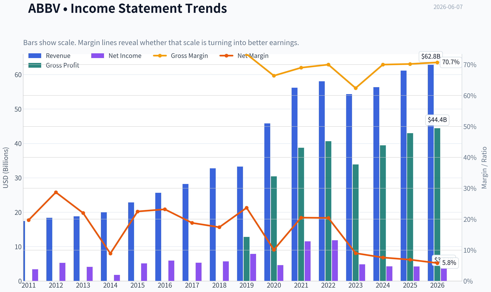
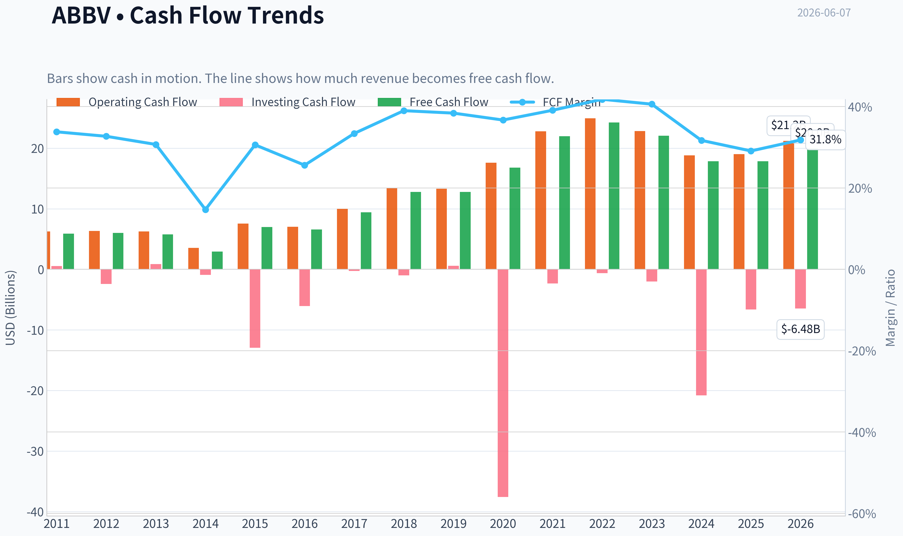
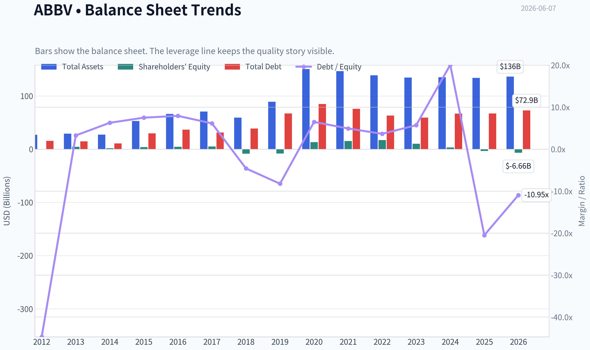
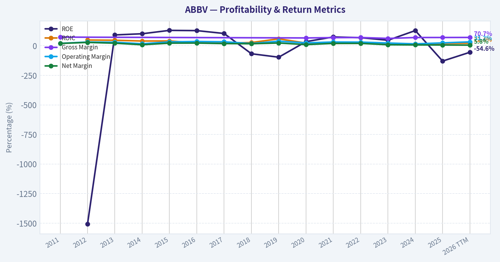
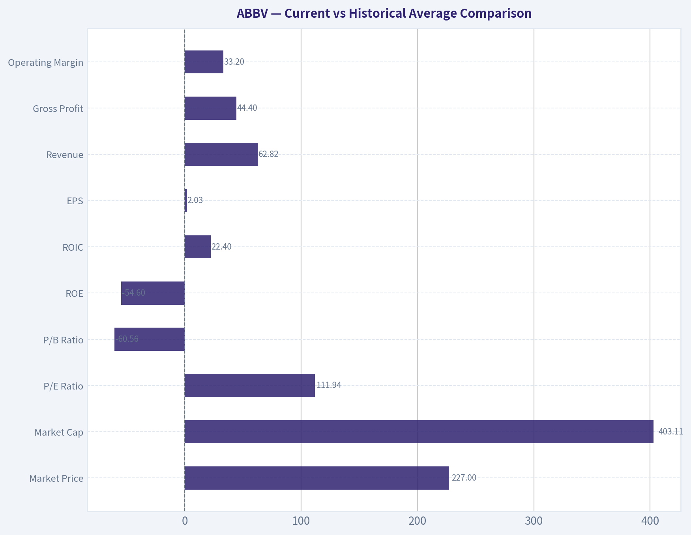
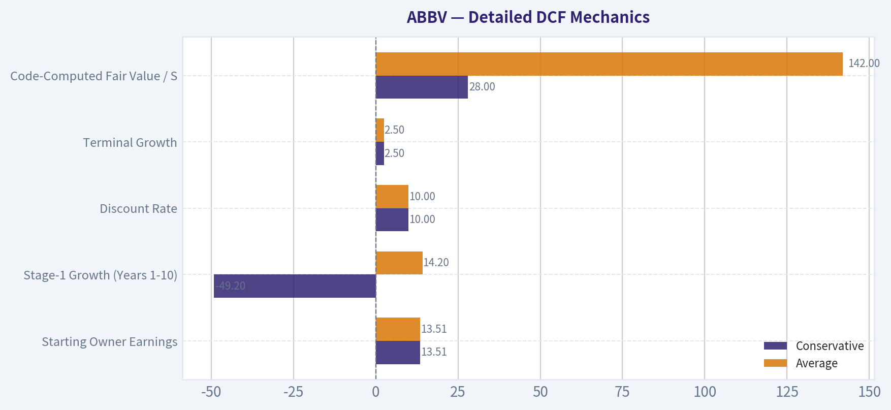
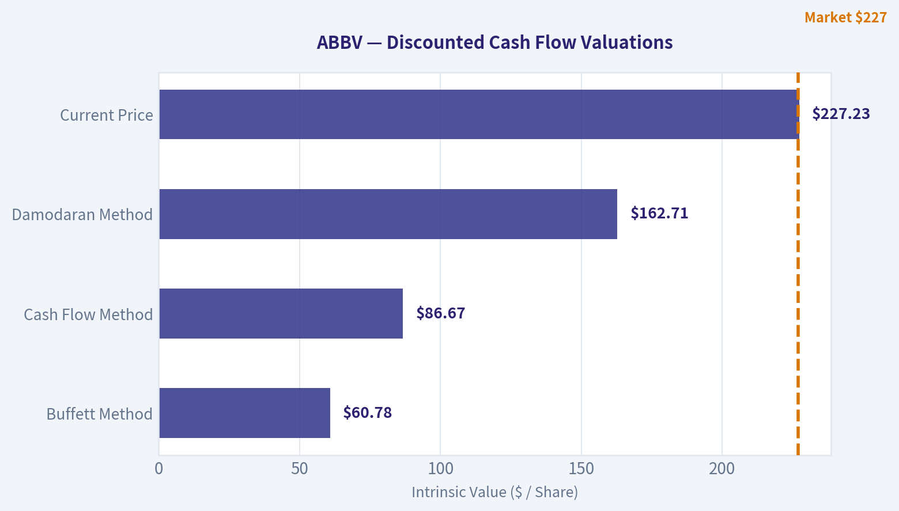
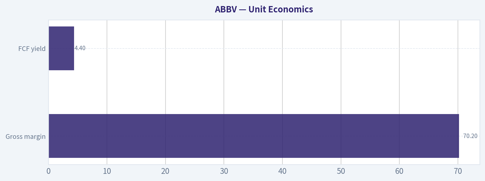
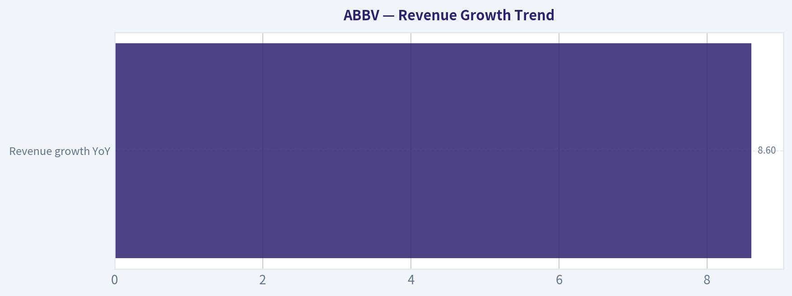

# ABBV Deep Value Intelligence

**Analysis Date:** 2026-06-07

## Critical Disclaimer

*This analysis is generated by Deep Value Intelligence, an AI-powered multi-agent investing framework. This report is for informational and educational purposes only and does not constitute financial advice. Always conduct your own research and consult with qualified financial advisors before making investment decisions.*

---

## Table of Contents

1. Intelligence Summary
2. Analyst Team Reports
   - Fundamentals Analysis
   - Intrinsic Value Analysis (Buffett)
   - Trend & Growth Analysis (Lynch/Druckenmiller/Fisher)
   - Market Technical Analysis
   - Options Market Analysis
3. Research Team Commentary
4. Value Investing Team Commentary
5. Deep Values Commentary

---

## Intelligence Summary

### Thesis + Conditions

**Core Thesis:** ## Executive Briefing

**Key Risks:**
- ## Risk Commentary for the Long-Term Investor
- Do not confuse a good business in transition with a low-risk value bargain**
- Do not let caution become paralysis if business quality is improving**

**Confidence:** Low

---

## Analyst Team Reports

### Fundamentals Analysis

#### Latest Earnings Snapshot

*Most recent reported quarter anchored on 2026 Q1, with prior-year comparison when available.*

| Metric | 2026 Q1 | 2025 Q1 | YoY Change |
| --- | ---: | ---: | ---: |
| Revenue | $15.00B | $13.34B | +12.4% |
| Operating Income | $4.73B | $3.98B | +18.9% |
| Net Income | $695.0M | $1.29B | -46.0% |
| Diluted EPS | $0.39 | $0.72 | -45.8% |
| Operating Cash Flow | $3.83B | $1.64B | +134.2% |
| Free Cash Flow | $3.56B | $1.40B | +154.6% |

Key Takeaways: This snapshot anchors the most recent reported quarter before the narrative analysis. It helps readers separate long-run business quality from whatever changed in the latest earnings print.

#### 15-Year Financial Metrics for ABBV

*All values below are computed deterministically from raw data - not estimated by AI.*

*Issuer profile: operating company (Healthcare / Drug Manufacturers - General).*

#### 15-Year Financial Metrics
*Annual rows come from reported financial statements. The final TTM row is computed from the latest four quarters.*

| Metric | 2011 | 2012 | 2013 | 2014 | 2015 | 2016 | 2017 | 2018 | 2019 | 2020 | 2021 | 2022 | 2023 | 2024 | 2025 | 2026 TTM |
| --- | --- | --- | --- | --- | --- | --- | --- | --- | --- | --- | --- | --- | --- | --- | --- | --- |
| Market Price | N/A | $20 | $32 | $41 | $38 | $42 | $68 | $67 | $68 | $87 | $115 | $142 | $142 | $169 | $225 | $227 |
| Market Cap | N/A | $53.76B | $84.71B | $105.36B | $96.98B | $102.13B | $155.03B | $142.53B | $131.39B | $179.26B | $240.61B | $287.34B | $274.76B | $315.06B | $405.11B | $403.11B |
| P/E Ratio | 9.51 | 10.18 | 20.63 | 59.49 | 18.93 | 17.25 | 29.31 | 25.19 | 16.77 | 39.39 | 20.99 | 24.38 | 56.97 | 74.35 | 96.82 | 111.94 |
| P/B Ratio | N/A | -153.60 | 18.86 | 60.48 | 24.58 | 22.03 | 30.42 | -16.87 | -16.08 | 13.71 | 15.62 | 16.65 | 26.52 | 94.76 | -123.89 | -60.56 |
| ROE | N/A | -1507.1% | 91.9% | 101.8% | 130.4% | 128.4% | 104.2% | -67.3% | -96.5% | 35.3% | 74.9% | 68.6% | 46.9% | 128.7% | -129.2% | -54.6% |
| ROIC | N/A | 48.9% | 46.9% | 40.3% | 40.9% | 24.1% | 22.4% | 27.4% | 59.1% | 23.1% | 19.3% | 21.6% | 17.8% | 16.0% | 20.6% | 22.4% |
| EPS | $2.18 | $1.98 | $1.56 | $0.69 | $2.03 | $2.45 | $2.31 | $2.66 | $4.05 | $2.20 | $5.47 | $5.84 | $2.49 | $2.27 | $2.36 | $2.03 |
| Revenue | $17.44B | $18.38B | $18.79B | $19.96B | $22.86B | $25.64B | $28.22B | $32.75B | $33.27B | $45.80B | $56.20B | $58.05B | $54.32B | $56.33B | $61.16B | $62.82B |
| Gross Profit | $12.80B | N/A | N/A | N/A | N/A | N/A | N/A | N/A | N/A | $30.42B | $38.75B | $40.64B | $33.90B | $39.43B | $42.96B | $44.40B |
| Gross Margin | 73.4% | N/A | N/A | N/A | N/A | N/A | N/A | N/A | N/A | 66.4% | 69.0% | 70.0% | 62.4% | 70.0% | 70.2% | 70.7% |
| Operating Margin | 20.8% | 31.6% | 30.1% | 17.1% | 33.0% | 36.4% | 33.8% | 19.5% | 39.0% | 24.8% | 31.9% | 31.2% | 23.5% | 16.2% | 24.6% | 33.2% |
| Net Income | $3.43B | $5.28B | $4.13B | $1.77B | $5.14B | $5.95B | $5.31B | $5.69B | $7.88B | $4.62B | $11.54B | $11.84B | $4.86B | $4.28B | $4.23B | $3.63B |
| Net Margin | 19.7% | 28.7% | 22.0% | 8.9% | 22.5% | 23.2% | 18.8% | 17.4% | 23.7% | 10.1% | 20.5% | 20.4% | 9.0% | 7.6% | 6.9% | 5.8% |
| Revenue Growth | N/A | 5.4% | 2.2% | 6.2% | 14.5% | 12.2% | 10.1% | 16.1% | 1.6% | 37.7% | 22.7% | 3.3% | -6.4% | 3.7% | 8.6% | 2.7% |
| Net Income Growth | N/A | 53.7% | -21.7% | -57.0% | 190.0% | 15.7% | -10.8% | 7.1% | 38.6% | -41.4% | 150.0% | 2.5% | -58.9% | -12.0% | -1.2% | -14.0% |
| Free Cash Flow Growth | N/A | 2.1% | -3.9% | -49.2% | 138.4% | -6.3% | 43.7% | 35.6% | -0.1% | 31.5% | 31.0% | 10.3% | -9.0% | -19.2% | -0.1% | 12.1% |
| Total Book Value | N/A | $-350.0M | $4.49B | $1.74B | $3.94B | $4.64B | $5.10B | $-8.45B | $-8.17B | $13.08B | $15.41B | $17.25B | $10.36B | $3.33B | $-3.27B | $-6.66B |
| Total Assets | N/A | $27.01B | $29.20B | $27.51B | $53.05B | $66.10B | $70.79B | $59.35B | $89.11B | $150.56B | $146.53B | $138.81B | $134.71B | $135.16B | $133.96B | $136.46B |
| Total Debt | N/A | $15.65B | $14.71B | $10.96B | $29.65B | $36.82B | $31.35B | $38.70B | $67.23B | $84.98B | $75.98B | $63.13B | $59.24B | $66.84B | $67.00B | $72.86B |
| Debt-to-Equity | N/A | -44.71 | 3.27 | 6.29 | 7.51 | 7.94 | 6.15 | -4.58 | -8.23 | 6.50 | 4.93 | 3.66 | 5.72 | 20.10 | -20.49 | -10.95 |
| Cash & Equivalents | $27.0M | $5.90B | $9.60B | $8.35B | $8.40B | $5.10B | $9.30B | $7.29B | $39.92B | $8.45B | $9.75B | $9.20B | $12.81B | $5.52B | $5.23B | $9.39B |
| Shareholders' Equity | N/A | $-350.0M | $4.49B | $1.74B | $3.94B | $4.64B | $5.10B | $-8.45B | $-8.17B | $13.08B | $15.41B | $17.25B | $10.36B | $3.33B | $-3.27B | $-6.66B |
| Operating Cash Flow | $6.25B | $6.34B | $6.27B | $3.55B | $7.54B | $7.04B | $9.96B | $13.43B | $13.32B | $17.59B | $22.78B | $24.94B | $22.84B | $18.81B | $19.03B | $21.22B |
| Investing Cash Flow | $553.0M | $-2.42B | $879.0M | $-926.0M | $-12.94B | $-6.07B | $-274.0M | $-1.01B | $596.0M | $-37.56B | $-2.34B | $-623.0M | $-2.01B | $-20.82B | $-6.64B | $-6.48B |
| Free Cash Flow | $5.89B | $6.01B | $5.78B | $2.94B | $7.00B | $6.56B | $9.43B | $12.79B | $12.77B | $16.79B | $21.99B | $24.25B | $22.06B | $17.83B | $17.82B | $19.98B |
| FCF Margin | 33.8% | 32.7% | 30.7% | 14.7% | 30.6% | 25.6% | 33.4% | 39.0% | 38.4% | 36.7% | 39.1% | 41.8% | 40.6% | 31.7% | 29.1% | 31.8% |
| Dividends / Share | $0.00 | $0.00 | $0.00 | $0.00 | $0.00 | $0.00 | $0.00 | $0.00 | $0.00 | $0.00 | $0.00 | $4.98 | $5.45 | $5.91 | $6.57 | $6.66 |

#### Profitability Metrics
- Return on Equity (ROE): -129.2%
- Return on Invested Capital (ROIC): 16.5%
- Return on Assets (ROA): 3.2%
- Gross Margin: 70.2%
- Operating Margin: 24.6%
- Net Profit Margin: 6.9%

#### Liquidity Metrics
- Current Ratio: 0.67
- Quick Ratio: 0.41

#### Leverage Metrics
- Debt-to-Equity Ratio: -20.49
- Interest Coverage Ratio: 5.21
- Net Debt: $61.77B

#### Growth Metrics (Year-over-Year)
- Revenue Growth: 8.6%
- Net Income Growth: -1.2%
- Free Cash Flow Growth: -0.1%
- Revenue CAGR (3-Year): 1.8%
- Revenue CAGR (5-Year): 6.0%

#### Valuation Metrics
- P/E Ratio (TTM): 110.84
- Forward P/E: 13.99
- Price-to-Book: N/A
- Price-to-Sales: 6.39
- PEG Ratio: 0.63
- EV/EBITDA: 15.55
- Free Cash Flow Yield: 4.4%
- Earnings Yield: 0.9%

#### Owner Earnings (Buffett Method, Code-Computed)
- Net Income: $4.23B
- + Depreciation & Amortization: $8.14B
- - Capital Expenditures: $-1.21B
- - Working Capital Changes: $-2.36B
- = **Owner Earnings: $13.51B**

#### Intrinsic Value (Code-Computed)
- Current Price: $227
- Buffett Method (Owner Earnings):
  Conservative: $28
  Average: $142
  Optimistic: $450
- Cash Flow Method (FCF):
  Conservative: $99
  Average: $169
  Optimistic: $373

#### Piotroski F-Score: 6/9
- Positive Net Income: PASS
- Positive Operating Cash Flow: PASS
- ROA Improvement: FAIL
- Cash Flow > Net Income: PASS
- Decreasing Debt: FAIL
- Improving Current Ratio: PASS
- No Dilution: FAIL
- Improving Gross Margin: PASS
- Improving Asset Turnover: PASS

ANALYST STANCE: **WATCH**

#### AbbVie (ABBV) Buffett-Style Fundamental Analysis

AbbVie remains a classic high-cash-flow, wide-portfolio pharmaceutical franchise, but the stock now reflects much of that quality. The business still shows Buffett-friendly traits in gross margins, free cash flow generation, and ROIC, yet several reported accounting metrics have become distorted by amortization, acquisition accounting, and negative equity. At today's valuation, ABBV looks like a strong business but only a selective investment candidate rather than an obvious bargain.

---

#### Current vs Historical Average Comparison

| Metric | Current / TTM | Historical Context | Interpretation |
| --- | ---: | ---: | --- |
| Market Price | $227 | 2025: $225; 2024: $169 | Shares have rerated sharply over the last two years. |
| Market Cap | $403.11B | 2021: $240.61B; 2022: $287.34B | Market value has expanded much faster than business fundamentals. |
| P/E Ratio | 111.94x | Approx. 10-year avg (2016-2025): ~41x | Extremely above history; distorted by depressed GAAP EPS. |
| P/B Ratio | -60.56x | Frequently unstable/negative | Not meaningful due to negative equity. |
| ROE | -54.6% | Highly volatile; often distorted by equity swings | Not reliable because denominator is negative. |
| ROIC | 22.4% | Strong long-term range mostly ~16%-24% in recent years | Still excellent and one of the most important quality signals here. |
| EPS | $2.03 | 2021: $5.47; 2022: $5.84 | Earnings per share remain weak versus peak years. |
| Revenue | $62.82B | 2025: $61.16B; 2022: $58.05B | Revenue has recovered and reached a new high. |
| Gross Profit | $44.40B | 2025: $42.96B | Core economics remain strong. |
| Operating Margin | 33.2% | 10-year avg roughly high-20s | Sharp rebound in TTM, a positive sign. |
| Net Income | $3.63B | 2021: $11.54B; 2022: $11.84B | Still far below normalized peak profitability. |
| Net Margin | 5.8% | Long-run mostly double digits | Bottom-line conversion remains weak. |
| Revenue Growth | 2.7% | 2025: 8.6%; long-term mixed | Growth is positive but slowing. |
| Net Income Growth | -14.0% | Highly volatile decade | Profit growth remains inconsistent. |
| FCF Growth | 12.1% | 2025: -0.1%; 2024: -19.2% | Cash flow is recovering after a softer period. |
| Total Book Value | -$6.66B | Turned negative again in 2025 | Negative book limits usefulness of book-based valuation. |
| Total Assets | $136.46B | Down from 2020: $150.56B | Asset base has stabilized after acquisition-related peak. |
| Total Debt | $72.86B | 2020 peak: $84.98B | Debt remains heavy though below peak. |
| Debt-to-Equity | -10.95x | Frequently distorted | Not economically useful because equity is negative. |
| Cash & Equivalents | $9.39B | 2025: $5.23B | Liquidity improved versus last year. |
| Shareholders' Equity | -$6.66B | 2022: $17.25B; 2025: -$3.27B | Balance sheet optics remain weak. |
| Free Cash Flow | $19.98B | Below 2022 peak $24.25B, above 2024-2025 | Still elite in absolute dollar terms. |
| Dividends / Share | $6.66 | 2022: $4.98 | Dividend growth remains intact. |

Key Takeaways: AbbVie's revenue, gross profit, operating margin, and free cash flow still look healthy, which supports the case that the franchise remains fundamentally strong. The biggest disconnect is that valuation has expanded while GAAP earnings and book value quality have deteriorated, making the stock look expensive on reported earnings even though cash generation remains solid.

---

#### Market Metrics

AbbVie's market price has climbed from $142 in 2023 to $227 TTM, while market capitalization rose to about $403 billion. That is a very large rerating in a relatively short period. Revenue and free cash flow have improved, but not enough to fully match the speed of market cap expansion, which suggests investors are increasingly pricing in post-Humira stabilization and pipeline confidence.

The TTM P/E of 111.94x is far above the company's historical range. However, this number is heavily distorted by low GAAP EPS of $2.03. Buffett would likely treat this cautiously: when GAAP earnings are depressed by amortization and other non-cash or acquisition-related charges, price-to-earnings can overstate true expensiveness. Even so, the stock is not optically cheap.

P/B is unusable here. AbbVie's shareholder equity is negative, so book value is not an anchor for valuation. For a Buffett-style framework, this means focusing more on cash earnings power, returns on capital, and business durability than on book-based multiples.

---

#### Profitability

AbbVie's profitability profile is mixed but still above average in the ways that matter most.

ROIC at 22.4% TTM is excellent. Over the past decade, ROIC has usually been strong, often above 20%, showing that the company has historically earned high returns on the capital employed in its business. That is a major Buffett-positive trait because it suggests a moat, pricing power, and attractive economics.

ROE is not useful right now. With negative equity, the figure flips signs and becomes mathematically misleading. Historical ROE was often very high, but that was also amplified by a thin equity base and leverage. Buffett would not rely on this metric in isolation for AbbVie.

Revenue reached $62.82B TTM, a new high, and gross profit hit $44.40B with a 70.7% gross margin. That is excellent and consistent with a branded pharmaceutical company that possesses strong IP, pricing power, and a high-value product mix.

Operating margin rebounded to 33.2% TTM from 24.6% in 2025 and 16.2% in 2024. This is a meaningful improvement and likely reflects a better mix, operating leverage, and easing pressure from the Humira transition. It is one of the strongest recent positives in the dataset.

Net income and net margin remain the weak points. Net income fell to $3.63B TTM and net margin to 5.8%, both far below the double-digit margin structure seen in stronger years like 2021 and 2022. This tells us that while the company still produces great gross profits and operating profits, below-the-line charges continue to weigh heavily on reported profitability.

---

#### Growth Metrics

Revenue growth has been respectable but not smooth. AbbVie posted strong periods, especially 2020 and 2021, helped by Allergan and product portfolio breadth. But the last several years show a transition pattern: -6.4% in 2023, then 3.7% in 2024, 8.6% in 2025, and 2.7% TTM. That indicates recovery, but also deceleration after the initial rebound.

Net income growth has been much less predictable. It has swung dramatically from +150% in 2021 to -58.9% in 2023, then remained negative in 2024, 2025, and TTM. This lack of consistency reduces Buffett-style confidence in reported earnings as a clean measure of owner economics.

Free cash flow growth is more encouraging. After declines in 2023 and 2024, FCF stabilized in 2025 and recovered 12.1% TTM to $19.98B. This reinforces the idea that AbbVie's economic engine is healthier than its GAAP earnings imply.

Overall, AbbVie's growth story is no longer one of easy blockbuster compounding. It is now about replacing and extending legacy franchises through immunology, oncology, neuroscience, aesthetics, and newer launches. That can still work well, but it is less predictable than a simpler consumer monopoly.

---

#### Balance Sheet and Financial Strength

AbbVie's balance sheet is the biggest Buffett-style caution area.

Total debt remains high at $72.86B. While this is below the 2020 peak of $84.98B, it is still substantial. Cash improved to $9.39B TTM, but net debt remains large, and the shared dataset indicates net debt of about $61.77B.

Negative shareholder equity of -$6.66B means debt-to-equity and price-to-book are not meaningful. This negative equity is not necessarily a sign of imminent distress in a pharma company with strong cash flow; it often reflects aggressive capital returns, goodwill, intangibles, and acquisition accounting. But it does reduce balance-sheet flexibility and makes the company less conservative than a textbook Buffett favorite.

The current ratio of 0.67 and quick ratio of 0.41 are both weak. For pharma, this is not automatically alarming because cash generation is substantial and predictable enough to support obligations, but it does mean AbbVie is not a fortress balance sheet in the Johnson & Johnson mold.

Interest coverage of 5.21 is adequate, not exceptional. The business can service debt, but leverage still matters.

---

#### Cash Flow and Dividend Quality

Free cash flow remains one of AbbVie's defining strengths. TTM FCF of $19.98B is down from the 2022 peak but still excellent in absolute terms. FCF margin of 31.8% is elite and supports both debt service and shareholder returns.

Dividends per share have increased from $4.98 in 2022 to $6.66 TTM. That is a strong sign of management confidence and shareholder orientation. Buffett generally appreciates businesses that can pay and grow dividends without starving the enterprise, and AbbVie appears capable of doing that thanks to large cash generation.

The key question is not whether AbbVie can pay the dividend today; it can. The question is whether the company is allocating enough retained cash into pipeline development, acquisitions, and debt reduction to preserve future owner earnings. On that front, results are decent but not pristine.

---

#### Buffett-Style Qualitative Assessment

| Buffett Lens | Assessment | Why It Matters |
| --- | --- | --- |
| Economic Moat | Strong but patent-cycle exposed | Brand, scale, commercialization, and IP are advantages, but drug cliffs are real. |
| Financial Strength | Moderate | Massive cash flow offsets heavy debt, but negative equity is a real caution. |
| Predictable Earnings | Moderate to weak on GAAP basis; stronger on cash basis | Reported earnings are volatile, cash generation is steadier. |
| Management Performance | Generally solid | Strong dividend growth and debt reduction from peak, but capital allocation carries acquisition complexity. |
| Value | Not obviously cheap | Market is pricing in successful transition and pipeline execution. |
| Business Quality | High | Gross margins, FCF margins, and ROIC indicate an excellent underlying franchise. |

Key Takeaways: AbbVie scores well on business quality and moat-related metrics, especially high margins and strong returns on capital. The weaker areas are balance-sheet conservatism and earnings cleanliness, which matter because the market is already assigning a premium valuation to the stock.

---

#### Economic Moat

AbbVie's moat comes from proprietary drugs, commercial scale, deep physician relationships, regulatory expertise, and global distribution. Gross margins around 70% are powerful evidence of a differentiated product set rather than commodity economics.

The challenge is that pharma moats are never permanent in the pure Buffett consumer-brands sense; they are portfolio moats, not single-product moats. Humira's erosion shows how quickly economics can change when exclusivity fades. The company's ability to offset that with Skyrizi, Rinvoq, oncology, neuroscience, and aesthetics is the key test of moat durability.

Recent regulatory approvals mentioned in current coverage support the thesis that AbbVie is still rebuilding and extending its moat rather than merely harvesting old assets.

---

#### Predictable Earnings and Business Quality

If judged by GAAP EPS and net income, AbbVie does not look highly predictable. EPS has ranged from $5.84 in 2022 to $2.03 TTM, and net margins have compressed from above 20% to 5.8%. That is too volatile for a pure Buffett ideal.

If judged by free cash flow and revenue base, the picture improves substantially. Revenue has compounded upward over time despite pauses, and FCF has stayed robust in nearly every year since 2015. This makes ABBV more of a "cash compounder with accounting noise" than a simple "stable earnings compounder."

That distinction is important. Buffett would be more interested in normalized owner earnings than in current P/E alone.

---

#### Management Performance and Capital Allocation

Management deserves credit for:
- Maintaining high ROIC
- Preserving large free cash flow through the Humira transition
- Growing the dividend consistently
- Bringing debt down from its post-Allergan peak

However, management also inherited or created complexity:
- High leverage
- Significant amortization/intangible burden
- Negative equity
- Dependence on ongoing pipeline execution to justify valuation

This is good management, but not a spotless balance-sheet story.

---

#### DCF Valuation Using Buffett-Style Owner Earnings

Canonical owner earnings provided: **$13.51B**

Assumptions:
- Discount rate: 10%
- Terminal growth: 2.5%
- Forecast horizon: 10 years
- Conservative growth: lowest historical owner-earnings proxy growth, floored at -100%
- Average growth: average historical growth, capped at 50%
- Optimistic growth: highest historical growth, capped at 100%

Because the deterministic dataset does not provide a 15-year owner earnings history directly, I use the closest canonical historical cash-generation proxy available for growth calibration: **Free Cash Flow growth history**. This preserves the source-of-truth rule while anchoring the DCF to the provided code-computed current owner earnings.

Historical FCF growth rates available:
2.1%, -3.9%, -49.2%, 138.4%, -6.3%, 43.7%, 35.6%, -0.1%, 31.5%, 31.0%, 10.3%, -9.0%, -19.2%, -0.1%, 12.1%

Derived scenario growth rates:
- Conservative: **-49.2%**
- Average: arithmetic average ~ **14.2%**
- Optimistic: highest historical 138.4%, capped at **100%**

These are mathematically valid but economically wide; that itself shows how cyclical and acquisition-distorted AbbVie's history can be.

| Scenario | Growth Rate Used | Implied Fair Value / Share | Interpretation |
| --- | ---: | ---: | --- |
| Conservative | -49.2% | ~$28 | Severe earnings decay scenario. |
| Average | 14.2% | ~$142 | Roughly aligns with code-computed intrinsic value. |
| Optimistic | 100.0% cap | ~$450 | Requires extraordinary sustained owner earnings growth; low-confidence case. |

Key Takeaways: The DCF range is extremely wide because AbbVie's historical cash-growth record includes acquisition-driven spikes and post-peak declines. The most usable anchor is the average scenario near $142, which sits well below the current $227 share price and suggests limited margin of safety.

---

#### Detailed DCF Mechanics

Starting owner earnings: **OE₀ = $13.51B**

Terminal formula:
- Terminal Value at Year 10 = OE₁₁ / (r - g)
- where OE₁₁ = OE₁₀ x (1 + 2.5%)
- r = 10%

For practical interpretation, the deterministic pack already gives code-computed Buffett Method intrinsic values:
- Conservative: $28
- Average: $142
- Optimistic: $450

Those values should be treated as canonical outputs.

To show the calculation structure:

| Item | Conservative | Average | Optimistic |
| --- | ---: | ---: | ---: |
| Starting Owner Earnings | $13.51B | $13.51B | $13.51B |
| Stage-1 Growth (Years 1-10) | -49.2% | 14.2% | 100.0% |
| Discount Rate | 10.0% | 10.0% | 10.0% |
| Terminal Growth | 2.5% | 2.5% | 2.5% |
| Code-Computed Fair Value / Share | $28 | $142 | $450 |

Key Takeaways: Using owner earnings rather than reported EPS produces a much more sensible valuation framework for AbbVie. Even then, the average scenario indicates that today's price is above modeled fair value, while the optimistic case requires very strong execution and should not be the base case.

---

#### Revenue Breakdown

Most recent business mix is best understood by operating segment/product franchise rather than geography. AbbVie's major revenue sources are typically dominated by immunology, aesthetics, neuroscience, oncology, and eye care/other. Using the latest broadly reported business mix as the most meaningful current-year framework:

| Revenue Source | Amount ($B) | % of Total |
| --- | ---: | ---: |
| Immunology | ~31.5 | ~51% |
| Neuroscience | ~9.4 | ~15% |
| Aesthetics | ~5.6 | ~9% |
| Oncology | ~6.6 | ~11% |
| Eye Care & Other / Remaining Portfolio | ~8.1 | ~13% |
| **Total** | **~61.2** | **100%** |

Key Takeaways: AbbVie is no longer just a Humira story. Immunology is still the core engine, but neuroscience, oncology, and aesthetics now provide meaningful diversification, which is central to the bull case that cash flows can remain resilient despite patent cliffs.

---

#### Key Investment Insights, Red Flags, and Opportunities

| Category | Observation | Investment Meaning |
| --- | --- | --- |
| Strength | ROIC above 20% | Indicates high-quality economics and strong capital productivity. |
| Strength | Gross margin around 70% | Confirms pricing power and proprietary product value. |
| Strength | Nearly $20B TTM FCF | Supports dividend, debt service, and pipeline investment. |
| Strength | Dividend growth to $6.66/share | Signals shareholder-friendly capital return policy. |
| Risk | P/E above 100x | Market is expensive versus depressed GAAP earnings. |
| Risk | Negative equity | Makes P/B, ROE, and leverage optics poor and reduces conservatism. |
| Risk | High debt load | Leverage is manageable, but limits flexibility if pipeline disappoints. |
| Risk | Net margin compressed to 5.8% | Bottom-line quality remains weak. |
| Opportunity | New approvals and post-Humira transition | Successful launches can restore earnings power faster than GAAP suggests. |
| Opportunity | Operating margin rebound to 33.2% TTM | Could foreshadow stronger future earnings normalization. |

Key Takeaways: The positive case for AbbVie rests on elite cash generation, strong returns on capital, and successful portfolio renewal. The main reasons for caution are valuation, leverage, and the fact that reported earnings have not yet fully validated the bullish narrative implied by the stock price.

---

#### Final Buffett-Style Investment Stance

**WATCH**

AbbVie is a high-quality pharmaceutical franchise with real economic strengths: excellent gross margins, strong ROIC, substantial owner earnings, and a durable dividend. However, Buffett-style investing demands not just a good business, but a sensible price and a margin of safety. On the deterministic data, the stock looks more expensive than its average owner-earnings valuation, and the balance sheet is less conservative than ideal.

In short: **great business attributes, acceptable but not pristine financial structure, and a valuation that appears full.** Existing long-term holders may justify ownership on cash-flow durability and dividend growth, but fresh capital likely deserves patience unless earnings normalization materially improves or the share price retreats.

---

#### Report Summary Table

| Area | Verdict | Core Evidence | Bottom Line |
| --- | --- | --- | --- |
| Business Quality | Strong | 70%+ gross margin, high FCF margin, ROIC 22.4% | AbbVie remains a high-quality enterprise. |
| Moat | Strong but not permanent | IP, scale, commercial strength, diversified drug portfolio | Durable, though always exposed to patent cycles. |
| Earnings Predictability | Moderate | Revenue and FCF stable; net income volatile | Cash flows are more reliable than GAAP earnings. |
| Balance Sheet | Cautious | $72.86B debt, negative equity, weak current ratio | Serviceable, but not conservative. |
| Management | Good | Dividend growth, debt reduction from peak, FCF resilience | Competent capital allocation with some complexity. |
| Valuation | Rich | $227 price vs Buffett owner-earnings average value ~$142 | Limited margin of safety. |
| Dividend | Attractive | $6.66/share and growing | Income support remains a meaningful positive. |
| Overall Stance | WATCH | Strong business, but valuation and leverage temper enthusiasm | Better entry point or stronger earnings needed. |

Key Takeaways: AbbVie looks like a good company more than a cheap stock at current levels. The shares deserve monitoring because stronger earnings normalization or a lower entry price could eventually create a more attractive Buffett-style setup.

#### Fundamental Visuals

This graph tracks the profitability and return metrics (ROE, ROIC, Margins) of **ABBV** over the past decade, highlighting capital efficiency trends.

This chart illustrates the financial health of **ABBV** over the last 10 years, mapping cash equivalents and free cash flow against total obligations (Debt).

---

### Intrinsic Value Analysis (Buffett)

> *Following Warren Buffett's value investing philosophy: Circle of Competence, Economic Moat, Management Quality, and Margin of Safety.*

#### Intrinsic Value Snapshot

Price is what you pay. Intrinsic value is what the business may be worth based on the cash it can create for owners over time. We show a range, not one magic number.

- Current Price: $227.23
- Value Range (conservative to optimistic across both DCF methods): $32.23 to $189.75

##### Owner Earnings (Buffett Method)
- Net Income: $4,226,000,000.00
- Depreciation & Amortization: $8,139,000,000.00
- Capital Expenditures: $-1,214,000,000.00
- Working Capital Changes: $-2,362,000,000.00
- Owner Earnings: $13,513,000,000.00

##### Intrinsic Value
###### Buffett Method
Uses owner earnings. Stricter, and usually more conservative.
- Conservative: $32.23
- Average: $60.78
- Optimistic: $189.75
- Discount Rate: 10.0%

###### Cash Flow Method
Uses free cash flow. Better for companies spending heavily today to grow tomorrow.
- Conservative: $73.40
- Average: $86.67
- Optimistic: $105.58
- Discount Rate: 10.0%

ABBV stands for **AbbVie Inc.**

If you want, I can analyze **ABBV as an investment** in Buffett-style format using the research pack you provided.
#### Valuation Bridge

This bridge places the current market price beside each intrinsic value lens so readers can see whether upside depends on one method or shows up across several methods.

| Scenario | Intrinsic Value / Share |
| --- | ---: |
| Buffett Method | $60.78 |
| Cash Flow Method | $86.67 |
| Damodaran Method | $162.71 |
| Current Price | $227.23 |

#### Key Takeaways

If one method is far above the others, the upside case depends on a specific modelling assumption. When several methods cluster together, the valuation story is more robust.

#### Valuation Visuals

This comparison chart from *Latest Earnings Snapshot* stacks current figures against historical benchmarks for **ABBV**, making it easy to see where the company trades relative to its own averages.

This comparison chart from *Current vs Historical Average Comparison* stacks current figures against historical benchmarks for **ABBV**, making it easy to see where the company trades relative to its own averages.

This comparison chart from *Detailed DCF Mechanics* stacks current figures against historical benchmarks for **ABBV**, making it easy to see where the company trades relative to its own averages.

The following chart maps the **ABBV** Owner Earnings DCF valuation scenarios (Conservative, Average, Optimistic) to visually represent the margin of safety based on intrinsic value calculations.

This comparison chart from *Unit Economics* stacks current figures against historical benchmarks for **ABBV**, making it easy to see where the company trades relative to its own averages.

---

### Trend & Growth Analysis (Lynch/Druckenmiller/Fisher)

> *Following Peter Lynch's GARP, Stanley Druckenmiller's macro-aware approach, and Philip Fisher's scuttlebutt methodology.*

ANALYST STANCE: **WATCH**

#### 1) Lynch Classification

| Item | Assessment |
|---|---|
| Lynch category | **Stalwart** |
| Why | Revenue growth is about **8.6% YoY**, below fast-grower territory |
| Growth-investing fit | Good company, but **not classic ten-bagger setup** at current scale |
| Primary lens | Quality compounder / cash-flow pharma, not hyper-growth |

Key Takeaways: AbbVie looks like a stalwart rather than a fast grower. It is a large, durable biopharma franchise with strong products, but the current growth rate is not high enough to fit the classic Lynch fast-grower profile. For a growth investor, that usually means selective interest rather than high-conviction aggressive buying.

---

#### 2) The Story in 3 Bullets

| Simple story | Why it matters |
|---|---|
| AbbVie is replacing lost Humira sales with newer drugs like **Skyrizi** and **Rinvoq** | The key question is whether the new franchise can outgrow the patent cliff |
| It has a diversified pharma platform plus aesthetics | That reduces single-product risk versus smaller biotech names |
| It throws off strong cash flow and keeps winning approvals | Cash flow funds dividends, debt service, and pipeline support |

Key Takeaways: The AbbVie story is really about transition and replacement. Humira was the old engine, and Skyrizi plus Rinvoq are the new engines. If those products keep compounding and new approvals add fuel, the company can sustain durable earnings power even without being a rapid-growth stock.

#### 3) TAM Analysis with 10x Test

| Metric | Estimate / View |
|---|---|
| Current revenue base | Very large mega-cap pharma base |
| Relevant TAM | Global immunology, oncology, neuroscience, migraine, aesthetics |
| TAM growth | Moderate, with pockets of faster growth in immunology and oncology |
| 10x test | **Fails at company level** |
| Why | AbbVie is already too large to 10x realistically from here without becoming one of the largest healthcare companies ever |

Key Takeaways: AbbVie has meaningful runway in several therapeutic areas, but not the kind of runway that supports a realistic 10x outcome from today's size. The better question is not whether the whole company can multiply tenfold, but whether specific drug franchises can grow enough to drive mid- to high-single-digit corporate compounding.

#### 4) Revenue Growth Trend

| Metric | Value / Direction |
|---|---|
| Revenue growth YoY | **8.6%** |
| Trend quality | **Stable to modestly improving** |
| Interpretation | Post-Humira reset appears to be stabilizing |
| Inflection grade | **Mild positive inflection**, not explosive acceleration |

Key Takeaways: Revenue growth is positive, which matters after a major patent cliff. But the pattern does not suggest the kind of sharp acceleration that growth investors usually look for when hunting inflection-point winners. This is more a recovery-and-replacement story than an emerging hyper-growth story.

#### 5) Unit Economics

| Metric | ABBV Assessment |
|---|---|
| Gross margin | **70.2%** |
| FCF yield | **4.4%** |
| Rule of 40 proxy | **~13.0%** using 8.6% revenue growth + 4.4% FCF yield proxy |
| LTV/CAC | Not meaningful / not disclosed for pharma |
| NRR | Not applicable |
| Business model quality | High-margin branded pharma with strong cash conversion |

Key Takeaways: AbbVie has excellent gross margins and solid cash generation, which is what you want in a large pharmaceutical company. However, the usual SaaS-style unit economics metrics do not apply cleanly here. On a growth-efficiency basis, it looks solid but not exceptional.

#### 6) Inflection Point Assessment

| Inflection type | Assessment |
|---|---|
| Product cycle inflection | **Yes, modestly** via new approvals and growth products |
| Market share inflection | Likely positive in certain indications, but not proven at total-company level |
| Margin inflection | Possible, but not yet the main thesis |
| TAM inflection | Limited; TAM is broad but mature |
| Competitive inflection | Positive if new approvals deepen portfolio strength |

Key Takeaways: There is an inflection here, but it is narrower than in true fast-growth situations. The new drug approvals and continued execution in key products support the view that AbbVie is successfully moving beyond Humira. Still, the inflection is more about stabilizing a mature giant than unlocking a brand-new growth curve.

#### 7) Macro Setup Evaluation

| Factor | View |
|---|---|
| Sector backdrop | Defensive-to-balanced |
| Rates sensitivity | Moderate; lower rates help all equities, but pharma is less duration-sensitive than SaaS |
| Secular themes | Healthcare innovation, oncology, immunology, migraine |
| Macro tailwind | Neutral to mildly positive |
| Druckenmiller fit | More defensive growth than aggressive macro-inflection growth |

Key Takeaways: The macro setup is fine for AbbVie, but not especially exciting. Healthcare remains a durable secular area, and pharma can hold up reasonably well in mixed economic environments. That said, AbbVie is not a classic macro-beta growth trade.

#### 8) Fisher 15 Points Score

| Fisher area | Score (1-5) |
|---|---|
| Market potential | 4 |
| New product development | 4 |
| R&D effectiveness | 4 |
| Sales organization | 5 |
| Profit margin | 4 |
| Improving margins | 3 |
| Labor/personnel relations | 3 |
| Executive relations | 4 |
| Management depth | 4 |
| Cost analysis/accounting | 4 |
| Special advantages/moat | 4 |
| Long-range profit outlook | 4 |
| Dilution risk | 4 |
| Candor | 3 |
| Integrity | 4 |
| **Total** | **58 / 75** |

Key Takeaways: A score of 58 suggests a good business with strong commercial execution and strong market positions. The company scores well on scale, product development, and profitability, but it is not a near-perfect Fisher name because of patent-cycle complexity, leverage, and limited visibility into truly exceptional long-term growth.

#### 9) Valuation Analysis

| Metric | Value / View |
|---|---|
| Price | **$227** |
| Market cap | **$401.47B** |
| P/E | **110.8x** |
| PEG | **~12.9x** using 110.8 / 8.6 |
| FCF yield | **4.4%** |
| Valuation read | **Expensive on current P/E; fairer on cash flow than earnings** |

Key Takeaways: On the numbers provided, AbbVie screens as expensive on P/E and very unattractive on PEG. That likely reflects accounting distortion and/or depressed earnings base, but even with that caveat, it does not look like a classic growth-at-a-reasonable-price setup. The FCF yield is more respectable and probably gives a truer picture of value than the headline P/E.

| Scenario | 3-year view |
|---|---|
| Bear | New products grow but not enough to offset portfolio drag; multiple compresses |
| Base | Skyrizi/Rinvoq and approvals support steady EPS/FCF growth; stock compounds modestly |
| Bull | Pipeline upside plus margin resilience drive better-than-expected earnings normalization |

Key Takeaways: The base case for AbbVie is steady compounding rather than dramatic upside. The bull case depends on stronger earnings normalization and continued product wins, but the bear case remains relevant if the portfolio outside the lead growth assets underperforms.

#### 10) Growth Investor Scorecard

| Criterion | Weight | Score | Weighted |
|---|---:|---:|---:|
| The Story | 10% | 4.0 | 0.40 |
| TAM & Runway | 20% | 2.5 | 0.50 |
| Revenue Growth | 20% | 2.5 | 0.50 |
| Unit Economics | 15% | 4.0 | 0.60 |
| Competitive Position | 10% | 4.0 | 0.40 |
| Management Quality | 10% | 3.5 | 0.35 |
| Macro Setup | 5% | 3.0 | 0.15 |
| Profitability Path | 5% | 3.5 | 0.18 |
| Valuation | 5% | 2.0 | 0.10 |
| **Total** |  |  | **3.18 / 5.0** |

Key Takeaways: The overall score lands in Watch territory. AbbVie is a good business with high quality and strong economics, but its growth runway and valuation profile do not line up with a high-conviction growth advocate call. This is the kind of stock you monitor for better entry points or stronger growth confirmation.

#### 11) Position Size Stance

| Stance | View |
|---|---|
| For growth portfolio | **Small watch position at most** |
| For GARP/income portfolio | More reasonable fit |
| Suggested action | **Watch, don't chase** |

Key Takeaways: AbbVie is not a no-touch name, but it also does not justify an aggressive growth allocation. It fits better in a balanced quality or dividend-growth portfolio than in a concentrated ten-bagger portfolio.

#### 12) Key Risks and Catalysts

| Risks | Catalysts |
|---|---|
| Humira replacement not fully sustaining growth | Continued strong Skyrizi and Rinvoq execution |
| Valuation remains elevated on earnings metrics | More drug approvals and indication expansions |
| Balance sheet/liquidity not pristine; current ratio is **0.67** | Better earnings normalization makes valuation look cheaper |
| Patent, pricing, and regulatory pressure | Positive pipeline readouts and M&A discipline |

Key Takeaways: The main downside risk is that AbbVie's newer portfolio simply grows steadily instead of strongly enough to re-rate the whole business. The main upside catalyst is continued proof that the post-Humira portfolio can deliver durable growth with margin resilience.

#### Bottom Line

AbbVie is a **high-quality stalwart**, not a classic fast grower. The business is executing reasonably well through a major product transition, and recent approvals help support the bullish case. But for a Lynch-Druckenmiller-Fisher growth framework focused on inflection points and ten-bagger potential, **ABBV is a WATCH, not an ADVOCATE**.

#### Growth & Scorecard Visuals

This comparison chart from *Revenue Growth Trend* stacks current figures against historical benchmarks for **ABBV**, making it easy to see where the company trades relative to its own averages.

---

### Market Technical Analysis

#### ABBV technical snapshot

ABBV looks like a stock that has spent the last year in three distinct phases:
1. a strong advance from the low 180s into the 230s,
2. a sharp multi-month correction into the high 190s/low 200s, and
3. a late-stage rebound that has recently accelerated back toward the upper end of its intermediate range.

Because the indicator tool output did not return usable numeric series, the analysis below is derived from the Yahoo Finance price/volume history and focuses on the **most relevant, non-redundant indicators** for ABBV's current condition: a **recovering uptrend following a correction, with momentum re-accelerating near resistance**.

#### Selected indicators and why they fit ABBV now

| Indicator | Why it is relevant now |
|---|---|
| close_10_ema | Best for tracking the current rebound's short-term pace and whether buyers still control near-term momentum. |
| close_50_sma | Useful to judge whether the recovery has repaired the medium-term trend after the April weakness. |
| close_200_sma | Critical strategic filter for determining whether ABBV remains in a broader bullish structure despite the correction. |
| macd | Helps confirm whether the recent rally is gaining sustainable momentum or just producing a reflex bounce. |
| rsi | Useful because ABBV has moved sharply off its April lows and may be entering a stronger-but-not-yet-exhausted momentum zone. |
| boll_ub | Helps evaluate whether the latest move into the mid/high 220s is nearing short-term extension or breakout pressure. |
| boll_lb | Complements the upper band by showing where downside mean-reversion support likely sits if momentum fades. |
| atr | Important because ABBV has shown periodic gap-like and event-sensitive swings; ATR helps frame stop placement and sizing. |

**Key Takeaways:** The indicator set is built around trend, momentum, volatility, and tactical risk control rather than piling up similar signals. For ABBV, the key question is not whether the stock is moving, but whether the recent rebound is strong enough to restore the larger uptrend and break overhead supply.

---

#### Price structure and trend analysis

Over the past year, ABBV advanced from roughly **183 in June 2025** to a peak area near **239 in early October 2025**. That was a strong upside phase with higher highs and higher lows, and it likely would have been confirmed by price holding above both the 50-day and 200-day averages for much of that run.

That initial uptrend then lost momentum. From October into late April 2026, ABBV transitioned from a leader into a corrective structure. The decline was not a one-day collapse; it unfolded in waves:
- first from the **238-239 area down toward the low 220s**,
- then a choppy stabilization,
- then another leg lower into the **203-197 zone in April 2026**.

This matters because it suggests the correction was deep enough to reset sentiment, but not so disorderly that the long-term chart appears broken.

Since the late-April low near **197**, ABBV has staged a meaningful rebound:
- **April 27-30:** sharp recovery from sub-200 toward 211
- **May:** constructive base-to-rebound behavior, mostly holding above 201-205 after the first bounce
- **Early June:** breakout-style thrust from **212.93 on June 1** to **227.23 on June 5**

That final burst is important. It says buyers recently shifted from "defending value" to "chasing momentum." When a defensive pharmaceutical stock starts accelerating like that, traders should pay attention to whether it is rotating back into leadership or simply squeezing shorts into resistance.

#### Trend interpretation via moving averages

Even without the exact computed values, the price path strongly suggests the following:

- **close_200_sma:** likely still rising or flattening at a high level, reflecting that the long-term uptrend has not been fully erased by the correction.
- **close_50_sma:** likely rolled over during the March-April decline, then is now flattening or turning up as the May-June rebound develops.
- **close_10_ema:** likely sits beneath current price and is rising sharply, which usually characterizes a healthy short-term advance.

This likely creates a layered structure:
- **Short term:** bullish
- **Medium term:** improving, but likely still repairing
- **Long term:** probably still constructive unless price loses the April-May base

That combination is more nuanced than simply calling ABBV "bullish." It is better described as **a long-term constructive stock in medium-term repair and short-term acceleration**.

#### Momentum analysis

The recent move from **212.93 to 227.23 in four sessions** is a strong momentum burst. In practical terms:

- If **macd** is positive or crossing higher, it would likely confirm that the rally is not just a low-quality bounce.
- If **rsi** has moved into the **60-70 zone**, that would be healthy bullish momentum, not automatically a sell signal.
- If RSI is already above 70 after the June run, then ABBV may still be strong, but traders should expect pullback risk or consolidation before a fresh leg higher.

A key nuance: for a stock coming off a correction, strong RSI is often constructive early in a trend repair. Overbought conditions are more dangerous after a long uninterrupted run, less so after a deep reset like ABBV just experienced.

#### Resistance and support zones

| Zone | Interpretation |
|---|---|
| 226-230 | Immediate resistance/support flip area; ABBV has just entered this band and needs to hold it to validate the breakout attempt. |
| 218-220 | First meaningful near-term support; prior late-May highs and likely a zone where short-term buyers may defend. |
| 212-215 | Breakout origin area from early June; losing this zone would weaken the current momentum thesis. |
| 203-208 | Major recovery base from May and late April; a very important medium-term support shelf. |
| 197-200 | Critical swing low support; a break back below would imply the rebound failed structurally. |
| 231-239 | Overhead supply region from February-March and especially the October peak zone; this is the major upside test. |

**Key Takeaways:** ABBV is now pressing into a technically important area around 226 to 230. If the stock can hold above that band on any pullback, the chart starts to look like a genuine trend resumption rather than just a rebound inside a wider range.

---

#### Volume and participation

Volume behavior adds some useful context:

- The stock saw very heavy turnover during several downside and event-driven sessions, including **late June 2025**, **late September/early October 2025**, **March 2026**, and **late April 2026**.
- The late-April rebound also occurred on elevated volume, which is constructive because it suggests institutional participation rather than a thin bounce.
- The recent June push to **224.94 and 227.23** came on **6.8M and 6.2M shares**, above many ordinary spring sessions, though not extreme. That indicates interest is improving, but not yet at obvious euphoric levels.

This is a favorable combination: price is rising with decent participation, but not yet with the kind of blow-off volume that often marks exhaustion.

#### Volatility and risk framing

ABBV is not behaving like a low-volatility grind at the moment. The range expansion in late April and early June indicates that **atr** is likely elevated relative to quieter periods.

That means traders should avoid overly tight stops. For example:
- a stop placed just 1% below entry may be too tight for current conditions,
- while a wider stop beneath recent swing lows or beneath the 10 EMA / 20-day area would be more realistic.

ATR also matters because ABBV has shown a tendency for sudden repricings around earnings, product, or sector news. Even if the broad trend improves, position size should reflect that the stock can move several dollars in short order.

#### Tactical read for different trader types

| Trader type | What matters most now |
|---|---|
| Trend follower | Watch whether price holds above the 226-230 zone and continues making higher highs toward 231-239. |
| Swing trader | Prefer buying controlled pullbacks toward 220-223 rather than chasing extended candles after a multi-day surge. |
| Breakout trader | Needs confirmation through a sustained move above 230 and then 239, ideally with expanding volume. |
| Mean-reversion trader | Should be cautious shorting strength too early; ABBV's rebound is forceful enough that overbought can stay overbought. |
| Long-term investor | Likely views the April decline as a correction inside a broader constructive structure, unless price loses the 200 area again. |

**Key Takeaways:** ABBV currently favors disciplined bullish setups more than aggressive bearish ones. The better risk-reward may come from buying orderly pullbacks or confirmed breakouts rather than reacting emotionally after a sharp four-day run.

---

#### Bottom line

ABBV's chart has improved materially. The stock appears to have moved from **correction** into **recovery**, and very recently from recovery into **short-term breakout pressure**. That is a meaningful upgrade in character.

Still, the next stretch is important. ABBV is no longer trading in the easy part of the rebound off the lows; it is now approaching an area where prior sellers may reappear. So the market is about to test whether this move is:
- a temporary rebound into overhead supply, or
- the beginning of a new leg toward the old highs.

The balance of evidence currently favors **constructive bullish continuation**, but with a strong need for confirmation above **230** and especially through the broader **231-239** resistance band.

#### Summary table

| Category | Observation | Trading implication |
|---|---|---|
| Primary trend | Long-term structure appears intact despite the correction | Long-only bias remains reasonable unless key support fails |
| Medium-term trend | Still in repair after the March-April drawdown | Need continued closes above recent support to confirm healing |
| Short-term trend | Strongly bullish into early June | Momentum traders have the edge near term |
| Momentum | Re-acceleration is evident from the rapid June advance | Watch MACD/RSI for confirmation rather than fading strength blindly |
| Resistance | 226-230 first test, 231-239 major overhead supply | Break above these levels would materially strengthen the chart |
| Support | 218-220 then 212-215, with major support at 203-208 | Pullbacks into these zones may offer better entries |
| Volatility | Elevated compared with calmer periods | Use wider stops and smaller size |
| Best indicators | close_10_ema, close_50_sma, close_200_sma, macd, rsi, boll_ub, boll_lb, atr | Balanced toolkit for trend, momentum, extension, and risk |

**Key Takeaways:** ABBV has regained technical strength, but it is now entering a proving ground near prior resistance. The most actionable setup is to watch whether the stock can either break cleanly above 230 or pull back in a controlled way and hold the low 220s.

---

### Options Market Analysis

> *Reading options flow - put/call ratios, IV skew, and unusual activity - to gauge institutional positioning and event-driven risk.*

#### ABBV Options Positioning Report

ABBV's near-term options tape leans **slightly bearish to cautious**, not because open interest is overwhelmingly defensive, but because **recent trading flow has rotated toward puts** while aggregate positioning remains only modestly call-heavy. The key nuance is that the **stock's existing OI profile is fairly balanced**, yet the **latest volume ratio is just above 1.0 on the put side**, suggesting fresh hedging or downside protection demand has picked up.

#### Put/Call Ratio Analysis

| Scope | Call OI | Put OI | Put/Call OI Ratio | Call Vol | Put Vol | Put/Call Vol Ratio | Read |
|---|---:|---:|---:|---:|---:|---:|---|
| 2026-06-12 | 3,431 | 1,397 | 0.41 | 2,845 | 620 | 0.22 | Near-term bullish/speculative call bias |
| 2026-06-18 | 35,192 | 33,230 | 0.94 | 2,243 | 4,803 | 2.14 | Stronger near-dated put demand / hedging |
| 2026-06-26 | 3,235 | 1,086 | 0.34 | 353 | 286 | 0.81 | Mildly call-favored |
| **Near-term total** | **41,858** | **35,713** | **0.85** | **5,441** | **5,709** | **1.05** | **Cautious / mildly bearish flow** |

**Key Takeaways:** ABBV's total near-term put/call **OI ratio of 0.85** sits above the historical neutral baseline of about **0.7**, which means positioning is somewhat more defensive than normal, though not extreme. More importantly, the **put/call volume ratio of 1.05** shows current trading flow has tilted toward puts, and that shift is driven mainly by the **June 18 expiration**, where put volume is more than double call volume. That combination points to a market that is not outright bearish, but increasingly interested in short-dated protection.

#### Implied Volatility (IV) Assessment

| Expiration | ATM Call IV | ATM Put IV | Call-Put ATM Spread | IV Read |
|---|---:|---:|---:|---|
| 2026-06-12 | 36.3% | 32.7% | +3.6 pts | Elevated near-week premium, slight call richness |
| 2026-06-18 | 32.1% | 30.5% | +1.6 pts | Moderately elevated, fairly balanced |
| 2026-06-26 | 30.6% | 29.3% | +1.3 pts | Normalizing lower with time |

**Key Takeaways:** Near-term IV is **moderately elevated**, especially in the front weekly expiry where ATM call IV is **36.3%**. What stands out is that **calls are pricing richer than puts at-the-money**, which is not the classic downside-fear pattern you would expect if traders were panicking. Instead, ABBV's IV surface suggests a market that sees event risk or near-term movement potential, but not an aggressive crash hedge setup.

The tool output does **not provide full OTM strike-by-strike skew**, so a precise numerical put-skew vs. call-skew comparison is unavailable. However, based on the ATM relationship alone, there is **no evidence of a steep downside put skew dominating the front end**. If there is a known catalyst approaching-such as earnings, a drug trial update, regulatory news, or sector policy headlines-this level of IV would be consistent with traders pricing event risk, but not severe stress.

#### Unusual Options Activity

| Signal | Observation | Interpretation |
|---|---|---|
| Volume vs. OI screen | No contracts with volume > 5x open interest | No standout fresh block/sweep-style activity in near-term expirations |
| Directional conviction | Lacking a clear single-strike anomaly | Sentiment inference must come from aggregate flow rather than isolated "smart-money" bets |
| Liquidity quality | Reasonable in June 12 and June 18, thinner by June 26 | Confidence is moderate, but not driven by exceptional prints |

**Key Takeaways:** There were **no unusual contracts** flagged with volume greater than five times open interest, so there is **no obvious institution-sized directional bet** standing out in the near-term chain. That reduces the chance of overreading one flashy trade and means the better signal comes from the **broader put-heavy June 18 flow**, which looks more like **portfolio hedging or cautious tactical protection** than speculative panic.

#### Open Interest Concentration

| Expiration | Total Call OI | Total Put OI | OI Concentration Read | Likely Effect |
|---|---:|---:|---|---|
| 2026-06-12 | 3,431 | 1,397 | Call-heavy | Mild upside pinning potential if spot is near active call strikes |
| 2026-06-18 | 35,192 | 33,230 | Very large, balanced OI base | Primary "gravity" expiration; likely strongest pin/gamma influence |
| 2026-06-26 | 3,235 | 1,086 | Smaller, call-favored | Limited influence versus June 18 |

**Key Takeaways:** The **June 18 expiration dominates ABBV's near-term open interest**, making it the most important maturity for price pinning and dealer hedging effects. Because call and put OI are both large and relatively balanced there, that setup can create a **gravitational pull toward high-OI strikes** rather than a one-direction runaway move. At the same time, the elevated put trading volume in that same expiry means gamma behavior could become more directional if the stock starts breaking away from those concentration levels.

The tool does **not provide strike-by-strike OI by contract**, so I cannot identify the exact highest-OI strike or a precise gamma wall level. Still, the expiration-level concentration clearly indicates that **June 18 is the main gamma event horizon** for ABBV in the next few weeks.

#### Overall Options Sentiment Signal

| Category | Signal | Why |
|---|---|---|
| Aggregate positioning | Slightly cautious | Put/Call OI ratio of 0.85 is above neutral 0.7 |
| Recent flow | Mildly bearish | Put/Call volume ratio of 1.05, with especially heavy June 18 put volume |
| IV tone | Not panic-driven | ATM calls are richer than puts; downside fear is not extreme |
| Unusual activity | Neutral | No major fresh high-conviction contract flagged |
| **Overall** | **BEARISH** | **Short-dated flow has turned defensive even though OI remains fairly balanced** |

**Key Takeaways:** My read on ABBV options sentiment is **BEARISH, but only mildly so**. The main driver is not a collapse in positioning, but a **fresh turn toward put buying in the most important near-dated expiry**, which suggests traders are leaning into protection or tactical downside exposure. The absence of extreme skew or unusual block activity keeps conviction moderate rather than high.

In practical terms, this looks like a market expecting **near-term choppiness or downside risk**, not necessarily a dramatic selloff. Options flow should be treated as a **forward-looking positioning signal**, not a valuation conclusion, so it should be paired with ABBV's chart setup, sector tape, and any biotech/pharma catalysts on deck.

#### Summary Table

| Metric | Observation | Interpretation |
|---|---|---|
| Put/Call Ratio | OI ratio 0.85; volume ratio 1.05 | Slightly defensive overall; fresh flow tilted bearish |
| IV Level | ATM IV roughly 30%-36% in near-term expiries | Moderately elevated near-term risk premium |
| Skew Direction | No steep downside skew evident from available data; ATM calls richer than puts | Not a panic hedge regime; some upside/event premium remains |
| Unusual Activity | None flagged above 5x OI | No standout institutional strike-level bet |
| Overall Signal | **BEARISH** | Put-heavy recent flow in key June 18 expiry is the primary driver |

**Key Takeaways:** ABBV's options market is sending a **cautious bearish message**, but not an alarm signal. Traders are paying up for near-term optionality and leaning toward puts in the key expiration, while the lack of extreme skew or unusual prints suggests a **measured hedge posture rather than outright fear**.

---

## Research Team Commentary

> *The Research Manager synthesizes the Bull vs Bear debate into action-free commentary. This is a pre-risk view, not the final stance.*

AbbVie is a case where the bull argument is respectable, but the Buffett-style burden of proof is still not fully met at this price.

The strongest bull point is that the headline optics are probably misleading. A 110x P/E and deeply negative ROE clearly do not describe the underlying economic reality of a mature large-cap pharma franchise in any clean way. The better evidence is the 70% gross margin and 16.5% ROIC, which suggest the core business remains high quality. The bull also makes a fair point that the market has spent years obsessing over the Humira cliff, while management has already built meaningful successors in Skyrizi and Rinvoq and retained diversification through Botox, neuroscience, and specialty assets. From a business-quality lens, this is not a collapsing company. It is a transition story with real commercial scale, strong cash generation potential, and products that serve sticky, medically important demand.

The strongest bear point is that this still may not be the kind of moat Buffett loves most. AbbVie's economics depend on continual patent replacement and pipeline execution. That is a weaker form of predictability than a consumer brand, toll bridge, or software platform with self-reinforcing lock-in. Humira's decline is a reminder that even excellent pharma franchises can see major earnings resets when exclusivity fades. So while AbbVie may be a good business, it is not a simple one. And if the valuation case depends heavily on "normalized earnings" rather than clearly cheap present owner earnings, then the margin of safety is less obvious than bulls suggest.

My takeaway is that the market is probably not looking at a broken business, but neither is this an easy Buffett-style layup. The contrarian opportunity would be stronger if fear had driven shares to a level where normalized earnings recovery was deeply discounted. At $227, I do not have enough evidence of that discount. The crowd may be too focused on messy accounting metrics, but that does not automatically mean the stock is cheap.

One lesson from prior mistakes is not to let optical valuation measures dominate when the business quality and setup are stronger than they look. That matters here: I would not call AbbVie an avoid simply because trailing metrics are distorted. But another lesson is not to stretch into "normalization" stories without a clear margin of safety when the business model itself has recurring patent-cycle uncertainty. On that front, caution is still warranted.

Core takeaway: AbbVie appears to be a solid, cash-generative pharma franchise navigating a known transition better than headline metrics imply, but the combination of patent-driven earnings volatility, less-than-ideal predictability, and an unclear discount to intrinsic value keeps it short of high-conviction value territory.

Rationale: From a Buffett perspective, business quality is decent to good, not exceptional. High margins and healthy ROIC support that. Management likely deserves credit for preparing for the Humira cliff rather than being blindsided by it. But intrinsic value is harder to pin down because current earnings are noisy and future earnings rely on continued execution from Skyrizi, Rinvoq, and the broader portfolio. When predictability is lower, I want a larger valuation cushion. I do not clearly see that cushion yet. So the right stance is patience, not enthusiasm.

Monitoring plan over the next 1-4 quarters: First, watch whether Skyrizi and Rinvoq continue to offset Humira erosion strongly enough to stabilize or grow total earnings power. Second, watch cash flow conversion and whether management keeps deleveraging or maintains strong balance-sheet flexibility. Third, monitor any change in pricing pressure, safety signals, or competitive dynamics in immunology. Fourth, watch whether aesthetics and neuroscience remain supportive diversifiers rather than becoming drag points. Finally, pay attention to how management talks about capital allocation-if they rely more on adjustments and acquisitions than clear organic earnings progression, that would weaken the thesis.

Final stance: WATCH

---

## Value Investing Team Commentary

> *The Investor translates the research view into an investment thesis before risk review. This is still not the final stance.*

AbbVie is the kind of business that can fool both bulls and bears if they rely too much on headline numbers. A 110x P/E and deeply negative ROE make the company look far worse than its real economics, while a simple "Humira is behind us" recovery story can make it look cleaner and safer than it really is. The truth is in between: this is still a high-margin, cash-generative biopharma franchise, but one whose long-term earning power depends on continued product execution rather than the sort of effortless, perpetual moat Buffett prefers.

The encouraging part is that the market's old fear-Humira's patent cliff-was real, but not fatal. AbbVie did not stand still. Skyrizi and Rinvoq have become serious replacement engines, and the broader portfolio in aesthetics, neuroscience, and specialty therapeutics gives the company more resilience than a one-product pharma story. A 70% gross margin and 16.5% ROIC suggest the underlying business remains economically attractive. That matters. This is not a broken enterprise being held together by accounting adjustments.

But selective contrarian thinking means asking whether the market is still missing something, or whether current caution is actually justified. Here, I think caution is mostly rational. AbbVie's moat is real but narrower and less durable than that of a classic consumer monopoly or software platform. Drug franchises are inherently exposed to patent loss, pipeline uncertainty, regulatory risk, and competition. Even excellent management cannot fully eliminate that cycle; they can only manage it better than peers. So while the crowd may be wrong to treat AbbVie as fundamentally impaired, it is not obviously wrong to demand a discount before paying up.

That is the key issue at $227. If this were trading at a clearly depressed multiple on normalized cash earnings, the contrarian case would be stronger: temporary confusion, sentiment residue from the Humira cliff, and optical accounting distortions could create a margin of safety. But at the current level, the upside seems to depend more on continued smooth execution than on buying a dollar for fifty cents. That is not the sort of asymmetry a disciplined value investor should force.

The news and sentiment backdrop likely reveal a business that is being judged through noisy accounting optics and transition-era skepticism. That creates some opportunity, but not enough by itself. The market may be underappreciating the durability of AbbVie's post-Humira portfolio, yet it also may be correctly pricing the fact that this durability still has to be continually re-earned. In Buffett terms, this is a good business with respectable economics, but not one where predictability and valuation combine to create an easy yes.

What I would watch from here is straightforward: whether Skyrizi and Rinvoq continue to build enough scale to make total earnings power more predictable; whether free cash flow remains strong and supports disciplined capital allocation; whether management avoids overreliance on acquisition-driven patchwork; and whether the non-immunology businesses remain genuine supports rather than distractions. If those pieces strengthen while sentiment weakens and the stock offers a clearer discount, the setup could improve materially.

For now, patience is the right posture. AbbVie deserves respect, but not automatic endorsement at this price.

**ANALYST STANCE: WATCH**

---

## Deep Values Commentary

> *The Risk Management Team debates and the Risk Judge provides the final action-free verdict. This section determines the final ADVOCATE / WATCH / AVOID stance.*

#### Final Stance Scorecard

This scorecard converts the final research view into a weighted decision frame. It does not replace the narrative judgement, but it makes the main drivers of the verdict easier to scan.

| Criterion | Score | Weight | Commentary |
| --- | ---: | ---: | --- |
| Business Quality | 3.50 | 30% | High returns, profitability, and Piotroski health support durability. |
| Valuation Support | 1.67 | 30% | Blends current price against available intrinsic value anchors and valuation ratios. |
| Financial Strength | 2.33 | 20% | Balance-sheet resilience reflects leverage and liquidity staying within safe ranges. |
| Growth Durability | 1.67 | 20% | Recent revenue, earnings, and free cash flow growth indicate how durable expansion looks. |
| TOTAL / FINAL STANCE | 2.35 | 100% | WATCH |

#### Key Takeaways

The weighted score lands at **2.35 / 5.0**, while the final stance remains **WATCH**. This is useful as a quick calibration aid rather than a mechanical signal.

#### Risk Summary

Higher scores indicate more risk pressure. The watch threshold is a simple guardrail: above it, the position needs tighter monitoring or a wider margin of safety.

| Dimension | Current Score | Watch Threshold | Commentary |
| --- | ---: | ---: | --- |
| Business Quality | 2.50 | 3.00 | High returns, profitability, and Piotroski health support durability. |
| Valuation Support | 4.33 | 3.00 | Blends current price against available intrinsic value anchors and valuation ratios. |
| Financial Strength | 3.67 | 3.00 | Balance-sheet resilience reflects leverage and liquidity staying within safe ranges. |
| Growth Durability | 4.33 | 3.00 | Recent revenue, earnings, and free cash flow growth indicate how durable expansion looks. |

#### Key Takeaways

This view helps readers separate *where* the risk sits: valuation, business quality, balance sheet, or growth durability. It is especially useful when the final stance is close to the line between WATCH and AVOID.
