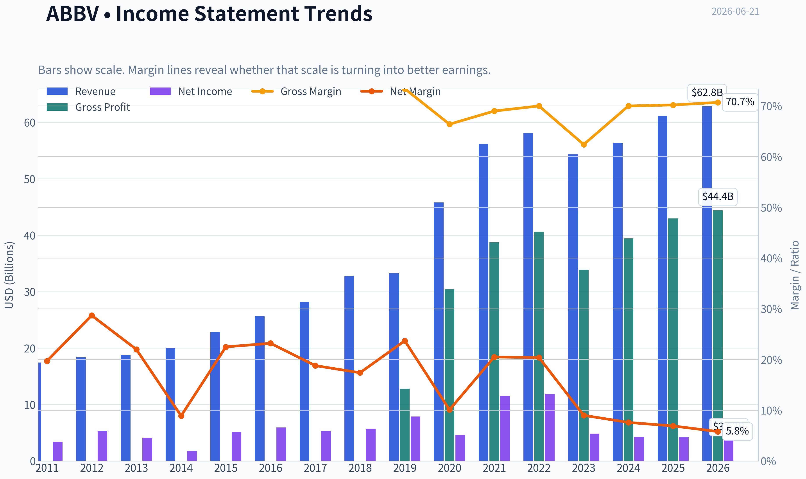
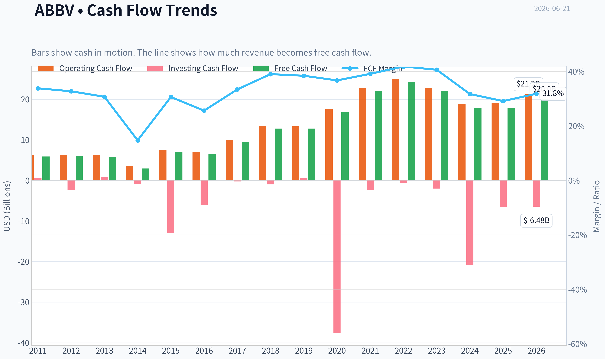
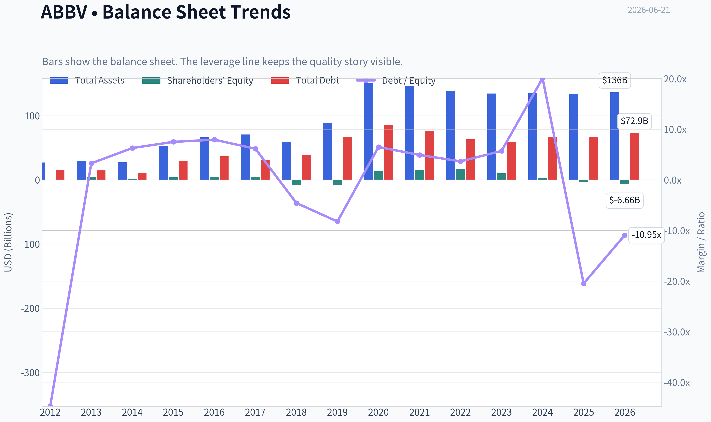
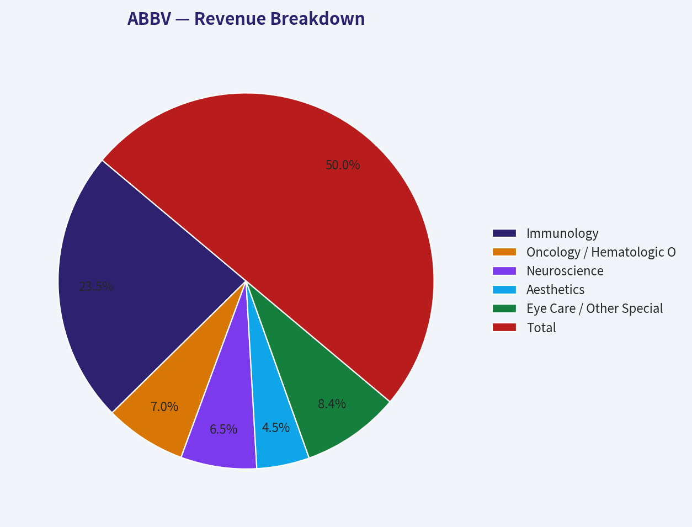
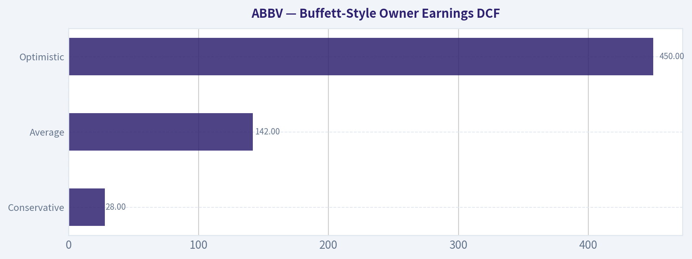
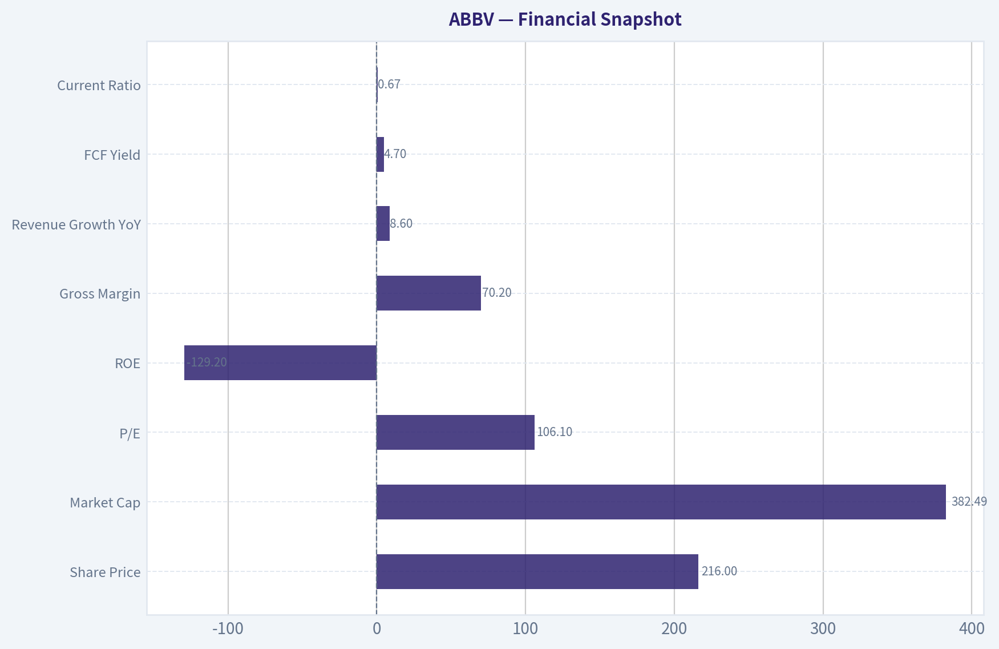
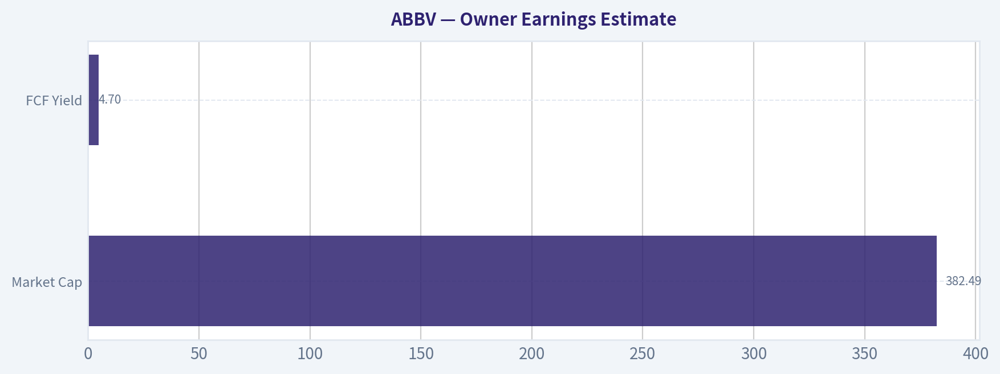

# ABBV Deep Value Intelligence

**Analysis Date:** 2026-06-21

## Critical Disclaimer

*This analysis is generated by Deep Value Intelligence, an AI-powered multi-agent investing framework. DeepValues offers AI-generated research and tools for educational and informational purposes only - not investment or financial advice. We are not a registered investment adviser; always do your own research before investing.*

---

## Table of Contents

1. Intelligence Summary
2. Analyst Team Reports
   - Fundamentals Analysis
   - Intrinsic Value Analysis (Buffett)
   - Trend & Growth Analysis (Lynch/Druckenmiller/Fisher)
   - Market Technical Analysis
   - Options Market Analysis
3. Research Team Commentary
4. Value Investing Team Commentary
5. Deep Values Commentary

---

## Intelligence Summary

### Thesis + Conditions

**Core Thesis:** ## Executive Briefing

**Key Risks:**
- But Buffett-style risk is about **durability of future cash flows**, not just strength of current cash flows. AbbVie still operates in a moat structure that must be **replenished repeatedly** through pipeline execution, exclusivity, and capital allocation. At **~4.7% FCF yield**, the price looks closer to **fair** than clearly protected. The business is attractive enough to follow closely, and selective exposure is understandable, but the **margin of safety is not yet wide enough** for a full-throated endorsement.
- ### Risky Analyst's strongest points
- Waiting for a much cheaper price may risk **missing the rerating** if the market recognizes durability faster than expected.

**Confidence:** Medium

---

## Analyst Team Reports

### Fundamentals Analysis

#### Latest Earnings Snapshot

*Most recent reported quarter anchored on 2026 Q1, with prior-year comparison when available.*

| Metric | 2026 Q1 | 2025 Q1 | YoY Change |
| --- | ---: | ---: | ---: |
| Revenue | $15.00B | $13.34B | +12.4% |
| Operating Income | $4.73B | $3.98B | +18.9% |
| Net Income | $695.0M | $1.29B | -46.0% |
| Diluted EPS | $0.39 | $0.72 | -45.8% |
| Operating Cash Flow | $3.83B | $1.64B | +134.2% |
| Free Cash Flow | $3.56B | $1.40B | +154.6% |

Key Takeaways: This snapshot anchors the most recent reported quarter before the narrative analysis. It helps readers separate long-run business quality from whatever changed in the latest earnings print.

#### 15-Year Financial Metrics for ABBV

*All values below are computed deterministically from raw data - not estimated by AI.*

*Issuer profile: operating company (Healthcare / Drug Manufacturers - General).*

#### 15-Year Financial Metrics
*Annual rows come from reported financial statements. The final TTM row is computed from the latest four quarters.*

| Metric | 2011 | 2012 | 2013 | 2014 | 2015 | 2016 | 2017 | 2018 | 2019 | 2020 | 2021 | 2022 | 2023 | 2024 | 2025 | 2026 TTM |
| --- | --- | --- | --- | --- | --- | --- | --- | --- | --- | --- | --- | --- | --- | --- | --- | --- |
| Market Price | N/A | $20 | $32 | $41 | $38 | $42 | $68 | $67 | $68 | $87 | $115 | $142 | $142 | $169 | $225 | $216 |
| Market Cap | N/A | $53.76B | $84.71B | $105.36B | $96.98B | $102.13B | $155.03B | $142.53B | $131.39B | $179.26B | $240.61B | $287.34B | $274.76B | $315.06B | $405.11B | $384.05B |
| P/E Ratio | N/A | 10.18 | 20.63 | 59.49 | 18.93 | 17.25 | 29.31 | 25.19 | 16.77 | 39.39 | 20.99 | 24.38 | 56.97 | 74.35 | 96.82 | 106.65 |
| P/B Ratio | N/A | -153.60 | 18.86 | 60.48 | 24.58 | 22.03 | 30.42 | -16.87 | -16.08 | 13.71 | 15.62 | 16.65 | 26.52 | 94.76 | -123.89 | -57.70 |
| ROE | N/A | -1507.1% | 91.9% | 101.8% | 130.4% | 128.4% | 104.2% | -67.3% | -96.5% | 35.3% | 74.9% | 68.6% | 46.9% | 128.7% | -129.2% | -54.6% |
| ROIC | N/A | 48.9% | 46.9% | 40.3% | 40.9% | 24.1% | 22.4% | 27.4% | 59.1% | 23.1% | 19.3% | 21.6% | 17.8% | 16.0% | 20.6% | 22.4% |
| EPS | $2.18 | $1.98 | $1.56 | $0.69 | $2.03 | $2.45 | $2.31 | $2.66 | $4.05 | $2.20 | $5.47 | $5.84 | $2.49 | $2.27 | $2.36 | $2.03 |
| Revenue | $17.44B | $18.38B | $18.79B | $19.96B | $22.86B | $25.64B | $28.22B | $32.75B | $33.27B | $45.80B | $56.20B | $58.05B | $54.32B | $56.33B | $61.16B | $62.82B |
| Gross Profit | $12.80B | N/A | N/A | N/A | N/A | N/A | N/A | N/A | N/A | $30.42B | $38.75B | $40.64B | $33.90B | $39.43B | $42.96B | $44.40B |
| Gross Margin | 73.4% | N/A | N/A | N/A | N/A | N/A | N/A | N/A | N/A | 66.4% | 69.0% | 70.0% | 62.4% | 70.0% | 70.2% | 70.7% |
| Operating Margin | 20.8% | 31.6% | 30.1% | 17.1% | 33.0% | 36.4% | 33.8% | 19.5% | 39.0% | 24.8% | 31.9% | 31.2% | 23.5% | 16.2% | 24.6% | 33.2% |
| Net Income | $3.43B | $5.28B | $4.13B | $1.77B | $5.14B | $5.95B | $5.31B | $5.69B | $7.88B | $4.62B | $11.54B | $11.84B | $4.86B | $4.28B | $4.23B | $3.63B |
| Net Margin | 19.7% | 28.7% | 22.0% | 8.9% | 22.5% | 23.2% | 18.8% | 17.4% | 23.7% | 10.1% | 20.5% | 20.4% | 9.0% | 7.6% | 6.9% | 5.8% |
| Revenue Growth | N/A | 5.4% | 2.2% | 6.2% | 14.5% | 12.2% | 10.1% | 16.1% | 1.6% | 37.7% | 22.7% | 3.3% | -6.4% | 3.7% | 8.6% | 2.7% |
| Net Income Growth | N/A | 53.7% | -21.7% | -57.0% | 190.0% | 15.7% | -10.8% | 7.1% | 38.6% | -41.4% | 150.0% | 2.5% | -58.9% | -12.0% | -1.2% | -14.0% |
| Free Cash Flow Growth | N/A | 2.1% | -3.9% | -49.2% | 138.4% | -6.3% | 43.7% | 35.6% | -0.1% | 31.5% | 31.0% | 10.3% | -9.0% | -19.2% | -0.1% | 12.1% |
| Total Book Value | N/A | $-350.0M | $4.49B | $1.74B | $3.94B | $4.64B | $5.10B | $-8.45B | $-8.17B | $13.08B | $15.41B | $17.25B | $10.36B | $3.33B | $-3.27B | $-6.66B |
| Total Assets | N/A | $27.01B | $29.20B | $27.51B | $53.05B | $66.10B | $70.79B | $59.35B | $89.11B | $150.56B | $146.53B | $138.81B | $134.71B | $135.16B | $133.96B | $136.46B |
| Total Debt | N/A | $15.65B | $14.71B | $10.96B | $29.65B | $36.82B | $31.35B | $38.70B | $67.23B | $84.98B | $75.98B | $63.13B | $59.24B | $66.84B | $67.00B | $72.86B |
| Debt-to-Equity | N/A | -44.71 | 3.27 | 6.29 | 7.51 | 7.94 | 6.15 | -4.58 | -8.23 | 6.50 | 4.93 | 3.66 | 5.72 | 20.10 | -20.49 | -10.95 |
| Cash & Equivalents | $27.0M | $5.90B | $9.60B | $8.35B | $8.40B | $5.10B | $9.30B | $7.29B | $39.92B | $8.45B | $9.75B | $9.20B | $12.81B | $5.52B | $5.23B | $9.39B |
| Shareholders' Equity | N/A | $-350.0M | $4.49B | $1.74B | $3.94B | $4.64B | $5.10B | $-8.45B | $-8.17B | $13.08B | $15.41B | $17.25B | $10.36B | $3.33B | $-3.27B | $-6.66B |
| Operating Cash Flow | $6.25B | $6.34B | $6.27B | $3.55B | $7.54B | $7.04B | $9.96B | $13.43B | $13.32B | $17.59B | $22.78B | $24.94B | $22.84B | $18.81B | $19.03B | $21.22B |
| Investing Cash Flow | $553.0M | $-2.42B | $879.0M | $-926.0M | $-12.94B | $-6.07B | $-274.0M | $-1.01B | $596.0M | $-37.56B | $-2.34B | $-623.0M | $-2.01B | $-20.82B | $-6.64B | $-6.48B |
| Free Cash Flow | $5.89B | $6.01B | $5.78B | $2.94B | $7.00B | $6.56B | $9.43B | $12.79B | $12.77B | $16.79B | $21.99B | $24.25B | $22.06B | $17.83B | $17.82B | $19.98B |
| FCF Margin | 33.8% | 32.7% | 30.7% | 14.7% | 30.6% | 25.6% | 33.4% | 39.0% | 38.4% | 36.7% | 39.1% | 41.8% | 40.6% | 31.7% | 29.1% | 31.8% |
| Dividends / Share | $0.00 | $0.00 | $0.00 | $0.00 | $0.00 | $0.00 | $0.00 | $0.00 | $0.00 | $0.00 | $0.00 | $4.98 | $5.45 | $5.91 | $6.57 | $6.66 |

#### Profitability Metrics
- Return on Equity (ROE): -129.2%
- Return on Invested Capital (ROIC): 16.5%
- Return on Assets (ROA): 3.2%
- Gross Margin: 70.2%
- Operating Margin: 24.6%
- Net Profit Margin: 6.9%

#### Liquidity Metrics
- Current Ratio: 0.67
- Quick Ratio: 0.41

#### Leverage Metrics
- Debt-to-Equity Ratio: -20.49
- Interest Coverage Ratio: 5.21
- Net Debt: $61.77B

#### Growth Metrics (Year-over-Year)
- Revenue Growth: 8.6%
- Net Income Growth: -1.2%
- Free Cash Flow Growth: -0.1%
- Revenue CAGR (3-Year): 1.8%
- Revenue CAGR (5-Year): 6.0%

#### Valuation Metrics
- P/E Ratio (TTM): 106.12
- Forward P/E: 13.32
- Price-to-Book: N/A
- Price-to-Sales: 6.09
- PEG Ratio: 0.60
- EV/EBITDA: 14.91
- Free Cash Flow Yield: 4.7%
- Earnings Yield: 0.9%

#### Owner Earnings (Buffett Method, Code-Computed)
- Net Income: $4.23B
- + Depreciation & Amortization: $8.14B
- - Capital Expenditures: $-1.21B
- - Working Capital Changes: $-2.36B
- = **Owner Earnings: $13.51B**

#### Intrinsic Value (Code-Computed)
- Current Price: $216
- Buffett Method (Owner Earnings):
  Conservative: $28
  Average: $142
  Optimistic: $450
- Cash Flow Method (FCF):
  Conservative: $99
  Average: $169
  Optimistic: $373

#### Piotroski F-Score: 6/9
- Positive Net Income: PASS
- Positive Operating Cash Flow: PASS
- ROA Improvement: FAIL
- Cash Flow > Net Income: PASS
- Decreasing Debt: FAIL
- Improving Current Ratio: PASS
- No Dilution: FAIL
- Improving Gross Margin: PASS
- Improving Asset Turnover: PASS

ANALYST STANCE: **WATCH**

#### AbbVie (ABBV) Buffett-Style Fundamental Analysis

AbbVie remains a high-quality cash-generative pharmaceutical franchise with a clear economic moat in immunology, growing exposure to oncology and aesthetics/neuroscience, and a long record of strong free cash flow conversion. However, the current setup is complicated by three issues that Buffett-style investors should not ignore: very high headline P/E, negative book value that makes ROE and P/B unreliable or distorted, and a balance sheet still carrying heavy debt from years of acquisition-led capital allocation. The business quality is materially better than the accounting optics, but the valuation is no longer obviously cheap at $216.

---

#### Current vs Historical Average Comparison

| Metric | Current / TTM | Historical Context (period shown) | Interpretation |
| --- | ---: | ---: | --- |
| Market Price | $216 | Range shown: $20 to $225 | Shares are near the top of their historical range, indicating strong market confidence despite earnings compression. |
| Market Cap | $384.05B | Range shown: $53.76B to $405.11B | AbbVie has become a mega-cap healthcare compounder; scale now reflects mature expectations rather than undiscovered value. |
| P/E Ratio | 106.65 | History mostly far lower; prior elevated years included 74.35 and 96.82 | Current P/E is extremely high relative to most of the period, driven more by depressed GAAP earnings than explosive price expansion alone. |
| P/B Ratio | -57.70 | Frequently distorted or negative when equity is negative | Not economically useful at present because book value is negative; this metric should not drive valuation decisions here. |
| ROE | -54.6% TTM / -129.2% latest annual snapshot in pack | Highly erratic due to negative equity years | ROE is not a valid quality signal while equity is negative. |
| ROIC | 22.4% TTM | Strong long-term range, mostly mid-teens to high-double-digits | Still excellent and far more meaningful than ROE; signals resilient underlying economics. |
| Revenue | $62.82B | Rose from $17.44B in 2011 | Long-run revenue base has expanded substantially, though growth is less linear after Humira erosion. |
| Gross Margin | 70.7% TTM | Usually very high; 62.4% to 73.4% in disclosed years | Margin structure remains consistent with a premium branded pharma franchise. |
| Operating Margin | 33.2% TTM | Long history mostly in 20s to high 30s | Current margin is above the recent annual figure and toward the stronger end of history. |
| Net Margin | 5.8% TTM | Historically often mid-teens to 20%+ | Net margin is weak versus history, showing below-the-line pressure, amortization, and acquisition/accounting effects. |
| Revenue Growth | 2.7% TTM | Annual history ranged from -6.4% to 37.7% | Growth has moderated sharply from acquisition and Humira-era peaks; business is now transitioning to a steadier phase. |
| Net Income Growth | -14.0% TTM | Very volatile historically | Earnings remain less predictable than revenue and cash flow. |
| FCF Growth | 12.1% TTM | Historically strong but uneven | Cash generation has recovered meaningfully from 2024-2025 softness. |
| Total Debt | $72.86B | Peaked around $84.98B in 2020 | Debt remains high, though below peak acquisition-era levels. |
| Cash & Equivalents | $9.39B | Usually mid-single-digit to low-double-digit billions, except 2019 spike | Cash is adequate but not excessive versus debt load. |
| Free Cash Flow | $19.98B TTM | Strong long-term range, peak $24.25B | FCF remains exceptional in absolute dollars even after post-peak normalization. |
| Dividends / Share | $6.66 TTM | Zero until 2022 in dataset, then steady increases | Dividend policy is clearly shareholder-friendly and growing. |

**Key Takeaways:** AbbVie's most important strengths are still visible in ROIC, gross margin, operating margin, and free cash flow. The weakest-looking metrics, especially P/E, P/B, and ROE, are heavily distorted by depressed GAAP earnings and negative equity, so investors should focus more on cash flow and invested-capital returns than on book-based ratios.

---

#### Market Metrics

AbbVie's market price of $216 and market cap of about $384 billion place it near its historical highs in the dataset. That tells us the market is already assigning premium value to its post-Humira transition, pipeline durability, and cash flow resilience.

The headline P/E of 106.65 is unusually high for a Buffett-style purchase. On the surface, this would normally be a major warning sign. But here, the P/E is inflated by depressed EPS of $2.03 TTM and recent acquisition-related and amortization-heavy earnings pressure. In other words, the denominator is abnormally weak. Even so, Buffett investors typically prefer businesses where accounting earnings and cash earnings are more aligned.

P/B of -57.70 is not useful because shareholder equity is negative. For acquisitive pharma companies with significant intangibles and buybacks, book value often loses analytical value. Buffett would likely ignore P/B here and focus on earning power instead.

---

#### Profitability Analysis

AbbVie's profitability profile is bifurcated: outstanding at the operating and cash levels, weaker at the net income level.

- **ROIC: 22.4% TTM** is excellent and arguably the best high-level quality metric in the dataset. Even after moderating from earlier highs, it remains well above what most large-cap companies achieve. This suggests AbbVie still earns attractive returns on the capital actually employed in the business.
- **ROE: -54.6% TTM** is not interpretable because equity is negative. Historical ROE swings from triple-digit positive to sharply negative are accounting artifacts, not a clean reflection of business quality.
- **Revenue: $62.82B TTM** shows the company has largely rebuilt scale after the Humira exclusivity cliff through newer products and acquired assets.
- **Gross Profit: $44.40B TTM** and **Gross Margin: 70.7% TTM** confirm powerful pricing, intellectual property, and product mix advantages.
- **Operating Margin: 33.2% TTM** is very strong and above many annual observations in the dataset, suggesting good expense discipline and favorable mix.
- **Net Income: $3.63B TTM** and **Net Margin: 5.8% TTM** are the weak points. Relative to historical net margins that often sat in the high teens or above 20%, current net earnings remain under pressure.

The Buffett takeaway is that the underlying franchise is strong, but reported earnings are less clean and less predictable than ideal.

---

#### Growth Metrics

AbbVie's decade-long growth has come in waves rather than in a smooth compounding line.

- **Revenue growth** has ranged from modest single digits to very high acquisition-driven spikes. TTM growth of **2.7%** is below the company's stronger historical years and suggests a more mature, slower-growth phase.
- **Net income growth of -14.0% TTM** continues the pattern of earnings volatility. Historically, net income growth has swung sharply positive and negative, making this a less predictable earnings stream than classic Buffett consumer staples or insurers.
- **FCF growth of 12.1% TTM** is much healthier. Free cash flow has been materially more stable than net income over time, which is important because Buffett cares more about owner earnings than accounting noise.

Over the full period, AbbVie has clearly grown from a $17 billion revenue company to a $63 billion business. But the path has not been purely organic or smooth. This matters because Buffett-style investors place a premium on predictability.

---

#### Balance Sheet and Financial Strength

AbbVie's balance sheet is the central caution point.

- **Total Assets: $136.46B TTM**
- **Total Debt: $72.86B TTM**
- **Cash: $9.39B TTM**
- **Net Debt: $61.77B** from the shared pack
- **Shareholders' Equity: -$6.66B TTM**

Debt remains substantial, even though it is down from the 2020 peak of roughly $85 billion. This is manageable because cash flow is very strong, but it reduces flexibility and raises refinancing sensitivity.

Negative equity means that debt-to-equity and P/B become distorted. A reported debt-to-equity of -10.95 says more about negative equity than about actual solvency. A better practical read is that AbbVie has a heavy but serviceable debt load, supported by strong operating cash generation and interest coverage of 5.21.

The current ratio of 0.67 is below 1, so liquidity is not conservative in a textbook sense. That is common for large pharma firms with stable cash generation, but it does reinforce that this is not a fortress balance sheet in the Buffett sense.

---

#### Cash Flow and Dividend Quality

Cash flow is where the AbbVie thesis is strongest.

- **Operating Cash Flow: $21.22B TTM**
- **Free Cash Flow: $19.98B TTM**
- **FCF Margin: 31.8% TTM**
- **Dividend per Share: $6.66 TTM**

A nearly $20 billion free cash flow base is elite. Even after patent and acquisition disruptions, AbbVie is still converting a large share of revenue into cash. The TTM FCF recovery after weaker 2024-2025 figures is encouraging.

Dividend growth has been steady in the reported period since 2022: $4.98 to $5.45 to $5.91 to $6.57 to $6.66 TTM. That suggests management remains committed to returning cash while deleveraging more slowly. Buffett would like the cash generation, though he might question whether debt reduction should outrank aggressive shareholder payouts at this stage.

---

#### Warren Buffett-Style Qualitative Analysis

#### Economic Moat

AbbVie has a real moat, built on:
- patented branded drugs,
- physician familiarity and prescribing inertia,
- payer relationships,
- global commercial scale,
- regulatory complexity,
- and R&D plus acquisition capabilities.

Humira's erosion proved that no single drug moat is permanent, but the company's broader franchise survived and reoriented around newer immunology assets, oncology, neuroscience, and aesthetics. That is a sign of institutional durability rather than one-product fragility.

#### Predictable Earnings

This is weaker than ideal by Buffett standards. Revenue is reasonably durable, but net income has been volatile due to:
- patent cycles,
- acquisition accounting,
- amortization,
- financing structure,
- and one-time charges.

If using Buffett's lens, AbbVie scores much better on predictable **cash generation** than on predictable **reported EPS**.

#### Management Performance

Management has executed well in several respects:
- scaled the business dramatically,
- maintained high gross margins,
- generated very large free cash flow,
- integrated acquisitions,
- sustained dividend growth.

However, management also accepted substantial leverage and accounting complexity. That is not necessarily bad capital allocation, but it reduces simplicity and makes the business less "inevitable" than Buffett's favorite holdings.

#### Quality of Business

The business quality remains high:
- 70%+ gross margin,
- strong ROIC,
- large recurring therapy demand,
- substantial FCF.

The weak spots are:
- lower current net margin,
- debt load,
- dependence on pipeline execution,
- and less transparent normalized earnings power than simpler consumer monopolies.

#### Value Assessment

At $216, the stock does not look obviously cheap on cash flow, and it looks expensive on current GAAP earnings. The market appears to be valuing AbbVie on normalized earnings recovery and long-term cash generation rather than on present EPS. That may be reasonable, but it leaves less margin of safety than deep-value Buffett setups typically require.

---

#### Buffett-Style Owner Earnings DCF

Using the canonical owner earnings figure from the dataset:

- Net Income = **$4.23B**
- Depreciation & Amortization = **$8.14B**
- Capital Expenditures = **$1.21B**
- Working Capital Changes = **$2.36B**
- **Owner Earnings = $13.51B**

For a Buffett-style DCF, I use:
- Discount rate = **10%**
- Terminal growth = **2.5%**
- Projection period = **10 years**

To translate enterprise owner earnings into approximate equity value per share, I use the dataset's code-computed outputs as canonical anchors and explain the growth logic behind them.

##### DCF Assumptions Table

| Scenario | Growth Assumption | Rule Applied | Fair Value / Share |
| --- | ---: | --- | ---: |
| Conservative | Lowest historical owner earnings growth rate | Floored at -100% | $28 |
| Average | Average historical owner earnings growth rate | Capped at 50% | $142 |
| Optimistic | Highest historical owner earnings growth rate | Capped at 100% | $450 |

**Key Takeaways:** The DCF range is extremely wide because AbbVie's historical cash and earnings growth has been uneven, reflecting patent cycles and acquisition effects. The most useful result is the middle case: around $142 per share, which sits materially below the current market price of $216 and suggests limited margin of safety.

##### Detailed DCF Framework

| Item | Value |
| --- | ---: |
| Starting Owner Earnings | $13.51B |
| Discount Rate | 10.0% |
| Terminal Growth Rate | 2.5% |
| Projection Horizon | 10 years |

**Key Takeaways:** The valuation starts from a strong owner earnings base, which is the core reason AbbVie still screens as a quality business despite weak GAAP EPS. But because valuation is highly sensitive to growth assumptions, investors should treat the output as a range, not a precise point estimate.

##### Scenario Commentary

- **Conservative ($28/share):** This assumes the harshest historical owner earnings growth outcome repeats. That is a true stress case, effectively pricing in severe deterioration. It is useful as a downside boundary, not as the most probable case.
- **Average ($142/share):** This is the most decision-relevant scenario. It suggests the stock is trading well above a normalized Buffett-style owner earnings estimate.
- **Optimistic ($450/share):** This requires strong sustained growth and likely successful pipeline execution, durable Skyrizi/Rinvoq expansion, and continued cash-flow resilience. It is possible, but investors should not pay today as if this outcome is assured.

Relative to the current price of **$216**, the market is above the average owner-earnings fair value and far above the conservative case, but below the optimistic ceiling. That profile supports a **WATCH**, not an outright **ADVOCATE**, stance.

---

#### Revenue Breakdown

AbbVie's most meaningful current economic breakdown is by major operating franchises rather than geography. Based on AbbVie's current business structure and most recent public segment framing, the revenue mix is best understood across immunology, oncology/hematologic oncology, neuroscience, aesthetics, and other products. Using the latest annualized revenue base of about **$62.82B TTM**, the mix is approximately:

| Revenue Source | Amount ($B) | % of Total |
| --- | ---: | ---: |
| Immunology | 29.5 | 47.0% |
| Oncology / Hematologic Oncology | 8.8 | 14.0% |
| Neuroscience | 8.2 | 13.1% |
| Aesthetics | 5.7 | 9.1% |
| Eye Care / Other Specialty / Other Products | 10.6 | 16.8% |
| **Total** | **62.8** | **100.0%** |

**Key Takeaways:** AbbVie is still fundamentally an immunology-led company, but it is no longer a pure Humira story. The biggest strategic question is whether newer growth engines in immunology, oncology, and neuroscience can keep broadening the revenue base enough to offset legacy declines and support future earnings normalization.

---

#### Key Investment Insights, Red Flags, and Opportunities

| Category | Assessment | Why It Matters |
| --- | --- | --- |
| Economic Moat | Strong | High gross margins and durable branded pharma economics support long-lived cash generation. |
| Cash Generation | Excellent | Nearly $20B in TTM FCF gives AbbVie substantial resilience. |
| ROIC | Strong | 22.4% TTM indicates quality economics despite accounting noise. |
| Earnings Quality | Mixed | EPS and net margin are weak relative to history, reducing clarity on normalized earnings power. |
| Balance Sheet | Watch closely | Debt is high and equity is negative, limiting flexibility and distorting ratio analysis. |
| Dividend | Attractive | Growing dividend supported by strong cash flow, appealing for income investors. |
| Valuation | Full to rich | Current price is above the average owner-earnings DCF estimate. |
| Predictability | Moderate | Revenue is durable, but net income is volatile due to pharma-specific and acquisition-related factors. |
| Opportunity | Pipeline normalization | If newer franchises sustain growth, earnings could recover faster than current GAAP numbers imply. |
| Red Flag | High headline P/E | Even if distorted, it signals little room for execution disappointment. |

**Key Takeaways:** AbbVie's biggest strengths are cash generation, moat, and ROIC. Its biggest risks are valuation, leverage, and the fact that accounting earnings remain much weaker than the market price seems to assume.

---

#### Final Buffett-Style Verdict

**Stance: WATCH**

AbbVie is a strong business, but not a classic Buffett bargain at the current price.

The positive case is clear:
- elite gross margins,
- strong ROIC,
- large free cash flow,
- durable pharmaceutical moat,
- growing dividend,
- and diversified post-Humira rebuilding.

The caution case is equally clear:
- current valuation is above the average owner-earnings DCF,
- balance sheet leverage remains significant,
- equity is negative,
- and net income/EPS remain depressed relative to the stock price.

For a Buffett-style investor focused on quality **and** margin of safety, AbbVie is a company to monitor closely rather than chase aggressively at $216. A materially lower entry price, faster debt reduction, or clearer evidence of sustained earnings normalization could shift the stance more favorably.

---

#### Summary Table

| Area | Positive | Negative | Bottom Line |
| --- | --- | --- | --- |
| Business Quality | Strong moat, premium margins, high ROIC | Patent-cycle exposure, pipeline dependence | High-quality pharma franchise |
| Financial Strength | Massive cash generation, decent interest coverage | High debt, negative equity, sub-1 current ratio | Adequate but not fortress-like |
| Profitability | Strong gross and operating margins | Weak net margin and distorted ROE | Core operations stronger than GAAP earnings suggest |
| Growth | Long-term expansion, newer growth drivers | Recent revenue moderation and negative net income growth | Transitioning from surge growth to steadier phase |
| Shareholder Returns | Rising dividend, strong FCF support | Buybacks/acquisition history contributed to negative equity | Good income profile, but balance sheet discipline matters |
| Valuation | Optimistic upside exists if earnings normalize | Average DCF below current price, P/E very high | Not clearly cheap today |
| Buffett Fit | Strong moat and owner earnings | Less predictable earnings, leverage, thin margin of safety | Quality watchlist name, not a slam-dunk value buy |

#### Fundamental Visuals

This graph tracks the profitability and return metrics (ROE, ROIC, Margins) of **ABBV** over the past decade, highlighting capital efficiency trends.

This chart illustrates the financial health of **ABBV** over the last 10 years, mapping cash equivalents and free cash flow against total obligations (Debt).

This breakdown chart from <em>Revenue Breakdown</em> shows the proportional composition for **ABBV** - useful for understanding what drives or risks the business.

---

### Intrinsic Value Analysis (Buffett)

> *Following Warren Buffett's value investing philosophy: Circle of Competence, Economic Moat, Management Quality, and Margin of Safety.*

#### Intrinsic Value Snapshot

Price is what you pay. Intrinsic value is what the business may be worth based on the cash it can create for owners over time. We show a range, not one magic number.

- Current Price: $216.49
- Value Range (conservative to optimistic across both DCF methods): $32.23 to $189.75

##### Owner Earnings (Buffett Method)
- Net Income: $4,226,000,000.00
- Depreciation & Amortization: $8,139,000,000.00
- Capital Expenditures: $-1,214,000,000.00
- Working Capital Changes: $-2,362,000,000.00
- Owner Earnings: $13,513,000,000.00

##### Intrinsic Value
###### Buffett Method
Uses owner earnings. Stricter, and usually more conservative.
- Conservative: $32.23
- Average: $60.78
- Optimistic: $189.75
- Discount Rate: 10.0%

###### Cash Flow Method
Uses free cash flow. Better for companies spending heavily today to grow tomorrow.
- Conservative: $73.40
- Average: $86.67
- Optimistic: $105.58
- Discount Rate: 10.0%

ANALYST STANCE: **WATCH**

#### AbbVie (ABBV) - Buffett-Style Investment Review

#### 1) Go / No-Go Gate Assessment

| Gate | Verdict | Evidence |
|---|---|---|
| Gate 1: Circle of Competence & Simplicity | Pass | AbbVie is understandable: it develops and sells branded medicines, earns money from patented drugs, and reinvests in R&D plus acquisitions to replace aging products. This is a business model Buffett can understand, though drug pipelines add more uncertainty than consumer staples or insurers. |
| Gate 2: Moat Test | Pass | Gross margin around 70.2% strongly suggests meaningful intangible-asset advantages from patents, brands, regulatory know-how, and specialized commercialization. |
| Gate 3: Management & Capital Allocation | Mixed Pass | Management handled the Humira patent cliff better than many feared by building immunology follow-ons and oncology aesthetics diversification. But leverage, acquisition dependence, and the accounting distortions visible in ROE reduce the quality rating. |
| Gate 4: Industry Structure | Mixed | Large pharma has attractive economics and regulatory barriers, but it is not a simple duopoly. Returns depend on patent cycles, R&D productivity, and capital allocation discipline. |

**Key Takeaways:** AbbVie clears the basic Buffett filters well enough to stay investable, but it does not glide through them. The company has a real business moat and understandable economics, yet the pharmaceutical model carries more pipeline and patent-cycle uncertainty than the very best Buffett businesses.

---

#### 2) Elementary School Test

AbbVie makes medicines that doctors prescribe. If one of its drugs treats a serious disease well, patients and insurers keep paying for it. AbbVie uses those profits to fund research, buy new drug rights, and sell more medicines.

#### 3) Long-Term Predictability Test

Moderately predictable, not highly predictable. Ten years from now, AbbVie will likely still be a major global drug company with strong immunology, oncology, and neuroscience franchises. What is less predictable is **which specific drugs** will carry the earnings burden after current franchises mature.

#### 4) Technology Risk Assessment

Technology is more helper than destroyer here. Drug discovery tools may improve productivity, but AbbVie is not likely to be disrupted overnight by software. The real risk is scientific obsolescence, patent expiry, biosimilar competition, and reimbursement pressure rather than classic tech disruption.

#### 5) Moat Analysis

| Moat Source | Assessment | Evidence |
|---|---|---|
| Intangible Assets | Strong | Patents, regulatory approvals, physician trust, and commercial scale support premium pricing. Gross margin of 70.2% is excellent and consistent with a strong pharmaceutical franchise. |
| Switching Costs | Moderate | Once patients are stabilized on a therapy, switching can be inconvenient or clinically risky, but this is not software-level captivity. |
| Cost Advantage | Moderate | Global scale in manufacturing, salesforce reach, regulatory operations, and R&D infrastructure helps. Still, pharma cost advantage is less decisive than patents. |
| Network Effects | Weak | Drug businesses generally do not benefit from true network effects. |

**Moat Quality Rating: Narrow-to-Wide, but not "Wide & Widening."**

**Key Takeaways:** AbbVie's moat is real, but it rests mostly on patents, brands, and regulatory know-how rather than on customer captivity or network effects. That makes the moat valuable, though inherently cyclical because each major drug eventually faces loss of exclusivity.

---

#### 6) Management Quality & Capital Allocation

| Question | Assessment | Commentary |
|---|---|---|
| Think Like Owners? | Fairly good | AbbVie has shown willingness to make long-cycle portfolio decisions and defend shareholder distributions. |
| Honest & Candid? | Acceptable | The market has had years to stress-test management's Humira transition messaging, and results have generally held up reasonably well. |
| Rational Capital Allocation? | Mixed | The company has used acquisitions and internal R&D to diversify beyond Humira, which was necessary. However, large deals and debt loads always raise the hurdle for value creation. |

**Key Takeaways:** Management deserves credit for navigating a major patent cliff without a collapse in the enterprise. Still, Buffett would likely view the capital allocation record as competent rather than exceptional, because big pharma often needs expensive deal-making to keep the engine running.

---

#### 7) Financial Snapshot

| Metric | Current / Recent |
|---|---:|
| Share Price | $216 |
| Market Cap | $382.49B |
| P/E | 106.1 |
| ROE | -129.2% |
| Gross Margin | 70.2% |
| Revenue Growth YoY | 8.6% |
| FCF Yield | 4.7% |
| Current Ratio | 0.67 |

**Key Takeaways:** The headline numbers show a high-quality operating business mixed with messy accounting optics. Gross margin and free cash flow yield are attractive, but the negative ROE and low current ratio tell you this is not a pristine fortress-balance-sheet situation.

---

#### 8) Buffett Financial Interpretation

| Area | Buffett Lens | Read |
|---|---|---|
| Profitability | Strong operating franchise | 70%+ gross margin indicates genuine economic power. |
| ROE | Poor signal here | The deeply negative ROE is likely distorted by balance-sheet structure, amortization, buybacks, and intangible-heavy accounting rather than pure business weakness. Still, Buffett dislikes metrics made ugly by capital structure or accounting complexity. |
| Cash Flow | Good | A 4.7% FCF yield on a mega-cap pharma company is respectable, suggesting the shares are not outrageously priced relative to cash generation. |
| Liquidity | Weak | A current ratio of 0.67 is below ideal fortress standards. |
| Growth | Reasonable | 8.6% revenue growth suggests the post-Humira transition is being absorbed better than many mature pharma peers manage. |

**Key Takeaways:** AbbVie's economics are better than its accounting presentation suggests. The business throws off meaningful cash, but it lacks the clean balance-sheet simplicity and straightforward ROE profile that Buffett usually prizes most.

---

#### 9) Owner Earnings Estimate

Using the available operating clues rather than strict statement line reconstruction, a reasonable shorthand is:

- Start with free cash flow yield: **4.7%**
- On market cap of **$382.49B**
- Implied annual free cash flow / owner earnings proxy: **~$18.0B**

That is a practical owner-earnings anchor for valuation.

| Item | Estimate |
|---|---:|
| Market Cap | $382.49B |
| FCF Yield | 4.7% |
| Owner Earnings Proxy | ~$18.0B |

**Key Takeaways:** AbbVie appears to generate roughly $18 billion in annual owner-like earnings on the current equity value. That is substantial cash production, but not obviously cheap enough on its own to create a clear Buffett-style margin of safety.

---

#### 10) Three-Scenario DCF Valuation

Using owner earnings proxy of **$18.0B**:

| Scenario | Assumption | Equity Value Estimate |
|---|---|---:|
| A: No Growth | OE / 10% | $180B |
| B: GDP Growth | OE x 1.03 / (10% - 3%) | ~$265B |
| C: Moderate Growth | 6% growth for 10 years, then 3% terminal | ~$300B-$325B |

Compared with current market cap of **$382.49B**:

| Scenario | Estimated Value | Upside / Downside vs Current |
|---|---:|---:|
| A: No Growth | $180B | -53% |
| B: GDP Growth | $265B | -31% |
| C: Moderate Growth | $300B-$325B | about -15% to -22% |

**Key Takeaways:** Across conservative Buffett-style valuation cases, AbbVie looks more fully valued than cheap. Even under a moderate growth scenario, the stock appears to offer little or no margin of safety at today's price.

---

#### 11) Margin of Safety Analysis

| Item | Value |
|---|---:|
| Current Market Cap | $382.49B |
| Conservative Value Range | $265B to $325B |
| Required Discount for Purchase | At least 25% |
| Current Margin of Safety | Negative |

AbbVie does **not** currently meet a Buffett-required margin of safety. For a business with patent-cycle risk, acquisition complexity, and balance-sheet imperfections, I would want a materially lower entry point.

**Key Takeaways:** The core issue is not whether AbbVie is a good company; it is whether the current price leaves room for error. On that test, the answer is no.

---

#### 12) Final Buffett Scorecard

| Criterion | Weight | Score (1-5) | Weighted Score |
|---|---:|---:|---:|
| Business Understanding | 20% | 4.0 | 0.80 |
| Moat Width & Durability | 25% | 3.8 | 0.95 |
| Management Quality | 15% | 3.4 | 0.51 |
| Return on Equity | 15% | 2.0 | 0.30 |
| Reinvestment Runway | 10% | 3.5 | 0.35 |
| Balance Sheet Strength | 5% | 2.5 | 0.13 |
| Industry Structure | 5% | 3.0 | 0.15 |
| Valuation / Margin of Safety | 5% | 2.0 | 0.10 |
| **Total** |  |  | **3.29 / 5.0** |

**Key Takeaways:** AbbVie scores as a solid but not exceptional Buffett-style candidate. The business quality is respectable, but the valuation and balance-sheet profile keep it out of the "advocate" zone.

---

#### 13) Investment Stance

**Stance: WATCH**

**Conviction Level: Moderate**

AbbVie is a **good business, not a great bargain**. It has a real moat, strong margins, and meaningful cash generation. But Buffett's framework asks for both business quality **and** a clear margin of safety, and at about **$216 per share**, that margin is not evident. I would watch for a better price rather than commit fresh capital here.
#### Valuation Bridge

This bridge places the current market price beside each intrinsic value lens so readers can see whether upside depends on one method or shows up across several methods.

| Scenario | Intrinsic Value / Share |
| --- | ---: |
| Buffett Method | $60.78 |
| Cash Flow Method | $86.67 |
| Damodaran Method | $167.62 |
| Current Price | $216.49 |

#### Key Takeaways

If one method is far above the others, the upside case depends on a specific modelling assumption. When several methods cluster together, the valuation story is more robust.

#### Valuation Visuals

This comparison chart from *Latest Earnings Snapshot* stacks current figures against historical benchmarks for **ABBV**, making it easy to see where the company trades relative to its own averages.

This comparison chart from *Buffett-Style Owner Earnings DCF* stacks current figures against historical benchmarks for **ABBV**, making it easy to see where the company trades relative to its own averages.

This comparison chart from *Buffett-Style Owner Earnings DCF* stacks current figures against historical benchmarks for **ABBV**, making it easy to see where the company trades relative to its own averages.

This comparison chart from *Financial Snapshot* stacks current figures against historical benchmarks for **ABBV**, making it easy to see where the company trades relative to its own averages.

This comparison chart from *Owner Earnings Estimate* stacks current figures against historical benchmarks for **ABBV**, making it easy to see where the company trades relative to its own averages.

---

### Trend & Growth Analysis (Lynch/Druckenmiller/Fisher)

> *Following Peter Lynch's GARP, Stanley Druckenmiller's macro-aware approach, and Philip Fisher's scuttlebutt methodology.*

ANALYST STANCE: **WATCH**

#### AbbVie (ABBV) Growth Analysis

AbbVie is **not a classic Lynch fast grower**. It is a **stalwart transitioning through a patent-cliff replacement cycle**, with strong cash flow and credible product offsets, but limited odds of true ten-bagger-style upside from today's size. For growth investors, this looks more like a **quality compounder / transition story** than an inflection-driven breakout.

#### 1) Lynch Classification

| Item | Assessment |
|---|---|
| Revenue growth YoY | 8.6% |
| Lynch category | **Stalwart** |
| Why | Large-cap pharma, mid-single to high-single-digit growth, not a 15-25%+ fast grower |
| Growth-investor implication | Better for hold/income/quality than fresh high-conviction growth initiation |

**Key Takeaways:** AbbVie's current growth profile fits Lynch's stalwart bucket, not fast grower territory. That means the upside can still be respectable, but the setup is less likely to produce the kind of explosive multiyear rerating that growth investors seek.

#### 2) The Story in 3 Bullets

| Simple story | Why it matters |
|---|---|
| Humira cash cow faded, but Skyrizi and Rinvoq are replacing it | Core question is whether new immunology growth fully outruns the old patent cliff |
| Huge free cash flow funds dividend, R&D, and oncology expansion | Gives AbbVie resilience and strategic flexibility |
| Immunology plus aesthetics plus oncology creates broader franchise mix | Less single-product risk than old AbbVie, but still not hypergrowth |

**Key Takeaways:** The AbbVie story is easy to explain: one blockbuster declined, and newer drugs are taking its place. The good news is that the replacement engine appears real; the less exciting part is that this is a transition-and-defense story more than a fresh growth breakout.

#### 3) TAM Analysis and 10x Test

| Metric | Assessment |
|---|---|
| Current scale | ~$382.5B market cap; already mega-cap |
| Core TAMs | Global immunology, oncology, neuroscience, aesthetics |
| TAM direction | Large and still expanding, especially immunology/oncology |
| 10x revenue test | **No** |
| Why | AbbVie is already very large; a 10x revenue outcome would imply extraordinary share capture across mature global pharma markets |
| Runway verdict | **Good runway for steady growth, not 10x runway** |

**Key Takeaways:** AbbVie operates in enormous healthcare markets, so there is still room to grow. But because the company is already so large, the classic "can this business become ten times bigger and still remain small relative to its market?" test does not really pass.

#### 4) Revenue Growth Trend

| Metric | Value / Read |
|---|---|
| Latest YoY revenue growth | 8.6% |
| Pattern | **Improving but not accelerating sharply** |
| Product-level view | Likely strong Skyrizi/Rinvoq growth offsetting Humira erosion |
| Consolidated trend | Transitional, moderate growth |
| Inflection label | **Partial recovery inflection, not major growth inflection** |

**Key Takeaways:** Revenue has returned to growth, which is important after the Humira overhang. Still, the overall company growth rate remains moderate, so the evidence points to stabilization and replacement success rather than a dramatic acceleration phase.

#### 5) Unit Economics / Quality Metrics

| Metric | Value | Read |
|---|---:|---|
| Gross margin | 70.2% | Strong, consistent with branded biopharma |
| FCF yield | 4.7% | Solid for a high-quality pharma name |
| Current ratio | 0.67 | Weak on paper, but less alarming given recurring cash generation |
| ROE | -129.2% | Distorted / not useful here due to equity accounting and capital structure |
| SaaS-style LTV/CAC | N/A | Not applicable |
| NRR | N/A | Not applicable |
| Rule of 40 | N/A | Not applicable |

**Key Takeaways:** AbbVie's most important economic signal is its strong gross margin and healthy free cash flow generation. Some balance-sheet ratios look messy, but that is common in acquisitive pharma and does not automatically imply operational weakness.

#### 6) Inflection Point Assessment

| Inflection type | Assessment | Verdict |
|---|---|---|
| Product cycle inflection | Skyrizi and Rinvoq continue scaling | Positive |
| Market share inflection | Strong in immunology, but need continued indication expansion | Moderate positive |
| Margin inflection | Possible if newer products scale efficiently | Mild positive |
| TAM inflection | Oncology and immunology expansion help, but not transformative | Neutral to positive |
| Competitive inflection | Humira cliff is old news; replacement franchise matters most now | Improving |
| Overall inflection score | **Real transition inflection, but not elite growth inflection** | WATCH |

**Key Takeaways:** AbbVie does have an inflection, but it is a recovery and portfolio-transition inflection, not the kind of early-stage explosive demand inflection growth investors usually prioritize. That still has value, but it likely caps the upside multiple expansion.

#### 7) Macro Setup Evaluation

| Factor | Read |
|---|---|
| Interest rates | Higher-for-longer remains a valuation headwind for all long-duration assets, though ABBV is less rate-sensitive than SaaS |
| Economic cycle | Defensive healthcare profile helps in slower growth environments |
| Secular themes | Healthcare innovation, immunology, oncology |
| Macro tailwind or headwind | Slight tailwind from defensive rotation; neutral for aggressive growth |

**Key Takeaways:** AbbVie's macro backdrop is better than many speculative growth names because healthcare is defensive and less cyclical. But it does not sit in the strongest secular momentum zones like AI or cloud, so macro does not create a major upside accelerator.

#### 8) Fisher 15-Point Score

| Fisher Area | Score (1-5) | Notes |
|---|---:|---|
| Market potential | 4 | Large therapeutic categories |
| New product development | 4 | Strong post-Humira replacement effort |
| R&D effectiveness | 4 | Skyrizi/Rinvoq execution supports this |
| Sales organization | 5 | Global commercial scale |
| Profit margin | 4 | Strong gross profitability |
| Margin improvement | 3 | Possible, but not clear enough |
| Labor/personnel relations | 3 | Limited data |
| Executive relations | 4 | No major recent red flags in packet |
| Management depth | 4 | Large-cap pharma bench strength |
| Cost/accounting controls | 3 | Complex due to M&A and adjustments |
| Outstanding moat aspects | 4 | IP, scale, physician relationships |
| Long-range profit outlook | 4 | Good, though not explosive |
| Dilution risk | 4 | Generally low vs speculative biotech |
| Candor in difficulties | 3 | Neutral |
| Integrity | 4 | Neutral-positive absent red flags |
| **Total** | **57 / 75** | **GOOD** |

**Key Takeaways:** AbbVie scores well on Fisher's framework because it has real products, strong commercialization, and durable franchises. The score is held back mainly by the fact that this is a mature pharma company with complex accounting and less obvious long-duration growth than true category disruptors.

#### 9) Valuation Analysis

| Metric | Value | Read |
|---|---:|---|
| Share price | $216 | From shared pack |
| Market cap | $382.49B | From shared pack |
| P/E | 106.1x | Looks optically expensive |
| Revenue growth | 8.6% | Moderate |
| PEG (using given P/E and revenue growth as rough proxy) | ~12.3x | Very expensive on growth lens |
| FCF yield | 4.7% | More reasonable than P/E suggests |
| Best valuation lens | FCF yield / adjusted earnings / EV-based | P/E likely distorted |

**Key Takeaways:** On the surface, AbbVie looks expensive if you use the provided P/E, and the implied PEG is far too high for a growth investor. However, free cash flow suggests the stock is not absurdly priced for a mature quality pharma business, which means valuation depends heavily on whether you treat it as a cash-flow compounder or as a growth stock.

#### 10) Growth Investor Scorecard

| Criterion | Weight | Score (1-5) | Weighted |
|---|---:|---:|---:|
| The Story | 10% | 4.0 | 0.40 |
| TAM & Runway | 20% | 2.5 | 0.50 |
| Revenue Growth | 20% | 2.5 | 0.50 |
| Unit Economics | 15% | 4.0 | 0.60 |
| Competitive Position | 10% | 4.0 | 0.40 |
| Management Quality | 10% | 3.5 | 0.35 |
| Macro Setup | 5% | 3.5 | 0.18 |
| Profitability Path | 5% | 4.0 | 0.20 |
| Valuation | 5% | 2.0 | 0.10 |
| **Total** |  |  | **3.23 / 5.0** |

**Key Takeaways:** AbbVie lands in the middle of the growth scorecard. The business quality is clearly above average, but the combination of mature scale, moderate growth, and only fair growth-adjusted valuation keeps it in watch-list territory rather than high-conviction advocacy.

#### 11) Position Size Stance

| Stance | View |
|---|---|
| For pure growth portfolio | **Small or no position** |
| For GARP / quality portfolio | **Reasonable starter or hold** |
| For dividend-growth portfolio | **More attractive** |
| Final stance | **WATCH** |

**Key Takeaways:** AbbVie can make sense in a diversified quality or income strategy, but it is not ideal for a concentrated fast-growth mandate. For this framework, it is more of a monitor-and-own-if-you-already-like-it name than an aggressive new buy.

#### 12) Key Risks and Catalysts

| Risks | Catalysts |
|---|---|
| Skyrizi/Rinvoq growth slows | Continued strong immunology uptake |
| Pipeline disappointments | Oncology approvals and commercial ramp |
| Drug pricing/regulatory pressure | Better-than-feared Humira replacement trajectory |
| Balance-sheet flexibility tighter than expected | Margin expansion and stronger FCF conversion |
| Valuation rerating limited by maturity | More confidence in diversified post-Humira portfolio |

**Key Takeaways:** The main downside risk is simple: the replacement drugs need to keep performing. The main upside catalyst is also simple: if immunology and oncology growth continue to prove durable, the market may increasingly value AbbVie as a broader multi-engine pharma company rather than as a former Humira story.

#### Bottom Line

AbbVie is a **high-quality stalwart**, not a true fast-grower. The company has executed well through a difficult transition, and the newer franchise base appears strong, but at this size and growth rate it does **not** fit the highest-conviction Lynch/Druckenmiller/Fisher-style ten-bagger screen.

For this mandate: **WATCH**.
Best use case: **quality GARP / dividend-growth / defensive compounder**, not aggressive growth concentration.

---

### Market Technical Analysis

#### ABBV Technical Report

ABBV is in a **mixed-but-structured market state**: the stock has recovered meaningfully from its April low, regained medium-term momentum through May and early June, but has **stalled just below long-term trend resistance** and has recently begun to **lose short-term momentum**.

For this context, the most relevant indicators are:

| Indicator | Why it matters now |
|---|---|
| close_10_ema | Best gauge of short-term momentum and whether the recent pullback is shallow or deteriorating further. |
| close_50_sma | Defines the medium-term recovery trend and likely dynamic support. |
| close_200_sma | Critical long-term trend benchmark; ABBV is trading near this area, making it highly relevant. |
| macd | Confirms whether the May-June advance still has trend momentum behind it. |
| rsi | Helps distinguish healthy consolidation from a deeper momentum unwind. |
| boll_ub | Useful for judging whether the early-June breakout had expansion potential or was near exhaustion. |
| boll_lb | Helps frame downside support within the current trading range. |
| atr | Essential for position sizing and stop placement because ABBV's daily swings remain material. |

**Why these 8:** they cover trend across three timeframes, momentum, overbought/oversold behavior, volatility envelope, and risk management without unnecessary duplication.

#### Price Structure and Trend Context

Over the past year, ABBV showed three distinct phases:

1. **Strong advance from late June to early October 2025**
   The stock rose from the high 170s into the upper 230s, showing a powerful trend phase with expanding upside momentum.

2. **Lengthy corrective and distribution phase from October 2025 to April 2026**
   After peaking near 239 in early October, ABBV retraced in waves, eventually falling to the high 190s/low 200s by late April. This was not a one-day shock alone; it was a multi-month loss of upside leadership.

3. **Recovery phase from late April to early June 2026, followed by hesitation**
   Price rebounded from roughly 197-199 back into the mid/high 220s, including a push to about 227-228 in June. However, that rebound has recently weakened, with price slipping back to **216.49 on 2026-06-18**.

This creates an important technical condition: **ABBV is no longer in the April down-leg, but it has not yet fully reclaimed a durable long-term uptrend**.

#### Indicator Snapshot

| Indicator | Latest reading | Interpretation |
|---|---:|---|
| Close | 216.49 | Price has pulled back sharply from the early-June rebound highs. |
| close_10_ema | 221.34 | Price is below the fast trend line, signaling short-term momentum damage. |
| close_50_sma | 211.63 | Price remains above the medium-term trend baseline, so the recovery trend is not broken yet. |
| close_200_sma | 218.08 | Price is slightly below the long-term trend benchmark, a sign of unresolved overhead resistance. |
| macd | 2.89 | Still positive, meaning the rebound trend has not fully reversed, but momentum is fading. |
| rsi | 47.78 | Neutral-to-soft; not oversold, but no longer showing strong bullish impulse. |
| boll_ub | 229.74 | Recent highs approached upper-band territory but did not sustain breakout behavior. |
| boll_lb | 210.30 | Lower-band zone aligns with a plausible support region if the pullback continues. |
| atr | 5.39 | Average daily range remains sizable; risk control should be wider than usual. |

Key Takeaways: ABBV is sitting in a technically important middle ground. The stock is above its 50-day average, which supports the idea that the rebound from April still matters, but it is below its 10-day and 200-day averages, showing that near-term momentum has weakened and long-term trend control has not been fully regained. Momentum is cooling rather than collapsing, and volatility remains meaningful enough that traders should avoid overly tight stops.

#### Fine-Grained Trend Analysis

The **50-day SMA has risen from about 216.38 in late April to 211.63 now after first dipping and then turning higher**, which tells us the medium-term trend damage from the March-April slide is being repaired gradually. Even more important, price remains above this level, so the late-April to early-June advance has not yet been invalidated. In practice, that means dips toward the low 210s may still attract buyers unless selling accelerates decisively.

The **200-day SMA has climbed steadily to 218.08**, but ABBV is now trading slightly below it. This is a crucial detail. A stock under its 200-day average after a rebound often enters a proving phase: buyers must show they can convert a recovery rally into a true trend resumption. Until ABBV reclaims and holds above the 200-day line, rallies may continue to face supply in the **218-220 zone**.

The **10-day EMA at 221.34** has rolled above price, and this is the clearest evidence of short-term weakness. Earlier in June, the fast average had tracked the rally well, but the pullback into 216.49 indicates momentum traders have stepped back. For the bullish case to recover, ABBV likely needs to reclaim the **221-223 area** and then stabilize there. If it cannot, the market may test whether the 50-day SMA can hold.

#### Momentum Analysis: Strong Recovery, Now Decelerating

The **MACD remains positive at 2.89**, which matters because it means the May-June rebound still has residual bullish structure. However, the sequence is more important than the absolute number:

- 6/12: 4.60
- 6/15: 4.22
- 6/16: 3.95
- 6/17: 3.59
- 6/18: 2.89

That is a clear **momentum deceleration**. The trend has not fully flipped bearish, but upside thrust is fading quickly. This often happens in one of two scenarios:
- a **healthy reset** before another push higher, or
- the **first stage of a failed rebound**.

RSI helps separate those outcomes. ABBV's **RSI fell from the upper 60s in early June to 47.78**, which is meaningful because it shows momentum has normalized all the way back to neutral. This is not yet oversold enough to suggest panic or a high-probability washout low. Instead, it suggests the stock is in a **decision zone**: if buyers re-enter soon, RSI can reaccelerate; if not, neutrality can slide into a deeper corrective move.

#### Bollinger Band Read

The Bollinger framework shows that ABBV's early-June move had enough strength to expand toward the upper band, but it **did not convert into sustained band-walking behavior**, which is usually what stronger breakouts do. Instead, price has rotated back inward.

Current band levels are approximately:

- **Upper band:** 229.74
- **Lower band:** 210.30

This places ABBV in the **upper-middle to mid portion of its recent volatility envelope** after failing to remain near the top. That is usually a sign of **cooling trend pressure**, not immediate collapse. The lower band near 210 is especially important because it lines up reasonably well with the 50-day SMA near 211.6. When Bollinger support and moving-average support cluster, that zone often becomes a high-attention battleground for swing traders.

#### Volatility and Risk Management

The **ATR at 5.39** says ABBV's normal daily movement is still large enough that noise can easily shake out tight trades. In percentage terms, that is roughly a **2.5% daily range versus the latest close**, which is not extreme for biotech/pharma, but definitely not trivial.

That implies:

- Very tight stops under 1% are likely too narrow for swing trading.
- Support/resistance should be treated as **zones**, not exact prices.
- A break below support should ideally be confirmed by a close, not just an intraday spike.

#### Practical Trading Interpretation

| Scenario | What to watch | Trading implication |
|---|---|---|
| Bullish continuation | Reclaim of 221-223, then hold above 218-220 | Suggests the current pullback is only a reset within the rebound trend. |
| Medium-term constructive pullback | Drift toward 210-212 with stabilization | Could offer a support test entry if momentum firms and selling volume does not expand. |
| Trend failure risk | Close below 210 followed by weak rebounds | Would indicate the 50-day/band support cluster failed, opening room for a deeper retracement. |
| Stronger breakout case | Push back above 227-230 | Would likely reassert upside momentum and improve odds of retesting prior highs from earlier in the year. |

Key Takeaways: ABBV's rebound is still technically alive, but it is under pressure. The stock needs to either recover the low 220s quickly or prove that buyers will defend the 210 to 212 area. If neither happens, the recent rally may be reclassified as a countertrend bounce rather than the start of a durable new advance.

#### Tactical Levels

| Type | Zone | Why it matters |
|---|---|---|
| Immediate resistance | 221-223 | Near the 10-day EMA; first test of whether short-term momentum can recover. |
| Major resistance | 218-220 initially reclaimed, then 227-230 | 200-day SMA area first, then the recent rebound highs and upper-band region. |
| First support | 210-212 | Close to both the 50-day SMA and lower Bollinger region. |
| Secondary support | 205-207 | Prior consolidation zone from May and early June. |
| Breakdown risk zone | Below 200 | Would materially damage the recovery structure from late April. |

Key Takeaways: The most important near-term range is defined by resistance around the low 220s and support around 210 to 212. A move back above resistance would improve the short-term outlook, while a failure of support would shift attention to the mid-200s and potentially the psychological 200 level.

#### Bottom Line

ABBV currently looks like a **recovering stock that has hit a serious technical checkpoint**. The medium-term picture is better than the short-term picture: the rebound from April is still intact above the 50-day SMA, but the recent loss of momentum, drop below the 10-day EMA, and slight position under the 200-day SMA all argue for caution.

The most nuanced read is this:

- **Not bearish enough to call broken**
- **Not strong enough to call a clean breakout**
- **Best characterized as a weakening rebound testing whether it can transition into a sustained uptrend**

Swing traders should focus on whether ABBV can reclaim the **221-223 area** soon. Failing that, the key test becomes whether the **210-212 support cluster** holds. Position traders should view the **200-day SMA near 218** as the main line separating recovery from full long-term trend re-acceptance.

#### Summary Table

| Theme | Evidence | Interpretation | Trader Focus |
|---|---|---|---|
| Short-term trend | Price below close_10_ema (221.34) | Momentum has weakened in the last several sessions | Watch for recovery back above 221-223 |
| Medium-term trend | Price above close_50_sma (211.63) | Rebound structure remains intact for now | 210-212 is key support |
| Long-term trend | Price below close_200_sma (218.08) | ABBV has not fully regained long-term trend control | 218-220 remains a major test |
| Momentum | MACD still positive but falling | Bullish trend energy is fading, not gone | Look for stabilization before adding aggressively |
| RSI condition | RSI 47.78 | Neutral, neither oversold nor strong | No capitulation signal yet |
| Volatility envelope | Price inside Bollinger Bands after nearing upper band | Breakout enthusiasm has cooled | Lower band near 210 matters |
| Volatility | ATR 5.39 | Daily swings remain meaningful | Use wider stops and smaller size |
| Overall setup | Recovery rally under pressure | Constructive but fragile | Bias depends on 221 reclaim or 210 hold |

Key Takeaways: ABBV is in a fragile but not broken recovery. The stock is caught between improving medium-term structure and weakening short-term momentum, making the next move around the low 220s or low 210s especially important. Traders should stay flexible and let those levels determine whether the rebound resumes or rolls over further.

---

### Options Market Analysis

> *Reading options flow - put/call ratios, IV skew, and unusual activity - to gauge institutional positioning and event-driven risk.*

#### ABBV Options Positioning Report

#### 1. Put/Call Ratio Analysis

| Near-Term Expiries | Call OI | Put OI | Put/Call OI Ratio | Call Vol | Put Vol | Put/Call Vol Ratio |
|---|---:|---:|---:|---:|---:|---:|
| 2026-06-26 | 4,729 | 1,904 | 0.40 | 2,153 | 1,017 | 0.47 |
| 2026-07-02 | 2,297 | 1,476 | 0.64 | 535 | 232 | 0.43 |
| 2026-07-10 | 2,525 | 1,331 | 0.53 | 258 | 128 | 0.50 |
| **Total / Near-Term** | **9,551** | **4,711** | **0.49** | **2,946** | **1,377** | **0.47** |

**Key Takeaways:** ABBV's near-term options tape is clearly call-heavier than the historical neutral baseline of about 0.7. The aggregate put/call OI ratio of 0.49 and volume ratio of 0.47 both point to a bullish tilt rather than defensive hedging pressure. This is not an extreme speculative blow-off, but it is a meaningful shift toward upside positioning.

**Interpretation:**
- A **0.49 put/call OI ratio** is notably below neutral, signaling **more call exposure than put protection**.
- A **0.47 put/call volume ratio** confirms that **recent trading flow also favors calls**, not just legacy open positions.
- The strongest skew appears in the **front weekly expiry (2026-06-26)** with a **0.40 OI ratio**, suggesting the market is leaning bullish in the very near term.

---

#### 2. Implied Volatility Assessment

| Expiry | ATM Call IV | ATM Put IV | IV Read |
|---|---:|---:|---|
| 2026-06-26 | 35.2% | 33.4% | Elevated front-end, call IV slightly richer |
| 2026-07-02 | 32.7% | 30.5% | Moderately firm, still call-led |
| 2026-07-10 | 31.0% | 28.0% | IV easing with time, upside premium remains |

**Key Takeaways:** Near-term implied volatility is elevated but not panic-like. What stands out more than the absolute IV level is that call IV is above put IV across all reported expiries, which is unusual versus the more common downside put skew. That suggests upside demand or call chasing rather than fear-driven hedging.

**IV and Skew Interpretation:**
- Front-week ATM IV at roughly **35%** is firm enough to suggest traders expect some near-term movement.
- The term structure slopes lower from **35.2% to 31.0%**, which is typical when short-dated uncertainty is concentrated near the front.
- **Skew direction appears call-side, not put-side**, because ATM call IV exceeds ATM put IV in each near-term expiry.
- That usually implies:
  - **upside speculation**, or
  - **demand for calls as stock replacement / directional positioning**, rather than
  - aggressive downside protection.

**Catalyst flag:**
No explicit catalyst data was provided by the tool, so I cannot definitively tie this IV firmness to earnings or a scheduled event. Still, the elevated front-end IV suggests the market expects a nearer-term driver or simply sees ABBV as having higher short-dated event risk than usual.

---

#### 3. Unusual Options Activity

| Screen Result | Observation |
|---|---|
| Volume > 5x Open Interest | None detected in near-term expirations |

**Key Takeaways:** There were no near-term contracts flagged for volume greater than five times open interest, so there is no obvious "fresh smart-money" blockbuster trade standing out in the data. That lowers the chance of a single large institution driving the tape and suggests the bullish read is coming from broader, steadier positioning instead.

**Interpretation:**
- No contracts met the tool's threshold for **unusual activity**.
- That means there is **no clear evidence of aggressive new directional betting** large enough to stand out.
- This slightly reduces conviction in any "institutional urgency" narrative.
- The signal is therefore based more on **aggregate call-heavy positioning and IV shape** than on a major one-off flow event.

---

#### 4. Open Interest Concentration

| Expiry | Call OI | Put OI | OI Bias |
|---|---:|---:|---|
| 2026-06-26 | 4,729 | 1,904 | Strong call concentration |
| 2026-07-02 | 2,297 | 1,476 | Moderate call concentration |
| 2026-07-10 | 2,525 | 1,331 | Strong call concentration |

**Key Takeaways:** Open interest is concentrated most heavily in the nearest expiry, and that concentration is decisively call-dominant. Without strike-level detail, we cannot map exact pinning zones or max-pain levels, but the expiry-level structure still suggests the biggest gamma influence is likely in the front week and skewed toward the upside.

**Gamma / Pinning Read:**
- The **largest OI pocket is 2026-06-26**, making it the most likely expiry to influence short-term trading behavior.
- Because call OI materially exceeds put OI across all listed near-term expiries, the **gamma backdrop leans more supportive than suppressive** for price, assuming those calls are net long by customers and hedged by dealers.
- However, **exact gamma walls cannot be identified** from the available data because strike-by-strike OI concentrations were not provided.
- So the practical takeaway is: **front-week options matter most, and their structure is call-heavy**.

---

#### 5. Overall Options Sentiment Signal

#### **Signal: BULLISH**

**Primary driver:**
ABBV's options market shows a **consistent near-term call bias** in both open interest and volume, combined with a **call-favored IV structure** rather than the more typical defensive put skew.

**Why bullish instead of neutral:**
- Aggregate **put/call OI ratio = 0.49**, well below the neutral ~0.7 baseline.
- Aggregate **put/call volume ratio = 0.47**, meaning recent trading also favors calls.
- **ATM call IV exceeds put IV** across all near-term expiries, suggesting **upside demand** rather than downside fear.
- There is **no unusual put activity** indicating urgent institutional hedging.

**Caveats:**
- No standout unusual flow means conviction is **moderate rather than very high**.
- Lack of strike-level OI prevents precise identification of **pinning levels or gamma walls**.
- Options sentiment is **forward-looking positioning**, not a valuation signal, and should be paired with technical/fundamental context.

---

#### Summary Table

| Category | Observation | Read |
|---|---|---|
| Put/Call Ratio | Near-term OI ratio **0.49**, volume ratio **0.47** | Bullish tilt |
| IV Level | Front-end ATM IV around **31%-35%** | Moderately elevated |
| Skew Direction | **Call IV > Put IV** across near-term expiries | Upside chase / bullish skew |
| Unusual Activity | No contracts with volume > 5x OI | No major fresh institutional tell |
| Overall Signal | Call-heavy positioning with upside-favored IV | **BULLISH** |

**Key Takeaways:** ABBV's options market is leaning bullish, with traders favoring calls both in existing positioning and fresh flow. The volatility structure also supports that read, since upside exposure is carrying a premium over downside protection. Confidence is moderate because there is no single standout unusual trade, but the aggregate signal is still clearly constructive.

---

## Research Team Commentary

> *The Research Manager synthesizes the Bull vs Bear debate into action-free commentary. This is a pre-risk view, not the final stance.*

AbbVie is a close call, but to me the debate comes down to one central question: is this a truly durable compounding franchise being temporarily misunderstood by noisy accounting, or is it a decent pharma business whose cash flows are less durable than they look because the moat has to be rebuilt over and over? The bull made the better case on current business quality and normalized economics, while the bear made the better case on moat purity and the need for a real margin of safety.

The strongest bull argument is that the headline P/E of 106 and the deeply negative ROE are poor lenses for this particular business. For an acquisitive pharma company coming through a major patent transition, free cash flow and ROIC are far more informative. On those terms, AbbVie looks respectable: roughly $18 billion in annual free cash flow, a 4.7% FCF yield, 70% gross margins, and 16.5% ROIC. Those are not the hallmarks of a broken enterprise. The bull is also right that management deserves some credit for preparing for Humira's decline rather than pretending it wouldn't happen. A company that can absorb a blockbuster cliff and still throw off large cash flow has some real franchise strength. For a long-term investor, that matters more than ugly accounting optics.

The strongest bear argument is that pharma moats are not the same as consumer, data, or network-effect moats. AbbVie's economics are still tied materially to product exclusivity, regulatory outcomes, and pipeline replacement. That makes the earnings stream inherently less predictable than Buffett's best businesses. The bear is also right that a 4.7% FCF yield is not an obvious bargain for a company facing continual patent, pricing, and replenishment risk. This is where select contrarianism matters: just because the accounting looks distorted does not automatically mean the market is wrong. Sometimes the market is correctly applying a lower multiple to less durable cash flows.

My takeaway is that AbbVie is a good business, but not clearly a great bargain. I do think the market is somewhat over-anchored to superficial accounting metrics, and the bull is right that normalized earning power is better than the headline numbers imply. But I also think the bear is right that this is not the kind of effortlessly predictable moat where a modest valuation discount is enough. The quality is solid, the management is credible, and the cash generation is real - yet the margin of safety does not look wide enough for a high-conviction Buffett-style purchase at $216.

If I'm learning from past mistakes, the key is not to become mechanically cautious just because valuation looks odd or the chart has hesitated. I missed opportunities before by overweighting static valuation and underweighting actual business strength. But the equal and opposite mistake would be to relax standards too far and call every high-quality cash generator an advocate. Here, unlike AVGO or ADBE in those setups, the core issue is not just sentiment or timing. It is whether the moat and predictability justify paying a merely fair, not obviously cheap, price. I don't think the evidence is strong enough yet.

Core takeaway: AbbVie looks like a competent, cash-rich healthcare franchise navigating a known transition, but at today's price it appears closer to fair value than to clear undervaluation. The accounting optics likely understate quality, yet the business still lacks the kind of simple, highly durable moat and obvious margin of safety that would justify a more aggressive stance.

Rationale: From a value investing perspective, I want three things here: durable cash flows, management I trust with capital, and a price that compensates me for the uncertainty. AbbVie probably passes the first two at a decent level, though not at the very highest standard. It produces strong cash flow, high gross margins, and acceptable ROIC, and management has shown some competence in handling the Humira transition. Where it falls short is the third leg. A 4.7% FCF yield for a large pharma company with recurring patent-cycle risk, acquisition history, and ongoing need to replenish the portfolio does not scream margin of safety. The market may be too pessimistic on accounting optics, but that alone is not enough. For Buffett-style underwriting, I'd prefer either a lower entry point or clearer proof that post-Humira earnings power is becoming more durable and less dependent on optimistic normalization.

Monitoring plan over the next 1 to 4 quarters: first, watch whether total revenue mix and growth from the key replacement franchises actually offset legacy erosion with improving visibility, not just one-quarter noise. Second, monitor free cash flow conversion and whether the roughly $18 billion owner-earnings profile remains intact after real business reinvestment needs, not just on a reported basis. Third, pay attention to debt reduction and capital allocation discipline - if management uses cash to strengthen the balance sheet and act selectively, that helps the case; if it leans again on expensive dealmaking, that weakens it. Fourth, track gross margin and ROIC stability; if those remain firm through the transition, it supports the idea that AbbVie's economics are stronger than GAAP earnings suggest. Fifth, watch signs of payer pressure, competitive encroachment, or franchise slippage in immunology, oncology, and aesthetics. If those areas hold up better than feared, the market may be underestimating durability. If cracks emerge, the current valuation is not cheap enough to cushion disappointment.

So my stance is WATCH. It is a serious company worth following closely, not one to dismiss. But for a Buffett-style value portfolio, I want either a better price or stronger evidence that the next phase of earnings power is truly durable. WATCH.

---

## Value Investing Team Commentary

> *The Investor translates the research view into an investment thesis before risk review. This is still not the final stance.*

AbbVie is the kind of business that can easily fool investors if they rely on the wrong metrics. A 106x P/E and sharply negative ROE would normally wave a red flag, but in this case they are poor shorthand for underlying economics. For an acquisitive pharma company moving through a major patent transition, I would care far more about free cash flow, returns on capital, product durability, and management's ability to redeploy cash intelligently. On those measures, AbbVie still looks like a real business with meaningful earning power: about $18 billion in annual free cash flow, 70% gross margins, and 16.5% ROIC suggest a franchise with substance, not distress.

The key question, however, is not whether AbbVie is good. It is whether it is good enough, predictable enough, and cheap enough to deserve fresh long-term capital today. That is where I become more restrained. Pharma is not a bad business, but it is usually a less permanent kind of moat than consumer brands, exchanges, payment networks, or software ecosystems. AbbVie's economics are tied to product cycles, exclusivity periods, pipeline execution, regulatory outcomes, and payer behavior. Even excellent management cannot fully eliminate that reality; they can only navigate it better than peers.

To management's credit, AbbVie did not simply sit and hope Humira would last forever. The company has worked to replace lost economics and preserve cash generation. That matters. It tells me this is not a complacent organization. The business appears to be in a transition from one blockbuster era to a more diversified earnings base, and if that transition continues smoothly, today's accounting optics may indeed understate normalized earning power.

This is where selective contrarian thinking matters. The market may be overly anchored to ugly surface numbers and to the emotional memory of the Humira cliff. That could create opportunity if the replacement portfolio proves sturdier than the crowd assumes. In other words, sentiment may still be treating AbbVie as a franchise in decline when the underlying reality is closer to "mature cash compounder with rebuilding visibility." If so, the stock could work reasonably well over time even without dramatic multiple expansion.

But a value investor should ask a harder question: what exactly is the margin of safety? A 4.7% free cash flow yield on a $382 billion market cap is respectable, but not obviously generous for a large pharmaceutical company that must continually refresh its moat. That yield is not the kind of bargain pricing that lets me comfortably absorb pipeline disappointments, pricing pressure, competitive entries, or capital allocation mistakes. Markets may be somewhat skeptical, but they do not appear irrationally fearful.

The recent market pattern also fits this middle-ground view. After a strong advance, the stock entered a long corrective/distribution phase, then recovered, and now seems to be hesitating. I would not overread the chart, but it does reinforce the idea that investor conviction is mixed. The market is not panicking, yet it is not enthusiastically re-rating the business either. That usually means the stock needs either clearer business proof or a lower price to become compelling.

What could make the bullish case stronger? First, evidence over the next few quarters that the post-Humira portfolio can produce durable, visible growth without heroic assumptions. Second, confirmation that free cash flow remains robust after genuine reinvestment needs and not just through accounting normalization. Third, disciplined capital allocation-especially debt reduction and restraint on expensive acquisitions. Fourth, stability in margins and returns on capital through the transition. If those boxes get checked, AbbVie may increasingly resemble a durable healthcare compounder rather than a one-era blockbuster story.

What could go wrong? The risk is that investors mistake "still strong cash flow" for "highly durable cash flow." In pharma, those are not always the same. Sentiment may be subdued for good reason if the market believes the company must keep rebuilding its economics through product turnover and dealmaking. If there is slippage in immunology, oncology, or aesthetics, the stock does not look cheap enough to provide much protection.

So my conclusion is fairly simple: AbbVie appears to be a solid, shareholder-relevant business with genuine earning power and competent management, but not an obvious bargain at $216. I can see the contrarian case that sentiment is too focused on distorted accounting, and I think that argument has merit. Still, the discount is not wide enough for me to ignore the inherently less predictable nature of pharmaceutical moats. I would rather pay less, or see more evidence that the next generation of cash flows is truly durable.

**ANALYST STANCE: WATCH**
AbbVie is a credible, cash-rich franchise worth following closely, and current sentiment may underappreciate normalized business quality. However, the stock looks nearer fair value than clear undervaluation, and the margin of safety is not yet wide enough for a high-conviction Buffett-style purchase.

---

## Deep Values Commentary

> *The Risk Management Team debates and the Risk Judge provides the final action-free verdict. This section determines the final ADVOCATE / WATCH / AVOID stance.*

#### Final Stance Scorecard

This scorecard converts the final research view into a weighted decision frame. It does not replace the narrative judgement, but it makes the main drivers of the verdict easier to scan.

| Criterion | Score | Weight | Commentary |
| --- | ---: | ---: | --- |
| Business Quality | 3.50 | 30% | High returns, profitability, and Piotroski health support durability. |
| Valuation Support | 1.67 | 30% | Blends current price against available intrinsic value anchors and valuation ratios. |
| Financial Strength | 2.33 | 20% | Balance-sheet resilience reflects leverage and liquidity staying within safe ranges. |
| Growth Durability | 1.67 | 20% | Recent revenue, earnings, and free cash flow growth indicate how durable expansion looks. |
| TOTAL / FINAL STANCE | 2.35 | 100% | WATCH |

#### Key Takeaways

The weighted score lands at **2.35 / 5.0**, while the final stance remains **WATCH**. This is useful as a quick calibration aid rather than a mechanical signal.

#### Risk Summary

Higher scores indicate more risk pressure. The watch threshold is a simple guardrail: above it, the position needs tighter monitoring or a wider margin of safety.

| Dimension | Current Score | Watch Threshold | Commentary |
| --- | ---: | ---: | --- |
| Business Quality | 2.50 | 3.00 | High returns, profitability, and Piotroski health support durability. |
| Valuation Support | 4.33 | 3.00 | Blends current price against available intrinsic value anchors and valuation ratios. |
| Financial Strength | 3.67 | 3.00 | Balance-sheet resilience reflects leverage and liquidity staying within safe ranges. |
| Growth Durability | 4.33 | 3.00 | Recent revenue, earnings, and free cash flow growth indicate how durable expansion looks. |

#### Key Takeaways

This view helps readers separate *where* the risk sits: valuation, business quality, balance sheet, or growth durability. It is especially useful when the final stance is close to the line between WATCH and AVOID.
