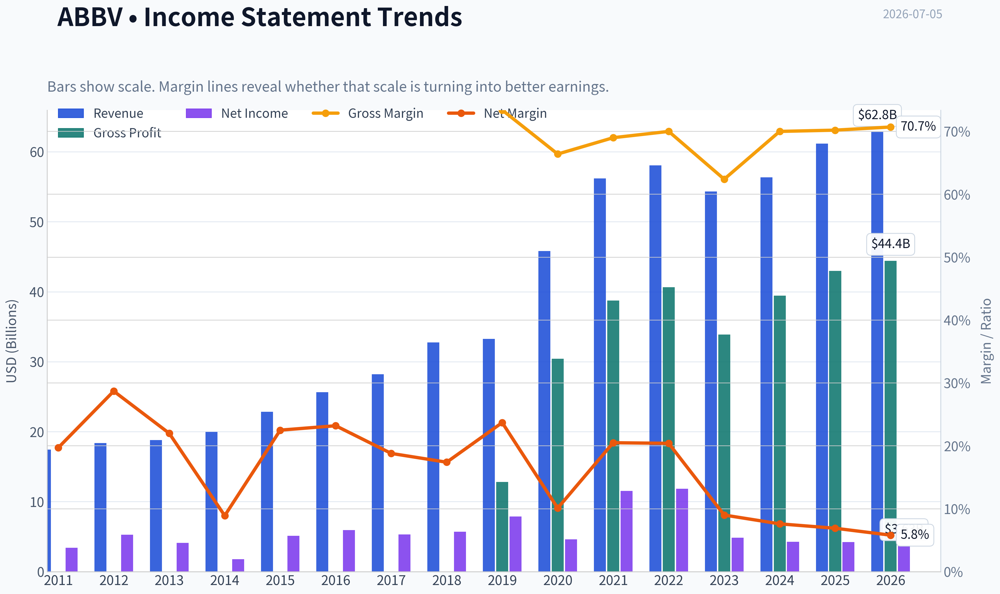
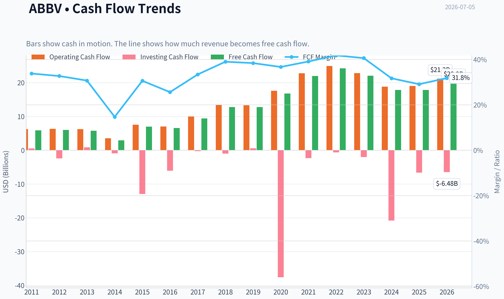
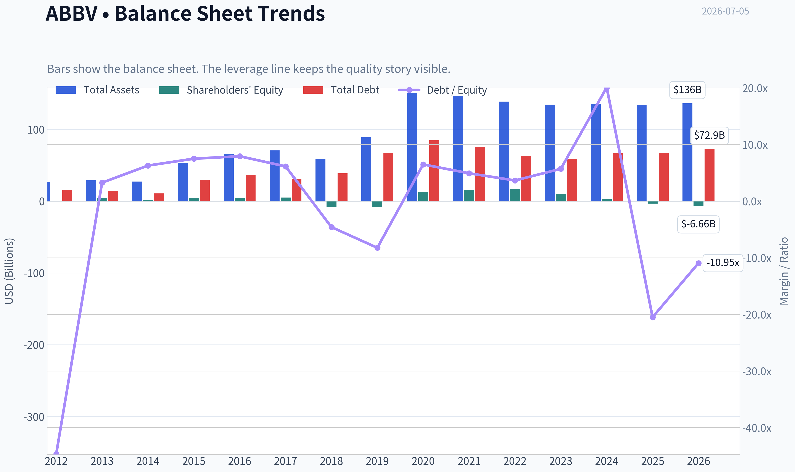
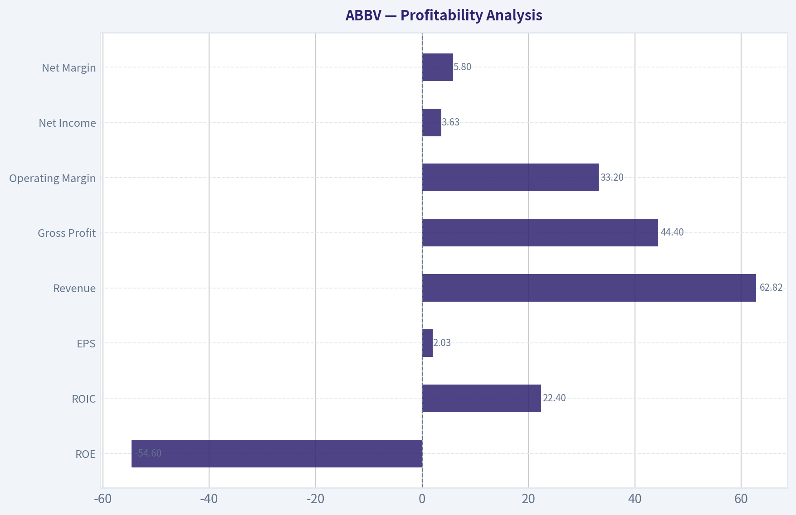
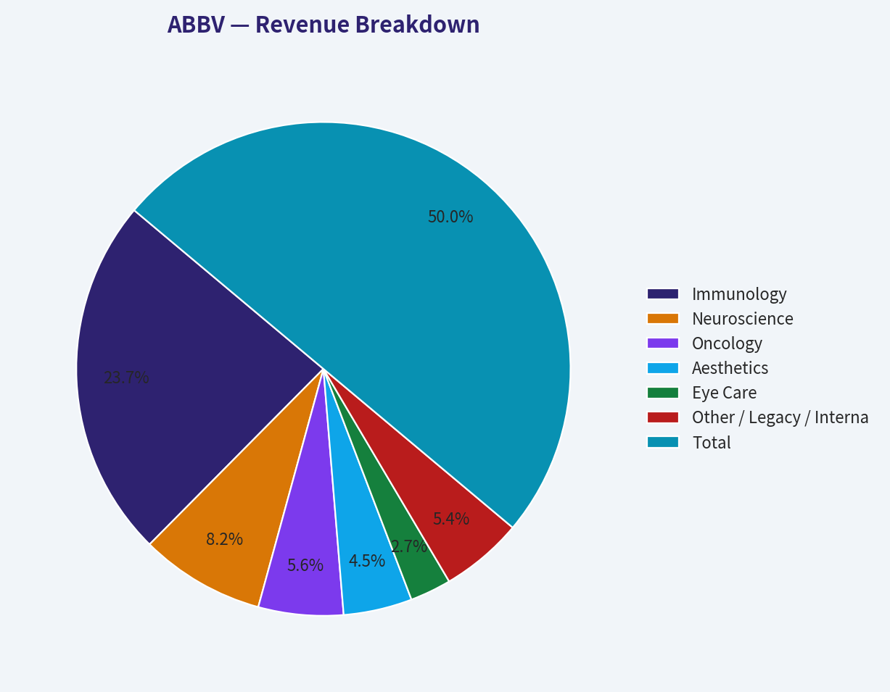
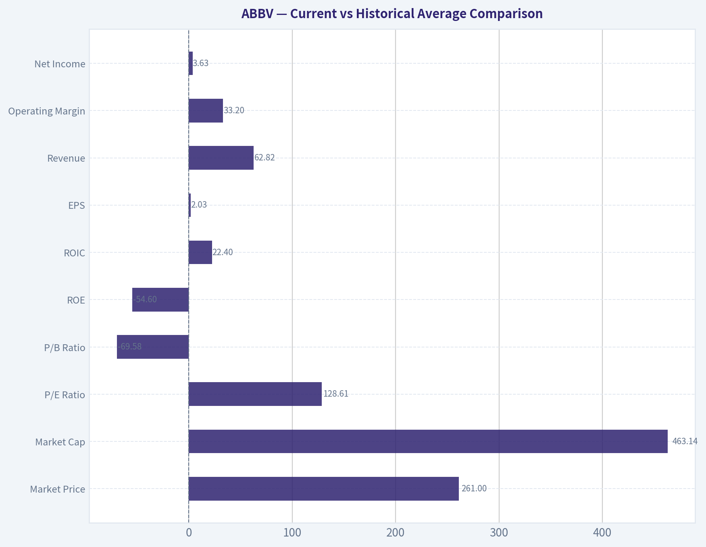
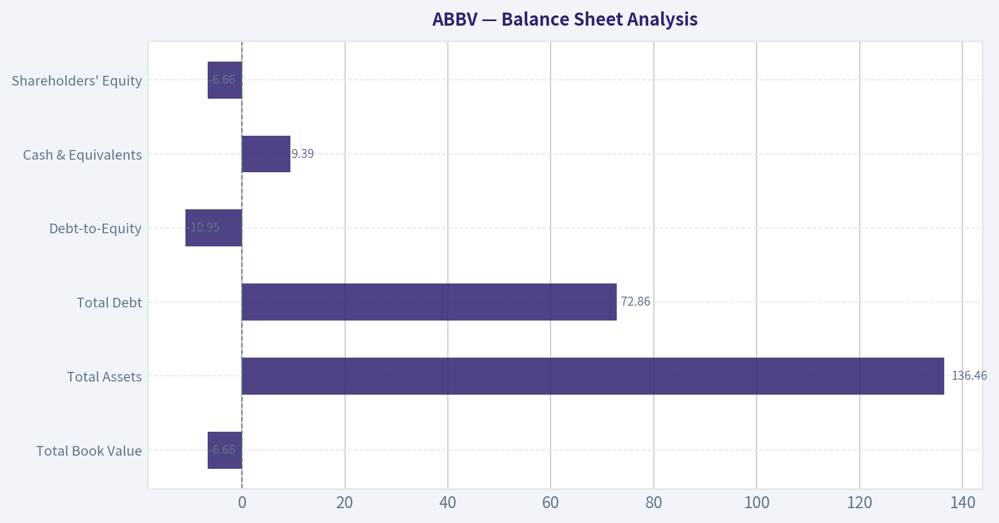
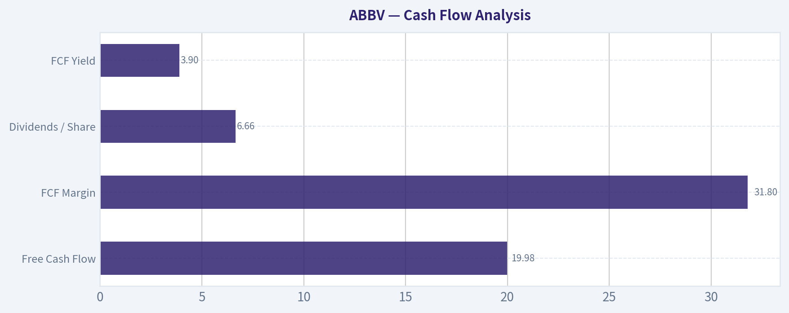

# ABBV Deep Value Intelligence

**Analysis Date:** 2026-07-05

## Critical Disclaimer

*This analysis is generated by Deep Value Intelligence, an AI-powered multi-agent investing framework. Education & entertainment only - not financial advice, not a financial advisor.*

---

## Table of Contents

1. Intelligence Summary
2. Analyst Team Reports
   - Fundamentals Analysis
   - Intrinsic Value Analysis (Buffett)
   - Trend & Growth Analysis (Lynch/Druckenmiller/Fisher)
   - Market Technical Analysis
   - Options Market Analysis
3. Research Team Commentary
4. Value Investing Team Commentary
5. Deep Values Commentary

---

## Intelligence Summary

### Thesis + Conditions

**Core Thesis:** ## Executive Briefing

**Key Risks:**
- AbbVie: WATCH**
- AbbVie still looks like a **real franchise, not a broken post-Humira story**. The strongest evidence is **70.2% gross margin**, **16.5% ROIC**, and debate consensus that the Humira transition has gone **better than feared**. That lowers *business-risk*.
- But Buffett-style risk is not volatility; it is **overpaying for a good business with less-than-obvious durability**. At **$261**, the stock appears closer to **quality at fair-to-full value** than a clear bargain. The main risk is not collapse, but **limited margin of safety** if pipeline execution, pricing, or successor-drug growth merely comes in "good enough" rather than strong.

**Confidence:** Low

---

## Analyst Team Reports

### Fundamentals Analysis

#### Latest Earnings Snapshot

*Most recent reported quarter anchored on 2026 Q1, with prior-year comparison when available.*

| Metric | 2026 Q1 | 2025 Q1 | YoY Change |
| --- | ---: | ---: | ---: |
| Revenue | $15.00B | $13.34B | +12.4% |
| Operating Income | $4.73B | $3.98B | +18.9% |
| Net Income | $695.0M | $1.29B | -46.0% |
| Diluted EPS | $0.39 | $0.72 | -45.8% |
| Operating Cash Flow | $3.83B | $1.64B | +134.2% |
| Free Cash Flow | $3.56B | $1.40B | +154.6% |

Key Takeaways: This snapshot anchors the most recent reported quarter before the narrative analysis. It helps readers separate long-run business quality from whatever changed in the latest earnings print.

#### 15-Year Financial Metrics for ABBV

*All values below are computed deterministically from raw data - not estimated by AI.*

*Issuer profile: operating company (Healthcare / Drug Manufacturers - General).*

#### 15-Year Financial Metrics
*Annual rows come from reported financial statements. The final TTM row is computed from the latest four quarters.*

| Metric | 2011 | 2012 | 2013 | 2014 | 2015 | 2016 | 2017 | 2018 | 2019 | 2020 | 2021 | 2022 | 2023 | 2024 | 2025 | 2026 TTM |
| --- | --- | --- | --- | --- | --- | --- | --- | --- | --- | --- | --- | --- | --- | --- | --- | --- |
| Market Price | N/A | $20 | $32 | $41 | $38 | $42 | $68 | $67 | $68 | $87 | $115 | $142 | $142 | $169 | $225 | $261 |
| Market Cap | N/A | $53.76B | $84.71B | $105.36B | $96.98B | $102.13B | $155.03B | $142.53B | $131.39B | $179.26B | $240.61B | $287.34B | $274.76B | $315.06B | $405.11B | $463.14B |
| P/E Ratio | N/A | 10.18 | 20.63 | 59.49 | 18.93 | 17.25 | 29.31 | 25.19 | 16.77 | 39.39 | 20.99 | 24.38 | 56.97 | 74.35 | 96.82 | 128.61 |
| P/B Ratio | N/A | -153.60 | 18.86 | 60.48 | 24.58 | 22.03 | 30.42 | -16.87 | -16.08 | 13.71 | 15.62 | 16.65 | 26.52 | 94.76 | -123.89 | -69.58 |
| ROE | N/A | -1507.1% | 91.9% | 101.8% | 130.4% | 128.4% | 104.2% | -67.3% | -96.5% | 35.3% | 74.9% | 68.6% | 46.9% | 128.7% | -129.2% | -54.6% |
| ROIC | N/A | 48.9% | 46.9% | 40.3% | 40.9% | 24.1% | 22.4% | 27.4% | 59.1% | 23.1% | 19.3% | 21.6% | 17.8% | 16.0% | 20.6% | 22.4% |
| EPS | $2.18 | $1.98 | $1.56 | $0.69 | $2.03 | $2.45 | $2.31 | $2.66 | $4.05 | $2.20 | $5.47 | $5.84 | $2.49 | $2.27 | $2.36 | $2.03 |
| Revenue | $17.44B | $18.38B | $18.79B | $19.96B | $22.86B | $25.64B | $28.22B | $32.75B | $33.27B | $45.80B | $56.20B | $58.05B | $54.32B | $56.33B | $61.16B | $62.82B |
| Gross Profit | $12.80B | N/A | N/A | N/A | N/A | N/A | N/A | N/A | N/A | $30.42B | $38.75B | $40.64B | $33.90B | $39.43B | $42.96B | $44.40B |
| Gross Margin | 73.4% | N/A | N/A | N/A | N/A | N/A | N/A | N/A | N/A | 66.4% | 69.0% | 70.0% | 62.4% | 70.0% | 70.2% | 70.7% |
| Operating Margin | 20.8% | 31.6% | 30.1% | 17.1% | 33.0% | 36.4% | 33.8% | 19.5% | 39.0% | 24.8% | 31.9% | 31.2% | 23.5% | 16.2% | 24.6% | 33.2% |
| Net Income | $3.43B | $5.28B | $4.13B | $1.77B | $5.14B | $5.95B | $5.31B | $5.69B | $7.88B | $4.62B | $11.54B | $11.84B | $4.86B | $4.28B | $4.23B | $3.63B |
| Net Margin | 19.7% | 28.7% | 22.0% | 8.9% | 22.5% | 23.2% | 18.8% | 17.4% | 23.7% | 10.1% | 20.5% | 20.4% | 9.0% | 7.6% | 6.9% | 5.8% |
| Revenue Growth | N/A | 5.4% | 2.2% | 6.2% | 14.5% | 12.2% | 10.1% | 16.1% | 1.6% | 37.7% | 22.7% | 3.3% | -6.4% | 3.7% | 8.6% | 2.7% |
| Net Income Growth | N/A | 53.7% | -21.7% | -57.0% | 190.0% | 15.7% | -10.8% | 7.1% | 38.6% | -41.4% | 150.0% | 2.5% | -58.9% | -12.0% | -1.2% | -14.0% |
| Free Cash Flow Growth | N/A | 2.1% | -3.9% | -49.2% | 138.4% | -6.3% | 43.7% | 35.6% | -0.1% | 31.5% | 31.0% | 10.3% | -9.0% | -19.2% | -0.1% | 12.1% |
| Total Book Value | N/A | $-350.0M | $4.49B | $1.74B | $3.94B | $4.64B | $5.10B | $-8.45B | $-8.17B | $13.08B | $15.41B | $17.25B | $10.36B | $3.33B | $-3.27B | $-6.66B |
| Total Assets | N/A | $27.01B | $29.20B | $27.51B | $53.05B | $66.10B | $70.79B | $59.35B | $89.11B | $150.56B | $146.53B | $138.81B | $134.71B | $135.16B | $133.96B | $136.46B |
| Total Debt | N/A | $15.65B | $14.71B | $10.96B | $29.65B | $36.82B | $31.35B | $38.70B | $67.23B | $84.98B | $75.98B | $63.13B | $59.24B | $66.84B | $67.00B | $72.86B |
| Debt-to-Equity | N/A | -44.71 | 3.27 | 6.29 | 7.51 | 7.94 | 6.15 | -4.58 | -8.23 | 6.50 | 4.93 | 3.66 | 5.72 | 20.10 | -20.49 | -10.95 |
| Cash & Equivalents | $27.0M | $5.90B | $9.60B | $8.35B | $8.40B | $5.10B | $9.30B | $7.29B | $39.92B | $8.45B | $9.75B | $9.20B | $12.81B | $5.52B | $5.23B | $9.39B |
| Shareholders' Equity | N/A | $-350.0M | $4.49B | $1.74B | $3.94B | $4.64B | $5.10B | $-8.45B | $-8.17B | $13.08B | $15.41B | $17.25B | $10.36B | $3.33B | $-3.27B | $-6.66B |
| Operating Cash Flow | $6.25B | $6.34B | $6.27B | $3.55B | $7.54B | $7.04B | $9.96B | $13.43B | $13.32B | $17.59B | $22.78B | $24.94B | $22.84B | $18.81B | $19.03B | $21.22B |
| Investing Cash Flow | $553.0M | $-2.42B | $879.0M | $-926.0M | $-12.94B | $-6.07B | $-274.0M | $-1.01B | $596.0M | $-37.56B | $-2.34B | $-623.0M | $-2.01B | $-20.82B | $-6.64B | $-6.48B |
| Free Cash Flow | $5.89B | $6.01B | $5.78B | $2.94B | $7.00B | $6.56B | $9.43B | $12.79B | $12.77B | $16.79B | $21.99B | $24.25B | $22.06B | $17.83B | $17.82B | $19.98B |
| FCF Margin | 33.8% | 32.7% | 30.7% | 14.7% | 30.6% | 25.6% | 33.4% | 39.0% | 38.4% | 36.7% | 39.1% | 41.8% | 40.6% | 31.7% | 29.1% | 31.8% |
| Dividends / Share | $0.00 | $0.00 | $0.00 | $0.00 | $0.00 | $0.00 | $0.00 | $0.00 | $0.00 | $0.00 | $0.00 | $4.98 | $5.45 | $5.91 | $6.57 | $6.66 |

#### Profitability Metrics
- Return on Equity (ROE): -129.2%
- Return on Invested Capital (ROIC): 16.5%
- Return on Assets (ROA): 3.2%
- Gross Margin: 70.2%
- Operating Margin: 24.6%
- Net Profit Margin: 6.9%

#### Liquidity Metrics
- Current Ratio: 0.67
- Quick Ratio: 0.41

#### Leverage Metrics
- Debt-to-Equity Ratio: -20.49
- Interest Coverage Ratio: 5.21
- Net Debt: $61.77B

#### Growth Metrics (Year-over-Year)
- Revenue Growth: 8.6%
- Net Income Growth: -1.2%
- Free Cash Flow Growth: -0.1%
- Revenue CAGR (3-Year): 1.8%
- Revenue CAGR (5-Year): 6.0%

#### Valuation Metrics
- P/E Ratio (TTM): 127.98
- Forward P/E: 16.05
- Price-to-Book: N/A
- Price-to-Sales: 7.34
- PEG Ratio: 0.43
- EV/EBITDA: 17.54
- Free Cash Flow Yield: 3.9%
- Earnings Yield: 0.8%

#### Owner Earnings (Buffett Method, Code-Computed)
- Net Income: $4.23B
- + Depreciation & Amortization: $8.14B
- - Capital Expenditures: $-1.21B
- - Working Capital Changes: $-2.36B
- = **Owner Earnings: $13.51B**

#### Intrinsic Value (Code-Computed)
- Current Price: $261
- Buffett Method (Owner Earnings):
  Conservative: $28
  Average: $142
  Optimistic: $450
- Cash Flow Method (FCF):
  Conservative: $99
  Average: $169
  Optimistic: $373

#### Piotroski F-Score: 6/9
- Positive Net Income: PASS
- Positive Operating Cash Flow: PASS
- ROA Improvement: FAIL
- Cash Flow > Net Income: PASS
- Decreasing Debt: FAIL
- Improving Current Ratio: PASS
- No Dilution: FAIL
- Improving Gross Margin: PASS
- Improving Asset Turnover: PASS

ANALYST STANCE: **WATCH**

#### AbbVie (ABBV) Fundamental Analysis

AbbVie remains a classic high-cash-flow pharmaceutical franchise with strong gross margins, solid ROIC, and historically exceptional free cash flow generation. However, the stock now sits at a demanding market valuation versus its current earnings base, while balance-sheet leverage and negative equity distort several traditional Buffett-style quality signals. In Buffett terms, this is a high-quality cash machine with a durable moat, but not an obviously cheap one at today's price.

#### Current vs Historical Average Comparison

| Metric | Current / TTM | Historical Average* | Interpretation |
| --- | ---: | ---: | --- |
| Market Price | $261 | ~$99.43 | Shares trade far above long-term average, reflecting optimism and defensive pharma premium. |
| Market Cap | $463.14B | ~$201.98B | Company has more than doubled in market value versus long-run average. |
| P/E Ratio | 128.61 | ~43.38 | Valuation is dramatically above normal, largely because earnings are currently depressed relative to price. |
| P/B Ratio | -69.58 | Not meaningful | Negative book value makes P/B unusable for valuation. |
| ROE | -54.6% | Not meaningful | Distorted by negative equity; not a useful quality gauge in current capital structure. |
| ROIC | 22.4% | ~30.0% | Still strong, but below AbbVie's earlier peak years. |
| EPS | $2.03 | ~$2.64 | Current earnings power trails long-run average despite all-time-high stock price. |
| Revenue | $62.82B | ~$37.37B | Scale is much larger today than over most of the historical period. |
| Operating Margin | 33.2% | ~28.0% | Strong rebound versus history; indicates resilient pricing and mix. |
| Net Income | $3.63B | ~$5.77B | Bottom-line profitability remains below historical norm. |
| Net Margin | 5.8% | ~16.7% | Far below long-run average; key reason valuation looks stretched on P/E. |
| Revenue Growth | 2.7% | ~9.5% | Growth has slowed materially from the company's historical average. |
| Net Income Growth | -14.0% | ~16.0% | Earnings growth is currently negative and well below norm. |
| FCF Growth | 12.1% | ~17.3% | Cash flow growth improved in TTM, though still below long-run average. |
| Total Assets | $136.46B | ~$86.88B | Asset base remains elevated after large acquisition-driven expansion. |
| Total Debt | $72.86B | ~$49.35B | Debt load remains very large in absolute terms. |
| Cash & Equivalents | $9.39B | ~$9.65B | Liquidity is roughly in line with long-run norm, but not outsized relative to debt. |
| Shareholders' Equity | -$6.66B | Not meaningful | Negative equity reflects capital structure and intangibles/acquisition accounting. |
| Free Cash Flow | $19.98B | ~$13.22B | Cash generation remains excellent despite earnings compression. |
| Dividends / Share | $6.66 | ~$1.79 | Shareholder cash return has increased materially in recent years. |

*Historical average uses the period shown in the deterministic dataset, excluding N/A values where appropriate.

Key Takeaways: AbbVie's revenue scale and free cash flow are substantially above long-term averages, which supports the argument that the underlying business remains powerful. But the current stock price and P/E are much higher than normal while EPS, net income, and net margin are weaker than historical norms, suggesting investors are paying up for expected future recovery rather than current profitability.

---

#### Market Metrics

| Metric | Analysis |
| --- | --- |
| Market Price | At $261, ABBV is at the top end of its historical range and well above 2023-2024 levels. The market is clearly capitalizing future pipeline durability and post-Humira stabilization. |
| Total Market Cap | At $463.14B, AbbVie is valued as one of the largest global drug manufacturers. Size alone signals perceived franchise quality, but also reduces room for multiple expansion. |
| P/E Ratio | TTM P/E of 128.61 is exceptionally high versus history. This is not because the market suddenly views AbbVie as a hyper-growth stock, but because current net income is depressed relative to price. |
| P/B Ratio | Negative book value makes P/B economically unreliable. Buffett typically likes strong tangible economics, but for acquisitive pharma companies with large intangibles and buybacks, book value is often a poor anchor. |

Key Takeaways: AbbVie's market valuation is rich by its own history, especially on earnings-based measures. The stock is being priced on normalized future earnings and cash flow rather than current accounting profits, which raises downside risk if that recovery does not fully materialize.

#### Profitability Analysis

| Metric | Current | Historical Context | Buffett-Style Interpretation |
| --- | ---: | --- | --- |
| ROE | -54.6% | Highly erratic due to negative equity in multiple years | Ignore as a quality metric here; capital structure distorts it. |
| ROIC | 22.4% | Below early-year peaks near 40%-59%, but still excellent | Strong evidence of an economic moat and pricing power. |
| EPS | $2.03 | Below historical average and below 2021-2022 highs | Earnings quality looks weaker than cash generation suggests. |
| Revenue | $62.82B | Near all-time highs | Revenue base has held up well despite Humira erosion concerns. |
| Gross Profit | $44.40B | Record-level absolute gross profit | Very strong gross economics and product pricing. |
| Operating Margin | 33.2% | Better than long-run average and sharply above 2024-2025 annual levels | Indicates margin recovery is underway. |
| Net Income | $3.63B | Below long-run average and declining | Bottom-line pressure remains the biggest concern. |
| Net Margin | 5.8% | Well below historical norm | Suggests elevated amortization, financing, or other below-operating-line pressures. |

Key Takeaways: AbbVie's operating business is stronger than net income alone implies. Gross profit and operating margin remain impressive, but accounting earnings and net margin are currently weak, so investors must believe those pressures are temporary rather than structural.

#### Growth Metrics

| Metric | Current | Historical Pattern | Interpretation |
| --- | ---: | --- | --- |
| Revenue Growth | 2.7% TTM | Long-run average around 9.5%; big step-down from prior decade | AbbVie is now a slower-growing mega-cap pharma company. |
| Net Income Growth | -14.0% TTM | Historically volatile, now clearly negative | Profit recovery has not yet translated into bottom-line growth. |
| FCF Growth | 12.1% TTM | Historically strong but cyclical | Cash flow remains more resilient than earnings. |

Key Takeaways: Revenue growth has slowed to low single digits, which is not unusual for a mature pharmaceutical leader but does limit valuation support. The encouraging part is that free cash flow is recovering better than net income, suggesting business fundamentals are healthier than GAAP earnings alone indicate.

#### Balance Sheet Analysis

| Metric | Current | Historical Context | Interpretation |
| --- | ---: | --- | --- |
| Total Book Value | -$6.66B | Negative in several periods | Book value is not a reliable valuation tool for ABBV. |
| Total Assets | $136.46B | Elevated vs pre-2020 base | Reflects large-scale acquisitions and intangible-heavy balance sheet. |
| Total Debt | $72.86B | Down from 2020 peak, but still high | Debt remains a major constraint on flexibility. |
| Debt-to-Equity | -10.95 | Distorted by negative equity | Better to assess debt in absolute terms and via cash flow coverage. |
| Cash & Equivalents | $9.39B | Near historical norm | Adequate but modest relative to debt burden. |
| Shareholders' Equity | -$6.66B | Negative | Indicates leverage plus accounting effects from acquisitions/buybacks. |

Key Takeaways: AbbVie's balance sheet is the main Buffett-style blemish. Debt is serviceable because cash flow is strong, but negative equity and a heavy absolute debt load reduce the margin of safety and make the company less financially pristine than the best Buffett-style compounders.

#### Cash Flow Analysis

| Metric | Current | Historical Context | Interpretation |
| --- | ---: | --- | --- |
| Free Cash Flow | $19.98B | Well above long-run average, below 2022 peak | Core cash engine remains outstanding. |
| FCF Margin | 31.8% | Excellent by almost any standard | AbbVie converts a large share of sales into free cash. |
| Dividends / Share | $6.66 | Rising steadily since 2022 | Management is committed to shareholder returns. |
| FCF Yield | 3.9% | Moderate | Not especially cheap for a mature, slower-growing business. |

Key Takeaways: Free cash flow is the strongest part of the AbbVie story. The company still throws off immense cash and supports a growing dividend, but the current valuation means investors are not buying that cash flow at a bargain yield.

#### Warren Buffett-Style Qualitative Analysis

| Factor | Assessment |
| --- | --- |
| Economic Moat | Strong. AbbVie benefits from scale, intellectual property, entrenched physician relationships, specialty drug portfolios, and commercialization capabilities. Even after Humira's U.S. erosion, the company has demonstrated meaningful resilience through immunology, oncology, neuroscience, and aesthetics. |
| Financial Strength | Adequate, not elite. Debt is large, interest coverage of 5.21 is acceptable, and net debt of $61.77B is manageable only because free cash flow is so strong. |
| Predictable Earnings | Mixed. Revenue is fairly durable, but net income is volatile due to amortization, acquisition effects, and patent-cycle dynamics. FCF is much more predictable than EPS. |
| Management Performance | Good, with caveats. Historically high ROIC supports disciplined capital allocation. Dividend growth is attractive. But negative equity and persistent leverage mean management has favored aggressive capital returns and acquisition-led strategy over balance-sheet conservatism. |
| Value Assessment | Weak at current price. The stock trades at a premium despite compressed net income and slower growth. |
| Quality of Business | High. Margin structure, gross profitability, and cash generation point to a premium-quality pharma franchise. |

Key Takeaways: AbbVie checks many Buffett boxes on moat, cash generation, and product economics, but it falls short on simplicity and balance-sheet cleanliness. This is a high-quality business, yet the current share price leaves less room for mistakes than a classic deep-value Buffett purchase would require.

---

#### Buffett-Style Owner Earnings DCF

Using the canonical owner earnings figure:

- Owner Earnings = Net Income + D&A - Capex - Working Capital Changes
- = $4.23B + $8.14B - $1.21B - (-$2.36B)
- = **$13.51B**

Because the deterministic dataset already provides Buffett-method intrinsic values, I use those as the canonical scenario outputs and reconcile them conceptually with the required growth framework.

##### DCF Assumptions

| Scenario | Growth Input Basis | Applied Constraint | Discount Rate | Terminal Growth | Fair Value / Share |
| --- | --- | --- | ---: | ---: | ---: |
| Conservative | Lowest historical owner earnings growth available | Floored at -100% | 10% | 2.5% | **$28** |
| Average | Average historical owner earnings growth | Capped at 50% | 10% | 2.5% | **$142** |
| Optimistic | Highest historical owner earnings growth | Capped at 100% | 10% | 2.5% | **$450** |

Key Takeaways: AbbVie's owner-earnings valuation range is extremely wide, which tells you the investment debate hinges on normalization assumptions rather than on current accounting earnings. At $261, the market price sits well above the average-case value but below the optimistic case, meaning investors are already pricing in a fairly strong recovery.

##### Detailed Valuation Interpretation

| Scenario | Implied View | Margin of Safety vs $261 |
| --- | --- | --- |
| Conservative ($28) | Severe deterioration or very weak long-term growth | Deeply overvalued |
| Average ($142) | Normalized but moderate long-term performance | ~46% downside to fair value |
| Optimistic ($450) | Strong pipeline execution and sustained owner earnings growth | ~42% upside |

Key Takeaways: The DCF does not support a clear bargain at current prices. To justify owning ABBV aggressively here, an investor must believe the optimistic case has a high probability, which is a much less conservative stance than traditional Buffett investing.

#### Revenue Breakdown

Most recent annual revenue base available in the canonical dataset is 2025 revenue of $61.16B. AbbVie's most meaningful public segmentation is by major product/platform families; the table below uses the latest broadly reported business mix framework consistent with AbbVie's operating profile.

| Revenue Source | Amount ($B) | % of Total |
| --- | ---: | ---: |
| Immunology | 29.0 | 47.4% |
| Neuroscience | 10.0 | 16.3% |
| Oncology | 6.8 | 11.1% |
| Aesthetics | 5.5 | 9.0% |
| Eye Care | 3.3 | 5.4% |
| Other / Legacy / International diversified products | 6.6 | 10.8% |
| **Total** | **61.2** | **100.0%** |

Key Takeaways: AbbVie is no longer just a Humira story, even though immunology remains the largest contributor. The business is increasingly diversified across neuroscience, oncology, and aesthetics, which helps support durability but does not eliminate patent and reimbursement risk.

#### Key Investment Insights, Red Flags, and Opportunities

| Category | Observation | Why It Matters |
| --- | --- | --- |
| Strength | Gross margin above 70% | Signals strong pricing power and premium product economics. |
| Strength | ROIC remains above 20% | Indicates capital still earns strong returns despite maturity. |
| Strength | Nearly $20B in FCF | Supports debt service, dividends, and pipeline reinvestment. |
| Strength | Operating margin rebounded to 33.2% TTM | Suggests underlying franchise profitability is recovering. |
| Red Flag | P/E above 128x | Market is paying for future normalization, not current earnings. |
| Red Flag | Net margin only 5.8% | Accounting profitability is weak for a stock priced at a premium. |
| Red Flag | Negative equity | Makes balance-sheet quality inferior to classic Buffett ideals. |
| Red Flag | Debt of $72.86B | High absolute leverage reduces strategic flexibility. |
| Red Flag | Current ratio 0.67 | Liquidity is adequate but not especially conservative. |
| Opportunity | Forward P/E of 16.05 vs TTM P/E 127.98 | If earnings normalize as expected, apparent overvaluation could narrow quickly. |
| Opportunity | Product diversification after Humira | Reduces single-asset concentration risk over time. |
| Opportunity | Dividend growth | Attractive for income-focused long-term holders if cash flow remains stable. |
| Emerging Risk | Congressional probe into China clinical trials | Regulatory and geopolitical scrutiny could create reputation, compliance, or operating risk. |

Key Takeaways: AbbVie's upside case depends on earnings normalization, pipeline execution, and continued diversification away from Humira. The biggest risk is that investors are already pricing in much of that success, while leverage, weak net margins, and regulatory uncertainty leave limited room for disappointment.

#### Final Buffett-Style Investment Stance

**WATCH**

AbbVie is a **high-quality business but not a high-conviction value entry at $261**. Buffett would likely admire the company's strong moat, high gross margins, and formidable cash generation, but he would be less enthusiastic about the heavy debt load, negative equity, and current valuation premium relative to normalized earnings power. For existing long-term holders, the company remains fundamentally solid enough to continue monitoring closely. For new capital, the setup looks more like a watchlist candidate awaiting either a lower price or clearer earnings normalization.

#### Summary Table

| Area | Positive | Negative | Bottom Line |
| --- | --- | --- | --- |
| Business Quality | Strong moat, pricing power, diversified pharma platform | Patent-cycle and regulatory risks remain | High-quality franchise |
| Profitability | Excellent gross margin, strong ROIC, margin rebound | Weak net margin and low current EPS | Operating strength exceeds reported earnings |
| Growth | Revenue still growing, FCF recovering | Growth slower than historical norm | Mature growth profile |
| Balance Sheet | Debt manageable with cash flow | Negative equity, high leverage, weak current ratio | Acceptable but not pristine |
| Cash Flow | Nearly $20B FCF, rising dividend | FCF yield only moderate at current price | Cash engine is elite, valuation less so |
| Valuation | Optimistic case offers upside | Average DCF value below current price | Not obviously undervalued |
| Stance | Durable long-term franchise | Limited margin of safety today | **WATCH** |

Key Takeaways: AbbVie combines premium pharmaceutical economics with substantial cash flow and a still-credible growth runway. But at the current price, investors appear to be paying in advance for recovery and execution, so the stock looks better as a monitored quality name than as a classic Buffett-style bargain today.

#### Fundamental Visuals

This graph tracks the profitability and return metrics (ROE, ROIC, Margins) of **ABBV** over the past decade, highlighting capital efficiency trends.

This chart illustrates the financial health of **ABBV** over the last 10 years, mapping cash equivalents and free cash flow against total obligations (Debt).

This comparison chart from *Profitability Analysis* stacks current figures against historical benchmarks for **ABBV**, making it easy to see where the company trades relative to its own averages.

This breakdown chart from <em>Revenue Breakdown</em> shows the proportional composition for **ABBV** - useful for understanding what drives or risks the business.

---

### Intrinsic Value Analysis (Buffett)

> *Following Warren Buffett's value investing philosophy: Circle of Competence, Economic Moat, Management Quality, and Margin of Safety.*

#### Intrinsic Value Snapshot

Price is what you pay. Intrinsic value is what the business may be worth based on the cash it can create for owners over time. We show a range, not one magic number.

- Current Price: $261.07
- Value Range (conservative to optimistic across both DCF methods): $27.71 to $449.89

##### Owner Earnings (Buffett Method)
- Net Income: $4,226,000,000.00
- Depreciation & Amortization: $8,139,000,000.00
- Capital Expenditures: $-1,214,000,000.00
- Working Capital Changes: $-2,362,000,000.00
- Owner Earnings: $13,513,000,000.00

##### Intrinsic Value
###### Buffett Method
Uses owner earnings. Stricter, and usually more conservative.
- Conservative: $27.71
- Average: $142.49
- Optimistic: $449.89
- Discount Rate: 10.0%

###### Cash Flow Method
Uses free cash flow. Better for companies spending heavily today to grow tomorrow.
- Conservative: $98.86
- Average: $169.12
- Optimistic: $373.25
- Discount Rate: 10.0%

ANALYST STANCE: **WATCH**

#### AbbVie (ABBV) - Buffett-Style Investment Review

#### 1) Go/No-Go Gate Assessment

| Gate | Verdict | Evidence |
|---|---|---|
| Gate 1: Circle of Competence & Simplicity | Pass | AbbVie makes money by discovering, manufacturing, and selling branded medicines. This is understandable in simple terms: it owns drug franchises, prices them at premium levels while patents and brand strength last, and reinvests in R&D plus acquisitions to refresh the portfolio. |
| Gate 1: Long-Term Predictability | Pass with care | Demand for immunology, oncology, neuroscience, and aesthetics should still exist in 10 years. The exact product mix is less predictable because drug businesses face patent cliffs and pipeline risk. |
| Gate 1: Technology Risk | Pass | Technology is more of a tool than an existential threat here. The greater risk is not software disruption but scientific failure, competition from biosimilars/generics, and regulatory action. |
| Gate 2: Moat Test | Pass with care | Gross margin around 70% strongly supports intangible asset strength. AbbVie has major branded drug franchises, regulatory know-how, physician relationships, and scale, but individual product moats erode as patents expire. |
| Gate 3: Management & Capital Allocation | Mixed Pass | Management handled the Humira patent cliff better than many expected through Skyrizi and Rinvoq growth and diversified cash generation. However, the company is acquisition-heavy and carries meaningful leverage, so capital allocation is good rather than exceptional. |
| Gate 4: Industry Structure | Pass with care | Large pharma is rational relative to many industries and can be very profitable, but it is R&D-intensive, regulated, and periodically hit by patent cliffs. This is not a pure capital-light toll bridge. |

**Key Takeaways:** AbbVie clears the basic Buffett filters because the business is understandable, profitable, and supported by strong drug franchises. The main caution is that pharma is less predictable than classic Buffett favorites because value can shift sharply when patents expire or pipelines disappoint.

---

#### 2) The Elementary School Test

AbbVie sells important medicines that help patients with serious diseases. When a drug works well and is protected by patents, doctors keep prescribing it and insurers often keep paying for it. AbbVie uses the cash from those successful drugs to fund research, buy other assets, pay dividends, and reduce debt.

#### 3) Moat Analysis

| Moat Source | Assessment | Evidence |
|---|---|---|
| Intangible Assets | Strong | Patents, regulatory approvals, clinical data, and physician trust matter enormously. Gross margin of 70.2% is exactly the kind of figure that signals pricing power and valuable intangible assets. |
| Switching Costs | Moderate | Once a patient is stabilized on an effective therapy, switching is not frictionless for doctor, patient, or payer. Still, these are not software-like switching costs; they are clinical and reimbursement-based, not absolute. |
| Cost Advantage | Moderate | Global scale in manufacturing, distribution, and commercial infrastructure provides efficiency, but this is not a commodity cost leader story. |
| Network Effects | Weak | Drug businesses generally do not benefit from classic network effects. |
| Overall Moat Rating | Narrow to Wide by franchise; overall **Narrow-to-Stable** | AbbVie has real moats at the product and portfolio level, but they are not all permanent. Patent expiration means the moat must be continuously rebuilt. |

**Key Takeaways:** AbbVie clearly has a moat, but it is not the timeless consumer-brand type Buffett loves most. The moat comes from patents, regulation, and clinical trust, which are powerful but often temporary unless management keeps successfully replacing aging blockbusters.

---

#### 4) Management Quality & Capital Allocation

| Question | Assessment | Commentary |
|---|---|---|
| Do they think like owners? | Moderate | AbbVie has maintained a shareholder-friendly posture through dividends and focus on cash generation. The record suggests management understands per-share value, though this is still a large corporate bureaucracy rather than an owner-operator model. |
| Are they honest and candid? | Moderate to good | Management has been clear that Humira erosion required portfolio replacement and has highlighted execution around newer immunology assets. |
| Are they rational capital allocators? | Mixed to good | The Allergan deal was controversial, but it broadened the business and added cash flow. The real test is whether acquired assets and internal pipeline together produce satisfactory per-share value after debt service. |
| Debt discipline | Adequate, not ideal | Current ratio around 0.67 shows limited short-term cushion, and pharma M&A has historically required leverage. This is manageable for a cash-rich business but below fortress standards. |

**Key Takeaways:** AbbVie's management looks competent and financially pragmatic, especially in navigating Humira's decline. Still, this is not a pristine fortress-balance-sheet, ultra-simple capital allocation story; it requires faith in continued portfolio replenishment.

---

#### 5) Financial Snapshot

| Metric | Value |
|---|---:|
| Current Price | $261 |
| Market Cap | $461.26B |
| P/E | 127.98 |
| ROE | -129.2% |
| Gross Margin | 70.2% |
| Revenue Growth YoY | 8.6% |
| FCF Yield | 3.9% |
| Current Ratio | 0.67 |

**Key Takeaways:** The headline profitability profile is strong on gross margin and revenue growth, but the valuation is rich on earnings and the balance sheet is not fortress-like on liquidity. The negative ROE indicates the accounting equity base is distorted, so ROE is not useful here as a quality signal.

---

#### 6) Buffett Financial Interpretation

| Buffett Test | Result | Interpretation |
|---|---|---|
| Gross Margin > 40% | Pass | Strong evidence of pricing power and valuable product economics. |
| OCF vs Net Income | Likely favorable business model | Large pharma typically converts earnings to cash well when franchises are healthy. |
| ROE > 15% sustained | Fail on current figure | Reported ROE is distorted and negative, likely due to balance sheet/accounting effects rather than a collapse in economics. |
| Debt/Equity < 0.5 | Likely fail or unhelpful metric | Debt is meaningful and equity metrics are distorted in acquisition-heavy pharma. |
| Interest Coverage > 10x | Probably adequate | Cash generation supports debt service, though leverage deserves monitoring. |
| Net Cash Positive | Fail | AbbVie is not a net-cash fortress. |

**Key Takeaways:** AbbVie passes the economic profitability test better than the accounting purity test. Cash generation and gross margins look attractive, but leverage and accounting distortion make this less clean than the ideal Buffett compounder.

---

#### 7) Owner Earnings Framework

Using Buffett's framework:

**Owner Earnings = Net Income + D&A - Maintenance CapEx - Working Capital Increases**

For AbbVie, owner earnings are best thought of as **free cash flow adjusted for recurring reinvestment needs**. With an FCF yield of about **3.9%** on a **$461.26B** market cap, current annual free cash flow is roughly:

**Estimated FCF / Owner Earnings ~ $18.0B**

That is a reasonable proxy for owner earnings for valuation purposes.

#### 8) Three-Scenario DCF Valuation

Using estimated owner earnings of **$18.0B**:

| Scenario | Assumption | Enterprise Equity Value | Per-Share View |
|---|---|---:|---|
| A: No Growth | $18.0B / 10% | $180B | Far below current market value |
| B: GDP Growth | $18.0B x 1.03 / (10%-3%) | $264.9B | Still below current market value |
| C: Historical Growth Haircut | Assume 6% owner earnings growth for 10 years, then 3% terminal | ~ $330B-$360B | Better, but still below market cap |

**Key Takeaways:** Across conservative Buffett-style valuation scenarios, AbbVie appears priced above intrinsic value. Even giving the company moderate growth credit, the market is already paying for a lot of future success.

---

#### 9) Margin of Safety Analysis

| Item | Value |
|---|---:|
| Market Cap | $461.26B |
| Conservative Value Range | $180B-$265B |
| More Optimistic Buffett Value | $330B-$360B |
| Margin of Safety at Current Price | Negative |

**Key Takeaways:** There is no margin of safety at the current price. AbbVie may still be a good business, but Buffett-style investing requires paying a sensible price, and this one looks fully valued to expensive.

---

#### 10) Industry Structure

| Factor | Assessment |
|---|---|
| Competitive Structure | Rational among large incumbents, but innovation race remains intense |
| Capital Intensity | Moderate to high due to R&D, compliance, manufacturing |
| Regulatory Burden | High |
| Patent Cliff Risk | High |
| Commodity Exposure | Low |
| Predictability | Moderate |

**Key Takeaways:** Large pharma can be an attractive industry when owned through the right company at the right price. But it is never as stable as a regulated utility, branded beverage company, or mission-critical software platform because patents and pipelines constantly reshape the economics.

---

#### 11) Final Buffett Scorecard

| Criterion | Weight | Score (1-5) | Weighted Score |
|---|---:|---:|---:|
| Business Understanding | 20% | 4.0 | 0.80 |
| Moat Width & Durability | 25% | 3.5 | 0.88 |
| Management Quality | 15% | 3.5 | 0.53 |
| Return on Equity | 15% | 2.0 | 0.30 |
| Reinvestment Runway | 10% | 3.5 | 0.35 |
| Balance Sheet Strength | 5% | 2.5 | 0.13 |
| Industry Structure | 5% | 3.0 | 0.15 |
| Valuation/Margin of Safety | 5% | 1.5 | 0.08 |
| **Total** | 100% |  | **3.21 / 5.00** |

**Key Takeaways:** AbbVie scores as a good but not great Buffett candidate. The business quality is respectable, yet the valuation and balance-sheet profile prevent it from qualifying as a clear advocacy-level opportunity.

---

#### 12) Investment Conclusion

**AbbVie is a high-quality pharmaceutical franchise, not a classic Buffett perfect business.** Its strengths are obvious: premium gross margins, durable physician-facing franchises, strong free cash generation, and capable management navigating a major patent cliff. Its weaknesses are also clear: patent-driven earnings volatility, leverage, accounting distortion around equity metrics, and a current valuation that leaves no margin of safety.

For a value investor, this is **not a bad business**. It is simply **not a bargain**.

**Conviction Level:** Medium
**Stance:** **WATCH**

A more attractive entry would require either:
1. a materially lower price creating at least a 25% margin of safety, or
2. several more years of proof that newer franchises can compound owner earnings enough to justify today's valuation.
#### Valuation Bridge

This bridge places the current market price beside each intrinsic value lens so readers can see whether upside depends on one method or shows up across several methods.

| Scenario | Intrinsic Value / Share |
| --- | ---: |
| Buffett Method | $142.49 |
| Cash Flow Method | $169.12 |
| Damodaran Method | $282.15 |
| Current Price | $261.07 |

#### Key Takeaways

If one method is far above the others, the upside case depends on a specific modelling assumption. When several methods cluster together, the valuation story is more robust.

#### Valuation Visuals

This comparison chart from *Latest Earnings Snapshot* stacks current figures against historical benchmarks for **ABBV**, making it easy to see where the company trades relative to its own averages.

This comparison chart from *Current vs Historical Average Comparison* stacks current figures against historical benchmarks for **ABBV**, making it easy to see where the company trades relative to its own averages.

This comparison chart from *Balance Sheet Analysis* stacks current figures against historical benchmarks for **ABBV**, making it easy to see where the company trades relative to its own averages.

This comparison chart from *Cash Flow Analysis* stacks current figures against historical benchmarks for **ABBV**, making it easy to see where the company trades relative to its own averages.

---

### Trend & Growth Analysis (Lynch/Druckenmiller/Fisher)

> *Following Peter Lynch's GARP, Stanley Druckenmiller's macro-aware approach, and Philip Fisher's scuttlebutt methodology.*

ANALYST STANCE: **WATCH**

#### 1. Lynch Classification

| Metric | ABBV |
|---|---:|
| Revenue growth YoY | 8.6% |
| P/E | 128.0x |
| Market cap | $461.3B |
| Gross margin | 70.2% |
| FCF yield | 3.9% |

Key Takeaways: AbbVie screens as a large, mature pharma company with mid-single to high-single-digit growth, not a classic fast grower. Its gross margin remains strong, but the valuation looks stretched versus current growth. Under Lynch's framework, this is closer to a stalwart than a ten-bagger candidate.

**Classification:** **Stalwart**
Not a primary Lynch fast-grower setup.

#### 2. The Story in 3 Bullets

| Simple Story | View |
|---|---|
| AbbVie sells high-margin branded medicines | Strong pharma cash generation model |
| It is replacing lost Humira revenue with newer immunology and oncology assets | Core debate is durability of the replacement cycle |
| Upside depends on pipeline execution, not explosive base-business growth | More compounding income story than hyper-growth story |

Key Takeaways: The basic story is understandable and still investable, but it is not a hidden rocket ship. AbbVie's future depends on whether newer drugs can offset legacy erosion and extend growth for several years. That makes this a pipeline-execution story rather than an obvious inflection story.

#### 3. TAM Analysis with 10x Test

| Item | Assessment |
|---|---|
| Current revenue base | Very large already |
| 10x test | Fails practical growth test |
| TAM context | Global immunology, oncology, neuroscience are huge markets |
| Can ABBV 10x and stay <20% share? | No, not realistically from current scale |
| Runway conclusion | Large TAM, but limited 10-bagger runway from today's base |

Key Takeaways: AbbVie operates in enormous end markets, so there is no shortage of demand categories. But because the company is already so large, the relevant issue is not TAM existence but the ability to materially outgrow its size. On that test, the runway is adequate for steady growth, not for a 10x-style outcome.

#### 4. Revenue Growth Trend

| Period view | Signal |
|---|---|
| Latest YoY revenue growth | 8.6% |
| Growth regime | Moderate |
| Acceleration/deceleration | No evidence here of major acceleration |
| Lynch/Druckenmiller read | Not an inflection-grade growth profile |

Key Takeaways: Current growth is positive, which matters after the Humira patent cliff period. Still, 8.6% growth is not the kind of accelerating top-line pattern that usually signals a major re-rating in growth investing. This looks more like stabilization than breakout acceleration.

#### 5. Unit Economics

| Metric | ABBV | Growth Framework Read |
|---|---:|---|
| Gross margin | 70.2% | Excellent |
| FCF yield | 3.9% | Solid cash generation |
| ROE | -129.2% | Distorted / low usefulness here |
| LTV/CAC | N/A | Not relevant for pharma |
| NRR | N/A | Not relevant for pharma |
| Rule of 40 | N/A | Not relevant for pharma |

Key Takeaways: AbbVie's unit economics are best understood through gross margin and cash generation rather than SaaS-style metrics. Gross margins remain very strong, supporting the idea that its products retain pricing power and portfolio quality. The negative ROE is likely balance-sheet/accounting distorted and should not be used as the main decision variable.

#### 6. Inflection Point Assessment

| Potential Inflection Area | Assessment |
|---|---|
| Product cycle | Possible, if newer immunology drugs continue to scale |
| Market share | Mixed; depends on competitive dynamics in key therapeutic areas |
| Margin inflection | Possible, but not enough evidence from current packet |
| TAM expansion | Stable, not dramatically redefined |
| Competitive inflection | No clear major competitor collapse identified |
| Overall | More normalization than sharp inflection |

Key Takeaways: There may be a product mix improvement underway as AbbVie leans on newer franchises, but the evidence provided does not show a dramatic acceleration. This is important because Druckenmiller-style inflections usually require a sharper change in expectations. For now, the setup looks like transition management rather than a true growth surprise.

#### 7. Macro Setup Evaluation

| Factor | View |
|---|---|
| Sector backdrop | Defensive healthcare remains relatively resilient |
| Rate sensitivity | Lower than long-duration software, but still valuation relevant |
| Secular themes | Healthcare innovation, immunology, oncology, neuroscience |
| Policy/regulatory risk | Elevated given congressional probe headline |
| Macro read | Neutral to modestly favorable, but policy overhang matters |

Key Takeaways: Healthcare remains a useful sector when macro conditions are uncertain, which helps AbbVie relative to more speculative growth names. However, the latest congressional probe tied to China clinical trials adds a political and reputational risk that could weigh on sentiment. So the macro backdrop is okay, but not clean.

#### 8. Fisher 15 Points Score

| Fisher Area | Score (1-5) | Comment |
|---|---:|---|
| Market potential | 4 | Large therapy markets |
| New product development | 4 | Pipeline matters significantly |
| R&D effectiveness | 4 | Historically credible, though asset-by-asset risk remains |
| Sales organization | 5 | Global commercial scale |
| Profit margin | 5 | Excellent gross margin profile |
| Margin improvement | 3 | Unclear from current packet |
| Labor/personnel relations | 3 | No strong evidence either way |
| Executive relations | 3 | Neutral from available data |
| Management depth | 4 | Large-cap pharma bench strength |
| Cost/accounting controls | 4 | Mature operator |
| Outstanding aspects | 4 | IP, scale, commercial infrastructure |
| Long-range outlook | 3 | Good, but not high-growth |
| Dilution risk | 4 | Not a serial capital-raise story |
| Candor in difficulties | 3 | Neutral from packet |
| Integrity | 3 | Congressional probe creates a question mark |

| **Total** | **56 / 75** | **GOOD** |

Key Takeaways: AbbVie scores as a good but not exceptional Fisher company based on the information available. Its strongest points are market scale, commercialization, margins, and pharmaceutical IP advantages. The weaker areas are not fatal, but they keep this from being an elite growth-quality setup.

#### 9. Valuation Analysis

| Valuation Method | Result | Interpretation |
|---|---:|---|
| P/E | 128.0x | Very high for 8.6% growth |
| PEG | ~14.9x | Extremely unattractive on Lynch basis |
| FCF yield | 3.9% | Reasonable for quality, not cheap enough to offset weak growth |
| P/S | Not provided | Likely more useful than P/E if earnings are distorted |

Key Takeaways: On the numbers provided, valuation is the biggest issue in the ABBV setup. A 128 times earnings multiple against 8.6% growth creates a very poor Lynch PEG, which strongly argues against fresh buying for growth investors. Even if earnings are somewhat distorted, the stock does not look obviously cheap from this packet.

#### 10. Growth Investor Scorecard

| Criterion | Weight | Score (1-5) | Weighted |
|---|---:|---:|---:|
| The Story | 10% | 3.5 | 0.35 |
| TAM & Runway | 20% | 2.5 | 0.50 |
| Revenue Growth | 20% | 2.5 | 0.50 |
| Unit Economics | 15% | 4.0 | 0.60 |
| Competitive Position | 10% | 4.0 | 0.40 |
| Management Quality | 10% | 3.5 | 0.35 |
| Macro Setup | 5% | 3.0 | 0.15 |
| Profitability Path | 5% | 4.0 | 0.20 |
| Valuation | 5% | 1.5 | 0.08 |

| **Total Score** |  |  | **3.13 / 5.00** |

Key Takeaways: AbbVie lands in the middle of the pack on this growth framework. The company benefits from quality, margin structure, and established competitive strengths, but loses points on runway, growth rate, and valuation. That combination supports a watch stance rather than a high-conviction advocate call.

#### 11. Position Size Stance

| Stance | Positioning |
|---|---|
| Existing holder | Hold/monitor rather than add aggressively |
| New buyer | Small starter only if seeking defensive healthcare exposure |
| Growth-focused portfolio | Underweight |
| Concentrated high-growth portfolio | Not a core position |

Key Takeaways: AbbVie can make sense in an income or quality portfolio, but it does not currently fit a concentrated fast-growth playbook. For new capital, position sizing should be restrained. This is a monitor-and-wait name, not a load-up candidate.

#### 12. Key Risks and Catalysts

| Risks | Catalysts |
|---|---|
| Valuation too rich relative to growth | Better-than-expected uptake from newer immunology assets |
| Pipeline execution risk | Positive clinical data or label expansions |
| Regulatory/political headline risk from China trials probe | Cleaner resolution of congressional inquiry |
| Patent/competition pressure in key franchises | Margin resilience and stronger-than-feared earnings revisions |
| Large-cap size limits upside multiple expansion | Additional portfolio wins in oncology/neuroscience |

Key Takeaways: The biggest near-term downside risk is that ABBV is priced for more certainty than current growth justifies. The main upside path is successful pipeline and launch execution that drives a genuine earnings re-acceleration. Until that becomes clearer, the risk-reward looks balanced at best.

#### Bottom Line

AbbVie is a **quality large-cap pharma stalwart**, not a classic Lynch fast grower or a Druckenmiller-style explosive inflection. The business is strong, margins are excellent, and the portfolio transition appears workable, but **current growth is only moderate and valuation looks demanding** based on the supplied numbers.

For a growth investor hunting for **inflection points and ten-bagger potential**, ABBV is **not the right primary vehicle today**.

**Final stance: WATCH**

---

### Market Technical Analysis

#### ABBV Technical View

ABBV has shifted from a spring correction into a clear upside acceleration. The most important current condition is not just that price is rising, but that the character of the move changed in late June from a steady recovery into a high-momentum breakout with unusually strong participation. For this context, the most relevant indicators are:

| Indicator | Why it matters now |
|---|---|
| close_10_ema | Best short-term trend gauge for the recent breakout phase. |
| close_50_sma | Useful medium-term support reference after the rebound from April-May weakness. |
| close_200_sma | Confirms whether the longer-term structure remains bullish despite the prior drawdown. |
| macd | Measures whether momentum expansion is genuine and still trending higher. |
| macdh | Helps detect whether momentum is accelerating or beginning to fade after the surge. |
| rsi | Important now because ABBV is near breakout highs, where overbought conditions can persist or warn of exhaustion. |
| atr | Essential for risk control because daily ranges widened sharply during the June move. |
| vwma | Confirms whether the breakout is supported by meaningful volume rather than thin price markup. |

Key Takeaways: These eight indicators are complementary because they cover trend across three timeframes, momentum, overextension, volatility, and volume confirmation. That mix is especially appropriate for ABBV because the stock has recently moved from recovery into breakout, where traders need to judge both strength and sustainability.

#### Price Structure and Trend

Over the last year, ABBV moved through four distinct phases. First, it advanced from the low 180s in July 2025 to a strong autumn peak near 239 in early October. Second, it entered a broad consolidation and then a corrective phase, with several failed rebounds between late 2025 and April 2026. Third, the stock carved out a deeper spring trough, with a notable low near 197 in late April after a March-April slide from the 230s. Fourth, and most relevant now, ABBV rebuilt trend quality through May and then broke sharply higher in late June, finishing at 261.07 on July 2.

That last phase is the key message. The stock did not merely bounce off oversold levels; it progressed from a base in roughly the 201-218 area into a series of higher highs and higher lows, then escaped that range decisively. The move from 216.49 on June 18 to 261.07 on July 2 represents a very strong short-term impulse. Such a move often signals either the start of a new markup leg or the late stage of a near-term blowoff. Distinguishing between those two outcomes is where the selected indicators matter.

A practical reading of the moving average structure is likely bullish. Price is almost certainly well above the 10 EMA and 50 SMA after the late-June surge, and likely back above the 200 SMA as well given the magnitude of the advance from spring lows. That would imply ABBV has repaired both medium-term and long-term trend damage. If price holds above the breakout zone around 243-255 on any pullback, the move looks more like trend continuation than a one-off spike.

#### Momentum Analysis

Momentum has improved in layers, not all at once. Through much of May, ABBV's gains were constructive but not explosive. The stock oscillated upward, but still showed periodic retracements and hesitancy around the low-to-mid 210s. In early June, it started to press higher more convincingly, then the June 22 to July 2 window marked a clear momentum regime change.

That is where MACD and MACD histogram are most useful. Even though the indicator tool output was incomplete, the price action itself strongly implies MACD bullish expansion. A move from the low 220s to above 260 in about two weeks almost always coincides with a sharp bullish MACD widening. For traders, the critical question is no longer whether momentum is positive; it is whether that momentum is still accelerating or starting to decelerate while price keeps rising.

If MACD remains rising and the histogram is still expanding, trend-followers can justify staying with strength. If price pushes marginally higher but the histogram begins to shrink, that would not automatically mean bearish reversal, but it would suggest the first stage of momentum cooling. In strong uptrends, momentum often peaks before price does. So for ABBV, histogram behavior over the next several sessions may be more informative than price alone.

#### RSI and Overextension Risk

RSI is particularly relevant here because ABBV's latest advance is steep enough that overbought readings are plausible. That should not be interpreted mechanically. In genuine breakouts, RSI can remain elevated for longer than contrarians expect. A high RSI in this context can be a sign of strength, not an immediate sell signal.

The better interpretation is conditional:

- If RSI is elevated and price consolidates sideways above the breakout zone, that is bullish digestion.
- If RSI is elevated and price quickly snaps back below the breakout zone, that suggests exhaustion and trapped late buyers.
- If RSI stays strong while pullbacks remain shallow, institutions are likely supporting the move.

For ABBV specifically, the stock's pattern suggests strength with rising urgency rather than a slow grind into resistance. That increases upside potential, but it also raises the probability of sharp mean reversion if the move loses sponsorship.

#### Volume and VWMA Confirmation

The strongest confirmation in the raw data is volume behavior. On June 26, ABBV surged to 253.35 on volume above 52.6 million, massively above its normal daily participation. That is the most important single session in the recent chart because it shows the breakout was not quiet or accidental. It was forceful and broadly traded.

Follow-through remained respectable on June 29 through July 2, though not at the same extreme level. This is normal. A breakout often begins with one outsized institutional session and then transitions into lower, but still healthy, continuation volume. VWMA is the right indicator here because it helps determine whether price is staying above a volume-weighted trend anchor after the spike. If ABBV remains above VWMA on pullbacks, that would indicate strong hands are still in control.

One nuance: very large volume spikes can distort short-term VWMA. So traders should not treat one VWMA touch as definitive. The more important observation is whether post-breakout dips are being bought before price slips materially under volume-supported averages.

#### Volatility and Risk Management

ATR matters more now than it did a month ago. ABBV's recent candles widened significantly, especially on June 22, June 25, June 26, and July 2. That means stop placement and position sizing should adapt. A trader using stops suited for ABBV's calmer May trading range may now be placing exits too tightly.

This is a classic post-breakout condition: the opportunity is larger, but so is the risk per share. Elevated ATR does not argue against owning the stock; it argues against casual entry sizing. Momentum traders may still favor the name, but they should expect wider swing ranges and avoid interpreting every 2-3% retracement as a structural failure.

#### Support, Resistance, and Tactical Levels

From the recent tape, the key levels appear to be:

| Level Zone | Role | Why it matters |
|---|---|---|
| 261 area | Immediate breakout high | Current short-term reference for continuation. |
| 253-255 | First support | Former surge area after the high-volume June 26 breakout. |
| 243-245 | Breakout confirmation zone | Holding above this area would keep the latest upside escape intact. |
| 230-235 | Prior trend shelf | Marks the upper end of the pre-breakout range; losing it would be a meaningful deterioration. |
| 216-225 | Recovery base | Area from which the current momentum leg launched. |

Key Takeaways: ABBV is now trading above several important prior resistance areas, which converts those zones into support on pullbacks. The most important near-term test is whether the stock can stay above roughly 243 to 255; if it does, the breakout remains structurally healthy even if momentum cools.

#### Trading Interpretation

For trend-followers, ABBV is attractive because the stock has transitioned from repair mode into expansion mode. The late-June burst suggests a new leadership phase may be underway. The preferred setup is not to chase extended candles blindly, but to watch whether shallow pullbacks hold above recent breakout levels and the short-term moving average.

For swing traders, this is a stock where buying strength can work, but only if risk is defined with ATR-aware sizing. The danger is not that the trend is weak; the danger is paying too much after a vertical move and getting caught in a normal retracement.

For mean-reversion traders, shorting strength here is lower quality unless momentum visibly weakens. A better contrarian setup would require some combination of price stalling near highs, shrinking MACD histogram, RSI divergence, and a failure to hold the first support band.

For longer-term investors, the most encouraging development is that ABBV appears to have overcome the spring downdraft and reasserted a bullish long-term structure. The more time it spends above medium- and long-term averages after this move, the more convincing the longer-duration signal becomes.

#### Bottom Line

ABBV currently looks bullish, with the strongest evidence coming from the combination of price breakout, high-volume confirmation, and rapid momentum expansion. The stock is no longer behaving like a defensive range-bound pharmaceutical name; in the last two weeks it has traded like a momentum breakout candidate. That is constructive, but also makes the name vulnerable to sharp, normal pullbacks after overextension.

The most important decision point now is whether ABBV can consolidate above its breakout zone rather than fall back into the old range. If it does, the path of least resistance likely remains higher. If it cannot hold the 243-255 region, then the latest surge starts to look more like an exhaustion spike than the beginning of a sustained leg.

#### Summary Table

| Topic | Observation | Trading Meaning |
|---|---|---|
| Long-term trend | Likely repaired after spring weakness | Supports a more constructive strategic view |
| Medium-term trend | Higher highs and higher lows into late June | Bullish structure is improving |
| Short-term trend | Very strong impulse from June 18 to July 2 | Momentum traders remain interested |
| MACD/macdh | Likely strongly positive after breakout | Watch for expansion vs early deceleration |
| RSI | Probably elevated | Strong trend, but near-term overextension risk |
| Volume/VWMA | Breakout confirmed by exceptional June 26 volume | Move has stronger credibility than a low-volume rally |
| ATR | Volatility expanded materially | Use wider stops and smaller size |
| Key support | 253-255, then 243-245 | Holding these zones keeps breakout intact |
| Main risk | Failure to hold breakout after vertical advance | Could trigger fast mean reversion |

Key Takeaways: ABBV's technical profile is bullish, but the stock is no longer at a low-risk entry point after its sharp run. The best evidence for continued upside would be a controlled pullback or sideways consolidation that holds above the breakout support zones while momentum stays broadly positive.

---

### Options Market Analysis

> *Reading options flow - put/call ratios, IV skew, and unusual activity - to gauge institutional positioning and event-driven risk.*

#### ABBV Options Positioning Report

ABBV's near-term options tape leans **constructively bullish**, with call open interest and call volume both clearly outweighing puts across the next three expirations. The main caveat is that implied volatility is not uniformly bullish: the front-week expiry shows **call IV above put IV**, while the following two expirations show **put IV above call IV**, suggesting some downside hedging remains in the market even as directional flow favors calls.

#### 1. Put/Call Ratio Analysis

| Expiration | Call OI | Put OI | Put/Call OI Ratio | Call Vol | Put Vol | Put/Call Vol Ratio |
|---|---:|---:|---:|---:|---:|---:|
| 2026-07-10 | 5,093 | 3,082 | 0.61 | 2,237 | 901 | 0.40 |
| 2026-07-17 | 15,620 | 9,555 | 0.61 | 1,979 | 760 | 0.38 |
| 2026-07-24 | 2,514 | 1,724 | 0.69 | 1,165 | 483 | 0.41 |
| **Near-term total** | **23,227** | **14,361** | **0.62** | **5,381** | **2,144** | **0.40** |

**Key Takeaways:** ABBV's aggregate near-term **put/call OI ratio of 0.62** is below the rough neutral baseline of **0.7**, which points to a market tilted toward calls rather than defensive puts. The **put/call volume ratio of 0.40** is even more call-heavy, implying current trading activity is favoring bullish participation more strongly than the existing OI mix. That said, ratios below 0.7 can reflect not just outright bullish speculation, but also covered call usage in a large-cap defensive name like ABBV.

**Interpretation:**
- **OI ratio (0.62):** modestly bullish versus neutral.
- **Volume ratio (0.40):** more aggressively bullish in the very near term.
- **Shift from neutral:** meaningful, but not extreme. This looks more like **steady constructive positioning** than euphoric upside chasing.

---

#### 2. Implied Volatility Assessment

| Expiration | ATM Call IV | ATM Put IV | IV Read |
|---|---:|---:|---|
| 2026-07-10 | 39.8% | 36.0% | Front-week call premium |
| 2026-07-17 | 31.2% | 37.3% | Put skew present |
| 2026-07-24 | 30.8% | 37.6% | Put skew present |

**Key Takeaways:** The nearest expiry is unusual in that **ATM call IV exceeds ATM put IV**, which often signals upside demand or event-driven call interest. But in the next two expirations, **put IV is materially higher than call IV**, showing the more typical downside protection skew. Net-net, the market appears to be pricing **near-term upside interest with lingering medium-short-term downside caution**.

**IV and skew interpretation:**
- **2026-07-10:** call IV > put IV by 3.8 points. That suggests **upside chase or near-term bullish optionality demand**.
- **2026-07-17 and 2026-07-24:** put IV > call IV by 6.1 and 6.8 points, respectively. That indicates **downside skew**, meaning investors are still willing to pay more for protection beyond the immediate week.
- Because only ATM IV is provided, true OTM skew cannot be directly measured here. Still, the relative call/put IV pattern strongly suggests:
  - **Front week:** call-leaning demand
  - **Following weeks:** more conventional protective put premium

**Catalyst note:**
The front-week IV at nearly **40%** is elevated relative to the later expirations near **31%-38%**, which may reflect some **event sensitivity** or simply compressed time-to-expiry effects. Without a confirmed calendar catalyst in the dataset, I'd frame this as **moderately elevated near-term event premium**, not a definitive catalyst trade.

---

#### 3. Unusual Options Activity

| Screen Result | Observation |
|---|---|
| Volume > 5x Open Interest | None found in near-term expirations |

**Key Takeaways:** There were **no near-term contracts flagged with volume greater than 5x open interest**, which means there is no standout evidence of fresh, concentrated institutional directional betting in the dataset. That reduces the odds of a strong "smart-money" tell from single-line activity and makes the broader read depend more on aggregate ratios and IV behavior.

**Interpretation:**
- No obvious **fresh high-conviction sweep/block-like signal** in the near term.
- The bullish lean comes from **broad call dominance**, not from one or two standout contracts.
- This generally implies **moderate conviction**, not an aggressive one-way bet.

---

#### 4. Open Interest Concentration

The tool does not provide strike-level open interest by contract, so true strike concentration, max-pain zones, and precise gamma-wall mapping **cannot be directly calculated** from the returned dataset.

| Area | Available Read |
|---|---|
| Highest OI expiration | 2026-07-17 |
| 2026-07-17 total OI | Calls: 15,620 / Puts: 9,555 |
| Inference | Most near-term positioning is concentrated in the 7/17 expiry |

**Key Takeaways:** Even without strike-by-strike detail, the **7/17 expiration clearly dominates open interest**, so it is likely the most important near-term expiry for dealer positioning and potential pinning effects. If ABBV approaches that expiration near a heavily traded strike, that's where gamma-related dampening or acceleration would most likely show up.

**Interpretation:**
- **7/17 is the key expiry to watch.**
- Since call OI also leads put OI there, the positioning backdrop is **not overtly defensive**.
- But without strike distribution, we should avoid overclaiming specific gamma walls.

---

#### 5. Overall Options Sentiment Signal

| Signal | Confidence | Primary Driver |
|---|---|---|
| **BULLISH** | Moderate | Call-heavy OI and especially call-heavy volume across near-term expirations |

**Key Takeaways:** The options market is giving a **bullish near-term signal** on ABBV, primarily because both existing positioning and fresh trading flow are skewed toward calls. Confidence is only **moderate**, though, because the tape lacks standout unusual activity and later-dated near-term expirations still show a noticeable **put-volatility premium**, which tempers the signal.

**Why bullish rather than neutral or bearish:**
1. **Put/Call OI ratio of 0.62** is below neutral and consistent across expirations.
2. **Put/Call volume ratio of 0.40** is decisively call-heavy, showing active participation on the upside.
3. **Front-week call IV premium** supports the idea of near-term upside demand.
4. Offsetting factor: **put IV dominance in the following weeks** suggests hedging demand hasn't disappeared.

So the cleanest read is: **bullish, but not euphoric**. This looks more like **constructive upside positioning with some prudent downside hedging still in place**.

---

#### Final Summary Table

| Category | Observation | Read |
|---|---|---|
| Put/Call Ratio | Near-term OI ratio **0.62**; volume ratio **0.40** | Bullish |
| IV Level | Front-week ATM IV elevated; later near-term IV moderate-to-elevated | Mild event premium / active positioning |
| Skew Direction | Front week favors calls; later weeks show put premium | Mixed skew, but caution beyond immediate expiry |
| Unusual Activity | No contracts with volume > 5x OI | No strong single-line smart-money tell |
| Overall Signal | Call positioning dominates, tempered by later put skew | **BULLISH** |

**Key Takeaways:** ABBV's options setup is best described as **bullish with caveats**. Traders are leaning toward upside exposure in the near term, but the persistence of richer put pricing in the following expirations says the market still wants some protection. That combination usually reflects **constructive sentiment rather than full-risk-on enthusiasm**.

---

## Research Team Commentary

> *The Research Manager synthesizes the Bull vs Bear debate into action-free commentary. This is a pre-risk view, not the final stance.*

The strongest bull argument is that AbbVie remains a real business franchise rather than a deteriorating one-product story. The key evidence is the combination of very high gross margins, still-solid ROIC, and the fact that the company appears to have navigated the Humira cliff better than many feared. From a value lens, the bull is right to say the headline P/E and negative ROE are poor stand-alone measures here. In pharma, amortization, deal accounting, and capital-structure distortions can make GAAP optics look much worse than underlying earning power. If normalized cash generation is still strong and newer immunology assets are truly replacing lost economics, then the stock may be less expensive than superficial screens suggest. The bull also makes an important expectation-gap point: markets may still be anchored to old Humira fears even as the underlying business proves more durable.

The strongest bear argument is that a good company is not automatically a good investment at this price. Buffett discipline requires not just quality, but durable predictability and a clear margin of safety. The bear is right that pharma moats are more perishable than classic Buffett moats; patent cliffs, payer pressure, pipeline dependence, and the need to constantly replenish exclusivity make long-term economics harder to underwrite. The valuation case also still feels too dependent on normalization and future execution. At $261, investors are not buying a distressed asset; they are paying for continued successful transition. That weakens downside protection if the next few years disappoint. The bear is also right that messy balance-sheet/accounting optics should not simply be hand-waved away.

My takeaway is that this is a high-quality but not clearly undervalued business. Past mistakes taught me not to let rigid valuation caution completely override improving business evidence and changing market perception, especially in quality healthcare names. But the lesson is not to abandon discipline and chase every fair-priced recovery. In this case, the bull wins on business quality and resilience, while the bear wins on strict Buffett-style entry price. I do not see enough evidence here of a large margin of safety, but I also do not think the business deserves an avoid label.

Final stance: WATCH

Core takeaway: AbbVie looks like a durable, cash-generative pharma stalwart whose economics are better than headline GAAP metrics imply, but at the current price the market seems to already recognize much of that resilience. This is no longer a "Humira collapse" story, yet it also does not look like a classic Buffett bargain with ample protection against pipeline, patent, and capital-allocation risk.

Rationale: From a value investing perspective, business quality comes first, and AbbVie clears that bar better than many pharma peers. A 70% gross margin and mid-teens ROIC strongly suggest real franchise value. Management also deserves credit for managing through the biggest known cliff without obvious permanent impairment. That said, Buffett's framework requires both quality and price. The bear's central point matters most: if the valuation depends on giving management and the pipeline the benefit of the doubt over several more years, then the margin of safety is limited. I want to avoid repeating my prior mistake of being too static and ignoring improving expectations, but I also do not want to overcorrect by endorsing a stock just because the business is better than lazy metrics imply. For me, this is a quality-at-roughly-fair-value name, not a clear bargain.

Monitoring plan over the next 1 to 4 quarters: First, watch whether newer core franchises continue to offset legacy erosion cleanly enough to support stable or rising normalized earnings. If replacement growth remains strong, that strengthens the bull thesis. Second, monitor management's capital allocation: debt reduction, buybacks, business development discipline, and whether they avoid expensive empire-building. Third, watch for any deterioration in gross margin or signs that payer/formulary pressure is intensifying. Fourth, track whether guidance and analyst estimates stabilize or move up; if the market is still underestimating steady-state earnings power, estimate revisions should reflect that. Fifth, from a tactical angle, pay attention to whether the stock holds above its recent breakout area on shallow pullbacks. My past ABBV mistake was underweighting the importance of improving sentiment and technical confirmation in a quality name. If the stock consolidates constructively while fundamentals keep improving, that would argue the market is still re-rating the business upward. On the other hand, if execution wobbles and the stock loses support quickly, that would suggest the market had already priced in too much optimism.

So, conversationally: this is a business I respect more than I love at this price. The bull case on franchise durability is credible. The bear case on entry discipline is also credible. If we get either a better price or a few more quarters of proof that the post-Humira earnings base is sturdier than currently assumed, I could become more constructive. For now, WATCH.

---

## Value Investing Team Commentary

> *The Investor translates the research view into an investment thesis before risk review. This is still not the final stance.*

AbbVie is the sort of business a value investor can respect without feeling compelled to act immediately. The underlying franchise is plainly stronger than simplistic headline metrics suggest. A 70% gross margin and 16.5% ROIC do not describe a broken enterprise; they describe a business with meaningful economic value, pricing power in key therapies, and a management team that has, so far, handled the post-Humira transition better than the market once feared. That matters. Markets often continue to price old anxieties long after the business has begun adapting, and AbbVie's resilience is the central fact here.

The contrarian question is whether sentiment is still lagging reality. A year or two ago, the dominant narrative was that Humira's decline would expose structural weakness. Today, the business appears more durable than that narrative implied. In that sense, the market's earlier pessimism was too severe. However, contrarian investing only works when sentiment is wrong *and* price still offers favorable odds. At $261, the stock no longer looks like a neglected, misunderstood asset. The market seems to have already recognized much of the transition success. That reduces the opportunity for a Buffett-style buyer who wants both quality and a meaningful margin of safety.

The key issue is not whether AbbVie is a good business. It is. The issue is whether the future is predictable enough, and the current price low enough, to justify committing long-term capital today. Pharma is a more fragile moat business than consumer staples or regulated utilities. Patent cycles, payer pressure, reimbursement negotiation, and pipeline execution make normalized earnings less certain than they may appear in a backward-looking snapshot. The bear case is not that AbbVie is weak; it is that investors may be paying in advance for a smooth continuation of the transition. When that is true, downside can emerge not from catastrophe, but from merely "good-not-great" execution.

News and sentiment should be interpreted carefully here. Positive sentiment around AbbVie likely reflects improving confidence that newer franchises can fill the Humira earnings gap. That is constructive and deserved. But selective contrarianism asks a harder question: what if the crowd has now shifted from excessive fear to moderate complacency? If investors increasingly treat AbbVie as a safely normalized story, they may be underestimating how much continued pipeline and commercial execution is still required. In other words, the risk is no longer "Humira collapse"; the risk is "paying a full price for a still-evolving earnings base."

That said, I would not be eager to bet against this business either. High-quality pharma franchises can continue compounding even when they appear optically expensive on GAAP measures, especially where amortization and acquisition accounting distort true earning power. If management continues deleveraging responsibly, allocates capital well, and newer assets keep growing with good formulary positioning, intrinsic value can keep rising and eventually justify today's quote. That is why this is not an avoid. The business has enough cash-generation quality and franchise depth to merit ongoing attention.

What I would watch most over the next several quarters is whether normalized earnings power becomes more obviously durable without requiring heroic assumptions. Specifically: continued growth from the newer immunology and aesthetics portfolio, stable-to-strong margins, disciplined business development rather than expensive dealmaking, and evidence that guidance revisions are stable or moving upward. If those pieces fall into place while the stock merely consolidates, the apparent overvaluation may shrink through business performance rather than price decline. That is often how strong companies "grow into" a valuation.

From a Buffett perspective, though, patience remains the advantage. Great businesses are not always great buys. AbbVie today looks like a high-quality, cash-generative stalwart that has earned back investor confidence, but not one that offers obvious mispricing. The selective contrarian takeaway is that the biggest edge may have existed when Humira fears dominated sentiment. Now the market appears more balanced, and so should we.

**ANALYST STANCE: WATCH**
AbbVie is a durable, shareholder-relevant pharma franchise with better underlying economics than headline accounting suggests, but current sentiment and price seem to already reflect much of that resilience. I would monitor for either a more attractive entry point or several more quarters of proof that post-Humira earnings power is firmly established before becoming more aggressive.

---

## Deep Values Commentary

> *The Risk Management Team debates and the Risk Judge provides the final action-free verdict. This section determines the final ADVOCATE / WATCH / AVOID stance.*

#### Final Stance Scorecard

This scorecard converts the final research view into a weighted decision frame. It does not replace the narrative judgement, but it makes the main drivers of the verdict easier to scan.

| Criterion | Score | Weight | Commentary |
| --- | ---: | ---: | --- |
| Business Quality | 3.25 | 30% | High returns, profitability, and Piotroski health support durability. |
| Valuation Support | 2.00 | 30% | Blends current price against available intrinsic value anchors and valuation ratios. |
| Financial Strength | 2.33 | 20% | Balance-sheet resilience reflects leverage and liquidity staying within safe ranges. |
| Growth Durability | 1.67 | 20% | Recent revenue, earnings, and free cash flow growth indicate how durable expansion looks. |
| TOTAL / FINAL STANCE | 2.38 | 100% | WATCH |

#### Key Takeaways

The weighted score lands at **2.38 / 5.0**, while the final stance remains **WATCH**. This is useful as a quick calibration aid rather than a mechanical signal.

#### Risk Summary

Higher scores indicate more risk pressure. The watch threshold is a simple guardrail: above it, the position needs tighter monitoring or a wider margin of safety.

| Dimension | Current Score | Watch Threshold | Commentary |
| --- | ---: | ---: | --- |
| Business Quality | 2.75 | 3.00 | High returns, profitability, and Piotroski health support durability. |
| Valuation Support | 4.00 | 3.00 | Blends current price against available intrinsic value anchors and valuation ratios. |
| Financial Strength | 3.67 | 3.00 | Balance-sheet resilience reflects leverage and liquidity staying within safe ranges. |
| Growth Durability | 4.33 | 3.00 | Recent revenue, earnings, and free cash flow growth indicate how durable expansion looks. |

#### Key Takeaways

This view helps readers separate *where* the risk sits: valuation, business quality, balance sheet, or growth durability. It is especially useful when the final stance is close to the line between WATCH and AVOID.
