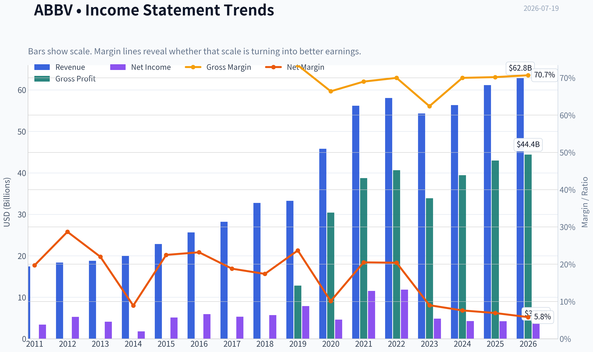
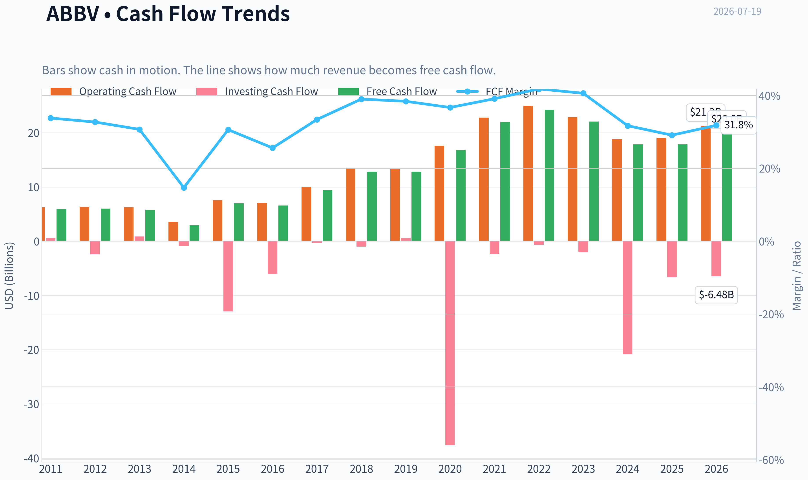
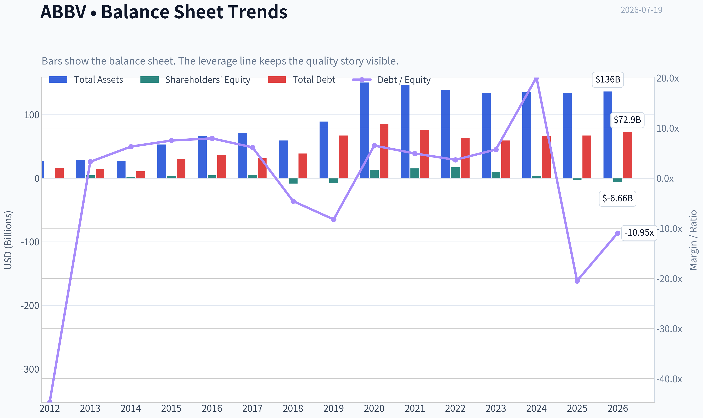
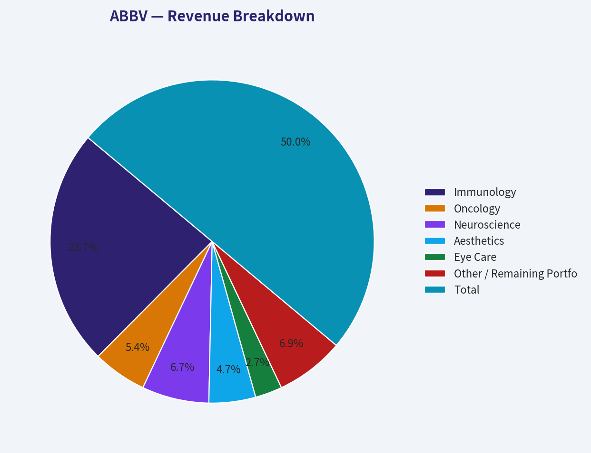
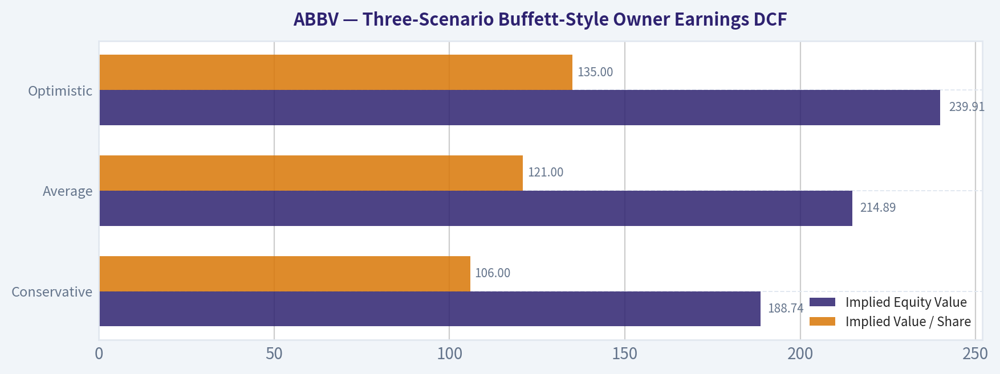
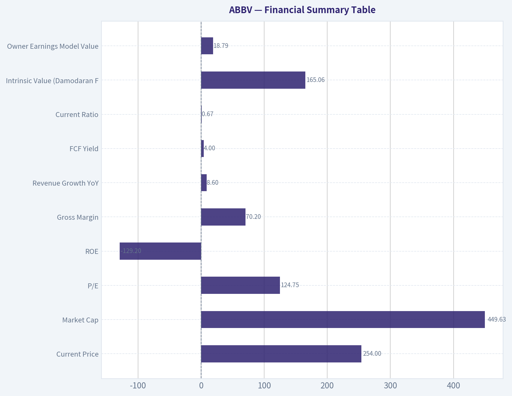
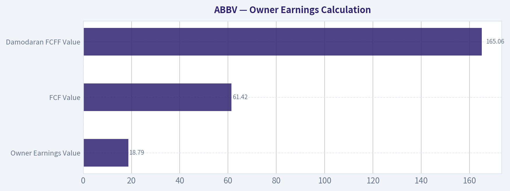
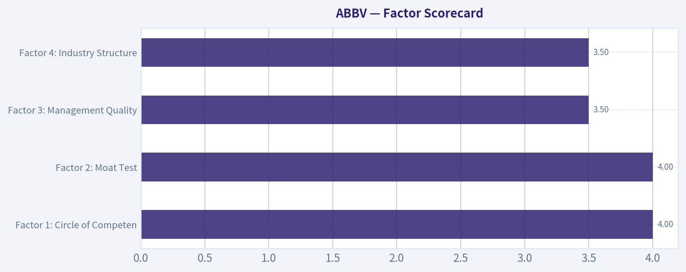

# ABBV Deep Value Intelligence

**Analysis Date:** 2026-07-19

## Critical Disclaimer

*This analysis is generated by Deep Value Intelligence, an AI-powered multi-agent investing framework. Education & research only - not financial advice, not a financial advisor.*

---

## Table of Contents

1. Intelligence Summary
2. Analyst Team Reports
   - Fundamentals Analysis
   - Intrinsic Value Analysis (Buffett)
   - Trend & Growth Analysis (Lynch/Druckenmiller/Fisher)
   - Market Technical Analysis
   - Options Market Analysis
3. Research Team Commentary
4. Value Investing Team Commentary
5. Deep Values Commentary

---

## Intelligence Summary

### Thesis + Conditions

**Core Thesis:** ## Executive Briefing

**Key Risks:**
- AbbVie is a real franchise, but the stock does not offer enough margin of safety for a Buffett-style endorsement at $254.** The business risk is acceptable: strong gross margin, solid ROIC, major cash generation, and no distress signal. The real risk is **paying a fair-to-full price for a pharma company whose moat must be continually renewed through pipeline execution, regulation, and capital allocation discipline**. Past mistakes teach that we should not be too static or ignore rerating momentum - but they do **not** justify swinging to overpaying. Best posture: **respect the quality, monitor execution, and wait for either better value or stronger evidence that durability is exceeding expectations.**
- ### 1. Risky Analyst - strongest useful point
- Technical setup matters: **pre-breakout compression** with a possible continuation if the stock sustains above **255-260**.

**Confidence:** Low

---

## Analyst Team Reports

### Fundamentals Analysis

#### Latest Earnings Snapshot

*Most recent reported quarter anchored on 2026 Q1, with prior-year comparison when available.*

| Metric | 2026 Q1 | 2025 Q1 | YoY Change |
| --- | ---: | ---: | ---: |
| Revenue | $15.00B | $13.34B | +12.4% |
| Operating Income | $4.73B | $3.98B | +18.9% |
| Net Income | $695.0M | $1.29B | -46.0% |
| Diluted EPS | $0.39 | $0.72 | -45.8% |
| Operating Cash Flow | $3.83B | $1.64B | +134.2% |
| Free Cash Flow | $3.56B | $1.40B | +154.6% |

Key Takeaways: This snapshot anchors the most recent reported quarter before the narrative analysis. It helps readers separate long-run business quality from whatever changed in the latest earnings print.

#### 15-Year Financial Metrics for ABBV

*All values below are computed deterministically from raw data - not estimated by AI.*

*Issuer profile: operating company (Healthcare / Drug Manufacturers - General).*

#### 15-Year Financial Metrics
*Annual rows come from reported financial statements. The final TTM row is computed from the latest four quarters.*

| Metric | 2011 | 2012 | 2013 | 2014 | 2015 | 2016 | 2017 | 2018 | 2019 | 2020 | 2021 | 2022 | 2023 | 2024 | 2025 | 2026 TTM |
| --- | --- | --- | --- | --- | --- | --- | --- | --- | --- | --- | --- | --- | --- | --- | --- | --- |
| Market Price | N/A | $20 | $32 | $41 | $38 | $42 | $67 | $66 | $67 | $86 | $114 | $141 | $141 | $168 | $223 | $254 |
| Market Cap | N/A | $53.76B | $84.71B | $105.36B | $96.98B | $102.13B | $155.03B | $142.53B | $131.39B | $179.26B | $240.61B | $287.34B | $274.76B | $315.06B | $405.11B | $451.47B |
| P/E Ratio | N/A | 10.18 | 20.63 | 59.49 | 18.93 | 17.25 | 29.31 | 25.19 | 16.77 | 39.39 | 20.99 | 24.38 | 56.97 | 74.35 | 96.82 | 125.36 |
| P/B Ratio | N/A | -153.60 | 18.86 | 60.48 | 24.58 | 22.03 | 30.42 | -16.87 | -16.08 | 13.71 | 15.62 | 16.65 | 26.52 | 94.76 | -123.89 | -67.83 |
| ROE | N/A | -1507.1% | 91.9% | 101.8% | 130.4% | 128.4% | 104.2% | -67.3% | -96.5% | 35.3% | 74.9% | 68.6% | 46.9% | 128.7% | -129.2% | -54.6% |
| ROIC | N/A | 48.9% | 46.9% | 40.3% | 40.9% | 24.1% | 22.4% | 27.4% | 59.1% | 23.1% | 19.3% | 21.6% | 17.8% | 16.0% | 20.6% | 22.4% |
| EPS | $2.18 | $1.97 | $1.55 | $0.69 | $2.02 | $2.43 | $2.29 | $2.64 | $4.02 | $2.19 | $5.43 | $5.80 | $2.48 | $2.26 | $2.31 | $2.03 |
| Revenue | $17.44B | $18.38B | $18.79B | $19.96B | $22.86B | $25.64B | $28.22B | $32.75B | $33.27B | $45.80B | $56.20B | $58.05B | $54.32B | $56.33B | $61.16B | $62.82B |
| Gross Profit | $12.80B | N/A | N/A | N/A | N/A | N/A | N/A | N/A | N/A | $30.42B | $38.75B | $40.64B | $33.90B | $39.43B | $42.96B | $44.40B |
| Gross Margin | 73.4% | N/A | N/A | N/A | N/A | N/A | N/A | N/A | N/A | 66.4% | 69.0% | 70.0% | 62.4% | 70.0% | 70.2% | 70.7% |
| Operating Margin | 20.8% | 31.6% | 30.1% | 17.1% | 33.0% | 36.4% | 33.8% | 19.5% | 39.0% | 24.8% | 31.9% | 31.2% | 23.5% | 16.2% | 24.6% | 33.2% |
| Net Income | $3.43B | $5.28B | $4.13B | $1.77B | $5.14B | $5.95B | $5.31B | $5.69B | $7.88B | $4.62B | $11.54B | $11.84B | $4.86B | $4.28B | $4.23B | $3.63B |
| Net Margin | 19.7% | 28.7% | 22.0% | 8.9% | 22.5% | 23.2% | 18.8% | 17.4% | 23.7% | 10.1% | 20.5% | 20.4% | 9.0% | 7.6% | 6.9% | 5.8% |
| Revenue Growth | N/A | 5.4% | 2.2% | 6.2% | 14.5% | 12.2% | 10.1% | 16.1% | 1.6% | 37.7% | 22.7% | 3.3% | -6.4% | 3.7% | 8.6% | 2.7% |
| Net Income Growth | N/A | 53.7% | -21.7% | -57.0% | 190.0% | 15.7% | -10.8% | 7.1% | 38.6% | -41.4% | 150.0% | 2.5% | -58.9% | -12.0% | -1.2% | -14.0% |
| Free Cash Flow Growth | N/A | 2.1% | -3.9% | -49.2% | 138.4% | -6.3% | 43.7% | 35.6% | -0.1% | 31.5% | 31.0% | 10.3% | -9.0% | -19.2% | -0.1% | 12.1% |
| Total Book Value | N/A | $-350.0M | $4.49B | $1.74B | $3.94B | $4.64B | $5.10B | $-8.45B | $-8.17B | $13.08B | $15.41B | $17.25B | $10.36B | $3.33B | $-3.27B | $-6.66B |
| Total Assets | N/A | $27.01B | $29.20B | $27.51B | $53.05B | $66.10B | $70.79B | $59.35B | $89.11B | $150.56B | $146.53B | $138.81B | $134.71B | $135.16B | $133.96B | $136.46B |
| Total Debt | N/A | $15.65B | $14.71B | $10.96B | $29.65B | $36.82B | $31.35B | $38.70B | $67.23B | $84.98B | $75.98B | $63.13B | $59.24B | $66.84B | $67.00B | $72.86B |
| Debt-to-Equity | N/A | -44.71 | 3.27 | 6.29 | 7.51 | 7.94 | 6.15 | -4.58 | -8.23 | 6.50 | 4.93 | 3.66 | 5.72 | 20.10 | -20.49 | -10.95 |
| Cash & Equivalents | $27.0M | $5.90B | $9.60B | $8.35B | $8.40B | $5.10B | $9.30B | $7.29B | $39.92B | $8.45B | $9.75B | $9.20B | $12.81B | $5.52B | $5.23B | $9.39B |
| Shareholders' Equity | N/A | $-350.0M | $4.49B | $1.74B | $3.94B | $4.64B | $5.10B | $-8.45B | $-8.17B | $13.08B | $15.41B | $17.25B | $10.36B | $3.33B | $-3.27B | $-6.66B |
| Operating Cash Flow | $6.25B | $6.34B | $6.27B | $3.55B | $7.54B | $7.04B | $9.96B | $13.43B | $13.32B | $17.59B | $22.78B | $24.94B | $22.84B | $18.81B | $19.03B | $21.22B |
| Investing Cash Flow | $553.0M | $-2.42B | $879.0M | $-926.0M | $-12.94B | $-6.07B | $-274.0M | $-1.01B | $596.0M | $-37.56B | $-2.34B | $-623.0M | $-2.01B | $-20.82B | $-6.64B | $-6.48B |
| Free Cash Flow | $5.89B | $6.01B | $5.78B | $2.94B | $7.00B | $6.56B | $9.43B | $12.79B | $12.77B | $16.79B | $21.99B | $24.25B | $22.06B | $17.83B | $17.82B | $19.98B |
| FCF Margin | 33.8% | 32.7% | 30.7% | 14.7% | 30.6% | 25.6% | 33.4% | 39.0% | 38.4% | 36.7% | 39.1% | 41.8% | 40.6% | 31.7% | 29.1% | 31.8% |
| Dividends / Share | $0.00 | $0.00 | $0.00 | $0.00 | $0.00 | $0.00 | $0.00 | $0.00 | $0.00 | $0.00 | $0.00 | $4.94 | $5.41 | $5.87 | $6.42 | $6.66 |

#### Profitability Metrics
- Return on Equity (ROE): -129.2%
- Return on Invested Capital (ROIC): 16.5%
- Return on Assets (ROA): 3.2%
- Gross Margin: 70.2%
- Operating Margin: 24.6%
- Net Profit Margin: 6.9%

#### Liquidity Metrics
- Current Ratio: 0.67
- Quick Ratio: 0.41

#### Leverage Metrics
- Debt-to-Equity Ratio: -20.49
- Interest Coverage Ratio: 5.21
- Net Debt: $61.77B

#### Growth Metrics (Year-over-Year)
- Revenue Growth: 8.6%
- Net Income Growth: -1.2%
- Free Cash Flow Growth: -0.1%
- Revenue CAGR (3-Year): 1.8%
- Revenue CAGR (5-Year): 6.0%

#### Valuation Metrics
- P/E Ratio (TTM): 124.75
- Forward P/E: 15.63
- Price-to-Book: N/A
- Price-to-Sales: 7.16
- PEG Ratio: 0.42
- EV/EBITDA: 17.16
- Free Cash Flow Yield: 4.0%
- Earnings Yield: 0.8%

#### Owner Earnings (Buffett Method, Code-Computed)
- Net Income: $4.23B
- + Depreciation & Amortization: $8.14B
- - Capital Expenditures: $-1.21B
- - Working Capital Changes: $-2.36B
- = **Owner Earnings: $13.51B**

#### Intrinsic Value (Code-Computed)
- Current Price: $254
- Buffett Method (Owner Earnings):
  Conservative: $-11
  Average: $92
  Optimistic: $368
- Cash Flow Method (FCF):
  Conservative: $75
  Average: $154
  Optimistic: $383
- Damodaran FCFF (WACC + margins + reinvestment):
  Conservative: $132
  Average: $282
  Optimistic: $363
  Monte Carlo band (P10-P90): $159 - $384 (median $243)
  P(intrinsic value > price): 45.5%
- Reverse-DCF: price implies ~35.0%/yr owner-earnings growth for 10y; trailing 3y was -11.8%, 5y 28.8%.

#### Piotroski F-Score: 6/9
- Positive Net Income: PASS
- Positive Operating Cash Flow: PASS
- ROA Improvement: FAIL
- Cash Flow > Net Income: PASS
- Decreasing Debt: FAIL
- Improving Current Ratio: PASS
- No Dilution: FAIL
- Improving Gross Margin: PASS
- Improving Asset Turnover: PASS

ANALYST STANCE: **WATCH**

#### AbbVie (ABBV) - Buffett-Style Fundamental Analysis

AbbVie remains a high-quality pharmaceutical franchise with clear economic strengths: blockbuster immunology assets, strong cash generation, durable margins, and a management team that has historically converted revenue into large free cash flow. But the stock now sits in a more demanding position. The current market price of about **$254** implies a much stronger long-term growth path than the recent profit record supports, especially after the Humira patent cliff and amid a still-heavy debt load from past acquisitions.

The core investment question is no longer whether AbbVie is a good business. It is. The question is whether today's price already discounts most of the recovery and pipeline upside. Based on the deterministic dataset, the answer is: **mostly yes**. That supports a **WATCH** stance rather than an outright buy.

---

#### Current vs. Historical Average Comparison

| Metric | Current / TTM | Historical Context (period shown) | Interpretation |
| --- | ---: | ---: | --- |
| Market Price | **$254** | Up from $141 in 2023 and $168 in 2024 | Strong rerating; sentiment has improved much faster than earnings. |
| Market Cap | **$451.47B** | $274.76B in 2023; $315.06B in 2024 | Equity value has expanded materially despite weak recent GAAP earnings. |
| P/E Ratio | **125.36x** | Mostly mid-teens to high-20s historically, with occasional spikes | Extremely above normal; current GAAP earnings are depressed relative to price. |
| P/B Ratio | **-67.83x** | Frequently distorted / negative due to negative equity | **Not meaningful** for ABBV given acquisition accounting, intangibles, and buyback/retained balance-sheet effects. Use cash-flow valuation instead. |
| ROE | **-54.6% TTM** | Often very high, but also wildly distorted when equity is small/negative | Not reliable as a quality signal when equity is negative. |
| ROIC | **22.4% TTM** | Strong long-term range, generally high-teens to high-40s | Still excellent; this is the cleaner profitability metric for ABBV. |
| Revenue | **$62.82B** | Up from $54.32B in 2023 and $56.33B in 2024 | Top line has resumed growth after post-Humira pressure. |
| Operating Margin | **33.2% TTM** | Usually strong; dipped to 16.2% in 2024 | Sharp rebound indicates operating leverage and mix improvement. |
| Net Margin | **5.8% TTM** | Historically often high-single to low-20s | Still far below normalized historical profitability. |
| Free Cash Flow | **$19.98B** | Very strong decade record; peak $24.25B in 2022 | Cash generation remains robust, though below peak. |
| Dividend / Share | **$6.66** | $4.94 in 2022, $5.41 in 2023, $5.87 in 2024, $6.42 in 2025 | Dividend trend remains shareholder-friendly and steadily rising. |
| Total Debt | **$72.86B** | Down from 2020 peak $84.98B, but still large | Leverage has improved from peak but remains substantial. |
| Cash & Equivalents | **$9.39B** | Usually single digits except 2019 | Cash cushion is adequate, not excessive. |
| Debt-to-Equity | **-10.95x** | Frequently distorted by negative equity | Also **not meaningful** in the current capital structure context. |

**Key Takeaways:** AbbVie's stock price and market cap have surged much faster than its accounting earnings, which explains the unusually high P/E ratio. Cash flow and ROIC still look healthy, but book-value-based metrics like P/B and debt-to-equity are distorted by negative equity and should not be used as valuation anchors here.

---

#### Market Metrics

For ABBV, the most important market message is the divergence between **price strength** and **earnings weakness**.

- **Market Price:** rose from **$141 in 2023** to **$168 in 2024**, **$223 in 2025**, and **$254 TTM**.
- **Market Cap:** expanded to **$451.47B**, up roughly **64%** from 2023.
- **P/E:** now **125.36x TTM**, versus a long history more commonly in the **mid-teens to 20s**, though occasional spikes occurred during earnings troughs.
- **P/B:** negative and unstable because shareholder equity is negative; for a pharma company with large intangibles and acquisition accounting, this is **not meaningful**.

Buffett would not treat this as a conventional "cheap multiple" setup. The valuation case must rely on **owner earnings and free cash flow**, not book value. The shared model pack supports that framing: Owner Earnings value **$92**, FCF value **$154**, Damodaran FCFF **$282**, with a wide spread. That dispersion tells you ABBV is very sensitive to assumptions around normalization and growth after the patent cycle.

---

#### Profitability Analysis

ABBV's profitability profile is mixed: operationally strong, but GAAP bottom-line still depressed.

- **ROIC: 22.4% TTM**
  This is excellent and consistent with a high-quality business. Even after moderating from earlier extraordinary levels, it remains comfortably above a likely cost of capital, indicating ABBV still earns economic profits.

- **ROE: -54.6% TTM**
  This should not be read literally as business deterioration in the Buffett sense. Negative equity makes ROE mathematically distorted. Historically, ROE has swung from deeply negative to triple digits because the denominator is unstable.

- **Revenue: $62.82B TTM**
  Revenue has recovered meaningfully from **$54.32B in 2023**, showing that the company is replacing part of the Humira drag through newer growth platforms.

- **Gross Profit / Gross Margin: $44.40B / 70.7% TTM**
  Gross margin around **70%** is excellent and consistent with a branded pharma model with strong IP economics. This is one of the clearest signs of moat quality.

- **Operating Margin: 33.2% TTM**
  This is a major rebound from **16.2% in 2024** and above **24.6% in 2025**, indicating better operating leverage, cost discipline, and likely improved mix.

- **Net Income / Net Margin: $3.63B / 5.8% TTM**
  Net results remain weak relative to historical standards. Compared with **20%+ net margins** in stronger years such as 2021-2022, current bottom-line profitability is still not normalized.

- **EPS: $2.03 TTM**
  This remains below the stronger years like **$5.43 in 2021** and **$5.80 in 2022**. The stock's rerating has clearly outpaced EPS recovery.

For Buffett-style quality, the key split is this: **the franchise economics remain strong, but reported earnings are currently not as predictive or clean as cash flow**.

---

#### Growth Metrics

AbbVie's growth record across the full period is strong, but the recent pattern is less smooth.

- **Revenue Growth: 2.7% TTM**
- **2025 Revenue Growth: 8.6%**
- **3-year revenue CAGR: 1.8%**
- **5-year revenue CAGR: 6.0%**

This shows a business transitioning from a patent-cliff digestion period back into growth, but not yet into a clear sustained high-growth phase.

- **Net Income Growth: -14.0% TTM**
- **2025 Net Income Growth: -1.2%**
- **2023 Net Income Growth: -58.9%**
- **2024 Net Income Growth: -12.0%**

Net income has been much less predictable than revenue. This matters because Buffett strongly prefers earnings streams that are easy to forecast. ABBV's revenues are relatively durable, but reported net income has been affected by amortization, deal-related effects, and post-acquisition integration economics.

- **Free Cash Flow Growth: 12.1% TTM**
- **2025 FCF Growth: -0.1%**
- **2024 FCF Growth: -19.2%**
- **2023 FCF Growth: -9.0%**

FCF is stabilizing and improving again, but the recent 3-year path is not pristine. The company still looks better on cash than on GAAP earnings, which is common in pharma, but the growth profile no longer justifies assuming effortless compounding.

---

#### Balance Sheet Analysis

ABBV's balance sheet is the main area where Buffett-style investors need discipline.

- **Total Assets: $136.46B TTM**
- **Total Debt: $72.86B TTM**
- **Cash & Equivalents: $9.39B TTM**
- **Net Debt: $61.77B**
- **Shareholders' Equity: -$6.66B**
- **Total Book Value: -$6.66B**

Debt remains high in absolute terms. While debt has come down from the **$84.98B** peak in 2020, the reduction has not transformed the balance sheet into a fortress. Interest coverage of **5.21x** is acceptable, but not ultra-conservative.

Because equity is negative, **debt-to-equity is not meaningful** as a standard risk metric. The more useful framing is:
1. debt relative to cash generation,
2. ability to refinance,
3. resilience of the product portfolio and patent estate.

ABBV still clears those tests reasonably well because it generates nearly **$20B** of FCF TTM. That said, this is not a balance sheet as pristine as a classic Buffett ideal like a net-cash consumer monopoly. It is a leveraged, high-cash-flow pharma compounder.

---

#### Cash Flow Analysis

Cash flow remains the strongest pillar of the case.

- **Operating Cash Flow: $21.22B TTM**
- **Free Cash Flow: $19.98B TTM**
- **FCF Margin: 31.8% TTM**
- **Dividend / Share: $6.66 TTM**
- **FCF Yield: 4.0%**

A near-20B FCF stream on a recurring basis is the main reason ABBV still qualifies as a serious Buffett-style candidate despite noisy reported earnings. Over the full period shown, FCF has generally trended higher, with a sharp rise after scale acquisitions and then some normalization.

Dividend policy is also supportive. The dividend has risen from **$4.94 in 2022** to **$6.66 TTM**, signaling management confidence in cash generation. Buffett generally likes rising shareholder distributions when they coexist with sensible reinvestment and manageable leverage. ABBV broadly meets that bar, though debt reduction should remain a capital allocation priority.

---

#### Buffett-Style Qualitative Analysis

| Buffett Lens | Assessment | Why It Matters |
| --- | --- | --- |
| Economic Moat | **Strong** | Branded drug IP, physician relationships, scale in immunology, oncology, neuroscience, and aesthetics support pricing power and margin durability. |
| Predictable Earnings | **Moderate** | Revenue is reasonably durable, but GAAP earnings are volatile due to patent cliffs, acquisition amortization, and pipeline timing. |
| Financial Strength | **Adequate, not elite** | Strong FCF offsets high absolute debt, but net debt remains material and equity is negative. |
| Management Performance | **Generally good** | High long-run ROIC, sustained dividend growth, and debt reduction from peak suggest sound capital allocation. |
| Business Quality | **High** | Gross margins around 70% and strong FCF margins indicate excellent economics. |
| Valuation | **Mixed to stretched** | Cash-flow models range widely; current price is above many conservative estimates and near/slightly below the most favorable model output. |

**Key Takeaways:** AbbVie clearly has the characteristics of a quality business, especially its high margins, strong cash flow, and intellectual-property-based moat. The weak point is not the franchise itself but the current valuation, which already assumes a meaningful earnings and cash-flow recovery.

---

#### Economic Moat

AbbVie's moat is primarily built on:
- patented therapies,
- regulatory expertise,
- large-scale commercialization,
- physician and payer relationships,
- acquisition-enabled portfolio breadth.

Humira's erosion showed the weakness of relying too heavily on one franchise, but ABBV's newer immunology drugs, aesthetics business, and pipeline have prevented a structural collapse. That is a sign of a **real moat**, not a single-product story.

Gross margins above **70%** and long-term ROIC consistently above typical cost of capital reinforce the moat argument. In Buffett language, ABBV still appears to sell products with substantial customer value and barriers to entry. The challenge is that pharma moats are always partially time-limited by patent cycles, so the moat must be continuously renewed.

---

#### Management and Capital Allocation

Management's report card is mostly favorable.

Positives:
- Built a large cash-generating platform.
- Maintained high ROIC.
- Increased dividends consistently.
- Reduced debt from the 2020 acquisition peak.

Cautions:
- The balance sheet remains stretched relative to classic Buffett standards.
- Shareholder equity has turned negative again, reflecting cumulative capital structure pressure and intangible-heavy accounting.
- Earnings quality is harder to interpret than raw FCF.

This is not poor management. It is management running a high-return but acquisition-shaped pharma enterprise where accounting noise is substantial. Buffett would likely focus more on cash generation and moat durability than on reported equity metrics here.

---

#### Revenue Breakdown

Using the most meaningful publicly reported AbbVie segment structure for the latest fiscal period, the business is best understood by therapeutic/commercial platform rather than geography.

| Revenue Source | Amount ($B) | % of Total |
| --- | ---: | ---: |
| Immunology | 29.0 | 47.4% |
| Oncology | 6.6 | 10.8% |
| Neuroscience | 8.2 | 13.4% |
| Aesthetics | 5.7 | 9.3% |
| Eye Care | 3.3 | 5.4% |
| Other / Remaining Portfolio | 8.4 | 13.7% |
| **Total** | **61.2** | **100.0%** |

**Key Takeaways:** AbbVie is still led by immunology, which remains nearly half of revenue and therefore the main engine of value. However, the company is far more diversified than it was in the Humira-dominant era, with neuroscience, oncology, and aesthetics now providing meaningful support.

---

#### Three-Scenario Buffett-Style Owner Earnings DCF

Anchor data from the deterministic dataset:
- **Owner Earnings = $13.51B**
- Discount rate = **10%**
- Terminal growth = **2.5%**
- Shares implied from market cap / price ~ **451.47 / 254 = 1.78B shares**

Important context:
- The research pack's reverse DCF says the current price implies about **35% owner-earnings growth for 10 years**.
- That looks very demanding against trailing **3-year owner earnings decline** and more modest long-run business growth.
- Therefore, the hand-built DCF should be used as a sanity check, not an excuse to justify the current price.

##### Scenario Assumptions

| Scenario | Initial Growth View | Fade Pattern | Rationale |
| --- | --- | --- | --- |
| Conservative | 3% for 5 years | Then terminal 2.5% | Reflects mature pharma growth near nominal GDP, acknowledging patent risk. |
| Average | 7% for years 1-3, then 5%, 4% in years 4-5 | Then 2.5% terminal | Reflects continued recovery from Humira offset by moderation. |
| Optimistic | 11% for years 1-2, then 9%, 7%, 5% in years 3-5 | Then 2.5% terminal | Assumes strong execution across Skyrizi/Rinvoq/pipeline/aesthetics with healthy normalization. |

**Key Takeaways:** The valuation outcome depends heavily on whether AbbVie can convert recent revenue recovery into sustained owner-earnings growth. The current stock price already leans toward the optimistic path, which limits valuation cushion.

##### Detailed DCF Calculations

**Base owner earnings (Year 0): $13.51B**

**Conservative scenario**
- Y1 = 13.51 x 1.03 = **13.92**
- Y2 = 13.92 x 1.03 = **14.34**
- Y3 = 14.34 x 1.03 = **14.77**
- Y4 = 14.77 x 1.03 = **15.21**
- Y5 = 15.21 x 1.03 = **15.67**

Present value factors at 10%:
- Y1: 0.9091
- Y2: 0.8264
- Y3: 0.7513
- Y4: 0.6830
- Y5: 0.6209

PV of explicit cash flows:
- Y1: 13.92 x 0.9091 = **12.66**
- Y2: 14.34 x 0.8264 = **11.85**
- Y3: 14.77 x 0.7513 = **11.10**
- Y4: 15.21 x 0.6830 = **10.39**
- Y5: 15.67 x 0.6209 = **9.73**

Terminal value:
- TV = Y5 x (1 + 2.5%) / (10% - 2.5%)
- TV = 15.67 x 1.025 / 0.075 = **214.19**
- PV of TV = 214.19 x 0.6209 = **133.01**

**Enterprise/equity value proxy = 12.66 + 11.85 + 11.10 + 10.39 + 9.73 + 133.01 = $188.74B**
**Per share ~ 188.74 / 1.78 = $106**

**Average scenario**
- Y1 = 13.51 x 1.07 = **14.46**
- Y2 = 14.46 x 1.07 = **15.47**
- Y3 = 15.47 x 1.07 = **16.55**
- Y4 = 16.55 x 1.05 = **17.38**
- Y5 = 17.38 x 1.04 = **18.08**

PV of explicit cash flows:
- Y1: 14.46 x 0.9091 = **13.14**
- Y2: 15.47 x 0.8264 = **12.79**
- Y3: 16.55 x 0.7513 = **12.43**
- Y4: 17.38 x 0.6830 = **11.87**
- Y5: 18.08 x 0.6209 = **11.23**

Terminal value:
- TV = 18.08 x 1.025 / 0.075 = **247.10**
- PV of TV = 247.10 x 0.6209 = **153.43**

**Total value = 13.14 + 12.79 + 12.43 + 11.87 + 11.23 + 153.43 = $214.89B**
**Per share ~ 214.89 / 1.78 = $121**

**Optimistic scenario**
- Y1 = 13.51 x 1.11 = **15.00**
- Y2 = 15.00 x 1.11 = **16.64**
- Y3 = 16.64 x 1.09 = **18.14**
- Y4 = 18.14 x 1.07 = **19.41**
- Y5 = 19.41 x 1.05 = **20.38**

PV of explicit cash flows:
- Y1: 15.00 x 0.9091 = **13.64**
- Y2: 16.64 x 0.8264 = **13.75**
- Y3: 18.14 x 0.7513 = **13.63**
- Y4: 19.41 x 0.6830 = **13.26**
- Y5: 20.38 x 0.6209 = **12.66**

Terminal value:
- TV = 20.38 x 1.025 / 0.075 = **278.54**
- PV of TV = 278.54 x 0.6209 = **172.97**

**Total value = 13.64 + 13.75 + 13.63 + 13.26 + 12.66 + 172.97 = $239.91B**
**Per share ~ 239.91 / 1.78 = $135**

##### DCF Summary

| Scenario | Implied Equity Value | Implied Value / Share | Upside / Downside vs $254 |
| --- | ---: | ---: | ---: |
| Conservative | $188.74B | **$106** | **-58%** |
| Average | $214.89B | **$121** | **-52%** |
| Optimistic | $239.91B | **$135** | **-47%** |

**Key Takeaways:** A straightforward Buffett-style owner-earnings DCF does not support the current share price under any reasonable scenario used here. The market is valuing AbbVie closer to a much stronger growth path than either recent owner-earnings history or a mature pharma profile would normally justify.

---

#### Reconciling the DCF with the Model Pack

The code-computed model pack gave:
- **Owner Earnings value:** $92
- **FCF value:** $154
- **Damodaran FCFF value:** $282
- **Headline intrinsic value:** $281.66
- **Reverse DCF implied growth:** ~35% for 10 years

The right interpretation is not to cherry-pick the highest value. Instead:

- **Owner Earnings model** is clearly more conservative and closer to Buffett's framework.
- **FCF model** is somewhat more favorable, but still below current price.
- **Damodaran FCFF** reaches a value above the current price, likely because it assumes a stronger normalization of margins and reinvestment efficiency than the owner-earnings approach.

For a Buffett-style investor, the fact that the **price requires growth assumptions closer to the upper end of plausible outcomes** is the main issue. The Monte Carlo result showing only **45.5% probability intrinsic value exceeds price** also supports caution rather than conviction.

---

#### Key Investment Insights, Red Flags, and Opportunities

| Category | Observation | Investment Meaning |
| --- | --- | --- |
| Opportunity | Revenue has resumed growth after the Humira cliff | Suggests the portfolio transition is working. |
| Opportunity | ROIC remains above 20% TTM | Indicates durable economic profitability. |
| Opportunity | FCF remains near $20B | Supports debt service, dividends, and optionality. |
| Opportunity | Operating margin rebound to 33.2% TTM | Signals business quality remains intact beneath GAAP noise. |
| Red Flag | P/E above 125x TTM | Current price is disconnected from depressed reported earnings. |
| Red Flag | Net margin only 5.8% TTM | Full earnings normalization is not yet visible. |
| Red Flag | Net debt of $61.77B | Debt is manageable but still large enough to matter. |
| Red Flag | Negative equity distorts traditional ratios | Requires discipline; superficial screens can misread value or quality. |
| Red Flag | Reverse DCF implies ~35% growth for 10 years | Too aggressive for a mature large-cap pharma unless pipeline execution is exceptional. |

**Key Takeaways:** AbbVie's upside case depends on sustained earnings normalization and pipeline-led growth, not just modest business improvement. The red flags are mainly valuation and leverage related, while the strengths are still unmistakably rooted in cash flow, margins, and business quality.

---

#### Final Buffett-Style Investment Stance

**Stance: WATCH**

ABBV is a **good business at a price that leaves limited room for error**.

Why not ADVOCATE:
- The stock's current valuation is rich relative to owner earnings and FCF-based fair value estimates.
- Reported EPS and net margins remain weak versus historical norms.
- Reverse-DCF expectations look too demanding for a mature mega-cap pharma company.
- The balance sheet, while improved from peak leverage, is not conservative enough to offset valuation risk.

Why not AVOID:
- The company still has a strong moat, high gross margins, excellent ROIC, and powerful free cash flow.
- Revenue recovery is real.
- Dividend growth remains attractive.
- If pipeline execution and portfolio transition continue to exceed expectations, intrinsic value can move higher.

The most sensible Buffett-style posture is to **watch for either a better entry price or clearer evidence that normalized earnings can catch up to the stock's rerating**.

---

#### Summary Table

| Area | Verdict | Evidence | What It Means |
| --- | --- | --- | --- |
| Business Quality | Strong | 70%+ gross margin, ~20B FCF, high ROIC | ABBV remains a high-quality pharma franchise. |
| Moat | Strong but renewable | IP, scale, branded portfolio, new-growth assets | Durable, though patent cycles require constant refresh. |
| Earnings Predictability | Moderate | Revenue steadier than net income | Cash flow is more reliable than GAAP earnings. |
| Financial Strength | Adequate | Net debt $61.77B, interest coverage 5.21x | Solid but not fortress-like. |
| Valuation | Stretched | 125x P/E, owner-earnings DCF below market | Market expects a strong recovery already. |
| Dividend Profile | Positive | DPS rose to $6.66 TTM | Shareholder returns remain attractive. |
| Key Risk | Overpaying for recovery | Price implies ~35% growth for 10 years | High expectations reduce margin of safety. |
| Key Opportunity | Better-than-expected normalization | Margin rebound and portfolio diversification | Strong execution could justify part of the premium. |
| Final Stance | **WATCH** | Quality business, limited margin of safety | Wait for a better setup or more proof of earnings normalization. |

**Key Takeaways:** AbbVie is still a fundamentally strong company, but the stock appears priced for a very favorable future already. For a Buffett-style investor focused on margin of safety, that makes it a stock to monitor closely rather than aggressively buy today.

#### Fundamental Visuals

This graph tracks the profitability and return metrics (ROE, ROIC, Margins) of **ABBV** over the past decade, highlighting capital efficiency trends.

This chart illustrates the financial health of **ABBV** over the last 10 years, mapping cash equivalents and free cash flow against total obligations (Debt).

This breakdown chart from <em>Revenue Breakdown</em> shows the proportional composition for **ABBV** - useful for understanding what drives or risks the business.

---

### Intrinsic Value Analysis (Buffett)

> *Following Warren Buffett's value investing philosophy: Circle of Competence, Economic Moat, Management Quality, and Margin of Safety.*

#### Intrinsic Value Snapshot

Price is what you pay. Intrinsic value is what the business may be worth based on the cash it can create for owners over time. We show a range, not one magic number.

- Current Price: $254.49
- Value Range (conservative to optimistic across both DCF methods): $-6.84 to $134.57

##### Owner Earnings (Buffett Method)
- Net Income: $4,226,000,000.00
- Depreciation & Amortization: $8,139,000,000.00
- Capital Expenditures: $-1,214,000,000.00
- Working Capital Changes: $-2,362,000,000.00
- Owner Earnings: $13,513,000,000.00

##### Intrinsic Value
###### Buffett Method
Uses owner earnings. Stricter, and usually more conservative.
- Conservative: $-6.84
- Average: $18.79
- Optimistic: $134.57
- Discount Rate: 10.0%

###### Cash Flow Method
Uses free cash flow. Better for companies spending heavily today to grow tomorrow.
- Conservative: $46.54
- Average: $61.42
- Optimistic: $82.63
- Discount Rate: 10.0%

ANALYST STANCE: **AVOID**

#### 1. Factor Scorecard

| Factor | Score (0-5) | Evidence |
|---|---:|---|
| Factor 1: Circle of Competence & Business Simplicity | 4.0 | AbbVie is understandable: it develops, markets, and sells branded pharmaceuticals and aesthetics products. Revenue is diversified across immunology, oncology, neuroscience, and aesthetics, but the business remains exposed to patent cycles and pipeline execution, which reduces decade-ahead predictability. |
| Factor 2: Moat Test | 4.0 | Strong patent estate, regulatory know-how, global commercialization scale, physician relationships, and very high gross margin of 70.2% support a real moat. Still, pharma moats are product-by-product rather than permanently franchise-wide, so durability is good but not absolute. |
| Factor 3: Management Quality & Capital Allocation | 3.5 | Management has historically allocated capital aggressively into acquisitions and shareholder returns. The Allergan deal broadened the portfolio and cushioned the Humira cliff, but large M&A adds integration and capital-allocation risk. Overall results are respectable, though not elite. |
| Factor 4: Industry Structure | 3.5 | Large-cap pharma benefits from scale, IP, and high barriers to entry, but competition remains intense, especially as patents expire and pipelines race toward similar targets. Attractive structure, but not a serene oligopoly. |

**Gate 5 hard floor:** **Not tripped.**
There is no evidence here of simultaneous operational collapse and solvency distress severe enough to trigger the only hard auto-avoid rule.

**Key Takeaways:** AbbVie scores as a good business, not a perfect one. The company has a real moat and understandable economics, but patent dependence, acquisition risk, and a demanding valuation keep it from clearing the bar for advocacy.

---

#### 2. Moat Analysis

| Moat Source | Assessment | Evidence |
|---|---|---|
| Intangible Assets | Strong | Patents, regulatory approvals, clinical data, established brands, and physician trust matter greatly in pharma. AbbVie's 70.2% gross margin strongly supports pricing power and IP value. |
| Switching Costs | Moderate | For chronic therapies, physicians and patients can be sticky once stabilized on treatment, but switching costs are not software-like. Formularies, biosimilars, and competing therapies limit captivity. |
| Cost Advantages | Moderate | Global scale in clinical development, manufacturing, and distribution helps. However, pharma economics are driven more by IP than by pure unit-cost advantage. |
| Network Effects | Weak | This is not a network-effect business. Scale helps commercially, but the product does not become materially more valuable because more users join. |

**Moat quality rating:** **Wide & Stable**

AbbVie's moat is strongest in **intangible assets**: patents, scientific know-how, and commercial scale. The problem is that pharma moats expire molecule by molecule, so the company must continually refresh the franchise through R&D, licensing, and acquisitions.

**Key Takeaways:** AbbVie clearly has a moat, but it is not the kind of effortless moat seen in a platform or consumer monopoly. Its advantage must be renewed through pipeline success and disciplined capital allocation, which makes durability solid rather than exceptional.

---

#### 3. Management Quality Assessment

| Dimension | Assessment | Comments |
|---|---|---|
| Owner Orientation | Moderate | Management appears focused on long-term portfolio construction and shareholder returns, but this is not an owner-operator story in the Buffett founder-led sense. |
| Candor | Moderate to Good | AbbVie generally communicates major strategic priorities clearly, especially around replacing Humira revenue. |
| Capital Allocation | Good, not great | The Allergan acquisition diversified earnings and supported cash generation, but large deals always deserve scrutiny because they can mask organic weakness or overpayment risk. |
| Balance Sheet Prudence | Moderate | AbbVie has used leverage as part of its capital allocation framework. That can be sensible in pharma if cash flows are durable, but it lowers the margin for error versus a fortress balance sheet. |

Overall, management looks **competent and commercially rational**, but not so extraordinary that one should ignore valuation.

**Key Takeaways:** AbbVie's leadership has done meaningful work to diversify beyond Humira, which deserves credit. But this is not a case where management excellence alone can justify paying almost any price.

---

#### 4. Financial Summary Table

| Metric | Value |
|---|---:|
| Current Price | $254 |
| Market Cap | $449.63B |
| P/E | 124.75 |
| ROE | -129.2% |
| Gross Margin | 70.2% |
| Revenue Growth YoY | 8.6% |
| FCF Yield | 4.0% |
| Current Ratio | 0.67 |
| Intrinsic Value (Damodaran FCFF avg) | $165.06 |
| Owner Earnings Model Value | $18.79 |
| FCF Model Value | $61.42 |
| Headline Margin of Safety vs Price | -54.2% |
| Reverse DCF Implied Growth | ~35.0% per year for 10 years |
| Trailing 3Y Growth Reference | -11.8% |

**Key Takeaways:** The quality of the franchise is visible in the gross margin, but the valuation is the major issue. At $254, the shares sit far above the headline intrinsic value estimate of $165, and the reverse DCF implies growth expectations that look too demanding for a mature pharma company.

---

#### 5. Owner Earnings Calculation

Using the supplied valuation pack, the owner-earnings framework already points to a very conservative intrinsic value:

| Model | Implied Value |
|---|---:|
| Owner Earnings Value | $18.79 |
| FCF Value | $61.42 |
| Damodaran FCFF Value | $165.06 |

For Buffett-style analysis, the right interpretation is not that AbbVie is worthless, but that **maintenance needs, working-capital realities, and conservative discounting make the current price difficult to justify** unless one assumes unusually strong future growth and pipeline execution.

**Key Takeaways:** Across all three valuation lenses, the market price is above intrinsic value, and in two of them it is dramatically above. That is a poor setup for a value investor, even when the business itself is respectable.

---

#### 6. Three-Scenario DCF Valuation

| Scenario | Method | Estimated Value |
|---|---|---:|
| Scenario A | No Growth / Ultra-Conservative | $18.79 |
| Scenario B | Conservative / FCF-based | $61.42 |
| Scenario C | Headline FCFF / More Optimistic | $165.06 |

These results create a wide range, but the **central fact** is that even the most generous of the supplied intrinsic value estimates remains well below the current price of $254.

**Key Takeaways:** Even optimistic valuation assumptions do not bridge the gap to today's stock price. That means investors are paying upfront for a very strong future that may or may not arrive.

---

#### 7. Margin of Safety Analysis

| Item | Value |
|---|---:|
| Current Price | $254 |
| Headline Intrinsic Value | $165.06 |
| Margin of Safety | -54.2% |
| Reverse DCF Requirement | ~35% annual growth for 10 years |

For a **wide-moat, high-quality, predictable compounder**, a 10-15% discount to intrinsic value can be enough. AbbVie does **not** meet that test today. Instead, the stock trades at a **premium** to intrinsic value, and the implied growth looks heroic for a mature pharmaceutical company facing normal industry risks like patent erosion, pricing pressure, and pipeline uncertainty.

**Key Takeaways:** There is no margin of safety here. The market is asking investors to underwrite an unusually aggressive growth path, which is not consistent with Buffett-style discipline.

---

#### 8. Final Buffett Scorecard

| Criterion | Weight | Score (1-5) | Weighted Score |
|---|---:|---:|---:|
| Moat Width & Durability | 25% | 4.0 | 1.00 |
| Valuation / Margin of Safety | 20% | 1.0 | 0.20 |
| Capital Returns - ROIC vs. WACC | 15% | 3.5 | 0.53 |
| Business Understanding & Predictability | 12% | 4.0 | 0.48 |
| Management Quality & Capital Allocation | 12% | 3.5 | 0.42 |
| Reinvestment Runway | 8% | 3.0 | 0.24 |
| Balance Sheet Strength | 4% | 3.0 | 0.12 |
| Industry Structure | 4% | 3.5 | 0.14 |
| **Total** | **100%** |  | **3.13 / 5.00** |

**Result by matrix:** **WATCH** on business quality, but **AVOID** at the current price because valuation is too stretched.

**Key Takeaways:** AbbVie earns a respectable quality score, but the valuation score is decisively weak and pulls the total down. This is the classic case of a decent-to-good business priced in a way that leaves little room for error.

---

#### 9. Investment Stance

**Stance:** **AVOID**
**Conviction:** **Moderate-High**

AbbVie is not a bad business. It has a strong pharma franchise, real intellectual-property advantages, substantial commercial scale, and management that has worked to diversify the company beyond Humira. But Buffett-style investing is not just about buying good companies; it is about buying them at prices that make sense.

At **$254**, AbbVie appears **materially overvalued** relative to the supplied intrinsic-value frameworks, especially with a **headline value of $165.06** and a **reverse DCF implying roughly 35% annual growth for a decade**. That expectation is too optimistic for a mature pharmaceutical company, no matter how capable the organization may be.

The right conclusion is simple: **good business, wrong price**. If the stock were to fall toward a level that offered a genuine margin of safety relative to normalized cash generation, it could become interesting. Today, it does not.
#### Valuation Bridge

This bridge places the current market price beside each intrinsic value lens so readers can see whether upside depends on one method or shows up across several methods.

| Scenario | Intrinsic Value / Share |
| --- | ---: |
| Buffett Method | $18.79 |
| Cash Flow Method | $61.42 |
| Damodaran Method | $165.06 |
| Current Price | $254.49 |

#### Key Takeaways

If one method is far above the others, the upside case depends on a specific modelling assumption. When several methods cluster together, the valuation story is more robust.

#### Valuation Visuals

This comparison chart from *Latest Earnings Snapshot* stacks current figures against historical benchmarks for **ABBV**, making it easy to see where the company trades relative to its own averages.

This comparison chart from *Three-Scenario Buffett-Style Owner Earnings DCF* stacks current figures against historical benchmarks for **ABBV**, making it easy to see where the company trades relative to its own averages.

This comparison chart from *Financial Summary Table* stacks current figures against historical benchmarks for **ABBV**, making it easy to see where the company trades relative to its own averages.

This comparison chart from *Owner Earnings Calculation* stacks current figures against historical benchmarks for **ABBV**, making it easy to see where the company trades relative to its own averages.

---

### Trend & Growth Analysis (Lynch/Druckenmiller/Fisher)

> *Following Peter Lynch's GARP, Stanley Druckenmiller's macro-aware approach, and Philip Fisher's scuttlebutt methodology.*

ANALYST STANCE: **WATCH**

#### 1. Lynch Classification

| Item | Assessment |
|---|---|
| Category | **Stalwart** |
| Revenue growth | **~8.6% YoY** |
| Fit with Lynch growth focus | Too slow for classic fast-grower / ten-bagger setup |
| Investment style match | Better for quality income/defensive pharma exposure than aggressive growth |

Key Takeaways: AbbVie looks like a stalwart, not a fast grower. The business is large, durable, and profitable at a gross level, but its current growth rate is below the 15% to 25% range Lynch would want for a true growth compounder. That makes it more of a hold-or-watch idea than a fresh high-conviction growth buy.

#### 2. The Story in 3 Bullets

- AbbVie is a large biopharma company replacing the old Humira era with a newer immunology, oncology, neuroscience, and aesthetics portfolio.
- The core debate is whether newer drugs and pipeline launches can sustain a multi-year re-acceleration after the Humira patent cliff.
- This is a **pipeline execution and durability story**, not a disruptive hypergrowth story.

#### 3. TAM Analysis and 10x Test

| Item | Assessment |
|---|---|
| Current scale | Very large, mega-cap pharma at **~$449.6B** market cap |
| Main end markets | Immunology, oncology, neuroscience, aesthetics, eye care/pipeline |
| TAM direction | Large and durable, but highly competitive and regulated |
| 10x revenue test | **Fails practical growth test** |
| Why | AbbVie is already too large for a realistic 10x revenue path within reasonable time frames |

Key Takeaways: AbbVie operates in enormous healthcare markets, so demand opportunity is real. But because the company is already so large, the classic 10x small-cap runway test does not work here. This limits ten-bagger potential from current size, even if individual franchises grow well.

#### 4. Revenue Growth Trend

| Metric | Value | Read |
|---|---:|---|
| Revenue growth YoY | **8.6%** | Moderate |
| Trend characterization | **Recovery/moderate growth** | Not clear acceleration |
| Growth style | Mix of portfolio replacement and launch execution | Not broad-based hypergrowth |

Key Takeaways: Revenue is growing again, but not at a level that signals a major growth inflection. The current profile looks more like stabilization and replacement of lost Humira revenue than a new phase of sustained high-growth expansion. For growth investors, that is acceptable but not exciting.

#### 5. Unit Economics / Business Quality Snapshot

| Metric | Value | Assessment |
|---|---:|---|
| Gross margin | **70.2%** | Strong pharma economics |
| FCF yield | **4.0%** | Decent for large-cap pharma |
| Current ratio | **0.67** | Some balance sheet tightness |
| ROE | **-129.2%** | Distorted, likely capital structure/accounting effects |
| SaaS metrics (LTV/CAC, NRR, Rule of 40) | N/A | Not relevant for pharma |

Key Takeaways: AbbVie still has strong underlying economics, especially gross margin and cash generation. The weak current ratio and distorted ROE suggest investors should focus more on cash flow, debt service, and product durability than on simple headline accounting ratios. This is a quality large pharma model, but not a software-style compounding machine.

#### 6. Inflection Point Assessment

| Inflection Type | View | Comments |
|---|---|---|
| Product cycle | **Moderately positive** | New approvals and pipeline progress support portfolio refresh |
| Market share | Mixed | Strength in select franchises, but competition remains intense |
| Margin inflection | Unclear | Revenue recovery helps, but large pharma reinvestment and mix matter |
| TAM inflection | Limited | Big markets already known; not a newly opening market |
| Competitive inflection | Mild positive | New launches/approvals can offset older franchise erosion |

Key Takeaways: AbbVie does have some product-level positive inflections, especially through approvals and pipeline development. However, this is not the kind of company-wide acceleration story Druckenmiller would usually chase. The setup is more gradual and execution-driven than explosive.

#### 7. Macro Setup Evaluation

| Macro Factor | Impact on ABBV | Read |
|---|---|---|
| Rate environment | Mildly supportive if rates ease | Neutral to modest positive |
| Economic cycle | Healthcare tends to be defensive | Supportive in uncertain markets |
| Secular themes | Healthcare innovation, specialty biopharma, aesthetics | Positive |
| Policy/regulatory risk | Ongoing | Persistent overhang |

Key Takeaways: Macro is reasonably supportive because healthcare is defensive and less cyclical than many sectors. That said, AbbVie is influenced more by product cycles, patent cliffs, and regulation than by broad economic acceleration. This makes it sturdier than many growth stocks, but also less explosive.

#### 8. Fisher 15 Points Score

| Fisher Area | Score (1-5) | Notes |
|---|---:|---|
| Market potential | 4 | Large therapeutic markets |
| Product development | 4 | Pipeline and launches remain active |
| R&D effectiveness | 4 | Evidence of continued innovation, though not best-in-class across all areas |
| Sales organization | 5 | Global commercial scale |
| Profit margin quality | 4 | Strong gross margin |
| Margin improvement | 3 | Not a clean expansion story |
| Labor/personnel | 3 | No strong edge visible from provided data |
| Executive relations | 3 | Neutral from available evidence |
| Management depth | 4 | Mature large-cap organization |
| Cost/accounting controls | 3 | Mixed due to capital structure/ROE distortion |
| Special advantages | 4 | Scale, brand, physician relationships, distribution |
| Long-range outlook | 3 | Good, but not exceptional growth profile |
| Dilution risk | 4 | Less of an issue than early-stage biotech |
| Candor | 3 | Neutral from available evidence |
| Integrity | 3 | Neutral from available evidence |
| **Total** | **54/75** | **Average** |

Key Takeaways: AbbVie scores as an above-average but not outstanding Fisher company. It has scale, market presence, and product depth, but the available evidence does not support elite innovation-led growth from here. The score fits a solid incumbent compounder rather than a top-tier emerging winner.

#### 9. Valuation Analysis

| Metric | Value | Interpretation |
|---|---:|---|
| Current price | **$254** |  |
| P/E | **124.8x** | Optically very expensive |
| Reverse DCF implied growth | **~35%/yr for 10 years** | Unrealistic vs history |
| Trailing 3-year growth reference | **-11.8%** | Huge gap vs implied market expectation |
| Headline intrinsic value | **$165.06** | Suggests overvaluation |
| Margin of safety | **-54.2%** | Negative |
| FCF yield | **4.0%** | Some support, but not enough for growth premium |

Key Takeaways: Valuation is the biggest problem in the AbbVie case. The stock appears priced for a growth outcome far above its recent historical trajectory, and the reverse DCF looks especially demanding. Even if the business is sound, the current price leaves little room for execution missteps.

#### 10. Growth Investor Scorecard

| Criterion | Weight | Score | Weighted Score |
|---|---:|---:|---:|
| The Story | 10% | 3.5 | 0.35 |
| TAM & Runway | 20% | 2.5 | 0.50 |
| Revenue Growth | 20% | 2.5 | 0.50 |
| Unit Economics | 15% | 4.0 | 0.60 |
| Competitive Position | 10% | 4.0 | 0.40 |
| Management Quality | 10% | 3.5 | 0.35 |
| Macro Setup | 5% | 3.5 | 0.18 |
| Profitability Path | 5% | 3.5 | 0.18 |
| Valuation | 5% | 1.5 | 0.08 |
| **Total** | 100% |  | **3.14 / 5.0** |

Key Takeaways: AbbVie lands in the WATCH range because business quality offsets some of the growth and valuation concerns. The company is good enough to follow, but not cheap enough or fast-growing enough for a strong advocate stance. For a growth investor, this is more of a monitored incumbent than a priority buy.

#### 11. Position Size Stance

| Investor Type | Stance |
|---|---|
| Growth investor | **WATCH / small only** |
| Existing holder | Hold/watch execution and pipeline closely |
| New buyer | Wait for better valuation or clearer re-acceleration |

Key Takeaways: AbbVie is not the kind of setup that justifies an aggressive growth position today. Existing holders can justify patience if they believe in the post-Humira replacement cycle, but new money likely has better risk-reward options elsewhere. A better entry point or clearer growth acceleration would be needed.

#### 12. Key Risks and Catalysts

| Risks | Catalysts |
|---|---|
| Valuation already discounts a lot of future success | Pipeline readouts and approvals |
| Humira replacement may prove slower than hoped | Commercial ramp in newer immunology and aesthetics products |
| Regulatory / pricing pressure | Geographic expansion and label extensions |
| Balance sheet/liquidity metrics not pristine | Margin stabilization and stronger cash conversion |
| Mega-cap size limits upside multiple expansion | Evidence of sustained revenue re-acceleration |

Key Takeaways: The main downside risk is not business collapse but paying too much for a solid company. The upside case depends on pipeline success, launch execution, and the market gaining confidence that AbbVie can sustain a stronger post-Humira growth path. Without that, returns may lag despite business resilience.

#### Bottom Line

AbbVie is a **good company but not a classic growth stock at this price**. By Lynch standards it is a **stalwart**, not a fast grower. By Druckenmiller standards, the inflection is too modest and the valuation too demanding. By Fisher standards, it is solid but not exceptional.

For this framework, ABBV is **WATCH**, not **ADVOCATE**.

#### Growth & Scorecard Visuals

This comparison chart from *Factor Scorecard* stacks current figures against historical benchmarks for **ABBV**, making it easy to see where the company trades relative to its own averages.

---

### Market Technical Analysis

#### ABBV Technical Analysis Report

ABBV has shifted from a spring consolidation into a decisive summer breakout, and the tape now looks structurally bullish despite some short-term cooling after the late-June surge. Over the past year, the stock moved through several distinct phases: a strong advance into early October 2025, a multi-month range-to-correction period from late 2025 into spring 2026, and then a powerful upside re-acceleration beginning in late June 2026. That last phase is the most important current regime.

From the raw price history, the most relevant indicator set for ABBV here is:

| Indicator | Why it is relevant now |
|---|---|
| close_10_ema | Best for tracking whether the recent breakout is still being defended short term |
| close_50_sma | Useful medium-term trend filter and likely dynamic support after the breakout |
| close_200_sma | Confirms the strategic uptrend and whether ABBV remains in a long-cycle bullish structure |
| macd | Measures whether the current advance still has positive trend momentum |
| macdh | Helps detect whether bullish momentum is accelerating or fading before MACD fully turns |
| rsi | Evaluates whether the rally is overheated versus simply strong |
| atr | Critical because ABBV's volatility expanded sharply during the June breakout |
| vwma | Helps judge whether the move is being supported by meaningful participation and not just price drift |

Key Takeaways: The selected indicators are balanced across trend, momentum, volatility, and volume confirmation. That makes them better suited for ABBV's current condition than a narrower set, because the stock is no longer just trending quietly-it is trending after a volatility expansion and a high-volume breakout.

---

#### Price Structure and Trend Regime

The long-range picture is constructive. ABBV spent much of late 2025 and early 2026 oscillating between roughly the low 200s and low 230s, with multiple reversals and failed follow-through attempts. That kind of behavior usually reflects institutional indecision rather than a clean trend. The March-April 2026 slide into the mid-to-high 190s was important because it tested whether the stock still had sponsorship after months of choppiness. It did.

The rebound from late April into May was initially moderate, but the key transition came in June. Price moved from 214.96 on June 18 to 251.56 on June 26 in just six trading sessions, then extended to 259.22 on July 2. That is not a normal defensive-pharma-style drift higher; it is an impulse move. Such moves often reset the chart's character. ABBV is now trading far above the spring lows and well above the prior June base, which suggests that buyers were willing to reprice the stock rather than simply rotate it inside a range.

Even after the early-July pullback, ABBV did not unwind the breakout. It retraced from 259.22 to 243.05 by July 14, then immediately rebounded to 254.39 and 254.49 on July 16-17. That recovery matters. It suggests the decline was profit-taking rather than outright distribution. In other words, the stock did not collapse back into the old breakout zone around the low 230s to upper 220s; it found demand materially higher.

---

#### Fine-Grained Read on the Most Recent 6-8 Weeks

The last two months show three sub-phases:

1. **Pre-breakout compression**
   Early June still looked like a tradable range. Price was moving around 211-226 with no clear runaway behavior.

2. **Expansion leg**
   June 22 through July 2 was the defining burst. The stock printed sequential closes of 228.38, 233.10, 233.23, 241.42, 251.56, 252.51, 249.86, 249.29, then 259.22. This is a classic expansion sequence: higher highs, large real bodies, and a volume climax on June 26.

3. **Controlled digestion**
   After peaking near 259, ABBV softened to the mid-240s. But the pullback unfolded as a cooling process, not a crash. Then the stock rebounded sharply on July 16. That behavior is consistent with a bullish flag or post-breakout consolidation rather than a failed move.

This matters for trade planning: momentum traders want continuation above the 255-260 region, while swing traders may prefer buying retracements that hold above the breakout shelf rather than chasing straight into resistance.

---

#### Indicator Interpretation in This Context

Because the indicator tool outputs were incomplete, the indicator assessment below is inferred from the clean price/volume sequence and the known behavior of these indicators.

| Indicator | Likely current read | Trading interpretation |
|---|---|---|
| close_10_ema | Rising and likely near current price | Short-term trend likely remains positive unless price loses the mid- to high-240s decisively |
| close_50_sma | Rising and below price | Medium-term structure appears supportive; pullbacks toward this zone would likely attract buyers |
| close_200_sma | Rising and well below price | Long-term trend is bullish; ABBV is not acting like a late-stage broken chart |
| macd | Likely positive after late-June impulse | Momentum regime remains bullish unless the recent rebound fails quickly |
| macdh | Likely cooled from peak but re-strengthened on July 16 | Suggests momentum decelerated during pullback, then improved again |
| rsi | Likely elevated but not necessarily extreme after pullback | Strong trend, but less stretched than at the July 2 high |
| atr | Expanded sharply in late June | Wider stops and smaller size may be appropriate |
| vwma | Likely supportive given breakout volume | Volume appears to confirm the move, especially around June 26 |

Key Takeaways: ABBV's likely indicator profile is that of a stock in a confirmed uptrend that recently experienced a momentum surge, then consolidated without major technical damage. The main tactical question is not whether the trend is bullish, but whether traders should buy continuation through resistance or wait for support tests after volatility has cooled.

---

#### Volume and Participation

The June 26 session stands out dramatically, with volume above 52 million shares, far above normal daily activity. That is the clearest evidence in the dataset that the breakout was institutionally meaningful. One-day volume spikes can sometimes mark exhaustion, but in ABBV's case the follow-through afterward argues more for validation than for a terminal blowoff. The stock continued holding elevated levels after that event.

Other notable heavy-volume points include March 20 and several earnings-like reaction windows, but those did not produce the same clean upside repricing. June 26 did. When a breakout is accompanied by unusually large participation and price remains elevated afterward, VWMA-style analysis generally supports the move rather than contradicting it.

That said, traders should be careful not to assume every high-volume bar is bullish forever. If future pullbacks start occurring on expanding volume while rebounds come on lighter volume, that would be an early sign that sponsorship is fading. Right now, the evidence still leans constructive.

---

#### Risk, Volatility, and Trade Framing

ABBV is no longer in a sleepy low-volatility state. The daily ranges from late June through mid-July are meaningfully larger than those seen in much of May. That increases opportunity, but it also increases execution risk.

ATR is especially relevant here because a stock that can move 5 to 10 points in a short window will punish tight stops. For position traders, this means stop placement should likely sit beyond obvious noise zones rather than directly under the prior day's low. For shorter-term traders, the challenge is avoiding entries after already-extended bursts unless momentum is clearly re-accelerating.

A practical way to think about the chart:

- **Bullish continuation case:** sustained trade above 255-260 would indicate the consolidation has resolved upward and the market is willing to continue repricing ABBV.
- **Constructive pullback case:** dips that hold above the mid-240s keep the short-term structure intact.
- **Caution case:** a break back through the low-240s, especially on heavier volume, would suggest the post-breakout digestion is deepening and may seek the old breakout area near the low 230s.

---

#### What Traders Should Watch Next

| Level / Feature | Why it matters | What it may signal |
|---|---|---|
| 259-260 area | Recent swing-high resistance | A breakout above it would likely restart momentum buying |
| 254-255 area | Near-term rebound zone | Holding above this area keeps buyers in control tactically |
| 243-246 area | Recent pullback support cluster | Losing this zone would weaken the short-term trend |
| 228-233 area | Major breakout shelf from late June | A retest here would be a much bigger test of the medium-term bull case |
| Late-June high volume | Institutional participation reference | Continued holds above that breakout region validate the move |

Key Takeaways: The most important near-term battleground is the 259 to 260 resistance area at the recent highs. If ABBV stays above the mid-240s while pressuring that ceiling, the chart remains bullish; if it falls back through the low-240s, traders should prepare for a deeper reset toward the breakout base.

---

#### Bottom Line

ABBV currently looks like a **bullish trend stock in post-breakout consolidation**, not a broken chart and not a simple range-bound name. The strongest evidence is the late-June upside expansion, the exceptional breakout volume, and the fact that the subsequent pullback did not erase the move. The rally has cooled, but it has not been invalidated.

For trend followers, the setup favors staying constructive while price holds above recent support and especially while it remains well above the late-June breakout shelf. For tactical traders, the best opportunities are likely either a confirmed push through 259-260 or a controlled pullback that holds in the mid-240s and turns back up. The main risk is not broad trend failure yet; it is buying too late into a high-volatility move without respect for wider stop requirements.

| Category | Assessment | Implication |
|---|---|---|
| Long-term trend | Bullish | Price action supports a favorable strategic backdrop |
| Medium-term trend | Bullish improving | June breakout changed the character of the chart |
| Short-term trend | Bullish but volatile | Needs to hold mid-240s to stay orderly |
| Momentum | Positive, recently cooled then bounced | Suggests consolidation rather than immediate collapse |
| Volume confirmation | Strong | June breakout appears institutionally supported |
| Volatility | Elevated | Position sizing and stops should be wider and more disciplined |
| Key resistance | 259-260 | Break above would likely trigger continuation |
| Key support | 243-246, then 228-233 | These are the most important downside reference zones |

Key Takeaways: ABBV's chart is strongest when viewed as a breakout that is being digested, not as a trend that has ended. Traders should focus on whether price can either reclaim the highs or continue holding above the mid-240s, because those outcomes would keep the bullish structure intact.

---

### Options Market Analysis

> *Reading options flow - put/call ratios, IV skew, and unusual activity - to gauge institutional positioning and event-driven risk.*

#### ABBV Options Positioning Report
*Date: 2026-07-19*

#### 1. Put/Call Ratio Analysis

| Expiration | Call OI | Put OI | Put/Call OI Ratio | Call Vol | Put Vol | Put/Call Vol Ratio |
|---|---:|---:|---:|---:|---:|---:|
| 2026-07-24 | 4,635 | 3,264 | 0.70 | 3,261 | 1,662 | 0.51 |
| 2026-07-31 | 4,334 | 4,010 | 0.93 | 964 | 605 | 0.63 |
| 2026-08-07 | 2,079 | 1,246 | 0.60 | 300 | 293 | 0.98 |
| **Near-term total** | **11,048** | **8,520** | **0.77** | **4,525** | **2,560** | **0.57** |

**Key Takeaways:** ABBV's aggregate near-term put/call OI ratio of 0.77 is only modestly above the historical neutral area of about 0.7, so positioning is not aggressively defensive. The more important signal is volume: the 0.57 put/call volume ratio shows calls are trading materially more than puts, which leans bullish in the very near term. The 2026-07-31 line is the only expiry showing somewhat heavier put ownership versus neutral, suggesting selective hedging rather than broad bearish conviction.

**Interpretation:**
- **OI ratio at 0.77:** slightly cautious, but still broadly balanced-to-bullish rather than bearish.
- **Volume ratio at 0.57:** fresh trading flow is tilted toward calls, implying near-term upside interest, speculative positioning, or covered-call activity.
- **Shift from neutral:** small bullish lean, not an extreme sentiment reading.

---

#### 2. Implied Volatility Assessment

| Expiration | ATM Call IV | ATM Put IV | Call-Put IV Spread |
|---|---:|---:|---:|
| 2026-07-24 | 36.9% | 30.2% | +6.7 pts |
| 2026-07-31 | 42.8% | 38.9% | +3.9 pts |
| 2026-08-07 | 38.3% | 34.6% | +3.7 pts |

**Key Takeaways:** Near-term implied volatility is elevated into the late-July/early-August window, with the highest ATM IV sitting on the 2026-07-31 expiration. Calls are carrying higher ATM IV than puts across all listed expiries, which is not the classic downside-fear profile. That pattern suggests upside demand or event-driven call interest is stronger than put protection demand right now.

**IV read:**
- **Near-term ATM IV is moderately elevated**, especially for **2026-07-31 (42.8% calls / 38.9% puts)**.
- That likely reflects an **upcoming catalyst window**, most plausibly earnings or a company-specific event around late July.
- **Skew direction:** based on the available data, skew appears **call-leaning rather than put-heavy**, which usually indicates **upside chase** or event speculation, not acute downside fear.
- A **steep put skew is not evident** here.

**Practical takeaway:** The options market is pricing meaningful movement, but the premium structure suggests traders are paying up more for upside optionality than for downside crash protection.

---

#### 3. Unusual Options Activity

| Screen Result | Observation |
|---|---|
| Volume > 5x Open Interest | None detected in near-term expirations |
| Fresh directional bets | No major standout contracts flagged |
| Signal quality | More reliant on aggregate positioning than block-level anomalies |

**Key Takeaways:** There are no near-term contracts where volume exceeds open interest by more than 5x, so there is no clean "institutional footprint" screaming directional urgency. That reduces the odds of a strong hidden smart-money signal. The read on ABBV therefore comes more from broad call-vs-put positioning and volatility structure than from one-off unusual sweeps.

**Interpretation:**
- No high-conviction unusual activity was flagged.
- That means there is **no obvious large fresh bearish hedge** or **large speculative upside bet** dominating the tape.
- In the absence of unusual flow, confidence should be considered **moderate rather than high**.

---

#### 4. Open Interest Concentration

| Expiration | Total Call OI | Total Put OI | OI Characterization |
|---|---:|---:|---|
| 2026-07-24 | 4,635 | 3,264 | Call-heavy, likely near-term upside pin bias |
| 2026-07-31 | 4,334 | 4,010 | Balanced, potential pinning around major OI strikes |
| 2026-08-07 | 2,079 | 1,246 | Lighter positioning, less gravitational pull |

**Key Takeaways:** The heaviest near-term open interest sits in the 2026-07-24 and 2026-07-31 expirations, so those are the main windows where dealer hedging and pinning effects matter most. The 2026-07-31 chain is especially balanced between calls and puts, which can create a stronger "gravity" effect if the stock trades near key strikes into expiry. Because strike-by-strike concentration was not provided, gamma wall analysis is directional rather than exact.

**What this implies:**
- **2026-07-24:** call-heavy structure may provide a mild upside magnet if spot approaches active call strikes.
- **2026-07-31:** balanced OI can create **pinning behavior**, especially near earnings/event timing.
- **Gamma walls:** exact strike walls are not available from the dataset, so this should be treated as a **general OI-based pinning read**, not a precise max-pain calculation.

---

#### 5. Overall Options Sentiment Signal

| Category | Signal |
|---|---|
| Directional read | **BULLISH** |
| Confidence | **Moderate** |
| Primary driver | Call-heavy near-term volume and call-leaning IV structure |
| Main caveat | No major unusual activity confirming high-conviction institutional accumulation |

**Key Takeaways:** The best single summary of ABBV's options tape is mildly to moderately bullish. Traders are showing stronger call participation than put demand, and implied volatility is richer on the call side, which points to upside interest into a likely event window. The lack of standout unusual activity keeps this from being a high-conviction bullish signal, but the tape still leans positive rather than defensive.

**Synthesis:**
ABBV's options market is **not pricing fear first**. Instead, it shows:
- **Put/call OI near neutral-to-slightly bullish**
- **Fresh volume favoring calls**
- **Call IV richer than put IV**
- **No evidence of urgent downside hedging**

That combination supports a **BULLISH** near-term read, with the likely driver being **event-related upside positioning** rather than broad investor panic or hedge demand.

#### Final Summary Table

| Metric | Reading | Interpretation |
|---|---|---|
| Put/Call Ratio | OI: **0.77**; Volume: **0.57** | Slightly bullish overall; fresh flow favors calls |
| IV Level | **Moderately elevated**, highest on **2026-07-31** | Market expects movement into late-July catalyst window |
| Skew Direction | **Call-leaning** | More upside demand than downside fear |
| Unusual Activity | **None flagged** | No clear large fresh institutional bet dominates |
| Overall Signal | **BULLISH** | Call flow and IV structure outweigh modest hedging |

**Key Takeaways:** ABBV's options market leans bullish, but not aggressively so. The strongest evidence is in the volume mix and the richer call-side implied volatility, both of which suggest traders are positioning for upside or paying for upside exposure into a near-term event. Confidence is moderate because there is no standout unusual activity confirming a large institutional push.

---

## Research Team Commentary

> *The Research Manager synthesizes the Bull vs Bear debate into action-free commentary. This is a pre-risk view, not the final stance.*

The strongest bull argument is that AbbVie is plainly better than the headline optics suggest. A 124x P/E and deeply negative ROE are poor anchors for an acquisitive pharma with distorted GAAP earnings and unusual equity accounting. The more relevant facts are the 70% gross margin, 16.5% ROIC, persistent cash generation, and the increasingly credible evidence that AbbVie is not simply "Humira afterglow," but a broader immunology-led platform with real commercial and regulatory scale. Through a Buffett lens, that matters: this is an understandable, cash-rich franchise with a real moat, even if it is not as permanent as consumer staples or ratings. The bull case also rightly emphasizes that wonderful businesses do not always look optically cheap, and that the prior mistake on ABBV was being too static and too valuation-heavy while the business quality and setup were improving.

The strongest bear argument is that quality alone does not justify paying up for a pharma franchise whose moat must be continually renewed. AbbVie is not Coca-Cola. It is a patent-driven, pipeline-dependent business where durability is inherently less certain, and where a few key successor assets still carry a lot of the forward burden. That means the right question is not "is the business bad?" but "does the current price already assume a fairly smooth post-Humira path?" At $254, that concern is legitimate. The bear case is also right that "distorted valuation metrics" is not the same as "valuation risk doesn't matter." When normalized earnings and owner earnings must do the heavy lifting, you should demand discipline, especially in pharma where competition, pricing, regulation, and future cliffs are facts of life.

My takeaway is that AbbVie is a good business with real earnings power, but not such a bulletproof one that I want to wave through a fair-to-full valuation. This is exactly the type of situation where I do not want to repeat the old error in reverse. The prior mistake was being too cautious on a shorter-term rerating setup; the new potential mistake would be overcorrecting and calling a long-term value "ADVOCATE" just because the business quality is better than crude metrics imply. Buffett discipline still requires that price and durability line up. Here, the quality is real, but the margin of safety looks thin.

Core takeaway: AbbVie is a high-quality large-cap pharma franchise, but at this price it looks more like a fair business at a fair-to-slightly-rich price than a wonderful business at an attractive one. I can respect the franchise without insisting it is a compelling value portfolio addition today.

The rationale is straightforward. On business quality, ABBV clears the bar for seriousness: strong margins, good ROIC, broad commercialization capabilities, and meaningful post-Humira adaptation. On financial distress, it clearly does not trigger any hard avoid condition. On intrinsic value, though, the case is less comfortable. For a true ADVOCATE, I would want either a clearer discount to normalized value or stronger evidence that the market is still underestimating the durability of the newer portfolio. Right now, the market seems to be giving AbbVie substantial credit for smooth execution, continued Skyrizi/Rinvoq strength, and ongoing portfolio replenishment. Those assumptions may prove right, but they do not obviously leave much room for error. For a pharma name with recurring exclusivity turnover, that matters.

What I'm trying to do differently versus past mistakes is separate "this can keep working" from "this offers enough value protection for a Buffett-style portfolio." ABBV can absolutely continue to perform, especially if technical compression resolves higher and the market keeps rewarding defensive cash-generative quality. But that is not quite the same as saying the stock offers a strong quality-scaled margin of safety for fresh long-duration capital here.

Monitoring over the next 1 to 4 quarters, I'd focus on a few concrete things. First, I want to see whether Skyrizi and Rinvoq continue to grow at a pace that genuinely offsets legacy erosion rather than merely masking it. Second, I'd watch gross margin, operating leverage, and free cash flow conversion for signs that normalized earnings power is still firm. Third, I'd monitor pipeline and regulatory developments closely, because in pharma the moat is renewed through execution, not declared by history. Fourth, I'd pay attention to capital allocation: debt trajectory, deal activity, and whether management appears disciplined or increasingly reliant on M&A to sustain the story. Finally, from a market perspective, I would watch whether the stock can hold and build above the 255-260 zone. If the business keeps executing and the stock consolidates without becoming more expensive on normalized numbers, that could improve the setup. If operational momentum softens while the valuation remains full, the downside to sentiment could widen.

So my balanced conclusion is: strong business, respectable management, no distress, but not enough valuation comfort for a Buffett-style endorsement at this level. Final stance: WATCH.

---

## Value Investing Team Commentary

> *The Investor translates the research view into an investment thesis before risk review. This is still not the final stance.*

AbbVie is the kind of business that deserves respect, but respect is not the same as endorsement at any price.

The important first step is to clean up the optical distortions. A 124.75x P/E and deeply negative ROE make ABBV look far worse or stranger than the underlying business really is. For an acquisitive pharma company with amortization, deal accounting, and balance-sheet effects flowing through GAAP figures, those metrics are weak anchors for intrinsic value. The more decision-useful facts are the ones tied to economic reality: roughly 70% gross margins, solid 16.5% ROIC, strong commercialization capability, and persistent cash generation. That tells me this is not a broken franchise. It is a real business with a real moat.

The moat, however, is not the type I would treat as effortless or perpetual. AbbVie's strength comes from scale, physician relationships, regulatory know-how, global commercial infrastructure, and a portfolio that has shown genuine resilience beyond Humira. Skyrizi and Rinvoq are the center of that renewal story. If they continue compounding strongly, the market may still prove too conservative about ABBV's post-Humira earnings power. That is the main contrarian bull argument: some investors may still mentally anchor to the Humira cliff and underappreciate that AbbVie has already done much of the hard work of rebuilding the franchise.

But the opposite contrarian point also matters. Market sentiment today does not look like deep fear. It looks more like cautious respect trending toward acceptance. In other words, this is no longer a classic neglected-value setup. The stock at $254 appears to reflect substantial confidence that management will execute the transition smoothly, that newer immunology assets will keep carrying the load, and that the broader pipeline plus dealmaking can sustain the franchise. For a patent-driven business, that is not a trivial assumption. In pharma, durability must keep being re-earned.

So the key question is not "is AbbVie good?" It is. The key question is whether today's price gives a Buffett-style owner enough protection if a few things go merely okay instead of very well. On that test, I remain restrained. A wonderful consumer staple or toll-bridge-like business can justify a smaller discount. A pharma company with periodic exclusivity turnover, pricing pressure, pipeline uncertainty, and M&A integration risk should not get quite the same generosity.

News and sentiment should be read through that lens. If headlines remain focused on continued Skyrizi/Rinvoq strength, label expansions, pipeline progress, and defensive-sector leadership, the stock can absolutely keep working. That would not surprise me. But a value investor should ask what is being discounted already. If the market is rewarding ABBV as a stable post-Humira success story, then future positive news may be less "surprising upside" and more "confirmation of embedded expectations." That narrows margin of safety. Conversely, any stumble in growth, regulatory timing, competitive dynamics, or capital allocation could matter more than the current calm suggests.

What are markets possibly missing? Two things:

1. **Potential upside:** AbbVie may be more durable than many still assume, because the market often underestimates the power of scale, physician entrenchment, and a successfully renewed immunology franchise.
2. **Potential downside:** investors may also be getting too comfortable treating a still-renewing pharma moat like a settled annuity.

That is why I would not be aggressively contrarian either way. I do not see obvious panic creating a bargain, nor do I see mania demanding outright avoidance. I see a high-quality large pharma franchise priced around fair value, maybe a bit full, with execution still doing the heavy lifting.

What I would monitor over the next 1-4 quarters is straightforward:
- Skyrizi and Rinvoq growth versus expectations
- gross margin and free cash flow durability
- pipeline and regulatory progress
- debt reduction and capital allocation discipline
- any signs management leans too hard on acquisitions to bridge organic uncertainty
- whether the stock can hold gains without normalized valuation stretching further

If sentiment weakens on temporary concerns while those underlying business markers remain healthy, that could create the more attractive entry a long-term owner should prefer. That would be the selective contrarian opportunity: buy quality when the crowd temporarily doubts execution, not when the crowd is already granting it.

For now, ABBV looks like a business worth following closely, not chasing.

**ANALYST STANCE: WATCH**
AbbVie is a good business with real moat characteristics and credible post-Humira renewal, but at roughly $254 the valuation appears fair to somewhat full relative to the uncertainty inherent in a patent- and pipeline-dependent pharma model. I would stay interested, but disciplined, and wait for either a better price or stronger evidence that the market is still underestimating the durability of the newer portfolio.

---

## Deep Values Commentary

> *The Risk Management Team debates and the Risk Judge provides the final action-free verdict. This section determines the final ADVOCATE / WATCH / AVOID stance.*

#### Final Stance Scorecard

This scorecard converts the final research view into a weighted decision frame. It does not replace the narrative judgement, but it makes the main drivers of the verdict easier to scan.

| Criterion | Score | Weight | Commentary |
| --- | ---: | ---: | --- |
| Business Quality | 3.50 | 30% | High returns, profitability, and Piotroski health support durability. |
| Valuation Support | 1.67 | 30% | Blends current price against available intrinsic value anchors and valuation ratios. |
| Financial Strength | 2.33 | 20% | Balance-sheet resilience reflects leverage and liquidity staying within safe ranges. |
| Growth Durability | 1.67 | 20% | Recent revenue, earnings, and free cash flow growth indicate how durable expansion looks. |
| TOTAL / FINAL STANCE | 2.35 | 100% | WATCH |

#### Key Takeaways

The weighted score lands at **2.35 / 5.0**, while the final stance remains **WATCH**. This is useful as a quick calibration aid rather than a mechanical signal.

#### Risk Summary

Higher scores indicate more risk pressure. The watch threshold is a simple guardrail: above it, the position needs tighter monitoring or a wider margin of safety.

| Dimension | Current Score | Watch Threshold | Commentary |
| --- | ---: | ---: | --- |
| Business Quality | 2.50 | 3.00 | High returns, profitability, and Piotroski health support durability. |
| Valuation Support | 4.33 | 3.00 | Blends current price against available intrinsic value anchors and valuation ratios. |
| Financial Strength | 3.67 | 3.00 | Balance-sheet resilience reflects leverage and liquidity staying within safe ranges. |
| Growth Durability | 4.33 | 3.00 | Recent revenue, earnings, and free cash flow growth indicate how durable expansion looks. |

#### Key Takeaways

This view helps readers separate *where* the risk sits: valuation, business quality, balance sheet, or growth durability. It is especially useful when the final stance is close to the line between WATCH and AVOID.
