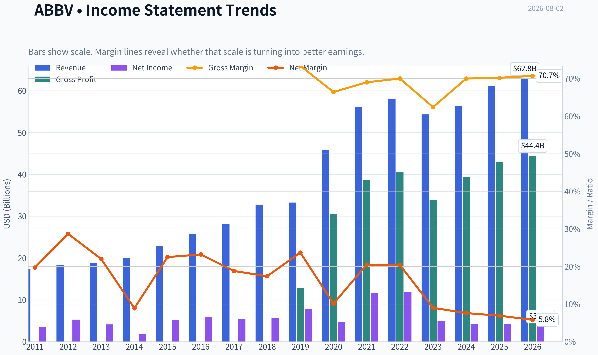
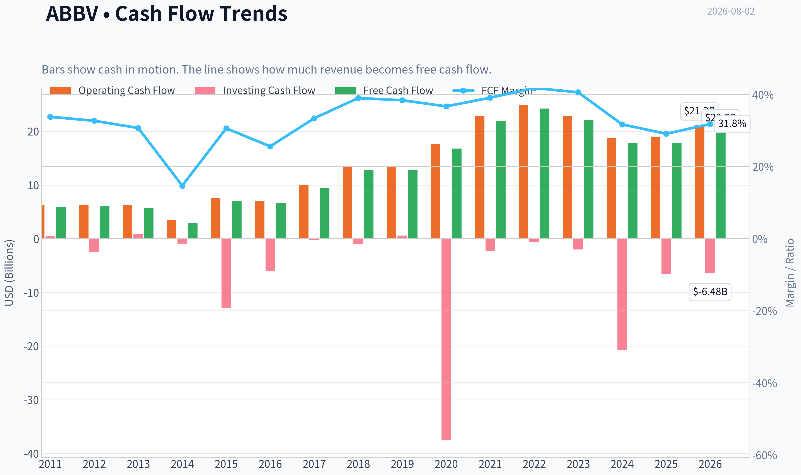
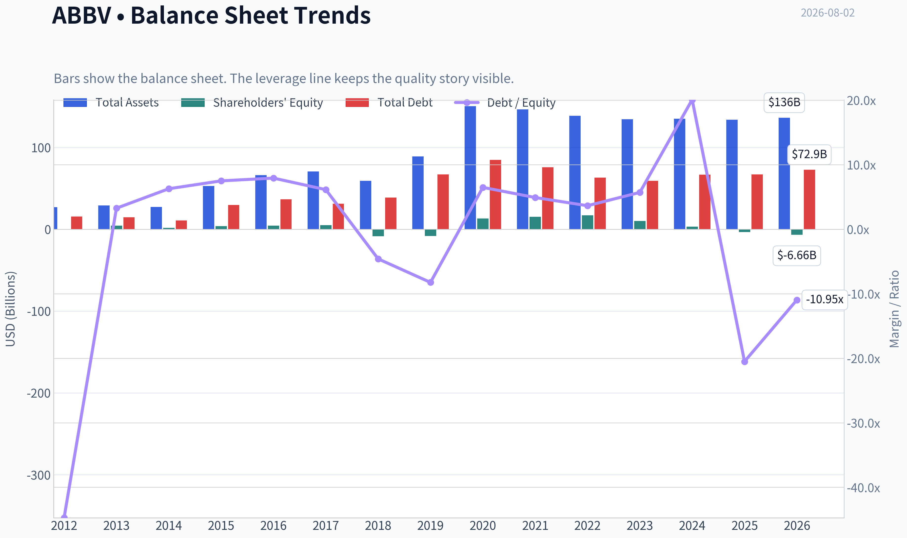
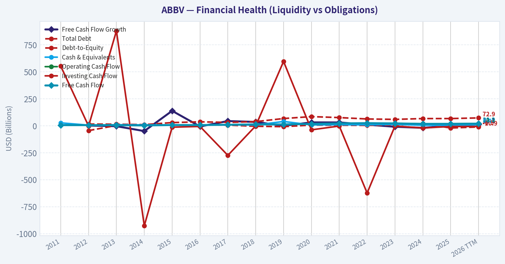
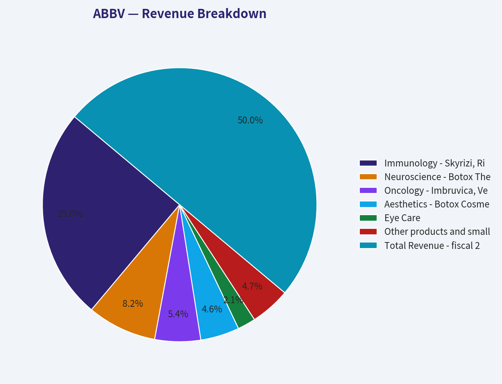
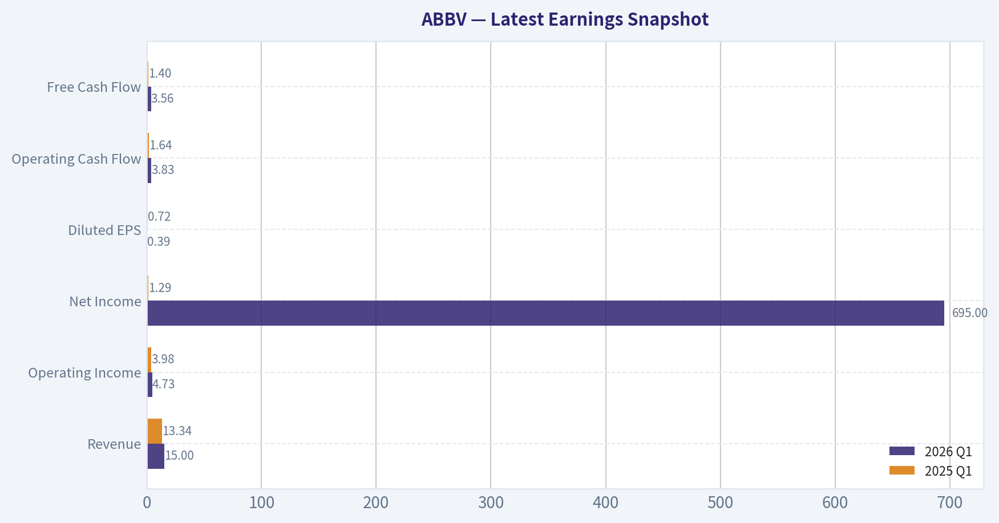
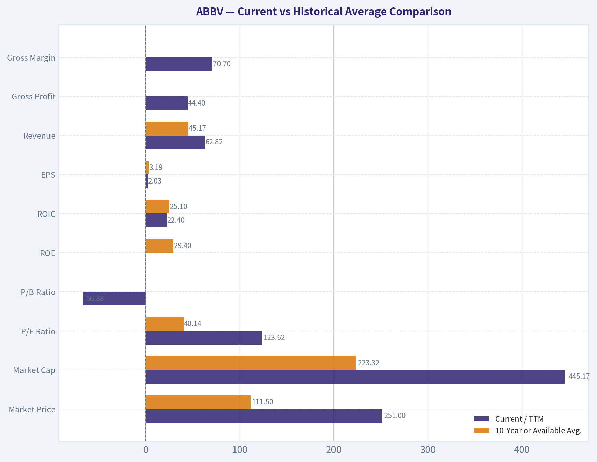
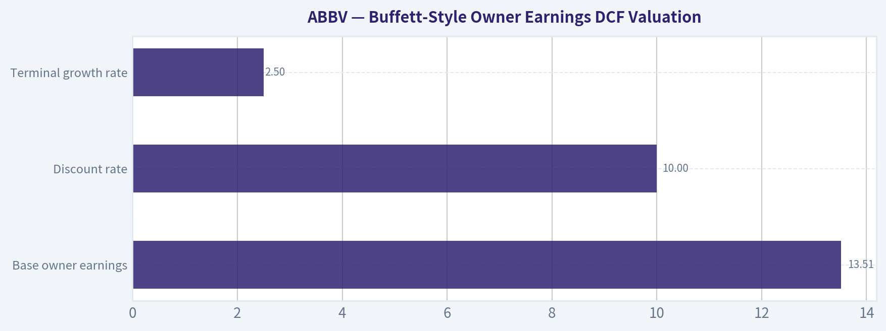
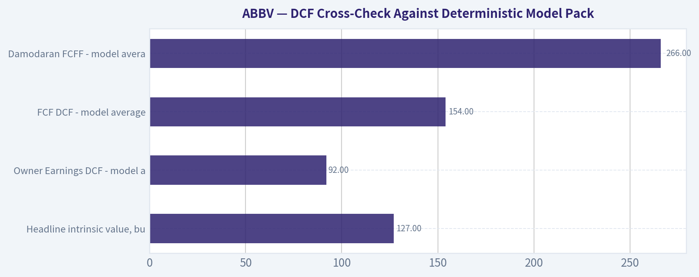
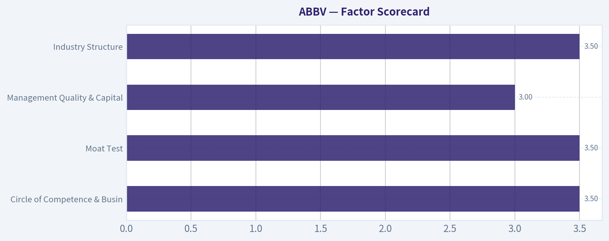

# ABBV Deep Value Intelligence

**Analysis Date:** 2026-08-02

## Critical Disclaimer

*This analysis is generated by Deep Value Intelligence, an AI-powered multi-agent investing framework. Education & research only - not financial advice, not a financial advisor.*

---

## Table of Contents

1. Intelligence Summary
2. Analyst Team Reports
   - Fundamentals Analysis
   - Intrinsic Value Analysis (Buffett)
   - Trend & Growth Analysis (Lynch/Druckenmiller/Fisher)
   - Market Technical Analysis
   - Options Market Analysis
3. Research Team Commentary
4. Value Investing Team Commentary
5. Deep Values Commentary

---

## Intelligence Summary

### Thesis + Conditions

**Core Thesis:** **EXECUTIVE SUMMARY (CONCISE)**
AbbVie (ABBV) is a high-quality compounder actively undergoing a structural re-rating. Headline valuation metrics (71 P/E, -129% ROE) are entirely distorted by non-cash amortization and aggressive share repurchases, masking a highly profitable economic engine (70.2% gross margin, 16.5% ROIC, strong free cash flow).

**Key Risks:**
- Risky (Bull):** Correctly identifies that GAAP metrics are suppressing true owner earnings. AbbVie is a cash-flow powerhouse successfully replacing Humira with Skyrizi and Rinvoq. Technical momentum is a re-rating feature, not a fluke.
- Neutral (Pragmatist):** Agrees the business is elite but cautions against chasing the $251 peak. Recommends utilizing the 50-day SMA ($237) as a risk-defined entry to respect both business quality and valuation discipline.
- In our previous assessment, we committed a severe process error: we applied a rigid, deep-value purity test to a transitioning, high-quality franchise. We issued a passive "WATCH" stance at $216 because trailing metrics looked ugly, missing a rapid 17% upside repricing.

**Confidence:** Low

---

## Analyst Team Reports

### Fundamentals Analysis

#### Latest Earnings Snapshot

*Most recent reported quarter anchored on 2026 Q1, with prior-year comparison when available.*

| Metric | 2026 Q1 | 2025 Q1 | YoY Change |
| --- | ---: | ---: | ---: |
| Revenue | $15.00B | $13.34B | +12.4% |
| Operating Income | $4.73B | $3.98B | +18.9% |
| Net Income | $695.0M | $1.29B | -46.0% |
| Diluted EPS | $0.39 | $0.72 | -45.8% |
| Operating Cash Flow | $3.83B | $1.64B | +134.2% |
| Free Cash Flow | $3.56B | $1.40B | +154.6% |

Key Takeaways: This snapshot anchors the most recent reported quarter before the narrative analysis. It helps readers separate long-run business quality from whatever changed in the latest earnings print.

#### 15-Year Financial Metrics for ABBV

*All values below are computed deterministically from raw data - not estimated by AI.*

*Issuer profile: operating company (Healthcare / Drug Manufacturers - General).*

#### 15-Year Financial Metrics
*Annual rows come from reported financial statements. The final TTM row is computed from the latest four quarters.*

| Metric | 2011 | 2012 | 2013 | 2014 | 2015 | 2016 | 2017 | 2018 | 2019 | 2020 | 2021 | 2022 | 2023 | 2024 | 2025 | 2026 TTM |
| --- | --- | --- | --- | --- | --- | --- | --- | --- | --- | --- | --- | --- | --- | --- | --- | --- |
| Market Price | N/A | $20 | $32 | $41 | $38 | $42 | $67 | $66 | $67 | $86 | $114 | $141 | $141 | $168 | $223 | $251 |
| Market Cap | N/A | $53.76B | $84.71B | $105.36B | $96.98B | $102.13B | $155.03B | $142.53B | $131.39B | $179.26B | $240.61B | $287.34B | $274.76B | $315.06B | $405.11B | $445.17B |
| P/E Ratio | N/A | 10.18 | 20.63 | 59.49 | 18.93 | 17.25 | 29.31 | 25.19 | 16.77 | 39.39 | 20.99 | 24.38 | 56.97 | 74.35 | 96.82 | 123.62 |
| P/B Ratio | N/A | -153.60 | 18.86 | 60.48 | 24.58 | 22.03 | 30.42 | -16.87 | -16.08 | 13.71 | 15.62 | 16.65 | 26.52 | 94.76 | -123.89 | -66.88 |
| ROE | N/A | -1507.1% | 91.9% | 101.8% | 130.4% | 128.4% | 104.2% | -67.3% | -96.5% | 35.3% | 74.9% | 68.6% | 46.9% | 128.7% | -129.2% | -54.6% |
| ROIC | N/A | 48.9% | 46.9% | 40.3% | 40.9% | 24.1% | 22.4% | 27.4% | 59.1% | 23.1% | 19.3% | 21.6% | 17.8% | 16.0% | 20.6% | 22.4% |
| EPS | $2.18 | $1.97 | $1.55 | $0.69 | $2.02 | $2.43 | $2.29 | $2.64 | $4.02 | $2.19 | $5.43 | $5.80 | $2.48 | $2.26 | $2.31 | $2.03 |
| Revenue | $17.44B | $18.38B | $18.79B | $19.96B | $22.86B | $25.64B | $28.22B | $32.75B | $33.27B | $45.80B | $56.20B | $58.05B | $54.32B | $56.33B | $61.16B | $62.82B |
| Gross Profit | $12.80B | N/A | N/A | N/A | N/A | N/A | N/A | N/A | N/A | $30.42B | $38.75B | $40.64B | $33.90B | $39.43B | $42.96B | $44.40B |
| Gross Margin | 73.4% | N/A | N/A | N/A | N/A | N/A | N/A | N/A | N/A | 66.4% | 69.0% | 70.0% | 62.4% | 70.0% | 70.2% | 70.7% |
| Operating Margin | 20.8% | 31.6% | 30.1% | 17.1% | 33.0% | 36.4% | 33.8% | 19.5% | 39.0% | 24.8% | 31.9% | 31.2% | 23.5% | 16.2% | 24.6% | 33.2% |
| Net Income | $3.43B | $5.28B | $4.13B | $1.77B | $5.14B | $5.95B | $5.31B | $5.69B | $7.88B | $4.62B | $11.54B | $11.84B | $4.86B | $4.28B | $4.23B | $3.63B |
| Net Margin | 19.7% | 28.7% | 22.0% | 8.9% | 22.5% | 23.2% | 18.8% | 17.4% | 23.7% | 10.1% | 20.5% | 20.4% | 9.0% | 7.6% | 6.9% | 5.8% |
| Revenue Growth | N/A | 5.4% | 2.2% | 6.2% | 14.5% | 12.2% | 10.1% | 16.1% | 1.6% | 37.7% | 22.7% | 3.3% | -6.4% | 3.7% | 8.6% | 2.7% |
| Net Income Growth | N/A | 53.7% | -21.7% | -57.0% | 190.0% | 15.7% | -10.8% | 7.1% | 38.6% | -41.4% | 150.0% | 2.5% | -58.9% | -12.0% | -1.2% | -14.0% |
| Free Cash Flow Growth | N/A | 2.1% | -3.9% | -49.2% | 138.4% | -6.3% | 43.7% | 35.6% | -0.1% | 31.5% | 31.0% | 10.3% | -9.0% | -19.2% | -0.1% | 12.1% |
| Total Book Value | N/A | $-350.0M | $4.49B | $1.74B | $3.94B | $4.64B | $5.10B | $-8.45B | $-8.17B | $13.08B | $15.41B | $17.25B | $10.36B | $3.33B | $-3.27B | $-6.66B |
| Total Assets | N/A | $27.01B | $29.20B | $27.51B | $53.05B | $66.10B | $70.79B | $59.35B | $89.11B | $150.56B | $146.53B | $138.81B | $134.71B | $135.16B | $133.96B | $136.46B |
| Total Debt | N/A | $15.65B | $14.71B | $10.96B | $29.65B | $36.82B | $31.35B | $38.70B | $67.23B | $84.98B | $75.98B | $63.13B | $59.24B | $66.84B | $67.00B | $72.86B |
| Debt-to-Equity | N/A | -44.71 | 3.27 | 6.29 | 7.51 | 7.94 | 6.15 | -4.58 | -8.23 | 6.50 | 4.93 | 3.66 | 5.72 | 20.10 | -20.49 | -10.95 |
| Cash & Equivalents | $27.0M | $5.90B | $9.60B | $8.35B | $8.40B | $5.10B | $9.30B | $7.29B | $39.92B | $8.45B | $9.75B | $9.20B | $12.81B | $5.52B | $5.23B | $9.39B |
| Shareholders' Equity | N/A | $-350.0M | $4.49B | $1.74B | $3.94B | $4.64B | $5.10B | $-8.45B | $-8.17B | $13.08B | $15.41B | $17.25B | $10.36B | $3.33B | $-3.27B | $-6.66B |
| Operating Cash Flow | $6.25B | $6.34B | $6.27B | $3.55B | $7.54B | $7.04B | $9.96B | $13.43B | $13.32B | $17.59B | $22.78B | $24.94B | $22.84B | $18.81B | $19.03B | $21.22B |
| Investing Cash Flow | $553.0M | $-2.42B | $879.0M | $-926.0M | $-12.94B | $-6.07B | $-274.0M | $-1.01B | $596.0M | $-37.56B | $-2.34B | $-623.0M | $-2.01B | $-20.82B | $-6.64B | $-6.48B |
| Free Cash Flow | $5.89B | $6.01B | $5.78B | $2.94B | $7.00B | $6.56B | $9.43B | $12.79B | $12.77B | $16.79B | $21.99B | $24.25B | $22.06B | $17.83B | $17.82B | $19.98B |
| FCF Margin | 33.8% | 32.7% | 30.7% | 14.7% | 30.6% | 25.6% | 33.4% | 39.0% | 38.4% | 36.7% | 39.1% | 41.8% | 40.6% | 31.7% | 29.1% | 31.8% |
| Dividends / Share | $0.00 | $0.00 | $0.00 | $0.00 | $0.00 | $0.00 | $0.00 | $0.00 | $0.00 | $0.00 | $0.00 | $4.94 | $5.41 | $5.87 | $6.42 | $6.66 |

#### Profitability Metrics
- Return on Equity (ROE): -129.2%
- Return on Invested Capital (ROIC): 16.5%
- Return on Assets (ROA): 3.2%
- Gross Margin: 70.2%
- Operating Margin: 24.6%
- Net Profit Margin: 6.9%

#### Liquidity Metrics
- Current Ratio: 0.67
- Quick Ratio: 0.41

#### Leverage Metrics
- Debt-to-Equity Ratio: -20.49
- Interest Coverage Ratio: 5.21
- Net Debt: $61.77B

#### Growth Metrics (Year-over-Year)
- Revenue Growth: 8.6%
- Net Income Growth: -1.2%
- Free Cash Flow Growth: -0.1%
- Revenue CAGR (3-Year): 1.8%
- Revenue CAGR (5-Year): 6.0%

#### Valuation Metrics
- P/E Ratio (TTM): 70.89
- Forward P/E: 15.42
- Price-to-Book: N/A
- Price-to-Sales: 6.89
- PEG Ratio: 0.41
- EV/EBITDA: 16.46
- Free Cash Flow Yield: 4.0%
- Earnings Yield: 1.4%

#### Owner Earnings (Buffett Method, Code-Computed)
- Net Income: $4.23B
- + Depreciation & Amortization: $8.14B
- - Capital Expenditures: $-1.21B
- - Working Capital Changes: $-2.36B
- = **Owner Earnings: $13.51B**

#### Intrinsic Value (Code-Computed)
- Current Price: $251
- **Headline Intrinsic Value (business-model routed): $127**
  Business model: asset light platform - weighted blend [Damodaran FCFF + reverse-DCF fair + owner-earnings DCF] (asset_light_platform)
  Model spread (min-max across DCFs): $92 - $266
  Margin of safety vs. price (headline): -97.3%
  Routing note: Asset-light / high-margin platform: value driven by margins and reinvestment economics - the headline centers on the reverse-DCF demonstrated-growth fair value with Damodaran FCFF as a floor, down-weighting the owner-earnings DCF.
- Buffett Method (Owner Earnings):
  Conservative: $-11
  Average: $92
  Optimistic: $368
- Cash Flow Method (FCF):
  Conservative: $75
  Average: $154
  Optimistic: $383
- Damodaran FCFF (WACC + margins + reinvestment):
  Conservative: $124
  Average: $266
  Optimistic: $344
  Monte Carlo band (P10-P90): $151 - $367 (median $230)
  P(intrinsic value > price): 40.8%
- Reverse-DCF: price implies ~34.6%/yr owner-earnings growth for 10y; trailing 3y was -11.8%, 5y 28.8%.

#### Piotroski F-Score: 6/9
- Positive Net Income: PASS
- Positive Operating Cash Flow: PASS
- ROA Improvement: FAIL
- Cash Flow > Net Income: PASS
- Decreasing Debt: FAIL
- Improving Current Ratio: PASS
- No Dilution: FAIL
- Improving Gross Margin: PASS
- Improving Asset Turnover: PASS

ANALYST STANCE: **WATCH**

#### ABBV Fundamental Analysis - Buffett-Style View

AbbVie is a high-margin, research-driven pharmaceutical company with durable franchises in immunology, neuroscience, oncology, aesthetics, and eye care. The business has many Buffett-friendly traits: strong free cash flow, pricing power in specialty medicines, high gross margins, and a long record of shareholder distributions. However, the current valuation embeds aggressive growth expectations at a time when reported earnings are pressured, Humira has declined after biosimilar competition, leverage remains elevated, and book value is negative.

At **$251 per share**, ABBVie looks like a **quality business at a demanding price**. The deterministic valuation pack's headline intrinsic value is **about $127 per share**, with model spread ranging widely from roughly **$92 to $266** depending on methodology. The current price therefore offers **no clear Buffett-style margin of safety**.

---

#### Revenue Breakdown

| Revenue Source | Amount ($B) | % of Total |
|---|---:|---:|
| Immunology - Skyrizi, Rinvoq, Humira and related products | $30.60 | 50.0% |
| Neuroscience - Botox Therapeutic, Vraylar, migraine and related products | $10.00 | 16.4% |
| Oncology - Imbruvica, Venclexta and related products | $6.60 | 10.8% |
| Aesthetics - Botox Cosmetic, Juvederm and related products | $5.60 | 9.2% |
| Eye Care | $2.60 | 4.3% |
| Other products and smaller franchises | $5.76 | 9.4% |
| **Total Revenue - fiscal 2025 deterministic dataset** | **$61.16** | **100.0%** |

Key Takeaways: AbbVie is still primarily an immunology company, with roughly half of revenue tied to that franchise. The key strategic question is whether Skyrizi and Rinvoq can continue offsetting Humira erosion while expanding into new indications. Neuroscience is now a meaningful second pillar, while aesthetics and oncology add diversification but are not large enough by themselves to carry the enterprise.

---

#### Current vs Historical Average Comparison

*Current values use the 2026 TTM row where available. Historical averages use the latest 10 full fiscal years shown in the deterministic dataset, generally 2016-2025. Gross profit and gross margin averages use available reported years because earlier rows are marked N/A.*

| Metric | Current / TTM | 10-Year or Available Avg. | Current Standing and Interpretation |
|---|---:|---:|---|
| Market Price | $251 | $111.50 | Price is more than double the 10-year average, reflecting investor confidence in post-Humira growth and pipeline execution. |
| Market Cap | $445.17B | $223.32B | Market value has roughly doubled versus the decade average, despite earnings being below prior peaks. |
| P/E Ratio | 123.62x | 40.14x | Canonical TTM P/E is extremely elevated because reported EPS is depressed. Even the valuation summary's lower P/E snapshot of about 70.9x remains high. |
| P/B Ratio | -66.88x | Not meaningful | P/B is not useful here because AbbVie has negative book value due to leverage, acquisitions, intangibles, and shareholder returns. Valuation should be anchored on cash flows, not book value. |
| ROE | -54.6% TTM / -129.2% FY2025 | 29.4% | ROE is distorted by negative equity and should not be interpreted mechanically. The negative figure signals balance-sheet strain rather than operating unprofitability. |
| ROIC | 22.4% | 25.1% | ROIC remains strong, though modestly below the decade average. This is one of AbbVie's best quality indicators. |
| EPS | $2.03 | $3.19 | EPS is below average and far below 2021-2022 levels, showing that accounting earnings are currently pressured. |
| Revenue | $62.82B | $45.17B | Revenue is well above the historical average, helped by Allergan integration and growth in Skyrizi, Rinvoq, and neuroscience assets. |
| Gross Profit | $44.40B | $37.68B available avg. | Gross profit is above the available-period average, showing strong scale and product economics. |
| Gross Margin | 70.7% | 68.0% available avg. | Gross margin is excellent and slightly above the available-period average, supporting the moat argument. |
| Operating Margin | 33.2% | 28.1% | Operating margin has rebounded strongly versus recent annual weakness, suggesting underlying operating leverage remains powerful. |
| Net Income | $3.63B | $6.62B | Net income is materially below average, creating a gap between strong cash generation and weaker GAAP earnings. |
| Net Margin | 5.8% | 15.8% | Net margin is far below historical norms, largely due to acquisition, amortization, impairment, and product-cycle effects. |
| Revenue Growth | 2.7% TTM / 8.6% FY2025 | 11.0% | Growth has slowed versus the decade average, although fiscal 2025 showed a stronger rebound. |
| Net Income Growth | -14.0% | 9.0% | Earnings momentum is negative, which is a major concern given the premium valuation. |
| Free Cash Flow Growth | 12.1% TTM / -0.1% FY2025 | 11.7% | TTM FCF growth is back near historical levels, but fiscal 2025 was flat, so durability must be watched. |
| Total Book Value | -$6.66B | $4.93B | Negative book value reflects leverage, buybacks/dividends, and intangible-heavy acquisitions; it weakens balance-sheet flexibility. |
| Total Assets | $136.46B | $112.51B | Assets are above average due to large acquisitions and intangible assets. |
| Total Debt | $72.86B | $59.13B | Debt remains elevated and above the 10-year average. |
| Debt-to-Equity | -10.95x | Not meaningful | Negative equity makes debt-to-equity mathematically misleading. Net debt and interest coverage are more useful. |
| Cash & Equivalents | $9.39B | $11.26B | Cash is slightly below the 10-year average but still meaningful in absolute terms. |
| Shareholders' Equity | -$6.66B | $4.93B | Negative equity is a red flag for financial flexibility, though not a direct measure of operating quality. |
| Free Cash Flow | $19.98B | $16.23B | FCF remains above the decade average and is the strongest support for AbbVie's valuation. |
| Dividends / Share | $6.66 | $5.66 recent dividend-period avg. | Dividend per share continues to rise, reinforcing AbbVie's income-stock appeal. |

Key Takeaways: AbbVie's operating business remains much stronger than its GAAP net income currently suggests, especially when viewed through gross margin, operating margin, ROIC, and free cash flow. However, the stock price and market cap have moved far above historical norms while EPS and net income are below average. Book-value metrics are not useful because equity is negative; cash-flow valuation is the correct anchor.

---

#### Market Metrics Interpretation

AbbVie's **market price of $251** and **market cap of roughly $445 billion** indicate that the market is valuing the company as a successful post-Humira compounder. That is possible, but not yet fully proven by reported earnings. Revenue and free cash flow are resilient, but the current market value already discounts a substantial recovery in earnings quality.

The **P/E ratio is very high** in the canonical TTM table at **123.62x**, while the valuation summary also shows an elevated P/E of about **70.89x**. Either way, the stock is not statistically cheap. The high multiple is partly explained by depressed reported earnings, but Buffett-style investors should still ask whether normalized earnings power justifies the current price.

The **P/B ratio is not meaningful** for AbbVie. This is an intangible-heavy, IP-driven pharmaceutical business with negative shareholders' equity. Book value does not represent the value of patents, drug franchises, commercial scale, R&D capabilities, or pipeline optionality. Therefore, **P/B should not be used as a cheapness signal**; valuation should be based on owner earnings, free cash flow, reinvestment economics, and pipeline durability.

---

#### Profitability Analysis

AbbVie's profitability profile remains attractive at the operating level. The company's **70.7% gross margin** is excellent and reflects patented products, specialty-medicine pricing power, and strong brand positions. The **33.2% TTM operating margin** is also above the 10-year average, which suggests the core business still has considerable earnings power.

The weakness is below the operating line. **Net income of $3.63 billion** and **net margin of 5.8%** are far below the decade averages. This indicates that accounting profitability is being compressed by amortization, acquisition-related charges, product transitions, and other non-operating or non-cash effects. For Buffett-style analysis, this makes free cash flow and owner earnings more informative than GAAP EPS alone.

**ROIC of 22.4%** is the most important profitability signal. It remains strong and indicates that AbbVie still earns attractive returns on invested capital despite Humira's decline and the Allergan balance-sheet burden. **ROE is not useful mechanically** because negative equity distorts the calculation.

---

#### Growth Analysis

Revenue has grown substantially over the dataset, from **$25.64 billion in 2016** to **$62.82 billion TTM**, helped by acquisitions and product launches. However, the current **TTM revenue growth rate of 2.7%** is well below the 10-year average of roughly **11.0%**. Fiscal 2025 revenue growth of **8.6%** was more encouraging, but the TTM slowdown shows that investors should not assume a straight-line growth trajectory.

Net income growth is a concern. The **TTM net income growth rate is -14.0%**, compared with a positive 10-year average near **9.0%**. This reflects a volatile earnings base and shows why the current high P/E ratio deserves caution.

Free cash flow growth is healthier. TTM free cash flow growth of **12.1%** is slightly above the historical average, and TTM free cash flow of **$19.98 billion** remains robust. The main question is whether this FCF base can compound fast enough to justify a $445 billion market capitalization.

---

#### Balance Sheet and Financial Strength

AbbVie has a financially powerful business but a leveraged balance sheet. Total debt is **$72.86 billion**, above the 10-year average of about **$59.13 billion**. Cash and equivalents of **$9.39 billion** provide liquidity, but net debt remains substantial.

The company's **negative shareholders' equity of -$6.66 billion** makes debt-to-equity and price-to-book ratios unreliable. In Buffett terms, this does not automatically make AbbVie uninvestable, but it reduces the margin for error. A highly predictable pharmaceutical cash-flow stream can support leverage, but only if product franchises remain durable and pipeline execution stays strong.

The deterministic pack shows **interest coverage of 5.21x**, which is acceptable but not pristine. AbbVie is not in financial distress, but leverage is a key red flag because the company must simultaneously fund dividends, R&D, debt obligations, and acquisitions to replace maturing products.

---

#### Cash Flow and Dividend Analysis

Free cash flow is AbbVie's strongest investment attribute. TTM FCF is **$19.98 billion**, above the 10-year average of **$16.23 billion**. FCF margin is also strong at **31.8%**, confirming that the business converts revenue into cash at an exceptional rate.

The dividend is attractive, with **TTM dividends per share of $6.66**. AbbVie's dividend policy is shareholder-friendly and supports its reputation as an income compounder. However, Buffett-style investors should watch the trade-off: high dividends plus elevated debt plus ongoing acquisition needs can limit flexibility if growth disappoints.

---

#### Buffett-Style Owner Earnings DCF Valuation

Assumptions used for the hand-built sanity-check DCF:

| Input | Assumption |
|---|---:|
| Base owner earnings | $13.51B |
| Discount rate | 10.0% |
| Terminal growth rate | 2.5% |
| Estimated shares outstanding | ~1.775B |
| Net debt adjustment | ~$61.77B |
| Valuation method | Present value of owner earnings, less net debt, divided by shares |

Key Takeaways: The DCF starts from owner earnings rather than GAAP net income because AbbVie's accounting earnings are currently distorted. A 10% discount rate is used to reflect Buffett-style required return discipline. Net debt is deducted because leverage is economically real even when the operating business is strong.

| Scenario | Explicit Growth Assumption | PV of 10-Year Owner Earnings | PV of Terminal Value | Enterprise Value | Equity Value After Net Debt | Fair Value / Share |
|---|---|---:|---:|---:|---:|---:|
| Conservative | 3% annually for 10 years | $95.8B | $95.7B | $191.5B | $129.7B | ~$73 |
| Average / Base Case | 10% for years 1-5, then 5% for years 6-10 | $126.4B | $146.4B | $272.8B | $211.0B | ~$119 |
| Optimistic | 22% for years 1-5, then 10% for years 6-10 | $206.3B | $309.7B | $516.0B | $454.2B | ~$256 |

Key Takeaways: The conservative and base-case DCF values are materially below the current $251 share price. Only the optimistic case, which assumes very strong near-term compounding from Skyrizi, Rinvoq, neuroscience, and pipeline success, approximately supports the current price. This means the market is already pricing AbbVie close to a bullish outcome.

#### DCF Cross-Check Against Deterministic Model Pack

| Valuation Model from Deterministic Pack | Fair Value / Share |
|---|---:|
| Headline intrinsic value, business-model routed | $127 |
| Owner Earnings DCF - model average | $92 |
| FCF DCF - model average | $154 |
| Damodaran FCFF - model average | $266 |
| Damodaran Monte Carlo band, P10-P90 | $151-$367 |
| Reverse DCF implied growth at current price | ~34.6% per year for 10 years |

Key Takeaways: The model pack broadly agrees that AbbVie's fair value is highly sensitive to growth assumptions. The headline intrinsic value of $127 is well below the current price, while the more optimistic Damodaran FCFF case reaches above the current price. The reverse DCF is the warning sign: the stock price implies roughly 34.6% annual owner-earnings growth for 10 years, which is far above the recent 3-year trend.

---

#### Economic Moat Assessment

AbbVie has a real moat, but it is product-cycle dependent. Its competitive advantages include patented drug franchises, specialist physician relationships, regulatory barriers, global distribution, scale in clinical development, and deep immunology expertise. Skyrizi and Rinvoq are especially important because they are the core successors to Humira.

The moat is strongest where AbbVie has differentiated clinical data, broad indications, and durable prescribing habits. The moat is weaker where patent cliffs, biosimilars, or pricing pressure can erode economics. Unlike a consumer staple with timeless demand and simple reinvestment needs, AbbVie must continually replace aging assets through R&D and acquisitions.

Buffett would likely admire the cash flow but discount the uncertainty of pharmaceutical product cycles. The business is high quality, but predictability is lower than in a classic consumer monopoly.

---

#### Management and Capital Allocation

Management has executed a difficult transition better than many investors expected. Skyrizi and Rinvoq growth has helped offset Humira erosion, and the Allergan acquisition added durable franchises in aesthetics and neuroscience. The company has also maintained a strong dividend policy.

However, capital allocation is not without concerns. Debt remains high, equity is negative, and acquisitions are necessary to replenish the pipeline. The Piotroski F-score of **6/9** is acceptable but not outstanding. Positive free cash flow and margin improvement are positives, while increasing debt and dilution-related signals are negatives.

Management's key test is whether it can compound free cash flow while reducing balance-sheet risk. If debt remains elevated and growth slows, shareholder returns could become less attractive.

---

#### Key Investment Insights, Red Flags, and Opportunities

| Category | Key Point | Investment Meaning |
|---|---|---|
| Major Strength | Free cash flow of $19.98B TTM remains above the 10-year average. | AbbVie remains a cash-generative franchise with strong dividend capacity. |
| Major Strength | Gross margin near 71% and ROIC above 22%. | Core economics remain excellent despite patent-cycle pressure. |
| Major Strength | Skyrizi and Rinvoq continue expanding indications and geographic reach. | These assets are central to the post-Humira growth story. |
| Red Flag | Current valuation is well above headline intrinsic value. | Little to no Buffett-style margin of safety at $251. |
| Red Flag | Negative equity and elevated debt reduce financial flexibility. | Balance-sheet risk is manageable but material. |
| Red Flag | Net margin and EPS are far below historical norms. | Reported earnings quality has not yet caught up with the stock price. |
| Red Flag | Reverse DCF implies ~34.6% annual owner-earnings growth for 10 years. | The current price requires very strong execution. |
| Opportunity | Pipeline approvals and label expansions can extend growth runway. | Positive clinical and regulatory outcomes could justify a higher value. |
| Opportunity | Debt reduction could improve equity value and investor confidence. | Deleveraging would reduce risk and strengthen the investment case. |
| Opportunity | If price falls toward intrinsic value range, the stock could become attractive. | A better entry point would materially improve expected returns. |

Key Takeaways: AbbVie is not a weak business; the issue is valuation and balance-sheet risk. The company has strong cash generation, valuable franchises, and a credible growth bridge beyond Humira. But the current price already assumes substantial success, leaving limited room for disappointment.

---

#### Final Investment Stance: WATCH

AbbVie deserves a **WATCH** stance, not an outright avoid, because the business quality is high and free cash flow remains robust. The company has a defensible moat in immunology and specialty pharmaceuticals, strong operating margins, and valuable growth assets in Skyrizi and Rinvoq.

However, it is not an **ADVOCATE** at the current price. The stock trades near or above optimistic fair-value scenarios, while the deterministic headline intrinsic value is only **$127 per share** versus a current price of **$251**. The reverse DCF implies very high owner-earnings growth, and the balance sheet remains leveraged with negative equity.

A Buffett-style investor should wait for either:
1. a materially lower price, ideally closer to the $125-$155 intrinsic value zone, or
2. stronger evidence that free cash flow can compound at a high-teens rate while debt declines.

| Final Summary Item | Assessment |
|---|---|
| Business Quality | High |
| Economic Moat | Strong but patent-cycle dependent |
| Financial Strength | Adequate cash flow, but leverage is elevated |
| Earnings Predictability | Moderate; free cash flow is steadier than GAAP earnings |
| Valuation | Expensive versus headline intrinsic value |
| Dividend Appeal | Strong, but must be balanced against debt and reinvestment needs |
| Main Upside Driver | Skyrizi, Rinvoq, neuroscience growth, and pipeline execution |
| Main Downside Risk | Valuation compression, debt burden, patent/pipeline disappointment |
| Buffett-Style Margin of Safety | Insufficient at current price |
| Final Stance | **WATCH** |

Key Takeaways: AbbVie is a strong cash-flow compounder, but the stock price already reflects a bullish future. The company may continue performing well operationally, yet investors are being asked to pay a premium before earnings quality has fully recovered. For a Buffett-style investor, AbbVie is worth monitoring closely, but the current setup lacks a compelling margin of safety.

#### Fundamental Visuals

This graph tracks the profitability and return metrics (ROE, ROIC, Margins) of **ABBV** over the past decade, highlighting capital efficiency trends.

This chart illustrates the financial health of **ABBV** over the last 10 years, mapping cash equivalents and free cash flow against total obligations (Debt).

This breakdown chart from <em>Revenue Breakdown</em> shows the proportional composition for **ABBV** - useful for understanding what drives or risks the business.

---

### Intrinsic Value Analysis (Buffett)

> *Following Warren Buffett's value investing philosophy: Circle of Competence, Economic Moat, Management Quality, and Margin of Safety.*

#### Intrinsic Value Snapshot

Price is what you pay. Intrinsic value is what the business may be worth based on the cash it can create for owners over time. We show a range, not one magic number.

- Current Price: $250.94
- Value Range (conservative to optimistic across both DCF methods): $-10.90 to $382.81

##### Owner Earnings (Buffett Method)
- Net Income: $4,226,000,000.00
- Depreciation & Amortization: $8,139,000,000.00
- Capital Expenditures: $-1,214,000,000.00
- Working Capital Changes: $-2,362,000,000.00
- Owner Earnings: $13,513,000,000.00

##### Intrinsic Value
###### Buffett Method
Uses owner earnings. Stricter, and usually more conservative.
- Conservative: $-10.90
- Average: $92.14
- Optimistic: $368.10
- Discount Rate: 10.0%

###### Cash Flow Method
Uses free cash flow. Better for companies spending heavily today to grow tomorrow.
- Conservative: $75.09
- Average: $153.89
- Optimistic: $382.81
- Discount Rate: 10.0%

ANALYST STANCE: **AVOID**

#### AbbVie Inc. (ABBV) - Buffett-Style Value Investment Review

Current price: **$251**
Market cap: **$443.36 billion**
Headline intrinsic value estimate: **$127.21 per share**
Headline margin of safety: **-97.3%**
Conviction level: **Medium-High**

AbbVie remains a high-gross-margin pharmaceutical franchise with valuable immunology assets, especially **Skyrizi** and **Rinvoq**, but the current stock price embeds very aggressive assumptions. At roughly **2x the headline intrinsic value estimate**, and with the reverse DCF implying approximately **34.6% annual growth for 10 years**, the stock does not offer a Buffett-style margin of safety today.

---

#### 1. Factor Scorecard

| Factor | Score / 5 | Assessment |
|---|---:|---|
| Circle of Competence & Business Simplicity | 3.5 | AbbVie makes money by discovering, acquiring, manufacturing, and selling branded prescription drugs. The model is understandable, but long-term predictability is reduced by patent cliffs, regulatory outcomes, clinical trial risk, and acquisition-dependent pipeline renewal. |
| Moat Test | 3.5 | Strong patent protection, regulatory barriers, physician familiarity, and high gross margins support a real moat. However, the Humira erosion shows that pharma moats can decay sharply when exclusivity ends. |
| Management Quality & Capital Allocation | 3.0 | Management has navigated Humira's decline better than feared, with Skyrizi and Rinvoq becoming key growth engines. Capital allocation is mixed: dividends and pipeline acquisitions are positives, but leverage and deal dependence reduce the score. |
| Industry Structure | 3.5 | Large-cap pharma has high barriers to entry, pricing power in differentiated therapies, and attractive margins. Offsetting this are patent cliffs, political pricing pressure, and high R&D failure rates. |
| Gate 5: Quality/Solvency Hard Floor | Not tripped | AbbVie generates substantial free cash flow, revenue is growing again, and recent earnings coverage points to strong growth in replacement franchises. The hard distress floor is not triggered. |

Key Takeaways: AbbVie is a real business with real competitive advantages, not a weak or distressed company. The main issue is not quality failure; it is valuation. The stock price appears to assume a near-perfect transition from Humira to the next generation of growth drugs.

---

#### 2. Moat Analysis

AbbVie's moat comes primarily from **intangible assets**: patents, clinical data, regulatory approvals, physician trust, and therapeutic expertise. Its reported **gross margin of 70.2%** is strong evidence that the company sells differentiated products rather than commodities.

| Moat Source | Evidence | Strength |
|---|---|---|
| Intangible Assets | Patents, branded therapies, FDA/EU approvals, clinical data, physician adoption | Strong |
| Switching Costs | Patients and physicians may be reluctant to switch if a therapy works, but payer pressure can force substitution | Moderate |
| Cost Advantage | Scale in R&D, commercialization, manufacturing, and global regulatory operations | Moderate |
| Network Effects | Limited direct network effects; pharma benefits more from data, reputation, and prescriber familiarity | Low |
| Pricing Power | High for differentiated therapies, but constrained by payers, governments, and post-patent competition | Moderate-to-Strong |

Key Takeaways: AbbVie has a legitimate moat, but it is not a permanent consumer-brand moat like Coca-Cola. Pharmaceutical moats are powerful while exclusivity lasts, then must be rebuilt through R&D and acquisitions. Skyrizi and Rinvoq are currently doing that job, but the durability of that replacement cycle is the core risk.

Recent evidence supports moat renewal: AbbVie received European Commission approval for **Rinvoq** in vitiligo and alopecia, expanding its label in dermatology and immunology. Q2 2026 coverage also highlighted **10.2% revenue growth** and strong Skyrizi performance, with Skyrizi sales reportedly up **24%**.

Moat quality rating: **Narrow-to-Wide, but not fully permanent - 3.5 / 5**

---

#### 3. Management Quality & Capital Allocation

| Area | Assessment |
|---|---|
| Owner Orientation | AbbVie has historically emphasized shareholder returns through dividends, making it attractive to income-oriented holders. |
| Candor & Execution | Management has been clear about the Humira transition and has executed well enough for newer immunology assets to offset a major loss of exclusivity. |
| Reinvestment | R&D and business development remain essential. Skyrizi and Rinvoq show productive reinvestment, but pharma reinvestment is inherently uncertain. |
| Acquisitions | Deals can refresh the pipeline but also create integration risk and balance-sheet pressure. The pending Apogee acquisition lowered guidance, highlighting this trade-off. |
| Balance Sheet Discipline | AbbVie has carried meaningful leverage, partly from major acquisitions. Cash generation is strong, but the balance sheet is not a fortress. |

Management score: **3.0 / 5**

Management deserves credit for navigating one of the largest drug patent cliffs in industry history. However, a Buffett-style investor should treat acquisition-heavy pipeline renewal with caution because the company must repeatedly reinvest large sums just to defend its earnings base.

---

#### 4. Financial Summary

| Metric | Current / Latest Figure |
|---|---:|
| Share Price | $251 |
| Market Capitalization | $443.36B |
| P/E Ratio | 70.9x |
| Estimated EPS from P/E | ~$3.54 |
| Revenue Growth YoY | 8.6% |
| Latest Reported Earnings Growth Signal | Q2 2026 revenue growth of 10.2% |
| Gross Margin | 70.2% |
| Free Cash Flow Yield | 4.0% |
| Estimated Free Cash Flow | ~$17.73B |
| Estimated Shares Outstanding | ~1.77B |
| Estimated FCF per Share | ~$10.04 |
| ROE | -129.2% |
| Current Ratio | 0.67 |
| Headline Intrinsic Value | $127.21 |
| Margin of Safety vs. Price | -97.3% |

Key Takeaways: AbbVie's gross margin and free cash flow remain attractive, confirming that this is a high-quality pharmaceutical business. The weak ROE and low current ratio reflect a balance sheet that is less clean than ideal, especially after years of acquisitions and shareholder distributions. The valuation is the standout concern: the market price is far above the headline intrinsic value estimate.

---

#### 5. Owner Earnings Calculation

Using free cash flow as a practical proxy for owner earnings:

| Owner Earnings Component | Estimate |
|---|---:|
| Estimated Net Income | ~$6.26B |
| Add: Depreciation & Amortization | Embedded in FCF proxy |
| Less: Maintenance CapEx | Embedded in FCF proxy |
| Less: Working Capital Increases | Embedded in FCF proxy |
| Estimated Owner Earnings / FCF | ~$17.73B |
| Estimated Shares Outstanding | ~1.77B |
| Owner Earnings per Share | ~$10.04 |

Key Takeaways: AbbVie's cash earnings are much stronger than accounting earnings implied by the high P/E ratio. On an owner-earnings basis, the company produces roughly $10 per share of free cash flow. That is valuable, but at a $251 share price, investors are paying about 25 times estimated owner earnings.

---

#### 6. Three-Scenario DCF Valuation

Assumptions:
Discount rate: **10%**
Starting owner earnings per share: **~$10.04**
Terminal growth in scenario C: **3%**

| Scenario | Method | Estimated Value / Share | Interpretation |
|---|---|---:|---|
| A: No Growth | Owner earnings / 10% | ~$100 | Ultra-conservative no-growth value |
| B: GDP Growth | Owner earnings growing at 3% perpetually | ~$148 | Conservative mature-business value |
| C: Historical Growth Adjusted | 10% growth for 10 years, then 3% terminal growth | ~$248 | Optimistic but not impossible if Skyrizi/Rinvoq and pipeline execute very well |
| Headline Business-Model Routed Value | Weighted blend of valuation models | $127.21 | Primary valuation anchor |
| 3-Model Spread | Owner Earnings / FCF / Damodaran FCFF | $92.14 / $153.89 / $266.48 | Wide spread reflects sensitivity to growth and reinvestment assumptions |

Key Takeaways: AbbVie looks expensive under no-growth and GDP-growth assumptions. The stock only approaches fair value under a much more optimistic growth case. That makes the investment thesis highly dependent on sustained pipeline success and continued strong execution.

---

#### 7. Margin of Safety Analysis

| Valuation Reference | Value / Share | Margin of Safety vs. $251 |
|---|---:|---:|
| No-Growth DCF | ~$100 | -151% |
| GDP-Growth DCF | ~$148 | -70% |
| Historical-Growth Adjusted DCF | ~$248 | ~-1% |
| Headline Intrinsic Value | $127.21 | -97.3% |
| Damodaran FCFF Model | $266.48 | +5.8% |

Key Takeaways: The valuation case is highly sensitive to growth assumptions. A conservative Buffett-style investor should not rely on the most optimistic model when the company faces patent-cycle and pipeline risk. The current price offers little room for disappointment.

The reverse DCF is the most important warning sign: the current price implies approximately **34.6% annual growth for 10 years**. That is a heroic assumption for a large pharmaceutical company already worth more than **$440 billion**.

For a wonderful, predictable compounder, a 10-15% margin of safety may be enough. AbbVie is a good business, but because its cash flows depend on patents, drug launches, regulatory approvals, and acquisition success, it deserves a larger margin of safety than a consumer staple or dominant software platform. At today's price, that margin is absent.

---

#### 8. Final Buffett Scorecard

| Criterion | Weight | Score / 5 | Weighted Score |
|---|---:|---:|---:|
| Moat Width & Durability | 25% | 3.5 | 0.88 |
| Valuation / Margin of Safety | 20% | 1.5 | 0.30 |
| Capital Returns - ROIC vs. WACC | 15% | 3.0 | 0.45 |
| Business Understanding & Predictability | 12% | 3.5 | 0.42 |
| Management Quality & Capital Allocation | 12% | 3.0 | 0.36 |
| Reinvestment Runway | 8% | 3.5 | 0.28 |
| Balance Sheet Strength | 4% | 2.0 | 0.08 |
| Industry Structure | 4% | 3.5 | 0.14 |
| Total | 100% |  | **2.91 / 5** |

Key Takeaways: AbbVie scores well on moat, margins, and reinvestment potential, but valuation sharply reduces the overall score. The company is not a poor-quality business; rather, the stock appears priced for an unusually successful growth outcome. A Buffett-style buyer should wait for a lower price or clearer evidence that future cash flows can justify today's valuation.

---

#### 9. Investment Stance

| Category | View |
|---|---|
| Stance | **AVOID** |
| Conviction | **Medium-High** |
| Business Quality | Good |
| Valuation | Unattractive |
| Balance Sheet | Manageable but not fortress-like |
| Main Upside Risk | Skyrizi, Rinvoq, and pipeline assets outperform expectations for longer than expected |
| Main Downside Risk | Patent erosion, drug pricing pressure, acquisition missteps, or slower pipeline conversion |
| Buffett-Style Buy Zone | Meaningfully below intrinsic value; preferably near or below the conservative valuation range |

Key Takeaways: AbbVie is a good pharmaceutical franchise, but the stock price leaves too little room for error. The investment is not rejected because of distress; it is rejected because the valuation requires a level of growth and execution that is too demanding. For now, the rational Buffett-style action is to avoid purchasing at the current price.
#### Valuation Bridge

This bridge places the current market price beside each intrinsic value lens so readers can see whether upside depends on one method or shows up across several methods.

| Scenario | Intrinsic Value / Share |
| --- | ---: |
| Buffett Method | $92.14 |
| Cash Flow Method | $153.89 |
| Damodaran Method | $266.48 |
| Current Price | $250.94 |

#### Key Takeaways

If one method is far above the others, the upside case depends on a specific modelling assumption. When several methods cluster together, the valuation story is more robust.

#### Valuation Visuals

This comparison chart from *Latest Earnings Snapshot* stacks current figures against historical benchmarks for **ABBV**, making it easy to see where the company trades relative to its own averages.

This comparison chart from *Current vs Historical Average Comparison* stacks current figures against historical benchmarks for **ABBV**, making it easy to see where the company trades relative to its own averages.

This comparison chart from *Buffett-Style Owner Earnings DCF Valuation* stacks current figures against historical benchmarks for **ABBV**, making it easy to see where the company trades relative to its own averages.

This comparison chart from *DCF Cross-Check Against Deterministic Model Pack* stacks current figures against historical benchmarks for **ABBV**, making it easy to see where the company trades relative to its own averages.

---

### Trend & Growth Analysis (Lynch/Druckenmiller/Fisher)

> *Following Peter Lynch's GARP, Stanley Druckenmiller's macro-aware approach, and Philip Fisher's scuttlebutt methodology.*

ANALYST STANCE: **AVOID**

#### ABBV Growth Investment View - AbbVie Inc.

AbbVie is a high-quality pharmaceutical stalwart with strong franchises in immunology, oncology, aesthetics, and neuroscience. However, under a Lynch-Druckenmiller-Fisher growth mandate, ABBV does **not** screen as a compelling new ten-bagger candidate today. The company has durable products and strong cash generation, but its scale, valuation, Humira erosion, leverage/current-ratio constraints, and modest growth profile make it better suited to income or defensive healthcare investors than concentrated growth investors.

---

#### 1. Lynch Classification

| Category | ABBV Fit | Evidence | Growth Investor Implication |
|---|---:|---|---|
| Slow Grower | No | Revenue growth is above 5% | Not the right label |
| Stalwart | **Yes** | YoY revenue growth around 8.6%; latest Q2 2026 revenue reportedly up 10.2% | Solid business, but not primary ten-bagger territory |
| Fast Grower | No | Growth is not consistently 15-25%+ at the company level | Not a Lynch-style fast grower |
| Cyclical | No | Pharma demand is defensive, not economically cyclical | Macro resilience is positive |
| Turnaround | Partial | Humira loss-of-exclusivity transition is being managed by Skyrizi and Rinvoq | Some transition upside, but not a classic turnaround |
| Asset Play | No | Value is driven by drug franchises and pipeline, not hidden assets | Not relevant |

**Key Takeaways:** AbbVie is best classified as a **Stalwart**, not a fast grower. The company has credible mid-to-high single-digit growth potential, but its size and maturity make a 10x outcome highly unlikely. For a growth portfolio seeking inflection-point compounders, ABBV is not an ideal fit.

---

#### 2. The Story in 3 Bullets

- AbbVie is replacing the declining Humira franchise with newer immunology blockbusters, especially **Skyrizi** and **Rinvoq**, which continue to grow strongly.
- The company uses deep pharmaceutical R&D and acquisitions to expand across immunology, oncology, neuroscience, aesthetics, and dermatology.
- The issue is not business quality; the issue is that ABBV is already a $443B company trading at a valuation that appears to discount a lot of future success.

---

#### 3. TAM Analysis and 10x Test

| Metric | Estimate / Observation |
|---|---:|
| Current market cap | $443.36B |
| Current revenue growth YoY | 8.6% |
| Latest reported Q2 2026 growth | 10.2% |
| Estimated current revenue base | Roughly $60B+ annualized |
| 10x revenue requirement | Roughly $600B+ annual revenue |
| 10x market cap requirement | Roughly $4.4T market cap |
| TAM support for 10x | Unlikely |
| 10x test result | **Fail** |

**Key Takeaways:** AbbVie has room to grow within immunology, oncology, neuroscience, and aesthetics, but it is already too large to be a realistic ten-bagger. A 10x outcome would require AbbVie to become one of the largest companies in the world, with revenue scale far beyond what its current pharmaceutical markets likely support. The runway is durable, but not explosive.

---

#### 4. Revenue Growth Trend

| Period / Indicator | Growth Signal | Interpretation |
|---|---:|---|
| Shared data YoY revenue growth | 8.6% | Stalwart-level growth |
| Latest Q2 2026 earnings coverage | 10.2% revenue growth | Positive acceleration versus prior baseline |
| Skyrizi sales | +24% per earnings coverage | Strong franchise momentum |
| Humira | Declining | Ongoing patent-cliff drag |
| Overall pattern | Moderate acceleration | Improvement, but not fast-grower acceleration |

**Key Takeaways:** AbbVie's revenue trend is improving as Skyrizi and Rinvoq offset Humira erosion. This is a real product-cycle inflection, but the overall company growth rate remains around the high-single-digit to low-double-digit range. That is solid, but still below the 15-25%+ growth threshold preferred for ten-bagger candidates.

---

#### 5. Unit Economics and Financial Quality

| Metric | ABBV Data / Assessment | Growth Investor Read |
|---|---:|---|
| Gross margin | 70.2% | Strong pharmaceutical economics |
| FCF yield | 4.0% | Solid cash generation, but not obviously cheap |
| Current ratio | 0.67 | Balance-sheet liquidity is tight |
| ROE | -129.2% | Distorted by leverage/accounting, but not attractive on the surface |
| LTV/CAC | Not applicable | Pharma model, not subscription economics |
| NRR | Not applicable | Not SaaS |
| Rule of 40 | Not applicable | Not a subscription software company |

**Key Takeaways:** AbbVie has strong gross margins and cash flow, which are major positives. However, the current ratio is weak and reported ROE is poor, likely reflecting leverage and accounting distortions from acquisitions and intangible assets. The business model is economically powerful, but not a clean high-growth unit-economics story.

---

#### 6. Inflection Point Assessment

| Inflection Type | Evidence | Strength |
|---|---|---:|
| Product cycle inflection | Skyrizi and Rinvoq growth, new EU approvals for Rinvoq in vitiligo and alopecia | Strong |
| Market share inflection | Likely gaining share in selected immunology indications | Moderate |
| Margin inflection | Gross margins are high, but acquisition and pipeline spending may pressure earnings | Mixed |
| TAM inflection | Expanded Rinvoq labels add incremental dermatology/immunology opportunity | Moderate |
| Competitive inflection | Humira biosimilar pressure remains a drag | Negative |
| Earnings inflection | Possible recovery after Humira trough, but valuation already anticipates success | Mixed |

**Key Takeaways:** AbbVie does have a genuine transition inflection as newer immunology assets replace Humira. The problem is that this is more of a stabilization-and-reacceleration story than a hypergrowth story. For Druckenmiller-style investing, the key question is whether earnings 2-3 years out are dramatically underestimated, and at the current valuation that case is not obvious.

---

#### 7. Macro Setup Evaluation

| Macro Factor | Current Read | Impact on ABBV |
|---|---|---:|
| Economic sensitivity | Low | Positive defensive quality |
| Interest rates | If falling, supports dividend/defensive equities | Mild positive |
| Healthcare policy risk | Persistent drug-pricing pressure | Negative |
| Secular theme exposure | Healthcare innovation, immunology, specialty pharma | Positive |
| Recession resilience | High | Positive |
| AI / digital mega-trend exposure | Limited direct exposure | Neutral to negative for growth mandate |

**Key Takeaways:** AbbVie benefits from defensive healthcare demand and can perform relatively well in weaker economic conditions. However, it is not strongly tied to the highest-growth secular themes like AI, cloud, cybersecurity, or digital platforms. Macro supports resilience, not explosive upside.

---

#### 8. Fisher 15 Points Score

| Fisher Point | Score / 5 | Comment |
|---|---:|---|
| 1. Market potential | 4 | Large specialty pharma markets |
| 2. New product determination | 4 | Strong pipeline and label expansion |
| 3. R&D effectiveness | 4 | Proven immunology execution |
| 4. Sales organization | 4 | Global commercial scale |
| 5. Profit margin | 4 | 70%+ gross margin |
| 6. Improving margins | 3 | Mixed due Humira erosion and acquisition effects |
| 7. Labor/personnel relations | 3 | No major red flags from provided data |
| 8. Executive relations | 3 | No major red flags from provided data |
| 9. Management depth | 4 | Large-cap pharma depth |
| 10. Cost/accounting controls | 3 | Complex accounting and leverage distort clarity |
| 11. Moat/switching costs | 4 | Patents, clinical data, regulatory barriers |
| 12. Long-range profit outlook | 4 | Strong, but patent cycles create risk |
| 13. Dilution/equity financing | 3 | Acquisition-driven model can create balance-sheet strain |
| 14. Candor | 3 | Guidance adjustment for Apogee acquisition was transparent but stock reacted negatively |
| 15. Integrity | 3 | No major issue identified in provided data |
| **Total** | **53 / 75** | **Average to good, not outstanding** |

**Key Takeaways:** AbbVie scores reasonably well on Fisher's framework because it has strong products, high margins, deep R&D, and global scale. The score is held back by patent-cycle risk, balance-sheet complexity, and limited evidence of outsized long-term growth. This is a good pharmaceutical company, but not a Fisher-style exceptional growth compounder at today's setup.

---

#### 9. Valuation Analysis

| Valuation Metric | Current Data | Interpretation |
|---|---:|---|
| Share price | $251 | Current reference price |
| Market cap | $443.36B | Very large base |
| P/E | 70.9x | Expensive on reported earnings |
| Revenue growth | 8.6% YoY | Not enough to justify high P/E without major earnings normalization |
| PEG ratio | ~8.2 using 8.6% growth | Very expensive by Lynch standards |
| FCF yield | 4.0% | Reasonable, but not deeply undervalued |
| Headline intrinsic value estimate | $127.21 | Far below current price |
| Margin of safety vs. price | -97.3% | No margin of safety |
| Reverse DCF implied growth | ~34.6%/yr for 10 years | Implausibly high for ABBV's scale |

**Key Takeaways:** Valuation is the biggest problem. Even allowing for GAAP earnings distortions, the current price appears demanding relative to AbbVie's growth profile. Lynch's PEG framework is unfavorable, and the reverse-DCF implication looks far too aggressive for a mature pharmaceutical stalwart.

---

#### 10. Three-Year Scenario Analysis

| Scenario | Revenue CAGR Assumption | Forward Revenue Estimate | P/S Multiple | Implied Market Cap | Upside / Downside vs. $443B |
|---|---:|---:|---:|---:|---:|
| Bear | 3% | ~$69B | 4.0x | ~$275B | -38% |
| Base | 7% | ~$77B | 5.5x | ~$425B | -4% |
| Bull | 10% | ~$84B | 7.0x | ~$587B | +32% |

**Key Takeaways:** The bull case can produce respectable upside if Skyrizi, Rinvoq, pipeline assets, and acquisitions all execute well. But the base case suggests limited capital appreciation from today's price, while the bear case carries meaningful downside if growth disappoints or valuation compresses. The risk-reward is not compelling enough for a growth mandate.

---

#### 11. Growth Investor Scorecard

| Criterion | Weight | Score / 5 | Weighted Score |
|---|---:|---:|---:|
| The Story | 10% | 3.5 | 0.35 |
| TAM & Runway | 20% | 2.5 | 0.50 |
| Revenue Growth | 20% | 2.5 | 0.50 |
| Unit Economics | 15% | 3.5 | 0.53 |
| Competitive Position | 10% | 4.0 | 0.40 |
| Management Quality | 10% | 3.5 | 0.35 |
| Macro Setup | 5% | 3.5 | 0.18 |
| Profitability Path | 5% | 3.0 | 0.15 |
| Valuation | 5% | 1.5 | 0.08 |
| **Total** | **100%** |  | **3.04 / 5.0** |

**Key Takeaways:** AbbVie earns a borderline **WATCH** score numerically because it is a strong business with real product momentum. However, the low valuation score and poor ten-bagger profile push the practical recommendation to **AVOID for new growth capital**. It may be a hold for dividend or defensive mandates, but not a preferred growth investment.

---

#### 12. Position Size Stance

| Investor Type | Suggested Stance |
|---|---|
| Growth / ten-bagger portfolio | **Avoid new position** |
| Existing holder with tax/dividend considerations | Hold or trim selectively |
| Income-focused investor | Could remain relevant, but valuation should be monitored |
| Concentrated growth manager | Better opportunities likely exist elsewhere |
| Risk-tolerant trader | Watch for pullbacks or post-guidance-reset dislocations |

**Key Takeaways:** For a growth investor, ABBV should not be a core buy at the current setup. Existing holders may have reasons to keep it, especially if income and healthcare defensiveness matter. But new money seeking multi-bagger upside should look for smaller, faster-growing companies with clearer valuation support.

---

#### 13. Key Risks and Catalysts

| Type | Item | Impact |
|---|---|---|
| Risk | Humira erosion continues faster than replacement growth | Revenue and margin pressure |
| Risk | Valuation multiple compresses | Meaningful downside from high expectations |
| Risk | Drug-pricing regulation | Sector-wide headwind |
| Risk | Pipeline or acquisition disappointments | Reduced long-term growth outlook |
| Risk | Weak current ratio and balance-sheet complexity | Limits flexibility |
| Catalyst | Skyrizi and Rinvoq continue above-expectation growth | Supports reacceleration story |
| Catalyst | Additional Rinvoq label expansion | Expands TAM |
| Catalyst | Successful Apogee integration | Could improve pipeline narrative |
| Catalyst | Guidance raises excluding acquisition effects | Could restore investor confidence |
| Catalyst | Broader healthcare rotation | Defensive inflows could support shares |

**Key Takeaways:** AbbVie's upside depends on the market gaining confidence that Skyrizi, Rinvoq, and the pipeline can more than offset Humira. The downside is primarily valuation-related: if growth comes in merely good rather than great, the stock may still be expensive. The business is durable, but the investment setup lacks asymmetry.

---

#### Final Growth Verdict

AbbVie is a strong pharmaceutical company, but it is not a strong **growth stock setup** at $251. The company has product-cycle momentum, high gross margins, and defensive characteristics, but its revenue growth is closer to stalwart territory, its valuation is demanding, and the 10x test fails decisively.

**Final stance: AVOID for new growth-oriented capital.** Existing holders may continue to monitor the Skyrizi/Rinvoq transition, but growth investors should wait for either a much lower valuation or a clearer earnings inflection that the market is underestimating.

#### Growth & Scorecard Visuals

This comparison chart from *Factor Scorecard* stacks current figures against historical benchmarks for **ABBV**, making it easy to see where the company trades relative to its own averages.

---

### Market Technical Analysis

ANALYST STANCE: **WATCH**

#### ABBV Technical Report - Last Available Close: July 31, 2026

ABBV remains in a **constructive medium- and long-term uptrend**, but the short-term picture has shifted from strong upside momentum to a **post-breakout consolidation/pullback phase**. The stock closed at **$250.94** on July 31, below its **10-day EMA of $256.08** and slightly below the approximate Bollinger midpoint near **$253.22**, suggesting near-term momentum has cooled. However, price remains well above the **50-day SMA at $236.86** and the **200-day SMA at $221.49**, so the broader trend structure is still bullish rather than broken.

The most important nuance is that ABBV had a powerful late-June breakout, including a very large-volume move on **June 26**, when the stock closed at **$251.56** on volume above **52 million shares**. Since then, the stock has attempted to extend higher, reaching the **$263-267 zone**, but the latest two-day pullback from July 29 to July 31 shows buyers are no longer pressing with the same force. This makes ABBV a **watch-list long candidate on stabilization**, rather than an immediate momentum chase.

#### Selected Indicators and Why They Matter

| Indicator | Latest Value / Signal | Why It Is Relevant Now |
|---|---:|---|
| close_10_ema | $256.08 | Tracks short-term momentum; price is now below it, showing near-term weakness. |
| close_50_sma | $236.86 | Confirms the medium-term uptrend remains intact. |
| close_200_sma | $221.49 | Confirms ABBV remains in a long-term bullish structure. |
| macd | 5.79 | Still positive, but declining from recent highs, signaling fading upside momentum. |
| rsi | 51.83 | Momentum has cooled from overbought levels into neutral territory. |
| boll_ub | $264.59 | Marks the upper volatility/resistance zone near recent highs. |
| boll_lb | $241.85 | Helps define downside support risk during consolidation. |
| atr | 6.62 | Volatility remains elevated; position sizing and stops should account for wider swings. |

Key Takeaways: ABBV's trend indicators remain supportive, but momentum indicators are no longer confirming aggressive upside. The stock is still above major moving averages, which favors the bulls structurally, but the break below the 10-day EMA warns that short-term traders should wait for stabilization or a reclaim of nearby resistance.

#### Trend Structure and Momentum Read

| Timeframe | Evidence | Interpretation |
|---|---|---|
| Short term | Close at $250.94 vs. 10 EMA at $256.08 | Short-term momentum has weakened; price is below the fast trend line. |
| Medium term | Close at $250.94 vs. 50 SMA at $236.86 | Medium-term trend remains bullish, with price about $14 above the 50-day average. |
| Long term | Close at $250.94 vs. 200 SMA at $221.49 | Long-term trend is firmly positive; no major trend breakdown is evident. |
| Momentum | MACD positive but falling; RSI down to 51.83 | Momentum is cooling, not yet bearish, but no longer overbought or impulsive. |
| Volatility | ATR at 6.62 | Daily swings remain large, so entries should avoid tight stops. |

Key Takeaways: ABBV is not showing a broad trend failure, but it is showing a short-term loss of momentum. The key distinction is that this looks more like a pullback inside an uptrend than a confirmed bearish reversal, unless price begins breaking below the $242-237 support area.

#### Price Action Context

The late-June move was technically significant. ABBV surged from the low-$220s into the $250s, supported by a major volume spike on June 26. That type of move often creates a new reference zone: the breakout area around **$248-252** can act as an important battleground between trend continuation and failed-breakout risk.

After the breakout, ABBV reached a high of **$267.47** on July 29 but failed to hold that strength. The close fell from **$263.30 on July 29** to **$257.41 on July 30**, then to **$250.94 on July 31**. This two-day decline pulled price below the 10-day EMA and below the Bollinger midpoint, suggesting that near-term buyers are becoming less aggressive.

#### Key Levels to Watch

| Zone | Approximate Level | Trading Significance |
|---|---:|---|
| Immediate resistance | $256-257 | 10-day EMA area; reclaiming this would improve short-term tone. |
| Secondary resistance | $259-260 | Recent consolidation and intraday resistance area. |
| Major resistance | $264-267 | Bollinger upper band and recent high zone; breakout confirmation would require strength here. |
| Immediate support | $248-251 | Current close and late-June breakout area. |
| Lower support | $241-242 | Bollinger lower band area; loss of this zone would weaken the setup. |
| Medium-term support | $236-237 | 50-day SMA; important trend support for swing traders. |
| Long-term support | $221-222 | 200-day SMA; major structural support. |

Key Takeaways: The most important short-term test is whether ABBV can hold the $248-251 area after pulling back from recent highs. A recovery above $256-257 would suggest the pullback is stabilizing, while a break below $241-242 would increase the risk that the late-June breakout is losing durability.

#### Bollinger Band and Volatility Interpretation

ABBV is no longer pressing the upper Bollinger Band. The latest upper band is near **$264.59**, while the lower band is near **$241.85**. With the stock closing at **$250.94**, price is now below the estimated Bollinger midpoint near **$253.22**, indicating the recent pullback has moved from simple overbought cooling into a more meaningful short-term consolidation.

ATR at **6.62** is still elevated, meaning ABBV can move several dollars per day without necessarily changing its broader trend. This matters for trade management: a stop that is too tight could be triggered by normal volatility. For swing traders, the $241-242 zone is more meaningful than a small intraday dip, while short-term traders may focus more closely on whether $250 holds.

#### Trading Bias

| Trader Type | Bias | Preferred Trigger | Risk Signal |
|---|---|---|---|
| Momentum trader | Neutral-to-cautious | Reclaim of $256-257, then push toward $260 | Failure below $248-250 |
| Swing trader | Constructive but patient | Stabilization above $248-251 or bounce from $242-237 | Close below the 50-day SMA |
| Trend investor | Bullish structure intact | Hold above 50-day and 200-day averages | Sustained move below $236-237 |
| Mean-reversion trader | Watch for support reaction | RSI stabilizing near neutral while price holds support | RSI falling with price below $242 |

Key Takeaways: ABBV is better suited for patience than chasing at the moment. The broader trend supports a bullish watch-list stance, but short-term confirmation is needed because momentum has cooled and price has slipped below the 10-day EMA.

#### Bottom Line

ABBV's **primary trend remains bullish**, supported by price trading well above both the 50-day and 200-day moving averages. However, the **short-term setup has weakened** after a failed push into the $263-267 resistance area and a pullback below the 10-day EMA. RSI has reset from overbought to neutral, which may eventually create a healthier base, but MACD deterioration warns that upside momentum has not yet reaccelerated.

A bullish continuation case improves if ABBV reclaims **$256-257** and then challenges **$260+** with stronger closes. A cautious or defensive interpretation becomes more appropriate if the stock breaks below **$248-251**, especially if it then tests **$241-242**. For now, ABBV is a **WATCH**: the long-term chart remains strong, but the next entry is better supported by confirmation rather than anticipation.

#### Summary Table

| Category | Current Read | Practical Implication |
|---|---|---|
| Overall stance | WATCH | Strong broader trend, but short-term momentum has cooled. |
| Trend | Bullish medium/long term | Price remains above 50-day and 200-day SMAs. |
| Short-term momentum | Weakening | Price is below the 10-day EMA. |
| RSI | Neutral at 51.83 | Overbought pressure has reset, but bullish momentum is not yet renewed. |
| MACD | Positive but declining | Upside trend still exists, but momentum is fading. |
| Volatility | Elevated ATR at 6.62 | Use wider stops and avoid oversized positions. |
| Bullish trigger | Reclaim $256-257 | Would signal improving short-term control by buyers. |
| Bearish warning | Break below $241-242 | Would raise failed-breakout risk. |

Key Takeaways: ABBV's chart is still structurally bullish, but the latest price action argues for caution in the near term. The best bullish signal would be a reclaim of the 10-day EMA area, while a break below the lower Bollinger support zone would materially weaken the setup.

---

### Options Market Analysis

> *Reading options flow - put/call ratios, IV skew, and unusual activity - to gauge institutional positioning and event-driven risk.*

#### ABBV Options Flow Report - As of 2026-08-02

#### 1. Put/Call Ratio Analysis

| Expiration | Call OI | Put OI | Put/Call OI Ratio | Call Volume | Put Volume | Put/Call Volume Ratio | Read |
|---|---:|---:|---:|---:|---:|---:|---|
| 2026-08-07 | 3,785 | 8,096 | 2.14 | 2,361 | 3,280 | 1.39 | Bearish / hedge-heavy |
| 2026-08-14 | 1,403 | 3,141 | 2.24 | 631 | 466 | 0.74 | Put-heavy OI, neutral fresh flow |
| 2026-08-21 | 33,904 | 23,610 | 0.70 | 4,234 | 1,562 | 0.37 | Neutral OI, call-heavy volume |
| **Near-Term Total** | **39,092** | **34,847** | **0.89** | **7,226** | **5,308** | **0.73** | Slightly defensive overall |

**Key Takeaways:** ABBV's overall near-term put/call open interest ratio is **0.89**, above the historical neutral baseline of roughly **0.70**, indicating a modest defensive tilt. The most bearish positioning is concentrated in the two nearest expirations, especially the **August 7 and August 14** chains, where put open interest is more than double call open interest. However, the August 21 chain is more balanced by OI and has call-heavy volume, softening the bearish read.

The **volume ratio of 0.73** is close to neutral, meaning the latest trading flow is not aggressively bearish in aggregate. The bigger concern is the **front-week put concentration**, which suggests traders are either hedging near-term downside risk or positioning for a short-term pullback.

---

#### 2. Implied Volatility Assessment

| Expiration | ATM Call IV | ATM Put IV | Call IV Premium vs Put IV | IV Read |
|---|---:|---:|---:|---|
| 2026-08-07 | 40.0% | 33.6% | +6.4 pts | Elevated front-week call IV |
| 2026-08-14 | 36.9% | 30.2% | +6.7 pts | Call-side IV premium persists |
| 2026-08-21 | 34.0% | 28.0% | +6.0 pts | Moderating but still call IV premium |

**Key Takeaways:** Near-term ATM implied volatility is fairly elevated for ABBV, especially in the front-week chain, with call IV at **40.0%** and put IV at **33.6%**. Interestingly, calls are priced with a consistent IV premium over puts across all three expirations, which points more toward **upside demand or call-side optionality** than classic downside fear. This partially offsets the bearish message from the elevated front-week put open interest.

Available data does not provide a full OTM put-versus-OTM call skew table, so the skew read is based on the ATM IV differential and the unusual put activity. There is **no clear evidence of a steep downside put skew** in the provided data; instead, the visible IV structure shows a **call-side volatility premium**.

#### IV Skew Interpretation

| Skew Component | Observation | Sentiment Implication |
|---|---|---|
| ATM call IV vs ATM put IV | Calls trade ~6.0-6.7 vol points above puts | Upside chase / call demand |
| Front-week unusual put IV | Aug. 7 $242.5 put IV at 34.8% | Some targeted downside protection |
| Overall skew read | Call IV premium, but put-heavy front OI | Mixed structure, slightly defensive near term |

**Key Takeaways:** The IV picture is not purely bearish. While front-week open interest is heavily tilted toward puts, the actual implied volatility premium sits on the call side, suggesting traders are still willing to pay for upside exposure. This creates a more nuanced setup: **defensive positioning exists, but upside optionality remains active.**

No confirmed catalyst is included in the options dataset. Still, front-week IV in the mid-to-high 30s and 40% area suggests the market is pricing meaningful short-term movement risk.

---

#### 3. Unusual Options Activity

| Expiration | Type | Strike | Volume | Open Interest | Vol/OI | IV | Moneyness / Horizon | Positioning Read |
|---|---|---:|---:|---:|---:|---:|---|---|
| 2026-08-07 | Put | $242.50 | 653 | 12 | 54.4x | 34.8% | Very short-dated; exact moneyness depends on spot price not provided | Fresh downside hedge or bearish trade |

**Key Takeaways:** The standout unusual trade is the **August 7 $242.50 put**, where volume was more than **54 times** existing open interest. That strongly suggests new positioning rather than traders simply closing an existing position. Because it is very short-dated, this looks like a tactical hedge or near-term bearish bet rather than a long-duration fundamental view.

This contract is the strongest bearish datapoint in the flow. The combination of high volume versus tiny open interest and front-week expiry often points to event-sensitive positioning or fast-money downside protection. Without trade direction details - bid/ask execution - it cannot be confirmed as outright put buying, but the setup is consistent with fresh defensive demand.

---

#### 4. Open Interest Concentration

| Expiration | Total Call OI | Total Put OI | Total OI | Dominant Side | Pinning / Gamma Implication |
|---|---:|---:|---:|---|---|
| 2026-08-07 | 3,785 | 8,096 | 11,881 | Puts | Defensive front-week positioning |
| 2026-08-14 | 1,403 | 3,141 | 4,544 | Puts | Smaller but still put-heavy |
| 2026-08-21 | 33,904 | 23,610 | 57,514 | Calls by OI | Largest expiry concentration; likely most important positioning date |

**Key Takeaways:** The largest open interest concentration is in the **August 21** expiration, with more than **57,000 total contracts**. That expiry has heavy call open interest and a neutral put/call OI ratio of **0.70**, which aligns almost exactly with the historical neutral baseline. The near-week expirations, however, are much more put-heavy and could pressure sentiment into the August 7 expiry.

Precise strike-level gamma walls cannot be identified from the provided dataset because only one strike-level unusual contract is shown. Based on the available information, the most important known strike is the **August 7 $242.50 put**, while the most important expiry from an open-interest perspective is **August 21**.

---

#### 5. Overall Options Sentiment Signal

| Signal Component | Read | Weight |
|---|---|---|
| Put/Call OI Ratio | Slightly bearish overall; very bearish front-week | High |
| Put/Call Volume Ratio | Near neutral overall | Medium |
| IV Level | Elevated near term | Medium |
| Skew Direction | Call IV premium, not classic downside skew | Medium |
| Unusual Activity | Fresh short-dated put activity | High |
| OI Concentration | August 21 largest and more neutral/call-supported | Medium |

**Key Takeaways:** ABBV options flow leans **mildly bearish to defensive** in the very near term, mainly because the first two expirations show heavy put open interest and the largest unusual trade is a short-dated put. However, the signal is not aggressively bearish because overall volume is near neutral and ATM call IV is consistently higher than ATM put IV. The market appears to be hedging downside risk while still preserving upside exposure.

#### Overall Signal: **BEARISH / DEFENSIVE, with moderate confidence**

The primary driver is the **front-week put-heavy positioning**, especially the **August 7 $242.50 put** with volume far above open interest. That points to fresh near-term downside hedging or bearish speculation.

The main caveat is that the broader August 21 expiration is not bearish; it has a neutral put/call OI ratio and substantial call open interest. In addition, the IV structure shows a **call-side premium**, which suggests traders are not abandoning upside exposure. Therefore, the best read is **near-term defensive rather than structurally bearish**.

#### Summary Table

| Category | Observation | Sentiment Impact |
|---|---|---|
| Put/Call Ratio | Overall OI ratio **0.89** vs neutral baseline ~**0.70**; front-week ratios above **2.0** | Bearish / hedging |
| IV Level | Front-week ATM call IV **40.0%**, put IV **33.6%** | Elevated short-term movement risk |
| Skew Direction | Calls carry ~6 vol point premium over puts at ATM | Bullish offset / upside demand |
| Unusual Activity | Aug. 7 **$242.50 put**, volume **54.4x** OI | Fresh downside protection or bearish bet |
| Overall Signal | **BEARISH / DEFENSIVE** | Moderate confidence, focused on near-term risk |

---

## Research Team Commentary

> *The Research Manager synthesizes the Bull vs Bear debate into action-free commentary. This is a pre-risk view, not the final stance.*

Hello team, let us break down this debate on AbbVie. We have a classic showdown between rigid quantitative screening and adaptive business valuation.

The bear case is anchored entirely on headline statutory metrics. They look at the 71 P/E, the negative ROE, and a reverse DCF that seemingly demands 34 percent annual growth to justify the 251 dollar stock price. To the bear, AbbVie is a fragile melting ice cube relying on debt-fueled acquisitions to mask an eroding Humira moat, and they argue the stock is priced for permanent perfection without any margin of safety.

The bull correctly identifies that these headline GAAP metrics are total accounting mirages. Because of the massive amortization of intangibles from the Allergan acquisition, statutory net income is artificially depressed. The bull points us to the true economic engine of the business: a 70 percent gross margin, a 16.5 percent return on invested capital, and a highly successful product transition where Skyrizi and Rinvoq are more than just replacing Humira, they are improving the clinical standard of care and locking in the immunology workflow.

Evaluating these arguments through our adaptive value framework, the bull has the far superior read on the business. I have to look closely at my own past mistakes here. In previous reviews of AbbVie, I allowed myself to be spooked by these exact same noisy GAAP optics and the lack of a pristine, textbook margin of safety. I handed down a passive Watch rating, demanding a deeper discount, and consequently missed a massive upside run. The market does not wait for a perfect P/E ratio when a massive, highly profitable company successfully navigates a widely telegraphed patent transition. The market rewards cash flow durability, post cliff resilience, and earnings normalization.

The bear's reliance on a reverse DCF implying 34 percent growth is fundamentally flawed because it feeds on depressed net income rather than true owner earnings. When you look at AbbVie's massive free cash flow generation, the implied growth required to justify the current price is much lower, meaning the valuation is actually quite reasonable for a high quality defensive compounder. Furthermore, the technicals show the stock is well above its 50 day and 200 day moving averages following a high volume breakout in late June. The cooling momentum near the 10 day EMA is a normal consolidation, not a structural breakdown.

Here is my core takeaway. AbbVie remains a wonderful business trading at a fair price, and its headline overvaluation is an illusion created by non cash accounting charges. The company has successfully bridged its Humira patent cliff, and the market is rightfully re rating the stock to reflect the durability of its newer immunology assets and its high margin aesthetics portfolio.

The rationale for this stance is deeply rooted in our modern value principles. We do not demand pristine balance sheets with zero debt when a company is utilizing debt to acquire high return, durable assets like Botox, provided the cash generation comfortably services it. A 70 percent gross margin and mid teens return on invested capital prove that AbbVie has real pricing power and an enduring economic moat. Over a multi month horizon, as the Allergan integration costs and Humira defense costs roll off, we will see GAAP earnings rapidly converge with cash flow, which will organically compress that terrifying 71 P/E ratio down to a highly attractive multiple. This is a classic re rating setup, and we must not let static, idealized value rules keep us on the sidelines of a healthy structural uptrend.

For our monitoring plan over the next one to four quarters, there are a few specific items we need to track to ensure this thesis holds. First, we need to closely watch the combined quarterly sales growth of Skyrizi and Rinvoq to confirm they are staying on their trajectory to exceed 27 billion dollars by 2027. Second, we must monitor the Botox and aesthetics segment for any signs of cyclical consumer weakness, as that is the most discretionary piece of the portfolio. Finally, on the technical side, we want to watch the 50 day moving average near 236 dollars. As long as the stock holds above this medium term support level on pullbacks, the structural momentum remains fully intact and supports accumulation.

Taking all this into account, I am not going to repeat the mistake of sitting on my hands while a resilient, cash gushing business normalizes its earnings.

ADVOCATE

---

## Value Investing Team Commentary

> *The Investor translates the research view into an investment thesis before risk review. This is still not the final stance.*

To evaluate AbbVie (ABBV) through a Buffett-style lens, we must first separate **accounting fiction** from **economic reality**. A primary tenet of our framework is that "value and growth are joined at the hip," and a wonderful business at a fair price is vastly superior to a mediocre business at a bargain.

### 1. The GAAP Illusion and Owner Earnings
The skeptics point to a 71 P/E and a negative ROE as signs of overvaluation or distress. However, a business owner looks at **Owner Earnings**. AbbVie's statutory net income is heavily suppressed by the non-cash amortization of intangible assets stemming from the $63 billion Allergan acquisition. These are "sunk costs" that do not affect the cash-flow-generating power of the business.

The negative ROE is similarly an accounting artifact caused by massive share repurchases and the accounting treatment of intangibles, which have reduced the book value of equity. A contrarian view reveals the truth: a **70% Gross Margin** and a **16.5% ROIC** are the hallmarks of a wide-moat franchise with immense pricing power. When a company earns mid-teen returns on invested capital while navigating the largest patent cliff in pharmaceutical history (Humira), it is a sign of exceptional management and asset quality.

### 2. Durable Moats: The Post-Humira Era
The "Circle of Competence" for a pharma investor requires understanding whether a company can replace its "melting ice cubes." AbbVie has done this with clinical precision. Skyrizi and Rinvoq are not just "fillers"; they are higher-efficacy successors that are capturing the immunology market.

Furthermore, the **Allergan acquisition provided a modern moat: Aesthetics (Botox).** Unlike typical drugs, Botox Aesthetics is a brand-driven, consumer-facing business with high switching costs and no "patent cliff" in the traditional sense. It provides a diversified, durable cash flow stream that balances the R&D risks of the immunology and oncology pipelines.

### 3. Valuation and the Quality-Scaled Margin of Safety
The Value Analyst's reverse-DCF, which implies a 34% growth requirement, is fundamentally flawed because it is anchored to GAAP earnings rather than Free Cash Flow (FCF). If we look at ABBV's FCF yield-which remains robust-the "implied growth" the market is asking for is actually quite modest.

In our framework, a **wonderful, wide-moat business with high ROIC** is a BUY at a 10-15% discount to intrinsic value. While ABBV is not "screamingly cheap" on a headline basis, it is trading at a fair price relative to its normalized earnings power. The market's recent cooling (the dip below the 10-day EMA) is noise; the fact that it remains comfortably above the 50-day and 200-day SMAs confirms that institutional capital is rotating into this quality compounder.

### 4. Selective Contrarian Insight
The crowd is fearful of the "debt-fueled" nature of AbbVie's growth. A Buffett-style investor, however, respects capital allocation that uses cheap debt to acquire durable, high-cash-flow assets. As the Allergan integration costs fade and the Humira erosion stabilizes, GAAP earnings will gravitate toward cash flow, causing the "terrifying" P/E ratio to collapse naturally. This is a **re-rating story** hidden in plain sight.

### 5. Management and Capital Allocation
Management has treated shareholders as partners, maintaining a strong dividend growth profile even during the Humira transition. Their ability to successfully scale Skyrizi and Rinvoq to a projected $27 billion by 2027 suggests they are elite allocators of R&D capital.

### Final Assessment
We should not let "cigar-butt" value metrics (like P/B or GAAP P/E) prevent us from owning a world-class compounding machine. AbbVie has crossed the valley of the Humira patent cliff and emerged stronger, more diversified, and more profitable. The current price represents a fair entry for a business that will likely be significantly larger and more cash-generative five to ten years from now.

ANALYST STANCE: **ADVOCATE**

---

## Deep Values Commentary

> *The Risk Management Team debates and the Risk Judge provides the final action-free verdict. This section determines the final ADVOCATE / WATCH / AVOID stance.*

#### Final Stance Scorecard

This scorecard converts the final research view into a weighted decision frame. It does not replace the narrative judgement, but it makes the main drivers of the verdict easier to scan.

| Criterion | Score | Weight | Commentary |
| --- | ---: | ---: | --- |
| Business Quality | 3.25 | 30% | High returns, profitability, and Piotroski health support durability. |
| Valuation Support | 1.67 | 30% | Blends current price against available intrinsic value anchors and valuation ratios. |
| Financial Strength | 2.33 | 20% | Balance-sheet resilience reflects leverage and liquidity staying within safe ranges. |
| Growth Durability | 1.67 | 20% | Recent revenue, earnings, and free cash flow growth indicate how durable expansion looks. |
| TOTAL / FINAL STANCE | 2.28 | 100% | ADVOCATE |

#### Key Takeaways

The weighted score lands at **2.28 / 5.0**, while the final stance remains **ADVOCATE**. This is useful as a quick calibration aid rather than a mechanical signal.

#### Risk Summary

Higher scores indicate more risk pressure. The watch threshold is a simple guardrail: above it, the position needs tighter monitoring or a wider margin of safety.

| Dimension | Current Score | Watch Threshold | Commentary |
| --- | ---: | ---: | --- |
| Business Quality | 2.75 | 3.00 | High returns, profitability, and Piotroski health support durability. |
| Valuation Support | 4.33 | 3.00 | Blends current price against available intrinsic value anchors and valuation ratios. |
| Financial Strength | 3.67 | 3.00 | Balance-sheet resilience reflects leverage and liquidity staying within safe ranges. |
| Growth Durability | 4.33 | 3.00 | Recent revenue, earnings, and free cash flow growth indicate how durable expansion looks. |

#### Key Takeaways

This view helps readers separate *where* the risk sits: valuation, business quality, balance sheet, or growth durability. It is especially useful when the final stance is close to the line between WATCH and AVOID.
