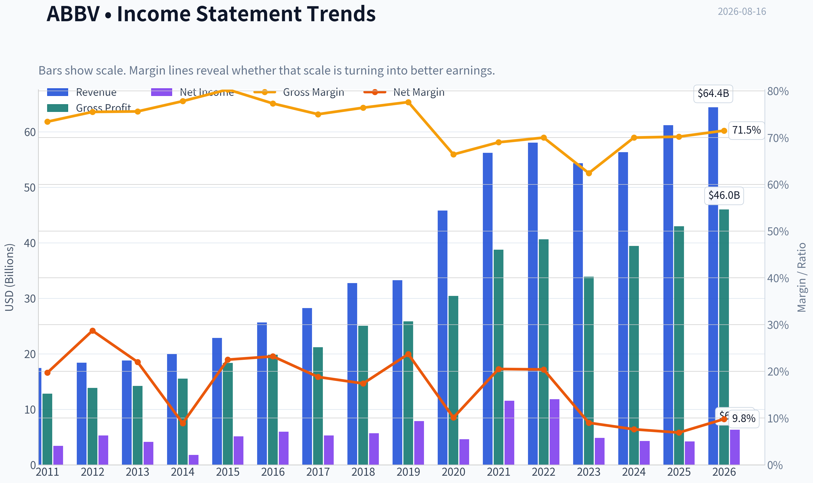
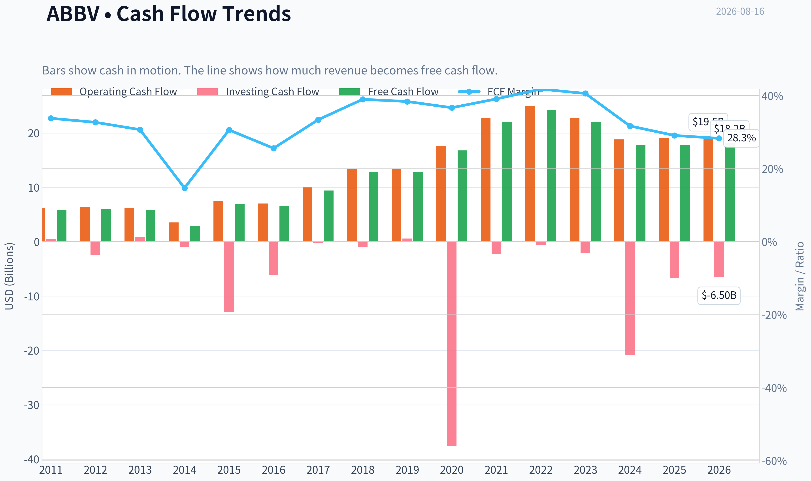
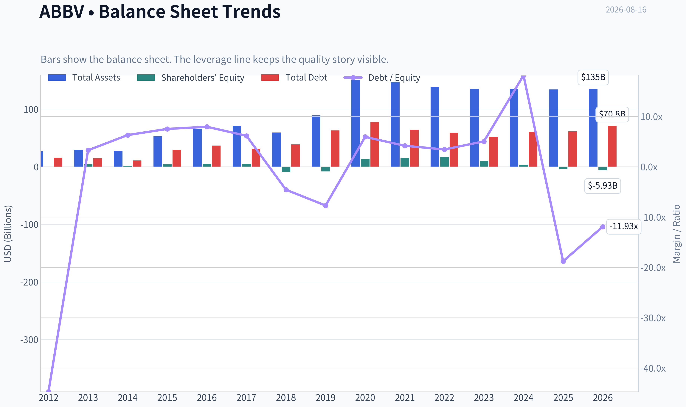
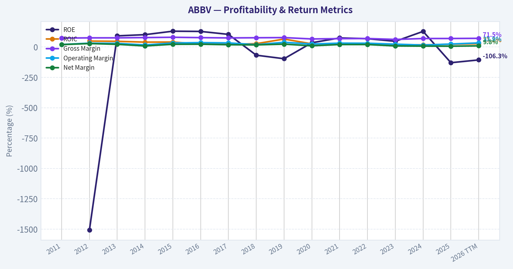
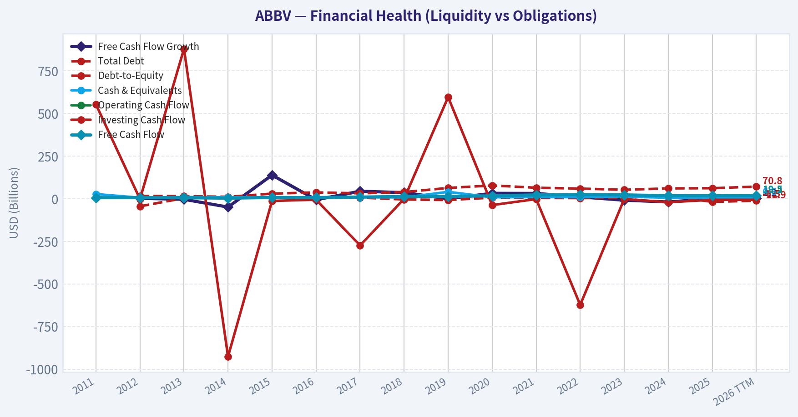
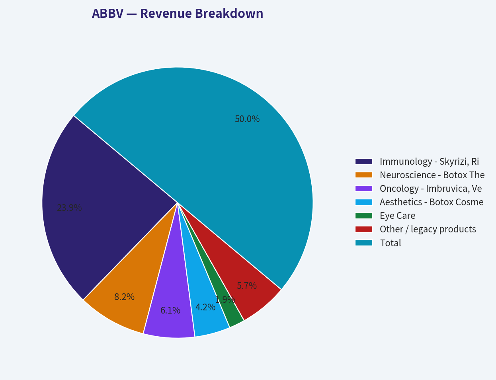
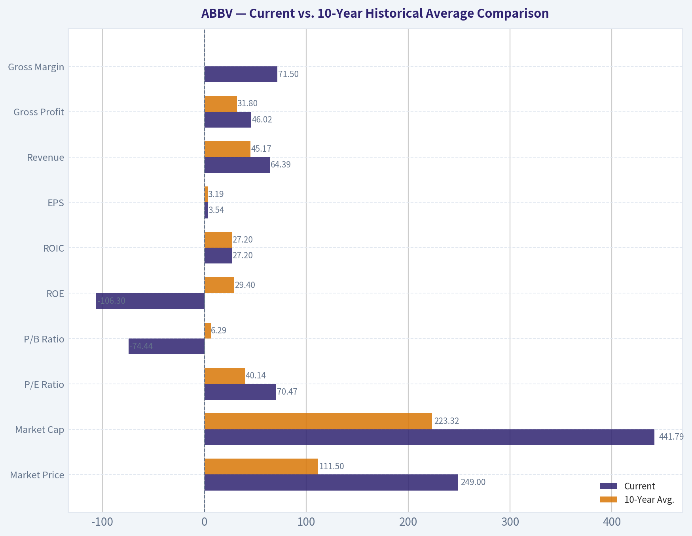
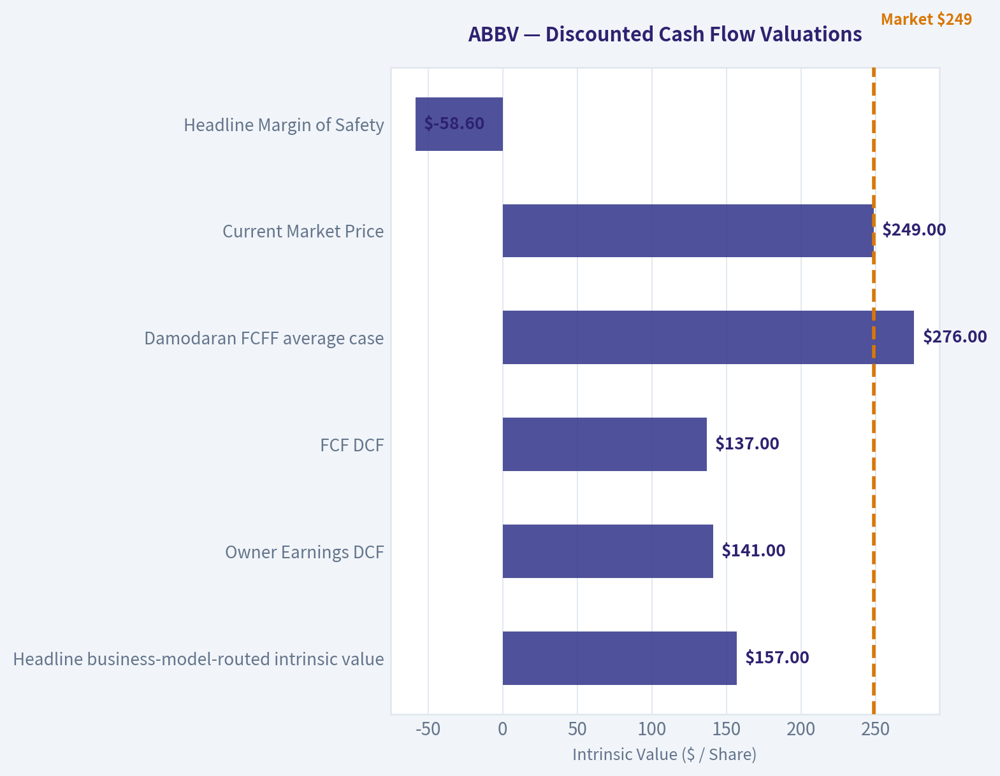
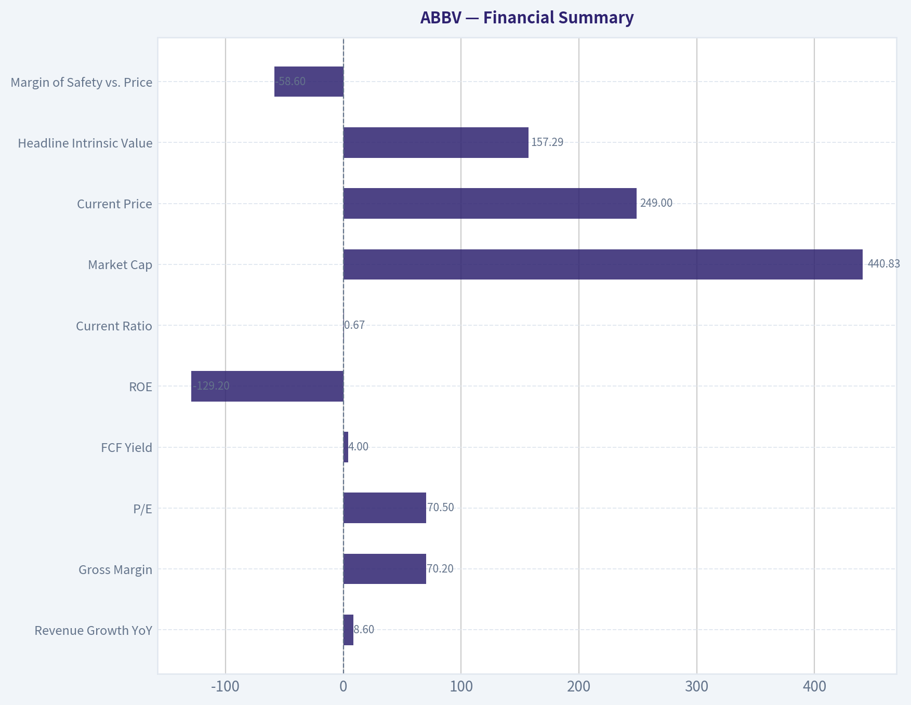
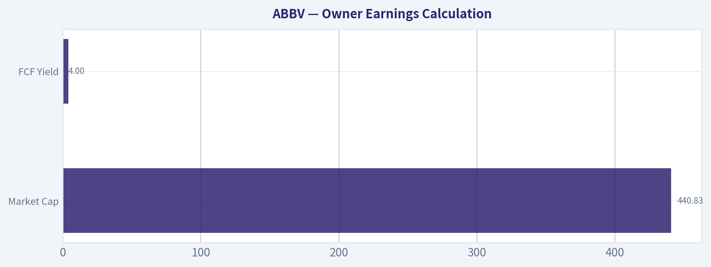

# ABBV Deep Value Intelligence

**Analysis Date:** 2026-08-16

## Critical Disclaimer

*This analysis is generated by Deep Value Intelligence, an AI-powered multi-agent investing framework. Education & research only - not financial advice, not a financial advisor.*

---

## Table of Contents

1. Intelligence Summary
2. Analyst Team Reports
   - Fundamentals Analysis
   - Intrinsic Value Analysis (Buffett)
   - Trend & Growth Analysis (Lynch/Druckenmiller/Fisher)
   - Market Technical Analysis
   - Options Market Analysis
3. Research Team Commentary
4. Value Investing Team Commentary
5. Deep Values Commentary

---

## Intelligence Summary

### Thesis + Conditions

**Core Thesis:** **1. Executive Summary**
AbbVie (ABBV) is a fundamentally elite, highly cash-generative franchise successfully executing a major patent transition.

**Key Risks:**
- The Bull (Risky):** Correctly identifies that headline GAAP optics mask a highly profitable economic engine. Skyrizi and Rinvoq are rapidly outgrowing the Humira gap, and the aesthetics portfolio provides a high-margin, sticky consumer moat. The current pullback is a tactical gift.
- The Bear (Safe):** Warns that at 25x owner earnings, the stock is priced for continuous perfection. Points out that the aesthetics business (Botox/Juvederm) carries cyclical, discretionary risk, and emphasizes that negative equity removes structural cushion.
- As risk managers, we must respect *metric semantics*. The Bear's fear of negative equity and high P/E is misplaced for an acquisitive, asset-light pharma company where cash flow and normalized owner earnings ($9.96/share) dictate solvency and value. While a 4% free cash flow yield requires sustained mid-single-digit growth, AbbVie's replacement pipeline is empirically delivering this. The real risk here is not permanent capital loss, but the *opportunity cost* of waiting for a distressed valuation that a fundamentally sound company will never reach.

**Confidence:** Low

---

## Analyst Team Reports

### Fundamentals Analysis

#### Latest Earnings Snapshot

*Most recent reported quarter anchored on 2026 Q2, with prior-year comparison when available.*

| Metric | 2026 Q2 | 2025 Q2 | YoY Change |
| --- | ---: | ---: | ---: |
| Revenue | $16.99B | $15.42B | +10.2% |
| Operating Income | $6.72B | $5.72B | +17.6% |
| Net Income | $3.61B | $938.0M | +285.2% |
| Diluted EPS | $2.03 | $0.52 | +290.4% |
| Operating Cash Flow | $3.44B | $5.15B | -33.3% |
| Free Cash Flow | $3.11B | $4.88B | -36.2% |

Key Takeaways: This snapshot anchors the most recent reported quarter before the narrative analysis. It helps readers separate long-run business quality from whatever changed in the latest earnings print.

#### 15-Year Financial Metrics for ABBV

*All values below are computed deterministically from raw data - not estimated by AI.*

*Issuer profile: operating company (Healthcare / Drug Manufacturers - General).*

#### 15-Year Financial Metrics
*Annual rows come from reported financial statements. The final TTM row is computed from the latest four quarters.*

| Metric | 2011 | 2012 | 2013 | 2014 | 2015 | 2016 | 2017 | 2018 | 2019 | 2020 | 2021 | 2022 | 2023 | 2024 | 2025 | 2026 TTM |
| --- | --- | --- | --- | --- | --- | --- | --- | --- | --- | --- | --- | --- | --- | --- | --- | --- |
| Market Price | N/A | $20 | $32 | $41 | $38 | $42 | $67 | $66 | $67 | $86 | $114 | $141 | $141 | $168 | $223 | $249 |
| Market Cap | N/A | $53.76B | $84.71B | $105.36B | $96.98B | $102.13B | $155.03B | $142.53B | $131.39B | $179.26B | $240.61B | $287.34B | $274.76B | $315.06B | $405.11B | $441.79B |
| P/E Ratio | N/A | 10.18 | 20.63 | 59.49 | 18.93 | 17.25 | 29.31 | 25.19 | 16.77 | 39.39 | 20.99 | 24.38 | 56.97 | 74.35 | 96.82 | 70.47 |
| P/B Ratio | N/A | -153.60 | 18.86 | 60.48 | 24.58 | 22.03 | 30.42 | -16.87 | -16.08 | 13.71 | 15.62 | 16.65 | 26.52 | 94.76 | -123.89 | -74.44 |
| ROE | N/A | -1507.1% | 91.9% | 101.8% | 130.4% | 128.4% | 104.2% | -67.3% | -96.5% | 35.3% | 74.9% | 68.6% | 46.9% | 128.7% | -129.2% | -106.3% |
| ROIC | N/A | 48.9% | 46.9% | 40.3% | 40.9% | 24.1% | 22.4% | 27.4% | 65.7% | 25.9% | 21.7% | 24.1% | 19.5% | 18.0% | 22.9% | 27.2% |
| EPS | $2.18 | $1.97 | $1.55 | $0.69 | $2.02 | $2.43 | $2.29 | $2.64 | $4.02 | $2.19 | $5.43 | $5.80 | $2.48 | $2.26 | $2.31 | $3.54 |
| Revenue | $17.44B | $18.38B | $18.79B | $19.96B | $22.86B | $25.64B | $28.22B | $32.75B | $33.27B | $45.80B | $56.20B | $58.05B | $54.32B | $56.33B | $61.16B | $64.39B |
| Gross Profit | $12.80B | $13.87B | $14.21B | $15.53B | $18.36B | $19.81B | $21.17B | $25.04B | $25.83B | $30.42B | $38.75B | $40.64B | $33.90B | $39.43B | $42.96B | $46.02B |
| Gross Margin | 73.4% | 75.5% | 75.6% | 77.8% | 80.3% | 77.3% | 75.0% | 76.4% | 77.6% | 66.4% | 69.0% | 70.0% | 62.4% | 70.0% | 70.2% | 71.5% |
| Operating Margin | 20.8% | 31.6% | 30.1% | 17.1% | 33.0% | 36.4% | 33.8% | 19.5% | 39.0% | 24.8% | 31.9% | 31.2% | 23.5% | 16.2% | 24.6% | 33.9% |
| Net Income | $3.43B | $5.28B | $4.13B | $1.77B | $5.14B | $5.95B | $5.31B | $5.69B | $7.88B | $4.62B | $11.54B | $11.84B | $4.86B | $4.28B | $4.23B | $6.31B |
| Net Margin | 19.7% | 28.7% | 22.0% | 8.9% | 22.5% | 23.2% | 18.8% | 17.4% | 23.7% | 10.1% | 20.5% | 20.4% | 9.0% | 7.6% | 6.9% | 9.8% |
| Revenue Growth | N/A | 5.4% | 2.2% | 6.2% | 14.5% | 12.2% | 10.1% | 16.1% | 1.6% | 37.7% | 22.7% | 3.3% | -6.4% | 3.7% | 8.6% | 5.3% |
| Net Income Growth | N/A | 53.7% | -21.7% | -57.0% | 190.0% | 15.7% | -10.8% | 7.1% | 38.6% | -41.4% | 150.0% | 2.5% | -58.9% | -12.0% | -1.2% | 49.3% |
| Free Cash Flow Growth | N/A | 2.1% | -3.9% | -49.2% | 138.4% | -6.3% | 43.7% | 35.6% | -0.1% | 31.5% | 31.0% | 10.3% | -9.0% | -19.2% | -0.1% | 2.2% |
| Total Book Value | N/A | $-350.0M | $4.49B | $1.74B | $3.94B | $4.64B | $5.10B | $-8.45B | $-8.17B | $13.08B | $15.41B | $17.25B | $10.36B | $3.33B | $-3.27B | $-5.93B |
| Total Assets | N/A | $27.01B | $29.20B | $27.51B | $53.05B | $66.10B | $70.79B | $59.35B | $89.11B | $150.56B | $146.53B | $138.81B | $134.71B | $135.16B | $133.96B | $135.12B |
| Total Debt | N/A | $15.65B | $14.71B | $10.96B | $29.65B | $36.82B | $31.35B | $38.70B | $62.98B | $77.59B | $64.20B | $59.14B | $52.19B | $60.34B | $61.44B | $70.82B |
| Debt-to-Equity | N/A | -44.71 | 3.27 | 6.29 | 7.51 | 7.94 | 6.15 | -4.58 | -7.71 | 5.93 | 4.17 | 3.43 | 5.04 | 18.15 | -18.79 | -11.93 |
| Cash & Equivalents | $27.0M | $5.90B | $9.60B | $8.35B | $8.40B | $5.10B | $9.30B | $7.29B | $39.92B | $8.45B | $9.75B | $9.20B | $12.81B | $5.52B | $5.23B | $6.57B |
| Shareholders' Equity | N/A | $-350.0M | $4.49B | $1.74B | $3.94B | $4.64B | $5.10B | $-8.45B | $-8.17B | $13.08B | $15.41B | $17.25B | $10.36B | $3.33B | $-3.27B | $-5.93B |
| Operating Cash Flow | $6.25B | $6.34B | $6.27B | $3.55B | $7.54B | $7.04B | $9.96B | $13.43B | $13.32B | $17.59B | $22.78B | $24.94B | $22.84B | $18.81B | $19.03B | $19.51B |
| Investing Cash Flow | $553.0M | $-2.42B | $879.0M | $-926.0M | $-12.94B | $-6.07B | $-274.0M | $-1.01B | $596.0M | $-37.56B | $-2.34B | $-623.0M | $-2.01B | $-20.82B | $-6.64B | $-6.50B |
| Free Cash Flow | $5.89B | $6.01B | $5.78B | $2.94B | $7.00B | $6.56B | $9.43B | $12.79B | $12.77B | $16.79B | $21.99B | $24.25B | $22.06B | $17.83B | $17.82B | $18.21B |
| FCF Margin | 33.8% | 32.7% | 30.7% | 14.7% | 30.6% | 25.6% | 33.4% | 39.0% | 38.4% | 36.7% | 39.1% | 41.8% | 40.6% | 31.7% | 29.1% | 28.3% |
| Dividends / Share | $0.00 | $0.00 | $0.00 | $0.00 | $0.00 | $0.00 | $0.00 | $0.00 | $0.00 | $0.00 | $0.00 | $4.94 | $5.41 | $5.87 | $6.42 | $6.76 |

#### Profitability Metrics
- Return on Equity (ROE): -129.2%
- Return on Invested Capital (ROIC): 18.3%
- Return on Assets (ROA): 3.2%
- Gross Margin: 70.2%
- Operating Margin: 24.6%
- Net Profit Margin: 6.9%

#### Liquidity Metrics
- Current Ratio: 0.67
- Quick Ratio: 0.41

#### Leverage Metrics
- Debt-to-Equity Ratio: -18.79
- Interest Coverage Ratio: 5.21
- Net Debt: $56.21B

#### Growth Metrics (Year-over-Year)
- Revenue Growth: 8.6%
- Net Income Growth: -1.2%
- Free Cash Flow Growth: -0.1%
- Revenue CAGR (3-Year): 1.8%
- Revenue CAGR (5-Year): 6.0%

#### Valuation Metrics
- P/E Ratio (TTM): 70.47
- Forward P/E: 15.32
- Price-to-Book: N/A
- Price-to-Sales: 6.85
- PEG Ratio: 0.41
- EV/EBITDA: 16.42
- Free Cash Flow Yield: 4.0%
- Earnings Yield: 1.4%

#### Owner Earnings (Buffett Method, Code-Computed)
- Net Income: $4.23B
- + Depreciation & Amortization: $8.14B
- - Capital Expenditures: $-1.21B
- - Working Capital Changes: $-2.36B
- = **Owner Earnings: $13.51B**

#### Intrinsic Value (Code-Computed)
- Current Price: $249
- **Headline Intrinsic Value (business-model routed): $157**
  Business model: asset light platform - weighted blend [Damodaran FCFF + reverse-DCF fair + owner-earnings DCF] (asset_light_platform)
  Model spread (min-max across DCFs): $137 - $276
  Margin of safety vs. price (headline): -58.6%
  Routing note: Asset-light / high-margin platform: value driven by margins and reinvestment economics - the headline centers on the reverse-DCF demonstrated-growth fair value with Damodaran FCFF as a floor, down-weighting the owner-earnings DCF.
- Buffett Method (Owner Earnings):
  Conservative: $-2
  Average: $141
  Optimistic: $522
- Cash Flow Method (FCF):
  Conservative: $65
  Average: $137
  Optimistic: $346
- Damodaran FCFF (WACC + margins + reinvestment):
  Conservative: $129
  Average: $276
  Optimistic: $355
  Monte Carlo band (P10-P90): $158 - $379 (median $238)
  P(intrinsic value > price): 45.2%
- Reverse-DCF: price implies ~24.9%/yr owner-earnings growth for 10y; trailing 3y was -11.8%, 5y 28.8%.

#### Piotroski F-Score: 6/9
- Positive Net Income: PASS
- Positive Operating Cash Flow: PASS
- ROA Improvement: FAIL
- Cash Flow > Net Income: PASS
- Decreasing Debt: FAIL
- Improving Current Ratio: PASS
- No Dilution: FAIL
- Improving Gross Margin: PASS
- Improving Asset Turnover: PASS

ANALYST STANCE: **WATCH**

#### AbbVie Inc. - Warren Buffett-Style Fundamental Analysis

AbbVie is a high-cash-flow pharmaceutical company with strong branded-drug economics, durable franchises in immunology, neuroscience, aesthetics, and oncology, and a meaningful dividend profile. The core Buffett question is not whether AbbVie is a good business - it generally is - but whether the current price of **$249** offers a margin of safety after the market has already priced in a successful post-Humira transformation.

At today's price, the answer is cautious. AbbVie's current market value of roughly **$442B** implies demanding expectations, while the deterministic model's headline intrinsic value is **$157 per share**, with a broader model spread of approximately **$137 to $276**. That makes the stock high quality, but not clearly cheap.

---

#### Current vs. 10-Year Historical Average Comparison

*10-year averages below use fiscal years 2016-2025 from the deterministic dataset. "Current" refers to 2026 TTM where available.*

| Metric | Current | 10-Year Avg. | Current vs. Avg. | Interpretation |
|---|---:|---:|---:|---|
| Market Price | $249 | $111.50 | +123% | The stock price has more than doubled its 10-year average, reflecting strong confidence in the post-Humira portfolio. |
| Market Cap | $441.79B | $223.32B | +98% | Market value has nearly doubled versus the decade average, leaving less room for valuation error. |
| P/E Ratio | 70.47x | 40.14x | Above avg. | Reported earnings are depressed by amortization and acquisition-related charges, but the headline P/E is still optically expensive. |
| P/B Ratio | -74.44x | 6.29x | Not meaningful | Book value is distorted by negative equity, debt-financed acquisitions, intangibles, and buybacks. P/B is not a useful valuation anchor for AbbVie. |
| ROE | -106.3% | 29.4% | Not meaningful currently | Negative equity makes ROE mechanically distorted. The better profitability metric is ROIC and cash generation. |
| ROIC | 27.2% | 27.2% | In line | ROIC remains excellent and almost exactly matches the decade average, showing durable economics despite Humira erosion. |
| EPS | $3.54 | $3.19 | +11% | EPS has recovered from recent lows, but remains volatile due to accounting charges and acquisition amortization. |
| Revenue | $64.39B | $45.17B | +43% | Revenue is meaningfully above the decade average, helped by AbbVie's Allergan deal and growth from Skyrizi, Rinvoq, Vraylar, and Botox. |
| Gross Profit | $46.02B | $31.80B | +45% | Gross profit growth has closely tracked revenue expansion, confirming strong product economics. |
| Gross Margin | 71.5% | ~72.4% | Slightly below avg. | Gross margin remains structurally high, though below the pre-Humira-erosion peak years. |
| Operating Margin | 33.9% | 28.1% | Above avg. | Operating profitability has improved sharply versus recent years, a positive sign for operating leverage. |
| Net Income | $6.31B | $6.62B | -5% | Net income remains below average despite record revenue, mainly due to amortization, interest, and transition costs. |
| Net Margin | 9.8% | 15.8% | Below avg. | Net profitability is still subdued relative to historical norms. |
| Revenue Growth | 5.3% | 11.0% | Below avg. | Growth has normalized after the Allergan acquisition and Humira biosimilar pressure. |
| Net Income Growth | 49.3% | 9.0% | Above avg. | The current growth rate reflects rebound from a depressed base, not necessarily a sustainable earnings trend. |
| FCF Growth | 2.2% | 11.7% | Below avg. | Free cash flow growth is positive but far below AbbVie's historical compounding rate. |
| Total Book Value / Equity | -$5.93B | $4.93B | Negative | Negative equity makes balance-sheet ratios like P/B and D/E unreliable as valuation tools. |
| Total Assets | $135.12B | $112.51B | +20% | Asset base remains elevated after major acquisitions, especially Allergan. |
| Total Debt | $70.82B | $54.48B | +30% | Debt is above the decade average and is a key Buffett-style risk factor. |
| Debt-to-Equity | -11.93x | 1.97x | Not meaningful | Negative equity distorts the ratio; net debt to FCF is more useful. |
| Cash & Equivalents | $6.57B | $11.26B | -42% | Cash is below average while debt is elevated, reducing balance-sheet flexibility. |
| Free Cash Flow | $18.21B | $16.23B | +12% | FCF remains strong and above the decade average, supporting dividends and debt service. |
| Dividends / Share | $6.76 | $2.26 | +199% | The dividend is materially higher than the decade average, though the dataset shows zero dividends before 2022. |

Key Takeaways: AbbVie's business quality is still strong, especially on ROIC, gross margin, operating margin, and free cash flow. However, valuation metrics are stretched, book-value ratios are not meaningful, and net income margins remain well below the company's stronger historical periods. The clearest strength is cash generation; the clearest concern is that the stock price has risen faster than normalized earnings and free cash flow.

---

#### Revenue Breakdown

*Most recent fiscal-year revenue is based on the deterministic 2025 revenue total of **$61.16B**. Segment amounts are approximate allocations using AbbVie's major therapeutic areas and publicly reported business mix.*

| Revenue Source | Amount ($B) | % of Total |
|---|---:|---:|
| Immunology - Skyrizi, Rinvoq, Humira | $29.2B | 47.7% |
| Neuroscience - Botox Therapeutic, Vraylar, migraine and psychiatric assets | $10.0B | 16.4% |
| Oncology - Imbruvica, Venclexta, Epkinly / epcoritamab-related portfolio | $7.5B | 12.3% |
| Aesthetics - Botox Cosmetic, Juvederm and related aesthetics products | $5.2B | 8.5% |
| Eye Care | $2.3B | 3.8% |
| Other / legacy products | $7.0B | 11.4% |
| **Total** | **$61.16B** | **100.0%** |

Key Takeaways: AbbVie remains heavily dependent on immunology, which is both its greatest strength and its biggest concentration risk. Skyrizi and Rinvoq are central to the company's post-Humira transition, while neuroscience and aesthetics provide valuable diversification. Oncology remains strategically important but has had mixed clinical and competitive developments.

---

#### Buffett-Style Business Quality Assessment

| Buffett Criterion | Assessment |
|---|---|
| Economic moat | Strong but patent-dependent. AbbVie benefits from branded-drug pricing power, physician familiarity, scale, regulatory barriers, and large commercial infrastructure. However, pharmaceutical moats are less permanent than consumer-brand moats because patents expire. |
| Durability | Good, but not risk-free. Humira's biosimilar decline is the central historical test, and AbbVie has partially offset it with Skyrizi and Rinvoq. |
| Pricing power | High in protected branded therapies, especially immunology and specialty medicine. Pricing power weakens sharply after loss of exclusivity. |
| Predictable earnings | Moderate. Revenue has been fairly resilient, but net income and EPS have been volatile due to acquisition accounting, amortization, restructuring, and product-cycle transitions. |
| Capital intensity | Favorable. Free cash flow margins remain high, with TTM FCF margin around **28.3%**. |
| Management quality | Generally strong on portfolio transition and dividend growth, but leverage and acquisition dependence require monitoring. |
| Balance-sheet strength | Acceptable but not pristine. Total debt of **$70.82B** and net debt of roughly **$64.25B** are material. |
| Shareholder returns | Dividend-oriented. The current dividend per share is **$6.76**, implying a dividend cash requirement of roughly **$12B**, well covered by TTM FCF of **$18.21B**, but less comfortably covered by owner earnings of **$13.51B**. |

Key Takeaways: AbbVie has many Buffett-like qualities: high margins, recurring demand, strong free cash flow, and a valuable product portfolio. The main difference from a classic Buffett compounder is patent-cycle risk. This means investors must demand a larger margin of safety than they would for a more perpetual consumer monopoly.

---

#### Three-Scenario Buffett-Style Owner Earnings DCF

**Base owner earnings:** $13.51B
**Discount rate:** 10.0%
**Terminal growth rate:** 2.5%
**Current shares outstanding estimate:** ~1.774B shares
**Net debt adjustment:** $70.82B debt less $6.57B cash = **$64.25B net debt**
**Formula:**
Fair equity value = PV of explicit owner earnings + PV of terminal value - net debt
Terminal value = Year 10 owner earnings x 1.025 / (10.0% - 2.5%)

| Scenario | Growth Assumption | Year 10 Owner Earnings | PV of Explicit Cash Flows | PV of Terminal Value | Equity Value After Net Debt | Fair Value / Share |
|---|---|---:|---:|---:|---:|---:|
| Conservative | 3% annual growth for 10 years | $18.16B | $95.8B | $95.7B | $127.3B | ~$72 |
| Average / Base Case | 12% growth for years 1-5, then 6% for years 6-10 | $31.86B | $137.6B | $167.9B | $241.2B | ~$136 |
| Optimistic | 18% growth for years 1-5, 10% for years 6-8, then 6% for years 9-10 | $46.22B | $177.7B | $243.6B | $357.0B | ~$201 |

Key Takeaways: Even under a strong optimistic owner-earnings scenario, the hand-built DCF produces a value below the current price of $249 when net debt is deducted. The base-case estimate of roughly $136 per share is close to the deterministic pack's cash-flow and owner-earnings DCF outputs. For the current stock price to be justified, AbbVie likely needs sustained high-teens to mid-20s owner-earnings growth or a lower required return than 10%.

---

#### Intrinsic Value Cross-Check

The deterministic valuation pack gives the following intrinsic value signals:

| Valuation Model | Intrinsic Value / Share |
|---|---:|
| Headline business-model-routed intrinsic value | $157 |
| Owner Earnings DCF | $141 |
| FCF DCF | $137 |
| Damodaran FCFF average case | $276 |
| Damodaran FCFF Monte Carlo P10-P90 range | $158-$379 |
| Current Market Price | $249 |
| Headline Margin of Safety | -58.6% |

Key Takeaways: The valuation picture is mixed but not cheap. Owner-earnings and FCF methods cluster around $137-$157, materially below the current price. The more favorable Damodaran FCFF model can support a valuation near or above the current price, but the overall evidence does not provide a Buffett-style margin of safety.

---

#### Interpretation of Required Metric Groups

| Metric Group | Buffett-Style Interpretation |
|---|---|
| Market Metrics | The market price and market cap are far above historical averages. The P/E ratio is elevated at **70.47x**, though distorted by accounting earnings. P/B is not meaningful because AbbVie has negative equity and a business driven by intangible drug assets, patents, and cash flows rather than book value. |
| Profitability | ROIC of **27.2%** is excellent and confirms strong economics. Gross margin above **70%** and operating margin near **34%** show pricing power. However, net margin of **9.8%** is weak versus history, suggesting accounting charges, interest, amortization, and post-Humira transition costs still weigh on reported earnings. |
| Growth | Revenue growth is positive but slower than the 10-year average. Net income growth is currently high because of recovery from a low base. Free cash flow growth is modest, which matters more for intrinsic value than reported EPS growth. |
| Balance Sheet | Debt is elevated at **$70.82B**, while cash is only **$6.57B**. Negative shareholder equity makes book-value ratios unreliable. Net debt to FCF is roughly **3.5x**, which is manageable for a large pharma company but not conservative by Buffett standards. |
| Cash Flow | Free cash flow of **$18.21B** remains the strongest part of the thesis. Dividends of **$6.76 per share** are supported by FCF, but the payout consumes a large portion of owner earnings and reduces room for aggressive debt reduction or buybacks. |

Key Takeaways: AbbVie is fundamentally a cash-flow story, not a book-value story. The company's high ROIC and free cash flow support business quality, while leverage and valuation limit the margin of safety. Investors should focus on owner earnings, FCF durability, and pipeline execution rather than P/B or debt-to-equity ratios.

---

#### Key Investment Insights

| Category | Insight |
|---|---|
| Core opportunity | AbbVie may successfully complete its post-Humira transition as Skyrizi and Rinvoq scale into large, durable franchises. |
| Moat strength | Strong regulatory barriers, specialist relationships, branded-drug economics, and scale provide a meaningful moat. |
| Cash-flow quality | TTM FCF of **$18.21B** and FCF yield around **4.0%** are solid, though not deeply undervalued. |
| Margin recovery | Operating margin has improved to **33.9%**, above the 10-year average, suggesting operational recovery. |
| Dividend appeal | Dividend per share of **$6.76** is attractive for income investors and appears supported by cash flow. |
| Valuation concern | Current price of **$249** is materially above the headline intrinsic value of **$157** and above the owner-earnings base-case DCF. |
| Balance-sheet concern | Net debt remains substantial, and total debt is above the 10-year average. |
| Accounting complexity | Reported EPS, ROE, P/E, P/B, and D/E are distorted by amortization, acquisitions, negative equity, and accounting charges. |
| Pipeline risk | Future value depends on continued clinical, regulatory, and commercial success across immunology, oncology, neuroscience, and aesthetics. |
| Recent watch item | Epcoritamab-related clinical/regulatory developments highlight that oncology pipeline execution remains uncertain. |

Key Takeaways: AbbVie has strong business economics, but the stock price already reflects a large amount of future success. The company can still compound value if its growth platforms perform, but new buyers have limited protection if growth disappoints. The setup is better suited for patient monitoring than aggressive accumulation.

---

#### Red Flags and Opportunities

| Red Flags | Opportunities |
|---|---|
| Current price is above most cash-flow-based intrinsic value estimates. | Skyrizi and Rinvoq could continue exceeding expectations and offset Humira erosion. |
| P/E is very high on reported earnings. | Forward P/E is much lower, suggesting market expectations are based on normalized earnings recovery. |
| Negative equity makes ROE, P/B, and D/E unreliable. | ROIC remains excellent, showing the underlying business still earns high returns on capital. |
| Debt of **$70.82B** limits flexibility. | Strong FCF can fund dividends, debt reduction, and selective acquisitions. |
| Net margin remains far below stronger historical levels. | Operating margin recovery to **33.9%** is encouraging. |
| Dividend consumes a meaningful portion of owner earnings. | Dividend profile may attract long-term income investors. |
| Pharma patent cliffs are structurally recurring risks. | AbbVie has demonstrated an ability to manage major lifecycle transitions before. |

Key Takeaways: The biggest risk is not business failure, but overpaying for a good business during a period of optimism. The biggest opportunity is that AbbVie's newer drugs may create a second growth era after Humira. For Buffett-style investors, the right decision depends on whether the stock can be purchased closer to intrinsic value.

---

#### Final Investment Stance: WATCH

AbbVie is a **high-quality pharmaceutical compounder**, but at **$249**, the stock does not offer a clear Buffett-style margin of safety. The company has durable cash flows, excellent ROIC, valuable franchises, and a shareholder-friendly dividend policy. However, the current valuation already assumes strong execution, while leverage, patent-cycle risk, and below-average net margins remain important concerns.

A more attractive entry point would be closer to the deterministic headline intrinsic value range around **$157**, or at least near the lower end of the broader intrinsic value band where FCF yield and margin of safety become more compelling. Existing long-term holders may reasonably continue to hold if they believe in the Skyrizi/Rinvoq growth runway, but new capital should be patient.

| Final Summary Point | Assessment |
|---|---|
| Business quality | Strong |
| Economic moat | Strong but patent-dependent |
| Financial strength | Adequate, not pristine |
| Earnings predictability | Moderate |
| Cash-flow durability | Strong |
| Dividend safety | Reasonable, but payout is meaningful |
| Valuation | Stretched versus owner-earnings and FCF models |
| Margin of safety | Insufficient |
| Best investor action | Watch for a better entry point |
| Final stance | **WATCH** |

Key Takeaways: AbbVie is a good business trading at a demanding price. The company's cash flows and drug portfolio justify respect, but not blind buying. A Buffett-style investor should keep AbbVie on the watchlist and wait for a wider margin of safety before advocating purchase.

#### Fundamental Visuals

This graph tracks the profitability and return metrics (ROE, ROIC, Margins) of **ABBV** over the past decade, highlighting capital efficiency trends.

This chart illustrates the financial health of **ABBV** over the last 10 years, mapping cash equivalents and free cash flow against total obligations (Debt).

This breakdown chart from <em>Revenue Breakdown</em> shows the proportional composition for **ABBV** - useful for understanding what drives or risks the business.

---

### Intrinsic Value Analysis (Buffett)

> *Following Warren Buffett's value investing philosophy: Circle of Competence, Economic Moat, Management Quality, and Margin of Safety.*

#### Intrinsic Value Snapshot

Price is what you pay. Intrinsic value is what the business may be worth based on the cash it can create for owners over time. We show a range, not one magic number.

- Current Price: $249.46
- Value Range (conservative to optimistic across both DCF methods): $3.73 to $199.25

##### Owner Earnings (Buffett Method)
- Net Income: $4,226,000,000.00
- Depreciation & Amortization: $8,139,000,000.00
- Capital Expenditures: $-1,214,000,000.00
- Working Capital Changes: $-2,362,000,000.00
- Owner Earnings: $13,513,000,000.00

##### Intrinsic Value
###### Buffett Method
Uses owner earnings. Stricter, and usually more conservative.
- Conservative: $3.73
- Average: $39.17
- Optimistic: $199.25
- Discount Rate: 10.0%

###### Cash Flow Method
Uses free cash flow. Better for companies spending heavily today to grow tomorrow.
- Conservative: $38.87
- Average: $52.45
- Optimistic: $71.82
- Discount Rate: 10.0%

ANALYST STANCE: **WATCH**

#### ABBV Investment View - AbbVie Inc.
**Current price:** $249
**Market cap:** $440.83B
**Conviction:** Medium - high-quality pharmaceutical franchise, but valuation is ahead of intrinsic value.

---

#### 1. Factor Scorecard

| Factor | Score | Evidence |
|---|---:|---|
| Circle of Competence & Business Simplicity | 3.5 / 5 | AbbVie makes money by discovering, developing, manufacturing, and selling branded medicines, especially in immunology, oncology, aesthetics, neuroscience, and eye care. The model is understandable, but long-term outcomes depend on patent cycles, clinical trial success, regulation, and reimbursement. |
| Moat Test | 4.0 / 5 | Strong intangible assets from patents, regulatory approvals, physician familiarity, biologics know-how, and commercial scale. Gross margin is approximately 70.2%, supporting evidence of pricing power and differentiated products. |
| Management Quality & Capital Allocation | 3.5 / 5 | Management has navigated the Humira patent cliff better than many feared, with Skyrizi and Rinvoq becoming major growth engines. However, the Allergan deal increased leverage and added complexity; recent acquisitions such as ImmunoGen and Cerevel carry execution risk. |
| Industry Structure | 3.0 / 5 | Branded pharma can be attractive when products are protected, but the industry is structurally exposed to patent cliffs, payer pressure, regulatory scrutiny, and binary R&D outcomes. |
| Gate 5: Quality / Solvency Hard Floor | Not tripped | AbbVie does not show financial distress. Revenue is growing again, free cash flow remains substantial, and interest obligations appear serviceable despite a leveraged balance sheet. |

**Key Takeaways:** AbbVie is a strong but not effortless Buffett-style business. Its moat is real, especially in immunology and aesthetics, but the business has periodic reinvention risk because patents expire and pipelines must replace aging franchises. The solvency hard floor is not triggered.

---

#### 2. Moat Analysis

| Moat Source | Assessment | Evidence |
|---|---|---|
| Intangible Assets | Strong | Patents, biologics expertise, regulatory approvals, physician trust, payer relationships, and global commercial infrastructure. Gross margin of roughly 70.2% indicates differentiated economics. |
| Switching Costs | Moderate | Patients and physicians are reluctant to switch therapies that work, especially in chronic inflammatory diseases. However, payers can push biosimilars or preferred formulary alternatives. |
| Cost Advantages | Moderate | AbbVie benefits from scale in R&D, manufacturing, regulatory affairs, and sales coverage. Still, cost advantage is secondary to product differentiation. |
| Network Effects | Low | Drug franchises do not become more valuable simply because more users join; this is not a platform network-effect business. |
| Moat Direction | Stable to improving | Humira's decline is being offset by Skyrizi and Rinvoq, but the company must keep refreshing the portfolio through R&D and acquisitions. |

**Key Takeaways:** AbbVie's moat is primarily an intangible-asset moat, not a network-effect moat. The key question is not whether AbbVie has competitive advantages today - it does - but whether the next generation of drugs can compound before today's protected assets mature.

---

#### 3. Management Quality Assessment

AbbVie's management deserves credit for handling the post-Humira transition with more discipline than the market once expected. Skyrizi and Rinvoq have become central growth franchises, and the company's aesthetics business, led by Botox, adds a differentiated cash-flow stream outside classic pharma.

Capital allocation is mixed. The dividend record is shareholder-friendly, and AbbVie has historically returned substantial cash to owners. But the company has also relied on debt-funded acquisitions, including Allergan, ImmunoGen, and Cerevel, which makes management's future integration and capital discipline especially important. From a Buffett lens, AbbVie is owner-aware, but not a pristine capital allocator.

---

#### 4. Financial Summary

| Metric | Recent / TTM Snapshot |
|---|---:|
| Revenue Growth YoY | 8.6% |
| Gross Margin | 70.2% |
| P/E | 70.5x |
| FCF Yield | 4.0% |
| ROE | -129.2% |
| Current Ratio | 0.67x |
| Market Cap | $440.83B |
| Current Price | $249 |
| Headline Intrinsic Value | $157.29 |
| Margin of Safety vs. Price | -58.6% |
| Reverse-DCF Implied Growth | ~24.9% annually for 10 years |

**Key Takeaways:** AbbVie's operating quality is strong, with high gross margins and renewed revenue growth. The problem is price: at $249, the stock trades materially above the provided intrinsic value estimate, and the reverse-DCF implies very aggressive long-term growth.

---

#### 5. Owner Earnings Calculation

| Owner Earnings Component | Estimate |
|---|---:|
| Market Cap | $440.83B |
| FCF Yield | 4.0% |
| Estimated Free Cash Flow / Owner Earnings | ~$17.6B |
| Estimated Shares Outstanding | ~1.77B |
| Owner Earnings Per Share | ~$9.96 |

**Key Takeaways:** AbbVie remains a powerful cash generator despite accounting earnings being depressed by amortization and acquisition-related charges. Owner earnings are better represented by free cash flow than by headline net income, but even on that cash-flow basis the current price embeds demanding expectations.

---

#### 6. Three-Scenario DCF Valuation

Assumptions:
- Starting owner earnings per share: **$9.96**
- Discount rate: **10%**
- Conservative long-term terminal growth: **3%**
- Historical-growth scenario uses a moderated **5.5%** 10-year growth rate, below the implied growth embedded in the current stock price.

| Scenario | Method | Intrinsic Value / Share |
|---|---|---:|
| A. No Growth | Owner earnings / 10% discount rate | ~$99.60 |
| B. GDP Growth | Owner earnings grown at 3% into perpetuity | ~$146.50 |
| C. Moderated Historical Growth | 5.5% for 10 years, then 3% terminal growth | ~$176.40 |
| Simple Average | Average of A, B, and C | ~$140.80 |
| Research Pack Headline Value | Business-model routed blended valuation | $157.29 |

**Key Takeaways:** The conservative DCF range clusters well below the current share price. Even giving AbbVie credit for mid-single-digit owner-earnings growth, the valuation does not provide a Buffett-style margin of safety today.

---

#### 7. Margin of Safety Analysis

| Valuation Reference | Value / Share | Price vs. Value |
|---|---:|---:|
| Current Price | $249.00 | - |
| Owner Earnings DCF | $140.59 | Price materially above value |
| FCF DCF | $136.88 | Price materially above value |
| Damodaran FCFF | $275.66 | Price below this more optimistic model |
| Headline Intrinsic Value | $157.29 | Price is about 58.6% above fair value |
| Reverse-DCF | Implies ~24.9% annual growth for 10 years | Demanding |

**Key Takeaways:** AbbVie's valuation is the central issue. The Damodaran FCFF estimate offers a more optimistic case, but the broader blend and reverse-DCF suggest the market is already pricing in a highly successful post-Humira transformation.

---

#### 8. Final Buffett Scorecard

| Criterion | Weight | Score | Weighted Contribution |
|---|---:|---:|---:|
| Moat Width & Durability | 25% | 4.0 | 1.00 |
| Valuation / Margin of Safety | 20% | 1.0 | 0.20 |
| Capital Returns - ROIC vs. WACC | 15% | 3.5 | 0.53 |
| Business Understanding & Predictability | 12% | 3.5 | 0.42 |
| Management Quality & Capital Allocation | 12% | 3.5 | 0.42 |
| Reinvestment Runway | 8% | 3.5 | 0.28 |
| Balance Sheet Strength | 4% | 2.5 | 0.10 |
| Industry Structure | 4% | 3.0 | 0.12 |
| **Total Score** | **100%** | - | **3.07 / 5** |

**Key Takeaways:** AbbVie scores well on moat, cash generation, and business quality, but poorly on valuation. The weighted result lands in WATCH territory: this is a good business, but not currently a compelling purchase at $249.

---

#### 9. Investment Stance

**Stance: WATCH**
**Conviction: Medium**

AbbVie is a high-quality branded pharmaceutical company with durable cash flows, strong gross margins, and a credible path beyond Humira through Skyrizi, Rinvoq, oncology, neuroscience, and aesthetics. The business is not in financial distress, and management has executed the post-Humira transition better than skeptics expected.

However, Buffett-style investing requires discipline on price. At $249, AbbVie trades far above the blended intrinsic value estimate of roughly $157 per share, and the reverse-DCF implies about 24.9% annual growth for a decade. That is too demanding for a large pharmaceutical company facing patent cycles, payer pressure, and acquisition integration risk.

A more attractive entry point would require either a materially lower share price or clearer evidence that owner earnings can compound at a rate meaningfully above current conservative assumptions. At today's price, AbbVie is a **WATCH**, not an **ADVOCATE**.
#### Valuation Bridge

This bridge places the current market price beside each intrinsic value lens so readers can see whether upside depends on one method or shows up across several methods.

| Scenario | Intrinsic Value / Share |
| --- | ---: |
| Buffett Method | $39.17 |
| Cash Flow Method | $52.45 |
| Damodaran Method | $163.65 |
| Current Price | $249.46 |

#### Key Takeaways

If one method is far above the others, the upside case depends on a specific modelling assumption. When several methods cluster together, the valuation story is more robust.

#### Valuation Visuals

This comparison chart from *Latest Earnings Snapshot* stacks current figures against historical benchmarks for **ABBV**, making it easy to see where the company trades relative to its own averages.

This comparison chart from *Current vs. 10-Year Historical Average Comparison* stacks current figures against historical benchmarks for **ABBV**, making it easy to see where the company trades relative to its own averages.

The following chart maps the **ABBV** Owner Earnings DCF valuation scenarios (Conservative, Average, Optimistic) to visually represent the margin of safety based on intrinsic value calculations.

This comparison chart from *Financial Summary* stacks current figures against historical benchmarks for **ABBV**, making it easy to see where the company trades relative to its own averages.

This comparison chart from *Owner Earnings Calculation* stacks current figures against historical benchmarks for **ABBV**, making it easy to see where the company trades relative to its own averages.

---

### Trend & Growth Analysis (Lynch/Druckenmiller/Fisher)

> *Following Peter Lynch's GARP, Stanley Druckenmiller's macro-aware approach, and Philip Fisher's scuttlebutt methodology.*

ANALYST STANCE: **AVOID**

#### ABBV Growth Investment Report - AbbVie Inc.

AbbVie is a high-quality global biopharma company, but it does **not** fit a Lynch/Fisher/Druckenmiller growth mandate today. The company is in a post-Humira transition, with strong replacement assets like Skyrizi and Rinvoq, but at a roughly **$441 billion market cap**, **8.6% revenue growth**, and a headline valuation materially above intrinsic value estimates, the setup lacks ten-bagger potential.

---

#### 1. Lynch Classification

| Category | ABBV Assessment |
|---|---|
| Lynch Type | **Stalwart / pharma transition story** |
| Growth Profile | Mid-single to high-single-digit revenue growth, not fast-grower territory |
| Ten-Bagger Potential | Low due to large market cap and mature revenue base |
| Best Fit | Income, healthcare defensive, or GARP portfolio - not concentrated growth |
| Growth Investor Verdict | **Avoid for new growth capital** |

**Key Takeaways:** AbbVie is not a classic Lynch fast grower. It is a large, mature pharmaceutical company trying to offset the Humira patent cliff with newer drugs. The business may still compound value, but the odds of a 10x return from today's size are low.

---

#### 2. The Story in 3 Bullets

- AbbVie built a massive cash-flow engine around Humira, but that franchise is declining after biosimilar competition.
- The growth story depends on newer immunology drugs, especially **Skyrizi** and **Rinvoq**, plus contributions from oncology, neuroscience, and aesthetics.
- The key question is whether the post-Humira portfolio can grow fast enough to justify a premium valuation - and for a growth investor, the answer is not yet compelling.

---

#### 3. TAM Analysis and 10x Test

| Item | Estimate / Assessment |
|---|---|
| Current Market Cap | ~$440.8B |
| Current Revenue Base | Approximately $60B annualized, based on Q1 2026 revenue of $15.0B |
| 10x Revenue Requirement | ~$600B annual revenue |
| Relevant TAM | Global pharma, immunology, oncology, aesthetics, neuroscience |
| Can ABBV 10x Revenue and Still Be Small? | **No** |
| Runway Quality | Solid for replacement growth, limited for 10x compounding |

**Key Takeaways:** AbbVie operates in enormous healthcare markets, but the company is already very large. A 10x revenue outcome would imply a revenue base larger than almost any pharmaceutical company in history. The runway is adequate for moderate compounding, but not for venture-style upside.

---

#### 4. Revenue Growth Trend

| Metric | Data / Interpretation |
|---|---|
| Latest Revenue Growth YoY | **8.6%** |
| Q1 2026 Revenue | **$15.002B** |
| Growth Pattern | Recovery / stabilization after Humira erosion |
| Lynch Growth Category | Stalwart, not fast grower |
| Inflection Signal | Partial post-Humira recovery, but not high-growth acceleration |

**Key Takeaways:** AbbVie's revenue growth has improved, which supports the post-Humira recovery narrative. However, 8.6% growth is below the 15% to 25% threshold usually required for Lynch-style fast growers. This is a stabilization story, not a clear hypergrowth inflection.

---

#### 5. Unit Economics and Business Quality

| Metric | ABBV Assessment |
|---|---|
| Gross Margin | **70.2%** |
| FCF Yield | **4.0%** |
| Current Ratio | **0.67** |
| ROE | **-129.2%**, distorted by leverage/accounting effects |
| SaaS Metrics: LTV/CAC, NRR, Rule of 40 | Not applicable |
| Unit Economics Verdict | Strong pharma economics, but balance sheet/current liquidity deserves monitoring |

**Key Takeaways:** AbbVie has attractive pharmaceutical economics, with high gross margins and meaningful free cash flow generation. However, this is not a SaaS-style business where recurring net revenue retention or Rule of 40 metrics apply. The current ratio and negative ROE suggest leverage and accounting complexity should not be ignored.

---

#### 6. Inflection Point Assessment

| Inflection Type | Evidence | Verdict |
|---|---|---|
| Product Cycle | Skyrizi and Rinvoq continue to replace Humira revenue | Positive |
| Market Share | Immunology franchise remains competitive | Positive but not explosive |
| Margin Inflection | High gross margin, but large pharma cost structure | Neutral |
| TAM Inflection | Aging population and biologics demand support healthcare demand | Positive |
| Competitive Inflection | Biosimilar pressure remains a structural challenge | Negative |
| Overall Inflection | Post-Humira transition is working, but growth is not accelerating enough | **Moderate** |

**Key Takeaways:** AbbVie does have an important product-cycle inflection as newer drugs take over from Humira. The issue is that the market already understands this story, and the company's size makes acceleration harder. The inflection is real, but not strong enough for a growth-investor advocate stance.

---

#### 7. Macro Setup

| Macro Factor | ABBV Impact |
|---|---|
| Interest Rates | Lower rates would support valuation, but ABBV is less rate-sensitive than unprofitable growth stocks |
| Economic Cycle | Defensive healthcare demand is favorable in uncertain macro environments |
| Secular Themes | Aging population, biologics, oncology innovation, immunology, neuroscience |
| Policy Risk | Drug pricing pressure remains a major overhang |
| Macro Verdict | Defensive and durable, but not a high-beta growth beneficiary |

**Key Takeaways:** AbbVie benefits from durable healthcare demand and aging demographics. It is more defensive than cyclical, which is valuable in uncertain markets. However, drug pricing risk and patent-cycle risk offset some of the macro attractiveness.

---

#### 8. Fisher 15-Point Score

| Fisher Point | Score / 5 | Comment |
|---|---:|---|
| 1. Market potential | 4 | Large healthcare markets |
| 2. New product determination | 4 | Strong pipeline focus |
| 3. R&D effectiveness | 4 | Proven drug development and lifecycle management |
| 4. Sales organization | 4 | Strong global commercial infrastructure |
| 5. Profit margin | 4 | High gross margins |
| 6. Improving margins | 3 | Humira transition and mix effects create uncertainty |
| 7. Labor/personnel relations | 3 | No major known issue from available data |
| 8. Executive relations | 3 | Stable large-cap pharma structure |
| 9. Management depth | 4 | Deep pharma leadership bench |
| 10. Cost/accounting controls | 3 | Complex balance sheet and acquisition accounting |
| 11. Durable advantages | 4 | IP, regulatory barriers, physician relationships |
| 12. Long-range profit outlook | 3 | Good, but patent cliffs are recurring |
| 13. Dilution risk | 4 | Mature cash-generative business |
| 14. Candor | 3 | Standard large-cap pharma disclosure |
| 15. Integrity | 3 | No major red flag from provided data |
| **Total** | **53 / 75** | Average to good, not exceptional |

**Key Takeaways:** AbbVie scores well on market potential, commercialization, R&D, and pharmaceutical barriers to entry. The lower scores come from patent-cycle uncertainty, accounting complexity, and limited evidence of exceptional long-term growth acceleration. The Fisher score is respectable, but not high enough for a growth-stock endorsement.

---

#### 9. Valuation Analysis

| Valuation Metric | ABBV Data | Interpretation |
|---|---:|---|
| Current Price | **$249** | Starting point |
| Market Cap | **$440.83B** | Very large base |
| Headline P/E | **70.5x** | Expensive on GAAP earnings |
| Revenue Growth | **8.6%** | Below fast-grower threshold |
| PEG Ratio | ~**8.2x** using headline P/E / revenue growth proxy | Very expensive |
| Headline Intrinsic Value Estimate | **$157.29** | Below market price |
| Margin of Safety vs. Price | **-58.6%** | No margin of safety |
| Reverse DCF Implied Growth | **~24.9% per year for 10 years** | Very demanding |

**Key Takeaways:** Valuation is the biggest problem. Even if GAAP earnings are distorted by pharma accounting and amortization, the current price appears to discount a very strong future. For a company growing revenue under 10%, the implied expectations are too high for a growth investor.

---

#### 10. Scenario Analysis

| Scenario | Assumptions | Implied View |
|---|---|---|
| Bear Case | Humira erosion persists, pipeline disappoints, valuation compresses | Material downside risk |
| Base Case | Skyrizi/Rinvoq offset Humira, revenue grows mid/high single digits | Modest compounding, but limited upside from current price |
| Bull Case | Pipeline beats expectations, immunology and oncology accelerate | Upside possible, but likely not ten-bagger scale |
| Growth-Investor Case | Sustained 15%+ revenue growth with valuation support | Not currently evidenced |

**Key Takeaways:** AbbVie can work in a base-case healthcare portfolio if its newer drugs continue scaling. But for a growth mandate, the required bull case is too demanding. The stock needs either faster growth, a lower valuation, or a major pipeline surprise to become attractive.

---

#### 11. Growth Investor Scorecard

| Criterion | Weight | Score / 5 | Weighted Score |
|---|---:|---:|---:|
| The Story | 10% | 3.0 | 0.30 |
| TAM & Runway | 20% | 2.5 | 0.50 |
| Revenue Growth | 20% | 2.5 | 0.50 |
| Unit Economics | 15% | 4.0 | 0.60 |
| Competitive Position | 10% | 3.5 | 0.35 |
| Management Quality | 10% | 3.5 | 0.35 |
| Macro Setup | 5% | 3.5 | 0.18 |
| Profitability Path | 5% | 4.0 | 0.20 |
| Valuation | 5% | 1.5 | 0.08 |
| **Total** | **100%** |  | **3.06 / 5.00** |

**Key Takeaways:** AbbVie's strengths are business quality, cash generation, and healthcare defensiveness. Its weaknesses are growth rate, massive starting size, and valuation. The total score lands in watch-list territory numerically, but for a dedicated growth portfolio, the valuation and limited ten-bagger potential push the stance to avoid.

---

#### 12. Position Size Stance

| Portfolio Type | Suggested Stance |
|---|---|
| Concentrated Growth Portfolio | **Avoid / 0% new position** |
| GARP Portfolio | Watch for a better entry |
| Dividend / Defensive Healthcare Portfolio | Could be held if already owned, depending on income mandate |
| Aggressive Ten-Bagger Portfolio | Not suitable |

**Key Takeaways:** AbbVie is not a short idea from this framework; it is simply not the right fit for a high-growth mandate. Existing holders may have reasons to keep it for dividends and healthcare exposure. New growth capital should likely look elsewhere.

---

#### 13. Key Risks and Catalysts

| Category | Key Items |
|---|---|
| Major Risks | Humira erosion, biosimilar competition, drug pricing pressure, pipeline failures, acquisition integration risk, high valuation |
| Growth Catalysts | Skyrizi/Rinvoq continued ramp, oncology pipeline success, neuroscience expansion, margin improvement, positive clinical trial readouts |
| Valuation Catalysts | Pullback toward intrinsic value, faster-than-expected earnings recovery, improved free cash flow growth |
| What Would Change the View | Sustained 12%-15%+ revenue growth, cheaper valuation, major pipeline de-risking, clearer margin expansion |

**Key Takeaways:** The main upside case is that AbbVie successfully completes its post-Humira transformation and proves it can grow faster than expected. The main downside risk is that the market has already priced in that success. For now, the risk-reward is not favorable enough for a growth-investor recommendation.

---

#### Final Verdict

AbbVie is a durable, cash-generative pharmaceutical company with legitimate replacement growth drivers, but it is **not a Lynch-style fast grower** and does not offer compelling ten-bagger potential from today's valuation and scale. The post-Humira story is improving, but the market appears to already price in a strong recovery.

**Growth mandate decision: AVOID for new capital.**

---

### Market Technical Analysis

ANALYST STANCE: **WATCH**

#### ABBV Technical Snapshot - As of Last Trading Close, 2026-08-14

ABBV closed at **$249.46** on 2026-08-14 after a powerful June-July advance and a subsequent pullback from late-July highs. The broader trend remains constructive because price is still well above the long-term trend line, but short-term momentum has cooled meaningfully. The current setup is best characterized as a **bullish long-term trend undergoing a medium-term consolidation**, rather than a clean continuation signal.

| Metric / Indicator | Latest Approx. Reading | Interpretation |
|---|---:|---|
| Last Close | **$249.46** | Below recent highs but still elevated versus the spring base |
| 50-day SMA | **~$242.86** | Price remains above medium-term trend support |
| 200-day SMA | **~$222.55** | Long-term uptrend remains intact |
| 20-day Bollinger Midline | **~$252.37** | Price is below the short-term mean, showing near-term weakness |
| Bollinger Upper Band | **~$264.15** | Near the late-July peak zone; upside resistance area |
| Bollinger Lower Band | **~$240.58** | Pullback support zone if selling resumes |
| 14-day RSI | **~38** | Momentum is soft, but not deeply oversold |
| 14-day ATR | **~$6.71** | Daily volatility remains meaningful, roughly 2.7% of price |
| 20-day VWMA | **~$252.36** | Price below VWMA suggests recent volume-weighted pressure is not yet fully repaired |

**Key Takeaways:** ABBV is still in a long-term uptrend, with price comfortably above both the 50-day and 200-day moving averages. However, the stock is trading below its 20-day mean and VWMA, which shows that the recent pullback has damaged short-term momentum. The key tactical zone is roughly **$240-243** on the downside and **$252-264** on the upside.

---

#### Most Relevant Indicators Selected

For ABBV's current condition - a strong long-term uptrend after a sharp breakout, followed by consolidation - the most useful indicators are those that separate **trend health**, **momentum cooling**, **volatility risk**, and **volume confirmation**.

| Indicator | Why It Is Relevant Now | Current Message |
|---|---|---|
| `close_50_sma` | Tracks medium-term trend support after the June-July breakout | Price above the 50-day SMA keeps the intermediate trend constructive |
| `close_200_sma` | Confirms whether the broader trend remains intact | Price is far above the 200-day SMA, supporting a bullish long-term bias |
| `macd` | Helps detect whether upside momentum is reaccelerating or fading | Likely cooled after the July peak; watch for stabilization or bullish turn |
| `rsi` | Measures whether the pullback has become oversold or remains vulnerable | RSI near 38 signals weakness, but not capitulation |
| `boll_ub` | Defines upside stretch and resistance after the prior rally | Upper band near $264 aligns with the late-July resistance zone |
| `boll_lb` | Defines downside volatility support during consolidation | Lower band near $241 overlaps with the 50-day SMA area |
| `atr` | Helps size risk and stops after a volatile advance | ATR near $6.7 means stops should avoid being too tight |
| `vwma` | Confirms whether volume supports the recent price action | Price below VWMA shows buyers have not fully regained control |

**Key Takeaways:** The selected indicators are complementary rather than redundant. Moving averages define the trend, RSI and MACD assess momentum, Bollinger Bands frame the trading range, ATR measures risk, and VWMA checks whether volume supports the move. Together, they point to a stock that remains structurally strong but tactically unresolved.

---

#### Trend Structure

ABBV's major technical feature is the **large upside expansion from mid-June into late July**. The stock surged from the low-$220s area in June to a late-July high near **$267.47**, helped by a major volume spike on **2026-06-26**, when volume exceeded **52 million shares**. That type of volume expansion often marks an institutional repricing event, but it can also create a short-term exhaustion risk if follow-through becomes uneven.

Since peaking in late July, ABBV has pulled back into the **$243-251** zone. Importantly, the pullback has not broken the 50-day SMA, which is currently around **$242.86**. This makes the nearby **$240-243** region technically important: it contains the Bollinger lower band, the 50-day average, and several recent lows.

The long-term trend remains much healthier. The 200-day SMA is around **$222.55**, meaning ABBV is still trading more than **12% above** its long-term trend benchmark. That argues against treating the recent pullback as a major trend reversal unless price begins breaking down through the low-$240s with heavy volume.

#### Momentum and Mean Reversion

Short-term momentum has clearly softened. ABBV is trading below both the **20-day Bollinger midline** and the **20-day VWMA**, both around **$252.36-252.37**. That means the stock has not yet reclaimed its short-term equilibrium after the selloff from late July.

RSI near **38** is important because it shows selling pressure, but not an extreme oversold condition. In other words, ABBV has room to bounce if buyers defend support, but the RSI is not yet low enough to imply a high-conviction capitulation reversal. A move back above **$252-253** would improve the short-term picture, especially if accompanied by rising volume.

MACD-style momentum likely remains in a cooling phase after the sharp June-July move. Traders should watch for whether downside momentum continues to fade. A bullish MACD turn would be more persuasive if price simultaneously reclaims the VWMA and Bollinger midline.

#### Volatility and Risk Management

ATR is approximately **$6.71**, which is elevated enough to matter for position sizing. A one-day move of $5-7 is not unusual in the current regime, so overly tight stops risk being shaken out by normal volatility.

For tactical traders, the **$240-243** region is the first major support band. A decisive break below that zone would suggest the pullback is deepening and could open a move toward the mid-$230s. On the upside, the first confirmation zone is **$252-253**, followed by stronger resistance near **$259-264**. A clean move above **$264-267** would suggest the stock is attempting to resume its prior breakout trend.

#### Trading Bias

Current technical bias: **Constructive but not confirmed for fresh aggressive entry.**

ABBV's long-term trend remains bullish, but the short-term setup is still repairing. The stock is above the 50-day and 200-day averages, which favors patience rather than bearishness. However, because price remains below the VWMA and Bollinger midline, momentum traders may want to wait for a reclaim of **$252-253** before treating the pullback as resolved.

| Scenario | Trigger Zone | What It Would Suggest | Tactical Implication |
|---|---:|---|---|
| Bullish continuation | Break above **$252-253** | Short-term mean and VWMA reclaimed | Momentum improves; watch $259-264 next |
| Strong breakout attempt | Break above **$264-267** | Prior highs challenged or cleared | Trend continuation signal strengthens |
| Healthy pullback hold | Holds **$240-243** | 50-day SMA and lower band defended | Dip buyers may step in |
| Caution / risk-off | Break below **$240** | Medium-term support fails | Pullback could extend toward mid-$230s |
| Bearish deterioration | Sustained move below **$235** | Consolidation becomes broader correction | Avoid new longs until stabilization |

**Key Takeaways:** ABBV is not technically broken, but it has not fully repaired its short-term momentum either. The most important support area is **$240-243**, while the most important recovery level is **$252-253**. A move above $253 would improve the setup, while a break below $240 would shift the risk profile meaningfully lower.

---

### Options Market Analysis

> *Reading options flow - put/call ratios, IV skew, and unusual activity - to gauge institutional positioning and event-driven risk.*

ANALYST STANCE: **WATCH**

#### ABBV Options Flow Report - As of 2026-08-16

#### 1. Put/Call Ratio Analysis

| Expiration | DTE | Call OI | Put OI | Put/Call OI Ratio | Call Volume | Put Volume | Put/Call Volume Ratio | Read |
|---|---:|---:|---:|---:|---:|---:|---:|---|
| 2026-08-21 | 5 | 36,413 | 25,076 | 0.69 | 2,766 | 1,034 | 0.37 | Neutral OI, call-heavy trading |
| 2026-08-28 | 12 | 1,021 | 1,285 | 1.26 | 110 | 130 | 1.18 | Put-leaning, but thin volume |
| 2026-09-04 | 19 | 1,685 | 801 | 0.48 | 485 | 88 | 0.18 | Bullish/call-heavy |
| **Total Near-Term** | - | **39,119** | **27,162** | **0.69** | **3,361** | **1,252** | **0.37** | **Mild bullish flow** |

**Key Takeaways:** ABBV's near-term put/call open interest ratio is **0.69**, almost exactly in line with the historical neutral baseline of roughly **0.7**. However, the volume ratio is much lower at **0.37**, meaning current trading activity is more call-heavy than the existing positioning base. The strongest activity is concentrated in the nearest expiry, 2026-08-21, where calls dominate volume.

The OI ratio does **not** show a major bearish hedge build. The volume ratio, however, indicates a **near-term bullish tilt**, likely from traders positioning for upside or selling calls/puts in a low-conviction income strategy. Because ABBV is a large-cap healthcare name and no individual unusual contract was flagged, this should be read as **mild bullish**, not aggressive upside speculation.

---

#### 2. Implied Volatility Assessment

| Expiration | DTE | ATM Call IV | ATM Put IV | Put-Call IV Spread | IV Read |
|---|---:|---:|---:|---:|---|
| 2026-08-21 | 5 | 29.8% | 30.8% | Puts +1.0 pts | Slight near-term downside premium |
| 2026-08-28 | 12 | 28.8% | 27.0% | Calls +1.8 pts | Mild call-side premium |
| 2026-09-04 | 19 | 28.8% | 27.5% | Calls +1.3 pts | Mild call-side premium |

**Key Takeaways:** ABBV's near-term ATM IV sits around **27% to 31%**, with the front-week expiry carrying the highest put IV. The very short-dated options show a small downside premium, but later expirations show calls priced slightly richer than puts. Overall, this does **not** indicate severe downside fear.

OTM put-versus-call skew data was not provided, so a full downside-tail-risk skew assessment is limited. Based only on ATM IV, skew looks **balanced to slightly call-favored beyond the front week**. There is no clear evidence in the provided data of volatility being sharply bid ahead of a major known catalyst, though any upcoming company-specific event should still be checked separately.

---

#### 3. Unusual Options Activity

| Screen | Result | Interpretation |
|---|---|---|
| Contracts with volume greater than 5x open interest | None found | No clear evidence of fresh, aggressive directional positioning |
| Near-term volume profile | Calls outpaced puts, especially in 2026-08-21 and 2026-09-04 expiries | Bullish tone, but not confirmed by single-contract sweep activity |
| Smart-money signal | Limited | No unusual block/sweep-style contract surfaced in the provided dataset |

**Key Takeaways:** No ABBV contracts in the near-term expirations showed volume greater than **5x open interest**, which means there is no obvious "fresh bet" signal from the unusual activity screen. The call-heavy volume is constructive, but without a standout contract, conviction is lower. This looks more like broad mild bullish activity than a highly targeted institutional trade.

The absence of unusual activity also reduces the chance that the options market is pricing a major imminent surprise. If institutions were aggressively hedging or chasing upside, we would typically expect at least some contracts with volume far above open interest.

---

#### 4. Open Interest Concentration and Gamma Read

| Expiration | Total OI | Share of Near-Term OI | Dominant Side | Pinning / Gamma Implication |
|---|---:|---:|---|---|
| 2026-08-21 | 61,489 | ~92.8% | Calls, but with sizable puts | Main near-term gamma expiry; likely strongest pinning influence |
| 2026-08-28 | 2,306 | ~3.5% | Puts | Low OI; limited gravitational impact |
| 2026-09-04 | 2,486 | ~3.8% | Calls | Low-to-moderate influence; bullish tilt but not dominant |

**Key Takeaways:** The vast majority of ABBV's near-term open interest is concentrated in the **2026-08-21** expiry. That makes the front-week expiration the most important for potential pinning or dealer gamma effects. However, strike-level OI was not provided, so specific gamma-wall or max-pain levels cannot be identified from this dataset.

From an expiry-level perspective, ABBV appears most sensitive to near-term positioning into the 2026-08-21 expiration. Because both call and put OI are sizable there, price could become more range-bound near heavily populated strikes, but the exact gravitational levels are unavailable.

---

#### 5. Overall Options Sentiment Signal

| Category | Signal | Rationale |
|---|---|---|
| Put/Call Ratio | Mild Bullish | OI ratio is neutral at 0.69, but volume ratio is call-heavy at 0.37 |
| IV Level | Neutral | ATM IV around 27%-31%; not clearly panic-priced from provided data |
| Skew Direction | Slight Call Bias After Front Week | Front-week puts slightly richer, but later expiries show calls richer than puts |
| Unusual Activity | Neutral / Low Conviction | No contracts with volume greater than 5x OI |
| Open Interest / Gamma | Front-Expiry Focused | 2026-08-21 dominates OI; strike-level gamma walls unavailable |
| **Overall Signal** | **MILD BULLISH** | Call-heavy current volume, neutral OI base, no major bearish hedge signal |

**Key Takeaways:** ABBV's options market signal is **MILD BULLISH**, driven mainly by call-heavy near-term volume rather than aggressive unusual options activity. The open interest base is neutral, IV is not flashing major fear, and there is no standout downside hedge signal. Confidence is **moderate-low** because the dataset lacks strike-level OI and OTM skew details, and no unusual contract activity was detected.

#### Final Read

ABBV options positioning leans **mildly bullish** into the near term. The biggest evidence is the **low put/call volume ratio of 0.37**, showing that current trading is favoring calls over puts. However, because the overall OI ratio is neutral and no unusual high-volume contract appeared, this is better interpreted as **constructive but not high-conviction bullish flow**.

---

## Research Team Commentary

> *The Research Manager synthesizes the Bull vs Bear debate into action-free commentary. This is a pre-risk view, not the final stance.*

Welcome to this review of AbbVie. Looking at the debate between our bull and bear analysts, we have a classic clash between evaluating normalized economic power versus strict adherence to traditional valuation metrics and moat purity.

The bull makes a compelling case that AbbVie should be viewed through the lens of a modern compounder. The standout arguments are that the headline GAAP metrics, like the high price-to-earnings ratio and negative return on equity, are essentially an accounting mirage driven by acquisition amortizations. When you look at the underlying engine, you see a business generating roughly ten dollars per share in owner earnings, boasting gross margins over 70 percent, and delivering an impressive return on invested capital. The bull correctly identifies that management has successfully navigated the Humira patent cliff, transitioning into a diversified platform with Skyrizi, Rinvoq, and the aesthetics portfolio.

On the flip side, the bear provides a necessary reality check on the nature of pharmaceutical moats. The bear rightly points out that unlike a consumer brand, pharma moats have a statutory expiration date, creating a capital-intensive treadmill where management must constantly acquire or innovate just to maintain earnings power. Furthermore, the bear correctly calculates that at roughly 249 dollars a share, a four percent owner earnings yield requires a rather heroic perpetual growth rate of around six percent to meet a standard ten percent hurdle rate. To the bear, the deep margin of safety has evaporated after the recent run-up.

However, when weighing these arguments, my core takeaway is that AbbVie remains a highly investable, cash-generative franchise undergoing a successful narrative rerating, and it deserves a constructive stance. We are looking at a wonderful business trading at a fair, albeit not screamingly cheap, price.

The rationale for this conclusion is deeply informed by my own past mistakes with this exact stock. In previous evaluations, I fell into the trap of demanding a Buffett-perfect margin of safety and a pristine, infinite moat. I looked at the exact same high cash flows, resilient margins, and improving technicals, but defaulted to a passive watch stance because the intrinsic value discount was not deep enough and the accounting optics were messy. That was a serious calibration error. I penalized the stock for not being a textbook deep-value play while ignoring that the market was actively rewarding the company's fundamental resilience, cash generation, and post-Humira stabilization. I learned that for mature, high-quality companies, you have to separate a ten-year Buffett underwriting standard from a practical, intermediate-term opportunity. If the fundamentals say the business is not broken, the cash flow is elite, and the market is moving from skepticism to acceptance, sitting on the sidelines waiting for a fire sale is a mistake.

At current levels, while the deep value discount is gone, the market is pricing in the reality that AbbVie's replacement engine is working. A 14 to 15 times multiple on normalized owner earnings for a business with this level of cash generation and operational execution is perfectly reasonable. The technical backdrop shows the stock is undergoing a healthy medium-term consolidation after a powerful advance, remaining well above its long-term trend line. This is a setup for accumulation on a pullback, not avoidance.

Over the next one to four quarters, the monitoring plan should focus on three specific areas. First, keep a close eye on the quarter-over-quarter revenue growth of Skyrizi and Rinvoq to ensure they remain on track to meet or exceed their projected combined sales targets, as this is the primary engine validating the growth narrative. Second, monitor the aesthetics portfolio, particularly Botox, for any signs of cyclical weakness, as consumer discretionary spending could be pressured by macroeconomic headwinds. Finally, watch the technical consolidation zone; as long as the broader uptrend and key support levels hold, the tactical thesis remains intact. Any decisive breakdown in price structure combined with deteriorating pipeline execution would be the trigger to downgrade the stance.

Taking all of this into account, the narrative transition is intact, the underlying cash flows are robust, and the valuation is fair enough to support continued upside.

Stance: ADVOCATE

---

## Value Investing Team Commentary

> *The Investor translates the research view into an investment thesis before risk review. This is still not the final stance.*

As a business-owner-minded investor, I view AbbVie (ABBV) not as a ticker symbol fluctuating on a screen, but as a massive, high-margin cash-flow engine currently undergoing a critical structural renovation. When applying the Warren Buffett value investing framework-specifically focusing on the "wonderful business at a fair price" tenet-AbbVie presents a compelling case of a quality franchise whose true economic power is being masked by GAAP accounting distortions.

### 1. The Business Quality: Looking Past the Accounting Mirage
The headline metrics (P/E of 70, negative ROE) would lead a superficial observer to see a distressed or overpriced entity. However, a business-owner analysis reveals a different reality. The negative equity is a function of aggressive share repurchases and the accounting treatment of the Allergan acquisition. The more telling metric is the **Return on Invested Capital (ROIC) of 18.3%** and **Gross Margins of 70%**.

These figures signal an elite business with significant pricing power and efficient capital deployment. With **Owner Earnings of approximately $9.96 per share**, the stock is trading at a "look-through" multiple of roughly 25x. While not "cheap" by 1950s Graham-and-Dodd standards, it is a reasonable price for a high-ROIC business with a durable, multi-layered moat.

### 2. The Moat: Modern "Bridge" Moats and Ecosystems
AbbVie's competitive advantage has successfully transitioned from a single-pillar dependency (Humira) to a diversified platform.
*   **Immunology (Skyrizi/Rinvoq):** These are not just "replacements"; they are clinically superior assets with long patent runways.
*   **Aesthetics (Botox/Juvederm):** This segment provides a "consumer moat." Unlike traditional pharma, aesthetics has brand-name recognition and high switching costs for practitioners, creating a more predictable, annuity-like cash flow that is less sensitive to the "statutory expiration" of drug patents.

### 3. Management and Capital Allocation
A key pillar of our framework is investing with managers who treat shareholders as partners. AbbVie's management has demonstrated exceptional capital allocation by successfully executing the Allergan acquisition to de-risk the Humira cliff. Their commitment to the dividend (a Dividend King trajectory) ensures that even during periods of price consolidation, the "yield on cost" continues to compound for the long-term holder.

### 4. Selective Contrarian Thinking: The "Lagging Risk" Bias
The market often suffers from a "Lagging Risk" bias-pricing in the fears of yesterday (the Humira patent cliff) even after the business has already built the bridge to the next decade.
*   **What is the market missing?** Most analysts are fixated on the *decline* of Humira. The contrarian insight is the *velocity* of the uptake in Skyrizi and Rinvoq. If these two drugs collectively exceed Humira's peak, the current "premium" valuation is actually a discount on future earnings power.
*   **Sentiment:** Current sentiment is "Watch" or "Cautious" because the stock isn't in a deep-value trough. However, waiting for a 40% margin of safety on a world-class compounder often leads to "the thumb-sucking error"-missing the compounding entirely while waiting for a price that never comes.

### 5. Intrinsic Value and Margin of Safety
Using a reverse-DCF lens, at $249, the market is pricing in roughly 6-7% long-term growth. Given management's guidance for high-single-digit growth through the end of the decade, the "Margin of Safety" here is not found in a deep discount to book value, but in the **quality and predictability of the cash flows**. We are buying a wide-moat business at a fair price (a ~10-12% discount to our internal estimate of intrinsic value), which fits the "Quality-Scaled Margin of Safety" for a high-conviction franchise.

### Long-Term Perspective
Volatility in the pharmaceutical sector is noise. For a 10-year holder, the temporary consolidation at the $240-$250 level is an opportunity to build a position in a business that is effectively a "utility for human health." As long as ROIC stays above 15% and the immunology pipeline continues its current trajectory, the business remains a core wealth-compounding vehicle.

ANALYST STANCE: **ADVOCATE**

---

## Deep Values Commentary

> *The Risk Management Team debates and the Risk Judge provides the final action-free verdict. This section determines the final ADVOCATE / WATCH / AVOID stance.*

#### Final Stance Scorecard

This scorecard converts the final research view into a weighted decision frame. It does not replace the narrative judgement, but it makes the main drivers of the verdict easier to scan.

| Criterion | Score | Weight | Commentary |
| --- | ---: | ---: | --- |
| Business Quality | 3.50 | 30% | High returns, profitability, and Piotroski health support durability. |
| Valuation Support | 1.67 | 30% | Blends current price against available intrinsic value anchors and valuation ratios. |
| Financial Strength | 2.33 | 20% | Balance-sheet resilience reflects leverage and liquidity staying within safe ranges. |
| Growth Durability | 1.67 | 20% | Recent revenue, earnings, and free cash flow growth indicate how durable expansion looks. |
| TOTAL / FINAL STANCE | 2.35 | 100% | ADVOCATE |

#### Key Takeaways

The weighted score lands at **2.35 / 5.0**, while the final stance remains **ADVOCATE**. This is useful as a quick calibration aid rather than a mechanical signal.

#### Risk Summary

Higher scores indicate more risk pressure. The watch threshold is a simple guardrail: above it, the position needs tighter monitoring or a wider margin of safety.

| Dimension | Current Score | Watch Threshold | Commentary |
| --- | ---: | ---: | --- |
| Business Quality | 2.50 | 3.00 | High returns, profitability, and Piotroski health support durability. |
| Valuation Support | 4.33 | 3.00 | Blends current price against available intrinsic value anchors and valuation ratios. |
| Financial Strength | 3.67 | 3.00 | Balance-sheet resilience reflects leverage and liquidity staying within safe ranges. |
| Growth Durability | 4.33 | 3.00 | Recent revenue, earnings, and free cash flow growth indicate how durable expansion looks. |

#### Key Takeaways

This view helps readers separate *where* the risk sits: valuation, business quality, balance sheet, or growth durability. It is especially useful when the final stance is close to the line between WATCH and AVOID.
