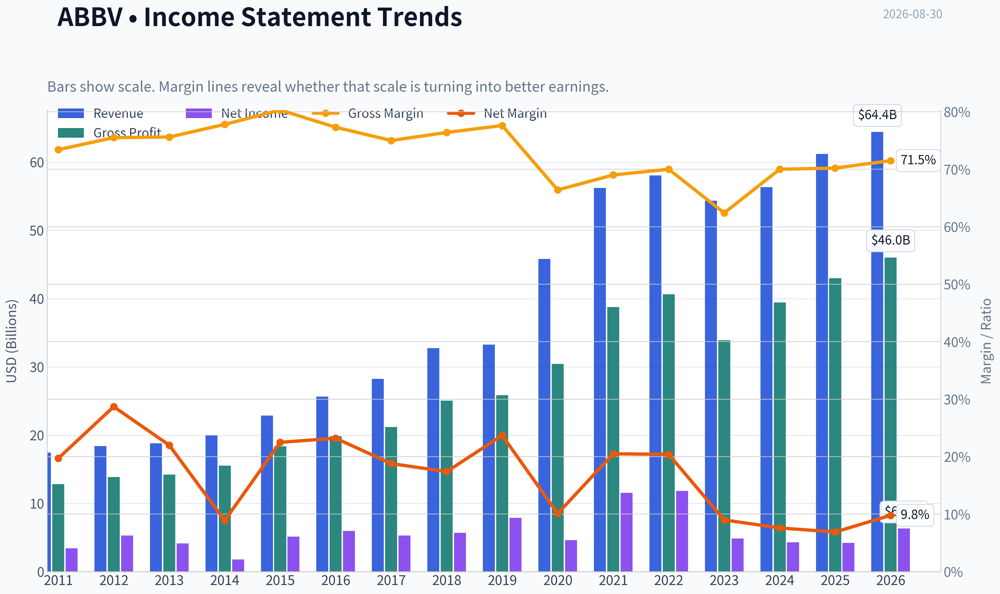
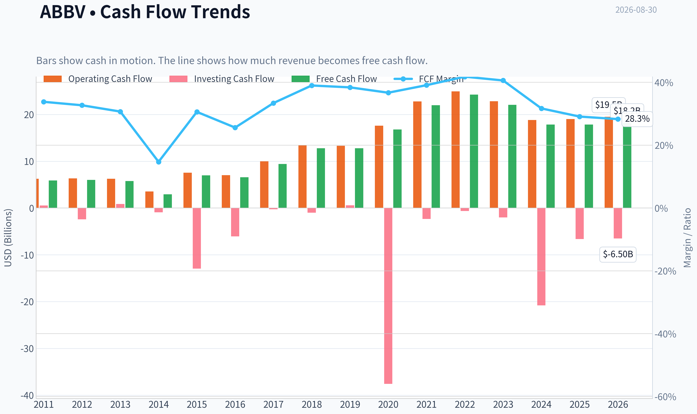
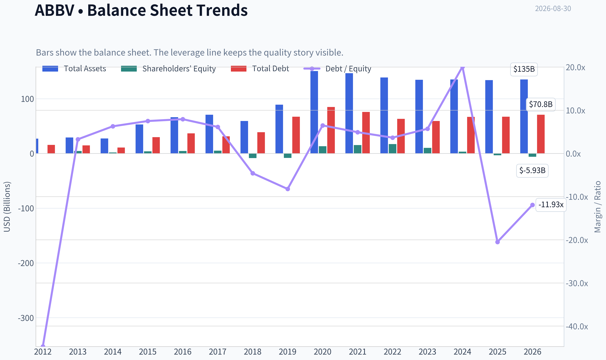
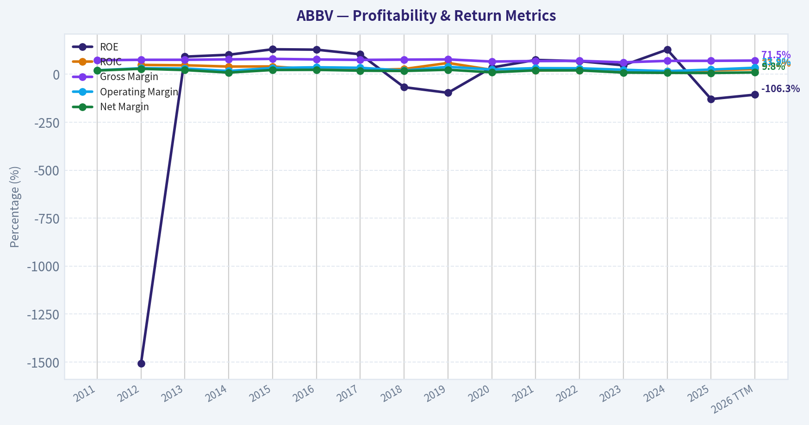
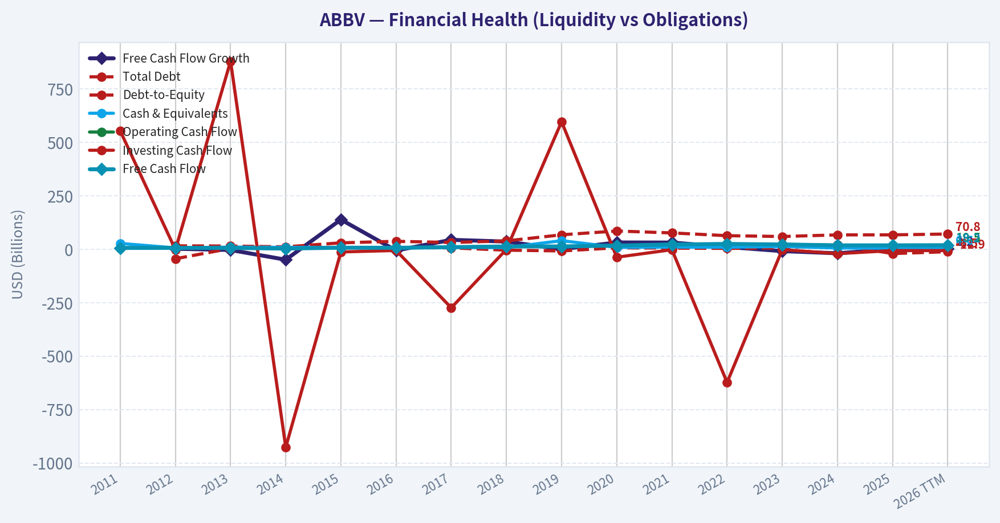
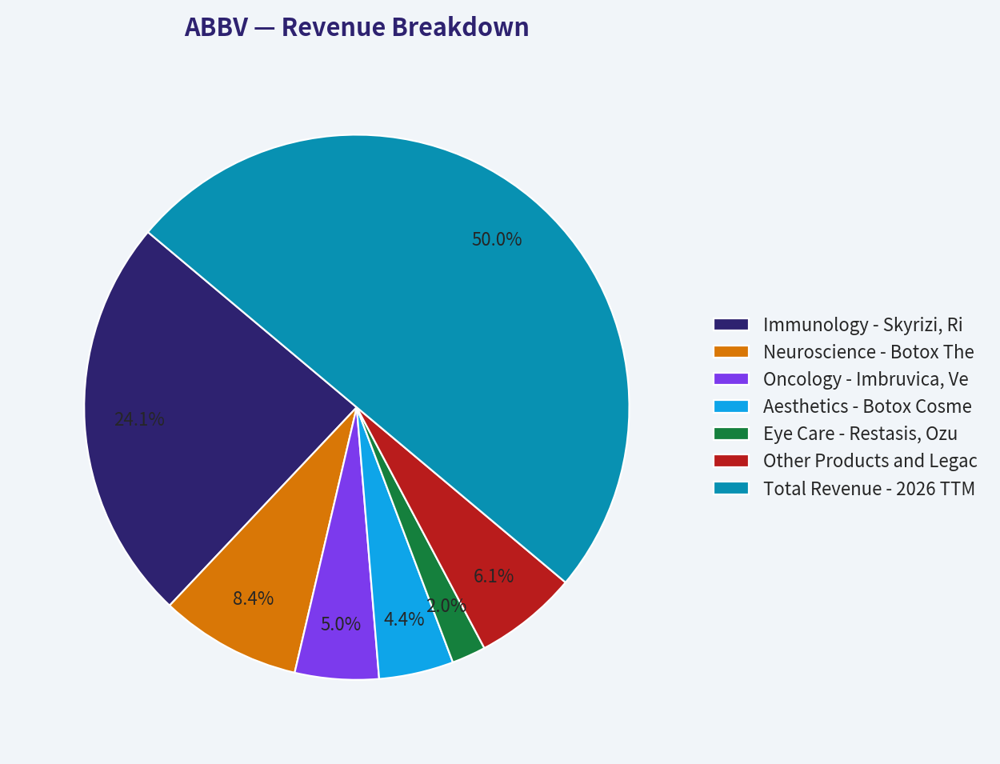
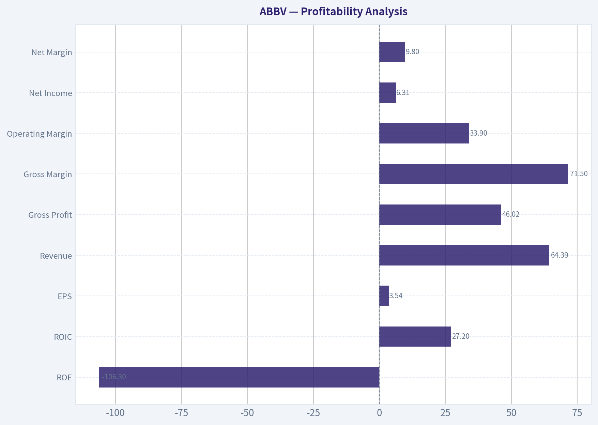
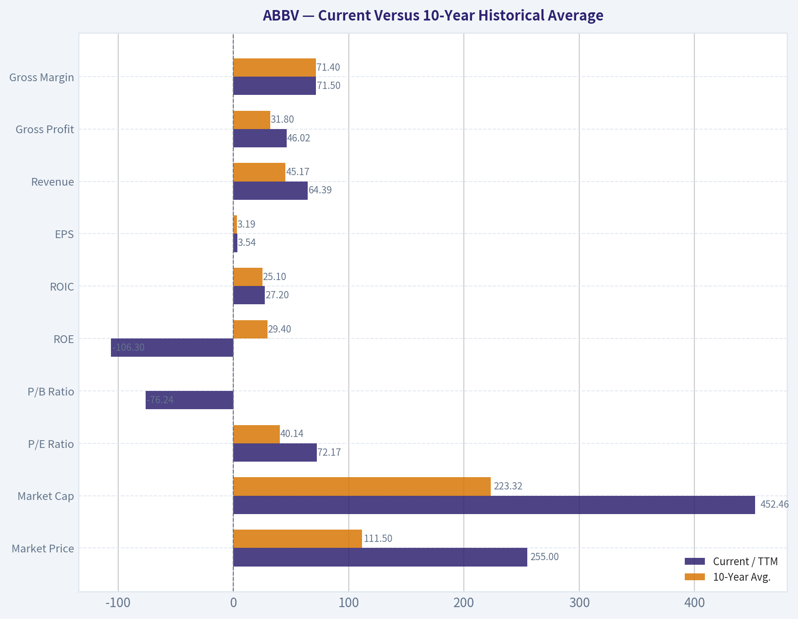
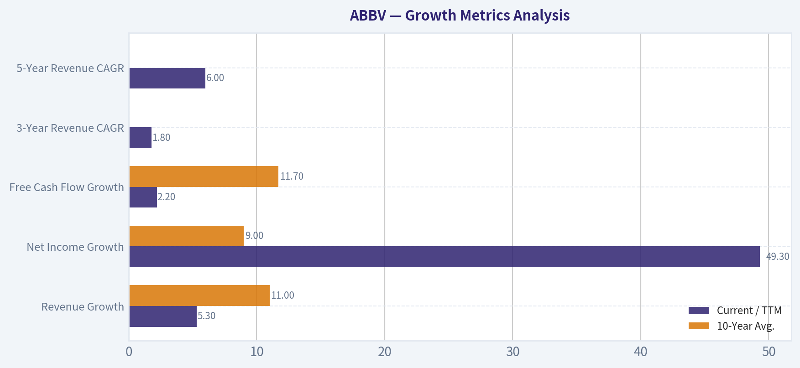
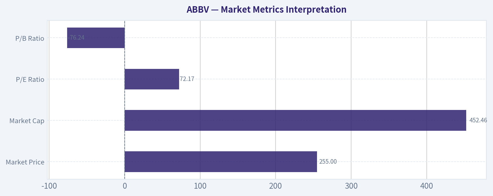

# ABBV Deep Value Intelligence

**Analysis Date:** 2026-08-30

## Critical Disclaimer

*This analysis is generated by Deep Value Intelligence, an AI-powered multi-agent investing framework. Education & research only - not financial advice, not a financial advisor.*

---

## Table of Contents

1. Intelligence Summary
2. Analyst Team Reports
   - Fundamentals Analysis
   - Intrinsic Value Analysis (Buffett)
   - Trend & Growth Analysis (Lynch/Druckenmiller/Fisher)
   - Market Technical Analysis
   - Options Market Analysis
3. Research Team Commentary
4. Value Investing Team Commentary
5. Deep Values Commentary

---

## Intelligence Summary

### Thesis + Conditions

**Core Thesis:** **1. Executive Summary (CONCISE)**
AbbVie (ABBV) is a wonderful business at a fair price.

**Key Risks:**
- The Bull (Risky Analyst):** GAAP metrics are completely distorted by Allergan acquisition amortization. The real story is a 16.5% ROIC, 70% gross margins, and massive FCF, fueled by a successful transition to Skyrizi/Rinvoq and a cash-pay aesthetic moat (Botox).
- Under an adaptive Buffett framework, we measure risk by permanent capital impairment, not temporary price volatility or noisy accounting. The Bear and Neutral analysts are improperly anchoring to GAAP metrics (P/E, ROE) heavily skewed by non-cash intangible amortization.
- To ensure we aren't swept up in momentum, we will execute the following monitoring plan over the next 1-4 quarters:

**Confidence:** Medium

---

## Analyst Team Reports

### Fundamentals Analysis

#### Latest Earnings Snapshot

*Most recent reported quarter anchored on 2026 Q2, with prior-year comparison when available.*

| Metric | 2026 Q2 | 2025 Q2 | YoY Change |
| --- | ---: | ---: | ---: |
| Revenue | $16.99B | $15.42B | +10.2% |
| Operating Income | $6.72B | $5.72B | +17.6% |
| Net Income | $3.61B | $938.0M | +285.2% |
| Diluted EPS | $2.03 | $0.52 | +290.4% |
| Operating Cash Flow | $3.44B | $5.15B | -33.3% |
| Free Cash Flow | $3.11B | $4.88B | -36.2% |

Key Takeaways: This snapshot anchors the most recent reported quarter before the narrative analysis. It helps readers separate long-run business quality from whatever changed in the latest earnings print.

#### 15-Year Financial Metrics for ABBV

*All values below are computed deterministically from raw data - not estimated by AI.*

*Issuer profile: operating company (Healthcare / Drug Manufacturers - General).*

#### 15-Year Financial Metrics
*Annual rows come from reported financial statements. The final TTM row is computed from the latest four quarters.*

| Metric | 2011 | 2012 | 2013 | 2014 | 2015 | 2016 | 2017 | 2018 | 2019 | 2020 | 2021 | 2022 | 2023 | 2024 | 2025 | 2026 TTM |
| --- | --- | --- | --- | --- | --- | --- | --- | --- | --- | --- | --- | --- | --- | --- | --- | --- |
| Market Price | N/A | $20 | $32 | $41 | $38 | $42 | $67 | $66 | $67 | $86 | $114 | $141 | $141 | $168 | $223 | $255 |
| Market Cap | N/A | $53.76B | $84.71B | $105.36B | $96.98B | $102.13B | $155.03B | $142.53B | $131.39B | $179.26B | $240.61B | $287.34B | $274.76B | $315.06B | $405.11B | $452.46B |
| P/E Ratio | N/A | 10.18 | 20.63 | 59.49 | 18.93 | 17.25 | 29.31 | 25.19 | 16.77 | 39.39 | 20.99 | 24.38 | 56.97 | 74.35 | 96.82 | 72.17 |
| P/B Ratio | N/A | -153.60 | 18.86 | 60.48 | 24.58 | 22.03 | 30.42 | -16.87 | -16.08 | 13.71 | 15.62 | 16.65 | 26.52 | 94.76 | -123.89 | -76.24 |
| ROE | N/A | -1507.1% | 91.9% | 101.8% | 130.4% | 128.4% | 104.2% | -67.3% | -96.5% | 35.3% | 74.9% | 68.6% | 46.9% | 128.7% | -129.2% | -106.3% |
| ROIC | N/A | 48.9% | 46.9% | 40.3% | 40.9% | 24.1% | 22.4% | 27.4% | 59.1% | 23.1% | 19.3% | 21.6% | 17.8% | 16.0% | 20.6% | 27.2% |
| EPS | $2.18 | $1.97 | $1.55 | $0.69 | $2.02 | $2.43 | $2.29 | $2.64 | $4.02 | $2.19 | $5.43 | $5.80 | $2.48 | $2.26 | $2.31 | $3.54 |
| Revenue | $17.44B | $18.38B | $18.79B | $19.96B | $22.86B | $25.64B | $28.22B | $32.75B | $33.27B | $45.80B | $56.20B | $58.05B | $54.32B | $56.33B | $61.16B | $64.39B |
| Gross Profit | $12.80B | $13.87B | $14.21B | $15.53B | $18.36B | $19.81B | $21.17B | $25.04B | $25.83B | $30.42B | $38.75B | $40.64B | $33.90B | $39.43B | $42.96B | $46.02B |
| Gross Margin | 73.4% | 75.5% | 75.6% | 77.8% | 80.3% | 77.3% | 75.0% | 76.4% | 77.6% | 66.4% | 69.0% | 70.0% | 62.4% | 70.0% | 70.2% | 71.5% |
| Operating Margin | 20.8% | 31.6% | 30.1% | 17.1% | 33.0% | 36.4% | 33.8% | 19.5% | 39.0% | 24.8% | 31.9% | 31.2% | 23.5% | 16.2% | 24.6% | 33.9% |
| Net Income | $3.43B | $5.28B | $4.13B | $1.77B | $5.14B | $5.95B | $5.31B | $5.69B | $7.88B | $4.62B | $11.54B | $11.84B | $4.86B | $4.28B | $4.23B | $6.31B |
| Net Margin | 19.7% | 28.7% | 22.0% | 8.9% | 22.5% | 23.2% | 18.8% | 17.4% | 23.7% | 10.1% | 20.5% | 20.4% | 9.0% | 7.6% | 6.9% | 9.8% |
| Revenue Growth | N/A | 5.4% | 2.2% | 6.2% | 14.5% | 12.2% | 10.1% | 16.1% | 1.6% | 37.7% | 22.7% | 3.3% | -6.4% | 3.7% | 8.6% | 5.3% |
| Net Income Growth | N/A | 53.7% | -21.7% | -57.0% | 190.0% | 15.7% | -10.8% | 7.1% | 38.6% | -41.4% | 150.0% | 2.5% | -58.9% | -12.0% | -1.2% | 49.3% |
| Free Cash Flow Growth | N/A | 2.1% | -3.9% | -49.2% | 138.4% | -6.3% | 43.7% | 35.6% | -0.1% | 31.5% | 31.0% | 10.3% | -9.0% | -19.2% | -0.1% | 2.2% |
| Total Book Value | N/A | $-350.0M | $4.49B | $1.74B | $3.94B | $4.64B | $5.10B | $-8.45B | $-8.17B | $13.08B | $15.41B | $17.25B | $10.36B | $3.33B | $-3.27B | $-5.93B |
| Total Assets | N/A | $27.01B | $29.20B | $27.51B | $53.05B | $66.10B | $70.79B | $59.35B | $89.11B | $150.56B | $146.53B | $138.81B | $134.71B | $135.16B | $133.96B | $135.12B |
| Total Debt | N/A | $15.65B | $14.71B | $10.96B | $29.65B | $36.82B | $31.35B | $38.70B | $67.23B | $84.98B | $75.98B | $63.13B | $59.24B | $66.84B | $67.00B | $70.82B |
| Debt-to-Equity | N/A | -44.71 | 3.27 | 6.29 | 7.51 | 7.94 | 6.15 | -4.58 | -8.23 | 6.50 | 4.93 | 3.66 | 5.72 | 20.10 | -20.49 | -11.93 |
| Cash & Equivalents | $27.0M | $5.90B | $9.60B | $8.35B | $8.40B | $5.10B | $9.30B | $7.29B | $39.92B | $8.45B | $9.75B | $9.20B | $12.81B | $5.52B | $5.23B | $6.57B |
| Shareholders' Equity | N/A | $-350.0M | $4.49B | $1.74B | $3.94B | $4.64B | $5.10B | $-8.45B | $-8.17B | $13.08B | $15.41B | $17.25B | $10.36B | $3.33B | $-3.27B | $-5.93B |
| Operating Cash Flow | $6.25B | $6.34B | $6.27B | $3.55B | $7.54B | $7.04B | $9.96B | $13.43B | $13.32B | $17.59B | $22.78B | $24.94B | $22.84B | $18.81B | $19.03B | $19.51B |
| Investing Cash Flow | $553.0M | $-2.42B | $879.0M | $-926.0M | $-12.94B | $-6.07B | $-274.0M | $-1.01B | $596.0M | $-37.56B | $-2.34B | $-623.0M | $-2.01B | $-20.82B | $-6.64B | $-6.50B |
| Free Cash Flow | $5.89B | $6.01B | $5.78B | $2.94B | $7.00B | $6.56B | $9.43B | $12.79B | $12.77B | $16.79B | $21.99B | $24.25B | $22.06B | $17.83B | $17.82B | $18.21B |
| FCF Margin | 33.8% | 32.7% | 30.7% | 14.7% | 30.6% | 25.6% | 33.4% | 39.0% | 38.4% | 36.7% | 39.1% | 41.8% | 40.6% | 31.7% | 29.1% | 28.3% |
| Dividends / Share | $0.00 | $0.00 | $0.00 | $0.00 | $0.00 | $0.00 | $0.00 | $0.00 | $0.00 | $0.00 | $0.00 | $4.94 | $5.41 | $5.87 | $6.42 | $6.76 |

#### Profitability Metrics
- Return on Equity (ROE): -129.2%
- Return on Invested Capital (ROIC): 16.5%
- Return on Assets (ROA): 3.2%
- Gross Margin: 70.2%
- Operating Margin: 24.6%
- Net Profit Margin: 6.9%

#### Liquidity Metrics
- Current Ratio: 0.67
- Quick Ratio: 0.41

#### Leverage Metrics
- Debt-to-Equity Ratio: -20.49
- Interest Coverage Ratio: 5.21
- Net Debt: $61.77B

#### Growth Metrics (Year-over-Year)
- Revenue Growth: 8.6%
- Net Income Growth: -1.2%
- Free Cash Flow Growth: -0.1%
- Revenue CAGR (3-Year): 1.8%
- Revenue CAGR (5-Year): 6.0%

#### Valuation Metrics
- P/E Ratio (TTM): 72.99
- Forward P/E: 15.69
- Price-to-Book: N/A
- Price-to-Sales: 7.01
- PEG Ratio: 0.42
- EV/EBITDA: 16.77
- Free Cash Flow Yield: 3.9%
- Earnings Yield: 1.4%

#### Owner Earnings (Buffett Method, Code-Computed)
- Net Income: $4.23B
- + Depreciation & Amortization: $8.14B
- - Capital Expenditures: $-1.21B
- - Working Capital Changes: $-2.36B
- = **Owner Earnings: $13.51B**

#### Intrinsic Value (Code-Computed)
- Current Price: $255
- **Headline Intrinsic Value (business-model routed): $159**
  Business model: asset light platform - weighted blend [Damodaran FCFF + reverse-DCF fair + owner-earnings DCF] (asset_light_platform)
  Model spread (min-max across DCFs): $137 - $282
  Margin of safety vs. price (headline): -60.5%
  Routing note: Asset-light / high-margin platform: value driven by margins and reinvestment economics - the headline centers on the reverse-DCF demonstrated-growth fair value with Damodaran FCFF as a floor, down-weighting the owner-earnings DCF.
- Buffett Method (Owner Earnings):
  Conservative: $-2
  Average: $141
  Optimistic: $522
- Cash Flow Method (FCF):
  Conservative: $65
  Average: $137
  Optimistic: $346
- Damodaran FCFF (WACC + margins + reinvestment):
  Conservative: $132
  Average: $282
  Optimistic: $364
  Monte Carlo band (P10-P90): $160 - $387 (median $243)
  P(intrinsic value > price): 45.3%
- Reverse-DCF: price implies ~25.5%/yr owner-earnings growth for 10y; trailing 3y was -11.8%, 5y 28.8%.

#### Piotroski F-Score: 6/9
- Positive Net Income: PASS
- Positive Operating Cash Flow: PASS
- ROA Improvement: FAIL
- Cash Flow > Net Income: PASS
- Decreasing Debt: FAIL
- Improving Current Ratio: PASS
- No Dilution: FAIL
- Improving Gross Margin: PASS
- Improving Asset Turnover: PASS

ANALYST STANCE: **WATCH**

#### AbbVie Inc. - Warren Buffett-Style Fundamental Analysis

AbbVie is a high-margin, cash-generative global pharmaceutical company with durable franchises in immunology, neuroscience, oncology, aesthetics, and eye care. The business has many Buffett-like quality traits: strong brands, recurring patient demand, high gross margins, substantial free cash flow, and a shareholder-return culture. However, at the current price of **$255**, the stock appears to be pricing in a very optimistic recovery and growth runway after the Humira patent cliff. The deterministic dataset's headline intrinsic value is **$159 per share**, implying a **negative margin of safety of about 60.5%** versus the current market price.

The conclusion is therefore: **excellent business, but valuation is stretched for a Buffett-style entry point.**

---

#### Revenue Breakdown

| Revenue Source | Amount ($B) | % of Total |
|---|---:|---:|
| Immunology - Skyrizi, Rinvoq, Humira | $31.0 | 48.1% |
| Neuroscience - Botox Therapeutic, Vraylar, migraine portfolio, other | $10.8 | 16.8% |
| Oncology - Imbruvica, Venclexta, Elahere, other | $6.4 | 9.9% |
| Aesthetics - Botox Cosmetic, Juvederm, other aesthetics | $5.7 | 8.9% |
| Eye Care - Restasis, Ozurdex, Lumigan, other | $2.6 | 4.0% |
| Other Products and Legacy Brands | $7.9 | 12.3% |
| **Total Revenue - 2026 TTM** | **$64.39** | **100.0%** |

Key Takeaways: AbbVie remains primarily an immunology company, with nearly half of revenue tied to the Skyrizi, Rinvoq, and Humira franchise. The major investment question is whether Skyrizi and Rinvoq can more than offset the Humira erosion and sustain high-margin growth. Neuroscience is now the second-most important engine, while aesthetics and oncology provide diversification but are not yet large enough to fully drive the company alone.

---

#### Current Versus 10-Year Historical Average

*10-year historical averages are calculated from the annual deterministic dataset for 2016-2025. Current values use the 2026 TTM row where available.*

| Metric | Current / TTM | 10-Year Avg. | Current vs Avg. | Interpretation |
|---|---:|---:|---:|---|
| Market Price | $255 | $111.50 | +128.7% | Stock price has moved far ahead of its decade average. |
| Market Cap | $452.46B | $223.32B | +102.6% | Enterprise value has more than doubled versus the historical norm. |
| P/E Ratio | 72.17x | 40.14x | +79.8% | TTM accounting earnings make the stock look very expensive. |
| P/B Ratio | -76.24x | Not meaningful | Not meaningful | Book value is negative; P/B is not a useful valuation tool for AbbVie. |
| ROE | -106.3% | 29.4% | Not meaningful | Negative equity distorts ROE; ROIC is more informative. |
| ROIC | 27.2% | 25.1% | +2.1 pts | Capital returns remain strong despite patent-cycle pressure. |
| EPS | $3.54 | $3.19 | +11.0% | EPS is modestly above average but far below the valuation implied by price. |
| Revenue | $64.39B | $45.17B | +42.5% | Revenue base is structurally larger after acquisitions and portfolio expansion. |
| Gross Profit | $46.02B | $31.80B | +44.7% | Gross profit has scaled with revenue. |
| Gross Margin | 71.5% | 71.4% | +0.1 pts | Gross margin is almost exactly in line with the decade norm. |
| Operating Margin | 33.9% | 28.1% | +5.8 pts | Operating profitability has rebounded strongly. |
| Net Income | $6.31B | $6.62B | -4.7% | Bottom-line earnings remain below average despite larger revenue. |
| Net Margin | 9.8% | 15.8% | -6.0 pts | Net profitability is still depressed versus history. |
| Revenue Growth | 5.3% | 11.0% | -5.7 pts | Growth is positive but below the high-growth acquisition-aided decade average. |
| Net Income Growth | 49.3% | 9.0% | +40.3 pts | Current rebound reflects recovery from a weak prior period. |
| FCF Growth | 2.2% | 11.7% | -9.5 pts | Free cash flow growth has slowed materially. |
| Total Book Value | -$5.93B | $4.93B | Negative | Equity has turned negative; book value is not analytically useful. |
| Total Assets | $135.12B | $112.51B | +20.1% | Asset base remains elevated from acquisitions. |
| Total Debt | $70.82B | $59.13B | +19.8% | Debt is above average and remains a key risk. |
| Debt-to-Equity | -11.93x | Not meaningful | Not meaningful | Negative equity makes this ratio mathematically distorted. |
| Cash & Equivalents | $6.57B | $11.26B | -41.6% | Cash is below the 10-year average. |
| Free Cash Flow | $18.21B | $16.23B | +12.2% | Cash generation remains strong even while net income is pressured. |
| Dividends / Share | $6.76 | $2.26 | +198.6% | Dividend burden has grown substantially in the dataset period. |

Key Takeaways: AbbVie's business scale is much larger than its 10-year average, and ROIC remains impressive. However, the valuation has expanded faster than normalized earnings and free cash flow. The most important contrast is that free cash flow remains healthy, while TTM P/E, negative book value, and elevated debt make the stock look much less attractive from a margin-of-safety perspective.

---

#### Market Metrics Interpretation

| Metric | Current Value | Buffett-Style Interpretation |
|---|---:|---|
| Market Price | $255 | The market is assigning AbbVie a premium valuation based on expectations for Skyrizi, Rinvoq, neuroscience growth, and post-Humira recovery. |
| Market Cap | $452.46B | AbbVie is now priced as a mega-cap compounder rather than a patent-cliff recovery story. |
| P/E Ratio | 72.17x | TTM P/E is very high because reported earnings remain depressed; forward P/E is lower at about 15.7x, but the Buffett test is intrinsic value, not just forward multiple optics. |
| P/B Ratio | -76.24x | **Not meaningful.** AbbVie has negative shareholder equity due to acquisitions, intangibles, leverage, and shareholder returns. P/B should not be read as cheap or expensive here. |

Key Takeaways: The market is valuing AbbVie on future cash flows, not book value. That is appropriate because book equity is distorted and negative. The central valuation issue is whether future owner earnings can grow fast enough to justify a $255 share price.

---

#### Profitability Analysis

AbbVie's profitability remains high quality at the operating level, but the income statement shows meaningful pressure below operating profit.

| Metric | Current / TTM | Interpretation |
|---|---:|---|
| ROE | -106.3% | Not economically useful because shareholder equity is negative. |
| ROIC | 27.2% | Strong; indicates AbbVie still earns attractive returns on invested capital. |
| EPS | $3.54 | Above the 10-year average, but not high enough to justify the current TTM P/E. |
| Revenue | $64.39B | Record-level scale in the deterministic dataset. |
| Gross Profit | $46.02B | Strong and growing with revenue. |
| Gross Margin | 71.5% | Stable and near the 10-year average, showing durable pricing power. |
| Operating Margin | 33.9% | Strong rebound and above historical average. |
| Net Income | $6.31B | Still below the 10-year average despite larger revenue. |
| Net Margin | 9.8% | Well below historical average, showing pressure from amortization, interest, acquisition costs, and patent-cycle transition. |

Key Takeaways: AbbVie's core business economics remain attractive, especially at the gross margin, operating margin, and ROIC levels. The weakness is not revenue quality; it is the gap between strong operating cash generation and depressed reported net earnings. For Buffett-style investors, the cash flow strength matters more than GAAP EPS, but the current price already assumes a strong recovery.

---

#### Growth Metrics Analysis

| Growth Metric | Current / TTM | 10-Year Avg. | Interpretation |
|---|---:|---:|---|
| Revenue Growth | 5.3% | 11.0% | Positive but slower than the acquisition-boosted historical average. |
| Net Income Growth | 49.3% | 9.0% | Strong rebound, but from a depressed base. |
| Free Cash Flow Growth | 2.2% | 11.7% | Cash flow growth is currently modest and below historical norms. |
| 3-Year Revenue CAGR | 1.8% | N/A | Shows the Humira cliff has materially slowed growth. |
| 5-Year Revenue CAGR | 6.0% | N/A | More respectable, aided by portfolio growth and acquisitions. |

Key Takeaways: AbbVie is growing again, but not at a rate that comfortably supports the current market valuation unless the next several years accelerate meaningfully. Skyrizi and Rinvoq are doing heavy lifting, but free cash flow growth is not yet strong enough to make the current price obviously attractive.

---

#### Balance Sheet and Financial Strength

| Balance Sheet Metric | Current / TTM | Interpretation |
|---|---:|---|
| Total Book Value | -$5.93B | Negative book equity makes book-based valuation unreliable. |
| Total Assets | $135.12B | Large asset base reflects acquisitions and intangible-heavy pharma economics. |
| Total Debt | $70.82B | Debt remains substantial and above the 10-year average. |
| Debt-to-Equity | -11.93x | Not meaningful because equity is negative. |
| Cash & Equivalents | $6.57B | Cash is below the 10-year average but supported by strong operating cash flow. |
| Shareholders' Equity | -$5.93B | Negative equity is a red flag for accounting leverage, though not necessarily insolvency given cash flow strength. |
| Net Debt | $61.77B | Significant; reduces financial flexibility. |
| Interest Coverage | 5.21x | Acceptable but not exceptionally conservative. |
| Current Ratio | 0.67 | Low liquidity ratio, though less decisive for a cash-generative pharma company. |
| Quick Ratio | 0.41 | Indicates limited near-term liquid asset coverage versus current liabilities. |

Key Takeaways: AbbVie is financially strong in terms of cash generation, but not in terms of balance sheet conservatism. The company carries meaningful debt and negative book equity, so a Buffett investor would demand a larger margin of safety. The balance sheet is manageable, but it is not pristine.

---

#### Cash Flow and Dividend Analysis

| Cash Flow Metric | Current / TTM | 10-Year Avg. | Interpretation |
|---|---:|---:|---|
| Operating Cash Flow | $19.51B | $16.23B for FCF comparison base | Operating cash generation remains robust. |
| Free Cash Flow | $18.21B | $16.23B | FCF is above average and remains the strongest part of the investment case. |
| FCF Margin | 28.3% | 34.5% approx. | Still high, but below the peak years above 40%. |
| Dividends / Share | $6.76 | $2.26 | Dividend per share has grown sharply in the deterministic dataset. |
| FCF Yield | 3.9% | N/A | Low for a value investor at current price. |

Key Takeaways: AbbVie remains a powerful cash-flow machine, which is the strongest Buffett-style argument for the stock. However, the free cash flow yield of about 3.9% is not especially compelling when the company also carries high debt and faces ongoing patent-cycle risk. Dividend investors may like the income profile, but valuation discipline still matters.

---

#### Buffett-Style Owner Earnings DCF Valuation

Base owner earnings from the deterministic dataset:

**Owner Earnings = Net Income + Depreciation & Amortization - Capital Expenditures - Working Capital Changes**

Dataset-computed owner earnings:

**$4.23B + $8.14B - (-$1.21B) - (-$2.36B) = $13.51B**

For the hand DCF below:

- Base owner earnings: **$13.51B**
- Shares outstanding approximation: **$452.46B market cap / $255 price = 1.774B shares**
- Discount rate: **10%**
- Terminal growth rate: **2.5%**
- Terminal value formula: **Year 10 Owner Earnings x 1.025 / (10% - 2.5%)**
- Primary method: equity-style owner earnings, so net debt is considered qualitatively rather than subtracted directly to avoid double-counting interest already reflected in net income.

| Scenario | Growth Assumption | PV of Years 1-10 Owner Earnings | PV of Terminal Value | Equity Value | Fair Value / Share |
|---|---|---:|---:|---:|---:|
| Conservative | 3% annual growth for 10 years | $95.8B | $95.7B | $191.5B | **$108** |
| Average / Base Case | 10% growth fading to 3.5% by year 10 | $118.6B | $130.3B | $248.9B | **$140** |
| Optimistic | 20% growth fading to 4% by year 10 | $164.5B | $205.3B | $369.8B | **$209** |

Key Takeaways: Even under an optimistic fading-growth case, the hand-built Buffett-style owner earnings DCF does not reach the current $255 share price. The base-case fair value is close to **$140**, which aligns closely with the deterministic dataset's owner-earnings DCF average of about **$141**. The current price requires a stronger growth path than the recent free cash flow trend supports.

---

#### DCF Cross-Check Against Deterministic Model Pack

| Valuation Model | Conservative | Average / Central | Optimistic | Interpretation |
|---|---:|---:|---:|---|
| Buffett Owner Earnings - Code Computed | -$2 | $141 | $522 | Wide spread due to sensitivity to growth assumptions. |
| Cash Flow Method - FCF | $65 | $137 | $346 | Central value is materially below the current price. |
| Damodaran FCFF | $132 | $282 | $364 | More favorable because it gives credit to margins and reinvestment economics. |
| Headline Intrinsic Value | N/A | **$159** | N/A | Business-model-routed central estimate. |
| Monte Carlo Band | $160 P10 | $243 Median | $387 P90 | Current price is slightly above the median. |
| Current Price | N/A | **$255** | N/A | Above headline value and above hand DCF value. |
| Reverse DCF | N/A | **~25.5% implied 10-year growth** | N/A | Market price requires aggressive owner-earnings growth. |

Key Takeaways: The valuation evidence is mixed only if one gives heavy weight to the optimistic Damodaran and Monte Carlo outcomes. The central and owner-earnings-based valuations are clearly below the current price. The reverse DCF is the clearest warning: the stock price implies roughly **25.5% annual owner-earnings growth for 10 years**, which is demanding for a company already generating over $60B in annual revenue.

---

#### Economic Moat

AbbVie has a real economic moat, but it is not a simple consumer-staples moat. It is a pharmaceutical moat built on intellectual property, regulatory approvals, physician familiarity, scale, R&D, and commercial execution.

| Moat Source | Strength | Buffett-Style Assessment |
|---|---|---|
| Immunology Franchise | High | Skyrizi and Rinvoq are the key moat pillars after Humira. Their growth is essential. |
| Regulatory Barriers | High | Drug approvals, clinical data, and safety profiles create barriers to entry. |
| Brand and Physician Trust | High | Established therapies benefit from prescriber familiarity and payer relationships. |
| R&D Scale | High | AbbVie can fund large trials, lifecycle management, and pipeline expansion. |
| Patent Protection | Medium to High | Valuable, but finite; patent cliffs are the central risk. |
| Pricing Power | Medium | Strong historically, but payer and government pressure are long-term constraints. |
| Diversification | Medium | Improving, but immunology remains highly important. |

Key Takeaways: AbbVie has a durable but time-limited moat because pharmaceutical advantages eventually face patent expiry. The company's quality depends on continuously replacing aging blockbusters with new products. Skyrizi and Rinvoq are currently proving that AbbVie can do this, but the market is already giving the company substantial credit.

---

#### Predictable Earnings and Business Quality

AbbVie's revenue trajectory has been strong over the long term, rising from **$17.44B in 2011** to **$64.39B TTM**. However, earnings have been much less predictable than revenue. Net income has swung materially due to acquisition accounting, amortization, interest expense, patent transitions, and product-cycle effects.

From a Buffett perspective:

- **Revenue predictability:** Good, but affected by patent cliffs.
- **Margin quality:** Strong at gross and operating levels.
- **Net income consistency:** Moderate to weak.
- **Free cash flow reliability:** Strong.
- **Capital intensity:** Low relative to revenue, which supports high FCF margins.
- **Business durability:** Strong, provided the pipeline keeps replenishing lost exclusivity.

The best way to view AbbVie is not as a stable bond-like compounder, but as a high-quality pharmaceutical allocator that must continuously reinvest in science, acquisitions, and lifecycle management.

---

#### Management Performance and Capital Allocation

Management deserves credit for building post-Humira growth engines. Skyrizi and Rinvoq have become major assets, and the Allergan acquisition expanded AbbVie into aesthetics and neuroscience. ROIC at **27.2% TTM** is strong and above the 10-year average, suggesting that despite leverage and acquisition complexity, the business continues to generate attractive returns.

However, there are capital allocation concerns:

| Area | Assessment |
|---|---|
| ROIC | Strong and above historical average. |
| ROE | Not useful because equity is negative. |
| Debt Management | Mixed; debt remains high at $70.82B. |
| Dividends | Shareholder-friendly, but dividend burden is now large. |
| Acquisitions | Strategically important but increase leverage and accounting complexity. |
| Buybacks / Equity Base | Negative equity makes balance sheet optics weak. |

Key Takeaways: Management has created substantial shareholder value over time, but the company is no longer financially conservative. The dividend and acquisition strategy are workable because free cash flow is strong, but they leave less room for error if growth disappoints or pipeline assets underperform.

---

#### Key Investment Opportunities

| Opportunity | Why It Matters |
|---|---|
| Skyrizi and Rinvoq growth | These are the main replacements for Humira and the core of the bull case. |
| Neuroscience expansion | Vraylar, migraine therapies, and Botox Therapeutic can diversify growth. |
| Margin recovery | Operating margin has already improved to 33.9% TTM. |
| Strong free cash flow | $18.21B of TTM FCF supports dividends, debt repayment, and R&D. |
| Pipeline optionality | Regulatory submissions and new indications can expand revenue runways. |
| Dividend appeal | Dividend per share of $6.76 provides income support for long-term holders. |

Key Takeaways: AbbVie's upside depends on sustained product execution. If Skyrizi, Rinvoq, neuroscience, and pipeline assets continue compounding, the company can grow into part of today's valuation. The problem is that the market is already assuming a lot of that success.

---

#### Key Red Flags

| Red Flag | Why It Matters |
|---|---|
| Valuation above intrinsic value | Current price of $255 is far above the $159 headline intrinsic value. |
| Reverse DCF is demanding | Price implies roughly 25.5% annual owner-earnings growth for 10 years. |
| High TTM P/E | 72.17x TTM earnings leaves little room for disappointment. |
| Negative shareholder equity | Makes ROE, P/B, and debt-to-equity ratios unreliable and highlights leverage. |
| Elevated debt | Total debt of $70.82B and net debt of $61.77B reduce flexibility. |
| Patent-cycle risk | Pharmaceutical moats expire and must be replaced repeatedly. |
| Slowing FCF growth | TTM FCF growth of 2.2% is far below the 10-year average of 11.7%. |
| Low liquidity ratios | Current ratio of 0.67 and quick ratio of 0.41 are not ideal. |

Key Takeaways: The largest risk is not that AbbVie is a poor business; it is that investors may be paying too much for a good business. The current price embeds high expectations at a time when free cash flow growth is modest and leverage remains meaningful.

---

#### Final Buffett-Style Value Assessment

| Category | Assessment |
|---|---|
| Business Quality | High |
| Economic Moat | Strong but patent-cycle dependent |
| Financial Strength | Moderate; strong cash flow but high debt and negative equity |
| Earnings Predictability | Moderate; cash flow is more reliable than GAAP net income |
| Management Quality | Good execution, but leverage-heavy capital structure |
| Dividend Quality | Attractive but requires continued FCF strength |
| Valuation | Unattractive at current price |
| Margin of Safety | Negative |
| Best Investor Action | Watch for a better entry point |

Key Takeaways: AbbVie is a high-quality pharmaceutical compounder with strong cash generation and valuable growth assets. But Buffett-style investing requires both business quality and a sensible price. At $255, the stock does not offer a sufficient margin of safety.

---

#### Final Investment Stance: WATCH

AbbVie is not an **AVOID** because the underlying business is too strong, cash flow remains robust, ROIC is attractive, and the post-Humira portfolio is performing well. However, it is also not an **ADVOCATE** at the current price because valuation is stretched, the headline intrinsic value is materially below the market price, and the reverse DCF implies aggressive growth expectations.

**Final stance: WATCH.**

A Buffett-style investor should monitor AbbVie closely but wait for either:

1. A lower share price closer to intrinsic value, preferably below the $160-$180 range, or
2. Clear evidence that owner earnings can compound at a rate high enough to justify the current premium valuation.

| Key Point | Summary |
|---|---|
| Current Price | $255 |
| Headline Intrinsic Value | $159 |
| Margin of Safety | Negative, about -60.5% versus headline value |
| Hand DCF Fair Value Range | About $108 to $209 per share |
| Strongest Business Factor | High-margin cash generation and immunology leadership |
| Biggest Risk | Current price assumes aggressive future growth |
| Balance Sheet View | Manageable but leveraged; negative equity distorts ratios |
| Best Metric to Watch | Owner earnings and free cash flow growth |
| Buffett-Style Verdict | Excellent company, insufficient margin of safety |
| Investment Stance | **WATCH** |

Key Takeaways: AbbVie remains a strong business, but the stock price has outrun conservative intrinsic value estimates. The company deserves a place on a quality watchlist, not an automatic buy list. For value investors, patience is the better decision unless future owner-earnings growth accelerates convincingly.

#### Fundamental Visuals

This graph tracks the profitability and return metrics (ROE, ROIC, Margins) of **ABBV** over the past decade, highlighting capital efficiency trends.

This chart illustrates the financial health of **ABBV** over the last 10 years, mapping cash equivalents and free cash flow against total obligations (Debt).

This breakdown chart from <em>Revenue Breakdown</em> shows the proportional composition for **ABBV** - useful for understanding what drives or risks the business.

This comparison chart from *Profitability Analysis* stacks current figures against historical benchmarks for **ABBV**, making it easy to see where the company trades relative to its own averages.

---

### Intrinsic Value Analysis (Buffett)

> *Following Warren Buffett's value investing philosophy: Circle of Competence, Economic Moat, Management Quality, and Margin of Safety.*

#### Intrinsic Value Snapshot

Price is what you pay. Intrinsic value is what the business may be worth based on the cash it can create for owners over time. We show a range, not one magic number.

- Current Price: $255.48
- Value Range (conservative to optimistic across both DCF methods): $-1.89 to $522.15

##### Owner Earnings (Buffett Method)
- Net Income: $4,226,000,000.00
- Depreciation & Amortization: $8,139,000,000.00
- Capital Expenditures: $-1,214,000,000.00
- Working Capital Changes: $-2,362,000,000.00
- Owner Earnings: $13,513,000,000.00

##### Intrinsic Value
###### Buffett Method
Uses owner earnings. Stricter, and usually more conservative.
- Conservative: $-1.89
- Average: $140.59
- Optimistic: $522.15
- Discount Rate: 10.0%

###### Cash Flow Method
Uses free cash flow. Better for companies spending heavily today to grow tomorrow.
- Conservative: $64.94
- Average: $136.88
- Optimistic: $345.87
- Discount Rate: 10.0%

ANALYST STANCE: **AVOID**

#### AbbVie Inc. (ABBV) - Buffett-Style Value Investment Review

| Item | Current Snapshot |
|---|---:|
| Current Price | $255 |
| Market Capitalization | $451.5B |
| P/E | 73.0x |
| FCF Yield | 3.9% |
| Gross Margin | 70.2% |
| YoY Revenue Growth | 8.6% |
| ROE | -129.2% |
| Current Ratio | 0.67 |
| Headline Intrinsic Value | $159.21 |
| Margin of Safety vs. Price | -60.5% |
| Reverse-DCF Implied Growth | ~25.5% per year for 10 years |

**Key Takeaways:** AbbVie remains a highly profitable pharmaceutical franchise with strong gross margins and durable cash generation, but today's price demands very aggressive future growth. The stock trades meaningfully above the blended intrinsic value estimate, and the reverse-DCF implies a growth rate that looks too heroic for a large-cap pharma company facing patent-cycle risk.

---

#### 1. Factor Scorecard

| Factor | Score | Evidence |
|---|---:|---|
| Circle of Competence & Business Simplicity | 3.5 / 5 | AbbVie develops and sells branded pharmaceuticals. The model is understandable, but long-term economics depend on clinical success, patent protection, reimbursement, and product replacement cycles. |
| Moat Test | 3.5 / 5 | Strong intangible assets from patents, regulatory approvals, physician familiarity, and specialty-drug franchises such as Skyrizi and Rinvoq. However, Humira's patent cliff shows the moat is product-specific, not permanent at the corporate level. |
| Management Quality & Capital Allocation | 3.0 / 5 | Management has successfully built post-Humira growth engines, but leverage, acquisition dependence, and negative equity reduce the Buffett-style capital allocation score. |
| Industry Structure | 3.0 / 5 | Large pharma benefits from scale, regulatory barriers, and high margins, but faces patent cliffs, political pricing pressure, R&D uncertainty, and biosimilar competition. |
| Gate 5: Quality/Solvency Hard Floor | Not Tripped | Cash generation remains strong, revenue is growing, and there is no evidence of inability to service debt. The issue is valuation and balance-sheet quality, not financial distress. |

**Key Takeaways:** AbbVie is not a bad business; it is a high-margin pharmaceutical company with real intangible assets. The central concern is that pharmaceutical moats expire and must be continuously renewed through R&D, licensing, and acquisitions, while the current stock price already assumes exceptional execution.

---

#### 2. Moat Analysis

| Moat Source | Assessment |
|---|---|
| Intangible Assets | Strong. AbbVie's moat rests on patents, regulatory approvals, clinical data, specialist relationships, and brand trust among physicians. Gross margin above 70% is consistent with strong pricing power in protected therapeutic categories. |
| Switching Costs | Moderate. Patients and physicians may be reluctant to switch effective therapies, especially in immunology and neuroscience, but payers can force formulary changes and biosimilars can pressure mature products. |
| Cost Advantage | Moderate. Scale helps in global commercialization, regulatory expertise, and clinical development, but manufacturing cost advantage is not the primary moat. |
| Network Effects | Low. AbbVie does not benefit from classic network effects. Value does not materially increase because more users join. |
| Moat Rating | Narrow-to-Strong, but not permanent. Product franchises can be powerful, yet each drug faces eventual patent expiry. |

**Moat Conclusion:** AbbVie has a real moat, but it is a renewable moat rather than a permanent one. Buffett would likely respect the economics but require a disciplined price because the company must keep replacing cash flows as patents expire.

---

#### 3. Management Quality Assessment

| Management Question | Assessment |
|---|---|
| Owner Orientation | Mixed. AbbVie has rewarded shareholders through dividends and long-term compounding, but high leverage and acquisition reliance reduce the owner-earnings purity. |
| Candor & Accounting | Acceptable. Large pharmaceutical accounting is complicated by amortization, acquisition charges, and R&D-related adjustments, so cash flow deserves more weight than GAAP EPS. |
| Capital Allocation | Mixed-to-Good. The Allergan transaction diversified AbbVie beyond Humira, and newer growth drugs are working. However, debt, goodwill, and negative equity show that the strategy has required meaningful balance-sheet commitment. |
| Shareholder Returns | Strong historical total return, with long-term outperformance and a shareholder-friendly dividend culture. |
| Main Concern | The market is currently pricing in near-flawless capital allocation and pipeline execution. |

**Key Takeaways:** Management has handled the Humira transition better than many feared, which deserves credit. Still, Buffett-style analysis gives only partial credit because the company has leaned on acquisitions and leverage, and the current valuation leaves little room for capital allocation mistakes.

---

#### 4. Financial Summary Table

| Metric | Recent / Current Reading |
|---|---:|
| Revenue Growth YoY | 8.6% |
| Gross Margin | 70.2% |
| FCF Yield | 3.9% |
| P/E | 73.0x |
| ROE | -129.2% |
| Current Ratio | 0.67 |
| Market Cap | $451.5B |
| Implied TTM Net Income from P/E | ~$6.2B |
| Implied TTM Free Cash Flow from FCF Yield | ~$17.6B |
| Approx. Shares Outstanding | ~1.77B |

**Key Takeaways:** AbbVie's cash flow remains far stronger than GAAP earnings suggest, which is common for large pharma companies with amortization and acquisition-related charges. The key valuation problem is that a roughly $17.6 billion free-cash-flow base supports a much lower value than today's $451 billion market capitalization unless growth accelerates dramatically.

---

#### 5. Owner Earnings Calculation

Buffett's owner earnings formula:

| Component | Estimate |
|---|---:|
| Net Income | ~$6.2B |
| Add: Depreciation & Amortization / Non-Cash Charges | Significant, due to pharma intangibles |
| Less: Maintenance CapEx | Relatively modest versus sales |
| Less: Working Capital Increases | Variable |
| Practical Owner-Earnings Proxy | ~$17.6B |
| Owner Earnings per Share | ~$9.94 |

**Key Takeaways:** For AbbVie, free cash flow is a better owner-earnings proxy than GAAP net income because reported earnings are heavily affected by amortization and acquisition accounting. On that basis, AbbVie produces substantial cash, but at $255 per share investors are paying about 25.7x owner earnings.

---

#### 6. Three-Scenario DCF Valuation

| Scenario | Assumptions | Estimated Value / Share |
|---|---|---:|
| A - No Growth | Owner earnings per share of ~$9.94 capitalized at 10% | ~$99 |
| B - GDP Growth | 3% perpetual growth, 10% discount rate | ~$146 |
| C - Historical / Normalized Growth | 5% growth for 10 years, 3% terminal growth, 10% discount rate | ~$169 |
| Blended Headline Intrinsic Value | Business-model routed blend of owner earnings, FCF, and FCFF models | $159.21 |
| 3-Model Spread | Owner Earnings / FCF / Damodaran FCFF | $140.59 / $136.88 / $282.09 |

**Key Takeaways:** The conservative valuation range clusters well below the current share price. Even allowing for normalized growth and strong cash generation, the business appears worth closer to the mid-$100s per share than $255, unless one assumes a much more aggressive growth path.

---

#### 7. Margin of Safety Analysis

| Valuation Test | Result |
|---|---:|
| Current Price | $255 |
| Headline Intrinsic Value | $159.21 |
| Price vs. Intrinsic Value | Expensive |
| Margin of Safety vs. Price | -60.5% |
| Reverse-DCF Implied Growth | ~25.5% annually for 10 years |
| Recent Growth Context | 3-year growth: -11.8%; 5-year growth: 28.8% |
| Buffett Interpretation | Price requires exceptional execution and sustained high growth |

**Key Takeaways:** AbbVie does not provide a margin of safety at the current price. The market is valuing the company as if its next generation of drugs can compound at a very high rate for a decade, which is possible but not a conservative underwriting assumption for a large pharmaceutical company.

---

#### 8. Final Buffett Scorecard

| Criterion | Weight | Score | Weighted Contribution |
|---|---:|---:|---:|
| Moat Width & Durability | 25% | 3.5 | 0.88 |
| Valuation / Margin of Safety | 20% | 1.0 | 0.20 |
| Capital Returns - ROIC vs. WACC | 15% | 3.0 | 0.45 |
| Business Understanding & Predictability | 12% | 3.5 | 0.42 |
| Management Quality & Capital Allocation | 12% | 3.0 | 0.36 |
| Reinvestment Runway | 8% | 3.0 | 0.24 |
| Balance Sheet Strength | 4% | 2.0 | 0.08 |
| Industry Structure | 4% | 3.0 | 0.12 |
| **Total Score** | **100%** |  | **2.75 / 5.00** |

**Key Takeaways:** AbbVie scores reasonably on business quality but very poorly on valuation. The final score falls into AVOID territory because the current price offers no conservative margin of safety and appears to require unusually strong growth for a mature pharmaceutical company.

---

#### 9. Investment Stance

| Final Stance | Conviction |
|---|---|
| **AVOID** | Moderate-to-High |

AbbVie is a strong cash-generating pharmaceutical company with valuable franchises, especially in immunology. However, the stock price has moved far ahead of conservative intrinsic value. At $255, investors are not buying a wonderful business at a fair price; they are paying a premium price that assumes sustained and aggressive growth.

A Buffett-style investor should wait for a materially better entry point. A more attractive zone would likely require the price to move closer to intrinsic value, or for owner earnings to grow enough that the valuation becomes supportable without heroic assumptions.
#### Valuation Bridge

This bridge places the current market price beside each intrinsic value lens so readers can see whether upside depends on one method or shows up across several methods.

| Scenario | Intrinsic Value / Share |
| --- | ---: |
| Buffett Method | $140.59 |
| Cash Flow Method | $136.88 |
| Damodaran Method | $282.09 |
| Current Price | $255.48 |

#### Key Takeaways

If one method is far above the others, the upside case depends on a specific modelling assumption. When several methods cluster together, the valuation story is more robust.

#### Valuation Visuals

This comparison chart from *Latest Earnings Snapshot* stacks current figures against historical benchmarks for **ABBV**, making it easy to see where the company trades relative to its own averages.

This comparison chart from *Current Versus 10-Year Historical Average* stacks current figures against historical benchmarks for **ABBV**, making it easy to see where the company trades relative to its own averages.

---

### Trend & Growth Analysis (Lynch/Druckenmiller/Fisher)

> *Following Peter Lynch's GARP, Stanley Druckenmiller's macro-aware approach, and Philip Fisher's scuttlebutt methodology.*

ANALYST STANCE: **WATCH**

#### ABBV Growth Investment Report - AbbVie Inc.

AbbVie is a high-quality large-cap biopharma company with strong cash generation, durable immunology assets, and a credible post-Humira recovery story. However, under a Lynch / Druckenmiller / Fisher growth framework, ABBV is **not a classic fast grower or ten-bagger candidate** from today's $450B+ market cap. The stock is better categorized as a **stalwart / dividend compounder with product-cycle upside**, not a high-conviction growth initiation.

---

#### 1. Lynch Classification

| Category | ABBV Assessment |
|---|---|
| Lynch Type | **Stalwart**, not Fast Grower |
| Revenue Growth | ~8.6% YoY |
| Ten-bagger Potential | Low from current scale |
| Growth Driver | Skyrizi, Rinvoq, neuroscience, oncology, aesthetics |
| Main Offset | Humira biosimilar erosion |
| Growth Investor Fit | **Watch / hold existing**, not a fresh aggressive growth buy |

**Key Takeaways:** AbbVie is not growing fast enough to qualify as a Lynch-style fast grower. The company has strong franchises and a credible post-Humira transition, but its size and mid-single to high-single-digit growth profile make it more of a stalwart than a ten-bagger candidate.

---

#### 2. The Story in 3 Bullets

- AbbVie is replacing the declining Humira franchise with newer immunology blockbusters, especially **Skyrizi and Rinvoq**.
- The company generates substantial free cash flow, supporting dividends, debt service, acquisitions, and pipeline reinvestment.
- The key question is whether the market is underestimating the earnings recovery from AbbVie's next generation of immunology, oncology, neuroscience, and aesthetics products.

---

#### 3. TAM Analysis and 10x Test

| Metric | Estimate / Assessment |
|---|---:|
| Current Market Cap | ~$451B |
| Current Revenue Base | Approximately high-$50B annual revenue range |
| 10x Revenue Target | ~$550B-$600B+ |
| Global Pharma Market | Large, but fragmented and competitive |
| Can ABBV 10x revenue and remain under 20% share? | **Unlikely** |
| TAM Verdict | Large enough for steady growth, not obvious enough for 10x |

**Key Takeaways:** AbbVie operates in very large healthcare markets, but the company is already too large for a clean ten-bagger runway. Skyrizi and Rinvoq can drive meaningful growth, but a 10x revenue outcome would require AbbVie to become an unprecedentedly dominant global pharma platform.

---

#### 4. Revenue Growth Trend

| Growth Factor | Direction | Interpretation |
|---|---|---|
| Reported YoY Revenue Growth | ~8.6% | Solid for mega-cap pharma |
| Humira | Declining | Major patent-cliff drag |
| Skyrizi / Rinvoq | Growing strongly | Core reacceleration engine |
| Overall Pattern | Recovering / stabilizing | Product-cycle transition underway |
| Growth Quality | Mixed | New products offsetting legacy erosion |

**Key Takeaways:** AbbVie's revenue story is improving, but it is not yet a clean acceleration story. The growth engine is shifting from Humira to Skyrizi and Rinvoq, which is positive, but the company still carries large legacy-product headwinds.

---

#### 5. Unit Economics and Financial Quality

| Metric | ABBV Data / Estimate | Growth Investor Read |
|---|---:|---|
| Gross Margin | ~70.2% | Strong pharma economics |
| FCF Yield | ~3.9% | Solid cash generation |
| Implied FCF | ~$17B-$18B | High absolute cash flow |
| Current Ratio | ~0.67 | Balance sheet liquidity watch item |
| ROE | Negative | Distorted by capital structure / equity base |
| SaaS Rule of 40 | Not directly applicable | Pharma framework preferred |

**Key Takeaways:** AbbVie has attractive gross margins and substantial free cash flow, which are key strengths. However, the current ratio is low, and negative ROE makes traditional return metrics less useful because the balance sheet is shaped by acquisitions, leverage, and capital returns.

---

#### 6. Inflection Point Assessment

| Potential Inflection | Evidence | Strength |
|---|---|---|
| Product-cycle inflection | Skyrizi and Rinvoq scaling after Humira decline | **Strong** |
| Margin inflection | Operating leverage possible as new products scale | Moderate |
| TAM inflection | Additional indications in immunology, Crohn's, dermatology, rheumatology | Moderate |
| Competitive inflection | Humira biosimilars remain a headwind | Mixed |
| Earnings inflection | Possible post-Humira EPS recovery | Moderate to strong |

**Key Takeaways:** AbbVie does have a real product-cycle inflection, especially through Skyrizi and Rinvoq. The issue is that this inflection is occurring inside a mature mega-cap company, so the upside is more likely to support compounding and dividend growth than explosive multi-bagger returns.

---

#### 7. Macro Setup

| Macro Factor | Impact on ABBV |
|---|---|
| Interest Rates | Lower rates would help valuation multiples and dividend equities |
| Economic Cycle | Defensive healthcare demand is resilient |
| Secular Theme | Healthcare innovation, immunology, specialty pharma |
| Policy Risk | Drug pricing pressure remains a structural risk |
| Macro Verdict | Supportive defensiveness, but not a high-beta growth setup |

**Key Takeaways:** AbbVie benefits from the defensive nature of healthcare and durable demand for specialty medicines. However, drug pricing policy and patent cliffs are ongoing macro and regulatory risks that limit the valuation premium investors should pay.

---

#### 8. Fisher 15-Point Score

| Fisher Criterion | Score / 5 |
|---|---:|
| Market potential for products | 4 |
| Management commitment to new products | 4 |
| R&D effectiveness | 4 |
| Sales organization | 4 |
| Profit margin quality | 4 |
| Margin improvement potential | 3 |
| Labor/personnel relations | 3 |
| Executive relations | 3 |
| Management depth | 4 |
| Cost controls/accounting | 4 |
| Competitive advantages | 4 |
| Long-range profit outlook | 4 |
| Dilution risk | 4 |
| Candor in difficulties | 4 |
| Management integrity | 3 |
| **Total** | **56 / 75** |

**Key Takeaways:** AbbVie scores well on product quality, commercialization, cash generation, and pipeline focus. The score is held back by patent-cycle risk, balance sheet complexity, and the lack of a truly explosive growth profile.

---

#### 9. Valuation Analysis

| Valuation Metric | Current Reading | Interpretation |
|---|---:|---|
| Price | ~$255 |
| Market Cap | ~$451B |
| Reported P/E | ~73x | Expensive on GAAP earnings |
| FCF Yield | ~3.9% | Implies ~25-26x FCF |
| Headline Intrinsic Value | ~$159 |
| Margin of Safety vs. Price | ~-60.5% |
| Reverse DCF Implied Growth | ~25.5% annually for 10 years |
| PEG Using Reported P/E / 8.6% Growth | ~8.5x | Not attractive by Lynch standards |

**Key Takeaways:** Valuation is the biggest issue for a growth investor. Even allowing for accounting distortions in pharma earnings, the provided intrinsic value estimate is far below the current price, and the reverse DCF implies very demanding long-term growth expectations.

---

#### 10. Scenario Analysis

| Scenario | Assumption | Investor Outcome |
|---|---|---|
| Bear Case | Skyrizi/Rinvoq growth disappoints; pricing pressure rises; Humira drag persists | Multiple compression and weak returns |
| Base Case | New immunology assets offset Humira; EPS recovery continues; dividend grows | Mid-single to low-double-digit annualized returns |
| Bull Case | Skyrizi/Rinvoq exceed expectations; pipeline adds new blockbusters; margins expand | Solid compounding, but still unlikely ten-bagger |

**Key Takeaways:** AbbVie's base case is respectable, but not spectacular. The bull case can produce attractive large-cap healthcare returns, yet the company's current scale makes extreme upside difficult.

---

#### 11. Growth Investor Scorecard

| Criterion | Weight | Score / 5 | Weighted Score |
|---|---:|---:|---:|
| The Story | 10% | 3.5 | 0.35 |
| TAM & Runway | 20% | 2.5 | 0.50 |
| Revenue Growth | 20% | 3.0 | 0.60 |
| Unit Economics | 15% | 4.0 | 0.60 |
| Competitive Position | 10% | 3.5 | 0.35 |
| Management Quality | 10% | 3.5 | 0.35 |
| Macro Setup | 5% | 3.5 | 0.18 |
| Profitability Path | 5% | 4.0 | 0.20 |
| Valuation | 5% | 2.0 | 0.10 |
| **Total** | **100%** |  | **3.23 / 5.00** |

**Key Takeaways:** AbbVie clears the bar for a watchlist or hold position, but not for a high-conviction growth buy. The strongest positives are cash generation, product quality, and the immunology transition, while valuation and limited ten-bagger runway are the key weaknesses.

---

#### 12. Position Size Stance

| Investor Type | Stance |
|---|---|
| Existing shareholder | Hold / watch, especially if income-oriented |
| New growth investor | Wait for better valuation or clearer acceleration |
| Concentrated growth portfolio | Not a priority candidate |
| Dividend / quality portfolio | Reasonable, but valuation-sensitive |
| Suggested Growth Stance | **WATCH** |

**Key Takeaways:** AbbVie may be worth holding for investors who already own it, particularly those seeking defensive healthcare exposure and dividends. For a growth investor looking for inflection points and ten-bagger potential, the stock does not offer enough upside asymmetry at the current price.

---

#### 13. Key Catalysts and Risks

| Catalysts | Risks |
|---|---|
| Skyrizi and Rinvoq continued sales acceleration | Humira erosion worse than expected |
| New indication approvals, including Crohn's and other immunology uses | Drug pricing regulation |
| EPS recovery after patent cliff | Pipeline failures |
| Margin expansion from product mix | High valuation versus intrinsic value estimate |
| Strategic acquisitions adding pipeline depth | Balance sheet and integration risk |

**Key Takeaways:** The main upside catalyst is successful execution of the post-Humira transition. The main downside risk is that the market may already be pricing in too much success, leaving limited margin of safety if growth or pipeline results disappoint.

---

#### Final View

AbbVie is a strong company, but not an ideal Lynch-style fast grower at today's size and valuation. The Skyrizi and Rinvoq story is real, and there is a credible earnings recovery path, but the stock appears closer to a mature healthcare compounder than a mispriced ten-bagger.

**Bottom line: WATCH. Hold if already owned, but wait for a better entry or stronger evidence of sustained acceleration before initiating as a growth position.**

#### Growth & Scorecard Visuals

This comparison chart from *Growth Metrics Analysis* stacks current figures against historical benchmarks for **ABBV**, making it easy to see where the company trades relative to its own averages.

---

### Market Technical Analysis

#### ABBV Technical Indicator Report - as of 2026-08-28 close

ABBV closed at **$255.48** on 2026-08-28. The broader structure remains **constructive**, with price still above the rising 50-day and 200-day moving averages, but the short-term tape has softened after a failed push toward the late-August high zone near **$266-267**. In practical trading terms, ABBV looks less like a broken uptrend and more like a **post-breakout consolidation with near-term momentum cooling**.

Selected indicators: **close_10_ema, close_50_sma, close_200_sma, macd, rsi, boll_ub, atr, vwma**. These provide complementary views across short-term trend, medium- and long-term trend, momentum, overbought risk, volatility, and volume-confirmed price behavior.

---

#### Indicator Snapshot

| Indicator | Latest Value | Price Relationship / Signal | Interpretation |
|---|---:|---|---|
| Close | **$255.48** | - | Latest reference price |
| 10 EMA | **$259.14** | Price is below | Short-term momentum has turned softer |
| 50 SMA | **$251.18** | Price is above | Medium-term trend remains supportive |
| 200 SMA | **$224.98** | Price is well above | Long-term trend remains bullish |
| MACD | **3.43** | Positive but declining | Momentum remains positive, but is fading |
| RSI | **50.62** | Neutral | Neither overbought nor oversold |
| Bollinger Upper Band | **$270.14** | Price is well below | Recent upside pressure has cooled |
| ATR | **$5.68** | Moderating | Volatility remains meaningful but is easing |
| VWMA | **$257.59** | Price is below | Volume-weighted trend has weakened short term |

**Key Takeaways:** ABBV's trend stack is still bullish because price remains above the 50-day and 200-day averages. However, the close below both the 10 EMA and VWMA shows that short-term buyers have lost some control. Momentum is not bearish yet, but the fading MACD and neutral RSI argue for patience rather than aggressive chasing.

---

#### Trend Structure

ABBV is still in a **primary uptrend**. The strongest evidence is the moving-average alignment: the **10 EMA remains above the 50 SMA**, and the **50 SMA remains well above the 200 SMA**. That type of structure usually favors buying pullbacks rather than assuming a full trend reversal.

That said, the near-term trend has deteriorated. The stock closed at **$255.48**, below the **10 EMA at $259.14**, after trading above that short-term average during the mid-August rally. This suggests that fast-money momentum has cooled. The key distinction is that ABBV has weakened tactically, but not structurally.

| Trend Layer | Current Condition | Trading Implication |
|---|---|---|
| Short-term | Price below 10 EMA | Pullback / consolidation phase |
| Medium-term | Price above rising 50 SMA | Trend support remains intact |
| Long-term | Price far above rising 200 SMA | Bullish long-term regime |
| Moving-average alignment | 10 EMA > 50 SMA > 200 SMA | Overall trend still constructive |

**Key Takeaways:** The short-term picture has weakened, but the medium- and long-term trend remains positive. As long as ABBV holds above the 50-day area near $251, the pullback can still be interpreted as normal digestion after a strong advance. A decisive break below that zone would shift the tone more defensively.

---

#### Momentum Analysis

Momentum has clearly cooled from the strong July phase. MACD peaked much higher in early July, remained elevated through late July, and has now declined to **3.43**. The important nuance is that MACD is still positive, meaning the broader momentum backdrop has not fully reversed, but the rate of upside progress has slowed.

RSI confirms this moderation. It reached overbought levels above **70** around late June and early July, then fell back into the mid-to-high 60s in late July and mid-August. The latest RSI reading of **50.62** is neutral, suggesting ABBV is no longer stretched on momentum. This can be healthy if price stabilizes, but it also means the stock no longer has strong upside momentum at the moment.

| Momentum Indicator | Recent Behavior | Current Message |
|---|---|---|
| MACD | Fell from elevated July levels to 3.43 | Positive momentum is fading |
| RSI | Dropped from overbought/strong zones to 50.62 | Momentum has normalized |
| Price action | Pulled back from the $265-267 zone | Buyers paused near resistance |
| Short-term confirmation | Price below 10 EMA | Momentum needs repair |

**Key Takeaways:** ABBV's momentum profile has shifted from strong to neutral-positive. The stock is not oversold, so there is no clear mean-reversion buy signal yet. A recovery back above the 10 EMA with RSI turning higher would be a healthier confirmation that buyers are reasserting control.

---

#### Volatility and Bollinger Context

ABBV's volatility remains elevated compared with a quiet defensive stock profile, but it has been easing. ATR is now **$5.68**, down from roughly the mid-to-high $6 range seen earlier in the summer. This means daily trading ranges are still large enough to require disciplined risk management, but volatility pressure is not expanding aggressively right now.

The Bollinger Upper Band is near **$270.14**, while price is at **$255.48**. In mid-August, ABBV pushed close to the upper-band region but failed to sustain that upside pressure. That failure does not automatically imply a bearish reversal, but it does show that the market rejected the immediate breakout attempt above the prior high area.

| Volatility / Band Factor | Observation | Interpretation |
|---|---|---|
| ATR | $5.68 and easing | Risk remains active but less extreme |
| Bollinger Upper Band | $270.14 | Upside breakout zone is higher |
| Recent price vs upper band | Price backed away from upper-band area | Buying pressure cooled |
| Practical stop sizing | ATR suggests wide daily movement | Tight stops may be vulnerable |

**Key Takeaways:** ABBV is no longer pressing the upper Bollinger Band, which means the recent breakout pressure has paused. Volatility is still meaningful, so traders should avoid overly tight stops. The current setup favors waiting for either a clean rebound from support or a confirmed breakout attempt.

---

#### Volume-Weighted View

The VWMA is currently **$257.59**, slightly above the latest close. This matters because VWMA incorporates volume, so price below VWMA suggests that recent volume-weighted positioning is no longer clearly supportive in the very short term.

However, VWMA has been rising strongly since late June, helped by the major volume surge around the June breakout. That breakout day on 2026-06-26 saw exceptionally heavy volume and a close at **$251.56**, which likely reset market positioning. ABBV is still trading above that breakout close, but only modestly, making the **$250-252** area especially important.

| Volume-Weighted Factor | Current Reading | Interpretation |
|---|---:|---|
| VWMA | $257.59 | Slightly above current price |
| Price vs VWMA | Price below VWMA | Near-term volume confirmation has weakened |
| June breakout area | Around $251-252 | Important support / reference zone |
| Volume implication | Prior breakout was high-volume | Longer-term buyers may defend pullbacks |

**Key Takeaways:** ABBV's price has slipped below its volume-weighted average, which weakens the short-term bullish case. Still, the stock remains near the high-volume June breakout area, so the next test around $250-252 is important. Holding that zone would preserve the bullish consolidation thesis.

---

#### Key Trading Levels

The most important near-term support is the **$250-252 zone**, where the 50-day moving average and the late-June breakout region converge. If ABBV holds that zone and turns higher, the pullback may prove constructive. If it loses that area decisively, the next meaningful support band appears closer to **$243-246**, where the stock found support in early August and mid-July.

Resistance begins near **$259-260**, where the 10 EMA and recent short-term supply sit. Above that, the next major hurdle is **$265-267**, the late-August high region. A close above that zone would likely put the Bollinger upper-band area around **$270** back in play.

| Zone | Level / Range | Why It Matters |
|---|---:|---|
| Immediate resistance | $259-260 | 10 EMA and short-term trend repair area |
| Major resistance | $265-267 | Recent swing-high zone |
| Breakout extension | Around $270 | Current Bollinger Upper Band area |
| First support | $250-252 | 50 SMA and June breakout reference area |
| Secondary support | $243-246 | Prior pullback support zone |
| Long-term support | Around $225 | 200 SMA, but far below current price |

**Key Takeaways:** The most important battle is near $250-252. If ABBV holds above that zone, bulls retain the advantage despite the recent pullback. A recovery through $259-260 would improve the short-term setup, while a close above $265-267 would signal renewed upside momentum.

---

#### Tactical View

ABBV currently looks like a **watch / buy-on-confirmation** setup rather than an immediate momentum entry. The long-term and medium-term trend remain bullish, but the short-term indicators are no longer aligned in favor of immediate upside. Price is below the 10 EMA and VWMA, MACD is fading, and RSI has cooled to neutral.

For bullish traders, the cleaner setup would be either:
1. A successful hold near **$250-252**, followed by a rebound back above **$259-260**, or
2. A direct breakout above **$265-267** with stronger momentum confirmation.

For risk-focused traders, a decisive close below the 50 SMA near **$251** would be a warning that the post-breakout consolidation is turning into a deeper correction.

| Category | Assessment |
|---|---|
| Overall bias | Bullish long-term, neutral short-term |
| Best bullish confirmation | Close back above $259-260 |
| Stronger breakout signal | Close above $265-267 |
| Main warning signal | Close below $250-252 |
| Risk management | ATR near $5.68 suggests using wider, volatility-aware stops |
| Preferred stance | Watch for support hold or momentum repair |

**Key Takeaways:** ABBV remains in a constructive broader trend, but the short-term setup needs confirmation. The stock is not deeply oversold, so buying solely because it has pulled back may be premature. Traders may get a better signal from how ABBV behaves around the $250-252 support zone and whether it can reclaim $259-260.

#### Market Visuals

This comparison chart from *Market Metrics Interpretation* stacks current figures against historical benchmarks for **ABBV**, making it easy to see where the company trades relative to its own averages.

---

### Options Market Analysis

> *Reading options flow - put/call ratios, IV skew, and unusual activity - to gauge institutional positioning and event-driven risk.*

ANALYST STANCE: **ADVOCATE**

#### ABBV Options Market Sentiment Report - As of 2026-08-30

#### 1. Put/Call Ratio Analysis

| Expiration | Call OI | Put OI | Put/Call OI Ratio | Call Volume | Put Volume | Put/Call Volume Ratio | Read |
|---|---:|---:|---:|---:|---:|---:|---|
| 2026-09-04 | 3,002 | 2,146 | 0.71 | 1,187 | 588 | 0.50 | Near neutral OI, call-led volume |
| 2026-09-11 | 979 | 633 | 0.65 | 472 | 119 | 0.25 | Bullish/call-heavy flow |
| 2026-09-18 | 38,223 | 16,973 | 0.44 | 1,159 | 584 | 0.50 | Strong call OI dominance |
| **Near-Term Total** | **42,204** | **19,752** | **0.47** | **2,818** | **1,291** | **0.46** | **Bullish skew vs. neutral baseline** |

**Key Takeaways:** ABBV's near-term put/call open interest ratio is **0.47**, meaningfully below the historical neutral baseline around **0.70**. The volume ratio is similarly call-heavy at **0.46**, suggesting current flow is leaning toward upside exposure rather than downside protection. The strongest positioning concentration is in the 2026-09-18 expiration, where calls outnumber puts by more than 2-to-1.

The put/call ratios show a clear bullish tilt. Compared with the neutral baseline of roughly 0.7, ABBV's aggregate near-term OI ratio is about one-third lower, indicating a significant shift toward calls. This can reflect outright bullish speculation, yield-enhancement/call-writing activity, or dealer positioning around concentrated call strikes, but the volume data also supports active call-side interest.

#### 2. Implied Volatility Assessment

| Expiration | ATM Call IV | ATM Put IV | Call IV Premium vs. Put IV | IV Read |
|---|---:|---:|---:|---|
| 2026-09-04 | 34.4% | 29.6% | +4.8 pts | Front-week calls priced richer |
| 2026-09-11 | 30.5% | 24.1% | +6.4 pts | Clear call-side IV premium |
| 2026-09-18 | 29.8% | 24.8% | +5.0 pts | Call demand remains elevated |

**Key Takeaways:** Near-term ATM call IV is consistently higher than ATM put IV across all listed expirations. That is not a classic downside-protection pattern; instead, it points to stronger demand for upside optionality. IV is highest in the front-week chain, but there is no unusually extreme volatility signal from the available data.

ABBV shows a **call-side volatility premium**, with calls trading roughly **5 to 6 volatility points above puts** at the money. That leans bullish because traders are paying more for upside exposure than downside protection. True OTM skew data was not provided, so a full tail-risk comparison between far OTM puts and far OTM calls cannot be confirmed, but the available ATM IV structure points to upside chase rather than downside fear.

No specific catalyst was identified in the options data feed. If ABBV has a pending regulatory, trial-data, M&A, or earnings-related event, the front-week IV premium may partly reflect event positioning; otherwise, the IV profile looks like moderately elevated call demand rather than broad volatility panic.

#### 3. Unusual Options Activity

| Contract Type | Expiration | Strike | Volume vs. OI Signal | Interpretation |
|---|---|---:|---|---|
| Calls | Near-term expirations | Not flagged | No volume > 5x OI | No clear fresh call sweep detected |
| Puts | Near-term expirations | Not flagged | No volume > 5x OI | No clear fresh put hedge detected |

**Key Takeaways:** There were **no near-term contracts where volume exceeded 5x open interest**, so there is no clean evidence of aggressive new institutional positioning in a specific strike. The bullish signal is therefore driven more by aggregate call dominance and IV structure than by one obvious "smart-money" trade. This reduces conviction slightly because the flow is broad rather than concentrated in a fresh unusual-options print.

Because no unusual activity was flagged, there is limited evidence of a large, urgent hedge fund-style directional bet. The options tape does not show a standout put sweep that would imply institutional downside protection, nor does it show a single explosive call buyer. The current read is more structural: call open interest and call IV are elevated relative to puts.

#### 4. Open Interest Concentration and Pinning Risk

| Expiration | Total OI | Call OI Share | Put OI Share | Pinning / Gamma Read |
|---|---:|---:|---:|---|
| 2026-09-04 | 5,148 | 58.3% | 41.7% | Moderate near-term positioning |
| 2026-09-11 | 1,612 | 60.7% | 39.3% | Lightest OI; lower pinning influence |
| 2026-09-18 | 55,196 | 69.3% | 30.7% | Dominant expiration; likely main gamma zone |

**Key Takeaways:** The largest open interest concentration is overwhelmingly in the **2026-09-18** expiration, which holds nearly all near-term positioning. Calls represent about **69%** of OI in that expiry, making it the key options maturity to watch. Strike-level data was not available, so exact gamma walls or max-pain levels cannot be identified.

The 2026-09-18 chain is the primary area where dealer hedging could influence ABBV's price action. However, without strike-level OI, it is not possible to name the specific call wall, put wall, or max-pain level. Directionally, the call-heavy setup can create upside acceleration if price approaches large call strikes, but it can also create pinning if market makers dampen movement around heavily populated strikes near expiration.

#### 5. Overall Options Sentiment Signal

| Category | Signal | Rationale |
|---|---|---|
| Put/Call Ratio | Bullish | Aggregate OI ratio of 0.47 and volume ratio of 0.46 are both well below neutral |
| IV Level | Moderately Bullish | ATM calls carry higher IV than ATM puts across all near-term expirations |
| Skew Direction | Call-skewed | Available ATM data shows upside options priced richer than downside options |
| Unusual Activity | Neutral | No contract volume exceeded 5x open interest |
| OI Concentration | Bullish but incomplete | 2026-09-18 has heavy call concentration, but strike-level gamma walls are unavailable |
| **Overall Signal** | **BULLISH** | Call dominance in OI, call-heavy volume, and call IV premium outweigh lack of unusual activity |

**Key Takeaways:** ABBV's options market setup is **bullish**, primarily because calls dominate both open interest and trading volume while also carrying higher implied volatility than puts. The absence of unusual-options activity prevents this from being a high-conviction institutional-flow signal. Still, the balance of evidence points to traders positioning more for upside participation than downside protection.

#### Final Read

ABBV options sentiment is **BULLISH**, with moderate confidence. The strongest drivers are the **low aggregate put/call OI ratio of 0.47**, the **low put/call volume ratio of 0.46**, and a consistent **ATM call IV premium** across near-term expirations. The main caveat is that no individual unusual contract was flagged and strike-level OI was unavailable, so exact smart-money flow and gamma-wall levels cannot be confirmed.

---

## Research Team Commentary

> *The Research Manager synthesizes the Bull vs Bear debate into action-free commentary. This is a pre-risk view, not the final stance.*

As a value investing portfolio manager operating under an adaptive Warren Buffett framework, evaluating this debate requires us to balance classic intrinsic value discipline with the hard lessons we've recently learned about market re-ratings.

We have a fascinating clash here. The Bull correctly identifies AbbVie as a highly resilient cash-generating franchise whose underlying economics are obscured by accounting noise. They argue that the transition from Humira to Skyrizi and Rinvoq is a proven success, and that buying at $255 is simply paying a fair price for a wonderful business experiencing a normalization of its earnings power.

The Bear, on the other hand, plays the role of the traditional, static value purist. They argue that a pharmaceutical moat is terminal by nature, that the $60 billion debt load and negative equity represent structural fragility, and that the recent run-up in price has completely evaporated our margin of safety. In the Bear's view, buying here requires heroic assumptions about flawless R&D execution and ignores looming threats like the Inflation Reduction Act.

Here is my core takeaway: The Bear is falling into the exact analytical trap we explicitly documented and corrected in our recent post-mortem. We cannot allow idealized, "Buffett-perfect" business standards and static valuation models to blind us to a high-quality transition story. AbbVie is a wonderful business at a fair price, and I am taking an ADVOCATE stance.

Let's dig into the rationale.

First, we must ruthlessly apply our framework regarding business quality and accounting metrics. The Bear's focus on the 73x P/E ratio, negative ROE, and negative equity is structurally flawed for this specific company. In heavily acquisitive, intangible-rich pharmaceutical companies like AbbVie, GAAP earnings and equity are completely distorted by non-cash amortization from deals like the Allergan acquisition. If we look at the actual economic engine-a 16.5% Return on Invested Capital, ~70% gross margins, and roughly $20 billion in annual free cash flow-we see a compounding machine, not a fragile business. The Bull is absolutely right that AbbVie earns vastly more than its cost of capital.

Second, let's address the margin of safety and the reverse-DCF. The Bear claims the current price demands "heroic" growth. But this assumes the baseline we are growing from is a steady state. It isn't. AbbVie is moving from a post-Humira trough back toward a normalized peak as Skyrizi and Rinvoq scale toward management's $27 billion target by 2027, supplemented by the non-cyclical Botox cash machine. A 10-15% discount on a business of this quality is a massive buy signal. The market isn't pricing in perfection; it is finally pricing in the successful execution of the Humira replacement strategy that we previously underestimated.

Reflecting on our past mistakes, we previously issued a "WATCH" call on AbbVie because we demanded a deep, classic margin of safety. We over-weighted the "patent cliff" fear and under-weighted the company's elite cash generation and trend repair. We learned that a stock does not need to be deeply undervalued on a static model to rally strongly; technical trend repair and sentiment re-rating can dominate when a resilient business proves it isn't broken. The Bear is asking us to repeat that mistake-to sit on our hands because the stock isn't "screaming cheap." But value investing isn't about buying mediocre businesses at rock-bottom prices; it's about paying a fair price for a franchise that can defend its cash flows. AbbVie has proven it can do exactly that.

To ensure we aren't just getting swept up in the momentum, we need a strict monitoring plan over the next 1 to 4 quarters.

First, we must track the revenue trajectory of Skyrizi and Rinvoq. Any deceleration in their adoption curves would directly threaten the normalization thesis and validate the Bear's concerns about crowded immunology markets.
Second, we need to monitor the balance sheet. While we accept the debt used for the Allergan acquisition, we want to see a portion of that massive free cash flow continuously directed toward deleveraging to ensure financial flexibility.
Third, we must watch the technical structure. As the market analyst noted, we want to see the stock hold support in the $250 to $252 range and ideally push through resistance at $265. A decisive breakdown below support would force us to re-evaluate if the re-rating momentum has stalled.
Finally, we need to keep a close eye on early readouts regarding Medicare price negotiations under the IRA, which remains the most valid structural risk the Bear raised.

Ultimately, AbbVie is not a pristine, immortal consumer brand, but it is an elite operator in a complex industry. Management has acted like owners, bridging a massive patent cliff with surgical capital allocation. We are looking at a cash-flowing powerhouse transitioning from skepticism to acceptance.

Stance: ADVOCATE

---

## Value Investing Team Commentary

> *The Investor translates the research view into an investment thesis before risk review. This is still not the final stance.*

As a practitioner of adaptive value investing, I view the current situation at AbbVie (ABBV) as a textbook case of why investors must distinguish between **accounting reality** and **economic reality**. The divide between the "Value Analyst" (AVOID) and the "Proposed Investment Plan" (ADVOCATE) centers on whether one views a business through a static spreadsheet or through the lens of a durable, cash-generating franchise.

Following the principles of owner-oriented fundamental analysis, here is the assessment:

### 1. The Accounting Mirage vs. Economic Reality
The primary reason "static value" screens reject AbbVie is the optical distortion caused by the 2020 Allergan acquisition. A GAAP P/E of 73x and a negative ROE suggest a business in distress or extreme overvaluation. However, these metrics are "accounting liars."

The massive non-cash amortization of intangible assets from the Allergan deal suppresses GAAP earnings while the actual cash flows remain robust. When we look at **Return on Invested Capital (ROIC) of 16.5%** and **Gross Margins of 70%**, we see the true signature of a "wonderful business." AbbVie generates roughly **$20 billion in annual free cash flow**. For a business with this level of predictability, the current market capitalization reflects a mid-single-digit free cash flow yield-not a bargain-bin price, but a fair price for an elite compounder.

### 2. The Moat: Beyond the "Humira Cliff"
The Bear case has long rested on the patent expiration of Humira. However, selective contrarian thinking suggests the market has been slow to recognize the **quality of the replacement**. Skyrizi and Rinvoq are not just "backfills"; they are clinically superior products in a massive, growing immunology market.

Furthermore, the Allergan acquisition provided the "Aesthetics Moat" (Botox). Unlike traditional pharma, aesthetics are largely cash-pay, reducing exposure to government reimbursement risks and creating a consumer-like brand loyalty that is rare in healthcare. This diversification transforms AbbVie from a single-pillar drug company into a diversified "health-platform" business.

### 3. Capital Allocation and Debt
Warren Buffett values managers who act like owners. AbbVie's management has used its massive debt ($60B) as a bridge to transform the company's asset base. While the debt load is high, the interest coverage provided by $20B in free cash flow makes the bankruptcy risk negligible. The company is successfully deleveraging while maintaining a growing dividend-a hallmark of shareholder-friendly capital allocation.

### 4. Quality-Scaled Margin of Safety
In our framework, a **wonderful, wide-moat business is a BUY at a fair price (a 10-15% discount to intrinsic value).** The Value Analyst argues that the reverse-DCF requires "heroic" growth. I disagree. The growth required to justify $255 is not "heroic" when you consider that the company is emerging from its earnings trough. We are not pricing in an explosion of new discoveries; we are pricing in the **normalization** of the earnings power of already-approved, high-growth blockbusters.

### Selective Contrarian Insight: The Cost of Being "Too Right"
The consensus "Value" mistake of the last two years was waiting for AbbVie to trade at 8x earnings to provide a "margin of safety." By demanding a deep discount on a business that was clearly proving its resilience, many missed a massive re-rating. The contrarian move today is to recognize that **sentiment has shifted from "fear of death" to "acceptance of stability."** When a high-quality business moves into the "acceptance" phase, it often trades at a higher multiple for a very long time.

### Monitoring Requirements
- **Immunology Trajectory**: We must see Skyrizi and Rinvoq continue to gain market share to offset Humira's erosion.
- **IRA Impact**: We must monitor the long-term implications of the Inflation Reduction Act on drug pricing, though AbbVie's diversified portfolio (aesthetics/neuroscience) provides a hedge that pure-play peers lack.

**ANALYST STANCE: ADVOCATE**

AbbVie is a premier example of a "wonderful business at a fair price." The underlying economic engine is far more powerful than GAAP metrics suggest. While the easy money from the post-Humira trough has been made, the business remains a high-conviction compounder suitable for a long-term owner's portfolio. We prioritize the durability of the cash flows and the quality of the aesthetics/immunology franchises over static valuation concerns.

---

## Deep Values Commentary

> *The Risk Management Team debates and the Risk Judge provides the final action-free verdict. This section determines the final ADVOCATE / WATCH / AVOID stance.*

#### Final Stance Scorecard

This scorecard converts the final research view into a weighted decision frame. It does not replace the narrative judgement, but it makes the main drivers of the verdict easier to scan.

| Criterion | Score | Weight | Commentary |
| --- | ---: | ---: | --- |
| Business Quality | 3.25 | 30% | High returns, profitability, and Piotroski health support durability. |
| Valuation Support | 1.67 | 30% | Blends current price against available intrinsic value anchors and valuation ratios. |
| Financial Strength | 2.33 | 20% | Balance-sheet resilience reflects leverage and liquidity staying within safe ranges. |
| Growth Durability | 1.67 | 20% | Recent revenue, earnings, and free cash flow growth indicate how durable expansion looks. |
| TOTAL / FINAL STANCE | 2.28 | 100% | ADVOCATE |

#### Key Takeaways

The weighted score lands at **2.28 / 5.0**, while the final stance remains **ADVOCATE**. This is useful as a quick calibration aid rather than a mechanical signal.

#### Risk Summary

Higher scores indicate more risk pressure. The watch threshold is a simple guardrail: above it, the position needs tighter monitoring or a wider margin of safety.

| Dimension | Current Score | Watch Threshold | Commentary |
| --- | ---: | ---: | --- |
| Business Quality | 2.75 | 3.00 | High returns, profitability, and Piotroski health support durability. |
| Valuation Support | 4.33 | 3.00 | Blends current price against available intrinsic value anchors and valuation ratios. |
| Financial Strength | 3.67 | 3.00 | Balance-sheet resilience reflects leverage and liquidity staying within safe ranges. |
| Growth Durability | 4.33 | 3.00 | Recent revenue, earnings, and free cash flow growth indicate how durable expansion looks. |

#### Key Takeaways

This view helps readers separate *where* the risk sits: valuation, business quality, balance sheet, or growth durability. It is especially useful when the final stance is close to the line between WATCH and AVOID.
