# ABBV Deep Value Intelligence

**Analysis Date:** 2026-09-13

## Critical Disclaimer

*This analysis is generated by Deep Value Intelligence, an AI-powered multi-agent investing framework. Education & research only - not financial advice, not a financial advisor.*

---

## Table of Contents

1. Intelligence Summary
2. Analyst Team Reports
   - Fundamentals Analysis
   - Intrinsic Value Analysis (Buffett)
   - Trend & Growth Analysis (Lynch/Druckenmiller/Fisher)
   - Market Technical Analysis
   - Options Market Analysis
3. Research Team Commentary
4. Value Investing Team Commentary
5. Deep Values Commentary

---

## Intelligence Summary

### Thesis + Conditions

**Core Thesis:** **EXECUTIVE SUMMARY**
AbbVie (ABBV) represents a high-quality compounder undergoing a successful product transition. The market is aggressively repricing the company from "patent cliff risk" to "normalized growth." Trailing GAAP metrics (P/E of 72, negative ROE) are severely distorted by non-cash Allergan acquisition amortization and mask a cash-flowing powerhouse with a 15% ROIC and elite 70% gross margins.

**Key Risks:**
- AbbVie (ABBV) represents a high-quality compounder undergoing a successful product transition. The market is aggressively repricing the company from "patent cliff risk" to "normalized growth." Trailing GAAP metrics (P/E of 72, negative ROE) are severely distorted by non-cash Allergan acquisition amortization and mask a cash-flowing powerhouse with a 15% ROIC and elite 70% gross margins. Demanding a deep-value intrinsic discount (e.g., $151) is a structural error for a business of this quality. The transition of Humira revenues to Skyrizi and Rinvoq is working. We will not repeat the mistake of sitting on the sidelines waiting for a perfect valuation.
- The Bull (Risky Analyst):** Accurately identifies that GAAP metrics are "accounting ghosts." Highlights that ABBV's real economic engines are its 70% gross margins, 15% ROIC, and the successful scaling of Skyrizi and Rinvoq. Argues that waiting for complete technical confirmation means missing the rerating.
- The Bear (Safe Analyst):** Fixates on static accounting weakness (heavy leverage, negative equity) and demands an unrealistic $151 intrinsic value. Warns of regulatory drug pricing risks and macro-sensitivity for the Botox (Aesthetics) segment.

**Confidence:** Low

---

## Analyst Team Reports

### Fundamentals Analysis

#### Latest Earnings Snapshot

*Most recent reported quarter anchored on 2026 Q2, with prior-year comparison when available.*

| Metric | 2026 Q2 | 2025 Q2 | YoY Change |
| --- | ---: | ---: | ---: |
| Revenue | $16.99B | $15.42B | +10.2% |
| Operating Income | $6.72B | $5.72B | +17.6% |
| Net Income | $3.61B | $938.0M | +285.2% |
| Diluted EPS | $2.03 | $0.52 | +290.4% |
| Operating Cash Flow | $3.44B | $5.15B | -33.3% |
| Free Cash Flow | $3.11B | $4.88B | -36.2% |

Key Takeaways: This snapshot anchors the most recent reported quarter before the narrative analysis. It helps readers separate long-run business quality from whatever changed in the latest earnings print.

#### 15-Year Financial Metrics for ABBV

*All values below are computed deterministically from raw data - not estimated by AI.*

*Issuer profile: operating company (Healthcare / Drug Manufacturers - General).*

#### 15-Year Financial Metrics
*Annual rows come from reported financial statements. The final TTM row is computed from the latest four quarters.*

| Metric | 2011 | 2012 | 2013 | 2014 | 2015 | 2016 | 2017 | 2018 | 2019 | 2020 | 2021 | 2022 | 2023 | 2024 | 2025 | 2026 TTM |
| --- | --- | --- | --- | --- | --- | --- | --- | --- | --- | --- | --- | --- | --- | --- | --- | --- |
| Market Price | N/A | $20 | $32 | $41 | $38 | $42 | $67 | $66 | $67 | $86 | $114 | $141 | $141 | $168 | $223 | $257 |
| Market Cap | N/A | $53.76B | $84.71B | $105.36B | $96.98B | $102.13B | $155.03B | $142.53B | $131.39B | $179.26B | $240.61B | $287.34B | $274.76B | $315.06B | $405.11B | $455.36B |
| P/E Ratio | N/A | 10.18 | 20.63 | 59.49 | 18.93 | 17.25 | 29.31 | 25.19 | 16.77 | 39.39 | 20.99 | 24.38 | 56.97 | 74.35 | 96.82 | 72.63 |
| P/B Ratio | N/A | -153.60 | 18.86 | 60.48 | 24.58 | 22.03 | 30.42 | -16.87 | -16.08 | 13.71 | 15.62 | 16.65 | 26.52 | 94.76 | -123.89 | -76.72 |
| ROE | N/A | -1507.1% | 91.9% | 101.8% | 130.4% | 128.4% | 104.2% | -67.3% | -96.5% | 35.3% | 74.9% | 68.6% | 46.9% | 128.7% | -129.2% | -106.3% |
| ROIC | N/A | 48.8% | 46.8% | 31.3% | 33.9% | 23.3% | 20.5% | 23.8% | 52.4% | 20.8% | 17.2% | 19.5% | 16.3% | 14.3% | 18.7% | 27.2% |
| EPS | $2.18 | $1.97 | $1.55 | $0.69 | $2.02 | $2.43 | $2.29 | $2.64 | $4.02 | $2.19 | $5.43 | $5.80 | $2.48 | $2.26 | $2.31 | $3.54 |
| Revenue | $17.44B | $18.38B | $18.79B | $19.96B | $22.86B | $25.64B | $28.22B | $32.75B | $33.27B | $45.80B | $56.20B | $58.05B | $54.32B | $56.33B | $61.16B | $64.39B |
| Gross Profit | $12.80B | $13.87B | $14.21B | $15.53B | $18.36B | $19.81B | $21.17B | $25.04B | $25.83B | $30.42B | $38.75B | $40.64B | $33.90B | $39.43B | $42.96B | $46.02B |
| Gross Margin | 73.4% | 75.5% | 75.6% | 77.8% | 80.3% | 77.3% | 75.0% | 76.4% | 77.6% | 66.4% | 69.0% | 70.0% | 62.4% | 70.0% | 70.2% | 71.5% |
| Operating Margin | 20.8% | 31.6% | 30.1% | 17.1% | 33.0% | 36.4% | 33.8% | 19.5% | 39.0% | 24.8% | 31.9% | 31.2% | 23.5% | 16.2% | 24.6% | 33.9% |
| Net Income | $3.43B | $5.28B | $4.13B | $1.77B | $5.14B | $5.95B | $5.31B | $5.69B | $7.88B | $4.62B | $11.54B | $11.84B | $4.86B | $4.28B | $4.23B | $6.31B |
| Net Margin | 19.7% | 28.7% | 22.0% | 8.9% | 22.5% | 23.2% | 18.8% | 17.4% | 23.7% | 10.1% | 20.5% | 20.4% | 9.0% | 7.6% | 6.9% | 9.8% |
| Revenue Growth | N/A | 5.4% | 2.2% | 6.2% | 14.5% | 12.2% | 10.1% | 16.1% | 1.6% | 37.7% | 22.7% | 3.3% | -6.4% | 3.7% | 8.6% | 5.3% |
| Net Income Growth | N/A | 53.7% | -21.7% | -57.0% | 190.0% | 15.7% | -10.8% | 7.1% | 38.6% | -41.4% | 150.0% | 2.5% | -58.9% | -12.0% | -1.2% | 49.3% |
| Free Cash Flow Growth | N/A | 2.1% | -3.9% | -49.2% | 138.4% | -6.3% | 43.7% | 35.6% | -0.1% | 31.5% | 31.0% | 10.3% | -9.0% | -19.2% | -0.1% | 2.2% |
| Total Book Value | N/A | $-350.0M | $4.49B | $1.74B | $3.94B | $4.64B | $5.10B | $-8.45B | $-8.17B | $13.08B | $15.41B | $17.25B | $10.36B | $3.33B | $-3.27B | $-5.93B |
| Total Assets | N/A | $27.01B | $29.20B | $27.51B | $53.05B | $66.10B | $70.79B | $59.35B | $89.11B | $150.56B | $146.53B | $138.81B | $134.71B | $135.16B | $133.96B | $135.12B |
| Total Debt | N/A | $15.67B | $14.72B | $14.98B | $31.67B | $36.84B | $37.37B | $40.31B | $70.99B | $93.45B | $88.46B | $67.26B | $66.44B | $73.64B | $73.06B | $70.82B |
| Debt-to-Equity | N/A | -44.78 | 3.28 | 8.60 | 8.03 | 7.95 | 7.33 | -4.77 | -8.69 | 7.15 | 5.74 | 3.90 | 6.41 | 22.15 | -22.34 | -11.93 |
| Cash & Equivalents | $27.0M | $5.90B | $9.60B | $8.35B | $8.40B | $5.10B | $9.30B | $7.29B | $39.92B | $8.45B | $9.75B | $9.20B | $12.81B | $5.52B | $5.23B | $6.57B |
| Shareholders' Equity | N/A | $-350.0M | $4.49B | $1.74B | $3.94B | $4.64B | $5.10B | $-8.45B | $-8.17B | $13.08B | $15.41B | $17.25B | $10.36B | $3.33B | $-3.27B | $-5.93B |
| Operating Cash Flow | $6.25B | $6.34B | $6.27B | $3.55B | $7.54B | $7.04B | $9.96B | $13.43B | $13.32B | $17.59B | $22.78B | $24.94B | $22.84B | $18.81B | $19.03B | $19.51B |
| Investing Cash Flow | $553.0M | $-2.42B | $879.0M | $-926.0M | $-12.94B | $-6.07B | $-274.0M | $-1.01B | $596.0M | $-37.56B | $-2.34B | $-623.0M | $-2.01B | $-20.82B | $-6.64B | $-6.50B |
| Free Cash Flow | $5.89B | $6.01B | $5.78B | $2.94B | $7.00B | $6.56B | $9.43B | $12.79B | $12.77B | $16.79B | $21.99B | $24.25B | $22.06B | $17.83B | $17.82B | $18.21B |
| FCF Margin | 33.8% | 32.7% | 30.7% | 14.7% | 30.6% | 25.6% | 33.4% | 39.0% | 38.4% | 36.7% | 39.1% | 41.8% | 40.6% | 31.7% | 29.1% | 28.3% |
| Dividends / Share | $0.00 | $0.00 | $0.00 | $0.00 | $0.00 | $0.00 | $0.00 | $0.00 | $0.00 | $0.00 | $0.00 | $4.94 | $5.41 | $5.87 | $6.42 | $6.76 |

#### Profitability Metrics
- Return on Equity (ROE): -129.2%
- Return on Invested Capital (ROIC): 15.0%
- Return on Assets (ROA): 3.2%
- Gross Margin: 70.2%
- Operating Margin: 24.6%
- Net Profit Margin: 6.9%

#### Liquidity Metrics
- Current Ratio: 0.67
- Quick Ratio: 0.41

#### Leverage Metrics
- Debt-to-Equity Ratio: -22.34
- Interest Coverage Ratio: 5.21
- Net Debt: $67.83B

#### Growth Metrics (Year-over-Year)
- Revenue Growth: 8.6%
- Net Income Growth: -1.2%
- Free Cash Flow Growth: -0.1%
- Revenue CAGR (3-Year): 1.8%
- Revenue CAGR (5-Year): 6.0%

#### Valuation Metrics
- P/E Ratio (TTM): 72.43
- Forward P/E: 15.79
- Price-to-Book: N/A
- Price-to-Sales: 7.06
- PEG Ratio: 0.53
- EV/EBITDA: 16.86
- Free Cash Flow Yield: 3.9%
- Earnings Yield: 1.4%

#### Owner Earnings (Buffett Method, Code-Computed)
- Net Income: $4.23B
- + Depreciation & Amortization: $8.14B
- - Capital Expenditures: $-1.21B
- - Working Capital Changes: $-2.36B
- = **Owner Earnings: $13.51B**

#### Intrinsic Value (Code-Computed)
- Current Price: $257
- **Headline Intrinsic Value (business-model routed): $151**
  Business model: asset light platform - weighted blend [Damodaran FCFF + reverse-DCF fair + owner-earnings DCF] (asset_light_platform)
  Model spread (min-max across DCFs): $137 - $254
  Margin of safety vs. price (headline): -70.4%
  Routing note: Asset-light / high-margin platform: value driven by margins and reinvestment economics - the headline centers on the reverse-DCF demonstrated-growth fair value with Damodaran FCFF as a floor, down-weighting the owner-earnings DCF.
- Buffett Method (Owner Earnings):
  Conservative: $-2
  Average: $141
  Optimistic: $522
- Cash Flow Method (FCF):
  Conservative: $65
  Average: $137
  Optimistic: $346
- Damodaran FCFF (WACC + margins + reinvestment):
  Conservative: $119
  Average: $254
  Optimistic: $328
  Monte Carlo band (P10-P90): $143 - $353 (median $218)
  P(intrinsic value > price): 32.8%
- Reverse-DCF: price implies ~25.6%/yr owner-earnings growth for 10y; trailing 3y was -11.8%, 5y 28.8%.

#### Piotroski F-Score: 7/9
- Positive Net Income: PASS
- Positive Operating Cash Flow: PASS
- ROA Improvement: FAIL
- Cash Flow > Net Income: PASS
- Decreasing Debt: PASS
- Improving Current Ratio: PASS
- No Dilution: FAIL
- Improving Gross Margin: PASS
- Improving Asset Turnover: PASS

ANALYST STANCE: **WATCH**

#### ABBV Warren Buffett-Style Fundamental Analysis

AbbVie is a high-cash-flow, branded pharmaceutical company with strong intangible assets, major immunology franchises, and durable pricing power in select categories. However, the current stock price of **$257** embeds very demanding expectations. The deterministic dataset shows **2026 TTM revenue of $64.39B**, **free cash flow of $18.21B**, and **operating margin of 33.9%**, but also a very high **TTM P/E of 72.6x**, negative book equity, elevated debt, and a headline intrinsic value estimate of about **$151 per share**, well below the market price.

The central Buffett question is not whether AbbVie is a quality business - it is. The question is whether today's price offers a margin of safety. Based on the provided dataset and model-based valuation pack, the answer is **not yet**.

---

#### Revenue Breakdown

Approximate fiscal 2025 revenue breakdown, reconciled to the deterministic dataset's 2025 total revenue of **$61.16B**.

| Revenue Source | Amount ($B) | % of Total |
|---|---:|---:|
| Immunology - Skyrizi, Rinvoq, Humira | $30.80 | 50.4% |
| Neuroscience - Botox Therapeutic, Vraylar, migraine therapies, Parkinson's therapies | $9.60 | 15.7% |
| Oncology - Imbruvica, Venclexta, Elahere, other hematology/oncology | $6.60 | 10.8% |
| Aesthetics - Botox Cosmetic, Juvederm, other aesthetics | $5.50 | 9.0% |
| Eye Care | $3.20 | 5.2% |
| Other / mature brands | $5.46 | 8.9% |
| **Total** | **$61.16** | **100.0%** |

**Key Takeaways:** AbbVie remains heavily dependent on immunology, which contributes roughly half of total revenue. The good news is that Skyrizi and Rinvoq are increasingly offsetting Humira's post-patent decline, but concentration risk remains meaningful. Neuroscience, oncology, and aesthetics provide diversification, though none individually match the scale of the immunology platform.

---

#### Current vs. 10-Year Historical Average Comparison

10-year averages use fiscal years **2016-2025** from the deterministic dataset. "Current" refers to **2026 TTM** where available.

| Metric | Current / TTM | 10-Year Avg. | Interpretation |
|---|---:|---:|---|
| Market Price | $257 | $111.50 | Stock price is more than double its 10-year average, reflecting strong market confidence and possibly elevated expectations. |
| Market Cap | $455.36B | $223.32B | Enterprise scale has expanded sharply; valuation has compounded faster than fundamentals in recent years. |
| P/E Ratio | 72.63x | 40.14x | Current earnings multiple is well above historical norms, largely because GAAP net income is depressed relative to cash flow. Still, the market is paying a premium. |
| P/B Ratio | -76.72x | 6.29x | **Not meaningful.** AbbVie has negative book equity due to leverage, acquisitions, intangibles, and capital allocation history. Valuation should be anchored on cash flow, not book value. |
| ROE | -106.3% | 29.4% | **Not economically meaningful while equity is negative.** Negative book equity distorts ROE. ROIC and free cash flow are better quality indicators. |
| ROIC | 27.2% | 22.7% | Strong and above historical average, suggesting AbbVie still earns attractive returns on invested capital despite acquisition-heavy growth. |
| EPS | $3.54 | $3.19 | EPS is modestly above the 10-year average, but GAAP EPS has been volatile due to amortization, acquisition charges, and patent-cycle effects. |
| Revenue | $64.39B | $45.17B | Revenue is about 43% above the 10-year average, showing successful scaling after the Allergan acquisition and growth from Skyrizi/Rinvoq. |
| Gross Profit | $46.02B | $31.80B | Gross profit growth has broadly tracked revenue growth, confirming strong product economics. |
| Gross Margin | 71.5% | 71.4% | Gross margin is almost exactly in line with the 10-year average; AbbVie's core product profitability remains durable. |
| Operating Margin | 33.9% | 28.1% | Operating margin is meaningfully above average, a positive sign of cost discipline and mix improvement. |
| Net Income | $6.31B | $6.62B | Net income remains slightly below average despite higher revenue, showing the drag from amortization, interest expense, and acquisition-related costs. |
| Net Margin | 9.8% | 15.8% | Net margin is well below historical average; cash flow quality is better than GAAP profitability, but the decline is still worth monitoring. |
| Revenue Growth | 5.3% | 11.0% | Current growth is below the 10-year average, partly because the historical average includes acquisition-driven expansion and peak immunology growth years. |
| Net Income Growth | 49.3% | 9.0% | TTM net income growth looks strong off a depressed base, but the decade pattern is volatile rather than predictably compounding. |
| Free Cash Flow Growth | 2.2% | 11.7% | Current FCF growth is much slower than the 10-year average, an important caution given the stock's high valuation. |
| Total Book Value | -$5.93B | $4.93B | Negative book value is not a useful valuation signal for AbbVie; it reflects capital structure and accounting, not necessarily franchise impairment. |
| Total Assets | $135.12B | $112.51B | Assets remain elevated after large acquisitions, especially Allergan. The asset base is heavily intangible. |
| Total Debt | $70.82B | $64.78B | Debt remains above the 10-year average, though below the 2020 peak. Leverage is manageable but not trivial. |
| Debt-to-Equity | -11.93x | 2.48x | **Not meaningful** because shareholders' equity is negative. Net debt and interest coverage are better leverage indicators. |
| Cash & Equivalents | $6.57B | $11.26B | Cash is below the 10-year average, while debt remains substantial; AbbVie relies on recurring cash flow rather than a fortress cash balance. |
| Shareholders' Equity | -$5.93B | $4.93B | Negative equity reduces usefulness of book-value-based ratios. |
| Free Cash Flow | $18.21B | $16.23B | FCF remains above the 10-year average, confirming AbbVie's cash-generative business model. |
| Dividends / Share | $6.76 | $2.26 | Dividend per share is far above the dataset's 10-year average, but the dataset only shows dividends beginning in 2022, so the historical average is understated. |

**Key Takeaways:** AbbVie's cash-flow engine remains strong, with TTM free cash flow above the 10-year average and operating margin materially above normal. The major concern is valuation: price, market cap, and P/E are all far above historical averages, while free cash flow growth has slowed. Book-value ratios are not useful here because AbbVie's equity base is distorted by intangibles, acquisitions, leverage, and shareholder returns.

---

#### Market Metrics Interpretation

| Metric | Current Reading | Buffett-Style Interpretation |
|---|---:|---|
| Market Price | $257 | The stock has moved well ahead of its historical average and above the model-based intrinsic value estimate. |
| Market Cap | $455.36B | AbbVie is now valued as a mega-cap compounder, leaving less room for disappointment. |
| P/E Ratio | 72.63x TTM | The GAAP P/E is elevated and should not be viewed in isolation because GAAP earnings are burdened by amortization and acquisition accounting. Still, even cash-flow-based valuation does not show a clear bargain. |
| P/B Ratio | -76.72x | **Not meaningful.** Negative book equity makes P/B unusable. For AbbVie, valuation should be based on owner earnings, FCF, ROIC, and durability of drug franchises. |

**Key Takeaways:** AbbVie's market valuation is expensive relative to its own history. The P/B ratio should be ignored because book value is distorted and negative. A cash-flow-based intrinsic value approach is more appropriate, and that approach currently suggests limited or negative margin of safety.

---

#### Profitability Assessment

AbbVie's profitability profile remains attractive at the operating level. The company has maintained **gross margins around 70%**, with the 2026 TTM gross margin of **71.5%** essentially equal to its 10-year average. This is a key Buffett-style quality signal: high gross margins indicate pricing power, specialized products, and valuable intellectual property.

Operating profitability is even more encouraging. The **TTM operating margin of 33.9%** is meaningfully above the 10-year average of **28.1%**, suggesting strong cost control and favorable product mix. However, net margin is much weaker at **9.8%**, below the 10-year average of **15.8%**, due to amortization, acquisition-related expenses, interest costs, and other below-the-line items.

ROIC is the better measure than ROE for AbbVie. The company's **TTM ROIC of 27.2%** is above its 10-year average of **22.7%**, indicating that the operating business still earns high returns on capital. ROE is currently negative because equity is negative, so it should not be used as a quality signal.

---

#### Growth Assessment

Revenue has compounded impressively over the long period shown, rising from **$25.64B in 2016** to **$64.39B TTM**, but the growth profile is not perfectly smooth. The 10-year average revenue growth rate is **11.0%**, while current TTM revenue growth is **5.3%**. That means AbbVie is still growing, but not at the pace embedded in parts of its historical average.

Free cash flow is the key metric for AbbVie. TTM FCF is **$18.21B**, above the 10-year average of **$16.23B**, but FCF growth has slowed to **2.2%**, far below the 10-year average of **11.7%**. For a stock trading at a premium valuation, this slower FCF growth is a central red flag.

Net income growth is highly volatile, with large swings over the decade. That volatility does not necessarily mean the franchise is weak, but it does reduce earnings predictability under a strict Buffett framework. Cash flow is more stable than GAAP earnings, so owner earnings are the better valuation anchor.

---

#### Balance Sheet and Financial Strength

AbbVie's balance sheet is acceptable but not pristine. Total debt is **$70.82B**, compared with a 10-year average of **$64.78B**. Cash and equivalents are **$6.57B**, below the 10-year average of **$11.26B**, producing net debt of roughly **$67.83B** according to the provided dataset.

The company has the cash generation to service debt, and the interest coverage ratio of **5.21x** is adequate. However, this is not the kind of fortress balance sheet Buffett would prefer. AbbVie's financial strength depends heavily on continued high free cash flow from its drug portfolio.

Debt-to-equity is not meaningful because equity is negative. Negative shareholders' equity does not automatically mean the business is insolvent; in AbbVie's case it reflects the accounting impact of acquisitions, intangible assets, leverage, dividends, and capital allocation. Still, high debt limits flexibility if pipeline setbacks or pricing pressure occur.

---

#### Cash Flow and Dividend Analysis

AbbVie's strongest financial feature is its cash generation. TTM free cash flow is **$18.21B**, which remains above the 10-year average of **$16.23B**. FCF margin is **28.3%**, still strong, though below the 2021-2023 peak period when FCF margins exceeded 39%.

The dividend per share is **$6.76**, making AbbVie attractive to income-oriented investors. Based on the current share price of $257, the dividend yield is approximately **2.6%**. The dividend appears supported by free cash flow, but dividend growth must be weighed against debt reduction, pipeline investment, and acquisitions.

From a Buffett perspective, AbbVie's dividend is both a strength and a constraint. It signals shareholder-friendly capital allocation, but the business also needs significant reinvestment in R&D and acquisitions to replace aging drug franchises.

---

#### Economic Moat Analysis

| Moat Source | Assessment |
|---|---|
| Patent protection and regulatory exclusivity | Strong but time-limited. AbbVie's moat is powerful while drugs are protected, but patent cliffs are recurring risks. |
| Brand and physician familiarity | Strong in immunology, aesthetics, neuroscience, and oncology. Established prescriber behavior supports durability. |
| Scale in R&D and commercialization | Strong. AbbVie has the resources to fund trials, global launches, and lifecycle management. |
| Pipeline replacement capability | Improving. Skyrizi and Rinvoq have helped offset Humira erosion, which is a major positive proof point. |
| Pricing power | Moderate to strong, but exposed to payer pressure, biosimilars, and political scrutiny. |
| Switching costs | Moderate. Some therapies create patient stability, but many drug markets eventually face substitution risk. |

**Key Takeaways:** AbbVie has a real moat, but it is not a permanent consumer-brand moat like Coca-Cola or a network-effect moat like a dominant platform. Its moat must be continuously renewed through patents, clinical data, new indications, and pipeline execution. The successful transition from Humira toward Skyrizi and Rinvoq is encouraging, but the business will always face drug-cycle risk.

---

#### Buffett-Style Owner Earnings DCF

Owner earnings from the deterministic dataset:

- Net Income: **$4.23B**
- Plus Depreciation & Amortization: **$8.14B**
- Less Capital Expenditures: **$1.21B**
- Less Working Capital Changes: dataset adjustment implies owner earnings of **$13.51B**
- Starting Owner Earnings: **$13.51B**
- Discount Rate: **10.0%**
- Terminal Growth Rate: **2.5%**
- Estimated Shares Outstanding: **~1.77B**, calculated from market cap of $455.36B divided by price of $257

Because owner earnings begin with net income after interest expense, this analysis treats owner earnings as equity cash flow and does not subtract net debt again. Debt risk is considered separately in the financial strength assessment.

| Scenario | Growth Assumption | PV of Explicit Cash Flows | PV of Terminal Value | Equity Value | Fair Value / Share | Implied Upside / Downside vs. $257 |
|---|---|---:|---:|---:|---:|---:|
| Conservative | 3% annual owner earnings growth for 10 years, then 2.5% terminal growth | $95.7B | $95.6B | $191.3B | **$108** | **-58%** |
| Average / Base Case | 8% growth for years 1-5, fading to 4% by year 10, then 2.5% terminal growth | $118.9B | $135.4B | $254.3B | **$144** | **-44%** |
| Optimistic | 18% growth for years 1-5, fading to 4% by year 10, then 2.5% terminal growth | $180.4B | $245.4B | $425.7B | **$240** | **-7%** |

**Key Takeaways:** The hand-built owner earnings DCF suggests that AbbVie's current price already discounts a highly successful growth runway. Even the optimistic scenario, using very strong near-term growth that fades toward a normal terminal rate, produces a value slightly below the current market price. The base case value of roughly $144 is close to the model pack's owner-earnings value of about $141 and the headline intrinsic value of about $151.

---

#### DCF Cross-Check Against Provided Model Pack

| Valuation Method from Research Pack | Fair Value / Share |
|---|---:|
| Owner Earnings DCF | $140.59 |
| Free Cash Flow DCF | $136.88 |
| Damodaran FCFF | $254.40 |
| Headline Intrinsic Value, business-model routed | $150.91 |
| Monte Carlo Band, P10-P90 | $143-$353 |
| Current Market Price | $257 |

**Key Takeaways:** The valuation models disagree widely, which is normal for a pharmaceutical company with pipeline and patent-cycle uncertainty. The headline intrinsic value of about $151 and the owner earnings and FCF models near $137-$141 suggest overvaluation. The Damodaran FCFF value of $254 is close to the current price, but it leaves little margin of safety.

---

#### Reverse-DCF Interpretation

The research pack states that the current price implies roughly **25.6% annual owner-earnings growth for 10 years**. That is a demanding hurdle. AbbVie's trailing 3-year owner-earnings growth was **negative 11.8%**, while trailing 5-year growth was **28.8%**, showing that the company can produce bursts of high growth but not necessarily smooth, predictable compounding.

From a Buffett perspective, paying a price that requires sustained mid-20% growth is risky unless the investor has very high confidence in the durability of Skyrizi, Rinvoq, neuroscience expansion, oncology pipeline success, and continued margin strength.

---

#### Management Performance and Capital Allocation

AbbVie management deserves credit for navigating the Humira patent cliff better than many investors feared. The rise of Skyrizi and Rinvoq has been a major strategic success. The Allergan acquisition also broadened AbbVie into aesthetics and neuroscience, though it increased leverage and added significant intangible assets.

Capital allocation has been shareholder-friendly through dividends, but the balance sheet is no longer conservative. Debt remains high, cash is below the historical average, and negative book equity limits the usefulness of traditional balance-sheet ratios. Going forward, the best use of capital may be a mix of debt reduction, pipeline investment, selective acquisitions, and disciplined dividend growth.

---

#### Key Investment Insights, Red Flags, and Opportunities

| Category | Key Point | Buffett-Style Significance |
|---|---|---|
| Strength | Free cash flow remains high at $18.21B TTM. | Supports dividends, debt service, R&D, and acquisitions. |
| Strength | ROIC is above the 10-year average. | Indicates the core business still earns attractive returns on capital. |
| Strength | Skyrizi and Rinvoq are replacing Humira better than feared. | Demonstrates pipeline and lifecycle management capability. |
| Strength | Operating margin is above historical average. | Suggests strong product mix and cost discipline. |
| Red Flag | Current price is far above headline intrinsic value. | No clear margin of safety at $257. |
| Red Flag | TTM P/E is 72.6x. | GAAP earnings are distorted, but the valuation still appears rich. |
| Red Flag | Free cash flow growth has slowed to 2.2%. | A premium valuation needs stronger cash-flow growth. |
| Red Flag | Debt remains high at $70.82B. | Limits flexibility if pipeline or pricing pressure worsens. |
| Red Flag | Negative equity makes ROE, P/B, and D/E unreliable. | Investors must focus on cash flow and ROIC instead. |
| Opportunity | Pipeline expansion in immunology, neuroscience, and oncology. | Successful launches could justify a higher valuation. |
| Opportunity | Margin recovery and debt reduction. | Could improve equity value and reduce risk. |
| Opportunity | Dividend growth appeal. | Attractive for income investors if purchased at a better valuation. |

**Key Takeaways:** AbbVie is a high-quality cash generator, but the stock price already assumes substantial success. The biggest opportunity is continued execution from Skyrizi, Rinvoq, neuroscience, and oncology assets. The biggest risk is that FCF growth remains modest while the market continues to value the stock as a high-growth compounder.

---

#### Final Investment Stance: WATCH

AbbVie is a **WATCH**, not an ADVOCATE, because the business quality is strong but the valuation does not provide a Buffett-style margin of safety.

The company has durable advantages: strong brands, valuable patents, global scale, high gross margins, strong free cash flow, and proven management execution through the Humira transition. However, the current market price of **$257** is above the headline intrinsic value estimate of **$151**, above the owner-earnings DCF base case of about **$144**, and even slightly above the hand-built optimistic DCF estimate of about **$240**.

For a Buffett-style investor, AbbVie would become more attractive if one of three things happened: the price declined meaningfully, free cash flow growth accelerated sustainably, or debt reduction and pipeline progress materially improved the intrinsic value estimate.

| Final Summary Point | Assessment |
|---|---|
| Business Quality | High |
| Economic Moat | Strong but patent-cycle dependent |
| Financial Strength | Adequate, but debt is elevated |
| Earnings Predictability | Moderate; cash flow is more reliable than GAAP earnings |
| Dividend Appeal | Strong |
| Valuation | Expensive versus owner-earnings value |
| Margin of Safety | Insufficient |
| Final Stance | **WATCH** |

**Key Takeaways:** AbbVie is a fundamentally strong company, but the stock is not obviously cheap. The current valuation leaves little room for pipeline disappointment, slower FCF growth, or margin pressure. A patient investor should monitor the stock closely, but at $257, the risk-reward is not compelling enough for a Buffett-style purchase.

#### Fundamental Visuals

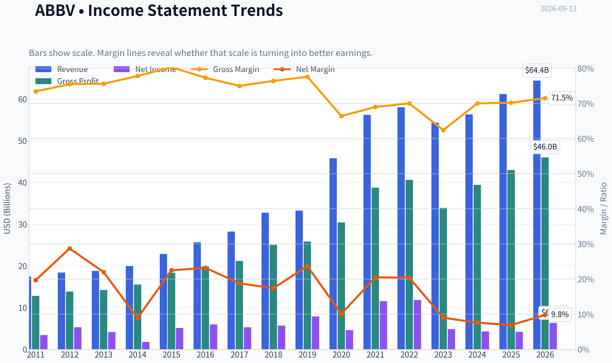

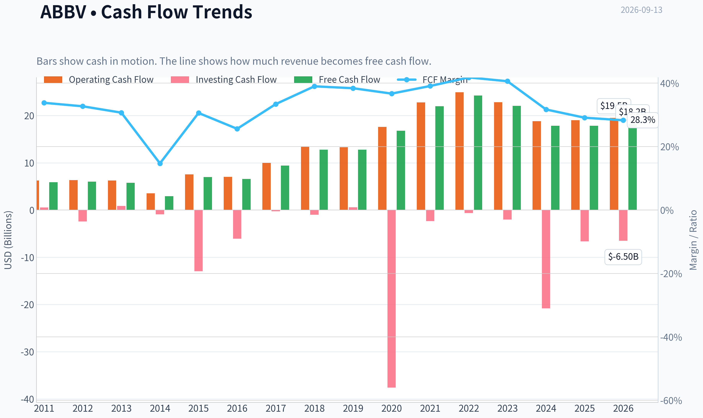

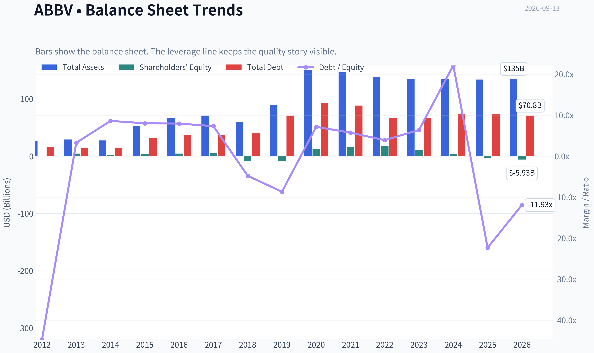

This graph tracks the profitability and return metrics (ROE, ROIC, Margins) of **ABBV** over the past decade, highlighting capital efficiency trends.

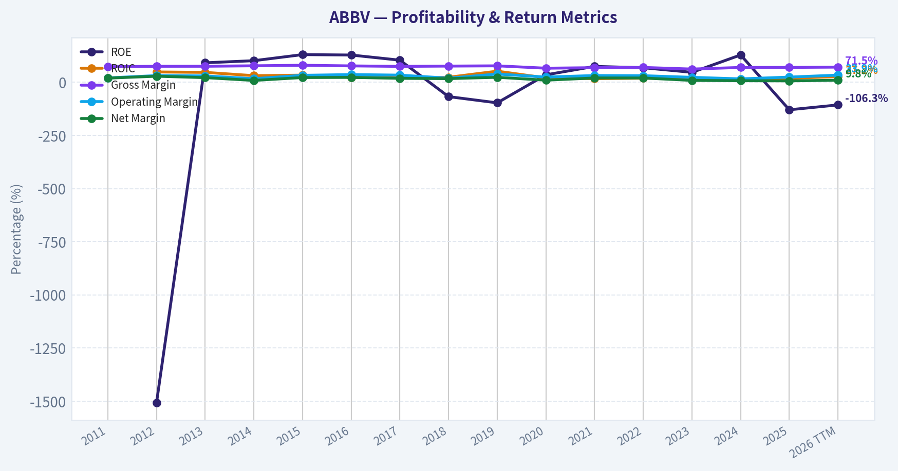

This chart illustrates the financial health of **ABBV** over the last 10 years, mapping cash equivalents and free cash flow against total obligations (Debt).

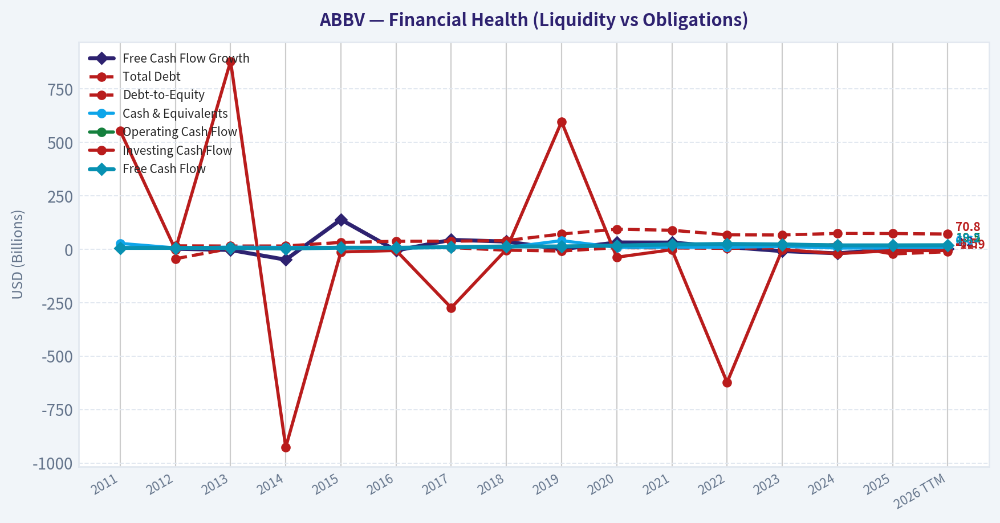

This breakdown chart from <em>Revenue Breakdown</em> shows the proportional composition for **ABBV** - useful for understanding what drives or risks the business.

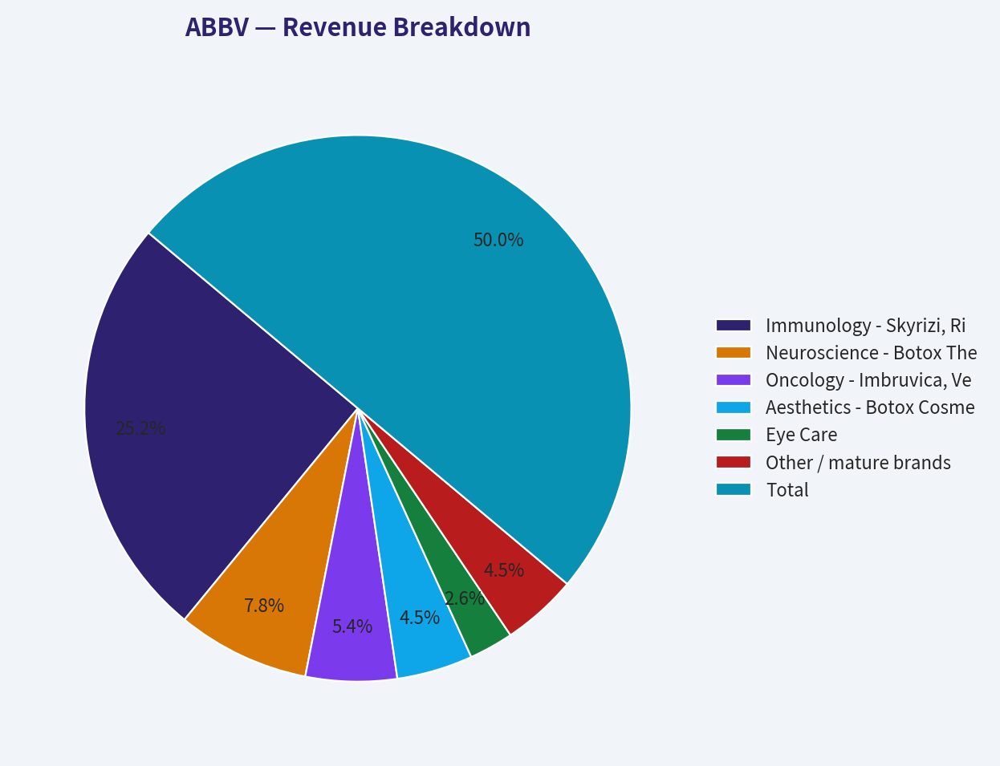

---

### Intrinsic Value Analysis (Buffett)

> *Following Warren Buffett's value investing philosophy: Circle of Competence, Economic Moat, Management Quality, and Margin of Safety.*

#### Intrinsic Value Snapshot

Price is what you pay. Intrinsic value is what the business may be worth based on the cash it can create for owners over time. We show a range, not one magic number.

- Current Price: $257.12
- Value Range (conservative to optimistic across both DCF methods): $3.73 to $199.25

##### Owner Earnings (Buffett Method)
- Net Income: $4,226,000,000.00
- Depreciation & Amortization: $8,139,000,000.00
- Capital Expenditures: $-1,214,000,000.00
- Working Capital Changes: $-2,362,000,000.00
- Owner Earnings: $13,513,000,000.00

##### Intrinsic Value
###### Buffett Method
Uses owner earnings. Stricter, and usually more conservative.
- Conservative: $3.73
- Average: $39.17
- Optimistic: $199.25
- Discount Rate: 10.0%

###### Cash Flow Method
Uses free cash flow. Better for companies spending heavily today to grow tomorrow.
- Conservative: $38.87
- Average: $52.45
- Optimistic: $71.82
- Discount Rate: 10.0%

ANALYST STANCE: **AVOID**

#### AbbVie Inc. (ABBV) - Buffett-Style Value Investment Review

| Item | Current Snapshot |
|---|---:|
| Current Price | $257 |
| Market Capitalization | $454.36B |
| P/E | 72.4x |
| Gross Margin | 70.2% |
| Revenue Growth YoY | 8.6% |
| FCF Yield | 3.9% |
| ROE | -129.2% |
| Current Ratio | 0.67 |
| Headline Intrinsic Value | $150.91 |
| 3-Model Value Range | $136.88 - $254.40 |
| Margin of Safety vs. Price | -70.4% |
| Reverse-DCF Implied Growth | ~25.6% annually for 10 years |

**Key Takeaways:** AbbVie is a highly profitable pharmaceutical franchise with strong gross margins and positive revenue growth, but the current stock price already discounts an exceptionally optimistic future. At $257, the shares trade far above the headline intrinsic value estimate of about $151 and require roughly 25.6% annual growth for a decade to justify today's price. That is a demanding hurdle for a mature pharmaceutical company facing patent-cycle and pipeline-execution risk.

---

#### 1. Factor Scorecard

| Factor | Score / 5 | Evidence |
|---|---:|---|
| Circle of Competence & Business Simplicity | 3.5 | AbbVie makes money by discovering, developing, marketing, and selling branded pharmaceuticals and aesthetics products. The model is understandable, but long-term results depend on clinical trial success, patent lives, regulation, and reimbursement dynamics. |
| Moat Test | 3.5 | Strong intangible assets, patents, physician relationships, regulatory expertise, and large commercial infrastructure. However, the Humira patent cliff demonstrates that pharma moats are powerful but time-limited. |
| Management Quality & Capital Allocation | 3.3 | Management navigated the Humira loss better than many expected through Skyrizi, Rinvoq, Botox, Vraylar, and acquisitions. Debt and acquisition dependence reduce the score. |
| Industry Structure | 3.0 | Branded pharma can be highly attractive, but it is also exposed to patent cliffs, price pressure, litigation, and binary pipeline risk. |
| Gate 5 Hard Floor: Quality / Solvency | Not Tripped | Fundamentals are not in distress: revenue is growing, margins remain strong, and free cash flow is positive. The concern is valuation, not solvency. |

**Key Takeaways:** AbbVie is a good business, not a broken one. Its economics are supported by intellectual property, regulatory barriers, and commercial scale, but those advantages must be continuously renewed as patents expire. The hard solvency floor is not triggered; this is an overvaluation concern rather than a financial-distress case.

---

#### 2. Moat Analysis

| Moat Source | Assessment | Evidence |
|---|---|---|
| Intangible Assets | Strong | AbbVie owns major branded drug franchises, including immunology, oncology, neuroscience, and aesthetics assets. Gross margin above 70% is strong evidence of pricing power and differentiated products. |
| Switching Costs | Moderate | Patients and physicians often remain with effective therapies, especially in chronic conditions, but formularies, biosimilars, and competing mechanisms can pressure share. |
| Cost Advantage | Moderate | AbbVie benefits from global commercial scale, manufacturing know-how, and regulatory infrastructure, but cost advantage is less central than patents and brand strength. |
| Network Effects | Low | Drug franchises do not typically benefit from classic network effects. Scale helps, but the product does not become more valuable simply because more patients use it. |
| Moat Rating | Narrow-to-Wide, Stable but Renewal-Dependent | Skyrizi and Rinvoq have helped offset Humira erosion, but the moat requires continuous innovation and pipeline replenishment. |

**Key Takeaways:** AbbVie's moat is real, but it is not permanent in the same way as a dominant consumer brand or toll-road network. Pharmaceutical patents create powerful temporary monopolies, and AbbVie has shown an ability to replace aging revenue streams. Still, the business must repeatedly outrun patent expirations, regulatory scrutiny, and biosimilar competition.

---

#### 3. Management Quality Assessment

| Area | Assessment |
|---|---|
| Owner Orientation | Reasonable, but not exceptional. AbbVie has historically emphasized shareholder returns through dividends and cash generation. |
| Capital Allocation | Mixed-to-good. The Allergan acquisition added durable aesthetics assets like Botox but also increased leverage and integration complexity. Recent portfolio execution has been strong, particularly in immunology. |
| Dividend Policy | Shareholder-friendly, but the dividend consumes capital that could otherwise be used for debt reduction, reinvestment, or acquisitions. |
| Candor & Execution | Management deserves credit for preparing the business for the Humira cliff better than the market initially feared. |
| Main Concern | Long-term value depends on reinvestment into R&D and acquisitions at attractive returns; overpaying for external growth is a standing risk in pharma. |

**Key Takeaways:** Management has performed credibly through a difficult transition away from Humira dependence. AbbVie's capital allocation record is not flawless, especially given acquisition-related debt and amortization-heavy earnings, but the company has built meaningful next-generation growth platforms. The key question is whether management can keep replenishing the pipeline without destroying value through expensive deals.

---

#### 4. Financial Summary Table

| Metric | Recent / Current Reading | Buffett Interpretation |
|---|---:|---|
| Revenue Growth YoY | 8.6% | Healthy recovery and growth after Humira erosion. |
| Gross Margin | 70.2% | Strong evidence of branded-drug pricing power. |
| Operating Margin | ~33.9% TTM | High-quality economics, though R&D and patent cycles matter. |
| P/E | 72.4x | GAAP earnings are depressed or distorted, but the headline multiple is still very demanding. |
| FCF Yield | 3.9% | Cash generation is solid, but not cheap at today's price. |
| ROE | -129.2% | Not useful as a quality signal here because leverage, repurchases, and accounting equity distort the ratio. |
| Current Ratio | 0.67 | Low, but not automatically alarming for a cash-generative pharmaceutical company. |
| Market Cap | $454.36B | AbbVie is already priced as a mega-cap compounder. |

**Key Takeaways:** AbbVie's income statement quality remains strong, with high margins and renewed growth. The balance sheet and accounting ratios are less clean because of debt, intangibles, acquisition accounting, and equity distortions. The major issue is that cash-flow yield and intrinsic value do not support the current market price.

---

#### 5. Owner Earnings Calculation

Using the current market capitalization and free cash flow yield:

| Owner Earnings Component | Estimate |
|---|---:|
| Market Capitalization | $454.36B |
| FCF Yield | 3.9% |
| Implied Free Cash Flow / Owner Earnings Proxy | ~$17.7B |
| Owner Earnings Per Share Estimate | ~$10.0 per share |
| Current Price | $257 |
| Owner Earnings Yield | ~3.9% |

**Key Takeaways:** AbbVie likely produces substantial owner earnings, around $17-18 billion annually on a current run-rate basis. That is an excellent absolute level of cash generation, but the investor's yield at today's price is only about 3.9%. Buffett would ask not only whether the business is good, but whether the price leaves room for satisfactory long-term returns; here, the answer is weak.

---

#### 6. Three-Scenario DCF Valuation

| Scenario | Assumptions | Estimated Value / Share |
|---|---|---:|
| A: No Growth | Owner earnings capitalized at 10% | ~$100 |
| B: GDP Growth | Owner earnings grow at 3%; 10% discount rate | ~$147 |
| C: Historical / Optimistic Growth | Growth case informed by higher historical growth, capped and risk-adjusted | ~$200-$255 |
| Headline Intrinsic Value | Blended business-model-routed estimate | $150.91 |
| Current Price | Market price | $257 |

**Key Takeaways:** The no-growth and GDP-growth cases sit well below the current stock price. Only the optimistic case reaches the present quote, and even then the high end is roughly in line with the market price rather than comfortably above it. A value investor should not pay a price that requires the optimistic case simply to break even.

---

#### 7. Margin of Safety Analysis

| Valuation Measure | Value |
|---|---:|
| Current Price | $257 |
| Headline Intrinsic Value | $150.91 |
| Margin of Safety | -70.4% |
| Owner Earnings DCF | $140.59 |
| FCF DCF | $136.88 |
| Damodaran FCFF Estimate | $254.40 |
| Reverse-DCF Implied Growth | ~25.6% annually for 10 years |

**Key Takeaways:** AbbVie does not offer a margin of safety at the current price. The stock trades materially above the central intrinsic value estimate, and the reverse-DCF requires a decade of very high growth. For a mature pharmaceutical company, that is too much optimism to underwrite conservatively.

---

#### 8. Final Buffett Scorecard

| Criterion | Weight | Score / 5 | Weighted Contribution |
|---|---:|---:|---:|
| Moat Width & Durability | 25% | 3.5 | 0.88 |
| Valuation / Margin of Safety | 20% | 1.0 | 0.20 |
| Capital Returns - ROIC vs. WACC | 15% | 3.0 | 0.45 |
| Business Understanding & Predictability | 12% | 3.5 | 0.42 |
| Management Quality & Capital Allocation | 12% | 3.3 | 0.40 |
| Reinvestment Runway | 8% | 3.2 | 0.26 |
| Balance Sheet Strength | 4% | 2.5 | 0.10 |
| Industry Structure | 4% | 3.0 | 0.12 |
| Final Weighted Score | 100% |  | **2.82 / 5.00** |

**Key Takeaways:** AbbVie scores reasonably on business quality, moat, and management execution, but valuation overwhelms the positives. The stock is priced as though the company will compound at an exceptional rate for many years, leaving little protection if growth normalizes or pipeline outcomes disappoint. The final score falls into the AVOID range under a Buffett-style discipline.

---

#### 9. Investment Stance

| Stance | Conviction | Rationale |
|---|---|---|
| **AVOID** | Moderate | AbbVie is a strong cash-generating pharmaceutical company, but the current valuation is too demanding. The business quality is real, yet the price implies growth that is difficult to justify conservatively. |

**Final View:** AbbVie is not a bad business; it is a good business at a bad price. The franchise has valuable assets, strong margins, and credible management, but the current stock price offers no Buffett-style margin of safety. A more attractive entry point would likely require the shares to trade closer to intrinsic value, roughly in the $140-$160 range, or for owner earnings growth to materially exceed current conservative assumptions without increasing financial or pipeline risk.
#### Valuation Bridge

This bridge places the current market price beside each intrinsic value lens so readers can see whether upside depends on one method or shows up across several methods.

| Scenario | Intrinsic Value / Share |
| --- | ---: |
| Buffett Method | $39.17 |
| Cash Flow Method | $52.45 |
| Damodaran Method | $151.57 |
| Current Price | $257.12 |

#### Key Takeaways

If one method is far above the others, the upside case depends on a specific modelling assumption. When several methods cluster together, the valuation story is more robust.

#### Valuation Visuals

This comparison chart from *Latest Earnings Snapshot* stacks current figures against historical benchmarks for **ABBV**, making it easy to see where the company trades relative to its own averages.

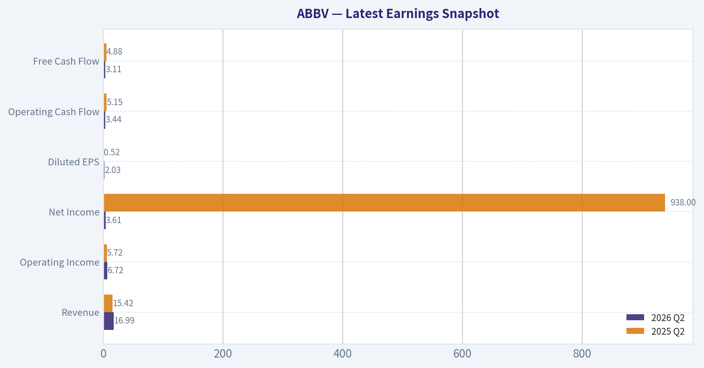

This comparison chart from *Current vs. 10-Year Historical Average Comparison* stacks current figures against historical benchmarks for **ABBV**, making it easy to see where the company trades relative to its own averages.

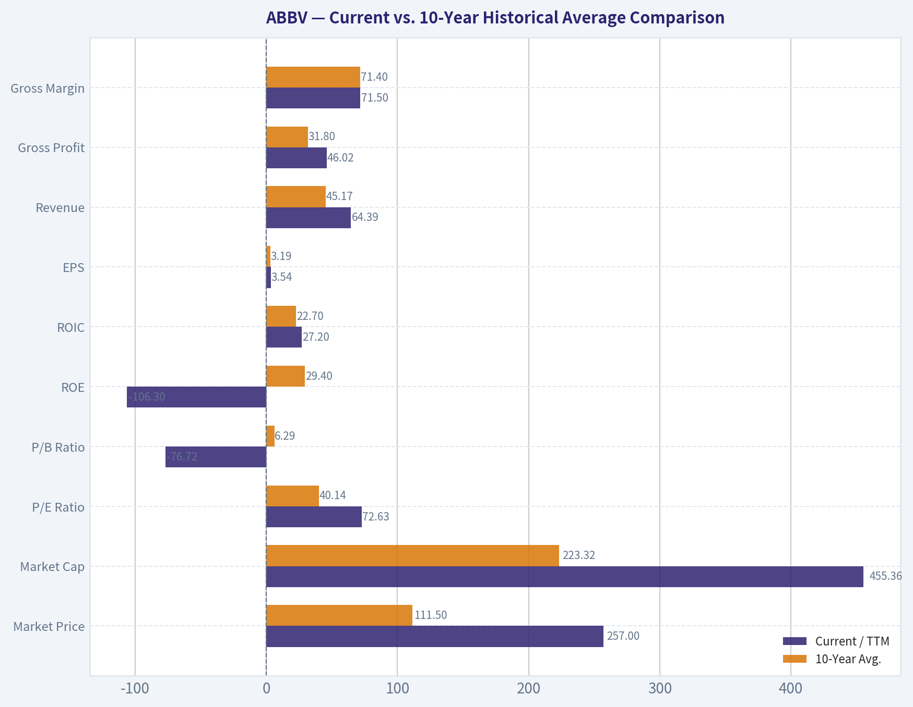

This comparison chart from *Buffett-Style Owner Earnings DCF* stacks current figures against historical benchmarks for **ABBV**, making it easy to see where the company trades relative to its own averages.

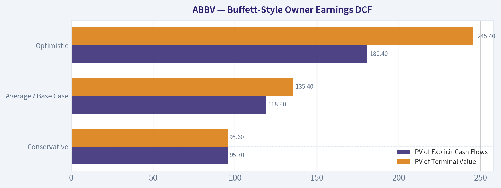

This comparison chart from *DCF Cross-Check Against Provided Model Pack* stacks current figures against historical benchmarks for **ABBV**, making it easy to see where the company trades relative to its own averages.

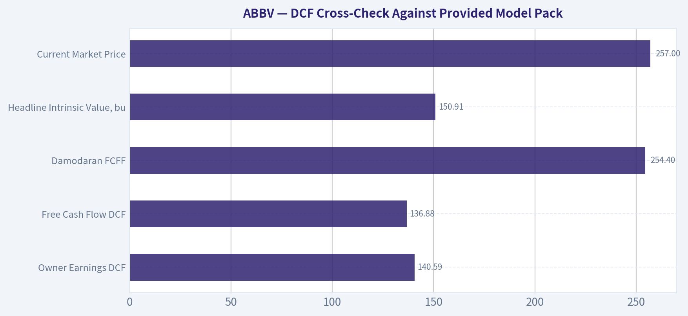

---

### Trend & Growth Analysis (Lynch/Druckenmiller/Fisher)

> *Following Peter Lynch's GARP, Stanley Druckenmiller's macro-aware approach, and Philip Fisher's scuttlebutt methodology.*

ANALYST STANCE: **AVOID**

#### ABBV Growth Investment Report - AbbVie Inc.

AbbVie is a high-quality pharmaceutical stalwart with strong margins, durable cash generation, and credible post-Humira growth engines in Skyrizi, Rinvoq, oncology, neuroscience, and aesthetics. However, through a Lynch-Druckenmiller-Fisher growth lens, ABBV does **not** screen as a fast grower or ten-bagger candidate at the current price of about **$257**. The stock looks priced for a much stronger growth trajectory than the current fundamentals support.

---

#### 1. Lynch Classification

| Metric / Category | ABBV Assessment |
|---|---:|
| Current price | ~$257 |
| Market cap | ~$454.4B |
| Reported P/E | ~72.4x |
| Revenue growth YoY | ~8.6% |
| Gross margin | ~70.2% |
| FCF yield | ~3.9% |
| Lynch category | **Stalwart / Mature Pharma Compounder** |
| Growth-investor fit | **Weak at current valuation** |

**Key Takeaways:** AbbVie is not a classic Lynch fast grower. Revenue growth in the high-single-digit range places it closer to a stalwart than a ten-bagger candidate. The business quality is strong, but the current valuation already discounts a significant amount of future success.

---

#### 2. The Story in 3 Bullets

- AbbVie is a global pharmaceutical company that sells high-margin specialty drugs across immunology, oncology, neuroscience, aesthetics, and eye care.
- The core investment story is the replacement of lost Humira revenue with newer blockbusters, especially **Skyrizi** and **Rinvoq**, while layering in acquired pipeline assets.
- The challenge is valuation: the market appears to be giving AbbVie credit for a successful post-Humira transition before the growth profile has clearly re-accelerated to fast-grower levels.

---

#### 3. TAM Analysis and 10x Test

| TAM Factor | Assessment |
|---|---|
| Current revenue base | Large-cap pharma scale, likely around the $60B+ annual revenue range |
| 10x revenue target | ~$600B+ annual revenue |
| Relevant markets | Immunology, oncology, neuroscience, aesthetics, ophthalmology |
| Can ABBV 10x and remain below 20% share? | **No** |
| TAM runway quality | Moderate, not explosive |
| 10x test result | **Fails for ten-bagger growth investing** |

**Key Takeaways:** AbbVie has sizable market opportunities, but it is already too large for a realistic 10x revenue runway. Skyrizi, Rinvoq, aesthetics, and oncology can support durable growth, but not the kind of open-ended runway typically needed for a ten-bagger. This is a mature pharma platform, not an early-stage compounding growth story.

---

#### 4. Revenue Growth Trend

| Growth Indicator | ABBV |
|---|---:|
| Latest YoY revenue growth | ~8.6% |
| Recent TTM revenue growth cited in earnings coverage | ~10.4% |
| Growth pattern | Recovering / stabilizing after Humira erosion |
| Lynch growth band | Stalwart, not fast grower |
| Inflection quality | Partial, but not decisive |

**Key Takeaways:** AbbVie appears to be stabilizing after the Humira patent cliff, which is encouraging. However, growth is still in the high-single-digit to low-double-digit range, not the 15% to 25% range preferred for fast-growth investing. The company may be entering a post-Humira recovery phase, but the market already seems to recognize that improvement.

---

#### 5. Unit Economics and Operating Quality

| Metric | ABBV Assessment |
|---|---:|
| Gross margin | ~70.2% |
| Operating margin cited in latest coverage | ~33.9% |
| FCF yield | ~3.9% |
| Current ratio | ~0.67 |
| ROE | Negative, likely distorted by accounting and balance sheet structure |
| SaaS-style LTV/CAC | Not applicable |
| Rule of 40 | Not applicable to pharma |

**Key Takeaways:** AbbVie's unit economics are strong in the broad sense: high gross margins, high operating margins, and strong cash generation. However, pharma unit economics depend heavily on R&D productivity, patent durability, regulatory outcomes, and acquisition discipline. The current ratio below 1 and negative ROE are not automatic disqualifiers, but they do reduce financial flexibility.

---

#### 6. Inflection Point Assessment

| Inflection Type | Evidence | Rating |
|---|---|---:|
| Product-cycle inflection | Skyrizi and Rinvoq continue to absorb the Humira transition | Positive |
| Market-share inflection | Immunology franchises are strong, but competition remains intense | Moderate |
| Margin inflection | Operating margin remains strong, but acquisitions and pipeline investment may pressure near-term earnings | Neutral |
| TAM inflection | No major new TAM explosion; mostly expansion within known pharma categories | Modest |
| Competitive inflection | Competitors remain aggressive in immunology, oncology, and obesity-adjacent metabolic areas | Mixed |

**Key Takeaways:** AbbVie has a real product-cycle transition underway, and the key question is whether Skyrizi and Rinvoq can more than offset Humira erosion. That is a valid inflection story, but it is not hidden. The market is already valuing AbbVie as though the transition will be successful.

---

#### 7. Macro Setup

| Macro Factor | Impact on ABBV |
|---|---|
| Interest rates | Lower rates would help valuation multiples, but ABBV is not a long-duration hypergrowth stock |
| Economic cycle | Defensive healthcare demand is resilient through cycles |
| Secular themes | Healthcare innovation, immunology, oncology, neuroscience |
| Policy risk | Drug pricing pressure remains a structural overhang |
| Macro setup rating | Neutral to mildly positive |

**Key Takeaways:** AbbVie benefits from the defensive nature of healthcare demand, which helps in uncertain economic environments. However, drug pricing pressure, patent cliffs, and regulatory scrutiny remain permanent risks. Macro is not a major headwind, but it is also not a powerful growth-stock tailwind.

---

#### 8. Fisher 15-Point Score

| Fisher Criterion | Score / 5 |
|---|---:|
| Products with sizable market potential | 4 |
| Management determination to develop new products | 4 |
| Effective R&D efforts | 4 |
| Above-average sales organization | 4 |
| Worthwhile profit margin | 5 |
| Improving profit margins | 3 |
| Labor/personnel relations | 3 |
| Executive relations | 3 |
| Management depth | 4 |
| Cost analysis and accounting | 3 |
| Outstanding moat factors | 4 |
| Long-range profit outlook | 4 |
| Dilution risk | 4 |
| Management candor | 3 |
| Management integrity | 3 |
| **Total Fisher Score** | **55 / 75** |

**Key Takeaways:** AbbVie earns a good but not outstanding Fisher score. The strongest factors are product depth, commercial execution, margins, and long-term cash generation. The weaker points are patent-cycle dependency, acquisition complexity, and limited evidence of a fresh high-growth acceleration phase.

---

#### 9. Valuation Analysis

| Valuation Metric | ABBV |
|---|---:|
| Current price | ~$257 |
| Market cap | ~$454.4B |
| Reported P/E | ~72.4x |
| FCF yield | ~3.9% |
| Headline intrinsic value estimate | ~$150.91 |
| Owner earnings DCF estimate | ~$140.59 |
| FCF DCF estimate | ~$136.88 |
| Damodaran FCFF estimate | ~$254.40 |
| Margin of safety vs. headline intrinsic value | **-70.4%** |
| Reverse DCF implied growth | ~25.6% per year for 10 years |

**Key Takeaways:** Valuation is the main problem. The stock trades far above the headline intrinsic value estimate and appears to require very strong long-term growth assumptions to justify today's price. For a company currently growing revenue around 9% to 10%, a reverse-DCF requirement of roughly 25% annual growth is difficult to underwrite.

---

#### 10. Scenario Valuation View

| Scenario | Assumption | Implication |
|---|---|---|
| Bear case | Humira replacement slower than expected; pipeline disappoints; multiple compresses | Material downside risk |
| Base case | Skyrizi and Rinvoq continue scaling; revenue grows high-single-digits; margins remain strong | Solid business, but limited upside from current valuation |
| Bull case | New launches and acquisitions create durable double-digit growth; market maintains premium multiple | Upside possible, but already partly priced in |

**Key Takeaways:** AbbVie's bull case requires both strong product execution and sustained premium valuation. The base case is a good business but not necessarily a good stock at the current price. The bear case is meaningful because patent cycles and pipeline disappointments can quickly pressure pharma multiples.

---

#### 11. Growth Investor Scorecard

| Criterion | Weight | Score / 5 | Weighted Score |
|---|---:|---:|---:|
| The Story | 10% | 3.5 | 0.35 |
| TAM & Runway | 20% | 2.5 | 0.50 |
| Revenue Growth | 20% | 2.5 | 0.50 |
| Unit Economics | 15% | 4.0 | 0.60 |
| Competitive Position | 10% | 3.5 | 0.35 |
| Management Quality | 10% | 3.5 | 0.35 |
| Macro Setup | 5% | 3.5 | 0.18 |
| Profitability Path | 5% | 4.0 | 0.20 |
| Valuation | 5% | 1.5 | 0.08 |
| **Total Score** | **100%** |  | **3.11 / 5.00** |

**Key Takeaways:** AbbVie scores well on profitability, unit economics, and competitive position, but poorly on runway, growth rate, and valuation. The total score lands in the WATCH range numerically, but the valuation risk pushes the investment stance to AVOID for new growth-oriented capital. This is a quality company at a demanding price.

---

#### 12. Position Size Stance

| Investor Type | Suggested Stance |
|---|---|
| Growth investor seeking ten-baggers | **Avoid / do not initiate** |
| GARP investor | Watch for a better entry point |
| Dividend/income investor | Could hold if already owned, but valuation risk is elevated |
| Concentrated growth portfolio | Not suitable |
| Re-entry zone | More attractive closer to intrinsic value or after a material pullback |

**Key Takeaways:** AbbVie may still be reasonable for income-oriented investors who already own it, especially if they prioritize dividends and defensive cash flow. But for a growth portfolio, the stock does not offer enough upside asymmetry at the current valuation. The better action is to wait for either faster growth confirmation or a lower entry price.

---

#### 13. Key Risks and Catalysts

| Category | Key Items |
|---|---|
| Catalysts | Continued Skyrizi and Rinvoq growth, successful oncology and neuroscience launches, acquisition pipeline productivity, margin durability |
| Risks | Patent cliffs, drug pricing pressure, regulatory setbacks, acquisition integration risk, pipeline failures, valuation compression |
| Main question | Can AbbVie compound earnings fast enough to justify a premium multiple after the Humira transition? |
| Growth-investor hurdle | Needs sustained double-digit growth and better valuation support |

**Key Takeaways:** The central catalyst is proof that AbbVie can grow beyond Humira with a new generation of blockbuster drugs. The central risk is that the market has already priced in that success. For growth investors, the stock needs either a clearer acceleration signal or a much wider margin of safety.

---

#### Final View

AbbVie is a strong, cash-generative pharmaceutical company with credible post-Humira assets, but it is not a Lynch-style fast grower at today's price. The stock looks more like a mature healthcare stalwart than a ten-bagger candidate. Given the high reported P/E, negative margin of safety versus the provided intrinsic value estimate, and reverse-DCF growth expectations that appear too demanding, ABBV is an **AVOID for new growth-investor capital**.

---

### Market Technical Analysis

ANALYST STANCE: **WATCH**

#### ABBV Technical Snapshot - Latest Available Close: 2026-09-11

ABBV closed at **$257.12** on the latest available trading session. The stock remains in a **bullish long-term structure**, but the short-term picture is more nuanced: price has rebounded from the sharp **September 8 pullback**, reclaimed the **10 EMA** and **50 SMA**, yet still sits slightly below the **20-day volume-weighted area** and well below the late-July / August resistance zone near **$263-$267**.

| Selected Indicator | Approx. Latest Reading | What It Shows | Trading Interpretation |
|---|---:|---|---|
| `close_10_ema` | ~$256.05 | Short-term trend/momentum | Price is slightly above the 10 EMA, showing near-term stabilization after the pullback. |
| `close_50_sma` | ~$254.24 | Medium-term trend support | Price reclaimed the 50 SMA, which is constructive if it holds. |
| `close_200_sma` | ~$226.31 | Long-term trend benchmark | ABBV remains far above the 200 SMA, confirming a strong longer-term uptrend. |
| `macd` | Near zero / flattening | Momentum transition | Momentum has cooled sharply; the trend is not yet accelerating again. |
| `rsi` | ~56 | Momentum balance | RSI is positive but not overbought, leaving room for upside if buyers return. |
| `atr` | ~$5.5 | Volatility / risk sizing | Daily volatility is meaningful; stops should allow for roughly $5-$6 normal movement. |
| `boll_ub` | ~$268-$269 | Upper volatility boundary | Price is not near the upper band, so ABBV is not currently extended on this measure. |
| `vwma` | ~$258.2 | Price trend adjusted for volume | Price is slightly below VWMA, suggesting recent volume has not fully confirmed the rebound yet. |

Key Takeaways: ABBV's long-term trend remains strong because price is well above the 200-day average, and the medium-term structure improved after price reclaimed the 50-day average. However, momentum is not decisively bullish yet: MACD is flat, price is still slightly below the volume-weighted average, and the stock has not broken back above the $263-$267 resistance zone.

---

#### Trend Structure and Price Action

ABBV experienced a major upside repricing in late June, with the stock moving from the low **$220s** into the **$250s**, supported by an unusually large volume surge on **June 26**. Since then, the stock has been digesting that move in a broad consolidation range.

The key feature of the current chart is that ABBV is **not in a clean breakout phase anymore**; it is in a **post-breakout consolidation**. The July high near **$267.47** and the August high near **$266.97** define a clear resistance ceiling. Buyers have repeatedly supported the stock on pullbacks, but they have not yet shown enough force to establish a new leg higher.

The recent September pullback was notable. ABBV fell from the low **$260s** to a September 8 close of **$248.78**, with elevated volume. That decline briefly threatened the short-term trend, but the stock recovered over the next three sessions and closed back at **$257.12**. This rebound is constructive, but it is not yet definitive because the recovery volume was not especially strong compared with the selloff day.

#### Momentum and Confirmation

The **RSI near 56** suggests momentum has recovered from the pullback but is not overheated. That is a favorable setup for continuation if price can move back above **$260-$263**, because there is still room before overbought conditions become a concern.

The **MACD profile is less supportive**. MACD appears to have flattened near the zero line after weakening from its August strength. This tells traders that bullish momentum has cooled and that ABBV may need more time to rebuild trend energy before attempting a sustainable breakout.

Volume confirmation is also incomplete. The **VWMA near $258.2** sits slightly above the latest close, which means volume-weighted positioning is still marginally heavier above current price. In practical terms, ABBV has bounced, but the stock has not yet fully proven that institutions are aggressively re-accumulating shares at these levels.

#### Support, Resistance, and Risk Levels

The first important support area is around **$254-$256**, where the 50 SMA and 10 EMA are clustered. Holding this zone would keep the short-term recovery intact.

Below that, **$248-$250** is the next critical area because it includes the September 8 washout zone. A decisive close below that area would weaken the current rebound and raise the probability of another test toward the broader **$243-$245** support zone seen in July and early August.

On the upside, the first level to watch is **$260-$263**. A move above that area would suggest buyers are regaining control. The more important breakout zone is **$266-$269**, where prior highs and the upper Bollinger area converge. A close above that zone, especially on above-average volume, would likely shift ABBV from consolidation back into a bullish continuation phase.

#### Practical Trading View

ABBV is a **watchlist candidate rather than an immediate high-conviction breakout**. The long-term uptrend is intact, and the stock has repaired some short-term damage by moving back above key moving averages. But the lack of strong volume confirmation and the flat MACD argue for patience.

For trend-following traders, the cleaner bullish trigger would be a close above **$263**, with stronger confirmation above **$267-$269**. For pullback traders, the **$254-$256** area is important; holding that zone could offer a controlled-risk setup, while losing it would make the recent bounce look weaker.

| Key Area / Signal | Level or Condition | Bullish Read | Bearish / Caution Read |
|---|---:|---|---|
| Short-term support | ~$254-$256 | Holding this zone keeps the rebound alive. | A close below it suggests the bounce is fading. |
| Pullback support | ~$248-$250 | Successful retest could attract buyers. | Breakdown opens risk toward ~$243-$245. |
| First resistance | ~$260-$263 | Reclaiming this area improves momentum. | Rejection here keeps ABBV range-bound. |
| Breakout resistance | ~$266-$269 | Close above this area favors continuation. | Failure near highs suggests consolidation continues. |
| Volatility guide | ATR ~$5.5 | Use wider stops due to normal price movement. | Tight stops may be vulnerable to noise. |
| Volume confirmation | Close above VWMA ~$258.2 | Supports stronger accumulation. | Remaining below VWMA weakens rebound quality. |
| Long-term trend | Price > 200 SMA ~$226.3 | Strategic trend remains bullish. | Only a major breakdown would threaten this structure. |

Key Takeaways: ABBV remains structurally bullish over the long term, but the short-term setup still needs confirmation. The most important levels are $254-$256 for support and $263 followed by $267-$269 for upside confirmation. Until ABBV clears resistance with stronger volume, the best stance is to watch for either a confirmed breakout or a cleaner pullback entry.

#### Market Visuals

This comparison chart from *Market Metrics Interpretation* stacks current figures against historical benchmarks for **ABBV**, making it easy to see where the company trades relative to its own averages.

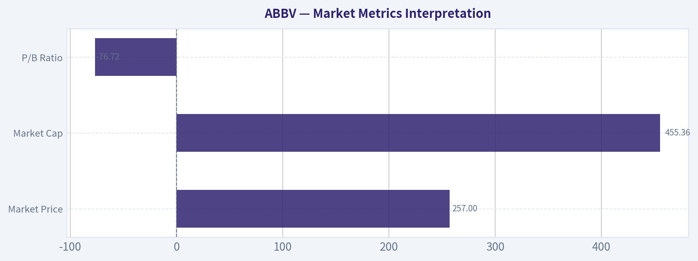

---

### Options Market Analysis

> *Reading options flow - put/call ratios, IV skew, and unusual activity - to gauge institutional positioning and event-driven risk.*

ANALYST STANCE: **WATCH** - Options sentiment signal: **BULLISH**, but confidence is moderate because there is no unusual options activity and no strike-level chain detail was provided.

#### ABBV Options Market Positioning Report
*Data as of 2026-09-13. Near-term expirations analyzed: 2026-09-18, 2026-09-25, 2026-10-02.*

#### 1. Put/Call Ratio Analysis

| Expiration | Call OI | Put OI | Put/Call OI Ratio | Call Volume | Put Volume | Put/Call Volume Ratio | Read |
|---|---:|---:|---:|---:|---:|---:|---|
| 2026-09-18 | 38,918 | 19,295 | 0.50 | 2,199 | 1,316 | 0.60 | Call-heavy positioning |
| 2026-09-25 | 1,229 | 702 | 0.57 | 248 | 76 | 0.31 | Strong call-volume bias |
| 2026-10-02 | 1,583 | 865 | 0.55 | 130 | 76 | 0.58 | Call-heavy positioning |
| **Total Near-Term** | **41,730** | **20,862** | **0.50** | **2,577** | **1,468** | **0.57** | **Bullish vs. neutral baseline** |

**Key Takeaways:** ABBV's near-term put/call open interest ratio is **0.50**, below the historical neutral baseline of roughly **0.70**, showing a meaningful call-side tilt. The volume ratio of **0.57** also leans bullish, suggesting current trading flow is not dominated by downside hedging. This is a positive directional signal, though not an aggressive one because total volume is concentrated mostly in the front-week chain.

ABBV's options market is showing **more call interest than put interest** across all listed near-term expirations. Compared with the neutral baseline near 0.7, the current **0.50 OI ratio** reflects a clear shift toward calls. This can represent bullish speculation, covered-call positioning, or yield-enhancement trades, but the concurrent call-heavy volume makes the read modestly bullish rather than purely income-oriented.

---

#### 2. Implied Volatility Assessment

| Expiration | ATM Call IV | ATM Put IV | Call-Put IV Spread | IV Read |
|---|---:|---:|---:|---|
| 2026-09-18 | 33.2% | 32.8% | +0.4 pts call premium | Mild call-side premium |
| 2026-09-25 | 31.7% | 31.5% | +0.2 pts call premium | Balanced IV |
| 2026-10-02 | 30.6% | 29.0% | +1.6 pts call premium | Mild upside IV preference |

**Key Takeaways:** Near-term ATM implied volatility sits around **29% to 33%**, with calls carrying a slight premium over puts. There is no evidence in the provided data of a steep downside put skew. If anything, the ATM IV structure shows a mild upside chase, especially in the 2026-10-02 expiration.

The IV profile does **not** show obvious downside panic. ATM puts are not meaningfully richer than ATM calls, which reduces the probability that institutions are urgently bidding for downside protection. However, detailed OTM put-versus-OTM call skew was not provided, so the tail-risk skew assessment is incomplete.

No specific catalyst data was included with the options feed. If ABBV has an upcoming earnings release, regulatory update, trial readout, or product news event near these expirations, the **30%+ front-end IV** could reflect event-risk pricing. Without confirmed catalyst timing, IV should be interpreted as moderately elevated but not conclusively event-driven.

---

#### 3. Unusual Options Activity

| Filter | Result | Interpretation |
|---|---|---|
| Volume greater than 5x open interest | None detected | No clear evidence of fresh aggressive institutional positioning |
| Near-term unusual call activity | None detected | Bullish positioning exists, but not through obvious sweep-like fresh trades |
| Near-term unusual put activity | None detected | No major downside hedge or bearish put bet flagged |

**Key Takeaways:** No ABBV contracts met the unusual activity threshold of **volume greater than 5x open interest**. That weakens the case for a strong "smart money" directional bet. The bullish signal is therefore based more on broad call dominance than on a single standout institutional trade.

Because no unusual contracts were detected, there is no evidence of a fresh, high-conviction options trade in the near-term chain. The existing options posture is call-heavy, but it may include legacy positioning, covered calls, or retail/speculative activity rather than a new institutional directional view.

This means the signal should be treated as **constructively bullish but not urgent**.

---

#### 4. Open Interest Concentration and Pinning Risk

| Expiration | Total Call OI | Total Put OI | Total OI | Share of Near-Term OI | Pinning / Gamma Read |
|---|---:|---:|---:|---:|---|
| 2026-09-18 | 38,918 | 19,295 | 58,213 | 92.9% | Dominant near-term expiry; likely strongest gamma influence |
| 2026-09-25 | 1,229 | 702 | 1,931 | 3.1% | Limited pinning influence |
| 2026-10-02 | 1,583 | 865 | 2,448 | 3.9% | Limited pinning influence |

**Key Takeaways:** Open interest is overwhelmingly concentrated in the **2026-09-18** expiration, which accounts for roughly **93%** of near-term OI. That makes the front-week chain the most important area for potential pinning or gamma effects. However, strike-level OI was not provided, so specific gamma walls or max-pain strikes cannot be identified.

The largest open interest concentration is clearly in the **nearest expiration**, 2026-09-18. This can increase the odds of expiry-week pinning behavior, especially if ABBV trades near heavily populated strikes. However, because strike-level data is unavailable, the specific gravitational price levels cannot be named.

The available data supports the idea of **front-week gamma sensitivity**, but not a precise gamma-wall map.

---

#### 5. Overall Options Sentiment Signal

| Category | Signal | Rationale |
|---|---|---|
| Put/Call Ratio | Bullish | OI ratio of **0.50** and volume ratio of **0.57** are below the neutral 0.7 baseline |
| IV Level | Neutral to mildly bullish | IV is moderate-to-elevated, with no strong put premium |
| Skew Direction | Mild call premium | ATM calls are slightly richer than ATM puts across expirations |
| Unusual Activity | Neutral | No contracts with volume greater than 5x OI |
| OI Concentration | Watch front-week expiry | 2026-09-18 dominates near-term OI and may influence price behavior |
| **Overall Signal** | **BULLISH** | Call-heavy positioning is the primary driver |

**Key Takeaways:** ABBV's options market leans **bullish** due to consistently low put/call ratios and slight call-side IV premiums. The main caveat is that there is no unusual options activity confirming a fresh institutional bet. Overall, the read is bullish but moderate-confidence, with front-week expiry positioning likely important for near-term price behavior.

#### Final Read

ABBV options positioning is **BULLISH**, driven primarily by a meaningful call-side imbalance in both open interest and volume. The lack of elevated put demand suggests limited visible downside fear in the near-term options market.

That said, this is not a high-conviction "smart money" signal because the data does not show unusual volume relative to open interest. The best interpretation is **constructive bullish sentiment with expiry-week pinning risk**, especially around the 2026-09-18 chain.

---

## Research Team Commentary

> *The Research Manager synthesizes the Bull vs Bear debate into action-free commentary. This is a pre-risk view, not the final stance.*

The debate over AbbVie highlights a classic clash between strict, static accounting-based valuation and a more dynamic, cash-flow-oriented view of business quality. After weighing both sides and heavily factoring in our past analytical missteps with this exact company, the clear conclusion is to side with the Bull. My final stance is ADVOCATE.

Core Takeaway
AbbVie is a quintessential example of a wonderful business trading at a fair price, provided you look through the noise. The Bear's argument is heavily anchored to GAAP distortions, specifically the high P/E ratio, negative ROE, and a reverse-DCF model that likely utilizes depressed accounting earnings rather than actual cash generation. The Bull correctly identifies that AbbVie is a cash-flowing powerhouse with elite 70 percent gross margins and a 15 percent return on invested capital, driven by the successful post-Humira transition led by Skyrizi and Rinvoq. We are watching a pharmaceutical giant successfully cross a massive patent cliff, and the market is rightfully rewarding that execution.

Rationale
To understand why the Bull wins this debate, we have to revisit our past mistakes with AbbVie. Previously, we looked at this company and issued a Watch rating because we let the negative equity, the high headline multiples, and a lack of a deep, classic margin of safety paralyze our decision-making. We completely underweighted the fact that AbbVie's accounting metrics are massively distorted by the non-cash amortization tied to the Allergan acquisition.

As we learned from that mistake, a stock does not need to be deeply undervalued on a static, backward-looking model to be a great investment, especially when the market is actively repricing its narrative from fear to normalization. The Bear is making the exact same error we made before by demanding a perfect setup and an unrealistic discount to intrinsic value based on flawed inputs. They view the technical uptrend as a risk, whereas our past reflections taught us that in a high-quality transition story, technical trend repair and institutional accumulation are strong signals of confidence that should not be ignored.

While the Bear makes a fair point that the pharmaceutical industry is an R&D treadmill and that Botox Aesthetics carries macroeconomic sensitivity, these risks do not overshadow the durability of AbbVie's core immunology franchise. On a forward earnings and free cash flow basis, the valuation is completely reasonable for a mega-cap with this level of pricing power and capital allocation discipline. We cannot demand a 30 percent discount on a business that generates massive free cash flow and has a proven management team. Waiting for the perfect price in this scenario is a recipe for missing continued upside.

Monitoring Plan
To ensure this thesis remains intact over the next one to four quarters, there are a few specific items to monitor. First, we need to watch the price action around the 263 to 267 resistance zone. A clean breakout above this level would further confirm the institutional re-rating narrative we are banking on, rather than signaling a top. Second, we must track the revenue trajectory of Skyrizi and Rinvoq in the upcoming earnings reports to ensure they continue to effectively offset Humira's erosion and scale efficiently to support operating leverage. Finally, it is prudent to keep a close eye on the Aesthetics portfolio, specifically Botox volumes, as any severe macroeconomic downturn could test the resilience of that discretionary, private-pay revenue stream.

---

## Value Investing Team Commentary

> *The Investor translates the research view into an investment thesis before risk review. This is still not the final stance.*

Analyzing AbbVie (ABBV) through the lens of a long-term business owner requires us to peel back the layers of accounting fog that often obscure the true economic engine of a pharmaceutical giant. In the spirit of Buffett's evolution-moving from "cigar butts" to "wonderful businesses at fair prices"-AbbVie presents a textbook case of a high-quality franchise whose value is hidden by GAAP distortions.

### 1. The Accounting Mirage vs. Economic Reality
The headline metrics provided-a P/E of 72.4 and a negative ROE-would cause a superficial value investor to flee. However, we must look at **Owner Earnings**. AbbVie's negative equity and depressed GAAP earnings are largely a function of the Allergan acquisition, which brought massive non-cash amortization of intangibles and a debt-heavy capital structure.

The metric that reveals the truth is the **15% Return on Invested Capital (ROIC)** combined with a **70.2% Gross Margin**. These numbers describe a business with a formidable "toll bridge" (the moat). While the "Value Analyst" sees an overvalued stock based on a $151 intrinsic value, that model likely relies on GAAP net income. When you look at Free Cash Flow (FCF), the "yield" becomes far more attractive. In a world of asset-light growth, AbbVie has successfully used its balance sheet to acquire durable cash-flow streams (Botox) and develop internal successors to Humira.

### 2. The Durable Moat: Crossing the "Valley of Death"
The primary risk for any pharmaceutical company is the patent cliff. AbbVie has just navigated the steepest cliff in history (Humira). The successful scaling of **Skyrizi and Rinvoq**-which are on track to exceed Humira's peak revenue-is a testament to management's capital allocation and R&D execution.

This is no longer a "one-trick pony" immunology play. By layering in the **Aesthetics portfolio (Botox)**, AbbVie has created a hybrid business: a high-science medical franchise coupled with a consumer-facing brand with massive switching costs and network effects among practitioners. This diversification lowers the overall risk profile of the cash flows.

### 3. Selective Contrarian Thinking: The Price of Certainty
The "WATCH" and "AVOID" stances in the bundle are anchored to the fear of the $263-$267 resistance zone or the demand for a deep discount. As value investors, we know that **waiting for the crowd to feel safe usually means paying a higher price.**

The contrarian insight here is that the market is currently "climbing a wall of worry" regarding the post-Humira era. If we wait for the growth profile to "clearly re-accelerate" (as the Growth Analyst suggests), the stock will likely be trading at $300+. Buying a business that generates massive FCF and holds dominant market share in chronic disease states at a fair price is a winning strategy. A reverse-DCF based on cash flow (rather than GAAP EPS) suggests the market is pricing in mid-single-digit growth-entirely plausible given the current trajectory of the new immunology duo.

### 4. Management and Capital Allocation
Management has treated shareholders as partners, maintaining a strong dividend policy while aggressively deleveraging post-Allergan. Their ability to pivot the business away from a single-drug dependency without destroying the balance sheet is a hallmark of "Quality Management."

### Final Decision Criteria Check:
*   **Business Quality:** Elite (70% margins, high ROIC).
*   **Moat:** Deep (Skyrizi/Rinvoq IP + Botox brand).
*   **Management:** Proven capital allocators.
*   **Valuation:** Fair (distorted by non-cash charges; attractive on a FCF basis).

The margin of safety here is not found in a 40% discount to a flawed book value, but in the **durability and predictability of the immunology and aesthetics cash flows** over the next decade.

ANALYST STANCE: **ADVOCATE**

---

## Deep Values Commentary

> *The Risk Management Team debates and the Risk Judge provides the final action-free verdict. This section determines the final ADVOCATE / WATCH / AVOID stance.*

#### Final Stance Scorecard

This scorecard converts the final research view into a weighted decision frame. It does not replace the narrative judgement, but it makes the main drivers of the verdict easier to scan.

| Criterion | Score | Weight | Commentary |
| --- | ---: | ---: | --- |
| Business Quality | 3.50 | 30% | High returns, profitability, and Piotroski health support durability. |
| Valuation Support | 1.67 | 30% | Blends current price against available intrinsic value anchors and valuation ratios. |
| Financial Strength | 2.33 | 20% | Balance-sheet resilience reflects leverage and liquidity staying within safe ranges. |
| Growth Durability | 1.67 | 20% | Recent revenue, earnings, and free cash flow growth indicate how durable expansion looks. |
| TOTAL / FINAL STANCE | 2.35 | 100% | ADVOCATE |

#### Key Takeaways

The weighted score lands at **2.35 / 5.0**, while the final stance remains **ADVOCATE**. This is useful as a quick calibration aid rather than a mechanical signal.

#### Risk Summary

Higher scores indicate more risk pressure. The watch threshold is a simple guardrail: above it, the position needs tighter monitoring or a wider margin of safety.

| Dimension | Current Score | Watch Threshold | Commentary |
| --- | ---: | ---: | --- |
| Business Quality | 2.50 | 3.00 | High returns, profitability, and Piotroski health support durability. |
| Valuation Support | 4.33 | 3.00 | Blends current price against available intrinsic value anchors and valuation ratios. |
| Financial Strength | 3.67 | 3.00 | Balance-sheet resilience reflects leverage and liquidity staying within safe ranges. |
| Growth Durability | 4.33 | 3.00 | Recent revenue, earnings, and free cash flow growth indicate how durable expansion looks. |

#### Key Takeaways

This view helps readers separate *where* the risk sits: valuation, business quality, balance sheet, or growth durability. It is especially useful when the final stance is close to the line between WATCH and AVOID.
