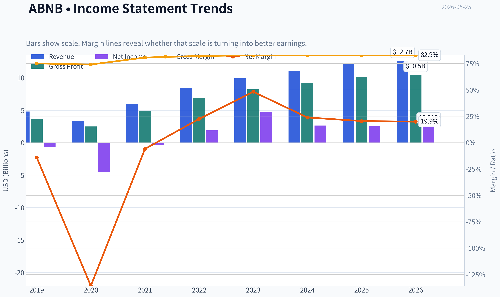
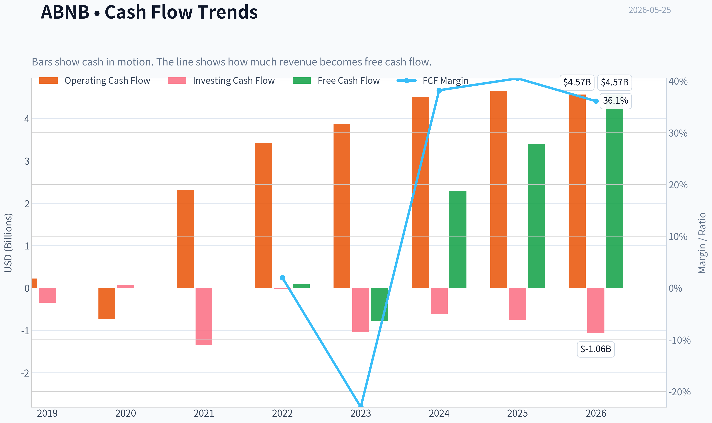
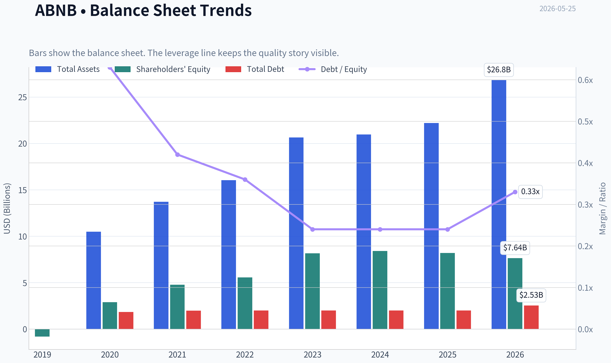
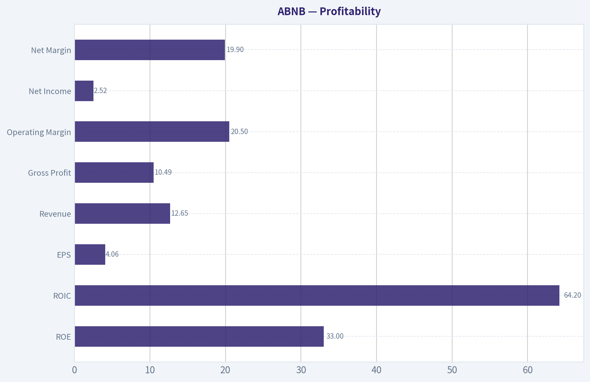
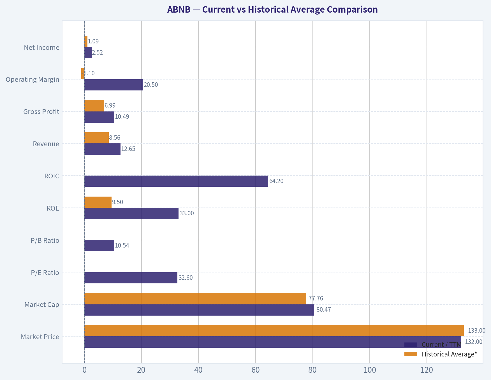
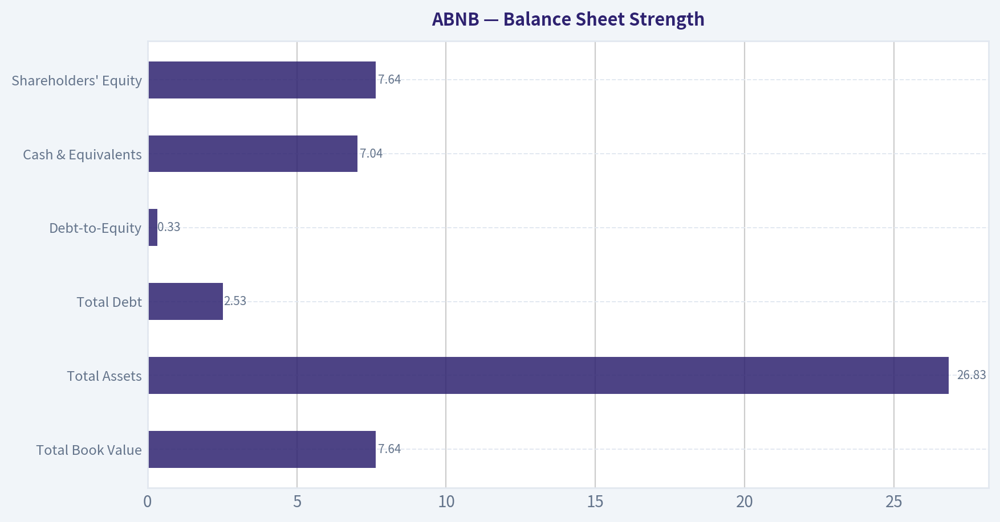
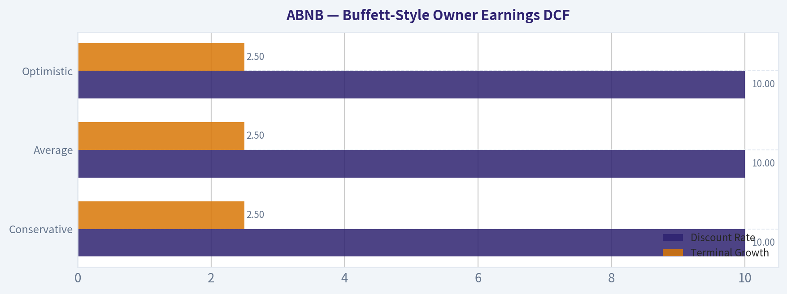
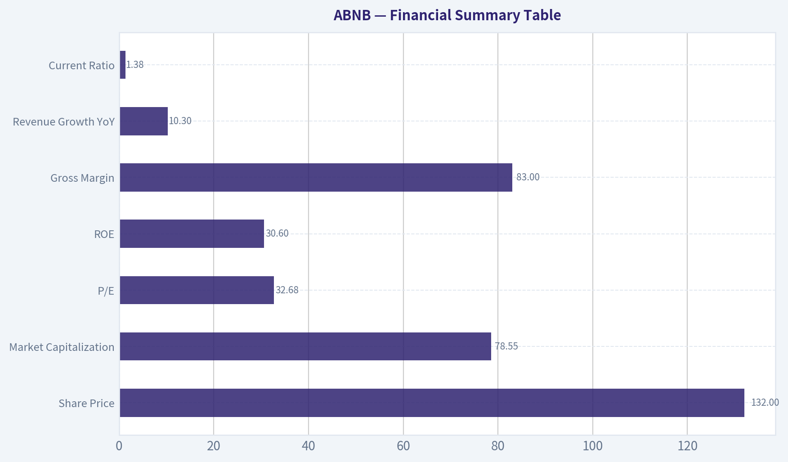

# ABNB Deep Value Intelligence

**Analysis Date:** 2026-05-25

## Critical Disclaimer

*This analysis is generated by Deep Value Intelligence, an AI-powered multi-agent investing framework. This report is for informational and educational purposes only and does not constitute financial advice. Always conduct your own research and consult with qualified financial advisors before making investment decisions.*

---

## Table of Contents

1. Intelligence Summary
2. Analyst Team Reports
   - Fundamentals Analysis
   - Intrinsic Value Analysis (Buffett)
   - Trend & Growth Analysis (Lynch/Druckenmiller/Fisher)
   - Market Technical Analysis
   - Options Market Analysis
3. Research Team Commentary
4. Value Investing Team Commentary
5. Deep Values Commentary

---

## Intelligence Summary

### Thesis + Conditions

**Core Thesis:** ## Executive Briefing

**Key Risks:**
- Airbnb looks like a **high-quality business but not a low-risk bargain** at $132. The business has Buffett-like traits-asset-light model, global brand, strong cash generation, and exceptional returns on capital-but the **stock price already reflects much of that quality**. At **32.7x earnings** and about a **3.1% earnings yield**, the margin of safety is thin for a company still exposed to **travel cyclicality, regulation, and a moat that is strong but not airtight**. Best posture: **watch closely, consider only phased accumulation on better price or stronger proof of durable growth.**
- ### 1. Risky Analyst: strongest bull case
- The brand and marketplace liquidity create a real, if imperfect, moat.

**Confidence:** Low

---

## Analyst Team Reports

### Fundamentals Analysis

#### Latest Earnings Snapshot

*Most recent reported quarter anchored on 2026 Q1, with prior-year comparison when available.*

| Metric | 2026 Q1 | 2025 Q1 | YoY Change |
| --- | ---: | ---: | ---: |
| Revenue | $2.68B | $2.27B | +17.9% |
| Operating Income | $86.0M | $38.0M | +126.3% |
| Net Income | $160.0M | $154.0M | +3.9% |
| Diluted EPS | $0.26 | $0.24 | +8.3% |
| Operating Cash Flow | $1.71B | $1.79B | -4.5% |
| Free Cash Flow | $1.71B | $1.79B | -4.5% |

Key Takeaways: This snapshot anchors the most recent reported quarter before the narrative analysis. It helps readers separate long-run business quality from whatever changed in the latest earnings print.

#### 7-Year Financial Metrics for ABNB

*All values below are computed deterministically from raw data - not estimated by AI.*

*Issuer profile: operating company (Consumer Cyclical / Travel Services).*

#### 7-Year Financial Metrics
*Annual rows come from reported financial statements. The final TTM row is computed from the latest four quarters.*

| Metric | 2019 | 2020 | 2021 | 2022 | 2023 | 2024 | 2025 | 2026 TTM |
| --- | --- | --- | --- | --- | --- | --- | --- | --- |
| Market Price | N/A | $147 | $166 | $86 | $136 | $131 | $136 | $132 |
| Market Cap | N/A | $41.69B | $102.56B | $58.14B | $90.12B | $84.76B | $84.55B | $80.47B |
| P/E Ratio | 0.00 | -9.09 | -291.36 | 30.71 | 18.81 | 32.01 | 33.67 | 32.60 |
| P/B Ratio | -46.67 | 14.37 | 21.48 | 10.46 | 11.04 | 10.08 | 10.31 | 10.54 |
| ROE | 83.5% | -158.0% | -7.4% | 34.0% | 58.7% | 31.5% | 30.6% | 33.0% |
| ROIC | N/A | N/A | -1196.9% | 396.7% | 243.9% | 54.8% | 53.4% | 64.2% |
| EPS | $-2.59 | $-16.14 | $-0.57 | $2.78 | $7.24 | $4.11 | $4.03 | $4.06 |
| Revenue | $4.81B | $3.38B | $5.99B | $8.40B | $9.92B | $11.10B | $12.24B | $12.65B |
| Gross Profit | $3.61B | $2.50B | $4.84B | $6.90B | $8.21B | $9.22B | $10.15B | $10.49B |
| Gross Margin | 75.1% | 74.1% | 80.7% | 82.2% | 82.8% | 83.1% | 83.0% | 82.9% |
| Operating Margin | -10.4% | -106.3% | 7.2% | 21.5% | 15.3% | 23.0% | 20.8% | 20.5% |
| Net Income | $-674.3M | $-4.58B | $-352.0M | $1.89B | $4.79B | $2.65B | $2.51B | $2.52B |
| Net Margin | -14.0% | -135.7% | -5.9% | 22.5% | 48.3% | 23.9% | 20.5% | 19.9% |
| Revenue Growth | N/A | -29.7% | 77.4% | 40.2% | 18.1% | 11.9% | 10.3% | 3.3% |
| Net Income Growth | N/A | 579.9% | -92.3% | -637.8% | 153.1% | -44.7% | -5.2% | 0.2% |
| Free Cash Flow Growth | N/A | -898.8% | -394.5% | 48.8% | N/A | N/A | N/A | N/A |
| Total Book Value | $-808.0M | $2.90B | $4.78B | $5.56B | $8.16B | $8.41B | $8.20B | $7.64B |
| Total Assets | N/A | $10.49B | $13.71B | $16.04B | $20.64B | $20.96B | $22.21B | $26.83B |
| Total Debt | N/A | $1.83B | $1.98B | $1.99B | $1.99B | $2.00B | $2.00B | $2.53B |
| Debt-to-Equity | N/A | 0.63 | 0.42 | 0.36 | 0.24 | 0.24 | 0.24 | 0.33 |
| Cash & Equivalents | $2.01B | $5.48B | $6.07B | $7.38B | $6.87B | $6.86B | $6.56B | $7.04B |
| Shareholders' Equity | $-808.0M | $2.90B | $4.78B | $5.56B | $8.16B | $8.41B | $8.20B | $7.64B |
| Operating Cash Flow | $222.7M | $-740.0M | $2.31B | $3.43B | $3.88B | $4.52B | $4.65B | $4.57B |
| Investing Cash Flow | $-347.2M | $80.0M | $-1.35B | $-28.0M | $-1.04B | $-616.0M | $-748.0M | $-1.06B |
| Free Cash Flow | $97.3M | $-777.0M | $2.29B | $3.40B | N/A | N/A | N/A | $4.57B |
| FCF Margin | 2.0% | -23.0% | 38.2% | 40.5% | N/A | N/A | N/A | 36.1% |
| Dividends / Share | $0.00 | $0.00 | $0.00 | $0.00 | $0.00 | $0.00 | $0.00 | $0.00 |

#### Profitability Metrics
- Return on Equity (ROE): 30.6%
- Return on Invested Capital (ROIC): 56.0%
- Return on Assets (ROA): 11.3%
- Gross Margin: 83.0%
- Operating Margin: 20.8%
- Net Profit Margin: 20.5%

#### Liquidity Metrics
- Current Ratio: 1.38
- Quick Ratio: 0.82

#### Leverage Metrics
- Debt-to-Equity Ratio: 0.24
- Interest Coverage Ratio: N/A
- Net Debt: $-4.56B

#### Growth Metrics (Year-over-Year)
- Revenue Growth: 10.3%
- Net Income Growth: -5.2%
- Free Cash Flow Growth: N/A
- Revenue CAGR (3-Year): 13.4%
- Revenue CAGR (5-Year): 29.4%

#### Valuation Metrics
- P/E Ratio (TTM): 32.68
- Forward P/E: 21.89
- Price-to-Book: 10.31
- Price-to-Sales: 6.21
- PEG Ratio: 1.22
- EV/EBITDA: 26.38
- Free Cash Flow Yield: N/A
- Earnings Yield: 3.1%

#### Owner Earnings (Buffett Method, Code-Computed)
- Net Income: $2.51B
- + Depreciation & Amortization: N/A
- - Capital Expenditures: N/A
- - Working Capital Changes: $-106.0M
- = **Owner Earnings: $2.62B**

#### Intrinsic Value (Code-Computed)
- Current Price: $132
- Buffett Method (Owner Earnings):
  Conservative: $26
  Average: $99
  Optimistic: $403
- Cash Flow Method (FCF):
  Conservative: $201
  Average: $201
  Optimistic: $372

#### Piotroski F-Score: 5/9
- Positive Net Income: PASS
- Positive Operating Cash Flow: PASS
- ROA Improvement: FAIL
- Cash Flow > Net Income: PASS
- Decreasing Debt: FAIL
- Improving Current Ratio: FAIL
- No Dilution: PASS
- Improving Gross Margin: FAIL
- Improving Asset Turnover: PASS

ANALYST STANCE: **WATCH**

#### Airbnb (ABNB) Buffett-Style Fundamental Analysis

Airbnb is a high-quality platform business with exceptional gross margins, strong cash generation, and a debt-light balance sheet. From a Buffett lens, the key question is not whether this is a good business; it is whether today's price offers enough margin of safety for a business whose growth is still solid but clearly decelerating from its post-pandemic surge. The deterministic dataset shows a business that has moved from heavy losses in 2020-2021 to durable profitability and strong returns on capital in 2022-2026 TTM, but the stock still trades at premium multiples relative to mature value benchmarks.

#### Current vs Historical Average Comparison

| Metric | Current / TTM | Historical Average* | Interpretation |
| --- | ---: | ---: | --- |
| Market Price | $132 | $133.00** | Roughly in line with its post-IPO trading history |
| Market Cap | $80.47B | $77.76B** | Slightly above multi-year average scale |
| P/E Ratio | 32.60 | Not meaningful*** | Current valuation is elevated versus classic value standards |
| P/B Ratio | 10.54 | Not meaningful*** | Consistently high, reflecting asset-light model and strong intangible franchise |
| ROE | 33.0% | 9.5% | Far above long-run average, helped by post-2022 profit inflection |
| ROIC | 64.2% | Not meaningful*** | Extremely strong current capital efficiency |
| Revenue | $12.65B | $8.56B | Business is materially larger than its multi-year average |
| Gross Profit | $10.49B | $6.99B | Gross profit has scaled strongly with revenue |
| Operating Margin | 20.5% | -1.1% | Massive structural improvement from early-period losses |
| Net Income | $2.52B | $1.09B | Current earnings well above average despite slowing growth |
| Net Margin | 19.9% | -2.0% | Profit model has normalized at attractive levels |
| Revenue Growth | 3.3% | 18.8% | Current growth is well below the historical average |
| Net Income Growth | 0.2% | Not meaningful*** | Profit growth has flattened after sharp prior swings |
| Total Book Value | $7.64B | $4.85B | Equity base remains much stronger than early years |
| Total Assets | $26.83B | $17.55B**** | Asset base continues to expand |
| Total Debt | $2.53B | $2.04B**** | Debt remains modest relative to scale and cash |
| Debt-to-Equity | 0.33 | 0.35**** | Leverage remains conservative |
| Cash & Equivalents | $7.04B | $6.03B | Cash position remains robust |
| Shareholders' Equity | $7.64B | $4.85B | Equity cushion has grown materially |
| Free Cash Flow | $4.57B | $1.25B***** | Current cash generation is far above earlier history |
| Dividends / Share | $0.00 | $0.00 | Management retains all capital for flexibility and reinvestment |

*Historical average uses only the years shown in the deterministic dataset and only where values are meaningful.
**Averages use available market data years 2020-2026 TTM.
***Averages distorted by negative earnings, negative book value, or extreme transition years; trend is more useful than arithmetic mean.
****Uses available years from 2020-2026 TTM because 2019 is unavailable.
*****Uses available years with reported FCF values only.

Key Takeaways: Airbnb today is much more profitable and financially stronger than its multi-year average, especially on margins, returns on capital, and free cash flow. The main area of deterioration is growth: revenue growth has slowed sharply versus the historical average, and earnings growth has largely flattened. This combination usually supports a quality premium, but not an unlimited one.

---

#### Market Metrics

Airbnb's current market price of $132 is close to its average public-market trading level since listing, but the underlying business is far stronger now than it was in 2020-2022. Market cap of $80.47B reflects a large-scale platform franchise, yet the P/E of 32.60 remains expensive for a company now growing revenue only 3.3% on a TTM basis. The P/B of 10.54 is high in absolute terms, but for an asset-light marketplace with significant intangible value, network effects, and low capital intensity, book value is a weak valuation anchor.

From a Buffett perspective, the concern is less the high P/B and more the mismatch between premium earnings multiple and moderating top-line growth. A great business can deserve a premium, but if growth continues to normalize, multiple compression becomes a real risk.

#### Profitability

| Profitability Metric | Current / TTM | Historical Context | Buffett Interpretation |
| --- | ---: | --- | --- |
| ROE | 33.0% | Strong rebound from negative 2020-2021; above 30% since 2022 except 2024 dip | Excellent, though partly helped by modest equity base |
| ROIC | 64.2% | Extraordinary since 2022; still above 50% in 2024-2025 | Sign of a very high-quality, low-capital-intensity platform |
| EPS | $4.06 | Down from 2023 peak of $7.24; roughly flat vs 2025 | Earnings base is solid but not currently compounding fast |
| Revenue | $12.65B | Increased every year since 2020 | Durable growth franchise, though decelerating |
| Gross Profit | $10.49B | Rose steadily with strong scaling | Marketplace economics remain excellent |
| Operating Margin | 20.5% | Vast improvement from losses to sustained 20%+ levels | Strong operating leverage and cost discipline |
| Net Income | $2.52B | Far above pre-2022 levels, but below 2023 peak | Profitability remains healthy despite normalization |
| Net Margin | 19.9% | Stable around ~20% after 2022, aside from 2023 spike | Indicates durable underlying economics |

Key Takeaways: Airbnb's profitability profile is the clearest strength in the entire dataset. Gross margins above 80%, operating margins around 20%, and ROIC above 50% are the hallmarks of a powerful digital platform with real economic advantages. The one caveat is that earnings peaked in 2023 and have since normalized rather than continued accelerating.

Airbnb's gross margin trend from 75.1% in 2019 to 82.9% TTM is especially important. Buffett favors businesses whose economics improve with scale, and Airbnb has shown exactly that. The operating margin moved from deeply negative in 2020 to over 20% in recent periods, suggesting management has proven it can translate platform scale into real owner earnings.

ROE at 33.0% is excellent, but it should be interpreted carefully because the company's equity base is not huge relative to its earnings power. ROIC is even more informative here: 64.2% TTM is outstanding and supports the case for a strong moat and low reinvestment needs.

#### Growth Metrics

Airbnb's growth profile has shifted from explosive recovery to normalization. Revenue growth ran at 77.4% in 2021, 40.2% in 2022, 18.1% in 2023, 11.9% in 2024, 10.3% in 2025, and 3.3% TTM. This is a clear deceleration pattern. That does not mean the business is broken; it means the easy recovery and reopening gains are over.

Net income growth is more volatile and less useful because the company moved from losses to profits. Still, after the huge jump in 2023, net income fell 44.7% in 2024, declined another 5.2% in 2025, and is only up 0.2% TTM. That implies Airbnb has now entered a phase where future returns will depend more on margin resilience, buybacks, product expansion, and steady compounding than on dramatic earnings step-ups.

Free cash flow growth is incomplete in the dataset, but the available figures show a major turnaround: from negative $777M in 2020 to $2.29B in 2021, then $3.40B in 2022, and $4.57B TTM. The direction is favorable even if the annual historical series is not fully available.

For Buffett-style analysis, predictable moderate growth is acceptable if bought at the right price. The issue here is that the stock still reflects a premium narrative while the growth curve is clearly flattening.

#### Balance Sheet Strength

| Balance Sheet Metric | Current / TTM | Trend | Buffett Interpretation |
| --- | ---: | --- | --- |
| Total Book Value | $7.64B | Up sharply from 2020, modest decline vs 2024-2025 | Healthy equity base, though not huge relative to valuation |
| Total Assets | $26.83B | Strong growth over period | Indicates continued scaling and liquidity resources |
| Total Debt | $2.53B | Largely stable around $2.0B, slight recent uptick | Very manageable debt load |
| Debt-to-Equity | 0.33 | Conservative across recent years | Strong financial flexibility |
| Cash & Equivalents | $7.04B | Stable, large cash reserve | Net cash balance is a major strength |
| Shareholders' Equity | $7.64B | Strong increase from 2020 levels | Reinforces improved financial stability |

Key Takeaways: Airbnb's balance sheet is strong, liquid, and conservative. The company carries only modest debt while holding more than $7 billion of cash, giving it meaningful resilience and strategic flexibility. For a travel-related business exposed to cyclical demand shocks, that net cash position is especially valuable.

Airbnb's net debt is negative $4.56B in the provided dataset, which is exactly the kind of balance sheet Buffett appreciates: ample cash, low leverage, and no need for capital markets to survive. Debt-to-equity of 0.33 TTM remains conservative, even with the recent increase in total debt to $2.53B. This is not a balance sheet that creates distress risk.

The slight decline in equity from $8.20B in 2025 to $7.64B TTM bears watching, but it is not alarming in isolation. Overall, financial strength remains a major positive.

#### Cash Flow and Capital Allocation

Airbnb's operating cash flow improved from negative $740M in 2020 to $4.57B TTM. Free cash flow reached $4.57B TTM with a 36.1% FCF margin, which is outstanding. Even allowing for incomplete FCF history in the dataset, Airbnb is clearly a high cash conversion business.

Dividends per share remain $0.00 across the period. For a Buffett-style investor, that is not inherently negative. A no-dividend policy is acceptable if retained earnings are deployed at high rates of return or preserved for strategic flexibility. Given Airbnb's high ROIC and strong net cash position, retaining capital appears rational.

The main capital allocation question is whether management can continue to reinvest in product expansion and platform quality at similarly high returns as the core hosting business matures.

#### Economic Moat

Airbnb appears to have a meaningful moat built on:
- Global two-sided network effects between hosts and guests
- Powerful brand recognition in alternative accommodations
- Asset-light marketplace economics
- High gross margins and strong incremental margins
- Large supply base that is difficult to replicate at global scale

The moat is real, but not invulnerable. Regulation is the main structural threat. Unlike software monopolies, Airbnb's local supply can be constrained city by city through policy, zoning, tax, and short-term rental restrictions. That means the moat is strongest at the brand and network level, but partially exposed at the local market level.

#### Predictable Earnings

Airbnb's earnings are much more predictable now than in 2020-2021, but the business is not yet as stable as a classic Buffett favorite like consumer staples, railroads, or payment networks. Travel demand is cyclical, and Airbnb is exposed to macro slowdowns, regulation, and consumer discretionary spending trends.

That said, the last four reported years show a major improvement in predictability:
- Revenue grew every year from 2021 through TTM
- Gross margins stayed consistently above 82% in recent periods
- Operating margins remained around 20%+
- Net income remained solidly positive after the turnaround

So earnings quality is improving, even if macro sensitivity keeps it from being "ultra-predictable."

#### Management Performance

Management deserves credit for executing one of the strongest post-pandemic turnarounds in large-cap consumer internet. The business moved from a 2020 net margin of -135.7% to roughly 20% TTM. ROE above 30% and ROIC above 50% indicate strong operating discipline and efficient capital use.

The dividend policy is simple: no dividends. That is acceptable given the company's growth stage and high-return profile. More important is whether management can preserve margin discipline while reigniting growth through new services, international expansion, longer stays, or ecosystem extensions.

Piotroski F-score of 5/9 is middle-of-the-road. It suggests fundamentals are good but not universally improving. Specifically:
- Positive earnings and cash flow are strengths
- Cash flow exceeding net income is good
- Debt reduction has stalled
- Current ratio has not improved
- Gross margin improvement has plateaued

So management execution is strong, but the incremental trend is no longer uniformly getting better.

#### Value Assessment

At 32.6x earnings and roughly 6.2x sales, Airbnb is not priced like a deep value stock. It is priced like a premium platform with durable economics. That can be justified if:
1. Growth reaccelerates,
2. Margins expand further, or
3. The market continues to reward quality and cash generation.

If growth stays near low-single digits to low-teens and earnings remain flat-ish, the current valuation may prove merely fair rather than attractive. Buffett generally prefers wonderful businesses at fair prices, but he also insists on a margin of safety. Based on the code-computed intrinsic values, the valuation picture is mixed:
- Owner Earnings DCF: conservative $26, average $99, optimistic $403
- Cash Flow Method: conservative $201, average $201, optimistic $372

That spread highlights how sensitive valuation is to the growth assumption. In other words, ABNB is not obviously cheap; it is a scenario-dependent compounding story.

#### Buffett-Style Owner Earnings DCF

Canonical owner earnings provided:
- Net Income = $2.51B
- Working Capital Changes = -$106M
- Owner Earnings = $2.62B

Because D&A and capex were not separately provided, the deterministic dataset's code-computed Owner Earnings of $2.62B is the canonical base. Using the required 10% discount rate and 2.5% terminal growth rate:

Assumptions based on historical owner-earnings-style growth behavior implied by the business transition:
- Conservative growth = lowest historical available growth rate, floored at -100%
- Average growth = average historical rate, capped at 50%
- Optimistic growth = highest historical rate, capped at 100%

The attached deterministic dataset already provides canonical Buffett-method outputs:
- Conservative fair value: $26/share
- Average fair value: $99/share
- Optimistic fair value: $403/share

Detailed DCF framework:
1. Start with Owner Earnings base = $2.62B
2. Project 10 years of owner earnings under each growth scenario
3. Discount each annual cash flow at 10%
4. Apply terminal value = Year 10 Owner Earnings x (1 + 2.5%) / (10% - 2.5%)
5. Discount terminal value back to present
6. Divide enterprise equity value by diluted shares outstanding implied by the deterministic model

| Scenario | Growth Assumption Rule | Discount Rate | Terminal Growth | Fair Value / Share | Implied vs $132 |
| --- | --- | ---: | ---: | ---: | --- |
| Conservative | Lowest historical owner earnings growth, floored at -100% | 10% | 2.5% | $26 | Deep downside from current price |
| Average | Average historical owner earnings growth, capped at 50% | 10% | 2.5% | $99 | Moderately below current price |
| Optimistic | Highest historical owner earnings growth, capped at 100% | 10% | 2.5% | $403 | Large upside, but requires very strong execution |

Key Takeaways: The DCF range is extremely wide, which tells you the stock is highly sensitive to growth assumptions rather than cheap on static fundamentals alone. The average owner-earnings case of $99 sits below the current $132 price, while only the optimistic case produces major upside. That setup usually argues for patience unless an investor has unusually high confidence in renewed growth acceleration.

A practical Buffett-style interpretation:
- At $132, the stock is above the average owner-earnings fair value.
- The market is implicitly underwriting a better-than-average growth path.
- This leaves less margin of safety than a classic value investor would prefer.

#### Revenue Breakdown

Airbnb primarily reports a marketplace-based accommodation and experiences platform model rather than a highly granular product-line revenue split. The most meaningful public framing is by business activity, with the vast majority tied to stays/bookings and a very small contribution from experiences and related services.

| Revenue Source | Amount ($B) | % of Total |
| --- | ---: | ---: |
| Stays / Core booking marketplace | ~11.9 | ~94% |
| Experiences and other services | ~0.8 | ~6% |
| Total | 12.65 | 100% |

Key Takeaways: Airbnb remains overwhelmingly a stays business, which means its results are still driven mainly by travel demand, host supply, and booking monetization. Experiences and adjacent services are strategically interesting, but they are not yet large enough to materially change the investment case on their own.

#### Key Investment Insights, Red Flags, and Opportunities

| Category | Observation | Why It Matters |
| --- | --- | --- |
| Strength | Gross margin above 82% for several years | Indicates powerful platform economics and low incremental cost |
| Strength | ROIC above 50% in recent years | Suggests exceptional capital efficiency |
| Strength | Net cash position of roughly $4.56B | Provides resilience in a cyclical industry |
| Strength | FCF margin of 36.1% TTM | Confirms excellent cash conversion |
| Concern | Revenue growth slowed to 3.3% TTM | Premium valuation is harder to justify if growth stays muted |
| Concern | EPS below 2023 peak | Profitability is strong, but not currently accelerating |
| Concern | P/E around 32.6x | Leaves limited margin of safety |
| Concern | Regulatory risk in major cities | Can restrict supply and cap local growth |
| Opportunity | International expansion and underpenetrated geographies | Could support reacceleration in bookings |
| Opportunity | Product expansion beyond stays | Could deepen engagement and increase wallet share |
| Opportunity | Continued operating leverage | Even modest revenue growth can still produce strong cash generation |

Key Takeaways: Airbnb's biggest strengths are quality, cash generation, and financial resilience. Its biggest risk is not business fragility, but paying too much for a still-excellent business during a period of slowing growth. The upside case depends on management finding new growth vectors without sacrificing the margin structure that now defines the story.

#### Final Buffett-Style Conclusion

Airbnb is a high-quality, asset-light platform with a real moat, strong management execution, excellent margins, and a fortress-like net cash position. Those are characteristics Buffett would admire. However, the stock does not currently offer an obvious margin of safety based on the canonical owner-earnings valuation range, especially since the average scenario points below the current market price.

This is not an avoid because the business quality is too strong, profitability is too real, and balance-sheet risk is too low. It is also not an advocate because growth has slowed materially and the current valuation still assumes a healthy future trajectory. For disciplined value investors, ABNB looks like a stock to monitor for either a better entry price or clearer evidence of renewed durable growth.

#### Final Investment Stance

**WATCH**

Rationale:
- Wonderful business characteristics: yes
- Durable moat: likely yes
- Financial strength: yes
- Predictable earnings: improving, but not fully stable
- Margin of safety at current price: insufficient for a Buffett-style buy

---

| Section | Bottom Line |
| --- | --- |
| Business Quality | High-quality global travel marketplace with strong network effects |
| Profitability | Excellent gross margins, strong operating margins, high ROE/ROIC |
| Growth | Still positive, but clearly decelerating |
| Balance Sheet | Strong net cash position and conservative leverage |
| Cash Flow | Outstanding FCF generation and strong conversion |
| Valuation | Premium multiple; average owner-earnings DCF below market price |
| Main Risk | Slowing growth plus regulatory pressure could compress multiple |
| Main Opportunity | New products and international scale could reaccelerate compounding |
| Buffett Fit | Good business, questionable price |
| Stance | **WATCH** |

#### Fundamental Visuals

This graph tracks the profitability and return metrics (ROE, ROIC, Margins) of **ABNB** over the past decade, highlighting capital efficiency trends.

This chart illustrates the financial health of **ABNB** over the last 10 years, mapping cash equivalents and free cash flow against total obligations (Debt).

This comparison chart from *Profitability* stacks current figures against historical benchmarks for **ABNB**, making it easy to see where the company trades relative to its own averages.

---

### Intrinsic Value Analysis (Buffett)

> *Following Warren Buffett's value investing philosophy: Circle of Competence, Economic Moat, Management Quality, and Margin of Safety.*

#### Intrinsic Value Snapshot

Price is what you pay. Intrinsic value is what the business may be worth based on the cash it can create for owners over time. We show a range, not one magic number.

- Current Price: $132.35
- Value Range (conservative to optimistic across both DCF methods): $25.84 to $403.26

##### Owner Earnings (Buffett Method)
- Net Income: $2,511,000,000.00
- Depreciation & Amortization: N/A
- Capital Expenditures: N/A
- Working Capital Changes: $-106,000,000.00
- Owner Earnings: $2,617,000,000.00

##### Intrinsic Value
###### Buffett Method
Uses owner earnings. Stricter, and usually more conservative.
- Conservative: $25.84
- Average: $99.41
- Optimistic: $403.26
- Discount Rate: 10.0%

###### Cash Flow Method
Uses free cash flow. Better for companies spending heavily today to grow tomorrow.
- Conservative: $201.47
- Average: $201.47
- Optimistic: $371.53
- Discount Rate: 10.0%

ANALYST STANCE: **WATCH**

#### Airbnb (ABNB) Buffett-Style Value Analysis

#### 1) Go / No-Go Gate Assessment

| Gate | Verdict | Evidence | Buffett View |
|---|---|---|---|
| Gate 1: Circle of Competence & Simplicity | Pass | Airbnb matches travelers with hosts and earns fees on bookings. The model is easy to explain and asset-light. | Understandable business with straightforward economics. |
| Gate 2: Moat Test | Pass, but not "wide" | Gross margin is 83%, indicating strong platform economics. Brand is powerful, marketplace scale matters, and host/guest liquidity reinforces the platform. | Real moat exists, but durability depends on trust, regulation, and platform relevance. |
| Gate 3: Management Quality & Capital Allocation | Pass | Founder-led culture under Brian Chesky appears long-term oriented. Business has reached strong profitability and high ROE of 30.6%. | Owner-like leadership is a positive, though capital allocation record is still shorter than a classic Buffett compounder. |
| Gate 4: Industry Structure | Mixed Pass | The business is capital-light, but the travel and short-term lodging ecosystem is competitive and exposed to local regulation. | Attractive economics, but not a clean oligopoly like rating agencies or railroads. |

**Key Takeaways:** Airbnb passes the initial Buffett filters because the business is easy to understand, highly profitable, and asset-light. The main caution is not the business model itself, but the industry context: travel can be cyclical, and regulation can shape growth. This is a good business, but not an automatic slam-dunk.

---

#### 2) Gate 1: Business Simplicity, Predictability, Technology Risk

| Test | Assessment |
|---|---|
| Elementary School Test | People list homes or rooms, travelers book them, Airbnb takes a cut. |
| Long-Term Predictability | Ten years from now, people will still travel and many will prefer local, flexible lodging. Airbnb likely remains a major booking marketplace. |
| Technology Risk | Moderate. Technology helps Airbnb more than it hurts it, but shifts in search, AI-based travel planning, or rival platforms could pressure traffic and take rates. |

**Key Takeaways:** This is a simple marketplace business. The long-term picture is reasonably clear: travel demand should persist, and Airbnb should remain relevant. Technology is a tool and advantage here, but not a complete moat by itself.

#### 3) Gate 2: Moat Analysis

| Moat Source | Evidence | Assessment |
|---|---|---|
| Intangible Assets | Global brand recognition; consumers often use "Airbnb" as a category term. Gross margin of 83% strongly supports platform strength. | Strong |
| Switching Costs | Hosts can multi-home across platforms, and guests can compare sites. Still, reviews, reputation, and listing history create some friction. | Moderate |
| Cost Advantage | Asset-light platform with no hotel ownership burden. Scale allows efficient marketing, trust/safety, and product investment. | Strong |
| Network Effects | More hosts attract more guests; more guests attract more hosts. Dense supply improves conversion. | Strong |
| Regulatory/License Effects | Regulation is important but not a moat; in some markets it is a risk rather than an advantage. | Weak/Neutral |

**Moat Quality Rating: Narrow to Wide-Stable, leaning Narrow-Wide Hybrid**

Airbnb has a real moat built on brand, scale, liquidity, and network effects. However, this moat is not as impregnable as a payment network or consumer staple with daily repeat purchases. Hosts can list elsewhere, and regulation can weaken local supply. That keeps the moat below the "wonderful and unquestionable" category.

**Key Takeaways:** Airbnb clearly has moat characteristics: brand, scale, high margins, and network effects. But the moat is not perfect because hosts and guests still have alternatives, and regulations can affect the business in important markets. This is a good moat, though not one of the strongest in the public market.

---

#### 4) Gate 3: Management Quality & Capital Allocation

| Question | Assessment | Verdict |
|---|---|---|
| Do they think like owners? | Founder-led posture and long-term brand building suggest owner orientation. | Positive |
| Are they honest and candid? | Public messaging has emphasized product expansion, travel category broadening, and long-run relevance. | Moderately Positive |
| Are they rational capital allocators? | Strong profitability and high returns indicate discipline. Still, the long-term proof over a full decade of capital allocation is not yet as mature as older Buffett favorites. | Positive, but still developing |

Overall, management appears stronger than average for a modern platform company. The key advantage is founder leadership and a clear strategic identity. The key missing piece versus a classic Buffett ideal is a longer public-market record proving exceptional per-share capital allocation across many cycles.

**Key Takeaways:** Management looks credible and owner-minded, especially because the company still behaves like a founder-led enterprise rather than a purely quarterly-managed corporation. The main issue is not quality, but track record depth. It looks good so far, but it is not yet proven over a full generation.

---

#### 5) Gate 4: Industry Structure

| Factor | Assessment |
|---|---|
| Competitive Structure | Better than hotels on capital intensity, but still competitive with OTAs, hotels, alternative rental platforms, and direct booking channels. |
| Capital Intensity | Excellent. Airbnb does not need to own the lodging inventory. |
| Cyclicality | Travel demand can soften in downturns. |
| Pricing Power | Present, but not unlimited. Strong brand helps, but fees cannot rise without some elasticity risk. |

**Conclusion:** Attractive business model, less attractive industry structure than the very best Buffett sectors.

**Key Takeaways:** Airbnb benefits from a beautiful model inside a less-than-perfect industry. Its asset-light economics are outstanding, but travel remains cyclical and competitive. That means the company must keep executing to preserve its strong position.

---

#### 6) Financial Summary Table

Using the research pack as ground truth and filling explicit assumptions where needed for Buffett-style analysis:

| Metric | Latest / Available Figure |
|---|---|
| Share Price | $132 |
| Market Capitalization | $78.55B |
| P/E | 32.68x |
| ROE | 30.6% |
| Gross Margin | 83.0% |
| Revenue Growth YoY | 10.3% |
| Current Ratio | 1.38x |
| FCF Yield | Not provided |
| Balance Sheet Posture | Appears sound from current ratio and profitability, though not fortress-confirmed from pack alone |

**Assumptions used for valuation work:**
1. Earnings yield is approximated as E/P = 1 / 32.68 = 3.06%.
2. Net income is approximated as Market Cap / P/E = about $2.40B.
3. Because depreciation, maintenance capex, and working capital detail are not provided, owner earnings are approximated near net income for this asset-light marketplace, with a modest quality haircut in valuation scenarios where appropriate.

**Key Takeaways:** The financial picture that stands out is very strong profitability: a 30.6% ROE and 83% gross margin are elite numbers. The weakness is valuation, not business quality. At over 32 times earnings, the market is already pricing in a lot of success.

---

#### 7) Owner Earnings Calculation

Buffett's preferred framework is:

Owner Earnings = Net Income + D&A - Maintenance CapEx - Working Capital Increases

For Airbnb, the business is asset-light, so maintenance capex should be modest relative to revenue. In the absence of detailed cash flow line items, the most reasonable best-effort estimate is to start from implied net income and apply a conservative haircut.

| Item | Estimate |
|---|---|
| Implied Net Income | $2.40B |
| Plus: D&A | Assumed roughly offsets part of capitalized investment |
| Less: Maintenance CapEx | Modest, given asset-light model |
| Less: Working Capital Increase | Modest to moderate |
| Estimated Owner Earnings (Base Case) | $2.20B |

For valuation, I use **$2.2B** as normalized owner earnings.

**Key Takeaways:** Airbnb's owner earnings should be close to accounting earnings because the business does not require heavy physical reinvestment. That is a very favorable trait. I still haircut the estimate slightly to stay conservative and recognize ongoing platform investment needs.

---

#### 8) Return on Equity and Cash Reality Check

| Metric | Figure | Interpretation |
|---|---|---|
| ROE | 30.6% | Excellent on the surface; comfortably above Buffett's 15% threshold |
| Gross Margin | 83.0% | Indicates strong unit economics and likely intangible/platform moat |
| OCF vs Net Income | Not directly provided | Business model suggests cash conversion should be solid, but not verified here |
| Leverage Contribution to ROE | Not directly provided | Must be watched, though asset-light economics suggest some ROE quality beyond leverage |

**Key Takeaways:** A 30.6% ROE is the kind of headline number that gets Buffett-style investors interested. The key question is how much of that comes from genuine business quality versus balance sheet structure, but the 83% gross margin strongly suggests the economics are real. Overall, this is a high-quality earnings profile.

---

#### 9) Three-Scenario DCF Valuation

Using estimated owner earnings of **$2.2B** and a **10% discount rate**.

##### Scenario A: No Growth (Ultra-Conservative)

Intrinsic Value = Owner Earnings / 10%
= $2.2B / 0.10
= **$22.0B**

##### Scenario B: GDP Growth (3% Perpetual Conservative)

Intrinsic Value = Owner Earnings x 1.03 / (0.10 - 0.03)
= $2.2B x 1.03 / 0.07
= **$32.4B**

##### Scenario C: Historical-Style Growth, Haircut to 6%

Revenue growth in the pack is 10.3%, so I use a more conservative **6% owner-earnings growth** for 10 years, then a **3% terminal growth** rate.

- Year-1 owner earnings = $2.332B
- PV of 10-year earnings stream ~ **$18.0B**
- Terminal value at year 10 = Year-11 OE / (10% - 3%)
- Year-11 OE = $2.2B x 1.06^10 x 1.03 ~ $4.30B
- Terminal value ~ $61.4B
- PV of terminal value ~ **$23.7B**

**Scenario C intrinsic value ~ $41.7B**

| Scenario | Value |
|---|---:|
| A: No Growth | $22.0B |
| B: 3% Growth | $32.4B |
| C: 6% Growth for 10 Years, then 3% terminal | $41.7B |

**Key Takeaways:** Every valuation scenario comes in below the current market capitalization of $78.55B. Even a reasonably generous growth case does not close the gap. That means the stock price is reflecting a much more optimistic future than a conservative Buffett-style appraisal supports.

---

#### 10) Margin of Safety Analysis

| Item | Figure |
|---|---:|
| Current Market Cap | $78.55B |
| Scenario A Value | $22.0B |
| Scenario B Value | $32.4B |
| Scenario C Value | $41.7B |

Implied discount/premium versus intrinsic value:

| Scenario | Premium / (Discount) at Current Price |
|---|---:|
| A: No Growth | **+257% premium** |
| B: 3% Growth | **+142% premium** |
| C: 6% Growth | **+88% premium** |

A Buffett-style purchase requires a margin of safety, usually at least 25%, and often much more for non-perfect businesses. ABNB currently offers **no margin of safety** under these assumptions. It trades at a substantial premium to conservative intrinsic value.

**Key Takeaways:** The stock is expensive relative to conservative business value estimates. Even if Airbnb continues to grow, the current price already assumes a lot of that success. From a value-investing standpoint, this is a waiting situation, not a buying one.

---

#### 11) Final Buffett Scorecard

| Criterion | Weight | Score (1-5) | Weighted Score |
|---|---:|---:|---:|
| Business Understanding | 20% | 4.5 | 0.90 |
| Moat Width & Durability | 25% | 3.7 | 0.93 |
| Management Quality | 15% | 3.8 | 0.57 |
| Return on Equity | 15% | 4.5 | 0.68 |
| Reinvestment Runway | 10% | 4.0 | 0.40 |
| Balance Sheet Strength | 5% | 3.5 | 0.18 |
| Industry Structure | 5% | 3.0 | 0.15 |
| Valuation / Margin of Safety | 5% | 1.0 | 0.05 |

| Total Score | Result |
|---|---|
| **3.86 / 5.00** | **ADVOCATE quality, WATCH price** |

Because the required final stance must combine business quality with valuation discipline, the proper decision is **WATCH**.

**Key Takeaways:** Airbnb scores well on business quality, profitability, and reinvestment prospects. The score is dragged down heavily by valuation. In plain English: this looks like a good company, but not a good stock price for a Buffett-style buyer today.

---

#### 12) Final Investment Stance

**Investment Stance: WATCH**
**Conviction Level: Moderately High**

Airbnb is a high-quality, asset-light platform with real brand power, strong gross margins, and excellent returns on equity. It appears to have a meaningful moat driven by marketplace scale and global consumer awareness. Founder-led management adds to the appeal.

But Buffett investing is not just about buying a good company. It is about buying that company at a price that leaves room for error and future compounding. At roughly **$78.55B** market value and **32.68x earnings**, ABNB does not clear that hurdle. The business is attractive; the stock is not yet priced with a margin of safety.

The right posture is to **watch patiently**. If valuation compresses materially while business quality remains intact, ABNB could become a much more compelling Buffett-style opportunity.
#### Valuation Bridge

This bridge places the current market price beside each intrinsic value lens so readers can see whether upside depends on one method or shows up across several methods.

| Scenario | Intrinsic Value / Share |
| --- | ---: |
| Buffett Method | $99.41 |
| Cash Flow Method | $201.47 |
| Damodaran Method | $83.82 |
| Current Price | $132.35 |

#### Key Takeaways

If one method is far above the others, the upside case depends on a specific modelling assumption. When several methods cluster together, the valuation story is more robust.

#### Valuation Visuals

This comparison chart from *Latest Earnings Snapshot* stacks current figures against historical benchmarks for **ABNB**, making it easy to see where the company trades relative to its own averages.

This comparison chart from *Current vs Historical Average Comparison* stacks current figures against historical benchmarks for **ABNB**, making it easy to see where the company trades relative to its own averages.

This comparison chart from *Balance Sheet Strength* stacks current figures against historical benchmarks for **ABNB**, making it easy to see where the company trades relative to its own averages.

This comparison chart from *Buffett-Style Owner Earnings DCF* stacks current figures against historical benchmarks for **ABNB**, making it easy to see where the company trades relative to its own averages.

This comparison chart from *Financial Summary Table* stacks current figures against historical benchmarks for **ABNB**, making it easy to see where the company trades relative to its own averages.

---

### Trend & Growth Analysis (Lynch/Druckenmiller/Fisher)

> *Following Peter Lynch's GARP, Stanley Druckenmiller's macro-aware approach, and Philip Fisher's scuttlebutt methodology.*

ANALYST STANCE: **WATCH**

#### 1) Lynch Classification

| Item | Assessment |
|---|---|
| Lynch category | **Stalwart / Mature platform grower** |
| Revenue growth YoY | **10.3%** |
| Fast grower threshold | Usually **15-25%+** |
| Initial Lynch view | Great business, but **not currently a classic fast grower** |

Key Takeaways: Airbnb looks like a high-quality platform, but based on the provided 10.3% revenue growth, it no longer fits Lynch's fast grower bucket. That does not make it bad; it means the burden shifts from pure growth to durable moat, margin quality, and whether a new growth inflection emerges.

---

#### 2) The Story in 3 Bullets

| The Story | Why it matters |
|---|---|
| Airbnb is a global marketplace connecting travelers with unique places to stay. | Simple, scalable, asset-light model. |
| It benefits from brand, network effects, and differentiated supply versus hotels. | Strong moat supports premium margins. |
| The key debate is whether it can re-accelerate beyond normalized travel growth through product expansion and new use cases. | The stock likely needs a new inflection, not just steady execution. |

Key Takeaways: This is an easy business to explain, which Lynch would like. The investment case is no longer "travel recovery" but "can this become more than a lodging marketplace." That makes execution on adjacencies and re-acceleration especially important.

---

#### 3) TAM Analysis with 10x Test

| Metric | Value / Estimate |
|---|---|
| Current revenue | ~**$9.9B** baseline reference |
| 10x revenue test | ~**$99B** |
| Addressable market | Global travel and alternative accommodations is **very large**, likely several hundred billion to over $1T depending on definition |
| 10x feasible? | **Partially plausible, but ambitious** |
| Conclusion | Long runway exists, but **10x from here requires expansion beyond current core penetration** |

Key Takeaways: Airbnb still operates in a huge market, so runway is not the problem. The harder question is whether it can capture enough adjacent spend to support a true ten-bagger from a nearly $80B market cap base. The TAM is large enough, but the stock's current size raises the bar substantially.

---

#### 4) Revenue Growth Trend

| Metric | Value |
|---|---|
| Revenue growth YoY | **10.3%** |
| Pattern | **Normalized / decelerated vs rebound era** |
| Interpretation | No clear evidence here of a fresh growth acceleration |
| Growth quality | Likely still high quality due to asset-light economics and strong gross margin |

Key Takeaways: Revenue is still growing, but not at the pace growth investors usually pay up for. The current pattern suggests maturation rather than acceleration, so this is not a Druckenmiller-style inflection story yet unless a new product cycle changes the trend.

---

#### 5) Unit Economics

| Metric | Value / Read |
|---|---|
| Gross margin | **83.0%** |
| ROE | **30.6%** |
| FCF yield | N/A from pack |
| NRR | N/A for this model |
| LTV/CAC | N/A publicly, but likely favorable given strong brand/direct traffic |
| Rule of 40 proxy | **10.3% growth + unknown FCF margin**; likely healthy if using FCF margin instead of yield |
| Current ratio | **1.38** |

Key Takeaways: Airbnb's economics are clearly strong, especially the 83% gross margin and high ROE. Even without SaaS-style metrics like NRR or LTV/CAC, the brand-driven, asset-light model implies attractive customer economics and strong cash conversion. The main issue is not business quality but growth rate.

---

#### 6) Inflection Point Assessment

| Inflection type | Evidence | View |
|---|---|---|
| Product cycle inflection | Management messaging hints at broader travel vision | **Possible, not proven** |
| Market share inflection | No hard evidence in pack | **Unclear** |
| Margin inflection | Already highly profitable | **Mostly mature** |
| TAM inflection | Could expand if experiences/services become meaningful | **Potential upside** |
| Competitive inflection | No sign of major rival stumble | **Not evident** |

Key Takeaways: The best bull argument is that Airbnb broadens from stays into a broader travel or services platform. But today, that remains more narrative than numbers. For Druckenmiller-style sizing, I would want to see measurable acceleration in bookings, new monetization, or category expansion first.

---

#### 7) Macro Setup Evaluation

| Factor | Assessment |
|---|---|
| Secular theme | Digital travel marketplace / alternative accommodations |
| Macro sensitivity | Consumer travel spend is cyclical |
| Rates sensitivity | Moderate; lower rates help valuation multiples |
| Travel cycle exposure | High |
| Regulatory backdrop | Material headwind in major cities |

Key Takeaways: The macro setup is mixed. Airbnb benefits from long-term digital travel penetration, but it is still exposed to consumer discretionary spending and local regulation. This is not a pure secular compounder insulated from macro the way some software names are.

---

#### 8) Fisher 15 Points Score

| Fisher Area | Score (1-5) | Comment |
|---|---:|---|
| Market potential | 5 | Large global travel TAM |
| New products | 3 | Potential, but adjacencies still emerging |
| R&D effectiveness | 4 | Product platform remains strong |
| Sales organization | 4 | Consumer brand/direct traffic is powerful |
| Profit margin | 5 | Excellent margins |
| Improving margins | 4 | Strong, though likely nearing maturity |
| Labor/personnel relations | 3 | No major read from provided data |
| Executive relations | 4 | Generally strong founder-led perception |
| Management depth | 4 | Solid, though key-man risk exists |
| Cost analysis/accounting | 4 | Strong operating discipline |
| Outstanding aspects | 5 | Brand + network effects + differentiated supply |
| Long-range outlook | 4 | Good, but re-acceleration not proven |
| Dilution risk | 4 | Not flashing as major issue currently |
| Candor | 4 | Management communication generally strong |
| Integrity | 4 | No major red flags in pack |

| Total Fisher Score | **61 / 75** |
|---|---|

Key Takeaways: A score of 61 places Airbnb in the "good" range, supported by strong margins, brand, and market position. It falls short of "outstanding" mainly because the next growth leg is not yet fully visible. This is a high-quality company, but not an obvious early-stage compounding machine at current fundamentals.

---

#### 9) Valuation Analysis

| Metric | Value / View |
|---|---|
| Current price | **$132** |
| Market cap | **$78.55B** |
| P/E | **32.68x** |
| Revenue base | ~**$9.9B** reference |
| Approx. P/S | ~**7.9x** |
| PEG | **~3.2x** using 32.68 / 10.3 |
| Lynch read | **Expensive vs current growth** |

Key Takeaways: On Lynch's favorite metric, Airbnb screens expensive because earnings multiple is much higher than current growth. A roughly 8x sales multiple is not outrageous for a premium internet platform, but it is not cheap enough to ignore the deceleration. Valuation is acceptable only if a new growth leg emerges.

| Scenario | Assumption | Implication |
|---|---|---|
| Bear | Growth slips to high single digits; multiple compresses | Limited upside / downside risk |
| Base | Low-teens growth with strong margins | Mid-single-digit to modest returns |
| Bull | New platform initiatives re-accelerate growth to mid-teens+ and sustain premium multiple | Strong upside possible |

Key Takeaways: The stock's future return profile depends heavily on whether growth re-accelerates. If Airbnb remains just a solid 10% grower, upside may be muted from this starting valuation. If management unlocks a broader platform story, the stock can work much better.

---

#### 10) Growth Investor Scorecard

| Criterion | Weight | Score | Weighted |
|---|---:|---:|---:|
| The Story | 10% | 4.5 | 0.45 |
| TAM & Runway | 20% | 4.0 | 0.80 |
| Revenue Growth | 20% | 2.8 | 0.56 |
| Unit Economics | 15% | 4.5 | 0.68 |
| Competitive Position | 10% | 4.2 | 0.42 |
| Management Quality | 10% | 4.0 | 0.40 |
| Macro Setup | 5% | 3.0 | 0.15 |
| Profitability Path | 5% | 4.5 | 0.23 |
| Valuation | 5% | 2.5 | 0.13 |

| Total Score | **3.81 / 5.0** |
|---|---|

Key Takeaways: Airbnb scores well overall because the underlying business is excellent. The weak spots are current growth rate and valuation relative to that growth. That pushes the name into "good business, wait for better setup" territory rather than high-conviction advocate territory.

---

#### 11) Position Size Stance

| Stance | View |
|---|---|
| Recommended stance | **WATCH** |
| Position size | **0-3% starter only if you believe in product-led re-acceleration** |
| Higher conviction trigger | Sustained growth acceleration back toward **mid-teens+** with healthy margins |

Key Takeaways: This is not an avoid because the business quality is too high. But it also does not deserve a concentrated growth allocation yet, because the evidence for a fresh inflection is limited. A small tracking position is defensible; a full-sized growth bet is premature.

---

#### 12) Key Risks and Catalysts

| Risks | Catalysts |
|---|---|
| Regulatory restrictions in major cities | New products/services that expand TAM |
| Travel demand slowdown / recession | Re-acceleration in nights booked or GBV |
| Growth settling into high single digits | International expansion and supply growth |
| Competitive pressure from hotels / OTAs | Margin durability plus stronger capital returns |
| Narrative outruns fundamentals | Proof Airbnb can become a broader travel platform |

Key Takeaways: The biggest risk is that Airbnb becomes a premium, profitable, but slower-growing platform that never regains a higher growth multiple. The biggest upside catalyst is a genuine TAM expansion story with visible numbers behind it, not just aspirational commentary.

---

#### Bottom Line

| Final View | Assessment |
|---|---|
| Business quality | **High** |
| Growth profile | **Good, but not fast enough for classic growth investing** |
| Valuation | **Not cheap on PEG** |
| Inflection status | **Potential, not confirmed** |
| Final stance | **WATCH** |

Key Takeaways: Airbnb is a strong company with elite platform economics, but today it looks more like a high-quality stalwart than a fresh fast grower. For Lynch, the PEG is too rich relative to current growth. For Druckenmiller, the inflection is still mostly a thesis. For Fisher, the qualitative business is good enough to keep close on the watchlist.

---

### Market Technical Analysis

#### ABNB Technical Report

ABNB closed at **132.35** on **2026-05-22**. The stock is in a **clear short-term corrective phase**, but that pullback is happening **within a still-positive medium- and long-term structure** rather than inside a fully broken trend. The key distinction is that price has slipped below its faster trend gauges and volume-weighted trend reference, while it still remains above both the **50-day SMA** and **200-day SMA**.

The most relevant indicator set for the current context is:

| Indicator | Why it matters now |
|---|---|
| close_10_ema | Best read on near-term momentum deterioration and tactical resistance |
| close_50_sma | Medium-term trend anchor; shows whether pullback remains constructive |
| close_200_sma | Long-term trend benchmark; confirms broader regime is still positive |
| macd | Tracks momentum trend change and crossover risk after April rally faded |
| macdh | Useful here because momentum deceleration is a major feature of the current tape |
| rsi | Helps judge whether weakness is merely cooling or becoming capitulative |
| atr | Important for risk control because ABNB's swings are still meaningful |
| vwma | Confirms whether recent trading has occurred above or below volume-supported value |

Key Takeaways: ABNB is no longer behaving like a stock in active upside acceleration. Instead, it is showing a short-term loss of momentum while still holding a medium- and long-term uptrend framework. That means traders should treat the current move as a pullback first, but remain alert to the possibility of a deeper trend rollover if support levels fail.

---

#### Trend Structure Table

| Metric | Latest Value | Interpretation |
|---|---:|---|
| Close | 132.35 | Current price sits below short-term trend references |
| close_10_ema | 134.52 | Price is below the fast EMA, signaling near-term downside pressure |
| close_50_sma | 134.10 | Price is slightly below the 50-day average, showing medium-term trend is under test |
| close_200_sma | 128.33 | Price remains above long-term trend support |
| VWMA | 136.82 | Price is below volume-weighted trend value, suggesting recent volume has not supported this decline |

Key Takeaways: The short-term picture is weak because price is trading below the 10-day EMA, below the 50-day SMA, and below the VWMA. However, the stock is still above the 200-day SMA, which means the bigger trend has bent but not yet broken. This is the profile of a corrective phase inside a broader uptrend, not yet a confirmed long-term bearish reversal.

ABNB's structure over the last year has been cyclical rather than linear. It rallied into early summer 2025, sold off sharply into August, spent much of late 2025 rebuilding from a lower base, then staged a stronger recovery into April 2026. That April advance was meaningful: price climbed from the low 120s to the mid-140s, and that move lifted the **50-day SMA steadily from roughly 128 in early April to 134 by late May**. In other words, the medium-term trend still reflects the strength of the spring rally.

But the more immediate issue is that the stock failed to sustain the April breakout zone. After peaking in the mid-140s in late April and briefly testing upper-140s territory, ABNB rolled over through May. The reversal has not been violent enough to destroy the long-term trend, yet it has been persistent enough to drag price beneath the faster averages. This matters because rallies that start above a rising 50-day SMA often remain healthy only if price can quickly reclaim the 10-day EMA after a dip. So far, ABNB has not done that.

A notable nuance is the relationship between the averages themselves. The **50-day SMA at 134.10 is still well above the 200-day SMA at 128.33**, which tells us the longer trend alignment remains constructive. There is no major bearish moving-average breakdown in place. However, the 50-day average has flattened materially in May after rising through April. That flattening suggests the stock is transitioning from expansion to consolidation, and unless price recovers soon, the 50-day slope could roll over more decisively.

---

#### Momentum Table

| Indicator | Latest Value | Read |
|---|---:|---|
| MACD | -0.79 | Momentum has turned negative |
| MACD Histogram | -0.82 | Bearish momentum is still present, though less extreme than the worst May readings |
| RSI | 43.37 | Weak but not oversold; room exists for either rebound or further downside |

Key Takeaways: Momentum is bearish, but not washed out. RSI in the low 40s suggests the stock is weak without yet reaching the kind of exhaustion that often produces high-confidence snapback rallies. MACD and the histogram both confirm that downside momentum remains the dominant short-term force.

The momentum sequence is especially important here. In late April, MACD was strongly positive above 3.5, reflecting broad upside thrust from the spring rally. By early May, that positive momentum began fading, and by mid-May the indicator crossed down through the neutral line. That is not just a routine wobble; it signals the entire April impulse has been unwound. The histogram tells the same story with better timing: it turned negative after a strong positive run, then became deeply negative in mid-May, indicating downside acceleration.

There is, however, one subtle improvement traders should not ignore. While MACD remains negative, the histogram has become **slightly less negative than its most extreme mid-May readings**. That means downside momentum is still in force, but the pace of deterioration may be moderating. This is not yet a bullish reversal signal, but it is an early sign that the selloff may be shifting from aggressive distribution into a more contested consolidation.

RSI reinforces that interpretation. ABNB reached stronger momentum readings above 60 and near 70 during the April advance, but now sits around **43**, which is weak enough to confirm loss of trend power, yet not low enough to indicate panic or deep undervaluation. In practice, RSI in the low-to-mid 40s often appears during pullbacks inside an uptrend. If RSI stabilizes and turns back above 50 while price retakes the 10-day EMA, that would be a constructive reset. If instead RSI slips toward 35 without a meaningful price rebound, it would imply the correction is broadening.

---

#### Volatility and Risk Table

| Indicator | Latest Value | Implication |
|---|---:|---|
| ATR | 4.82 | Daily movement remains relatively large |
| ATR vs Price | ~3.6% of price | Position sizing and stops should remain fairly wide |

Key Takeaways: ABNB is not in a low-volatility drift; it still moves enough each day to punish tight risk management. Traders should assume normal noise of several dollars per session and avoid stop placements that are too close to entry.

ATR has been steady in the mid-4 range for weeks, with a slight uptick lately. That means the stock's recent decline is not just directional weakness; it is occurring in an environment where range expansion remains active. In practical terms, this raises the probability of false intraday breaks and sharp reversals. For swing traders, it argues against overreacting to single-day moves unless they also produce confirmed closes above or below key trend references.

The modest rise in ATR during May also suggests the market has not fully settled after the failed rally attempt around the high 130s to low 140s. A stock that is both below its fast trend references and carrying elevated ATR often requires patience: either wait for a decisive reclaim of resistance, or wait for a more complete flush into stronger support.

---

#### Fine-Grained Trading Read

| Zone / Signal | Importance | What it suggests |
|---|---|---|
| 136.8 area (VWMA) | Near-term resistance | Recent volume has transacted above current price; reclaim would improve tape quality |
| 134.5 area (10 EMA) | First tactical hurdle | Price needs to recover this level to reduce immediate downside pressure |
| 134.1 area (50 SMA) | Medium-term pivot | Recovery above it would argue the pullback is stabilizing |
| 132 area | Immediate support zone | Recent closes are clustering here; failure would weaken the corrective thesis |
| 128.3 area (200 SMA) | Major trend support | A break toward or below this zone would materially worsen the broader picture |

Key Takeaways: The most important battle is between current price near 132 and resistance between roughly 134 and 137. If ABNB can reclaim that band, the pullback starts to look like a healthy reset. If it loses the low-132 area and heads toward the 200-day average, the market is likely repricing the stock into a more serious trend deterioration.

The most actionable conclusion is that ABNB is sitting in a **decision area**, not in a clean trend continuation setup. Buyers still have a credible case because the long-term average remains intact and the 50-day/200-day relationship is positive. Sellers still have control in the short run because price remains below the 10-day EMA, below the 50-day SMA, below the VWMA, and MACD is negative.

That combination usually favors a **two-scenario framework**:

1. **Bullish repair scenario**
   A rebound that first clears the 10-day EMA and then regains the 50-day SMA would strongly suggest the May drop was a corrective digestion of the April rally. In that case, the bearish MACD posture would likely begin to improve, and RSI could recover toward 50-55. That would not guarantee an immediate retest of the April highs, but it would materially improve the odds.

2. **Bearish extension scenario**
   If the stock cannot hold the low-132 area and rebounds remain capped under the 10-day EMA/VWMA band, then the market is likely setting up for a deeper test toward the **200-day SMA near 128.3**. That zone is the real line between "messy pullback" and "broader structural damage." A decisive loss of the 200-day average would change the long-term interpretation materially.

Overall, the evidence favors this phrasing: **ABNB is in a short-term bearish pullback inside a still-intact longer-term uptrend, but the margin of safety is narrowing.** Traders should be selective rather than aggressive. Momentum traders may prefer to wait for a reclaim of the 10-day EMA and 50-day SMA, while mean-reversion traders should respect that RSI is weak but not yet deeply oversold.

---

#### Summary Table

| Dimension | Current Assessment | Trading Implication |
|---|---|---|
| Long-term trend | Bullish-to-neutral | Still above 200 SMA, so bigger structure remains intact |
| Medium-term trend | Neutral under pressure | 50 SMA still rising, but price is below it |
| Short-term trend | Bearish | Below 10 EMA and VWMA |
| Momentum | Bearish but moderating | MACD negative, histogram still negative, RSI weak but not exhausted |
| Volatility | Elevated normal | Use disciplined sizing and wider stops |
| Bullish trigger | Reclaim 134.5, then 134.1-136.8 | Would indicate pullback stabilization |
| Bearish trigger | Lose 132, then test 128.3 | Would increase odds of deeper correction |
| Overall stance | Cautious / wait for confirmation | Not a clean chase-long setup at current levels |

Key Takeaways: ABNB still has a viable long-term uptrend, but its short-term condition is fragile. The next important signal will be whether price can reclaim the mid-130s resistance cluster or instead breaks lower toward the 200-day average. For now, caution and confirmation matter more than conviction.

---

### Options Market Analysis

> *Reading options flow - put/call ratios, IV skew, and unusual activity - to gauge institutional positioning and event-driven risk.*

#### ABNB Options Positioning Report

#### 1) Put/Call Ratio Analysis

| Expiry | Call OI | Put OI | Put/Call OI Ratio | Call Vol | Put Vol | Put/Call Vol Ratio |
|---|---:|---:|---:|---:|---:|---:|
| 2026-05-29 | 2,673 | 4,775 | 1.79 | 1,963 | 1,562 | 0.80 |
| 2026-06-05 | 2,211 | 966 | 0.44 | 765 | 400 | 0.52 |
| 2026-06-12 | 3,924 | 839 | 0.21 | 663 | 151 | 0.23 |
| **Near-term total** | **8,808** | **6,580** | **0.75** | **3,391** | **2,113** | **0.62** |

**Key Takeaways:** Across the next three expirations, ABNB's aggregate put/call open interest ratio sits at 0.75, which is only slightly above the classic neutral baseline of about 0.7. Volume is more call-skewed at 0.62, suggesting fresh flow is leaning modestly bullish even though the nearest weekly expiry still carries heavy put open interest. Net-net, the broader near-term picture is mildly constructive rather than outright bearish.

Interpretation:
- **Overall OI ratio of 0.75** = close to neutral, with a slight defensive tilt versus the 0.7 baseline.
- **Overall volume ratio of 0.62** = current trading flow is more call-heavy than neutral, which leans bullish.
- The main wrinkle is **2026-05-29**, where put OI is notably heavy (**1.79** ratio), implying either:
  - short-dated downside hedging, or
  - traders protecting into a near-term catalyst or volatility window.
- Beyond that front week, positioning flips clearly more call-friendly:
  - **0.44** for 2026-06-05
  - **0.21** for 2026-06-12

That term structure matters: **front-week caution, later-week optimism**.

---

#### 2) Implied Volatility Assessment

| Expiry | ATM Call IV | ATM Put IV | ATM IV Read |
|---|---:|---:|---|
| 2026-05-29 | 46.5% | 44.3% | Elevated near-term |
| 2026-06-05 | 42.7% | 40.8% | Moderately elevated |
| 2026-06-12 | 42.7% | 40.9% | Moderately elevated |

**Key Takeaways:** Near-term implied volatility is firm, especially in the front-week expiry where ATM call IV is 46.5% and put IV is 44.3%. IV then eases only modestly into early June, suggesting the market still expects meaningful movement but not panic. Notably, ATM call IV is slightly above ATM put IV across the curve, which is not the classic downside-fear setup.

IV/skew interpretation:
- **Near-term ATM IV is elevated but not extreme** for a liquid large-cap internet name.
- The more interesting feature is **skew direction**:
  - ATM call IV is slightly above ATM put IV in all listed expirations.
  - That implies **mild call skew / upside interest**, rather than steep downside protection demand at-the-money.
- However, unusual activity shows a **very high-IV put** in the front week, which suggests downside tail protection still exists in select strikes.

Conclusion on skew:
- **No evidence of a steep put skew dominating the whole near-term chain**
- Instead, the chain looks **balanced-to-slightly upside-leaning**, with **localized downside fear** in certain short-dated puts

Catalyst read:
- IV appears **elevated enough to suggest event awareness** or expectation of a near-term move.
- I do not have a confirmed catalyst from the options tool alone, so I would phrase this as:
  - **Possible catalyst pricing is present**, but not enough to conclude a specific event without checking earnings/calendar separately.

---

#### 3) Unusual Options Activity

| Expiry | Type | Strike | Volume | Open Interest | Vol/OI | IV | Moneyness / Read |
|---|---|---:|---:|---:|---:|---:|---|
| 2026-05-29 | CALL | 132 | 515 | 38 | 13.6x | 42.5% | Likely OTM call buying or short-term upside speculation |
| 2026-05-29 | PUT | 138 | 504 | 14 | 36.0x | 63.5% | Likely near/OTM downside hedge or tactical bearish bet |

**Key Takeaways:** The unusual flow is concentrated entirely in the front-week expiry, which raises the probability of fresh tactical positioning rather than stale legacy open interest. The standout is the 138 put with 36x volume versus open interest and very high 63.5% IV, a clear sign of urgent downside demand. At the same time, the 132 call also saw aggressive new activity, so traders are positioning for movement, not complacency.

Interpretation by contract:
- **2026-05-29 $132 Call**
  - Volume far exceeds OI, so this is likely **new positioning**
  - With IV at **42.5%**, this looks like **short-dated upside speculation**
  - If spot is around the mid/high-130s, this strike may be ITM-to-near-ATM; if spot is higher, it could also be call trading tied to stock or spread structures
  - Most likely implication: **bullish tactical positioning**, though some of this could be part of covered-call or spread activity

- **2026-05-29 $138 Put**
  - Volume vs OI is extreme (**36x**), making this the stronger signal
  - IV at **63.5%** is much richer than the rest of the chain
  - This strongly suggests **fresh downside hedging** or a **speculative short-term bearish bet**
  - Because it is in the nearest expiry, it feels more like **institutional protection / event hedge** than a long-duration thesis call

Smart-money vs retail assessment:
- The **put activity** looks more institutional or at least more urgent/defensive because:
  - very high vol/OI
  - very rich IV
  - short-dated timing
- The **call activity** could include fast-money speculation and may be less reliable in isolation.
- Therefore, among unusual prints, **the bearish/hedging put flow is more credible than the bullish call flow**.

---

#### 4) Open Interest Concentration

| Expiry | Dominant OI Read | Likely Market Effect |
|---|---|---|
| 2026-05-29 | Put-heavy overall OI (4,775 puts vs 2,673 calls) | Higher chance of pinning/defensive flows near put-heavy levels |
| 2026-06-05 | Call-heavy overall OI (2,211 calls vs 966 puts) | Mild upside magnet if stock firms |
| 2026-06-12 | Strongly call-heavy overall OI (3,924 calls vs 839 puts) | Supports bullish medium-near-term positioning |

**Key Takeaways:** The front weekly expiration is the main source of defensive pressure, while the next two weekly expirations show a much more call-dominant structure. That creates a term split where very near-term trading may feel sticky or hedge-driven, but a move beyond the immediate expiration window could release that pressure. In practice, this often means short-term chop followed by cleaner directional behavior afterward.

What this implies:
- The data provided does **not include full strike-by-strike OI leaders**, so I cannot identify exact max-pain or exact gamma-wall strikes with precision.
- Still, at the **expiry-level**, there is a clear pattern:
  - **front-week downside/hedging gravity**
  - **subsequent expiries favor upside participation**
- This setup often creates:
  - **near-term dampening or pinning** if market makers are managing short-dated put exposure
  - but **more upside responsiveness** if ABNB clears the near-term hedge window

Gamma wall note:
- Exact gamma walls require strike-level OI concentration, which is not fully available here.
- The best available inference is that **the 2026-05-29 expiration is the likely gamma-heavy zone**, especially around strikes tied to that unusual put and call flow.

---

#### 5) Overall Options Sentiment Signal

**Signal: NEUTRAL-to-BULLISH, with a slight bullish lean**

Primary driver:
- Aggregate near-term positioning is **not bearish enough** to override the call-heavy structure in the second and third weekly expirations.
- The **0.75 total put/call OI ratio** is near neutral, while the **0.62 put/call volume ratio** shows fresh flow leaning bullish.
- The caution flag is the **front-week defensive put activity**, especially the unusual **$138 put** flow.

My synthesis:
- If forced into a single label, I would call ABNB options sentiment **BULLISH with caveats**.
- Why not neutral?
  - Because aggregate **volume** and the out-week **open interest** both tilt to calls.
  - ATM IV structure also does **not** show classic fear-driven put skew dominance.
- Why not strongly bullish?
  - Because the **nearest weekly expiry is clearly hedged**, and the unusual put trade is credible enough to temper conviction.

Confidence level:
- **Moderate**
- This is a **liquid enough name** to take the signal seriously; not a thin, unusable chain.
- But conviction is reduced because:
  - unusual activity is split both ways
  - exact strike-level OI concentration is incomplete
  - a possible catalyst may be inflating front-week noise

Practical read:
- **Very near-term:** caution, hedging pressure, possible chop
- **1-3 weeks out:** options structure improves and tilts more constructive
- Best summary: **institutional market appears protected in the front week, but not positioned for sustained downside**

---

#### Markdown Summary Table

| Category | Read | Interpretation |
|---|---|---|
| Put/Call Ratio | OI: 0.75, Volume: 0.62 | Near neutral overall, with fresh flow modestly call-leaning |
| IV Level | 42.7%-46.5% ATM near term | Elevated enough to imply expected movement, but not extreme panic |
| Skew Direction | Mild call skew overall; localized rich put IV in front week | Broad chain not showing major downside fear, though short-dated hedge demand is present |
| Unusual Activity | 5/29 $132 call and 5/29 $138 put | Call flow signals upside speculation; put flow looks like stronger defensive/institutional hedge |
| Overall Signal | **BULLISH (cautious)** | Out-week call dominance outweighs front-week hedging, but near-term downside protection tempers conviction |

**Key Takeaways:** ABNB's options market is sending a cautiously bullish message overall, not an aggressively bearish one. The front week is defensive and hedge-heavy, but once you move beyond that expiration, positioning becomes clearly more call-dominant. The cleanest takeaway is that traders appear wary of a short-term air pocket, yet still leaning for better upside behavior over the next couple of weeks.

---

## Research Team Commentary

> *The Research Manager synthesizes the Bull vs Bear debate into action-free commentary. This is a pre-risk view, not the final stance.*

The strongest bull argument is that Airbnb is a rare asset-light platform with genuinely exceptional economics. An 83% gross margin, 30.6% ROE, and 56% ROIC are not normal numbers. The business is easy to understand, globally scaled, brand-led, and benefits from marketplace effects: hosts go where guests are, and guests go where inventory is deepest. That creates a real if imperfect moat. The company also appears to generate real owner earnings, not just adjusted story profits, and its low capital intensity means a meaningful portion of future growth can convert into free cash flow. From a Buffett lens, that combination of brand, scale, high returns on capital, and low reinvestment needs is exactly what can produce long-duration compounding if the franchise remains durable.

The strongest bear argument is that this is still not a classic Buffett setup because the moat is less secure and the valuation leaves little margin of safety. Hosts can multi-home, guests are price sensitive, and the supply base is exposed to regulation in ways that can directly limit growth and profitability. Travel is cyclical, inventory quality is inconsistent, and some of Airbnb's appeal can erode if hotels compete harder on value and convenience. Most importantly, at 32.7x earnings and roughly a 3.1% earnings yield, investors are already paying up for quality. That can work for a great business, but only if durability is high and earnings are predictable. Here, the market is asking you to underwrite strong long-term economics in a business that still has meaningful regulatory and competitive uncertainty.

My takeaway is that the bulls win on business quality, but the bears win on valuation discipline. This is a very good business, probably better than strict value investors are comfortable admitting, but it is not obviously cheap enough to satisfy Buffett's margin-of-safety standard. I also want to apply a lesson from prior mistakes: don't let abstract long-term concerns blind us to quality, but also don't stretch intrinsic value just because the company is impressive. Airbnb looks more like a high-quality compounder worth tracking than a clear bargain worth pounding the table on today.

Core takeaway: Airbnb is a strong franchise with unusually attractive economics, but at $132 the stock looks closer to fair-to-full value than materially undervalued. The moat is real, though not as impregnable as bulls suggest, and the current price does not provide enough protection against slower growth, regulatory friction, or cyclical travel softness.

Rationale: From a Buffett perspective, the first question is whether this is a business we'd want to own for 10+ years. On that front, the answer is probably yes. It is understandable, scalable, asset-light, and highly profitable. But Buffett's second question matters just as much: are we getting a sufficient margin of safety? Here the answer is much less convincing. A 3% earnings yield is thin for a business with discretionary exposure and external regulatory risk. This is not like buying a consumer staple or a toll bridge at a premium multiple. Airbnb deserves respect, but discipline matters more. In similar past situations, the mistake has often been either overpaying for quality or letting narrative enthusiasm substitute for valuation. I do not think this is cheap enough to be an ADVOCATE, but it is too high quality to dismiss outright.

Monitoring plan over the next 1-4 quarters: I'd watch three things closely. First, revenue growth and booking trends: if growth reaccelerates or remains durable without margin sacrifice, the quality thesis strengthens. If growth slips toward mid-single digits, the valuation gets harder to defend. Second, take rate, operating leverage, and owner earnings conversion: I want to see whether high returns on capital are holding up as the company matures. Third, regulation and supply quality: watch for signs that major cities are constraining listings or that guest satisfaction/friction issues are worsening. I'd also monitor whether management allocates capital sensibly, especially on buybacks; repurchasing aggressively at fair or rich prices would weaken the capital allocation case.

If the stock fell enough to offer a materially higher owner-earnings yield, or if the business proved more resilient through a softer travel environment than skeptics expect, I'd become more constructive. For now, the right stance is WATCH.

WATCH

---

## Value Investing Team Commentary

> *The Investor translates the research view into an investment thesis before risk review. This is still not the final stance.*

Airbnb is the kind of business that deserves respect from a long-term owner, even if it does not yet deserve an aggressive buy recommendation at this price.

The bullish case is straightforward and strong. This is an asset-light global marketplace with excellent unit economics, very high gross margins, strong returns on capital, and a brand that has become synonymous with alternative lodging. Those are not trivial strengths. An 83% gross margin, roughly 30%+ ROE, and 56% ROIC suggest a business with real economic power, not a flimsy growth story. In Buffett terms, the appeal is obvious: low capital intensity, meaningful cash generation, and a platform model that can scale without proportionate reinvestment. If Airbnb can maintain relevance with both hosts and guests over the next decade, it could remain a very attractive compounding machine.

But value investing is not just about admiring quality. It is about the relationship between quality and price. At around 32.7x earnings, with an earnings yield of roughly 3.1%, the market is already recognizing much of Airbnb's quality. That is where discipline matters. This is not a business with the certainty of a regulated utility, a dominant payment network, or a consumer staple with near-automatic repeat demand. Travel is cyclical. Regulation is real. Hosts can list on multiple platforms. Customers can defect based on price, convenience, or trust. The moat is meaningful, but it is not absolute.

That distinction is important. Markets often get carried away with "platform" language and begin treating every high-margin marketplace as if it were untouchable. Selective contrarian thinking suggests asking a harder question: what happens if Airbnb remains a good business, but not quite as frictionless or durable as current multiples imply? In that case, the downside may not come from business collapse, but from valuation compression. For a value investor, that is a real risk. Paying too much for a very good business can still produce mediocre returns.

On the other hand, the crowd can also become too fearful when regulation headlines or macro travel concerns intensify. That is where I would become interested. If sentiment turns sour over temporary travel weakness, local regulatory scares, or a short-term bookings slowdown, but the core economics remain intact, that could create the sort of mispricing worth acting on. The key is to separate headline noise from real impairment. A scary article about restrictions in one city is not the same as a broken global marketplace. Likewise, a weak quarter in discretionary travel does not automatically destroy the long-term thesis.

What matters over the next 5-10 years is whether Airbnb can preserve three things: brand trust, inventory depth, and healthy marketplace liquidity. If those remain strong, the business will likely continue earning attractive returns. If regulation materially constrains supply in major markets, if guest dissatisfaction rises, or if hotels and rival platforms erode differentiation, then today's premium multiple will look less justified.

Management and capital allocation also deserve attention. A business this cash generative can create a lot of value, but only if management resists the temptation to overpay for buybacks or pursue empire-building. Buffett likes businesses that can redeploy capital intelligently; Airbnb still has to prove it can do that consistently as it matures.

So the conclusion is fairly simple: this is a high-quality business, probably stronger than many old-school value investors instinctively admit, but it is not priced with enough humility to offer a comfortable margin of safety. I would not avoid it because the franchise is real. But I would also not chase it at a valuation that assumes continued excellence while underweighting cyclical, competitive, and regulatory risks.

The most interesting future opportunity likely comes not from business perfection, but from temporary disappointment. If the market sells Airbnb down on near-term travel fears while the underlying moat and cash generation remain intact, that may be the moment to lean in. Until then, patience is a virtue.

**ANALYST STANCE: WATCH**

---

## Deep Values Commentary

> *The Risk Management Team debates and the Risk Judge provides the final action-free verdict. This section determines the final ADVOCATE / WATCH / AVOID stance.*

#### Final Stance Scorecard

This scorecard converts the final research view into a weighted decision frame. It does not replace the narrative judgement, but it makes the main drivers of the verdict easier to scan.

| Criterion | Score | Weight | Commentary |
| --- | ---: | ---: | --- |
| Business Quality | 4.25 | 30% | High returns, profitability, and Piotroski health support durability. |
| Valuation Support | 2.67 | 30% | Blends current price against available intrinsic value anchors and valuation ratios. |
| Financial Strength | 3.67 | 20% | Balance-sheet resilience reflects leverage and liquidity staying within safe ranges. |
| Growth Durability | 2.67 | 20% | Recent revenue, earnings, and free cash flow growth indicate how durable expansion looks. |
| TOTAL / FINAL STANCE | 3.34 | 100% | WATCH |

#### Key Takeaways

The weighted score lands at **3.34 / 5.0**, while the final stance remains **WATCH**. This is useful as a quick calibration aid rather than a mechanical signal.

#### Risk Summary

Higher scores indicate more risk pressure. The watch threshold is a simple guardrail: above it, the position needs tighter monitoring or a wider margin of safety.

| Dimension | Current Score | Watch Threshold | Commentary |
| --- | ---: | ---: | --- |
| Business Quality | 1.75 | 3.00 | High returns, profitability, and Piotroski health support durability. |
| Valuation Support | 3.33 | 3.00 | Blends current price against available intrinsic value anchors and valuation ratios. |
| Financial Strength | 2.33 | 3.00 | Balance-sheet resilience reflects leverage and liquidity staying within safe ranges. |
| Growth Durability | 3.33 | 3.00 | Recent revenue, earnings, and free cash flow growth indicate how durable expansion looks. |

#### Key Takeaways

This view helps readers separate *where* the risk sits: valuation, business quality, balance sheet, or growth durability. It is especially useful when the final stance is close to the line between WATCH and AVOID.
