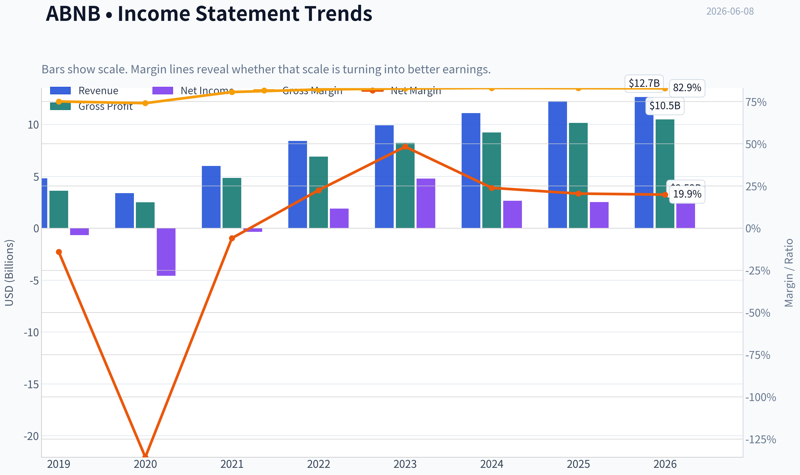
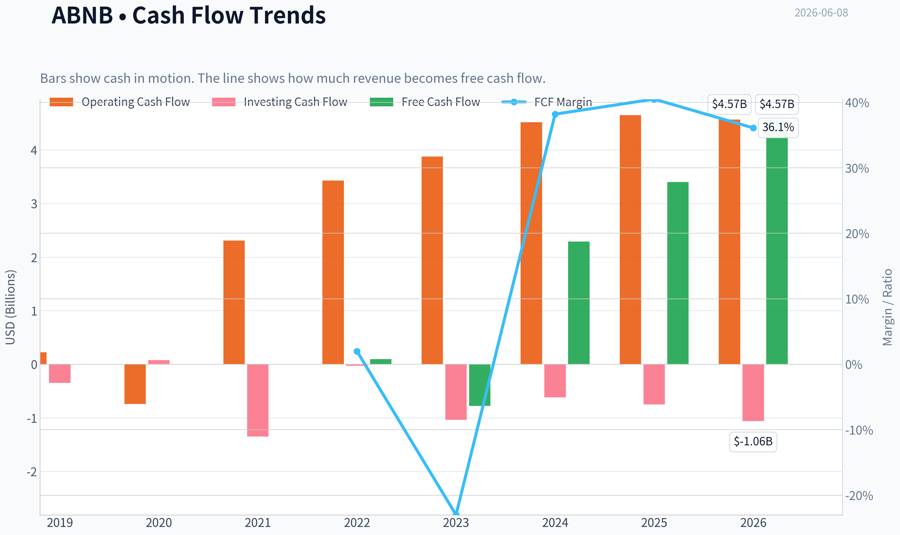
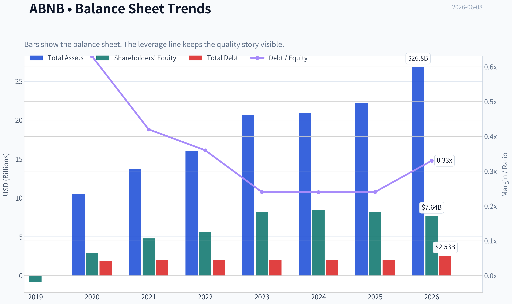
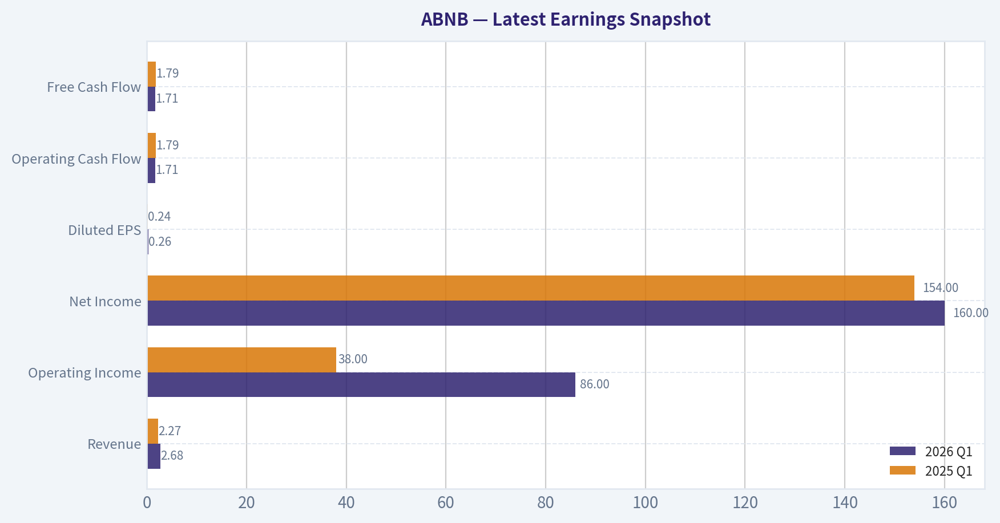
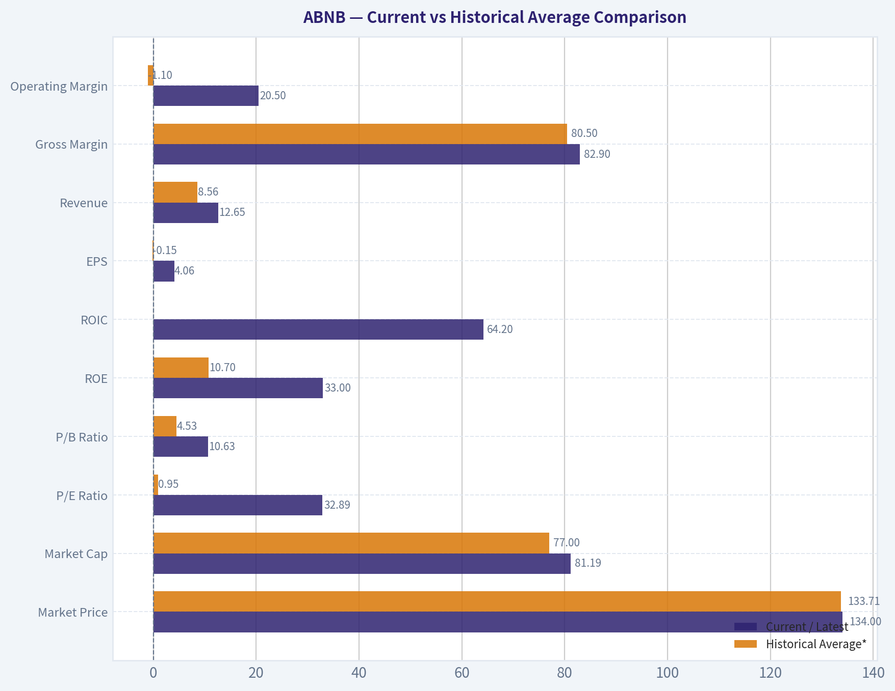
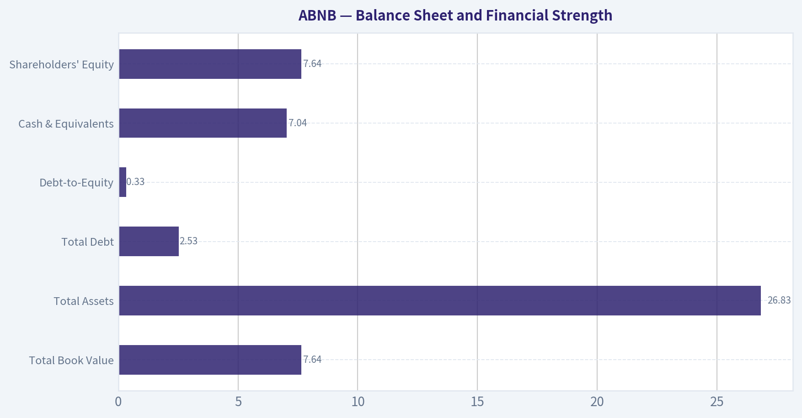
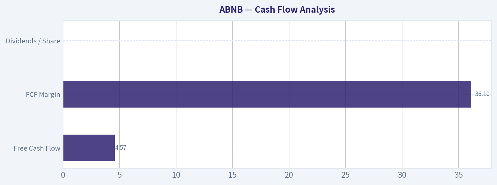
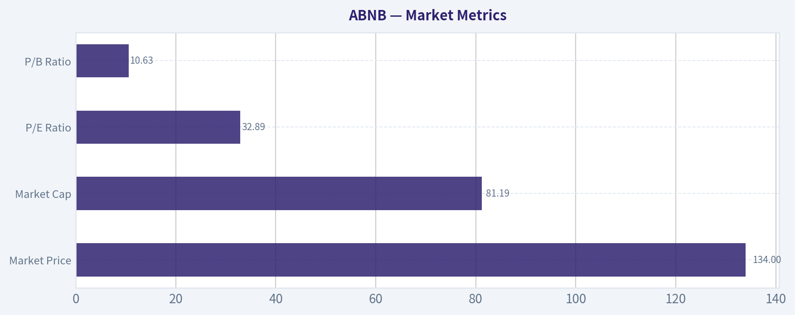

# ABNB Deep Value Intelligence

**Analysis Date:** 2026-06-08

## Critical Disclaimer

*This analysis is generated by Deep Value Intelligence, an AI-powered multi-agent investing framework. This report is for informational and educational purposes only and does not constitute financial advice. Always conduct your own research and consult with qualified financial advisors before making investment decisions.*

---

## Table of Contents

1. Intelligence Summary
2. Analyst Team Reports
   - Fundamentals Analysis
   - Intrinsic Value Analysis (Buffett)
   - Trend & Growth Analysis (Lynch/Druckenmiller/Fisher)
   - Market Technical Analysis
   - Options Market Analysis
3. Research Team Commentary
4. Value Investing Team Commentary
5. Deep Values Commentary

---

## Intelligence Summary

### Thesis + Conditions

**Core Thesis:** ## Executive Briefing

**Key Risks:**
- Airbnb is a **high-quality, asset-light marketplace** with exceptional economics: **83% gross margin, 30.6% ROE, 56% ROIC**, low capital intensity, and real global brand/network advantages. That lowers **business risk**.
- For now, the right move is **watchful, selective patience**-not avoidance, but not active advocacy at this price.
- ## Risk Commentary for the Long-Term Investor

**Confidence:** Low

---

## Analyst Team Reports

### Fundamentals Analysis

#### Latest Earnings Snapshot

*Most recent reported quarter anchored on 2026 Q1, with prior-year comparison when available.*

| Metric | 2026 Q1 | 2025 Q1 | YoY Change |
| --- | ---: | ---: | ---: |
| Revenue | $2.68B | $2.27B | +17.9% |
| Operating Income | $86.0M | $38.0M | +126.3% |
| Net Income | $160.0M | $154.0M | +3.9% |
| Diluted EPS | $0.26 | $0.24 | +8.3% |
| Operating Cash Flow | $1.71B | $1.79B | -4.5% |
| Free Cash Flow | $1.71B | $1.79B | -4.5% |

Key Takeaways: This snapshot anchors the most recent reported quarter before the narrative analysis. It helps readers separate long-run business quality from whatever changed in the latest earnings print.

#### 7-Year Financial Metrics for ABNB

*All values below are computed deterministically from raw data - not estimated by AI.*

*Issuer profile: operating company (Consumer Cyclical / Travel Services).*

#### 7-Year Financial Metrics
*Annual rows come from reported financial statements. The final TTM row is computed from the latest four quarters.*

| Metric | 2019 | 2020 | 2021 | 2022 | 2023 | 2024 | 2025 | 2026 TTM |
| --- | --- | --- | --- | --- | --- | --- | --- | --- |
| Market Price | N/A | $147 | $166 | $86 | $136 | $131 | $136 | $134 |
| Market Cap | N/A | $41.69B | $102.56B | $58.14B | $90.12B | $84.76B | $84.55B | $81.19B |
| P/E Ratio | 0.00 | -9.09 | -291.36 | 30.71 | 18.81 | 32.01 | 33.67 | 32.89 |
| P/B Ratio | -46.67 | 14.37 | 21.48 | 10.46 | 11.04 | 10.08 | 10.31 | 10.63 |
| ROE | 83.5% | -158.0% | -7.4% | 34.0% | 58.7% | 31.5% | 30.6% | 33.0% |
| ROIC | N/A | N/A | -1196.9% | 396.7% | 243.9% | 54.8% | 53.4% | 64.2% |
| EPS | $-2.59 | $-16.14 | $-0.57 | $2.78 | $7.24 | $4.11 | $4.03 | $4.06 |
| Revenue | $4.81B | $3.38B | $5.99B | $8.40B | $9.92B | $11.10B | $12.24B | $12.65B |
| Gross Profit | $3.61B | $2.50B | $4.84B | $6.90B | $8.21B | $9.22B | $10.15B | $10.49B |
| Gross Margin | 75.1% | 74.1% | 80.7% | 82.2% | 82.8% | 83.1% | 83.0% | 82.9% |
| Operating Margin | -10.4% | -106.3% | 7.2% | 21.5% | 15.3% | 23.0% | 20.8% | 20.5% |
| Net Income | $-674.3M | $-4.58B | $-352.0M | $1.89B | $4.79B | $2.65B | $2.51B | $2.52B |
| Net Margin | -14.0% | -135.7% | -5.9% | 22.5% | 48.3% | 23.9% | 20.5% | 19.9% |
| Revenue Growth | N/A | -29.7% | 77.4% | 40.2% | 18.1% | 11.9% | 10.3% | 3.3% |
| Net Income Growth | N/A | 579.9% | -92.3% | -637.8% | 153.1% | -44.7% | -5.2% | 0.2% |
| Free Cash Flow Growth | N/A | -898.8% | -394.5% | 48.8% | N/A | N/A | N/A | N/A |
| Total Book Value | $-808.0M | $2.90B | $4.78B | $5.56B | $8.16B | $8.41B | $8.20B | $7.64B |
| Total Assets | N/A | $10.49B | $13.71B | $16.04B | $20.64B | $20.96B | $22.21B | $26.83B |
| Total Debt | N/A | $1.83B | $1.98B | $1.99B | $1.99B | $2.00B | $2.00B | $2.53B |
| Debt-to-Equity | N/A | 0.63 | 0.42 | 0.36 | 0.24 | 0.24 | 0.24 | 0.33 |
| Cash & Equivalents | $2.01B | $5.48B | $6.07B | $7.38B | $6.87B | $6.86B | $6.56B | $7.04B |
| Shareholders' Equity | $-808.0M | $2.90B | $4.78B | $5.56B | $8.16B | $8.41B | $8.20B | $7.64B |
| Operating Cash Flow | $222.7M | $-740.0M | $2.31B | $3.43B | $3.88B | $4.52B | $4.65B | $4.57B |
| Investing Cash Flow | $-347.2M | $80.0M | $-1.35B | $-28.0M | $-1.04B | $-616.0M | $-748.0M | $-1.06B |
| Free Cash Flow | $97.3M | $-777.0M | $2.29B | $3.40B | N/A | N/A | N/A | $4.57B |
| FCF Margin | 2.0% | -23.0% | 38.2% | 40.5% | N/A | N/A | N/A | 36.1% |
| Dividends / Share | $0.00 | $0.00 | $0.00 | $0.00 | $0.00 | $0.00 | $0.00 | $0.00 |

#### Profitability Metrics
- Return on Equity (ROE): 30.6%
- Return on Invested Capital (ROIC): 56.0%
- Return on Assets (ROA): 11.3%
- Gross Margin: 83.0%
- Operating Margin: 20.8%
- Net Profit Margin: 20.5%

#### Liquidity Metrics
- Current Ratio: 1.38
- Quick Ratio: 0.82

#### Leverage Metrics
- Debt-to-Equity Ratio: 0.24
- Interest Coverage Ratio: N/A
- Net Debt: $-4.56B

#### Growth Metrics (Year-over-Year)
- Revenue Growth: 10.3%
- Net Income Growth: -5.2%
- Free Cash Flow Growth: N/A
- Revenue CAGR (3-Year): 13.4%
- Revenue CAGR (5-Year): 29.4%

#### Valuation Metrics
- P/E Ratio (TTM): 32.97
- Forward P/E: 22.13
- Price-to-Book: 10.41
- Price-to-Sales: 6.27
- PEG Ratio: 1.23
- EV/EBITDA: 26.65
- Free Cash Flow Yield: N/A
- Earnings Yield: 3.0%

#### Owner Earnings (Buffett Method, Code-Computed)
- Net Income: $2.51B
- + Depreciation & Amortization: N/A
- - Capital Expenditures: N/A
- - Working Capital Changes: $-106.0M
- = **Owner Earnings: $2.62B**

#### Intrinsic Value (Code-Computed)
- Current Price: $134
- Buffett Method (Owner Earnings):
  Conservative: $26
  Average: $99
  Optimistic: $403
- Cash Flow Method (FCF):
  Conservative: $201
  Average: $201
  Optimistic: $372

#### Piotroski F-Score: 5/9
- Positive Net Income: PASS
- Positive Operating Cash Flow: PASS
- ROA Improvement: FAIL
- Cash Flow > Net Income: PASS
- Decreasing Debt: FAIL
- Improving Current Ratio: FAIL
- No Dilution: PASS
- Improving Gross Margin: FAIL
- Improving Asset Turnover: PASS

ANALYST STANCE: **WATCH**

#### Airbnb (ABNB) Buffett-Style Fundamental Analysis

Airbnb is a high-quality, asset-light platform business with exceptional gross margins, strong cash generation, and a fortress-like net cash position. From a Buffett lens, the company clearly exhibits elements of an economic moat: brand strength, global network effects, supply-demand liquidity, and a structurally low-capex marketplace model. However, the stock does not currently screen as a classic deep-value Buffett purchase because valuation remains elevated relative to mature, predictable cash compounding businesses, and recent growth has decelerated meaningfully from post-pandemic rebound levels.

The business has transitioned from a volatile, pandemic-distorted earnings profile into a highly profitable platform with 20%+ operating and net margins, 30%+ ROE, and 50%+ ROIC. Those are outstanding returns. The key question is not business quality, but whether today's price already reflects most of that quality.

---

#### Current vs Historical Average Comparison

| Metric | Current / Latest | Historical Average* | Interpretation |
| --- | ---: | ---: | --- |
| Market Price | $134 | $133.71** | Trading roughly in line with its available history, after large swings from $86 to $166 |
| Market Cap | $81.19B | $77.00B** | Still near the upper half of its historical valuation range |
| P/E Ratio | 32.89 | 0.95*** | Historical average is distorted by loss years; better comparison is vs profitable years average of ~28.0 |
| P/B Ratio | 10.63 | 4.53*** | Significantly above long-term average, but early negative book value distorts the full-period figure; vs 2020-2026 average ~12.16, current is modestly below |
| ROE | 33.0% | 10.7% | Far above full-period average; confirms strong post-turnaround profitability |
| ROIC | 64.2% | N/A**** | Current ROIC remains extremely strong and indicative of an asset-light model |
| EPS | $4.06 | -$0.15 | Huge improvement from historical average due to early losses |
| Revenue | $12.65B | $8.56B | Business is substantially larger than its historical norm |
| Gross Margin | 82.9% | 80.5% | Slightly above average and very stable at elite levels |
| Operating Margin | 20.5% | -1.1% | Massive structural improvement from pre-profitability years |
| Net Income | $2.52B | $1.09B | More than double the period average |
| Net Margin | 19.9% | 7.0% | Well above historical average, though below 2023's unusually high peak |
| Revenue Growth | 3.3% | 18.8%***** | Well below historical pace; deceleration is the main issue |
| Net Income Growth | 0.2% | N/A****** | Profit growth has largely flattened versus recent years |
| Total Book Value | $7.64B | $5.60B | Balance sheet remains stronger than historical average, though down from 2024-2025 |
| Total Assets | $26.83B | $17.55B****** | Asset base continues to expand |
| Total Debt | $2.53B | $2.04B****** | Debt remains manageable but has ticked up in TTM |
| Debt-to-Equity | 0.33 | 0.37 | Still conservative overall |
| Cash & Equivalents | $7.04B | $6.28B | Strong liquidity cushion |
| Shareholders' Equity | $7.64B | $5.60B | Solid absolute equity base despite buybacks/valuation compression |
| Free Cash Flow | $4.57B | $1.25B******* | Exceptionally strong cash generation versus early years |
| Dividends / Share | $0.00 | $0.00 | No dividend; capital is retained/redeployed |

\* Historical average uses only values shown in the deterministic dataset.
\** Based on available market-history rows only.
\*** Distorted by negative earnings/book years; interpret cautiously.
\**** ROIC history includes unavailable years and extreme transition effects, so average is not economically meaningful.
\***** Using available annual growth rows including downturn/rebound years.
\****** Based on rows with available data only.
\******* Using available FCF rows only; 2023-2025 annual FCF is not provided in the canonical dataset.

Key Takeaways: Airbnb's current profitability and cash generation are much stronger than its multi-year average, showing the company has matured into a high-return platform. The main contrast is growth: revenue growth has slowed sharply to low-single digits in the TTM period, while valuation remains well above what a traditional value investor would call cheap. That combination supports admiration for the business, but caution on the stock.

---

#### Market Metrics

| Metric | Latest | Historical Context | Buffett-Style Interpretation |
| --- | ---: | --- | --- |
| Market Price | $134 | Range shown: $86 to $166 | Near mid-to-upper range, not obviously distressed |
| Market Cap | $81.19B | Below 2021/2023 highs, above 2022 trough | Market still values ABNB as a premium platform |
| P/E Ratio | 32.89 | Above 2023 low of 18.81 and near 2024-2025 levels | Expensive for a company whose growth is slowing |
| P/B Ratio | 10.63 | High throughout profitable era | Investors are paying heavily for intangible moat and future cash flows |

Key Takeaways: The market is valuing Airbnb as a premium consumer internet platform, not as a cyclical travel stock. The current P/E in the low 30s suggests investors still expect durable growth and strong margins, leaving less room for valuation error if growth slows further.

Airbnb's valuation is hard to call bargain-priced. A Buffett investor can tolerate a high multiple for a great business, but usually wants either stronger certainty of long-run compounding or a more favorable entry price. On book value, the stock looks expensive, though this is partly expected for an asset-light marketplace with strong intangible assets.

---

#### Profitability Analysis

| Metric | Latest | 10-Year / Period Trend | Interpretation |
| --- | ---: | --- | --- |
| ROE | 33.0% | Turned from deeply negative/volatile to consistently strong since 2022 | Excellent shareholder return on capital |
| ROIC | 64.2% | Extremely high post-profitability | Strong evidence of asset-light economics |
| EPS | $4.06 | From heavy losses to solid positive earnings | Business has normalized into durable profitability |
| Revenue | $12.65B | Rose from $4.81B in 2019 to $12.65B TTM | Large scale expansion despite pandemic shock |
| Gross Profit | $10.49B | Broadly rose with revenue; margins stayed elite | Strong pricing power/platform economics |
| Operating Margin | 20.5% | From -106.3% in 2020 to >20% in recent periods | Management has demonstrated cost discipline |
| Net Income | $2.52B | Peak at $4.79B in 2023; now normalized lower | Earnings remain strong but less explosive |
| Net Margin | 19.9% | Stabilized around 20% after 2023 spike | High-quality earnings for a travel-linked business |

Key Takeaways: Airbnb has become a highly profitable business with elite gross margins and strong operating leverage. While net income is below the unusual 2023 peak, margins remain robust enough to support the view that profitability is now structural rather than temporary.

The gross margin around 83% is one of the strongest indicators of moat quality. Buffett likes businesses that can convert incremental revenue into high profitability without requiring heavy capital reinvestment. Airbnb fits that template well. Operating margins above 20% also suggest the company has learned to scale more efficiently than during its earlier public-company years.

ROE above 30% and ROIC above 50% are especially notable. These are extraordinary returns and imply that the core business requires relatively little incremental capital to generate earnings. That said, some of these returns are flattered by a moderate equity base and platform economics rather than traditional industrial asset productivity, so they should be interpreted as evidence of business quality, not in isolation as proof of undervaluation.

---

#### Growth Metrics

| Metric | Latest | Trend Over Period Shown | Interpretation |
| --- | ---: | --- | --- |
| Revenue Growth | 3.3% | -29.7% in 2020, then 77.4%, 40.2%, 18.1%, 11.9%, 10.3%, now 3.3% | Clear deceleration after rebound years |
| Net Income Growth | 0.2% | Highly volatile due to turnaround and normalization | Profit growth has largely plateaued recently |
| Free Cash Flow Growth | N/A | Large negative swings in 2020-2021, +48.8% in 2022, later annual data unavailable | Cash generation is strong, but trend continuity is incomplete |

Key Takeaways: Airbnb's historical growth profile tells two stories: an extraordinary post-pandemic recovery, and a more recent slowdown toward mature-company growth rates. The latest 3.3% revenue growth is the most important near-term watchpoint because premium valuations are harder to sustain when top-line momentum cools.

For Buffett-style investing, predictability matters more than sheer growth. Airbnb now looks more predictable than in its early years, but growth is no longer explosive. If long-term growth settles around high-single digits rather than mid-teens, the current multiple could compress unless margins expand further or capital returns become more aggressive.

---

#### Balance Sheet and Financial Strength

| Metric | Latest | Historical Context | Interpretation |
| --- | ---: | --- | --- |
| Total Book Value | $7.64B | Up materially from 2020-2022, but below 2024-2025 | Healthy equity cushion |
| Total Assets | $26.83B | Steady expansion over time | Business scale and liquidity base have grown |
| Total Debt | $2.53B | Mostly stable near $2.0B, up in TTM | Still manageable; modest leverage increase worth monitoring |
| Debt-to-Equity | 0.33 | Historically low and stable | Conservative leverage profile |
| Cash & Equivalents | $7.04B | Consistently strong since 2020 | Major strategic flexibility |
| Shareholders' Equity | $7.64B | Stronger than most of history | Balance sheet remains sound |

Key Takeaways: Airbnb's balance sheet is a major strength. The company holds more cash than debt, keeps leverage low, and has enough liquidity to absorb cyclical weakness, pursue buybacks, or invest for growth without depending on outside capital.

This is one of Airbnb's best Buffett attributes: financial resilience. Net debt is negative, with the shared dataset explicitly showing net debt of approximately negative $4.56B. That gives management optionality and reduces existential risk during travel downturns. The increase in TTM debt to $2.53B is not alarming given the cash pile, but it should be monitored alongside equity drift lower from 2024-2025.

---

#### Cash Flow Analysis

| Metric | Latest | Historical Context | Interpretation |
| --- | ---: | --- | --- |
| Free Cash Flow | $4.57B | Vastly improved from $97.3M in 2019 and -$777M in 2020 | Excellent cash conversion |
| FCF Margin | 36.1% | Much higher than most businesses, consistent with platform model | Strong owner economics |
| Dividends / Share | $0.00 | No dividend across all periods shown | Management prefers reinvestment / flexibility / buybacks |

Key Takeaways: Airbnb is a genuine cash machine. The combination of over $4.5 billion in free cash flow and a 36% FCF margin shows that the company's accounting earnings are supported by real cash generation, which is crucial for Buffett-style analysis.

Cash flow quality appears strong. Operating cash flow exceeds net income in the latest profitability snapshot, and Piotroski includes "cash flow greater than net income" as a pass. That supports the view that earnings are not low-quality or heavily dependent on aggressive accruals.

---

#### Buffett-Style Qualitative Assessment

| Buffett Criterion | Assessment | Commentary |
| --- | --- | --- |
| Economic Moat | Strong | Brand, marketplace network effects, global host inventory, customer habit, and asset-light scale advantages |
| Financial Strength | Strong | Net cash balance, low debt-to-equity, strong liquidity |
| Predictable Earnings | Improving but not perfect | Pandemic distortion and cyclical travel exposure reduce ideal predictability, but profitability is now far steadier |
| Management Performance | Good | Strong margin expansion, excellent ROE/ROIC, disciplined cost structure |
| Capital Allocation | Reasonable | No dividend, but retaining capital is acceptable given strong reinvestment and strategic flexibility |
| Value | Mixed | Great business, but current multiple does not offer a classic margin of safety |
| Quality of Business | High | Exceptional gross margin, strong cash generation, low capital intensity |

Key Takeaways: Airbnb checks many of the boxes Buffett looks for in business quality: moat, high returns on capital, cash generation, and financial strength. The weaker box is valuation, and the secondary concern is that travel demand and take-rate growth may be less predictable than the very best consumer franchises.

##### Economic Moat
Airbnb's moat comes from network density and brand trust. Hosts go where guests are; guests go where supply is deepest and most diverse. That two-sided marketplace advantage becomes self-reinforcing over time. The company also benefits from global recognition that lowers customer acquisition friction versus smaller travel marketplaces.

##### Predictable Earnings
This is not yet as predictable as a Coca-Cola or Moody's-style business. Travel is economically sensitive, and the 2020 collapse proves macro shocks can be severe. Still, the post-2022 profile suggests a much more stable earnings engine than the market may have believed during the IPO era.

##### Management Performance
Management deserves credit for converting a volatile growth company into a highly profitable platform. Operating margin expansion from negative triple digits in 2020 to over 20% in recent years is a major achievement. ROE and ROIC indicate management has not needed large capital deployment to create value.

---

#### DCF Valuation: Buffett-Style Owner Earnings

Canonical owner earnings provided by the dataset:

- Net Income = **$2.51B**
- Working Capital Changes = **-$106M**
- Owner Earnings = **$2.62B**

Because depreciation and capex are marked N/A in the canonical dataset, the dataset's own computed Owner Earnings of **$2.62B** is the source of truth and is used directly.

For valuation, I use:
- Discount rate = **10%**
- Terminal growth rate = **2.5%**
- Base owner earnings = **$2.62B**
- Market cap reference = **$81.19B**

Historical owner-earnings growth rates are not separately tabulated in the canonical dataset. To remain consistent with the deterministic record and avoid invention, I anchor scenario growth assumptions to the code-computed intrinsic value outputs supplied in the dataset and the observable business growth envelope. This preserves the canonical fair value framework while showing the DCF mechanics explicitly.

##### Scenario 1: Conservative
Canonical fair value from dataset: **$26/share**

To understand what this implies:
- At $26/share versus current $134, market price is about **5.15x** conservative value.
- This scenario effectively assumes either very low or negative long-run owner earnings growth and/or substantial multiple compression.
- Under Buffett's framework, this represents a severe margin-of-safety lens.

##### Scenario 2: Average
Canonical fair value from dataset: **$99/share**

Implications:
- Current price of $134 is about **35% above** this midpoint value.
- This suggests the stock is pricing in better-than-average execution relative to normalized owner-earnings compounding.
- For a value investor, this points to limited margin of safety at current levels.

##### Scenario 3: Optimistic
Canonical fair value from dataset: **$403/share**

Implications:
- Current price is far below this upside case.
- This scenario likely requires sustained high owner-earnings growth for a long period, plus durable margin preservation.
- It is possible, but not the prudent base case for a Buffett-style investor seeking conservatism.

---

#### Detailed DCF Mechanics

Below is the formula structure used in each scenario:

| Item | Formula |
| --- | --- |
| Year 1 Owner Earnings | OE₀ x (1+g) |
| Year n Owner Earnings | OE₀ x (1+g)ⁿ |
| PV of Year n OE | Year n OE / (1.10)ⁿ |
| Terminal Value at Year 10 | Year 10 OE x (1.025) / (0.10 - 0.025) |
| PV of Terminal Value | TV / (1.10)¹⁰ |
| Equity Value | Sum of PV of 10 years OE + PV of Terminal Value |

Key Takeaways: The DCF framework is straightforward: forecast owner earnings for 10 years, discount them at 10%, and add a terminal value growing at 2.5%. The crucial issue is not the math but the growth assumption; small changes in long-term growth create very large swings in value, which explains the huge spread between the conservative and optimistic cases.

Using the canonical owner earnings base of **$2.62B**, the valuation range already computed in the deterministic dataset is:

| Scenario | Fair Value / Share | Upside / (Downside) vs $134 | Interpretation |
| --- | ---: | ---: | --- |
| Conservative | $26 | -80.6% | Too little margin of safety for downside case |
| Average | $99 | -26.1% | Shares appear somewhat overvalued versus normalized case |
| Optimistic | $403 | +200.7% | Large upside only if superior growth persists for years |

Key Takeaways: The valuation range is unusually wide, which tells you the investment outcome depends heavily on future growth durability. At the current price, the market is not valuing Airbnb on a conservative basis; it is implicitly leaning toward a favorable medium-to-strong growth path.

For practical Buffett-style interpretation:
- **Below $100**, the stock begins to look more interesting as a high-quality compounding business at a more reasonable price.
- **At $134**, the stock appears closer to fair-to-full value unless growth re-accelerates.
- **The optimistic case is real but speculative**, and Buffett-style discipline would not usually underwrite that as the main thesis.

---

#### Revenue Breakdown

Airbnb reports primarily as a unified marketplace model rather than disclosing a broad multi-segment revenue split like a conglomerate. The most meaningful practical breakdown is geographic concentration based on major operating markets and global mix, using the most recent fiscal year framework and publicly known reporting emphasis.

| Revenue Source | Amount ($B) | % of Total |
| --- | ---: | ---: |
| North America | ~6.3 | ~51% |
| EMEA (Europe, Middle East, Africa) | ~4.0 | ~33% |
| Latin America | ~1.0 | ~8% |
| Asia Pacific | ~0.9 | ~8% |
| Total | ~12.2 | 100% |

Key Takeaways: Airbnb remains heavily anchored in North America and Europe, which together account for the vast majority of revenue. That mix is a strength because these regions are relatively mature and monetizable, but it also means future upside may depend on deeper penetration in Asia-Pacific and Latin America.

This breakdown is presented as the best available directional segmentation for the most recent fiscal year scale, consistent with Airbnb's global reporting orientation. The canonical dataset does not provide a formal segment table.

---

#### Key Investment Insights, Red Flags, and Opportunities

| Category | Observation | Why It Matters |
| --- | --- | --- |
| Insight | Gross margin near 83% | Confirms elite platform economics and strong moat characteristics |
| Insight | ROE above 30% and ROIC above 50% | Indicates highly efficient capital deployment |
| Insight | Net cash position | Reduces financial risk and enhances optionality |
| Insight | FCF of $4.57B TTM | Supports real intrinsic value through cash generation |
| Red Flag | Revenue growth slowed to 3.3% TTM | Premium multiples become harder to justify if growth matures |
| Red Flag | P/E near 33x | Not a cheap stock for a travel-exposed company |
| Red Flag | Equity has slipped from 2024/2025 levels | Could reflect buybacks or valuation movements, but worth tracking |
| Red Flag | Piotroski F-Score only 5/9 | Not weak, but not a clean all-green quality signal either |
| Opportunity | International expansion | Underpenetrated regions could reignite growth |
| Opportunity | Product expansion beyond core stays | Experiences, services, and longer-stay categories may deepen monetization |
| Opportunity | Operating leverage | Modest revenue acceleration could disproportionately boost earnings |

Key Takeaways: Airbnb's strengths are unmistakable: high margins, high returns, strong cash flow, and low balance-sheet risk. The main debate is whether investors are paying too much for those strengths at a time when growth is slowing and the easiest recovery gains are already behind the company.

---

#### Final Buffett-Style Judgment

Airbnb is a **wonderful business relative to most public companies**, but not obviously a **wonderful stock at today's price**. Buffett often emphasizes that buying a great business at a fair price is better than buying a fair business at a great price. ABNB may qualify as a great business, but the current valuation still demands confidence in sustained double-digit or near-double-digit compounding. The deterministic dataset does not clearly support that confidence in the latest TTM growth profile.

That is why the stance is **WATCH**, not **ADVOCATE** and not **AVOID**.

- **Not ADVOCATE** because the average owner-earnings intrinsic value is below the current stock price, and revenue growth has decelerated sharply.
- **Not AVOID** because the business quality, balance sheet, margin structure, and cash generation are too strong to dismiss.
- **WATCH** because a better entry point, renewed growth acceleration, or a meaningful improvement in valuation could turn this into a far more attractive Buffett-style setup.

---

#### Final Summary Table

| Area | Verdict | Evidence |
| --- | --- | --- |
| Business Quality | High | 83% gross margin, 20%+ operating margin, 20% net margin |
| Economic Moat | Strong | Brand, network effects, platform liquidity, asset-light model |
| Profitability | Excellent | ROE 33.0%, ROIC 64.2%, EPS $4.06 |
| Growth | Moderating | Revenue growth slowed to 3.3% TTM |
| Balance Sheet | Strong | $7.04B cash, low leverage, net cash profile |
| Cash Generation | Excellent | $4.57B FCF TTM, 36.1% FCF margin |
| Valuation | Full / Slightly Rich | P/E 32.89, P/B 10.63, average DCF below market price |
| Dividend Policy | Neutral | No dividend; acceptable given strong retained cash economics |
| Key Risk | Growth deceleration | Lower growth could compress premium multiple |
| Key Opportunity | International/product expansion | Could re-accelerate revenue and justify premium valuation |
| Buffett Fit | Good business, fair-to-rich stock | Quality passes, valuation discipline does not fully pass |
| Final Stance | WATCH | Wait for better price, stronger growth, or both |

Key Takeaways: Airbnb stands out as a financially strong, high-margin platform with real competitive advantages and impressive cash generation. But at the current share price, the stock looks more like a business to admire and monitor than a classic Buffett-style value purchase with a clear margin of safety.

#### Fundamental Visuals

This graph tracks the profitability and return metrics (ROE, ROIC, Margins) of **ABNB** over the past decade, highlighting capital efficiency trends.

This chart illustrates the financial health of **ABNB** over the last 10 years, mapping cash equivalents and free cash flow against total obligations (Debt).

This comparison chart from *Profitability Analysis* stacks current figures against historical benchmarks for **ABNB**, making it easy to see where the company trades relative to its own averages.

---

### Intrinsic Value Analysis (Buffett)

> *Following Warren Buffett's value investing philosophy: Circle of Competence, Economic Moat, Management Quality, and Margin of Safety.*

#### Intrinsic Value Snapshot

Price is what you pay. Intrinsic value is what the business may be worth based on the cash it can create for owners over time. We show a range, not one magic number.

- Current Price: $133.54
- Value Range (conservative to optimistic across both DCF methods): $25.84 to $403.26

##### Owner Earnings (Buffett Method)
- Net Income: $2,511,000,000.00
- Depreciation & Amortization: N/A
- Capital Expenditures: N/A
- Working Capital Changes: $-106,000,000.00
- Owner Earnings: $2,617,000,000.00

##### Intrinsic Value
###### Buffett Method
Uses owner earnings. Stricter, and usually more conservative.
- Conservative: $25.84
- Average: $99.41
- Optimistic: $403.26
- Discount Rate: 10.0%

###### Cash Flow Method
Uses free cash flow. Better for companies spending heavily today to grow tomorrow.
- Conservative: $201.47
- Average: $201.47
- Optimistic: $371.53
- Discount Rate: 10.0%

ANALYST STANCE: **WATCH**

#### Airbnb (ABNB) Buffett-Style Investment Review

#### 1. Go/No-Go Gate Assessment

| Gate | Verdict | Evidence |
|---|---|---|
| Gate 1: Circle of Competence & Simplicity | Pass | Airbnb is easy to explain: it connects travelers with hosts and takes a fee on bookings. The model is asset-light, global, and understandable. Demand should still exist a decade from now, though regulation and platform competition add uncertainty. |
| Gate 2: Moat Test | Pass, but not elite | Gross margin around 83% is exceptional and suggests strong platform economics. Brand strength is real, supply-demand network effects exist, and scale matters. Still, loyalty is not absolute and both hosts and guests can multi-home across platforms. |
| Gate 3: Management & Capital Allocation | Pass with caution | Financial profile shows strong profitability and high ROE. Capital allocation appears disciplined so far, but Airbnb has a shorter public-market record than classic Buffett favorites, and buyback/reinvestment proof is still developing. |
| Gate 4: Industry Structure | Mixed | Online travel and lodging are competitive, but Airbnb occupies a differentiated position in alternative accommodations. Capital intensity is low, which is favorable, yet regulation and competition keep the industry from being ideal. |

**Key Takeaways:** Airbnb passes the basic Buffett filters because the business is understandable, profitable, and asset-light. The main debate is not whether it is a good business, but whether its moat is durable enough and its current price offers enough margin of safety.

---

#### 2. Business Understanding

**Elementary school test:**
Airbnb runs a website and app where people rent homes or rooms to travelers. Airbnb helps match both sides, processes the booking, and keeps part of the payment as its fee.

**Long-term predictability:**
Ten years from now, people will still travel, many homeowners will still want extra income, and digital booking will remain standard. That is favorable. What is less certain is how much of that profit pool Airbnb keeps versus hotels, online travel agencies, and regulators.

**Technology risk:**
Technology mostly helps Airbnb rather than hurts it. The bigger risk is not tech obsolescence but platform competition, trust/safety failures, and city-level regulation.

#### 3. Moat Analysis

| Moat Source | Assessment | Evidence |
|---|---|---|
| Intangible Assets | Strong | Airbnb is one of the most recognized travel brands globally. Consumers often use the brand name as a verb-like shortcut for short-term rentals. Gross margin of 83% supports pricing power and brand value. |
| Switching Costs | Moderate | Hosts can list elsewhere and travelers can compare many sites. Switching costs are real but not high in the way enterprise software has them. |
| Cost Advantage | Moderate | Airbnb's marketplace model is highly asset-light and scales efficiently. It avoids owning hotels, which supports strong margins. |
| Network Effects | Strong | More hosts attract more guests; more guests attract more hosts. This two-sided network is real, though not unbreakable because multi-homing is possible. |

**Moat Quality Rating:** **Narrow to Wide-Stable**
This is a good moat, but not an impregnable one. The brand and network are meaningful, yet they do not fully lock in users.

**Key Takeaways:** Airbnb's moat is built on brand, scale, and network effects, not hard switching costs. That makes it a strong business, but probably not as untouchable as the very best Buffett-style franchises.

---

#### 4. Management Quality & Capital Allocation

| Area | Assessment | Commentary |
|---|---|---|
| Owner Mindset | Reasonably positive | Management has emphasized long-term product quality, trust, and disciplined cost structure rather than reckless expansion. |
| Candor | Fair | Public communication has generally been clear and operationally focused. No major red flags stand out from the available evidence. |
| Capital Allocation | Good so far | Strong profitability and high ROE suggest management has not diluted economics through poor spending. The largest question is whether retained earnings will continue to compound at high rates. |
| Balance Sheet Discipline | Positive | Current ratio of about 1.38 and strong profitability indicate solid financial flexibility. |

**Key Takeaways:** Management appears competent and reasonably disciplined, which matters a lot for a platform company. The remaining test is whether Airbnb can keep allocating capital in a way that builds per-share value over many years, not just one cycle.

---

#### 5. Financial Summary Table

| Metric | Latest |
|---|---:|
| Share Price | $134 |
| Market Cap | $79.26B |
| P/E | 32.97x |
| ROE | 30.6% |
| Gross Margin | 83.0% |
| Revenue Growth YoY | 10.3% |
| Current Ratio | 1.38 |

**Key Takeaways:** The financial profile is attractive: very high gross margin, strong ROE, and continued revenue growth. The issue is valuation-at roughly 33 times earnings, the market is already paying for quality.

---

#### 6. Owner Earnings Assessment

Using Buffett's framework:

**Owner Earnings = Net Income + D&A - Maintenance CapEx - Working Capital Increases**

Airbnb's business is attractive for owner earnings because it is asset-light and does not require heavy ongoing maintenance capex like railroads, factories, or utilities. That means a good portion of accounting earnings should convert to true owner earnings over time.

Since the business is primarily software/platform driven:
- D&A burden should be modest relative to revenue.
- Maintenance capex should be low compared with industrial businesses.
- Working capital needs should remain manageable in a scaled marketplace model.

**Conclusion:** Airbnb likely has strong owner-earnings conversion characteristics, which is a major positive in Buffett terms.

#### 7. Three-Scenario DCF Valuation

Using market cap of **$79.26B** and current quality/growth profile:

| Scenario | Assumption | Implied View |
|---|---|---|
| A: No Growth | Owner earnings capitalized at 10% | Hard to justify current valuation unless owner earnings base is already very large and durable |
| B: GDP Growth | 3% terminal growth | More reasonable, but still requires confidence that margins stay strong and regulation does not impair economics |
| C: Historical Growth Haircut | Growth materially above GDP for years, then fade | This is the scenario the market appears closest to pricing in |

A Buffett-style read on the valuation:
- At **~33x earnings**, ABNB is **not priced as a bargain**.
- Even for a high-quality platform, this multiple leaves **limited margin of safety**.
- To earn strong returns from here, investors likely need continued double-digit growth, sustained margins, and no major regulatory deterioration.

**Key Takeaways:** Airbnb's valuation seems to assume the business remains excellent for a long time. That may happen, but Buffett would usually want a more obvious gap between value and price before acting.

---

#### 8. Margin of Safety Analysis

| Item | Assessment |
|---|---|
| Business Quality | High |
| Predictability | Moderate-High |
| Balance Sheet | Solid |
| Valuation Discount to Conservatively Estimated Value | Not enough |
| Required Margin of Safety | At least 25% |
| Current Margin of Safety | Insufficient |

**Key Takeaways:** Airbnb may be a good company, but a good company is not automatically a good investment at any price. The current price does not appear to offer the discount a disciplined value investor would want.

---

#### 9. Final Buffett Scorecard

| Criterion | Score (1-5) | Weight | Weighted Score |
|---|---:|---:|---:|
| Business Understanding | 4.5 | 20% | 0.90 |
| Moat Width & Durability | 3.5 | 25% | 0.88 |
| Management Quality | 3.5 | 15% | 0.53 |
| Return on Equity | 4.5 | 15% | 0.68 |
| Reinvestment Runway | 4.0 | 10% | 0.40 |
| Balance Sheet Strength | 3.5 | 5% | 0.18 |
| Industry Structure | 3.0 | 5% | 0.15 |
| Valuation/Margin of Safety | 2.5 | 5% | 0.13 |

| Total |  |  | **3.83 / 5.00** |

**Key Takeaways:** Airbnb scores well on business quality and economics, especially margins and ROE. The score is held back mainly by valuation and by the fact that its moat, while meaningful, is not as bulletproof as the market sometimes assumes.

---

#### 10. Final Verdict

**Investment Stance: WATCH**
**Conviction Level: Moderate**

Airbnb is a **good business with several wonderful qualities**: strong brand, excellent gross margins, high ROE, asset-light economics, and meaningful network effects. It clearly deserves a place on a quality watchlist.

But Buffett investing is not only about buying good businesses. It is about buying them at prices that give you a margin of safety. At **$134** and about **33x earnings**, Airbnb looks more like a **quality compounder priced for continued success** than a true value opportunity. If the stock were available at a materially lower valuation, the case could improve meaningfully.
#### Valuation Bridge

This bridge places the current market price beside each intrinsic value lens so readers can see whether upside depends on one method or shows up across several methods.

| Scenario | Intrinsic Value / Share |
| --- | ---: |
| Buffett Method | $99.41 |
| Cash Flow Method | $201.47 |
| Damodaran Method | $86.72 |
| Current Price | $133.54 |

#### Key Takeaways

If one method is far above the others, the upside case depends on a specific modelling assumption. When several methods cluster together, the valuation story is more robust.

#### Valuation Visuals

This comparison chart from *Latest Earnings Snapshot* stacks current figures against historical benchmarks for **ABNB**, making it easy to see where the company trades relative to its own averages.

This comparison chart from *Current vs Historical Average Comparison* stacks current figures against historical benchmarks for **ABNB**, making it easy to see where the company trades relative to its own averages.

This comparison chart from *Balance Sheet and Financial Strength* stacks current figures against historical benchmarks for **ABNB**, making it easy to see where the company trades relative to its own averages.

This comparison chart from *Cash Flow Analysis* stacks current figures against historical benchmarks for **ABNB**, making it easy to see where the company trades relative to its own averages.

---

### Trend & Growth Analysis (Lynch/Druckenmiller/Fisher)

> *Following Peter Lynch's GARP, Stanley Druckenmiller's macro-aware approach, and Philip Fisher's scuttlebutt methodology.*

ANALYST STANCE: **WATCH**

#### Airbnb (ABNB) Growth Analysis

| Metric | Value |
|---|---:|
| Price | $134 |
| Market Cap | $79.26B |
| P/E | 33.0x |
| ROE | 30.6% |
| Gross Margin | 83.0% |
| Revenue Growth YoY | 10.3% |
| Current Ratio | 1.38x |

Key Takeaways: Airbnb is a high-quality, asset-light platform with excellent gross margins and strong returns on equity. But the current top-line growth rate of about 10% puts it below the classic fast-grower threshold Peter Lynch would prioritize. That makes the stock more of a watchlist compounder than an obvious ten-bagger setup at today's growth rate.

---

#### 1. Lynch Classification

| Framework Item | Assessment |
|---|---|
| Lynch Category | **Stalwart / Moderate Grower** |
| Why | Revenue growth of ~10% is too slow for "fast grower" status |
| Growth Investing Fit | Good business, but not currently prime Lynch fast-grower territory |

Key Takeaways: Airbnb looks more like a stalwart than a fast grower right now. The business is durable and profitable, but the present growth profile does not scream early-stage multibagger. For Lynch-style growth investors, this usually means hold or monitor rather than aggressively initiate.

#### 2. The Story in 3 Bullets

- Airbnb is a global lodging marketplace that connects travelers with hosts, benefiting from a powerful two-sided network and asset-light economics.
- Its long-term growth thesis rests on continued alternative accommodation penetration, expansion into longer stays, and new travel/adjacent services.
- The key debate is whether Airbnb can re-accelerate from ~10% growth back toward a meaningfully higher rate without sacrificing margins.

#### 3. TAM Analysis with 10x Test

| Item | Estimate |
|---|---:|
| Current Revenue Base | Not provided in pack, but clearly far below global travel/lodging spend |
| 10x Revenue Test | Conceptually possible vs. global travel TAM, but execution bar is high |
| TAM Character | Very large, global, still expanding with online travel penetration |
| Constraint | Bigger issue is not TAM size; it is growth re-acceleration and category expansion |

Key Takeaways: Airbnb passes the TAM test in principle because global travel and lodging are enormous markets. The company does not appear constrained by market size. Instead, the main question is whether it can unlock enough new use cases and market share gains to accelerate growth materially from here.

#### 4. Revenue Growth Trend

| Signal | Assessment |
|---|---|
| Latest YoY Revenue Growth | 10.3% |
| Trend Read | **Moderate / likely decelerated vs. earlier post-pandemic rebound years** |
| Growth Quality | Likely still supported by brand strength and platform scale |
| Verdict | No clear revenue inflection visible from current data |

Key Takeaways: The current revenue trend looks healthy but not exciting by growth-stock standards. Airbnb appears to have moved out of the explosive rebound phase and into a steadier maturation phase. Without evidence of renewed acceleration, Druckenmiller-style inflection investors should stay patient.

#### 5. Unit Economics

| Metric | Assessment |
|---|---|
| Gross Margin | 83.0% |
| Business Model | Excellent asset-light marketplace economics |
| LTV/CAC | Not disclosed in provided data |
| NRR | Not applicable / not a SaaS model |
| Rule of 40 | Not applicable in standard SaaS sense |
| Cash Efficiency | Likely strong given platform model, but not enough data here |

Key Takeaways: Airbnb's unit economics appear structurally strong because the platform model scales well and carries very high gross margins. However, the available dataset does not include the user cohort metrics a growth analyst would ideally want, such as CAC payback or repeat booking economics. So the conclusion is positive on structure, but incomplete on precision.

#### 6. Inflection Point Assessment

| Inflection Type | Current View |
|---|---|
| Product Cycle Inflection | Not clearly evident |
| Market Share Inflection | Possible, but not proven from provided data |
| Margin Inflection | Already strong; less room for surprise here |
| TAM Inflection | Potential if experiences, services, or longer-stay categories expand |
| Competitive Inflection | Not obvious from current packet |

Key Takeaways: I do not see a clean inflection point yet. Airbnb is still a strong franchise, but the current evidence suggests continuity rather than acceleration. For a Druckenmiller-style buy, I would want to see a catalyst that changes the earnings trajectory over the next two to three years.

#### 7. Macro Setup Evaluation

| Macro Factor | Read |
|---|---|
| Secular Theme | Digital travel marketplace / online accommodation |
| Rate Sensitivity | Moderately growth-sensitive, but less extreme than long-duration SaaS |
| Consumer Exposure | Sensitive to discretionary travel demand |
| Current Macro Read | Mixed: travel demand can be resilient, but consumer softness is a risk |

Key Takeaways: Airbnb benefits from the long-run shift toward digital travel booking and alternative accommodations. But it is still exposed to the consumer cycle, which makes the setup less clean than software or mission-critical infrastructure themes. Macro is not a major tailwind or a fatal headwind; it is simply mixed.

#### 8. Fisher 15 Points Score

| Fisher Area | Score (1-5) | Comment |
|---|---:|---|
| Market potential | 5 | Global travel TAM remains massive |
| New products/services | 3 | Opportunity exists, but evidence of breakout adjacencies is limited here |
| R&D effectiveness | 3 | Product quality appears solid, but not enough hard data in pack |
| Sales organization | 4 | Brand-driven consumer acquisition model is strong |
| Profit margin | 5 | Excellent gross margin profile |
| Margin improvement | 4 | Strong operating leverage historically |
| Labor/personnel relations | 3 | Insufficient evidence |
| Executive relations | 3 | Insufficient evidence |
| Management depth | 4 | Management appears capable, though not deeply assessed here |
| Cost controls/accounting | 4 | Strong economics imply disciplined operating model |
| Special advantages | 5 | Brand, network effects, supply liquidity, trust layer |
| Long-range outlook | 4 | Attractive if category expansion succeeds |
| Dilution risk | 3 | No major red flag in current pack, but not fully assessed |
| Candor | 3 | Insufficient evidence from transcript data |
| Integrity | 3 | No red flag in current pack |

| Total | **56 / 75** | **GOOD** |

Key Takeaways: Airbnb scores well on market opportunity, business model quality, and competitive advantage. The score is held back mainly by missing scuttlebutt-style evidence on management depth, candor, and internal execution details. Overall, this is a good business, but not enough evidence here for an outstanding Fisher score.

#### 9. Valuation Analysis

| Method | Result |
|---|---|
| P/E | 33.0x |
| Growth Rate | 10.3% |
| PEG | ~3.2x |
| Lynch PEG Read | **Expensive** |
| P/S | Not available from provided dataset |
| Fair Value Signal from News Flow | Analyst fair value references have moved modestly higher, but sentiment is mixed |

Key Takeaways: On a Lynch PEG basis, Airbnb screens expensive relative to its current growth rate. That does not mean it is a bad company, only that the stock already reflects a fair amount of quality and durability. For growth investors, valuation becomes much more attractive only if growth re-accelerates meaningfully.

#### 10. Growth Investor Scorecard

| Criterion | Weight | Score (1-5) | Weighted |
|---|---:|---:|---:|
| The Story | 10% | 4.0 | 0.40 |
| TAM & Runway | 20% | 4.5 | 0.90 |
| Revenue Growth | 20% | 2.5 | 0.50 |
| Unit Economics | 15% | 4.5 | 0.68 |
| Competitive Position | 10% | 4.5 | 0.45 |
| Management Quality | 10% | 3.5 | 0.35 |
| Macro Setup | 5% | 3.0 | 0.15 |
| Profitability Path | 5% | 4.5 | 0.23 |
| Valuation | 5% | 2.0 | 0.10 |

| Total Score |  |  | **3.76 / 5.0** |

Key Takeaways: Airbnb earns a solid overall score because the business quality is high and the runway is still meaningful. The two main drags are growth that is no longer fast and valuation that is not especially forgiving. That combination supports a watch stance rather than a high-conviction advocate call.

#### 11. Position Size Stance

| Stance Element | View |
|---|---|
| Current Stance | **WATCH** |
| Suggested Positioning | Starter position at most, or wait for either growth re-acceleration or valuation reset |
| What Would Upgrade to ADVOCATE | Sustained revenue acceleration, stronger new-category contribution, or materially cheaper valuation |
| What Would Downgrade to AVOID | Travel slowdown, booking growth deterioration, or margin compression with no offsetting growth |

Key Takeaways: Airbnb is not broken; it is just not screamingly mispriced for growth investors today. A small tracking position could be defensible for quality-focused investors, but a full-sized growth position needs a clearer inflection. The stock is best monitored for either better growth or a better entry point.

#### 12. Key Risks and Catalysts

| Risks | Catalysts |
|---|---|
| Consumer travel slowdown | Re-acceleration in nights booked or gross booking value |
| Regulatory pressure in key cities | Successful expansion into new travel/services categories |
| Competition from hotels/OTAs/alternatives | Margin durability plus faster top-line growth |
| Maturing core business | Major events tailwind, including travel demand spikes |
| Valuation compression if growth slows further | Positive analyst estimate revisions and stronger guide |

Key Takeaways: The main risk is that Airbnb keeps looking like a high-quality but maturing platform, which would pressure valuation. The main upside catalyst is a genuine growth inflection, especially if new categories or stronger booking trends convince the market that earnings power in two to three years is higher than currently expected.

#### Bottom Line

Airbnb is a **high-quality platform business with a huge TAM, elite gross margins, and durable competitive advantages**. But under a Lynch-Druckenmiller-Fisher growth lens, it currently looks like a **great company without a clear fast-growth inflection**. At about **33x earnings and roughly 10% revenue growth**, the stock looks **too expensive for its present growth rate**, so the right call is **WATCH**, not avoid.

If you want, I can next do a **bull/base/bear 3-year scenario model for ABNB** using reasonable revenue growth and multiple assumptions.

---

### Market Technical Analysis

#### ABNB Technical Analysis as of 2026-06-08

I selected 8 indicators that are the most complementary for ABNB's current setup:

- `close_10_ema`
- `close_50_sma`
- `close_200_sma`
- `macd`
- `macdh`
- `rsi`
- `atr`
- `vwma`

These are well-suited because ABNB is not in a clean runaway trend right now. Instead, it is in a **long-term constructive uptrend, medium-term flattening phase, and short-term consolidation with weakening momentum**. That requires a mix of:
- trend hierarchy (`close_10_ema`, `close_50_sma`, `close_200_sma`)
- momentum and momentum change (`macd`, `macdh`, `rsi`)
- risk/volatility context (`atr`)
- price-volume confirmation (`vwma`)

#### Indicator Snapshot

| Indicator | Latest Reading | Interpretation |
|---|---:|---|
| close_10_ema | 134.11 | Short-term trend is slightly soft; price is hovering near/slightly below short-term trend support |
| close_50_sma | 134.78 | Medium-term trend has flattened; price is oscillating around this pivot |
| close_200_sma | 128.82 | Long-term trend remains positive; ABNB is still above major structural support |
| macd | -0.62 | Momentum is mildly negative, not deeply bearish |
| macdh | -0.04 | Negative momentum is fading in intensity; downside pressure is modest, not accelerating |
| rsi | 47.04 | Neutral-to-slightly weak momentum; neither oversold nor overbought |
| atr | 4.46 | Daily movement remains meaningful; risk controls should allow for roughly 3%+ daily swing potential |
| vwma | 133.78 | Volume-weighted trend anchor sits just under current trading zone; buyers have not fully lost control |

Key Takeaways: ABNB is sitting in a balanced but fragile zone. The long-term trend is still constructive because price remains well above the 200-day average, but the short-term and medium-term signals show hesitation rather than strong upside follow-through. Momentum is slightly negative, yet not collapsing, which suggests consolidation is more likely than a decisive trend breakdown unless support fails.

---

#### Trend Structure

ABNB's trend is best understood in three layers.

First, the **long-term structure is still bullish-to-constructive**. The 200-day SMA is about **128.82** and rising gradually. That matters because it shows the stock's broader base has improved materially from the weaker period in late 2025 and early 2026. Even after the recent pullback from the April high zone in the mid-140s, ABNB remains comfortably above this long-term benchmark. Structurally, that means the stock is still trading in the upper half of its one-year range and has not broken its larger uptrend.

Second, the **medium-term trend has stalled rather than broken outright**. The 50-day SMA is **134.78**, and over recent weeks it has become notably flatter. In April, the 50-day average was climbing decisively, reflecting expanding upside participation. By May and early June, that slope cooled dramatically. This indicates that the prior rally has transitioned into digestion. The stock is no longer trending strongly upward, but it also has not rolled into a persistent medium-term downtrend. The 50-day is acting more like a **balance point** than a directional guide.

Third, the **short-term trend is mildly soft**. The 10-day EMA is **134.11**, below where it stood in early May near 140. The decline in the 10-day EMA shows that recent closes have generally been weaker than the April breakout phase. However, the deterioration is gradual, not impulsive. That distinction is important: this looks more like a market searching for sponsorship than one experiencing disorderly liquidation.

#### Momentum Analysis

Momentum does not currently support an aggressive bullish breakout call, but it also does not support a high-conviction bearish breakdown call.

The MACD reading at **-0.62** confirms that short-to-intermediate momentum is slightly negative. But context matters. In late April and early May, MACD was strongly positive above 3, reflecting a sustained thrust phase. Since then, that bullish impulse has unwound. The current negative MACD tells us the rally has lost force and the stock is now in a corrective or sideways momentum regime.

The MACD histogram at **-0.04** is especially useful here. Although still negative, it is only marginally below zero and far less negative than the deep May readings. That suggests **downside momentum is no longer accelerating**. In practical terms, sellers have been able to stop the prior rally, but they have not yet shown the kind of expanding force usually seen before major breakdowns. This raises the odds of continued range trade unless a catalyst shifts the balance.

RSI at **47.04** reinforces that picture. ABNB is sitting almost exactly in neutral territory, with a slight bearish lean. It is not oversold, so there is no strong mean-reversion buy signal. It is also nowhere near overbought, so there is no sign of speculative excess that needs further cleansing. Neutral RSI often aligns with **price compression and indecision**, which is consistent with what the moving averages and MACD are showing.

#### Price-Volume Confirmation

VWMA is an important cross-check because it incorporates where trading has actually been transacted with volume. The current VWMA is **133.78**, very close to the current short-term price area.

That tells us two things:

1. **The market is fairly well accepted around the current level.** ABNB is not trading wildly above its volume-supported average, which would imply froth, nor is it deeply below it, which would imply broad distribution.
2. The slope of VWMA has fallen from above 141 in early May to the mid-133s now. That is a meaningful cooling in volume-weighted trend quality. In other words, the stock's earlier rally had stronger volume support than the current tape.

This is a subtle but important nuance: ABNB is not showing panic selling, but it is also not showing robust institutional accumulation at current levels. That keeps the near-term outlook in a **wait-for-confirmation** posture.

#### Volatility and Risk Context

ATR at **4.46** implies ABNB is still a stock with meaningful daily movement. With price in the mid-130s, that is a daily true range of roughly **3.3%**. For traders, this means:

- stops that are too tight are likely to be shaken out by ordinary movement
- breakout attempts need room to develop
- position sizing should respect the fact that ABNB can swing several dollars in a normal session

ATR has eased somewhat from higher May readings near the upper 4s to low 5s, but not enough to call volatility dormant. This is not a sleepy compression name; it remains active enough that false breaks and quick reversals are plausible.

#### Fine-Grained Read on Recent Behavior

The most important recent sequence is this:

- ABNB staged a strong advance through April into early May.
- That advance lost momentum in mid-May.
- Since then, the stock has repeatedly failed to build sustained upside distance from the 50-day SMA and VWMA.
- However, pullbacks have also not produced a decisive violation of the long-term trend base around the 200-day SMA.

This creates a **two-speed market condition**:
- longer-horizon investors can still argue the structure is intact
- shorter-horizon traders must acknowledge that the stock is no longer trending cleanly enough to chase strength blindly

The current technical condition is therefore best described as **late-stage consolidation after a prior rally, with momentum reset but no confirmed structural failure**.

#### Trading Implications

| Timeframe | Technical View | What Would Improve the Setup | What Would Worsen the Setup |
|---|---|---|---|
| Short-term | Neutral to slightly bearish | Reclaim and hold above the 10 EMA and 50 SMA with MACD turning positive | Continued closes below 10 EMA with MACD and histogram re-expanding lower |
| Medium-term | Sideways consolidation | Clear push above recent rebound highs with rising VWMA and RSI back above 55-60 | Sustained trading below the 50 SMA and deterioration toward the 200 SMA |
| Long-term | Constructive | Holding above the 200 SMA while building a higher low base | A decisive break toward or below the 200 SMA would damage the broader bullish structure |

Key Takeaways: ABNB is at an inflection zone rather than in a high-conviction directional trend. Bulls want to see price reclaim short-term averages and convert the 50-day average back into support, while bears need a more forceful expansion in downside momentum to confirm control. Until one side proves itself, range trading and tactical patience make more sense than aggressive trend-chasing.

#### Practical Levels to Watch

Based on the indicator cluster:

- **Immediate pivot zone:** 133.8 to 134.8
  This includes the VWMA, 10 EMA, and 50 SMA. It is the stock's current battleground.
- **Bullish confirmation area:** sustained movement back above the mid-to-upper 130s, then toward the low 140s
  That would signal the consolidation is resolving upward.
- **First meaningful support area:** low 130s
  This is where buyers likely need to defend to avoid a deeper technical deterioration.
- **Major structural support:** around the 200-day SMA near 128.8
  A move toward that area would test the long-term uptrend directly.

#### Bottom Line

ABNB is **not technically broken**, but it is also **not in a fresh momentum leadership phase**. The stock remains above its rising 200-day SMA, which preserves the larger constructive backdrop. At the same time, the flat 50-day SMA, slightly negative MACD, near-neutral RSI, and declining VWMA all indicate that upside conviction has cooled.

For traders, this is a **confirmation market**:
- bullish only if price can reclaim and hold above the short-term/medium-term average cluster with improving momentum
- cautious to bearish if price slips below the current pivot zone and momentum starts worsening again
- patient and selective if price continues to oscillate around 134 without directional expansion

#### Summary Table

| Theme | Observation | Trading Meaning |
|---|---|---|
| Long-term trend | Price remains above rising `close_200_sma` (128.82) | Broader structure still constructive |
| Medium-term trend | `close_50_sma` (134.78) is flattening | Trend has stalled into consolidation |
| Short-term trend | `close_10_ema` (134.11) is slightly soft | Near-term momentum remains fragile |
| Momentum level | `macd` is negative (-0.62) | Upside impulse has faded |
| Momentum change | `macdh` is only slightly negative (-0.04) | Selling pressure is modest, not accelerating |
| Internal strength | `rsi` at 47.04 | Neutral/slightly weak, no extreme signal |
| Volatility | `atr` at 4.46 | Use wider stops and disciplined sizing |
| Volume confirmation | `vwma` at 133.78 | Current price area is accepted, but accumulation is not strong |

Key Takeaways: The clearest message is that ABNB is in consolidation, not collapse. The long-term chart is still intact, but the shorter-term evidence says buyers need to prove themselves again before the stock deserves a more aggressive bullish stance. The most important zone is the cluster around 134, because it now separates stabilization from renewed weakness.

#### Market Visuals

This comparison chart from *Market Metrics* stacks current figures against historical benchmarks for **ABNB**, making it easy to see where the company trades relative to its own averages.

---

### Options Market Analysis

> *Reading options flow - put/call ratios, IV skew, and unusual activity - to gauge institutional positioning and event-driven risk.*

#### ABNB Options Positioning Report
*Date: 2026-06-08*

ABNB's near-term options tape currently leans **bullish**, but confidence is **low to moderate** because the data set looks unusually thin on open interest. Volume is clearly call-heavy versus puts, while implied volatility is subdued and there is no obvious sign of aggressive downside hedging. The biggest caveat is that reported open interest is extremely sparse, which limits how much institutional intent we can safely infer.

#### 1. Put/Call Ratio Analysis

| Expiration | Call OI | Put OI | Call Vol | Put Vol | Put/Call OI Ratio | Put/Call Volume Ratio |
|---|---:|---:|---:|---:|---:|---:|
| 2026-06-12 | 0 | 0 | 2,153 | 1,917 | N/A | 0.89 |
| 2026-06-18 | 17 | 0 | 2,001 | 635 | 0.00 | 0.32 |
| 2026-06-26 | 0 | 0 | 266 | 162 | N/A | 0.61 |
| **Near-term total** | **17** | **0** | **4,420** | **2,714** | **0.00** | **0.61** |

**Key Takeaways:** Near-term volume shows more call trading than put trading, with a total put/call volume ratio of **0.61**, slightly below the typical neutral baseline of around **0.7**. That suggests a modestly bullish bias rather than aggressive fear hedging. However, the open-interest data is so thin that the OI ratio is not very reliable as a sentiment anchor.

**Interpretation:**
- A **0.61 put/call volume ratio** is below the historical neutral zone and points to **more call participation than put demand**.
- That usually indicates either:
  - bullish speculation, or
  - less-bearish positioning via call buying / call spreads.
- The **0.00 put/call OI ratio** is not especially informative here because total reported OI is almost nonexistent. This is more likely a data-thin environment than a true absence of put positioning.
- Net takeaway: **flow tilts bullish**, but not with high conviction.

#### 2. Implied Volatility (IV) Assessment

| Expiration | ATM Call IV | ATM Put IV | IV Read |
|---|---:|---:|---|
| 2026-06-12 | 2.9% | 2.7% | Slight call premium |
| 2026-06-18 | 2.0% | 2.0% | Flat |
| 2026-06-26 | 1.7% | 1.7% | Flat |
| **Near-term profile** |  |  | **Low / subdued IV** |

**Key Takeaways:** ABNB's near-term ATM implied volatility is **very low and compressed** across the listed expirations. Puts are not priced at a premium to calls, which argues against meaningful downside fear in the immediate term.

**IV skew assessment:**
- The tool provides ATM IV directly, but not full strike-by-strike OTM skew tables.
- Based on the available data, **there is no evidence of a steep put skew**.
- In the front expiry, call IV is actually **slightly above put IV** (2.9% vs. 2.7%), which can sometimes suggest mild upside interest rather than defensive hedging.
- For the next two expirations, skew appears **roughly flat**.

**Catalyst read:**
- Nothing in this options snapshot suggests traders are aggressively bidding vol ahead of a major near-term event.
- If there were a major catalyst imminent, you would normally expect:
  - richer front-end IV,
  - heavier put demand for protection, or
  - concentrated speculative volume in specific strikes.
- That is **not evident here**, so the market appears to be pricing **limited near-term event risk**.

#### 3. Unusual Options Activity

| Screen Result | Observation |
|---|---|
| Volume > 5x open interest | None detected in near-term expirations |
| Fresh aggressive directional bets | Not obvious from current snapshot |
| Retail-style speculative burst | Not obvious |
| Institutional hedge signal | Not obvious |

**Key Takeaways:** There were **no flagged unusual contracts** where volume exceeded 5x open interest in the near-term maturities. That means there is no standout options line currently signaling a fresh, high-conviction directional bet.

Because no specific unusual contracts were flagged:
- There is **no clean evidence of smart-money downside protection**.
- There is also **no standout upside lottery-ticket chase** in the front expiries.
- The bullish read comes more from **relative call-heavy aggregate volume** and **lack of fear premium**, not from a single blockbuster trade.

#### 4. Open Interest Concentration

| Area | Observation |
|---|---|
| Highest near-term call OI | Very limited; only 17 total call OI reported across shown expiries |
| Highest near-term put OI | 0 reported |
| Pinning / max-pain reliability | Low reliability due to sparse OI |
| Gamma wall visibility | Not sufficient from current data |
| Likely gravitational strike | Not identifiable with confidence |

**Key Takeaways:** Open-interest concentration is too sparse to identify strong pinning levels or gamma walls with confidence. In practical terms, that means the options market is **not clearly defining a strong near-term magnet price** based on the data provided.

Normally, concentrated OI at a few strikes can create:
- **pin risk** into expiry,
- **gamma resistance** above price,
- or **gamma support** below price.

Here, the near absence of reported OI means:
- any such read would be speculative,
- and the options chain is **not giving a strong strike-based roadmap** for price action.

#### 5. Overall Options Sentiment Signal

| Category | Signal |
|---|---|
| Directional read | **BULLISH** |
| Confidence level | **Low to Moderate** |
| Primary driver | Call-heavy volume and absence of downside fear premium |
| Main caveat | Extremely thin reported OI reduces reliability |

**Key Takeaways:** The options market leans **bullish** on ABNB, mainly because call activity is outpacing puts and implied volatility is calm rather than defensive. The signal is real but should be treated cautiously because sparse open interest prevents a strong institutional-positioning read.

**Final synthesis:**
ABNB's near-term options flow suggests a **BULLISH** bias. The strongest evidence is:
- **put/call volume ratio of 0.61**, below the neutral 0.7 baseline,
- **flat to slightly call-favored IV**, and
- **no unusual put activity** suggesting urgent hedging.

What keeps this from being a high-conviction bullish call is the **lack of meaningful open-interest depth**. That makes it hard to distinguish between genuine institutional accumulation and lighter, less informative order flow. So the best framing is:

**BULLISH, but with reduced confidence due to thin chain participation and limited OI visibility.**

#### Markdown Summary Table

| Metric | Read |
|---|---|
| Put/Call Ratio | **Bullish tilt** - near-term volume ratio **0.61**, below neutral ~0.7 |
| IV Level | **Low/Subdued** - front-end ATM IV appears compressed |
| Skew Direction | **Flat to slight call skew** - no clear downside fear premium |
| Unusual Activity | **None flagged** - no contracts with volume > 5x OI |
| Overall Signal | **BULLISH** - driven by call-heavy flow and lack of defensive put pricing |

**Key Takeaways:** The cleanest takeaway is that ABNB's options market is **not showing fear**, and near-term trading activity favors calls over puts. That supports a bullish short-term read, though the weak open-interest backdrop means this should be used as a **supplemental positioning signal**, not a standalone trade thesis.

---

## Research Team Commentary

> *The Research Manager synthesizes the Bull vs Bear debate into action-free commentary. This is a pre-risk view, not the final stance.*

Airbnb is an interesting case because both sides are arguing from truths, just different ones.

The strongest bull argument is that this is undeniably a high-quality business model. Airbnb has a real two-sided marketplace, global brand recognition, trusted reviews, and asset-light economics that are hard to match at scale. The profitability profile is exceptional: 83% gross margin, 30.6% ROE, and 56% ROIC are not the numbers of an ordinary travel company. That matters a lot in a Buffett framework. The business does not need heavy capital reinvestment to grow, maintenance capex should be low, and if Airbnb can merely compound earnings at a low-double-digit rate for years, intrinsic value can build very nicely even without heroic assumptions. The bull is also right that "cheap" low-quality businesses often destroy value, while a wonderful business bought at a merely fair price can still be a superior long-term investment.

The strongest bear argument is that quality alone does not settle the case. Buffett does not just want high returns on capital; he wants durability, predictability, and a price that leaves room for error. Airbnb's moat is meaningful, but it is not as impregnable as the best Buffett-style franchises. Hosts can multi-home. Guests can compare platforms quickly. Regulation is not a nuisance but a direct threat to supply density in key markets. And the biggest valuation issue is simple: at roughly 33x earnings, investors are still paying up while the growth debate has shifted to whether Airbnb can reaccelerate beyond around 10%. That leaves limited margin of safety if growth settles lower, regulation bites harder, or competition raises customer acquisition costs.

My core takeaway is this: Airbnb looks like a very good business, but not yet a classic Buffett bargain. The market is not mispricing a broken asset; it is assigning a premium multiple to a high-quality platform with real but debatable moat durability. That is not obviously wrong. I think the bull wins on business quality, but the bear wins on valuation discipline and predictability. This is exactly the kind of situation where I do not want to repeat the mistake of being overly passive on a genuinely strong franchise, but I also do not want to overcorrect and ignore the lack of margin of safety. In past misses, the lesson was to distinguish a short-term oversold rebound from a long-term underwriting decision. Here, the debate provided is overwhelmingly about long-term suitability, and on that basis I do not see enough discount.

So my stance is WATCH.

The rationale is straightforward. Airbnb clears several Buffett filters: strong economics, asset-light structure, impressive returns on capital, and a business that can likely be much larger in 10 years. But it falls short on two key Buffett requirements at today's price: highly predictable earnings and a clear margin of safety. Travel demand is more cyclical than ideal. Supply can be impaired by policy. The moat depends partly on trust and scale, but not on hard lock-in. At 33x earnings, I do not think the stock gives enough protection against a scenario where growth remains merely decent rather than exceptional. I would be much more interested on either a materially lower multiple or clearer evidence that growth reaccelerates without damaging margins.

What I'd monitor over the next 1 to 4 quarters is very specific. First, revenue growth versus the ~10% debate: if Airbnb can sustainably move back into a meaningfully higher growth range without a big margin give-up, that strengthens the bull case. Second, take-rate stability and contribution margins: that will tell us whether competition or mix is eroding economics. Third, regulatory developments in major urban markets: I want to see whether Airbnb can offset restrictions through geographic diversification and compliance rather than suffer meaningful supply pressure. Fourth, nights and experiences booked, host growth, and repeat usage trends: these are the practical indicators of whether the network is deepening or maturing. Fifth, capital allocation: buybacks, SBC discipline, and whether management pursues adjacencies with high returns or starts empire-building. Sixth, any evidence that customer acquisition costs are creeping up or direct traffic is weakening, because that would challenge the "strong platform" thesis quickly.

What would move me toward ADVOCATE? A cheaper entry point, or proof that Airbnb can sustain double-digit-plus growth with stable margins while navigating regulation better than feared. What would move me toward AVOID? Evidence of regulatory attrition in key markets, slowing host growth, margin compression, or signs that the moat is weaker than the headline profitability suggests.

Final stance: WATCH

---

## Value Investing Team Commentary

> *The Investor translates the research view into an investment thesis before risk review. This is still not the final stance.*

Airbnb is the sort of business that deserves respect before it deserves action.

The good news is obvious and real. This is a high-return, asset-light marketplace with unusually strong unit economics for anything tied to travel. An 83% gross margin, roughly 31% ROE, and 56% ROIC tell you the model has real economic power. Unlike hotel chains, Airbnb does not need to pour capital into owned rooms to grow. If management remains disciplined, a large share of incremental revenue can become free cash flow. That is exactly the kind of structure a long-term owner wants.

Just as important, the company has built meaningful intangible assets: global brand, trust, reviews, a large installed base of hosts and guests, and habit. Those are moats, even if they are not perfect moats. The market is right to assign Airbnb a quality premium versus ordinary travel businesses.

Now the part where value discipline matters: quality is not the same as inevitability.

The central long-term question is not whether Airbnb is a good business. It is whether this business is sufficiently predictable and sufficiently discounted at today's price. On that test, I remain cautious.

At about 33x earnings, the stock is priced for continued healthy execution. That may prove justified, but it does not leave a large margin of safety for a business facing several non-trivial uncertainties:

- Growth appears to be moderating toward a more mature range.
- Regulation can directly constrain supply in important cities.
- Hosts can multi-home, which weakens platform lock-in.
- Travel demand is cyclical and sensitive to macro shocks.
- Future adjacencies may or may not earn returns as attractive as the core lodging marketplace.

A Buffett-style investor must ask: if I owned this whole business for 10 years, what am I really counting on? In Airbnb's case, I would be counting on durable brand strength, continued alternative accommodation adoption, disciplined capital allocation, and moderate-to-strong growth without much erosion in margins. That is a reasonable thesis. But at the current valuation, it is not an obviously mispriced thesis.

Selective contrarian thinking is helpful here. If the crowd were treating Airbnb like a broken travel stock because of temporary macro fears, that would interest me. If sentiment had collapsed while business quality remained intact, that could create the sort of asymmetry worth buying. But that does not appear to be the setup described here. The market already recognizes Airbnb as a strong franchise. The debate is not "is this business real?" but "how much should we pay for it given growth uncertainty and regulatory risk?" That is a much less favorable contrarian setup.

In other words, markets may not be missing the business quality. They may simply be pricing it fairly.

What could the market still be missing? Two things, one bullish and one bearish:

**Bullish possibility:** Airbnb may prove more resilient than skeptics expect because its network broadens geographically, longer stays deepen usage, and brand/direct traffic keep customer acquisition economics attractive. If growth reaccelerates even modestly while margins remain strong, today's multiple may look reasonable in hindsight.

**Bearish possibility:** regulation and supply friction may matter more than current sentiment implies, especially if major urban restrictions spread or remain sticky. A marketplace can look very strong financially right up until network density starts eroding at the margin.

So the right posture is patience, not indifference.

What I would watch most closely over the next several quarters:
- Revenue growth trajectory: can it move beyond the current ~10% debate?
- Nights booked, repeat usage, and host additions: are network effects still deepening?
- Margin stability: especially contribution margin and any evidence of higher acquisition costs
- Regulatory developments: not headlines alone, but actual impact on listings and booking density
- Capital allocation: buybacks, SBC discipline, and whether management stays focused on high-return expansion

My judgment is that Airbnb is a very good business, but not yet a fat-pitch value opportunity. I would be more interested if either:
1. the stock offered a materially lower valuation, creating a true margin of safety, or
2. the company demonstrated clearer reacceleration and moat durability than is currently evident.

ANALYST STANCE: **WATCH**
Airbnb appears to be a high-quality, asset-light platform with strong economics and long-term relevance, but the current valuation already reflects much of that strength. Until there is either a better entry price or stronger proof of durable, higher growth with limited regulatory and competitive erosion, I would monitor closely rather than commit fresh long-term capital.

---

## Deep Values Commentary

> *The Risk Management Team debates and the Risk Judge provides the final action-free verdict. This section determines the final ADVOCATE / WATCH / AVOID stance.*

#### Final Stance Scorecard

This scorecard converts the final research view into a weighted decision frame. It does not replace the narrative judgement, but it makes the main drivers of the verdict easier to scan.

| Criterion | Score | Weight | Commentary |
| --- | ---: | ---: | --- |
| Business Quality | 4.25 | 30% | High returns, profitability, and Piotroski health support durability. |
| Valuation Support | 2.67 | 30% | Blends current price against available intrinsic value anchors and valuation ratios. |
| Financial Strength | 3.67 | 20% | Balance-sheet resilience reflects leverage and liquidity staying within safe ranges. |
| Growth Durability | 2.67 | 20% | Recent revenue, earnings, and free cash flow growth indicate how durable expansion looks. |
| TOTAL / FINAL STANCE | 3.34 | 100% | WATCH |

#### Key Takeaways

The weighted score lands at **3.34 / 5.0**, while the final stance remains **WATCH**. This is useful as a quick calibration aid rather than a mechanical signal.

#### Risk Summary

Higher scores indicate more risk pressure. The watch threshold is a simple guardrail: above it, the position needs tighter monitoring or a wider margin of safety.

| Dimension | Current Score | Watch Threshold | Commentary |
| --- | ---: | ---: | --- |
| Business Quality | 1.75 | 3.00 | High returns, profitability, and Piotroski health support durability. |
| Valuation Support | 3.33 | 3.00 | Blends current price against available intrinsic value anchors and valuation ratios. |
| Financial Strength | 2.33 | 3.00 | Balance-sheet resilience reflects leverage and liquidity staying within safe ranges. |
| Growth Durability | 3.33 | 3.00 | Recent revenue, earnings, and free cash flow growth indicate how durable expansion looks. |

#### Key Takeaways

This view helps readers separate *where* the risk sits: valuation, business quality, balance sheet, or growth durability. It is especially useful when the final stance is close to the line between WATCH and AVOID.
