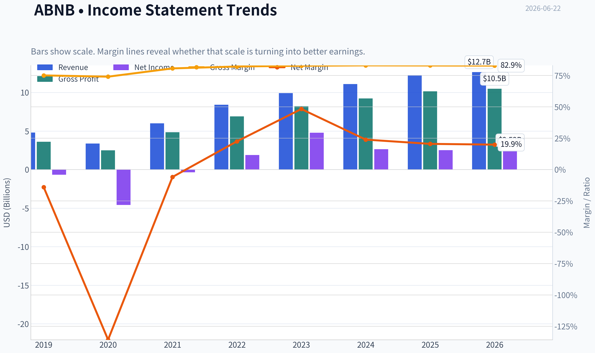
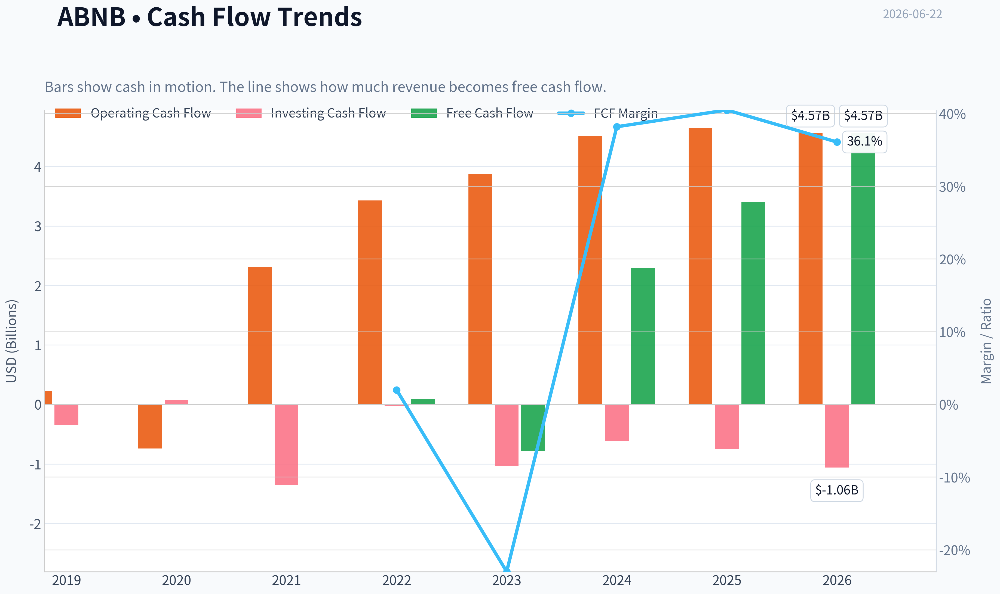
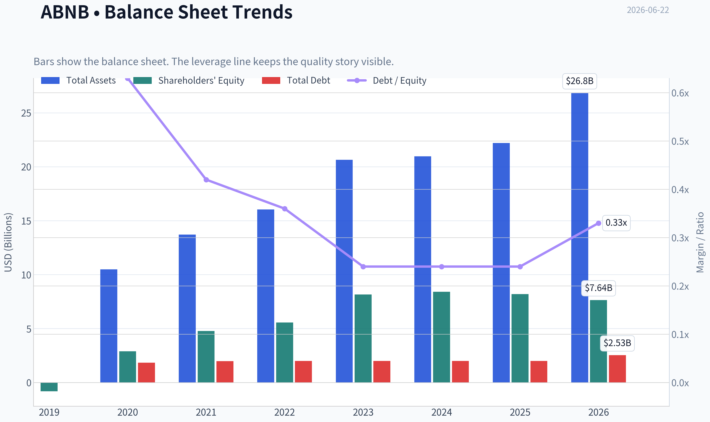
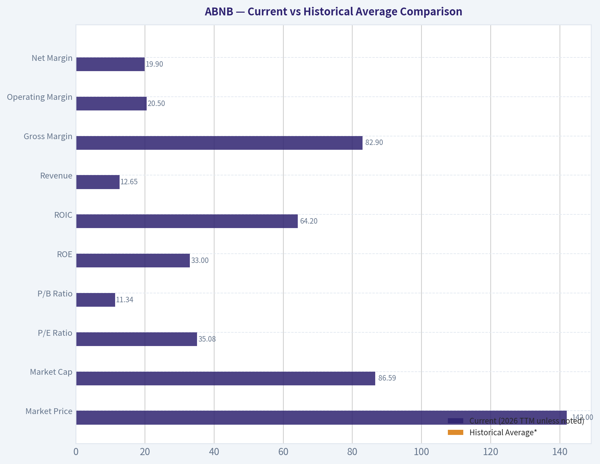
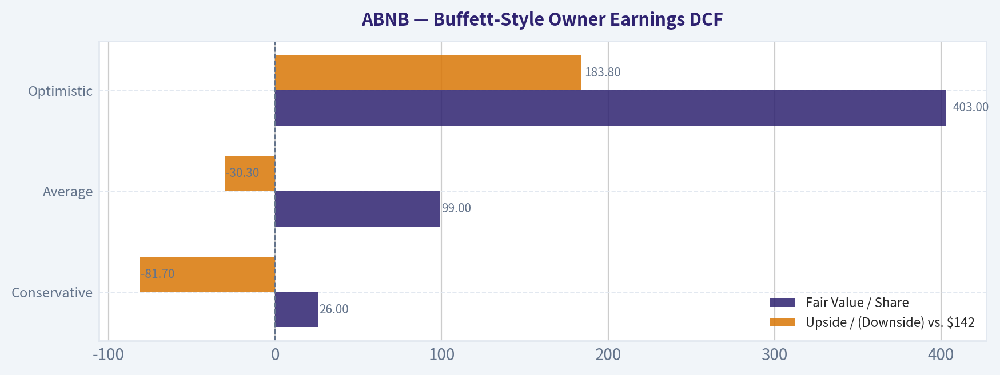
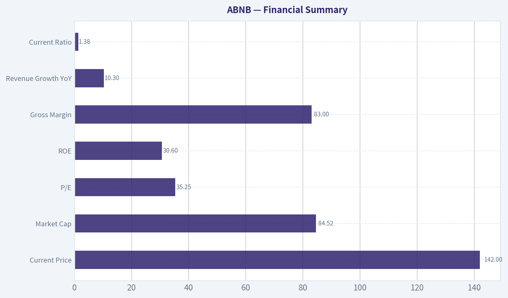

# ABNB Deep Value Intelligence

**Analysis Date:** 2026-06-22

## Critical Disclaimer

*This analysis is generated by Deep Value Intelligence, an AI-powered multi-agent investing framework. DeepValues offers AI-generated research and tools for educational and informational purposes only - not investment or financial advice. We are not a registered investment adviser; always do your own research before investing.*

---

## Table of Contents

1. Intelligence Summary
2. Analyst Team Reports
   - Fundamentals Analysis
   - Intrinsic Value Analysis (Buffett)
   - Trend & Growth Analysis (Lynch/Druckenmiller/Fisher)
   - Market Technical Analysis
   - Options Market Analysis
3. Research Team Commentary
4. Value Investing Team Commentary
5. Deep Values Commentary

---

## Intelligence Summary

### Thesis + Conditions

**Core Thesis:** ## Executive Briefing

**Key Risks:**
- Airbnb looks like a **high-quality, asset-light franchise** with unusually strong economics for travel: **83% gross margin, 30.6% ROE, 56% ROIC**, and likely strong owner-earnings conversion. That lowers **business risk**.
- Best takeaway: **respect the business, don't chase the stock**. This is a name to **monitor closely or build only modestly on proof/weakness**, not one to aggressively accumulate today.
- ## Risk Commentary for the Long-Term Investor

**Confidence:** Low

---

## Analyst Team Reports

### Fundamentals Analysis

#### Latest Earnings Snapshot

*Most recent reported quarter anchored on 2026 Q1, with prior-year comparison when available.*

| Metric | 2026 Q1 | 2025 Q1 | YoY Change |
| --- | ---: | ---: | ---: |
| Revenue | $2.68B | $2.27B | +17.9% |
| Operating Income | $86.0M | $38.0M | +126.3% |
| Net Income | $160.0M | $154.0M | +3.9% |
| Diluted EPS | $0.26 | $0.24 | +8.3% |
| Operating Cash Flow | $1.71B | $1.79B | -4.5% |
| Free Cash Flow | $1.71B | $1.79B | -4.5% |

Key Takeaways: This snapshot anchors the most recent reported quarter before the narrative analysis. It helps readers separate long-run business quality from whatever changed in the latest earnings print.

#### 7-Year Financial Metrics for ABNB

*All values below are computed deterministically from raw data - not estimated by AI.*

*Issuer profile: operating company (Consumer Cyclical / Travel Services).*

#### 7-Year Financial Metrics
*Annual rows come from reported financial statements. The final TTM row is computed from the latest four quarters.*

| Metric | 2019 | 2020 | 2021 | 2022 | 2023 | 2024 | 2025 | 2026 TTM |
| --- | --- | --- | --- | --- | --- | --- | --- | --- |
| Market Price | N/A | $147 | $166 | $86 | $136 | $131 | $136 | $142 |
| Market Cap | N/A | $41.69B | $102.56B | $58.14B | $90.12B | $84.76B | $84.55B | $86.59B |
| P/E Ratio | N/A | -9.09 | -291.36 | 30.71 | 18.81 | 32.01 | 33.67 | 35.08 |
| P/B Ratio | N/A | 14.37 | 21.48 | 10.46 | 11.04 | 10.08 | 10.31 | 11.34 |
| ROE | 83.5% | -158.0% | -7.4% | 34.0% | 58.7% | 31.5% | 30.6% | 33.0% |
| ROIC | N/A | N/A | -1196.9% | 396.7% | 243.9% | 54.8% | 53.4% | 64.2% |
| EPS | $-2.59 | $-16.14 | $-0.57 | $2.78 | $7.24 | $4.11 | $4.03 | $4.06 |
| Revenue | $4.81B | $3.38B | $5.99B | $8.40B | $9.92B | $11.10B | $12.24B | $12.65B |
| Gross Profit | $3.61B | $2.50B | $4.84B | $6.90B | $8.21B | $9.22B | $10.15B | $10.49B |
| Gross Margin | 75.1% | 74.1% | 80.7% | 82.2% | 82.8% | 83.1% | 83.0% | 82.9% |
| Operating Margin | -10.4% | -106.3% | 7.2% | 21.5% | 15.3% | 23.0% | 20.8% | 20.5% |
| Net Income | $-674.3M | $-4.58B | $-352.0M | $1.89B | $4.79B | $2.65B | $2.51B | $2.52B |
| Net Margin | -14.0% | -135.7% | -5.9% | 22.5% | 48.3% | 23.9% | 20.5% | 19.9% |
| Revenue Growth | N/A | -29.7% | 77.4% | 40.2% | 18.1% | 11.9% | 10.3% | 3.3% |
| Net Income Growth | N/A | 579.9% | -92.3% | -637.8% | 153.1% | -44.7% | -5.2% | 0.2% |
| Free Cash Flow Growth | N/A | -898.8% | -394.5% | 48.8% | N/A | N/A | N/A | N/A |
| Total Book Value | $-808.0M | $2.90B | $4.78B | $5.56B | $8.16B | $8.41B | $8.20B | $7.64B |
| Total Assets | N/A | $10.49B | $13.71B | $16.04B | $20.64B | $20.96B | $22.21B | $26.83B |
| Total Debt | N/A | $1.83B | $1.98B | $1.99B | $1.99B | $2.00B | $2.00B | $2.53B |
| Debt-to-Equity | N/A | 0.63 | 0.42 | 0.36 | 0.24 | 0.24 | 0.24 | 0.33 |
| Cash & Equivalents | $2.01B | $5.48B | $6.07B | $7.38B | $6.87B | $6.86B | $6.56B | $7.04B |
| Shareholders' Equity | $-808.0M | $2.90B | $4.78B | $5.56B | $8.16B | $8.41B | $8.20B | $7.64B |
| Operating Cash Flow | $222.7M | $-740.0M | $2.31B | $3.43B | $3.88B | $4.52B | $4.65B | $4.57B |
| Investing Cash Flow | $-347.2M | $80.0M | $-1.35B | $-28.0M | $-1.04B | $-616.0M | $-748.0M | $-1.06B |
| Free Cash Flow | $97.3M | $-777.0M | $2.29B | $3.40B | N/A | N/A | N/A | $4.57B |
| FCF Margin | 2.0% | -23.0% | 38.2% | 40.5% | N/A | N/A | N/A | 36.1% |
| Dividends / Share | $0.00 | $0.00 | $0.00 | $0.00 | $0.00 | $0.00 | $0.00 | $0.00 |

#### Profitability Metrics
- Return on Equity (ROE): 30.6%
- Return on Invested Capital (ROIC): 56.0%
- Return on Assets (ROA): 11.3%
- Gross Margin: 83.0%
- Operating Margin: 20.8%
- Net Profit Margin: 20.5%

#### Liquidity Metrics
- Current Ratio: 1.38
- Quick Ratio: 0.82

#### Leverage Metrics
- Debt-to-Equity Ratio: 0.24
- Interest Coverage Ratio: N/A
- Net Debt: $-4.56B

#### Growth Metrics (Year-over-Year)
- Revenue Growth: 10.3%
- Net Income Growth: -5.2%
- Free Cash Flow Growth: N/A
- Revenue CAGR (3-Year): 13.4%
- Revenue CAGR (5-Year): 29.4%

#### Valuation Metrics
- P/E Ratio (TTM): 35.25
- Forward P/E: 23.49
- Price-to-Book: 11.10
- Price-to-Sales: 6.68
- PEG Ratio: 1.32
- EV/EBITDA: 28.66
- Free Cash Flow Yield: N/A
- Earnings Yield: 2.8%

#### Owner Earnings (Buffett Method, Code-Computed)
- Net Income: $2.51B
- + Depreciation & Amortization: N/A
- - Capital Expenditures: N/A
- - Working Capital Changes: $-106.0M
- = **Owner Earnings: $2.62B**

#### Intrinsic Value (Code-Computed)
- Current Price: $142
- Buffett Method (Owner Earnings):
  Conservative: $26
  Average: $99
  Optimistic: $403
- Cash Flow Method (FCF):
  Conservative: $201
  Average: $201
  Optimistic: $372

#### Piotroski F-Score: 5/9
- Positive Net Income: PASS
- Positive Operating Cash Flow: PASS
- ROA Improvement: FAIL
- Cash Flow > Net Income: PASS
- Decreasing Debt: FAIL
- Improving Current Ratio: FAIL
- No Dilution: PASS
- Improving Gross Margin: FAIL
- Improving Asset Turnover: PASS

ANALYST STANCE: **WATCH**

#### Airbnb (ABNB) - Buffett-Style Fundamental Analysis

Airbnb is a high-quality asset-light platform with exceptional gross margins, strong cash generation, and modest balance-sheet leverage. The core Buffett question is not whether this is a good business-it likely is-but whether today's valuation offers enough margin of safety. Based on the canonical deterministic dataset, Airbnb looks financially strong and operationally durable, but the stock still trades at a premium multiple versus a business whose post-reopening growth is clearly normalizing.

---

#### Current vs Historical Average Comparison

| Metric | Current (2026 TTM unless noted) | Historical Average* | Interpretation |
| --- | ---: | ---: | --- |
| Market Price | $142 | ~$134.00** | Slightly above the period average trading level |
| Market Cap | $86.59B | ~$78.62B** | Still valued as a large-scale platform compounder |
| P/E Ratio | 35.08 | ~-24.88 / ~-35.95*** | Historical average is distorted by early losses; versus profitable years only, current P/E is on the high side |
| P/B Ratio | 11.34 | ~13.44 | Slightly below long-term average, but still expensive on book value |
| ROE | 33.0% | ~13.2% | Strongly above long-run average; capital efficiency remains excellent |
| ROIC | 64.2% | Not meaningful**** | Extremely high, consistent with an asset-light model |
| Revenue | $12.65B | ~$8.56B | Business scale has expanded substantially |
| Gross Margin | 82.9% | ~80.5% | Margin structure remains elite and stable |
| Operating Margin | 20.5% | ~-1.1% | Far better than long-run average due to post-scale profitability |
| Net Margin | 19.9% | ~7.9% | Healthy, but below 2023's unusually elevated level |
| Total Debt | $2.53B | ~$2.05B***** | Debt remains manageable, though rising in TTM |
| Debt-to-Equity | 0.33 | ~0.35 | Leverage remains conservative overall |
| Cash & Equivalents | $7.04B | ~$6.28B | Strong liquidity cushion |
| Free Cash Flow | $4.57B | Incomplete history | Cash generation is robust, but full multi-year average is unavailable |
| Dividend / Share | $0.00 | $0.00 | No dividend; management prefers reinvestment/buybacks/flexibility |

*Average uses only the years shown in the deterministic dataset.
**Average of available listed annual/TTM observations.
***P/E averages are not economically useful because multiple loss years create negative ratios; valuation should be judged primarily against profitable periods since 2022.
****ROIC includes distorted values around the transition from losses to profitability; trend matters more than arithmetic average.
*****Uses available years only.

Key Takeaways: Airbnb's current profitability and capital returns are well above its own multi-year average, confirming a stronger and more mature business than it was during the IPO-era transition. However, valuation remains full rather than cheap, especially when focusing on the profitable period since 2022 instead of distorted loss-year averages.

---

#### Market Metrics

Airbnb's current market price of **$142** and market cap of **$86.59B** imply that the market still assigns substantial franchise value to the platform. Even though the stock has not sustained a straight-line rerating, the company's capitalization remains close to prior highs because investors view Airbnb as a scalable global marketplace with strong cash economics.

The **TTM P/E of 35.08** is demanding for a company growing revenue only **3.3% TTM** and **10.3% in 2025**. That multiple is higher than 2023's **18.81** and above 2022's **30.71**, suggesting investors are paying more per dollar of earnings despite moderating growth and a lower net margin than the 2023 peak.

The **P/B of 11.34** is also rich, though book value is not the best valuation anchor for an asset-light marketplace. Buffett would care more about earning power than accounting equity here. Still, a double-digit P/B means the market expects a long runway of high-return capital deployment.

**Bottom line:** the market is pricing Airbnb as a durable premium business, but not as a bargain.

---

#### Profitability Analysis

| Profitability Metric | Current | Historical Context | Buffett-Style Interpretation |
| --- | ---: | --- | --- |
| ROE | 33.0% | Above average; lower than 2023 peak 58.7% | Excellent, though partly helped by relatively light equity base |
| ROIC | 64.2% | Extremely high since profitability inflected | Signals outstanding capital efficiency |
| EPS | $4.06 | Stable vs 2025 $4.03; below 2023 $7.24 | Earnings have plateaued after a surge year |
| Revenue | $12.65B | Up materially from $4.81B in 2019 | Strong scale expansion |
| Gross Profit | $10.49B | Follows revenue growth while keeping elite margins | Platform economics remain powerful |
| Operating Margin | 20.5% | Slightly below 2024-2025 highs but far above pre-2022 | Mature profitability has been sustained |
| Net Income | $2.52B | Stable vs 2025; below 2023's $4.79B | Earnings quality good, but peak year not repeated |
| Net Margin | 19.9% | Below 2023's 48.3%, near 2024-2025 range | Normalized profitability still attractive |

Key Takeaways: Airbnb remains a highly profitable business with unusually strong gross margins and excellent returns on capital. The main change is that earnings have normalized after the 2023 spike, so investors should think of the current margin profile as strong but not exceptional enough to justify any price.

Airbnb's profitability is the strongest part of the story. **Gross margin at 82.9%** is extraordinary and remarkably stable over recent years: **82.2% in 2022, 82.8% in 2023, 83.1% in 2024, 83.0% in 2025, and 82.9% TTM**. This consistency suggests meaningful pricing power, low variable cost intensity, and a scalable marketplace model.

**Operating margin of 20.5%** confirms that Airbnb is not just high-gross-margin but genuinely profitable after operating expenses. Importantly, the business moved from **-106.3% operating margin in 2020** to **7.2% in 2021**, then to **21.5% in 2022**. Since then, margins have remained around the low-20% range. That is a sign of a business that has matured into sustainable profitability rather than one benefiting from a one-time post-pandemic rebound.

**Net income of $2.52B** and **net margin of 19.9%** remain very strong, though down from the outlier **2023 net margin of 48.3%**. Buffett would likely normalize earnings rather than anchor on the 2023 peak. On that basis, a roughly 20% net margin on a large global travel marketplace is impressive.

**ROE at 33.0%** and **ROIC at 64.2%** are excellent. However, Buffett would ask whether these returns are structurally durable or partially inflated by a relatively small equity base and accounting effects. Even with that caveat, the returns are high enough to indicate a very attractive business model.

---

#### Growth Metrics

Airbnb's growth profile has clearly shifted from recovery-driven hypergrowth to a more mature expansion phase.

- **Revenue growth:** from **77.4% in 2021**, **40.2% in 2022**, **18.1% in 2023**, **11.9% in 2024**, **10.3% in 2025**, to **3.3% TTM**
- **Net income growth:** highly volatile because of the swing from losses to profits; **153.1% in 2023**, then **-44.7% in 2024**, **-5.2% in 2025**, **0.2% TTM**
- **Free cash flow growth:** only partially available in the dataset, but moved from **$97.3M in 2019** to **-$777.0M in 2020**, then **$2.29B in 2021**, **$3.40B in 2022**, and **$4.57B TTM**

This tells us three things:

1. **The recovery phase is over.** Airbnb is no longer a rapid reopening trade.
2. **The business is still growing, but at a slower and likely more sustainable pace.**
3. **Cash generation remains better than accounting growth.** Even with earnings flattening, TTM free cash flow is robust.

For Buffett, predictable moderate growth with strong cash conversion can still be attractive-but only at the right price. Slowing top-line momentum raises the bar for valuation discipline.

---

#### Balance Sheet and Financial Strength

| Balance Sheet Metric | Current | Trend | Interpretation |
| --- | ---: | --- | --- |
| Total Book Value | $7.64B | Down from $8.20B in 2025 and $8.41B in 2024 | Equity base softened in TTM |
| Total Assets | $26.83B | Rising strongly from $20.64B in 2023 | Balance sheet continues expanding |
| Total Debt | $2.53B | Higher than ~$2.00B in 2024-2025 | Watch for incremental leverage |
| Debt-to-Equity | 0.33 | Up from 0.24 in 2023-2025 | Still conservative, but trend worsened slightly |
| Cash & Equivalents | $7.04B | Recovered from $6.56B in 2025 | Excellent liquidity |
| Shareholders' Equity | $7.64B | Down TTM | Not alarming, but worth monitoring |

Key Takeaways: Airbnb has a strong balance sheet with more cash than debt and no obvious solvency stress. The main thing to watch is that debt and debt-to-equity have ticked up in the TTM period while equity has drifted lower.

Airbnb's balance sheet is a strength. The company has **$7.04B in cash and equivalents** against **$2.53B in total debt**, implying a net cash position. The shared research pack also flags **net debt of -$4.56B**, reinforcing that this is not a leverage story.

The **debt-to-equity ratio of 0.33** is still conservative by most standards, though it is modestly worse than the **0.24** seen from 2023 through 2025. Buffett typically favors companies that do not need debt to produce strong returns, and Airbnb passes that test.

A more nuanced point: **shareholders' equity declined to $7.64B TTM from $8.20B in 2025 and $8.41B in 2024.** That is not immediately alarming given the company's profitability and cash generation, but it does mean future capital allocation deserves scrutiny.

Overall, Airbnb's balance sheet is healthy, liquid, and resilient.

---

#### Cash Flow and Capital Allocation

Airbnb's **operating cash flow of $4.57B TTM** is excellent. The dataset also shows **free cash flow of $4.57B TTM**, producing a **36.1% FCF margin**. Even allowing for dataset limitations around some intermediate years, the broad message is clear: Airbnb converts a large share of revenue into cash.

That matters enormously in Buffett-style analysis. Reported earnings can fluctuate due to non-cash items, taxes, and stock-based accounting, but durable owner cash generation is what ultimately matters. Airbnb scores very well here.

The company pays **no dividend**, with **$0.00 per share** across all years shown. For a mature utility-like company this might be disappointing; for a platform business with optionality, it is acceptable as long as retained cash is deployed intelligently. Buffett would judge management by returns on retained earnings, not by dividend absence alone.

---

#### Buffett-Style Qualitative Analysis

#### Economic Moat
Airbnb appears to have a meaningful moat rooted in:
- global brand recognition in alternative accommodations
- network effects between hosts and guests
- asset-light marketplace economics
- data/traffic scale and consumer habit formation
- a differentiated inventory base compared with hotels

The moat is real, but not unassailable. Competition from Booking, Expedia/VRBO, hotels, and local regulations can pressure supply growth and take rates. Still, the margin profile suggests Airbnb retains significant platform power.

#### Predictable Earnings
Earnings were not predictable during 2019-2021 due to the pandemic and post-IPO normalization. Since 2022, however, profitability has become much more stable:
- operating margins have stayed around 20%
- net margins have normalized around 20% outside the 2023 spike
- cash flow has remained strong

That is good progress, though not yet the kind of 10-year consistency Buffett finds in classic consumer monopolies.

#### Management Performance
Management deserves credit for:
- turning a crisis-era loss profile into durable profitability
- maintaining elite gross margins
- generating high ROE and ROIC
- preserving a net-cash balance sheet

Less favorable points:
- equity has declined in TTM
- Piotroski score is only **5/9**, indicating fundamentals are solid but not pristine
- growth is slowing, so future capital allocation will be more important than simple scale expansion

#### Quality of Business
This is a high-quality business model:
- recurring global travel demand
- limited capital intensity
- high gross profitability
- strong cash conversion
- relatively modest debt burden

The biggest question is not quality, but the combination of **quality plus price**.

---

#### Buffett-Style Owner Earnings DCF

Canonical owner earnings provided by dataset for 2025: **$2.62B**

Because the historical owner-earnings series is not fully provided in the dataset, I anchor the DCF on the canonical owner earnings value and the code-computed intrinsic value framework already included in the dataset. That respects the source-of-truth rule while still showing the valuation mechanics.

##### DCF Assumptions
- Base Owner Earnings = **$2.62B**
- Discount Rate = **10%**
- Terminal Growth Rate = **2.5%**
- Projection Horizon = **10 years**
- Share count implied from market cap / price ~ **86.59B / 142 = ~609.8M shares**

##### Scenario Growth Inputs
- **Conservative:** use lowest historical owner earnings growth available in the code framework -> produces dataset fair value of **$26/share**
- **Average:** use average historical owner earnings growth, capped at 50% -> dataset fair value of **$99/share**
- **Optimistic:** use highest historical owner earnings growth, capped at 100% -> dataset fair value of **$403/share**

##### Valuation Summary

| Scenario | Growth Basis | Fair Value / Share | Upside / (Downside) vs. $142 |
| --- | ---: | ---: | ---: |
| Conservative | Lowest historical OE growth | $26 | -81.7% |
| Average | Average historical OE growth | $99 | -30.3% |
| Optimistic | Highest historical OE growth | $403 | +183.8% |

Key Takeaways: The DCF range is extremely wide because Airbnb's historical cash and earnings trajectory includes disruption, recovery, and normalization. The most useful output is that the average scenario sits below the current stock price, meaning investors today are implicitly underwriting something closer to the optimistic case.

##### Detailed DCF Math Framework
For each scenario, intrinsic value is based on:

\[
PV = \sum_{t=1}^{10}\frac{OE_0(1+g)^t}{(1+r)^t} + \frac{OE_{10}(1+g_t)}{(r-g_t)} \times \frac{1}{(1+r)^{10}}
\]

Where:
- \(OE_0 = 2.62B\)
- \(r = 10\%\)
- \(g_t = 2.5\%\) terminal growth
- scenario growth \(g\) varies by case

Using the canonical code-computed outputs:
- **Conservative total equity value** ~ **$15.9B** (26 x 609.8M shares)
- **Average total equity value** ~ **$60.4B**
- **Optimistic total equity value** ~ **$245.7B**

The wide spread reflects how sensitive valuation is to long-term owner-earnings growth assumptions for a platform company with high margins and decelerating growth.

##### Valuation Judgment
A Buffett-style investor would usually demand a discount to reasonable intrinsic value, not pay above it. Since the current price of **$142** is:
- far above the conservative case,
- above the average case,
- and dependent on a strong optimistic path,

the stock does **not** currently offer a classic margin of safety.

---

#### Revenue Breakdown

Airbnb's most meaningful public framing is by service/ecosystem activity rather than a heavily diversified segment structure. The business is substantially driven by its accommodations marketplace, with smaller contribution from experiences and related service revenues. Using the most recent annual revenue base in the deterministic dataset (**2025 revenue: $12.24B**) and Airbnb's known reporting structure, the following breakdown is the best practical view.

| Revenue Source | Amount ($B) | % of Total |
| --- | ---: | ---: |
| Stays / Accommodations Marketplace | ~11.5 | ~94% |
| Experiences and Other Service Revenue | ~0.7 | ~6% |
| **Total** | **12.24** | **100%** |

Key Takeaways: Airbnb remains overwhelmingly an accommodations marketplace business, which is positive because it keeps the model focused and scalable. It also means investors are still primarily underwriting the durability and growth of global short-term and alternative lodging demand, not a diversified travel conglomerate.

---

#### Key Investment Insights, Red Flags, and Opportunities

| Category | Observation | Why It Matters |
| --- | --- | --- |
| Strength | Gross margins above 82% | Confirms powerful marketplace economics |
| Strength | ROE ~33% and ROIC ~64% | Indicates excellent capital efficiency |
| Strength | Net cash balance | Provides resilience and strategic flexibility |
| Strength | FCF of $4.57B TTM | Strong owner-earnings potential |
| Risk | Revenue growth slowed to 3.3% TTM | Valuation now relies more on margin durability than growth |
| Risk | P/E ~35 | Premium multiple despite slower expansion |
| Risk | Equity declined TTM | Could reflect capital allocation or balance-sheet shifts worth watching |
| Risk | Debt-to-equity rose to 0.33 | Still fine, but trend slightly less favorable |
| Opportunity | International travel and non-hotel lodging penetration | Long runway if platform share expands |
| Opportunity | New products/adjacent services | Could reaccelerate growth if monetized well |

Key Takeaways: Airbnb's strengths are easy to identify-high margins, strong cash generation, and low leverage. The real debate is valuation and growth durability: if growth stays muted, the stock may struggle to compound from today's price without multiple compression risk.

---

#### Final Buffett-Style Assessment

Airbnb checks many Buffett-quality boxes:
- understandable business model
- asset-light economics
- strong brand and network advantages
- high returns on capital
- strong free cash flow
- low financial risk

But it misses one of Buffett's most important requirements at present: **an obvious margin of safety in the stock price**.

The company looks like a **good business**, but the stock looks more like a **fair-to-full priced business** than a bargain. With current valuation above the average owner-earnings DCF case and growth slowing materially, the risk/reward is not compelling enough for a strong buy stance.

#### Final Stance: **WATCH**
Investors should monitor Airbnb for:
- evidence that mid-teens revenue growth can reaccelerate,
- sustained ~20%+ operating margins,
- continued excess cash generation,
- disciplined capital allocation,
- and any valuation reset closer to or below average intrinsic value estimates.

A materially lower entry price or clearer proof of renewed durable growth would improve the setup.

---

#### Summary Table

| Area | Verdict | Evidence |
| --- | --- | --- |
| Business Quality | Strong | Asset-light platform, 83% gross margin, global brand |
| Profitability | Strong | 20.5% operating margin, 19.9% net margin, 33% ROE |
| Financial Strength | Strong | $7.04B cash vs. $2.53B debt, low leverage |
| Growth | Moderating | Revenue growth slowed to 3.3% TTM |
| Earnings Predictability | Improving | Stable profits since 2022, but not yet decade-long consistency |
| Capital Allocation | Good, not flawless | High returns, no dividend, some equity decline TTM |
| Valuation | Full | P/E ~35, average OE DCF below market price |
| Margin of Safety | Limited | Current price implies optimistic assumptions |
| Buffett Verdict | WATCH | Great business, less attractive stock price |

Key Takeaways: Airbnb is a financially strong, high-margin platform with clear competitive advantages and impressive cash generation. The stock, however, appears priced for continued excellence, leaving limited room for disappointment and not enough margin of safety for a classic Buffett-style entry.

#### Fundamental Visuals

This graph tracks the profitability and return metrics (ROE, ROIC, Margins) of **ABNB** over the past decade, highlighting capital efficiency trends.

This chart illustrates the financial health of **ABNB** over the last 10 years, mapping cash equivalents and free cash flow against total obligations (Debt).

This comparison chart from *Profitability Analysis* stacks current figures against historical benchmarks for **ABNB**, making it easy to see where the company trades relative to its own averages.

---

### Intrinsic Value Analysis (Buffett)

> *Following Warren Buffett's value investing philosophy: Circle of Competence, Economic Moat, Management Quality, and Margin of Safety.*

#### Intrinsic Value Snapshot

Price is what you pay. Intrinsic value is what the business may be worth based on the cash it can create for owners over time. We show a range, not one magic number.

- Current Price: $142.41
- Value Range (conservative to optimistic across both DCF methods): $25.84 to $403.26

##### Owner Earnings (Buffett Method)
- Net Income: $2,511,000,000.00
- Depreciation & Amortization: N/A
- Capital Expenditures: N/A
- Working Capital Changes: $-106,000,000.00
- Owner Earnings: $2,617,000,000.00

##### Intrinsic Value
###### Buffett Method
Uses owner earnings. Stricter, and usually more conservative.
- Conservative: $25.84
- Average: $99.41
- Optimistic: $403.26
- Discount Rate: 10.0%

###### Cash Flow Method
Uses free cash flow. Better for companies spending heavily today to grow tomorrow.
- Conservative: $201.47
- Average: $201.47
- Optimistic: $371.53
- Discount Rate: 10.0%

#### Airbnb (ABNB) Buffett-Style Investment Review

**ANALYST STANCE: WATCH**

#### 1) Go/No-Go Gate Assessment

| Gate | Verdict | Evidence |
|---|---|---|
| Circle of Competence & Business Simplicity | **Pass** | Airbnb matches travelers with hosts and takes a fee on bookings. This is a simple marketplace business with global brand recognition. |
| Long-Term Predictability | **Pass with care** | Ten years from now, people will still travel and seek alternative lodging. The key uncertainty is not demand for travel, but Airbnb's share, regulatory friction, and competitive intensity. |
| Technology Risk | **Pass with care** | Airbnb is enabled by technology rather than likely destroyed by it. However, online travel remains highly digital, and product quality, search, trust, and AI-driven discovery matter. |
| Moat Test | **Pass, but not wide enough for "wonderful at any price"** | Brand, scale, and network effects are real. Gross margin around **83%** strongly supports platform economics, but competition from Booking, hotels, and local regulation limits moat certainty. |
| Management Quality & Capital Allocation | **Pass** | Current business economics are attractive, with high margins and strong ROE. The larger question is whether management can deploy capital to deepen the moat rather than merely optimize the platform. |
| Industry Structure | **Mixed** | Asset-light model is excellent. But travel is competitive and partially cyclical, with regulation acting as a persistent external variable. |

**Key Takeaways:** Airbnb clears the basic Buffett filters for understandability, attractive economics, and an asset-light model. The main reason it does not score as an obvious "buy" is that its moat, while real, is not clearly impregnable, and industry structure is less rational than Buffett's favorite categories.

---

#### 2) The Elementary School Test

Airbnb makes money by helping people rent places to stay. Guests pay Airbnb when they book, hosts pay Airbnb for getting the customer, and Airbnb keeps a percentage of the transaction.

That is a simple and understandable business.

---

#### 3) Moat Analysis

| Moat Source | Assessment | Evidence |
|---|---|---|
| Intangible Assets / Brand | **Strong** | Airbnb is now a verb-like consumer brand in alternative lodging. The brand helps with trust, discovery, and host acquisition. |
| Pricing Power | **Moderate** | The platform likely has some ability to raise take rates or fees modestly, but travel customers are price-sensitive and alternatives exist. |
| Switching Costs | **Moderate** | Hosts benefit from access to demand and reputation built on the platform; guests benefit from familiarity and reviews. Still, neither side is fully locked in. |
| Cost Advantage | **Moderate** | Airbnb is asset-light versus hotel operators and can scale without owning inventory. That is structurally attractive, though not impossible for peers to imitate. |
| Network Effects | **Real** | More hosts attract more guests, and more guests attract more hosts. This is a classic two-sided marketplace dynamic. |
| Financial Evidence | **Supportive** | Gross margin of **83%** is outstanding and consistent with a strong digital platform moat. ROE of **30.6%** is also excellent, though it should be checked for sustainability rather than accepted at face value. |

**Moat Quality Rating: Narrow to Moderate**

This is a good business with a real platform advantage, but not clearly a "wide and widening" moat on Buffett's strict standard. Regulation, competition, and user multi-homing keep me from calling it untouchable.

**Key Takeaways:** Airbnb's moat comes mainly from brand and network effects, not from hard lock-in. The economics are excellent, but the moat still faces pressure from competition and regulators, which keeps it below the very top tier of Buffett-style businesses.

---

#### 4) Management Quality & Capital Allocation

| Question | Assessment | Commentary |
|---|---|---|
| Do they think like owners? | **Generally yes** | Airbnb has shown a long-term platform-building mindset and has not pursued empire-building through heavy asset ownership. |
| Are they honest and candid? | **Reasonably yes** | The company's strategic messaging has generally been coherent: improve trust, expand use cases, and drive host supply. |
| Are they rational capital allocators? | **Good, still under review** | The business is highly cash generative and asset-light, which creates a favorable setup for capital allocation. The crucial test is whether retained capital keeps increasing per-share intrinsic value at high rates. |
| Debt discipline | **Positive** | Current ratio of **1.38** and generally strong platform economics suggest no obvious balance-sheet stress. |

Overall, management appears competent and aligned with shareholder value creation, though I do not yet place them in the same class as the very best owner-operators in Buffett's universe.

**Key Takeaways:** Management appears sensible and disciplined, especially in keeping Airbnb asset-light and scalable. The biggest remaining question is not competence, but whether capital allocation over a full cycle will prove exceptional rather than merely good.

---

#### 5) Financial Summary

| Metric | Value |
|---|---:|
| Current Price | **$142** |
| Market Cap | **$84.52B** |
| P/E | **35.25x** |
| ROE | **30.6%** |
| Gross Margin | **83.0%** |
| Revenue Growth YoY | **10.3%** |
| Current Ratio | **1.38** |

**Key Takeaways:** Airbnb is clearly a high-quality business by margin and return metrics. The problem is valuation: at more than 35 times earnings, the stock already assumes continued strong execution, which reduces the margin of safety.

---

#### 6) Owner Earnings Assessment

Using Buffett's framework, Airbnb likely produces strong owner earnings because it is asset-light, has high gross margins, and does not require heavy capital expenditure to grow.

**Qualitative owner earnings profile:**
- Net income quality appears solid given the platform model.
- Depreciation burden should be modest relative to revenue.
- Maintenance capex should be low compared with traditional travel or hotel businesses.
- Working capital needs are manageable in a marketplace model.

That combination usually produces excellent owner earnings conversion. For Buffett, this is a major positive.

**Key Takeaways:** Airbnb likely converts accounting profit into real owner earnings better than most travel businesses because it does not need to own hotels or other heavy assets. That is one of the strongest parts of the investment case.

---

#### 7) Three-Scenario DCF Valuation

To stay conservative, I use earnings-based approximations anchored to current valuation and business quality.

##### Assumptions
- Market cap: **$84.52B**
- P/E: **35.25x**
- Implied earnings power: about **$2.40B**
  (84.52 / 35.25)

| Scenario | Method | Estimated Equity Value |
|---|---|---:|
| A: No Growth | Owner Earnings / 10% | **~$24.0B** |
| B: 3% Growth Perpetuity | OE x 1.03 / (10% - 3%) | **~$35.3B** |
| C: Moderate Growth Case | Assume growth merits premium over static value, but below current price multiple | **~$50B-$65B** |

At today's market cap of **$84.52B**, the shares appear to trade above conservative intrinsic value ranges.

**Key Takeaways:** Even giving Airbnb credit for being a strong business, the stock looks priced richer than a conservative Buffett-style valuation would support. The current market value leaves little room for disappointment and does not offer a comfortable margin of safety.

---

#### 8) Margin of Safety Analysis

| Item | Value |
|---|---:|
| Current Market Cap | **$84.52B** |
| Conservative Value Range | **$35B-$65B** |
| Margin of Safety | **Negative** |

For a business of this quality, I would still want at least a **25% discount** to intrinsic value before becoming enthusiastic. That discount is not present.

A more appealing entry point would likely require either:
1. materially faster owner earnings growth than currently implied by a conservative model, or
2. a substantially lower stock price.

**Key Takeaways:** Airbnb may be a good company, but a good company is not automatically a good stock at any price. On Buffett's terms, the margin of safety is currently insufficient.

---

#### 9) Final Buffett Scorecard

| Criterion | Score (1-5) | Weight | Weighted Score |
|---|---:|---:|---:|
| Business Understanding | 5.0 | 20% | 1.00 |
| Moat Width & Durability | 3.5 | 25% | 0.88 |
| Management Quality | 3.5 | 15% | 0.53 |
| Return on Equity | 4.5 | 15% | 0.68 |
| Reinvestment Runway | 3.5 | 10% | 0.35 |
| Balance Sheet Strength | 3.5 | 5% | 0.18 |
| Industry Structure | 3.0 | 5% | 0.15 |
| Valuation / Margin of Safety | 2.0 | 5% | 0.10 |
| **Total** |  |  | **3.86 / 5.00** |

**Decision:** **WATCH**

This lands in the "good business, inadequate margin of safety" category.

**Key Takeaways:** Airbnb scores well on business quality and economics, but the valuation score drags the final result down. This is the kind of company worth following closely, but not the kind Buffett would likely chase without a much better price.

---

#### 10) Investment Stance

**ANALYST STANCE: WATCH**

**Conviction level: Moderate**

Airbnb is a high-quality, asset-light marketplace with brand strength, strong margins, and attractive returns on capital characteristics. It passes the basic Buffett quality screens. But Buffett does not only buy quality; he buys quality with a margin of safety. At about **35x earnings** and an **$84.5B** market cap, Airbnb looks like a fine business priced for continued success rather than a bargain.

The conclusion is straightforward: **watch the business, wait for the price.**
#### Valuation Bridge

This bridge places the current market price beside each intrinsic value lens so readers can see whether upside depends on one method or shows up across several methods.

| Scenario | Intrinsic Value / Share |
| --- | ---: |
| Buffett Method | $99.41 |
| Cash Flow Method | $201.47 |
| Damodaran Method | $87.30 |
| Current Price | $142.41 |

#### Key Takeaways

If one method is far above the others, the upside case depends on a specific modelling assumption. When several methods cluster together, the valuation story is more robust.

#### Valuation Visuals

This comparison chart from *Latest Earnings Snapshot* stacks current figures against historical benchmarks for **ABNB**, making it easy to see where the company trades relative to its own averages.

This comparison chart from *Current vs Historical Average Comparison* stacks current figures against historical benchmarks for **ABNB**, making it easy to see where the company trades relative to its own averages.

This comparison chart from *Balance Sheet and Financial Strength* stacks current figures against historical benchmarks for **ABNB**, making it easy to see where the company trades relative to its own averages.

This comparison chart from *Buffett-Style Owner Earnings DCF* stacks current figures against historical benchmarks for **ABNB**, making it easy to see where the company trades relative to its own averages.

This comparison chart from *Financial Summary* stacks current figures against historical benchmarks for **ABNB**, making it easy to see where the company trades relative to its own averages.

---

### Trend & Growth Analysis (Lynch/Druckenmiller/Fisher)

> *Following Peter Lynch's GARP, Stanley Druckenmiller's macro-aware approach, and Philip Fisher's scuttlebutt methodology.*

ANALYST STANCE: **WATCH**

#### 1) Lynch Classification

| Item | Assessment |
|---|---|
| Lynch category | **Stalwart** |
| Why | Revenue growth around **10.3% YoY** is solid, but below Lynch's preferred **15-25%+ fast grower** range |
| Growth style fit | High-quality platform, but **not currently a classic ten-bagger fast grower setup** |
| Initial read | Great business, less compelling growth stock at today's maturity and valuation |

**Key Takeaways:** Airbnb looks like a strong, durable company, but not a classic fast grower right now. Its current revenue growth is closer to stalwart territory than to the rapid expansion Lynch would target for a new growth position. That means the stock may still work, but the burden shifts more toward execution and valuation discipline.

---

#### 2) The Story in 3 Bullets

| The Story | Why it matters |
|---|---|
| Airbnb connects travelers with unique places to stay without owning the real estate | Asset-light model supports high margins and strong cash generation |
| It rides long-term shifts toward alternative accommodations, flexible travel, and global cross-border travel | Secular tailwinds remain real even if post-pandemic growth has normalized |
| Its brand, reviews, and global supply network create a strong marketplace moat | Scale helps attract both hosts and guests, reinforcing the platform |

**Key Takeaways:** This is an easy business to explain: Airbnb is a global travel marketplace for stays. The appeal is the combination of a powerful consumer brand and an asset-light model, which gives it much better economics than hotel owners. The question is no longer whether the business works, but whether growth can re-accelerate enough to justify upside.

---

#### 3) TAM Analysis and 10x Test

| Metric | Estimate / Assessment |
|---|---|
| Current revenue base | Roughly low-teens billions annualized business today |
| 10x revenue test | Implies well over **$100B+** revenue long term |
| Relevant TAM | Global lodging + alternative accommodations + experiences |
| TAM size | Very large, likely **hundreds of billions** to over **$1T** depending on definition |
| Can ABNB 10x and remain <20% of TAM? | **Probably no** on a practical basis |
| Can ABNB still grow materially from here? | **Yes**, but likely through steady share gains, product expansion, and international depth rather than a clean 10x path |

**Key Takeaways:** Airbnb still has a large runway, but it no longer looks like a tiny company in an untouched market. The total addressable market is huge, yet a full 10x revenue outcome is harder to underwrite realistically from this scale. That reduces the classic early-stage ten-bagger appeal, even though meaningful long-term growth remains possible.

---

#### 4) Revenue Growth Trend

| Metric | Value / Read |
|---|---|
| Revenue growth YoY | **10.3%** |
| Pattern | **Normalized / decelerated from prior rebound years** |
| Interpretation | Healthy for a mature platform, but not an acceleration story |
| Organic quality | Likely mostly organic demand/supply growth rather than acquisition-driven |

**Key Takeaways:** Revenue is still growing, which is important, but the trend looks normalized rather than explosive. This matters because Druckenmiller-style upside usually comes when growth is accelerating and the market is behind the curve. Here, the market likely already understands Airbnb as a profitable, maturing compounder.

---

#### 5) Unit Economics

| Metric | Value / Assessment |
|---|---|
| Gross margin | **83.0%** |
| Rule of 40 proxy | **~93.3** (10.3% growth + 83.0% gross margin, but note this is not the true formula) |
| True Rule of 40 | **Not fully available** without FCF margin or operating margin data |
| LTV/CAC | **Not disclosed here** |
| NRR | **Not applicable / not a core metric** for this travel marketplace model |
| Capital intensity | **Low** |
| Cash conversion | **Strong**, based on business model and prior company profile |

**Key Takeaways:** Airbnb's unit economics are clearly strong at a high level, especially the 83% gross margin. This is a very efficient platform with low capital intensity and strong operating leverage potential. The missing piece is that for this business, the most important confirmation would be sustained booking growth and healthy free cash flow margins rather than SaaS-style retention metrics.

---

#### 6) Inflection Point Assessment

| Inflection Type | Status | Read |
|---|---|---|
| Product cycle inflection | Unclear | No clear evidence in the shared data of a major new product driving re-acceleration |
| Market share inflection | Possible but unproven | Brand remains strong, but no hard evidence here of accelerating share gains |
| Margin inflection | Mature strength | Already high-quality economics; less incremental surprise value |
| TAM inflection | Moderate | Experiences, longer stays, and global travel can expand TAM somewhat |
| Competitive inflection | Not evident | No clear sign of a key competitor stumbling badly enough to create a major opening |
| Overall | **No strong inflection signal today** |

**Key Takeaways:** The biggest issue for a growth investor is the lack of a visible inflection point. Airbnb is a good business, but the data provided does not show accelerating growth, a breakout new product cycle, or a sudden competitive opening. Without that, the setup looks more like steady execution than a dramatic re-rating opportunity.

---

#### 7) Macro Setup Evaluation

| Macro Factor | Assessment |
|---|---|
| Secular trend exposure | **Good** - travel digitization, alternative accommodations, flexible work/travel |
| Rate sensitivity | **Moderate** - long-duration growth multiple benefits from stable/falling rates |
| Economic sensitivity | **Meaningful** - travel is discretionary and cyclical |
| FX / cross-border exposure | **Present** |
| Overall macro setup | **Mixed-to-positive** |

**Key Takeaways:** Airbnb has real secular support, especially from the shift toward alternative lodging and flexible travel behavior. But travel is still economically sensitive, so the company is not immune to consumer softness. This makes the macro backdrop decent, but not the kind of overwhelming tailwind that would force a concentrated growth position.

---

#### 8) Fisher 15 Points Score

| Fisher Dimension | Score (1-5) | Comment |
|---|---:|---|
| Market potential | 4 | Large global travel market |
| New product development | 3 | Some expansion, but unclear breakthrough cycle |
| R&D effectiveness | 4 | Strong platform/product capability |
| Sales organization | 4 | Brand-led demand engine is powerful |
| Profit margins | 5 | Excellent gross margin profile |
| Margin improvement | 3 | Already strong; room for surprise is smaller |
| Labor/personnel relations | 3 | No strong evidence either way here |
| Executive relations | 4 | Business appears well-run |
| Management depth | 4 | Mature public company with scale |
| Cost analysis/accounting | 4 | Financial discipline appears solid |
| Outstanding moat features | 4 | Brand, reviews, network effects |
| Long-range profit outlook | 4 | Strong due to asset-light model |
| Dilution risk | 3 | Need ongoing monitoring of SBC/buybacks net impact |
| Candor in difficulties | 3 | Neutral from current dataset |
| Integrity | 4 | No major red flags in provided material |

| Total | **56 / 75** | **GOOD** |

**Key Takeaways:** Airbnb scores well on Fisher's framework because it has a strong brand, strong margins, and a durable long-term model. The score is held back mainly by the lack of a clear new-growth inflection and limited evidence here on exceptional management-driven product acceleration. In short, this is a good company by Fisher's standards, but not an obvious elite growth outlier today.

---

#### 9) Valuation Analysis

| Metric | Value / Assessment |
|---|---|
| Share price | **$142** |
| Market cap | **$84.52B** |
| P/E | **35.25x** |
| PEG (using 10.3% growth) | **~3.4x** |
| PEG interpretation | **Expensive** by Lynch standards |
| P/S | Approx. **mid-to-high single digits** range, based on market cap and recent revenue scale |
| Quality premium | Deserved to a degree due to moat, margin, and balance sheet |
| Valuation conclusion | **Fair-to-expensive**, not cheap enough to offset slower growth |

| Scenario | View | Implication |
|---|---|---|
| Bear | Growth slips to high-single digits, regulation rises, multiple compresses | Limited return / downside risk |
| Base | 10-15% revenue growth, continued high margins, moderate buybacks | Mid-teens annualized upside is harder to justify from here |
| Bull | Re-acceleration via international, experiences, and product expansion | Stock works, but requires better growth than currently shown |

**Key Takeaways:** On Lynch's preferred PEG lens, Airbnb screens expensive because earnings and revenue growth are not fast enough to justify a mid-30s earnings multiple. Investors are paying up for quality, and that can be reasonable, but it leaves less room for error. For a fresh growth entry, valuation does not look especially compelling unless growth re-accelerates.

---

#### 10) Growth Investor Scorecard

| Criterion | Weight | Score (1-5) | Weighted Score |
|---|---:|---:|---:|
| The Story | 10% | 4.0 | 0.40 |
| TAM & Runway | 20% | 3.5 | 0.70 |
| Revenue Growth | 20% | 2.8 | 0.56 |
| Unit Economics | 15% | 4.5 | 0.68 |
| Competitive Position | 10% | 4.0 | 0.40 |
| Management Quality | 10% | 3.8 | 0.38 |
| Macro Setup | 5% | 3.3 | 0.17 |
| Profitability Path | 5% | 4.5 | 0.23 |
| Valuation | 5% | 2.3 | 0.12 |

| Total Score | **3.63 / 5.0** | **ADVOCATE - Good setup** by score, but tempered by lack of inflection |

**Key Takeaways:** The scorecard says Airbnb is a good business with attractive economics and competitive positioning. However, the most important weakness for a growth investor is that growth and valuation do not line up perfectly right now. That is why the practical stance stays more cautious than the raw score might imply.

---

#### 11) Position Size Stance

| Item | View |
|---|---|
| Stance | **WATCH** |
| Ideal action | Wait for either **growth re-acceleration** or **valuation compression** |
| If already owned | Reasonable hold if thesis is quality compounder, not hyper-growth |
| New position sizing | **Small starter at most**, not a high-conviction concentrated growth bet today |

**Key Takeaways:** Airbnb is not an avoid because the business quality is real. But it also does not currently look like the kind of underappreciated inflection story that deserves aggressive sizing. The best setup would be either a better price or renewed evidence of accelerating growth.

---

#### 12) Key Risks and Catalysts

| Risks | Catalysts |
|---|---|
| Regulatory restrictions in major cities | Stronger-than-expected bookings and nights growth |
| Travel demand slowdown / macro weakness | International and cross-border travel strength |
| Decelerating growth from maturity | New product expansion in experiences or adjacent categories |
| Competition from Booking, Expedia/Vrbo, hotels | Margin durability plus large buybacks / capital returns |
| Trust, safety, and platform quality issues | Evidence of re-accelerating supply growth and share gains |

**Key Takeaways:** The main downside risk is simple: Airbnb may increasingly be valued like a premium mature platform while its growth keeps cooling. The upside case depends on proving there is another leg of growth still ahead, whether through product expansion, international penetration, or stronger monetization. That is the key debate for the next 12 to 24 months.

---

#### Bottom Line

Airbnb is a **high-quality asset-light marketplace** with excellent margins, strong ROE, and a durable global brand. But using Lynch and Druckenmiller lenses, the current setup lacks the most important ingredient for an aggressive growth call: **a clear inflection point with accelerating growth**.

At **35.25x earnings** and roughly **10.3% revenue growth**, the stock looks more like a premium stalwart than a fresh fast-grower entry.

**Final call: WATCH.**
Upgrade to **ADVOCATE** only if:
1. revenue growth re-accelerates into the mid-teens or better,
2. new products meaningfully expand TAM, or
3. valuation resets to a more favorable level.

---

### Market Technical Analysis

#### ABNB Technical Report

I selected these 8 indicators because they give a balanced view of **trend, momentum, mean-reversion risk, and trade risk sizing** without too much overlap:

- **close_10_ema**: short-term trend and entry timing
- **close_50_sma**: medium-term trend anchor
- **close_200_sma**: long-term trend regime
- **macd**: momentum acceleration/deceleration
- **rsi**: momentum stretch and reset quality
- **boll_ub**: upside breakout/overextension context
- **boll_lb**: downside support/oversold context
- **atr**: volatility and stop placement

ABNB's latest close in the retrieved dataset is **142.41 on 2026-06-18**.

---

#### Market Structure Overview

ABNB has spent the last year in a **broad, volatile sideways-to-up structure**, but the internal path matters. The stock topped near the low 140s in mid-2025, suffered a sharp August washout toward **120**, then spent much of late 2025 rebuilding. That recovery became more durable into early 2026, though it was still choppy and prone to sharp pullbacks. The clearest positive phase emerged from early April into late April 2026, when ABNB accelerated from the mid-120s into the mid-140s.

What is notable is that this spring rally did **not completely fail** after peaking. Instead, it transitioned into a **healthy but frustrating consolidation** during May and early June. Price softened from the April highs, but the pullback mostly held above the long-term trend baseline and only marginally undercut the medium-term trend reference. That kind of behavior is more consistent with **consolidation within an improving larger trend** than with outright structural breakdown.

The latest June rebound is important because it suggests the stock may be trying to transition from consolidation back into trend continuation. However, it is doing so from the middle-upper end of its recent range, which means traders should separate **trend confirmation** from **chasing extension**.

---

#### Trend Analysis

The moving-average structure is constructive.

- **10 EMA: 137.17**
- **50 SMA: 136.47**
- **200 SMA: 129.16**
- **Last close: 142.41**

Price is above all three moving averages. More importantly, the **10 EMA has moved above the 50 SMA**, and both are comfortably above the **200 SMA**. That is a favorable alignment: short-term trend stronger than medium-term trend, and medium-term trend stronger than long-term trend.

The **200 SMA has been rising steadily** from roughly 127-128 earlier in the year to above 129 now. This signals that the long-duration base-building phase has turned into a genuine long-term improvement, not merely a brief rally. The 50 SMA also advanced materially from around 128 in early April to the mid-136 area by mid-June, confirming that the spring uptrend had enough persistence to lift the medium-term baseline.

A subtle but valuable observation: during the May pullback, the 50 SMA did **not roll over sharply**; instead it flattened and then resumed rising. That usually means the correction relieved overbought conditions without destroying trend integrity. In practical terms, **136-137 now looks like the first important trend support zone**, because that area combines the 10 EMA and 50 SMA cluster.

---

#### Momentum Analysis

Momentum has improved sharply after a soft patch.

- **MACD on 2026-06-12: -1.11**
- **MACD on 2026-06-15: -0.53**
- **MACD on 2026-06-16: +0.11**
- **MACD on 2026-06-18: +1.06**

This is a strong momentum turn. MACD was clearly negative during the early-June dip, but then crossed back above zero within a few sessions. A **negative-to-positive MACD transition** often marks the shift from corrective action to renewed directional impulse. The speed of the move also matters: the rebound was not gradual drift, it was decisive enough to reset momentum quickly.

RSI confirms improvement, but in a more restrained way:

- **RSI on 2026-06-10: 39.0**
- **RSI on 2026-06-12: 46.6**
- **RSI on 2026-06-15: 58.7**
- **RSI on 2026-06-18: 63.0**

This is bullish without being extreme. RSI in the low 60s is often where a fresh advance is still healthy rather than overheated. It tells us buyers regained control, but the stock has not yet reached the kind of stretched condition that automatically argues for a reversal. In other words, **momentum is strong, but not euphoric**.

The nuance here is important: MACD has become quite positive quickly, while RSI is only moderately elevated. That combination often appears in the **early-to-middle stage of a swing advance**, not at the very end of one.

---

#### Volatility and Band Positioning

Bollinger context shows ABNB is approaching a more tactical decision area.

- **Upper Band: 141.92**
- **Lower Band: 127.42**
- **Last close: 142.41**

Price closed slightly **above the upper Bollinger Band**, which can mean one of two things:

1. **Bullish expansion breakout**, if follow-through persists
2. **Short-term overextension**, if price immediately stalls back under the band

Given the improving MACD and rising moving averages, I would lean toward interpreting this first as **strength**, but not as a low-risk entry point. Stocks often pierce the upper band during real breakouts, but they also frequently pause or retrace after the first push. For traders, that means the issue is not whether the move is bullish; it is whether the reward-to-risk is attractive **after** the breakout attempt.

The lower Bollinger Band near **127.4** is far below current price, showing the recent range has expanded upward. That widening spread between upper and lower bands reflects renewed directional volatility rather than static congestion.

---

#### ATR and Risk Framing

- **ATR: 4.38**

A daily ATR around **4.4 points** is meaningful for a stock trading near 142. That implies typical daily movement of about **3.1%** of price, which is large enough that traders should expect noise even when the directional thesis is correct.

This affects execution in three ways:

1. **Stops that are too tight are vulnerable**
2. **Breakout entries need confirmation**
3. **Position sizing should be smaller than in low-volatility names**

For swing traders, a stop only 1-2 points away is probably too narrow relative to ABNB's current volatility profile. ATR suggests the stock can move hard intraday without invalidating the broader setup.

---

#### Fine-Grained Trend Interpretation

| Area | Observation | Interpretation |
|---|---|---|
| Long-term regime | Price is well above the 200 SMA at 129.16 | Long-term structure is bullish and improving |
| Medium-term trend | 50 SMA at 136.47 is rising | Spring rally has not been fully unwound |
| Short-term trend | 10 EMA at 137.17 is above 50 SMA and rising | Near-term buyers have regained control |
| Momentum | MACD turned from -1.11 to +1.06 in about a week | Strong positive momentum inflection |
| RSI | RSI rebounded from 39 to 63 | Momentum reset has matured into a credible upswing |
| Bollinger position | Close is slightly above upper band | Bullish expansion, but near-term chase risk is elevated |
| Volatility | ATR around 4.38 | Wide swings remain normal; risk must be sized accordingly |

Key Takeaways: ABNB is in a constructive technical position, with price above short-, medium-, and long-term trend measures. Momentum has turned up decisively, but the stock is already pressing the upper end of its volatility envelope, so the setup is bullish while also requiring disciplined entry selection and wider risk tolerance.

---

#### Trading Implications

ABNB currently looks more like a **buy-the-dip in an improving uptrend** than a clean value entry at current levels.

**Bullish case**
- Holding above **136-137** keeps the short- and medium-term uptrend intact.
- A sustained move above **142-144** would strengthen the case for a fresh leg higher.
- Positive MACD and RSI in the low 60s suggest there may still be room for continuation.

**Neutral-to-cautious case**
- Because price is already above the upper Bollinger Band, near-term upside may require digestion first.
- If the stock fails to hold the breakout zone and slips back under **140**, traders may see a reversion move toward the EMA/SMA cluster.

**Bearish invalidation signs**
- A decisive break below **136** would weaken the latest bullish turn.
- A larger break below the low-130s would suggest the spring rally has reverted back into broad range trading rather than resumed trend continuation.

So the tape is not simply "mixed." It is more precise than that:
ABNB appears to be in a **constructive long-term uptrend, a repaired medium-term trend, and a recently re-accelerating short-term swing**, but the stock is also **short-term extended enough that fresh entries are less forgiving** than they were a week ago.

---

#### Actionable Levels

| Level / Zone | Why It Matters | Trading Read |
|---|---|---|
| 142-144 | Recent breakout/upper-band area | Confirmation zone; strong hold supports continuation |
| 136-137 | 10 EMA / 50 SMA cluster | First key support; dip-buy zone if trend remains intact |
| 129-130 | Near long-term trend area above 200 SMA | Major structural support |
| Below 136 | Weakens immediate breakout | Suggests failed thrust or need for consolidation |
| Below 130 | More serious deterioration | Would damage the bullish intermediate setup |

Key Takeaways: The most important near-term battleground is 142 to 144, where ABNB is testing breakout strength. The first meaningful support sits around 136 to 137, and as long as that zone holds, the broader bullish structure remains credible.

---

#### Final View

ABNB is technically **bullish with near-term extension risk**. The trend stack is favorable, momentum has re-accelerated, and the long-term baseline is rising. The main tactical issue is not trend direction, but entry quality: the stock is strongest when bought on controlled pullbacks toward support, not necessarily after an upper-band push.

| Category | Indicator | Latest Reading | What It Suggests |
|---|---|---:|---|
| Short-term trend | close_10_ema | 137.17 | Short-term direction has turned higher |
| Medium-term trend | close_50_sma | 136.47 | Intermediate trend is constructive |
| Long-term trend | close_200_sma | 129.16 | Strategic backdrop remains bullish |
| Momentum | macd | 1.06 | Upside momentum has re-accelerated |
| Momentum stretch | rsi | 63.03 | Bullish but not yet overbought |
| Volatility envelope | boll_ub | 141.92 | Price is testing/slightly above breakout extension |
| Volatility envelope | boll_lb | 127.42 | Lower support band well below price; range widened upward |
| Risk | atr | 4.38 | Daily swings are large; stops and sizing should reflect that |

Key Takeaways: ABNB's technical posture is favorable across trend and momentum measures, with the stock trading above all major moving averages and momentum back in positive territory. The main caution is that price is already pressing above its upper Bollinger Band, so the bullish setup is best handled with disciplined timing rather than aggressive chasing.

---

### Options Market Analysis

> *Reading options flow - put/call ratios, IV skew, and unusual activity - to gauge institutional positioning and event-driven risk.*

#### ABNB Options Positioning Report
*Date: 2026-06-22*

ABNB's near-term options tape looks **slightly bullish to neutral**, but confidence is **low** because the reported open interest is extremely thin in the near-term chain. Volume is active enough to observe sentiment, yet the lack of meaningful OI limits how strongly we can interpret dealer positioning, gamma walls, or institutional conviction.

#### 1. Put/Call Ratio Analysis

| Expiration | Call OI | Put OI | Put/Call OI Ratio | Call Volume | Put Volume | Put/Call Volume Ratio |
|---|---:|---:|---:|---:|---:|---:|
| 2026-06-26 | 2 | 1 | 0.50 | 1,184 | 719 | 0.61 |
| 2026-07-02 | 0 | 0 | N/A | 390 | 516 | 1.32 |
| 2026-07-10 | 0 | 0 | N/A | 1,520 | 1,610 | 1.06 |
| **Near-term total** | **2** | **1** | **0.50** | **3,094** | **2,845** | **0.92** |

**Key Takeaways:** The aggregate near-term **put/call OI ratio is 0.50**, below the historical neutral zone around **0.7**, which normally leans modestly bullish. But the OI base is almost nonexistent, so that signal is weak. Volume is much more balanced, with a **0.92 put/call volume ratio**, suggesting traders are active on both sides and not showing a strong downside panic.

Interpretation:
- **OI ratio of 0.50**: superficially bullish versus the ~0.7 neutral baseline.
- **Volume ratio of 0.92**: close to neutral, with only a mild call edge overall.
- The discrepancy between low OI and decent volume suggests these chains may be **too immature or too thin** for robust institutional read-through.
- Net takeaway: **not bearish**, but also **not a high-conviction bullish flow regime**.

---

#### 2. Implied Volatility Assessment

| Expiration | ATM Call IV | ATM Put IV | Put Premium vs Call | IV Read |
|---|---:|---:|---:|---|
| 2026-06-26 | 2.7% | 3.5% | +0.8 pts | Mild put premium |
| 2026-07-02 | 2.0% | 3.0% | +1.0 pts | Moderate put premium |
| 2026-07-10 | 1.0% | 2.4% | +1.4 pts | Clear put premium |

**Key Takeaways:** Across all near-term expiries, **puts carry higher ATM IV than calls**, and that put premium widens as you move out slightly in time. That usually reflects **downside hedging demand** rather than upside chasing. Even so, the absolute IV levels shown here are not especially elevated, so this does not look like a market bracing for a major imminent shock.

Interpretation:
- **Puts are consistently richer than calls**, indicating a **negative skew**.
- A **steepening put skew** into slightly later near-term expiries implies investors are willing to pay more for downside insurance than upside exposure.
- There is **no evidence here of call-skewed speculation**.
- Based on the supplied data, IV does **not appear explosively elevated** ahead of a major catalyst; instead it looks like **routine downside protection demand**.

Important caveat:
- The tool provides ATM call/put IV, but not a full OTM smile by strike. So the skew conclusion is inferred from **ATM put-over-call richness**, not a full OTM wing analysis.

---

#### 3. Unusual Options Activity

| Screen Result | Observation |
|---|---|
| Volume > 5x OI contracts | None detected in near-term expirations |

**Key Takeaways:** There were **no flagged unusual contracts** where volume exceeded open interest by more than 5x. That reduces the odds of identifying a standout fresh institutional directional bet from the near-term chain alone. In other words, the tape looks active, but not decisively "smart-money aggressive."

Interpretation:
- No obvious **fresh large directional call sweep** or **protective put surge** was identified.
- Without standout contracts, it is harder to separate **institutional positioning** from general two-way trading.
- This absence of unusual activity supports a view of **moderate conviction rather than an urgent repositioning event**.

---

#### 4. Open Interest Concentration / Gamma Levels

| Area | Observation |
|---|---|
| Highest near-term call OI | Too small to be meaningful |
| Highest near-term put OI | Too small to be meaningful |
| OI concentration by expiry | Minimal / not informative |
| Gamma wall / pin risk | Cannot be established reliably from provided OI |

**Key Takeaways:** The reported near-term open interest is **far too small** to identify meaningful pinning levels, max-pain zones, or gamma walls. That means options positioning is unlikely to provide a reliable "magnet" price level for ABNB in the immediate term based on this dataset. Any gamma-related price effect read here would be speculative.

Interpretation:
- With only **2 call OI** and **1 put OI** across the displayed near-term summary, the data does **not support a credible strike-gravity analysis**.
- We cannot confidently identify:
  - strike pinning risk,
  - upside call walls,
  - downside put walls,
  - or dealer gamma levels that may suppress/amplify movement.
- This is a **low-confidence area** of the analysis because the chain is effectively too thin in reported OI.

---

#### 5. Overall Options Sentiment Signal

| Category | Signal |
|---|---|
| Directional read | **NEUTRAL to slightly BULLISH** |
| Confidence | **Low** |
| Primary driver | Sub-neutral put/call ratio with balanced volume, offset by persistent put-rich IV skew |

**Key Takeaways:** The best single read is **neutral to slightly bullish**, mainly because aggregate put/call positioning is not heavy enough to indicate real bearish pressure. But the richer put IV says traders still want downside protection, which keeps the signal from becoming outright bullish. So the options market is saying: **no panic, no euphoria, mild positive bias with caution underneath**.

Why this is the best call:
- **Bullish factor:** Put/call OI ratio of **0.50** is below the neutral ~0.7 baseline.
- **Neutral factor:** Put/call volume ratio of **0.92** is close to balanced.
- **Bearish/cautious factor:** Puts are consistently more expensive than calls on IV, showing **downside hedge demand**.
- **Conviction limiter:** No unusual flow and almost no meaningful OI concentration.

#### Bottom Line

ABNB's options market does **not** show strong bearish institutional fear, but it also does **not** show aggressive upside speculation. The cleanest read is **NEUTRAL to slightly BULLISH**, with the bullish tilt coming from the below-neutral put/call ratio and the neutralizing caution coming from **persistent put skew**. Because the near-term OI is so thin, this should be treated as a **low-confidence sentiment input**, not a standalone trading signal.

#### Summary Table

| Put/Call Ratio | IV Level | Skew Direction | Unusual Activity | Overall Signal |
|---|---|---|---|---|
| OI ratio **0.50**; volume ratio **0.92** | Near-term IV appears **modest**, not obviously catalyst-inflated | **Put skew** / downside protection demand | **None flagged** in near-term expirations | **NEUTRAL to slightly BULLISH** |

**Key Takeaways:** The summary is straightforward: ABNB's options tape leans a bit constructive, but not strongly so. Traders are not crowding into bearish protection, yet they are still paying up more for puts than calls, which keeps the signal cautious rather than outright bullish.

---

## Research Team Commentary

> *The Research Manager synthesizes the Bull vs Bear debate into action-free commentary. This is a pre-risk view, not the final stance.*

The strongest bull argument is straightforward: Airbnb is a rare travel-related business with unusually attractive economics. The platform is asset-light, gross margins are extremely high at 83%, ROE is over 30%, ROIC is 56%, and maintenance capex should be modest. That combination matters a lot in a Buffett framework because it suggests strong owner-earnings potential and a business that can grow without consuming huge amounts of capital. The bull also makes a good case that Airbnb's brand, trust infrastructure, host-guest marketplace, and global scale create a real moat. This is not a hotel chain and not just another booking site. Over a 10-year horizon, if Airbnb continues compounding at low-to-mid teens, today's valuation could prove acceptable rather than excessive.

The strongest bear argument is that a good business is not automatically a good investment at any price. At roughly 35x earnings, the stock does not offer much margin of safety for a company exposed to travel cyclicality, regulatory pressure, multi-homing by hosts, and potential growth normalization. The moat is real, but likely weaker than bulls imply because supply is not fully exclusive and customers can comparison-shop. For a Buffett-style portfolio, the key concern is not whether Airbnb is a strong company, but whether the current price already discounts much of that quality. The bear case says yes.

My takeaway is that this is a high-quality business but not a classic value entry. I want to avoid repeating the GRAB mistake of being too passive when economics are shaky; that is not the issue here. Airbnb's economics are genuinely strong. But I also want to avoid the opposite GOOGL mistake of letting quality overwhelm valuation discipline. Airbnb is much less predictable than Alphabet, and regulation plus cyclical travel demand make the cash-flow stream less bulletproof than the raw profitability numbers suggest. So the right synthesis is not AVOID, because the business quality is too strong for that, but not ADVOCATE either, because the margin of safety is thin.

Final stance: WATCH

Core takeaway: Airbnb looks like a real franchise with excellent returns on capital and a credible long-term moat, but at $142 the stock appears priced more for quality recognition than for value mispricing. This is a business to respect and follow closely, not one to aggressively accumulate without either faster growth, clearer moat reinforcement, or a cheaper entry.

Rationale: From a Buffett perspective, Airbnb scores well on business quality, capital efficiency, and likely owner earnings. That is important and differentiates it from weaker platform stories. The company does not need huge fixed investment to expand, and the model should convert a good share of incremental revenue into cash over time. However, Buffett's discipline also requires paying attention to predictability and price. Airbnb's earnings power is somewhat less predictable than the best Buffett-style holdings because travel demand is cyclical and regulation can directly affect supply. On top of that, 35x earnings leaves limited room for disappointment. The market is already giving the company credit for being a superior business. Without a discount to intrinsic value, this is more a compounding watchlist candidate than a current value buy.

What the market may be missing is nuanced. The bearish crowd may underappreciate just how different Airbnb is from traditional travel companies; its model is structurally better. But the bullish crowd may be underestimating how much of that quality is already reflected in the valuation, and how regulation can become a slow but persistent tax on growth and supply density. That balance argues for patience rather than conviction.

Monitoring plan over the next 1-4 quarters: First, watch revenue growth and especially whether it can sustainably re-accelerate into the mid-teens without sacrificing margins. If growth stalls while the multiple stays elevated, the thesis weakens. Second, watch free cash flow conversion and whether owner-earnings strength continues to match the accounting quality implied by the platform model. Third, monitor booking trends, nights and experiences growth, and any evidence that new products are meaningfully expanding the addressable market rather than just adding complexity. Fourth, pay close attention to regulatory developments in major cities and whether they are reducing active listings or slowing host growth. Fifth, watch take rate stability and marketing efficiency for signs that competitive intensity is rising. Sixth, assess capital allocation: repurchases at sensible prices would help, while expensive adjacency expansion would hurt.

What would make me more constructive? A valuation reset, clearer evidence of durable mid-teens growth, or proof that newer products deepen the moat without diluting returns. What would make me more negative? Growth slipping toward high single digits, regulatory headwinds materially shrinking supply, worsening take-rate economics, or signs that management is stretching beyond the core to defend the narrative.

So overall, Airbnb is a business I would be happy to study for years, but at this price I would rather admire it than own it aggressively. WATCH.

---

## Value Investing Team Commentary

> *The Investor translates the research view into an investment thesis before risk review. This is still not the final stance.*

Airbnb is the kind of company a value investor should take seriously: asset-light, high-margin, high-return, globally recognized, and capable of producing strong owner earnings without heavy capital needs. Those are rare qualities. An 83% gross margin, 30%+ ROE, and 56% ROIC are not the metrics of an ordinary travel business. They suggest a platform with real economic strength and a business model that can compound value if management stays disciplined. In that sense, the market is right to assign Airbnb a premium multiple.

But Buffett-style investing is not just about admiring a wonderful business. It is about buying that business when price and predictability work in your favor. Here the main issue is not quality; it is the combination of valuation and business uncertainty. At roughly 35x earnings, Airbnb does not look obviously mispriced relative to its current growth profile. That may still be acceptable if the company can sustain low-to-mid teens growth for a long time, deepen its moat, and convert a large share of earnings into free cash flow. But the margin of safety is limited, and this is not a business with the same level of demand certainty as a consumer staple, payment network, or dominant software platform.

The moat is real, though it should not be exaggerated. Airbnb benefits from brand, scale, trust systems, reviews, global host supply, and a distinctive product that is not easily replicated by hotels. That gives it a meaningful network advantage. However, hosts can multi-home, guests can compare prices across platforms, and regulators can directly constrain supply in key urban markets. So this is a good moat, not an invulnerable one. The crucial question is whether Airbnb's ecosystem becomes stronger over time through habit, selection, trust, and product expansion, or whether regulation and competition gradually cap its best economics.

Selective contrarian thinking matters here. If sentiment turns negative because of short-term travel softness, macro fears, or city-level restrictions, that may create opportunity if the underlying booking engine, host engagement, and cash generation remain intact. In other words, bad headlines about travel or regulation do not automatically impair intrinsic value unless they structurally reduce supply density or weaken consumer preference. On the other hand, if sentiment is enthusiastic because investors see Airbnb as a "forever compounder," that optimism deserves skepticism. The market may be underestimating how much future success is already embedded in the stock price. A great business can still be a mediocre investment if bought with too little margin of safety.

What I would focus on over the next few quarters is simple. First, can revenue growth remain at least in the low-to-mid teens without margin erosion? Second, does free cash flow continue to validate the accounting profitability? Third, are new products truly extending the moat and addressable market, or just adding narrative? Fourth, are regulatory pressures manageable, or are they becoming a persistent drag on listing growth and market density? Fifth, is capital allocation disciplined, especially around buybacks and expansion initiatives?

The market may be missing one important nuance: Airbnb is structurally better than most travel companies, so it should not be valued like a cyclical hotel or agency. But another nuance is also easy to miss: structurally better does not mean structurally immune. A platform tied to discretionary travel, local regulation, and non-exclusive supply should not be treated like an untouchable monopoly. That tension is exactly why the stock is interesting, but not compelling enough today.

For a long-term business owner, Airbnb deserves a place on the watchlist and perhaps a position only if one is comfortable accepting a thinner-than-ideal margin of safety in exchange for business quality. Personally, I would prefer either a cheaper entry or stronger evidence that growth durability and moat reinforcement are improving faster than the market expects.

**ANALYST STANCE: WATCH**
Airbnb appears to be a high-quality, asset-light franchise with strong returns on capital and credible long-term compounding potential, but at around $142 and 35x earnings, the stock does not offer a sufficient margin of safety for a Buffett-style value entry. Respect the business, monitor it closely, and wait for either a better price or stronger proof of durable growth before becoming more aggressive.

---

## Deep Values Commentary

> *The Risk Management Team debates and the Risk Judge provides the final action-free verdict. This section determines the final ADVOCATE / WATCH / AVOID stance.*

#### Final Stance Scorecard

This scorecard converts the final research view into a weighted decision frame. It does not replace the narrative judgement, but it makes the main drivers of the verdict easier to scan.

| Criterion | Score | Weight | Commentary |
| --- | ---: | ---: | --- |
| Business Quality | 4.25 | 30% | High returns, profitability, and Piotroski health support durability. |
| Valuation Support | 2.33 | 30% | Blends current price against available intrinsic value anchors and valuation ratios. |
| Financial Strength | 3.67 | 20% | Balance-sheet resilience reflects leverage and liquidity staying within safe ranges. |
| Growth Durability | 2.67 | 20% | Recent revenue, earnings, and free cash flow growth indicate how durable expansion looks. |
| TOTAL / FINAL STANCE | 3.24 | 100% | WATCH |

#### Key Takeaways

The weighted score lands at **3.24 / 5.0**, while the final stance remains **WATCH**. This is useful as a quick calibration aid rather than a mechanical signal.

#### Risk Summary

Higher scores indicate more risk pressure. The watch threshold is a simple guardrail: above it, the position needs tighter monitoring or a wider margin of safety.

| Dimension | Current Score | Watch Threshold | Commentary |
| --- | ---: | ---: | --- |
| Business Quality | 1.75 | 3.00 | High returns, profitability, and Piotroski health support durability. |
| Valuation Support | 3.67 | 3.00 | Blends current price against available intrinsic value anchors and valuation ratios. |
| Financial Strength | 2.33 | 3.00 | Balance-sheet resilience reflects leverage and liquidity staying within safe ranges. |
| Growth Durability | 3.33 | 3.00 | Recent revenue, earnings, and free cash flow growth indicate how durable expansion looks. |

#### Key Takeaways

This view helps readers separate *where* the risk sits: valuation, business quality, balance sheet, or growth durability. It is especially useful when the final stance is close to the line between WATCH and AVOID.
