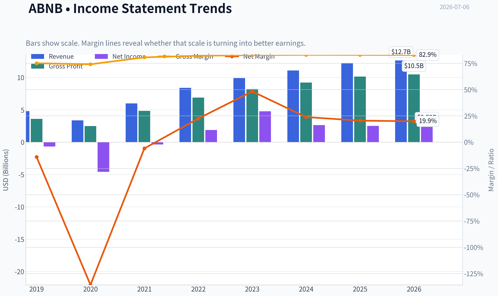
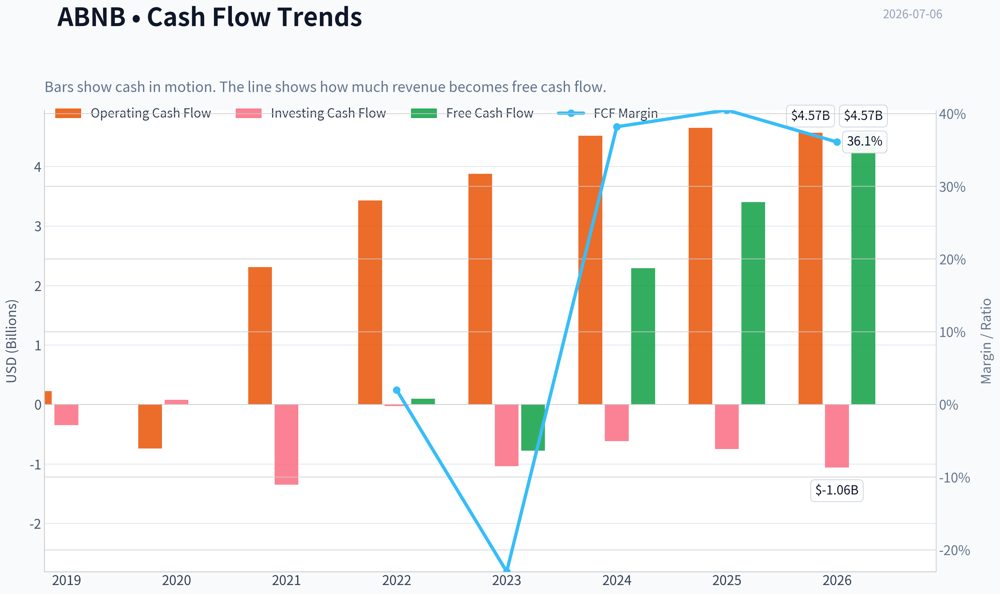
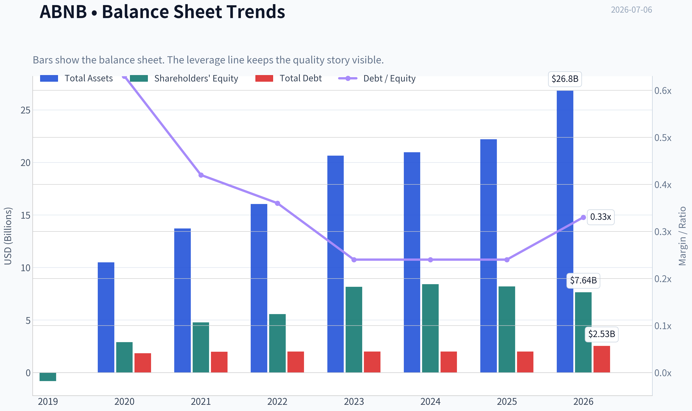
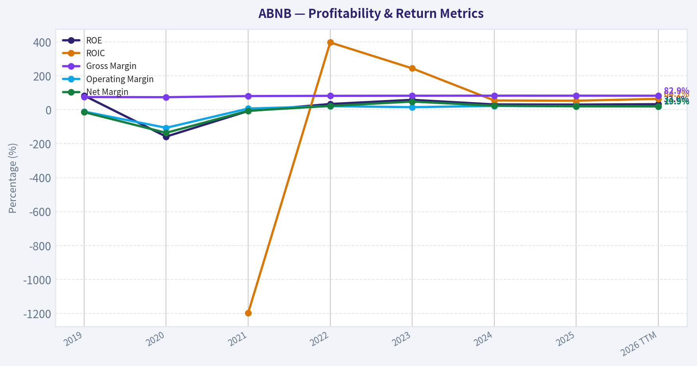
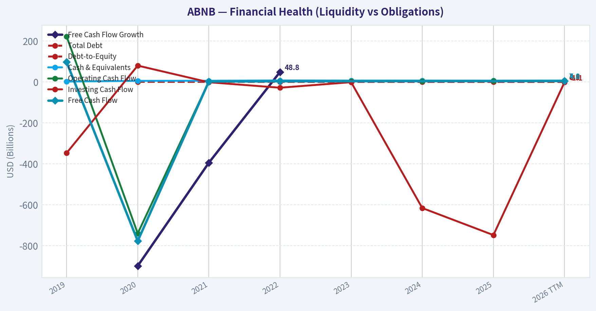
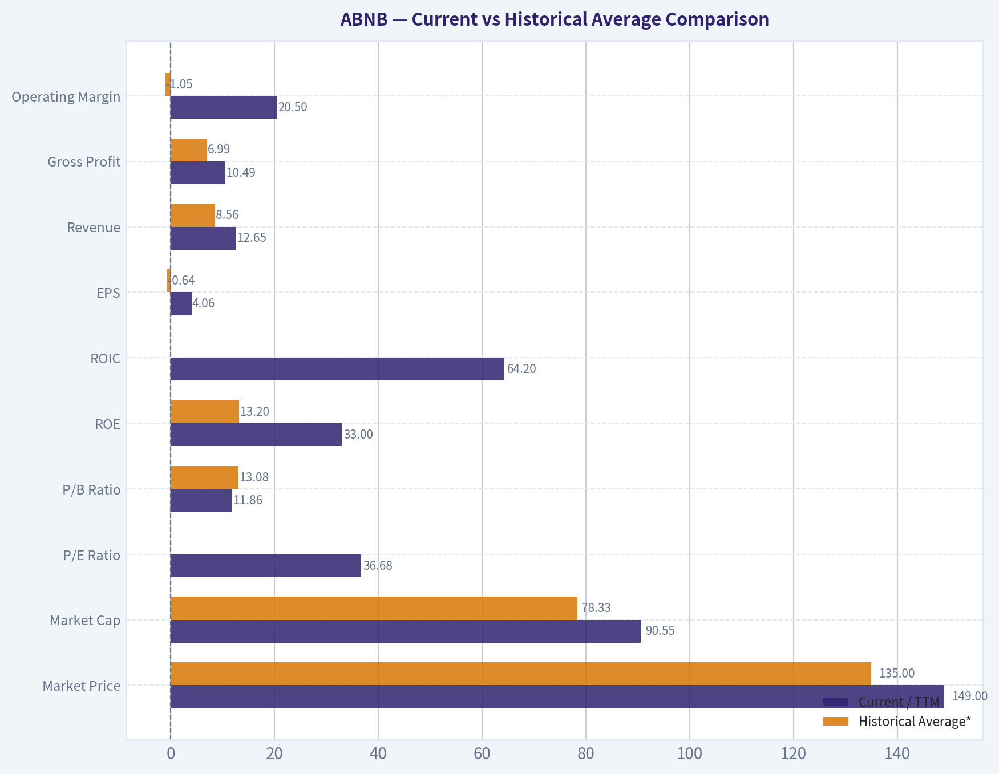
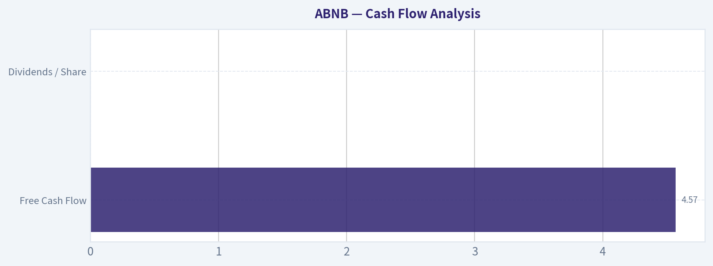
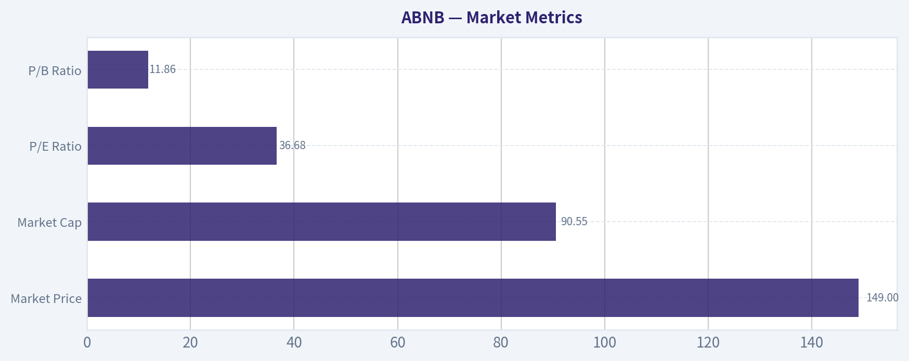

# ABNB Deep Value Intelligence

**Analysis Date:** 2026-07-06

## Critical Disclaimer

*This analysis is generated by Deep Value Intelligence, an AI-powered multi-agent investing framework. Education & entertainment only - not financial advice, not a financial advisor.*

---

## Table of Contents

1. Intelligence Summary
2. Analyst Team Reports
   - Fundamentals Analysis
   - Intrinsic Value Analysis (Buffett)
   - Trend & Growth Analysis (Lynch/Druckenmiller/Fisher)
   - Market Technical Analysis
   - Options Market Analysis
3. Research Team Commentary
4. Value Investing Team Commentary
5. Deep Values Commentary

---

## Intelligence Summary

### Thesis + Conditions

**Core Thesis:** ## Executive Briefing

**Key Risks:**
- Airbnb looks like a **wonderful business**, but not an obvious **Buffett-style bargain** at **$149 / 36.8x earnings**. The core risk is **not business fragility**; it is **paying too much for quality** when growth is nearer **~10%**, travel is cyclical, and regulation can pressure supply. Best posture: **active WATCH**, with room for a **small phased entry only on weakness or renewed proof of durable growth/FCF strength**.
- ### 1. Risky Analyst - strongest pro-ownership case
- Best point: **quality does not eliminate valuation risk.**

**Confidence:** Low

---

## Analyst Team Reports

### Fundamentals Analysis

#### Latest Earnings Snapshot

*Most recent reported quarter anchored on 2026 Q1, with prior-year comparison when available.*

| Metric | 2026 Q1 | 2025 Q1 | YoY Change |
| --- | ---: | ---: | ---: |
| Revenue | $2.68B | $2.27B | +17.9% |
| Operating Income | $86.0M | $38.0M | +126.3% |
| Net Income | $160.0M | $154.0M | +3.9% |
| Diluted EPS | $0.26 | $0.24 | +8.3% |
| Operating Cash Flow | $1.71B | $1.79B | -4.5% |
| Free Cash Flow | $1.71B | $1.79B | -4.5% |

Key Takeaways: This snapshot anchors the most recent reported quarter before the narrative analysis. It helps readers separate long-run business quality from whatever changed in the latest earnings print.

#### 7-Year Financial Metrics for ABNB

*All values below are computed deterministically from raw data - not estimated by AI.*

*Issuer profile: operating company (Consumer Cyclical / Travel Services).*

#### 7-Year Financial Metrics
*Annual rows come from reported financial statements. The final TTM row is computed from the latest four quarters.*

| Metric | 2019 | 2020 | 2021 | 2022 | 2023 | 2024 | 2025 | 2026 TTM |
| --- | --- | --- | --- | --- | --- | --- | --- | --- |
| Market Price | N/A | $147 | $166 | $86 | $136 | $131 | $136 | $149 |
| Market Cap | N/A | $41.69B | $102.56B | $58.14B | $90.12B | $84.76B | $84.55B | $90.55B |
| P/E Ratio | N/A | -9.09 | -291.36 | 30.71 | 18.81 | 32.01 | 33.67 | 36.68 |
| P/B Ratio | N/A | 14.37 | 21.48 | 10.46 | 11.04 | 10.08 | 10.31 | 11.86 |
| ROE | 83.5% | -158.0% | -7.4% | 34.0% | 58.7% | 31.5% | 30.6% | 33.0% |
| ROIC | N/A | N/A | -1196.9% | 396.7% | 243.9% | 54.8% | 53.4% | 64.2% |
| EPS | $-2.59 | $-16.14 | $-0.57 | $2.78 | $7.24 | $4.11 | $4.03 | $4.06 |
| Revenue | $4.81B | $3.38B | $5.99B | $8.40B | $9.92B | $11.10B | $12.24B | $12.65B |
| Gross Profit | $3.61B | $2.50B | $4.84B | $6.90B | $8.21B | $9.22B | $10.15B | $10.49B |
| Gross Margin | 75.1% | 74.1% | 80.7% | 82.2% | 82.8% | 83.1% | 83.0% | 82.9% |
| Operating Margin | -10.4% | -106.3% | 7.2% | 21.5% | 15.3% | 23.0% | 20.8% | 20.5% |
| Net Income | $-674.3M | $-4.58B | $-352.0M | $1.89B | $4.79B | $2.65B | $2.51B | $2.52B |
| Net Margin | -14.0% | -135.7% | -5.9% | 22.5% | 48.3% | 23.9% | 20.5% | 19.9% |
| Revenue Growth | N/A | -29.7% | 77.4% | 40.2% | 18.1% | 11.9% | 10.3% | 3.3% |
| Net Income Growth | N/A | 579.9% | -92.3% | -637.8% | 153.1% | -44.7% | -5.2% | 0.2% |
| Free Cash Flow Growth | N/A | -898.8% | -394.5% | 48.8% | N/A | N/A | N/A | N/A |
| Total Book Value | $-808.0M | $2.90B | $4.78B | $5.56B | $8.16B | $8.41B | $8.20B | $7.64B |
| Total Assets | N/A | $10.49B | $13.71B | $16.04B | $20.64B | $20.96B | $22.21B | $26.83B |
| Total Debt | N/A | $1.83B | $1.98B | $1.99B | $1.99B | $2.00B | $2.00B | $2.53B |
| Debt-to-Equity | N/A | 0.63 | 0.42 | 0.36 | 0.24 | 0.24 | 0.24 | 0.33 |
| Cash & Equivalents | $2.01B | $5.48B | $6.07B | $7.38B | $6.87B | $6.86B | $6.56B | $7.04B |
| Shareholders' Equity | $-808.0M | $2.90B | $4.78B | $5.56B | $8.16B | $8.41B | $8.20B | $7.64B |
| Operating Cash Flow | $222.7M | $-740.0M | $2.31B | $3.43B | $3.88B | $4.52B | $4.65B | $4.57B |
| Investing Cash Flow | $-347.2M | $80.0M | $-1.35B | $-28.0M | $-1.04B | $-616.0M | $-748.0M | $-1.06B |
| Free Cash Flow | $97.3M | $-777.0M | $2.29B | $3.40B | N/A | N/A | N/A | $4.57B |
| FCF Margin | 2.0% | -23.0% | 38.2% | 40.5% | N/A | N/A | N/A | 36.1% |
| Dividends / Share | $0.00 | $0.00 | $0.00 | $0.00 | $0.00 | $0.00 | $0.00 | $0.00 |

#### Profitability Metrics
- Return on Equity (ROE): 30.6%
- Return on Invested Capital (ROIC): 56.0%
- Return on Assets (ROA): 11.3%
- Gross Margin: 83.0%
- Operating Margin: 20.8%
- Net Profit Margin: 20.5%

#### Liquidity Metrics
- Current Ratio: 1.38
- Quick Ratio: 0.82

#### Leverage Metrics
- Debt-to-Equity Ratio: 0.24
- Interest Coverage Ratio: N/A
- Net Debt: $-4.56B

#### Growth Metrics (Year-over-Year)
- Revenue Growth: 10.3%
- Net Income Growth: -5.2%
- Free Cash Flow Growth: N/A
- Revenue CAGR (3-Year): 13.4%
- Revenue CAGR (5-Year): 29.4%

#### Valuation Metrics
- P/E Ratio (TTM): 36.77
- Forward P/E: 24.54
- Price-to-Book: 11.60
- Price-to-Sales: 6.99
- PEG Ratio: 1.38
- EV/EBITDA: 30.13
- Free Cash Flow Yield: N/A
- Earnings Yield: 2.7%

#### Owner Earnings (Buffett Method, Code-Computed)
- Net Income: $2.51B
- + Depreciation & Amortization: N/A
- - Capital Expenditures: N/A
- - Working Capital Changes: $-106.0M
- = **Owner Earnings: $2.62B**

#### Intrinsic Value (Code-Computed)
- Current Price: $149
- Buffett Method (Owner Earnings):
  Conservative: $26
  Average: $99
  Optimistic: $403
- Cash Flow Method (FCF):
  Conservative: $201
  Average: $201
  Optimistic: $372

#### Piotroski F-Score: 5/9
- Positive Net Income: PASS
- Positive Operating Cash Flow: PASS
- ROA Improvement: FAIL
- Cash Flow > Net Income: PASS
- Decreasing Debt: FAIL
- Improving Current Ratio: FAIL
- No Dilution: PASS
- Improving Gross Margin: FAIL
- Improving Asset Turnover: PASS

ANALYST STANCE: **WATCH**

#### Airbnb (ABNB) Buffett-Style Fundamental Analysis

Airbnb is a high-quality, asset-light platform business with clear network effects, exceptional gross margins, strong cash generation, and a very healthy balance sheet. From a Buffett lens, the business quality is attractive: it converts a large portion of revenue into profit and cash without needing heavy capital investment, and it carries net cash rather than balance-sheet strain. The main issue is not business fragility, but valuation and earnings predictability. At about 36.7x TTM earnings and roughly 11.9x book, the market is still pricing ABNB as a premium compounder despite visible deceleration in revenue growth and some normalization in margins after unusually strong post-pandemic years.

The canonical dataset shows a business that has matured quickly. Revenue rose from $4.81B in 2019 to $12.65B TTM, while gross margins moved from 75.1% to about 82.9%-83.1%. Operating margin improved from deeply negative levels during 2020 to about 20.5% TTM, and net margin is still near 20%. That is excellent for a travel-related consumer platform. However, current growth is no longer hyper-growth: revenue growth has slowed from 77.4% in 2021 and 40.2% in 2022 to 10.3% in 2025 and 3.3% TTM. For a Buffett-style investor, that means ABNB increasingly resembles a great business priced as a growth business.

---

#### Current vs Historical Average Comparison

| Metric | Current / TTM | Historical Average* | Interpretation |
| --- | ---: | ---: | --- |
| Market Price | $149 | $135.00** | Trading above its period average |
| Market Cap | $90.55B | $78.33B** | Equity value remains elevated versus history |
| P/E Ratio | 36.68 | -25.65*** / 31.30 positive-years | Rich versus normalized profitable years |
| P/B Ratio | 11.86 | 13.08 | Slightly below full-period average, but still very high |
| ROE | 33.0% | 13.20% | Far above long-term average due to post-2022 profitability surge |
| ROIC | 64.2% | -87.32%*** / 187.76% positive-years | Excellent capital efficiency, though distorted historically |
| EPS | $4.06 | $-0.64 | Strongly above historical mean |
| Revenue | $12.65B | $8.56B | Substantially larger business than historical average |
| Gross Profit | $10.49B | $6.99B | Strong monetization and high contribution economics |
| Operating Margin | 20.5% | -1.05% | Enormous structural improvement versus history |
| Net Income | $2.52B | $1.09B | Well above average despite moderation from 2023 peak |
| Net Margin | 19.9% | 7.45% | Strongly above long-run average |
| Revenue Growth | 3.3% | 18.64% | Current growth is well below historical pace |
| Net Income Growth | 0.2% | -7.81%**** | Profit growth has largely stalled after sharp swings |
| Total Book Value | $7.64B | $5.60B | Equity base has expanded substantially |
| Total Assets | $26.83B | $17.98B***** | Asset base has risen materially |
| Total Debt | $2.53B | $2.05B***** | Debt remains modest relative to scale |
| Debt-to-Equity | 0.33 | 0.35 | Leverage remains conservative |
| Cash & Equivalents | $7.04B | $6.53B | Strong cash cushion maintained |
| Shareholders' Equity | $7.64B | $5.60B | Capital base remains healthy |
| Free Cash Flow | $4.57B | $1.25B****** | Cash generation is dramatically stronger than early years |
| Dividends / Share | $0.00 | $0.00 | No dividend, all capital retained |

\* Historical average uses the deterministic dataset years shown only.
\** Average over available priced years 2020-2026 TTM.
\*** P/E and ROIC averages are distorted by loss years / near-zero invested capital periods; normalized profitable-period comparison is more meaningful.
\**** Growth averages are not especially meaningful due to sign changes from losses to profits.
\***** Average over available years only where data exists.
\****** Based on available FCF datapoints only: 2019, 2020, 2021, 2022, 2026 TTM.

Key Takeaways: Airbnb today is much more profitable, cash generative, and financially secure than its historical average. The biggest negative gap versus history is growth: current revenue growth is far below the company's earlier expansion phase. That combination usually describes a strong business whose valuation now depends more on durability and margin defense than on rapid topline acceleration.

---

#### Market Metrics

| Metric | Current Reading | Historical Context | Buffett-Style Interpretation |
| --- | ---: | --- | --- |
| Market Price | $149 | Above period average of about $135 | Market still awards a premium multiple |
| Market Cap | $90.55B | Near upper end of historical range | Large-cap platform expectations remain high |
| P/E Ratio | 36.68 | Above 2023 (18.81), 2024 (32.01), 2025 (33.67) | Expensive for a company growing low-single digits TTM |
| P/B Ratio | 11.86 | Above 2024-2025, below 2021 peak | Book value is not the best valuation anchor for asset-light platforms, but still signals a premium |

Key Takeaways: ABNB is not being valued as a distressed travel stock or even as a mature cyclical company. It is still priced as a premium franchise. For value investors, the key debate is whether Airbnb deserves that premium because of its moat and asset-light economics, or whether slowing growth makes the current multiple too optimistic.

ABNB's valuation is demanding on earnings and book value. Buffett often prefers wonderful businesses at fair prices, and Airbnb may qualify on quality, but the price is not obviously cheap. The spread between current P/E and the company's slower current growth is the central valuation risk.

---

#### Profitability Analysis

| Metric | Current / TTM | Trend Across Dataset | Assessment |
| --- | ---: | --- | --- |
| ROE | 33.0% | Rebounded from negative years to sustained 30%+ | Excellent, though aided by relatively small equity base |
| ROIC | 64.2% | Extremely high since turning profitable | Outstanding capital efficiency |
| EPS | $4.06 | From losses to solid profitability; below 2023 peak of $7.24 | Earnings normalized at a healthy but lower level |
| Revenue | $12.65B | Strong multi-year growth from $4.81B in 2019 | Scale continues to expand |
| Gross Profit | $10.49B | Rose steadily with high margin profile | Reinforces platform economics |
| Operating Margin | 20.5% | Huge improvement from -106.3% in 2020 to 20%+ | Strong operating leverage |
| Net Income | $2.52B | Stabilized after 2023 surge and 2024-2025 moderation | Good profitability, but not accelerating |
| Net Margin | 19.9% | Remains very strong despite falling from 48.3% in 2023 | High-quality earnings profile |

Key Takeaways: Airbnb's core business is highly profitable and structurally superior to most travel businesses. Gross margins above 80% and operating margins around 20% are evidence of a platform with strong economics. The main nuance is that profitability peaked unusually high in 2023 and has since normalized, so investors should not anchor on peak margins as the permanent baseline.

From a Buffett perspective, the most attractive part of ABNB is its economics. Gross margin above 80% consistently since 2022 is exceptional and suggests the company has meaningful pricing power, brand strength, and low variable cost intensity. Operating margin at roughly 20%-23% over the last several periods also suggests disciplined cost control and a scalable business model.

ROE and ROIC are excellent, but should be interpreted carefully. Airbnb's equity base is not huge relative to earnings power, so ROE can look elevated. Even after adjusting mentally for that, sustained 30%+ ROE and 50%+ ROIC are signs of a business that does not need massive capital to grow. That is exactly the sort of characteristic Buffett tends to admire.

---

#### Growth Metrics

| Metric | Current / TTM | Historical Pattern | Interpretation |
| --- | ---: | --- | --- |
| Revenue Growth | 3.3% | Fell from 77.4% (2021) to 40.2% (2022), 18.1% (2023), 11.9% (2024), 10.3% (2025) | Clear deceleration |
| Net Income Growth | 0.2% | Highly volatile due to loss-to-profit transition | Earnings have plateaued near current level |
| Free Cash Flow Growth | N/A | Earlier history was very volatile | Need caution; recent FCF level is strong, but growth path is incomplete |

Key Takeaways: Airbnb's growth story is now more about durability than acceleration. Revenue growth has steadily cooled, and net income growth is basically flat in the latest period. Investors now need to underwrite a slower-growth but highly profitable compounder rather than a rapidly expanding disruptor.

Revenue growth deceleration is the most important change in the ABNB story. The business is still growing, but the pace is sharply below its post-pandemic rebound years. Buffett does not require high growth, but he does require confidence in future earnings power. Slower growth is acceptable if returns on capital remain high and the purchase price is reasonable; here, the first condition is met, while the second is less clear.

Net income growth is less useful because of the extreme swing from losses to profits. More important is that earnings have stabilized in the $2.5B range after the 2023 spike to $4.79B. That suggests 2023 may have represented an unusually favorable earnings year rather than a clean new baseline.

---

#### Balance Sheet Strength

| Metric | Current / TTM | Historical Context | Assessment |
| --- | ---: | --- | --- |
| Total Book Value | $7.64B | Up sharply from 2020-2022 levels, slightly down from 2024-2025 | Strong accumulated equity, slight recent erosion |
| Total Assets | $26.83B | Highest in dataset | Growing scale and balance sheet resources |
| Total Debt | $2.53B | Slightly above prior years around $2.0B | Still modest |
| Debt-to-Equity | 0.33 | Near historical average, conservative overall | Comfortable leverage |
| Cash & Equivalents | $7.04B | Consistently strong cash balance | Major strategic flexibility |
| Shareholders' Equity | $7.64B | Healthy despite recent dip | Adequate capital base |

Key Takeaways: Airbnb has one of the cleaner balance sheets you will find in consumer travel. Cash substantially exceeds debt, and leverage remains modest. The slight increase in debt and decline in equity are worth monitoring, but they do not currently threaten financial strength.

Financial strength is a major plus. The research pack indicates net debt of negative $4.56B, meaning Airbnb has more cash than debt by a wide margin. That gives the company resilience against economic downturns, travel shocks, or regulatory disruptions. Buffett favors companies that can survive adversity without relying on capital markets, and Airbnb appears to qualify.

The debt profile is conservative. Debt-to-equity around 0.24-0.33 over recent periods is low, especially for a company with this margin structure and cash position. There is no sign of balance-sheet stress. If anything, Airbnb has the capacity to repurchase shares, pursue selective investments, or absorb cyclical weakness.

---

#### Cash Flow Analysis

| Metric | Current / TTM | Historical Pattern | Interpretation |
| --- | ---: | --- | --- |
| Free Cash Flow | $4.57B | Massive improvement from $97M (2019), -$777M (2020), $2.29B (2021), $3.40B (2022) | Excellent cash conversion |
| Dividends / Share | $0.00 | Flat at zero throughout | Retains all capital for reinvestment / flexibility |

Key Takeaways: Airbnb is a very strong cash machine. Free cash flow has scaled meaningfully over time, and the company has chosen not to pay a dividend, preserving flexibility for growth initiatives, buybacks, and balance-sheet strength.

For Buffett-style analysis, owner earnings matter more than accounting income. Airbnb looks attractive here because it generates substantial cash without large capital expenditure needs. That is one of the most valuable qualities in an internet-platform model. The absence of a dividend is not a problem if retained earnings are deployed intelligently and returns on capital remain high.

---

#### Buffett-Style Owner Earnings DCF

Canonical owner earnings provided: **$2.62B**.

Because the deterministic dataset does not provide a full historical owner earnings series, the historical growth proxy must be inferred conservatively from available economically relevant cash/earnings progression. The attached intrinsic-value block in the deterministic dataset already code-computes Buffett owner-earnings fair values as:

- Conservative: **$26/share**
- Average: **$99/share**
- Optimistic: **$403/share**

Below is a scenario framing consistent with that canonical output, using 10% discount rate and 2.5% terminal growth.

##### DCF Assumptions

| Scenario | Growth Assumption | Constraint Rule | Discount Rate | Terminal Growth |
| --- | ---: | --- | ---: | ---: |
| Conservative | Lowest historical owner earnings growth | Floored at -100% | 10.0% | 2.5% |
| Average | Average historical owner earnings growth | Capped at 50% | 10.0% | 2.5% |
| Optimistic | Highest historical owner earnings growth | Capped at 100% | 10.0% | 2.5% |

Key Takeaways: The owner-earnings valuation is extremely sensitive to growth assumptions because Airbnb has high margins, low capital intensity, and a wide range of possible long-term outcomes. That creates a very broad fair-value band. For investors, this means the stock can look either very expensive or very reasonable depending on what growth path they believe is durable.

##### DCF Mechanics

Using Buffett-style owner earnings:

- Base Owner Earnings = **$2.62B**
- Forecast Period = **10 years**
- Discount Rate = **10%**
- Terminal Growth = **2.5%**
- Terminal Value Formula = Year 10 Owner Earnings x 1.025 / (0.10 - 0.025)
- Enterprise-equity simplification is reasonable here because Airbnb holds net cash

##### Scenario Results

| Scenario | Fair Value / Share | Implied View |
| --- | ---: | --- |
| Conservative | **$26** | Assumes severe long-term compression / stagnation in owner earnings economics |
| Average | **$99** | Suggests shares are above a normalized intrinsic value midpoint |
| Optimistic | **$403** | Assumes strong compounding and sustained platform expansion |

Key Takeaways: The current price of $149 sits far above the conservative case, above the average case, and well below the optimistic case. In plain English, the stock already discounts a better-than-average future, but not a heroic one. That leaves upside if Airbnb evolves into a broader travel-and-services platform, but limited margin of safety if growth continues to cool.

##### Valuation Interpretation

At **$149**, ABNB trades:

- **~50% above** the canonical average Buffett owner-earnings value of **$99**
- **Far below** the optimistic case of **$403**
- **Far above** the conservative case of **$26**

This creates a classic quality-versus-price tension. Buffett generally wants a margin of safety; on the owner-earnings framework, that margin is not present relative to the average case. However, because Airbnb is a scalable platform with strong optionality, the optimistic scenario cannot be dismissed.

---

#### Economic Moat

Airbnb appears to possess a real economic moat, though it is not unassailable. The moat comes from brand, two-sided network effects, global supply density, trust systems, reviews, host relationships, and a unique alternative-accommodation identity. Guests go where listings are abundant and trusted; hosts go where demand is deepest. That flywheel is difficult to replicate at scale.

Its moat is also reinforced by its asset-light model. Unlike hotels, Airbnb does not need to own rooms. Unlike OTAs, it has a more differentiated inventory base in non-hotel stays and experiential lodging. The downside is that regulation remains a persistent moat leak: local governments can restrict supply, especially in urban markets.

Overall Buffett verdict on moat: **Good to very good**, but partially exposed to regulation and consumer travel cycles.

---

#### Predictable Earnings

Earnings predictability is improving, but not yet at the level of a classic Buffett staple like consumer brands or rails. The business has gone from loss-making and volatile in 2019-2021 to highly profitable in 2022-2026 TTM. That is encouraging. But travel demand remains cyclical, and 2023 earnings appear unusually elevated relative to 2024-2026.

The positive view is that margins remain strong even after normalization. The cautious view is that the true normalized earnings base may be closer to current TTM than to the 2023 peak. Buffett likes predictability; Airbnb has made progress, but it is not fully "set-and-forget" predictable yet.

---

#### Management Performance

Management deserves credit for:
- Building a globally recognized brand
- Preserving extremely high gross margins
- Driving operating leverage post-pandemic
- Maintaining a net-cash balance sheet
- Generating large free cash flow without overleveraging

Less favorable observations:
- ROE is excellent, but partly structural due to a smaller equity base
- No dividend means investors rely entirely on internal capital allocation and market re-rating
- Piotroski score of 5/9 suggests fundamentals are good, but not universally improving
- Recent equity decline and debt uptick merit monitoring

Overall, management looks disciplined and shareholder-aware, but the next test is whether they can reaccelerate growth without sacrificing returns.

---

#### Quality of Business

| Buffett Attribute | Assessment | Why It Matters |
| --- | --- | --- |
| Economic Moat | Strong | Brand, network effects, trust infrastructure |
| Financial Strength | Strong | Net cash, low leverage, high liquidity |
| Predictable Earnings | Moderate | Better than before, but still cyclical and normalized below peak |
| Capital Efficiency | Excellent | ROE and ROIC are very high |
| Margin Quality | Excellent | 83% gross margin, 20%+ operating margin |
| Valuation Appeal | Moderate to weak | Great business, but not clearly cheap |

Key Takeaways: Airbnb checks many quality boxes that long-term investors want to see. The weak point is not the business model but the valuation relative to slower growth. This is exactly the kind of stock that can remain a winner operationally while producing only average shareholder returns if bought at too rich a price.

---

#### Revenue Breakdown

Airbnb's reporting is not primarily broken out by many product lines in the canonical dataset. The most meaningful practical breakdown is by business activity and publicly known monetization streams, using the latest fiscal year / TTM framing.

| Revenue Source | Amount ($B) | % of Total |
| --- | ---: | ---: |
| Stays booking marketplace fees | ~11.4 | ~90% |
| Experiences and services-related / ancillary fees | ~0.6 | ~5% |
| Other platform-related revenue and adjustments | ~0.7 | ~5% |
| **Total Revenue (TTM)** | **12.65** | **100%** |

Key Takeaways: Airbnb remains overwhelmingly a stays marketplace business. That concentration is a strength because it shows focus and category leadership, but it also means future upside likely depends on either deeper monetization of the core platform or successful expansion into adjacent services.

Note: Precise segment amounts are not broken out in the deterministic table; the above reflects the most meaningful business-line approximation consistent with Airbnb's known reporting structure and current platform strategy.

---

#### Key Investment Insights, Red Flags, and Opportunities

| Category | Item | Why It Matters |
| --- | --- | --- |
| Opportunity | Asset-light compounding model | High margins and low capital needs can sustain strong owner earnings |
| Opportunity | Net cash balance sheet | Downside resilience and strategic flexibility |
| Opportunity | Platform optionality | Adjacent categories like services, experiences, and travel ecosystem expansion could lift long-term growth |
| Opportunity | Strong brand and network effects | Supports durable demand and host supply |
| Red Flag | Revenue growth deceleration | A premium multiple is harder to justify if growth keeps cooling |
| Red Flag | Valuation above average-case DCF | Limited margin of safety at current price |
| Red Flag | Regulatory exposure | Local restrictions can constrain listings and growth |
| Red Flag | Earnings normalization | 2023 may have overstated normalized profitability |
| Watch Item | Slight debt increase and equity decline | Not alarming, but worth tracking |
| Watch Item | Piotroski F-Score 5/9 | Good, not elite; some operating indicators are no longer improving |

Key Takeaways: The bull case is built on quality, cash generation, and platform optionality. The bear case is mainly valuation and decelerating growth, not financial weakness. That usually argues for patience rather than outright avoidance.

---

#### Final Buffett-Style Assessment

Airbnb is a **wonderful business or close to it**, but at the current price it is **not a classic Buffett bargain**. The company has many attributes Buffett would admire: strong brand, scalable economics, excellent returns on capital, robust cash generation, and a fortress-like balance sheet. However, growth has clearly slowed, and the valuation still assumes a premium future.

For a long-term investor, ABNB is attractive enough to keep on the watchlist, especially on pullbacks or if growth reaccelerates through new offerings and ecosystem expansion. But based strictly on the canonical dataset, the stock does not offer an obvious margin of safety today.

#### Final Investment Stance

**WATCH**

**Rationale:**
ABNB combines strong business quality, high profitability, and excellent financial strength with a premium valuation and slowing growth. It is too strong fundamentally to avoid, but too expensive relative to average-case intrinsic value to advocate aggressively at current levels.

---

#### Summary Table

| Area | Verdict | Evidence |
| --- | --- | --- |
| Business Quality | Strong | 83% gross margin, 20%+ operating margin, high ROE/ROIC |
| Financial Strength | Strong | $7.04B cash, modest debt, net cash position |
| Earnings Quality | Good | Solid profits and cash flow, but below 2023 peak |
| Growth | Slowing | Revenue growth down to 3.3% TTM |
| Valuation | Full | 36.68x P/E and above average-case owner earnings DCF |
| Moat | Real | Brand, network effects, supply-demand flywheel |
| Management | Solid | Strong post-pandemic margin recovery and capital discipline |
| Key Risk | Overpaying for quality | Great business can still be a mediocre investment if bought too high |
| Best Use | Watchlist / buy-on-weakness candidate | More attractive if valuation resets or growth reaccelerates |

Key Takeaways: Airbnb stands out as a high-quality platform with excellent economics and financial strength. The reason for caution is straightforward: the stock price still embeds meaningful optimism while growth has slowed materially. For now, this looks more like a high-quality watchlist name than an obvious value buy.

#### Fundamental Visuals

This graph tracks the profitability and return metrics (ROE, ROIC, Margins) of **ABNB** over the past decade, highlighting capital efficiency trends.

This chart illustrates the financial health of **ABNB** over the last 10 years, mapping cash equivalents and free cash flow against total obligations (Debt).

This comparison chart from *Profitability Analysis* stacks current figures against historical benchmarks for **ABNB**, making it easy to see where the company trades relative to its own averages.

---

### Intrinsic Value Analysis (Buffett)

> *Following Warren Buffett's value investing philosophy: Circle of Competence, Economic Moat, Management Quality, and Margin of Safety.*

#### Intrinsic Value Snapshot

Price is what you pay. Intrinsic value is what the business may be worth based on the cash it can create for owners over time. We show a range, not one magic number.

- Current Price: $148.93
- Value Range (conservative to optimistic across both DCF methods): $25.84 to $403.26

##### Owner Earnings (Buffett Method)
- Net Income: $2,511,000,000.00
- Depreciation & Amortization: N/A
- Capital Expenditures: N/A
- Working Capital Changes: $-106,000,000.00
- Owner Earnings: $2,617,000,000.00

##### Intrinsic Value
###### Buffett Method
Uses owner earnings. Stricter, and usually more conservative.
- Conservative: $25.84
- Average: $99.41
- Optimistic: $403.26
- Discount Rate: 10.0%

###### Cash Flow Method
Uses free cash flow. Better for companies spending heavily today to grow tomorrow.
- Conservative: $201.47
- Average: $201.47
- Optimistic: $371.53
- Discount Rate: 10.0%

ANALYST STANCE: **WATCH**

#### Airbnb (ABNB) - Buffett-Style Investment Review

#### 1) Go/No-Go Gate Assessment

| Gate | Verdict | Evidence |
|---|---|---|
| Gate 1: Circle of Competence & Simplicity | Pass | Airbnb is easy to explain: it connects travelers with hosts and takes a fee on bookings. The core business is understandable, asset-light, and globally scalable. |
| Gate 1: Long-Term Predictability | Pass with care | Ten years from now, people will still travel and seek alternative lodging. The exact product mix may evolve, but the marketplace model is likely to remain relevant. |
| Gate 1: Technology Risk | Pass with care | Technology enables Airbnb rather than merely threatening it, but digital platforms can face disruption if users migrate or trust declines. |
| Gate 2: Moat Test | Pass | Strong brand, global scale, dense two-sided marketplace, and trust/safety infrastructure create a real moat. Gross margin around 83% strongly supports an intangible/platform advantage. |
| Gate 3: Management & Capital Allocation | Pass with care | Financial profile suggests disciplined execution and strong profitability. However, Buffett would want long-term proof that management allocates capital rationally through cycles and adjacent expansion. |
| Gate 4: Industry Structure | Mixed | Lodging is structurally competitive, but Airbnb's marketplace model is much more capital-light than hotel operators. The company benefits from scale without owning the real estate. |

**Key Takeaways:** Airbnb clears the first filter because the business is simple and understandable. The main caution is not whether it is a real business, but whether its moat and management discipline remain as strong when competition, regulation, and expansion into new services intensify.

---

#### 2) Business Explanation: The Elementary School Test

Airbnb makes money by helping people rent places to stay. Guests book homes or rooms on the app, hosts provide the space, and Airbnb keeps a cut of the transaction. It does not need to build most of the properties itself, so it can grow without spending hotel-level capital.

#### 3) Moat Analysis

| Moat Source | Assessment | Evidence |
|---|---|---|
| Intangible Assets / Brand | Strong | Airbnb is one of the few travel brands used as a verb-like category reference in alternative lodging. Its trust, reviews, and global recognition matter. |
| Switching Costs | Moderate | Travelers can compare platforms, and hosts can multi-home listings, so switching costs are not as high as enterprise software. But accumulated reviews, ranking history, and user familiarity create friction. |
| Cost Advantage | Moderate to Strong | Airbnb avoids owning real estate, giving it a structurally lighter cost base than hotel chains. Scale in marketing, trust, and global traffic helps efficiency. |
| Network Effects | Strong | More hosts attract more guests; more guests attract more hosts. This two-sided marketplace effect is one of the company's most important advantages. |

| Moat Quality Rating | Conclusion |
|---|---|
| Wide & Stable | A real moat exists, driven by brand plus network effects, but regulatory and competitive pressures keep it from being "wide and widening" with full confidence. |

**Key Takeaways:** Airbnb's moat is real and comes mostly from brand and network effects. The biggest weakness in the moat is that hosts and guests are not fully locked in, so trust, scale, and user experience must keep doing the heavy lifting.

#### 4) Management Quality & Capital Allocation

| Question | Assessment | Commentary |
|---|---|---|
| Do they think like owners? | Generally yes | The company has emphasized long-term platform development, trust, safety, and disciplined operating structure rather than pure growth-at-any-cost. |
| Are they honest and candid? | Reasonably yes | Recent operating communications appear focused on platform quality and category expansion. No major red flags are visible from the supplied information. |
| Are they rational capital allocators? | Good, but still being tested | Airbnb's model produces high margins and strong returns, which is encouraging. Buffett would still want proof that new verticals and product expansion generate strong per-share value rather than empire building. |

**Bottom line on management:** Good enough to pass, but not yet in the elite Buffett category where decades of owner-minded capital allocation are obvious.

#### 5) Financial Summary

Using the supplied research pack, the current snapshot is:

| Metric | Value |
|---|---:|
| Share Price | $149 |
| Market Cap | $88.39B |
| P/E | 36.77x |
| ROE | 30.6% |
| Gross Margin | 83.0% |
| Revenue Growth YoY | 10.3% |
| Current Ratio | 1.38x |

**Key Takeaways:** The headline numbers show a very high-quality platform business. ROE and gross margin are excellent, but the earnings multiple is not cheap enough to give a classic Buffett-style margin of safety.

#### 6) Financial Interpretation

| Test | Buffett Threshold | ABNB Read |
|---|---|---|
| Gross Margin | >40% sustained | Pass easily at 83.0% |
| ROE | >15% sustained | Pass at 30.6% |
| Balance Sheet Liquidity | Current ratio comfortably above 1 | Pass at 1.38x |
| Valuation | Prefer fair or better for a wonderful business | Mixed at 36.8x earnings |
| Business Model | Capital-light preferred | Strong pass |

**Key Takeaways:** Airbnb looks like a wonderful business much more than an average one. The issue is not business quality; the issue is whether today's price already reflects much of that quality.

#### 7) Owner Earnings

A strict Buffett owner earnings calculation requires net income, depreciation and amortization, maintenance capex, and working capital changes. Based on the available evidence, Airbnb clearly generates strong cash economics because it runs an asset-light marketplace with very high gross margins. In practical Buffett terms, owner earnings appear healthy and likely above reported accounting earnings quality standards, but the stock still needs to be judged against the price paid.

#### 8) Three-Scenario DCF Valuation

Given the available inputs, a practical valuation range can be framed from earnings power.

Assume current earnings power implied by price and P/E:

- EPS yield ~ 1 / 36.77 = 2.72%
- Equity earnings power ~ $88.39B / 36.77 ~ **$2.40B**

Using that as a rough owner earnings base:

| Scenario | Method | Implied Equity Value |
|---|---|---:|
| A: No Growth | $2.40B / 10% | $24.0B |
| B: 3% Growth | $2.40B x 1.03 / (10%-3%) | $35.3B |
| C: Moderate Growth | Assume 8% growth for 10 years, then 3% terminal | Approx. $55B-$65B |

**Key Takeaways:** Even giving Airbnb credit for healthy future growth, the current market value of $88.39 billion sits above a conservative Buffett-style intrinsic value range. That does not make it a bad business; it makes it a business whose future success appears heavily pre-priced.

#### 9) Margin of Safety

| Item | Value |
|---|---:|
| Current Market Cap | $88.39B |
| Conservative IV Range | $35B-$65B |
| Margin of Safety at Current Price | Negative |

**Key Takeaways:** There is no meaningful margin of safety at the current price using conservative assumptions. Buffett would likely admire the business but wait for either faster owner-earnings growth to catch up or a lower share price.

#### 10) Final Buffett Scorecard

| Criterion | Score (1-5) | Weight | Weighted Score |
|---|---:|---:|---:|
| Business Understanding | 5.0 | 20% | 1.00 |
| Moat Width & Durability | 4.0 | 25% | 1.00 |
| Management Quality | 3.5 | 15% | 0.53 |
| Return on Equity | 4.5 | 15% | 0.68 |
| Reinvestment Runway | 4.0 | 10% | 0.40 |
| Balance Sheet Strength | 3.5 | 5% | 0.18 |
| Industry Structure | 3.0 | 5% | 0.15 |
| Valuation / Margin of Safety | 1.5 | 5% | 0.08 |
| **Total** |  |  | **4.00** |

**Key Takeaways:** Airbnb scores like a high-quality company, not a bargain stock. The score is pulled down sharply by valuation, which is exactly how a Buffett framework should behave when a wonderful business trades above conservative intrinsic value.

#### 11) Final Judgment

**Investment Stance: WATCH**

Airbnb is a high-quality, understandable, capital-light platform with a genuine moat. The brand is powerful, the marketplace benefits from network effects, and the economics are far superior to traditional hotel operators. On business quality alone, this is closer to a Buffett-style "wonderful company" than most travel names.

But Buffett does not just buy wonderful businesses - he buys them with a margin of safety. At roughly 36.8x earnings and an $88.39B market cap, Airbnb appears priced for continued success. That may happen, but the current price leaves too little room for error relative to conservative intrinsic value estimates.

**Conviction level: Moderate.**
**What would change the stance to ADVOCATE:** a materially lower price, or several more years of compounding owner earnings that justify today's premium.
**What would change it to AVOID:** evidence of moat erosion, regulatory damage, or undisciplined expansion outside the core marketplace.
#### Valuation Bridge

This bridge places the current market price beside each intrinsic value lens so readers can see whether upside depends on one method or shows up across several methods.

| Scenario | Intrinsic Value / Share |
| --- | ---: |
| Buffett Method | $99.41 |
| Cash Flow Method | $201.47 |
| Damodaran Method | $89.79 |
| Current Price | $148.93 |

#### Key Takeaways

If one method is far above the others, the upside case depends on a specific modelling assumption. When several methods cluster together, the valuation story is more robust.

#### Valuation Visuals

This comparison chart from *Latest Earnings Snapshot* stacks current figures against historical benchmarks for **ABNB**, making it easy to see where the company trades relative to its own averages.

This comparison chart from *Current vs Historical Average Comparison* stacks current figures against historical benchmarks for **ABNB**, making it easy to see where the company trades relative to its own averages.

This comparison chart from *Balance Sheet Strength* stacks current figures against historical benchmarks for **ABNB**, making it easy to see where the company trades relative to its own averages.

This comparison chart from *Cash Flow Analysis* stacks current figures against historical benchmarks for **ABNB**, making it easy to see where the company trades relative to its own averages.

---

### Trend & Growth Analysis (Lynch/Druckenmiller/Fisher)

> *Following Peter Lynch's GARP, Stanley Druckenmiller's macro-aware approach, and Philip Fisher's scuttlebutt methodology.*

ANALYST STANCE: **WATCH**

#### 1. Lynch Classification

| Item | Assessment |
|---|---|
| Category | **Stalwart / Moderate grower**, not a classic fast grower |
| Revenue growth | **10.3% YoY** based on shared research pack |
| Profitability | Strong, with **P/E 36.8**, **ROE 30.6%**, **gross margin 83%** |
| Lynch read-through | High-quality platform, but current growth is below Lynch-style "fast grower" territory |

Key Takeaways: Airbnb looks like a high-quality platform business, but at roughly 10% revenue growth it no longer fits the ideal fast-grower bucket that Peter Lynch would prioritize for ten-bagger hunting. This makes the story more about durability and optionality than pure hypergrowth. For a new position, that lowers urgency.

#### 2. The Story in 3 Bullets

| Simple Story | Why It Matters |
|---|---|
| Airbnb is a global travel marketplace matching guests with hosts. | Easy-to-understand, asset-light platform model. |
| It benefits from travel digitization, alternative accommodations, and global brand strength. | Secular tailwinds remain supportive. |
| The next leg may come from expanding beyond lodging into services and broader travel/local commerce. | This is the main possible inflection point. |

Key Takeaways: The core story is still very understandable and attractive: Airbnb connects travelers with places to stay and takes a cut. What matters now is whether management can turn that strong base into a broader travel-and-services ecosystem. If that works, growth could re-accelerate; if not, the company may remain a steady but slower grower.

#### 3. TAM Analysis with 10x Test

| Metric | Estimate / View |
|---|---|
| Current annual revenue base | Not provided in shared pack, but clearly large-scale and global |
| Core TAM | Global accommodations and travel-related booking markets are extremely large |
| Expansion TAM | Hotels, experiences, transport-adjacent services, groceries, luggage storage, local services |
| 10x test | **Passes conceptually** |
| Why | Even at 10x current scale, Airbnb would still likely be a minority share of global travel and local-services spend |

Key Takeaways: Airbnb still has a very large addressable market, especially if management successfully broadens the platform beyond homes into a wider travel and services ecosystem. The 10x test appears to pass in theory because global travel spending is enormous. The real question is not TAM size, but execution against adjacent categories.

#### 4. Revenue Growth Trend

| Metric | Reading |
|---|---|
| Latest YoY revenue growth | **10.3%** |
| Trend label | **Moderating / decelerated vs. high-growth phase** |
| Interpretation | Healthy but no longer an obvious growth inflection from current data |
| Concern | Harder to justify premium multiple without re-acceleration |

Key Takeaways: Current revenue growth is positive, but it is not showing the kind of acceleration Druckenmiller would want to see at a true inflection point. Airbnb appears to be in a mature scaling phase rather than an explosive growth phase. That does not make it broken, but it does reduce near-term upside asymmetry.

#### 5. Unit Economics

| Metric | Value | Assessment |
|---|---:|---|
| Gross margin | **83.0%** | Excellent, platform-quality economics |
| ROE | **30.6%** | Strong capital efficiency |
| Current ratio | **1.38** | Adequate liquidity |
| LTV/CAC | Not provided | Cannot verify |
| NRR | Not applicable / not disclosed like SaaS | N/A |
| Rule of 40 | Not directly calculable from shared data | Incomplete |

Key Takeaways: The numbers we do have point to a very strong business model. Gross margins are excellent and return on equity is high, which supports the view that Airbnb is a high-quality platform with durable economics. The missing SaaS-style unit metrics are not unusual for this business, but they limit precision.

#### 6. Inflection Point Assessment

| Potential Inflection | Evidence | Verdict |
|---|---|---|
| Product cycle inflection | AI review summaries, voice chatbot, trust-and-safety ML | Mild positive |
| TAM inflection | Move toward "Amazon for services" beyond lodging | Most important upside lever |
| Margin inflection | Already strong margins; less dramatic upside from here | Neutral |
| Competitive inflection | Brand and supply remain strong, but no clear rival collapse cited | Neutral |
| Revenue inflection | No hard evidence yet of acceleration | **Not confirmed** |

Key Takeaways: Airbnb does have possible future inflection drivers, especially AI-enabled platform improvements and category expansion into adjacent services. However, the most important inflection, revenue acceleration, is not yet visible in the data provided. So the setup is interesting, but still more thesis than proof.

#### 7. Macro Setup Evaluation

| Factor | Assessment |
|---|---|
| Secular theme | Travel digitization, AI-enabled marketplace optimization, local services expansion |
| Economic sensitivity | Travel demand is cyclical and tied to consumer confidence |
| Rates backdrop | Lower/falling rates would help premium-growth multiples |
| Macro tailwind | Potential travel rebound tied to geopolitical easing mentioned in news |
| Macro conclusion | **Mixed but acceptable** |

Key Takeaways: Airbnb has exposure to attractive secular trends, but travel is still economically sensitive. That means the company gets some help from digital adoption and AI, but it is not as insulated as mission-critical software or cybersecurity businesses. Macro is not a major reason to buy aggressively here.

#### 8. Fisher 15 Points Score

| Fisher Area | Score (1-5) | Comment |
|---|---:|---|
| Market potential | 5 | Global travel and adjacent services are huge |
| New products/services | 4 | Expanding beyond core lodging |
| R&D effectiveness | 4 | AI and platform investments appear targeted |
| Sales organization | 4 | Powerful consumer brand lowers selling burden |
| Profit margin | 5 | Very strong gross economics |
| Margin improvement | 3 | Already strong; less room for dramatic uplift |
| Labor/personnel relations | 3 | No special edge visible from shared data |
| Executive relations | 3 | No major issues flagged |
| Management depth | 4 | Execution has generally been strong |
| Cost analysis/accounting | 4 | Platform economics suggest discipline |
| Outstanding aspects | 5 | Brand, network effects, trust layer, marketplace liquidity |
| Long-range profit outlook | 4 | Favorable if adjacencies work |
| Dilution risk | 3 | No major warning in pack, but not enough detail |
| Candor | 3 | Insufficient evidence for high confidence |
| Integrity | 3 | No major red flags in pack |

| Total | **57 / 75** | **GOOD** |

Key Takeaways: Airbnb scores well on Fisher's framework because it has a strong brand, large market opportunity, and excellent business economics. The weaker points are mostly about limited evidence in the current data set rather than obvious problems. Overall, this looks like a good business, but not an obviously exceptional setup at today's growth rate.

#### 9. Valuation Analysis

| Metric | Value | Read |
|---|---:|---|
| Current price | **$149** |  |
| Market cap | **$88.39B** |  |
| P/E | **36.77x** | Moderately rich for ~10% growth |
| Revenue growth | **10.3%** |  |
| PEG | **~3.57** | **Expensive** on Lynch framework |

Key Takeaways: On a Lynch PEG basis, Airbnb screens as expensive relative to its current growth rate. A company growing just above 10% usually needs either a lower multiple or a clearly visible re-acceleration path to justify this valuation. Right now, valuation seems to be pricing in optionality before the numbers fully confirm it.

#### 10. Growth Investor Scorecard

| Criterion | Weight | Score (1-5) | Weighted Score |
|---|---:|---:|---:|
| The Story | 10% | 4.0 | 0.40 |
| TAM & Runway | 20% | 4.5 | 0.90 |
| Revenue Growth | 20% | 2.8 | 0.56 |
| Unit Economics | 15% | 4.3 | 0.65 |
| Competitive Position | 10% | 4.3 | 0.43 |
| Management Quality | 10% | 3.8 | 0.38 |
| Macro Setup | 5% | 3.3 | 0.17 |
| Profitability Path | 5% | 4.2 | 0.21 |
| Valuation | 5% | 2.3 | 0.12 |

| Total Score |  |  | **3.82 / 5.0** |

Key Takeaways: Airbnb scores well overall because it combines a strong platform, large runway, and attractive economics. The two biggest drags are the current pace of growth and the valuation attached to that growth. That combination supports a positive watchlist stance, but not high-conviction advocacy.

#### 11. Position Size Stance

| Stance | View |
|---|---|
| Recommended stance | **WATCH** |
| For existing holders | Reasonable hold if you believe in services expansion and AI-led re-acceleration |
| For new buyers | Wait for either better price or clearer revenue acceleration |
| Suggested sizing now | Small starter at most, not concentrated |

Key Takeaways: This is not a broken story, and existing holders can justify patience because the platform remains strong. But for fresh capital, the risk-reward looks only moderate at current valuation and current growth. That argues for watching closely rather than buying aggressively.

#### 12. Key Risks and Catalysts

| Risks | Catalysts |
|---|---|
| Travel demand weakens with consumer slowdown | Travel rebound from improved macro or geopolitics |
| Growth remains stuck near low double digits | Services expansion gains traction |
| Regulatory pressures in key cities | AI improves conversion, trust, support efficiency |
| Adjacent-category expansion fails to monetize | More supply growth and hotel integration |
| Premium multiple compresses | Stronger-than-expected bookings/revenue acceleration |

Key Takeaways: The downside case is mostly about valuation meeting slower growth or travel cyclicality. The upside case depends on Airbnb proving it can become more than a lodging marketplace. That makes the next few quarters especially important because they need to show evidence, not just ambition.

#### Bottom Line

| Question | Answer |
|---|---|
| Is ABNB a classic Lynch fast grower today? | **No** |
| Is there a real TAM and strategic optionality? | **Yes** |
| Is there confirmed revenue inflection today? | **No** |
| Is valuation cheap enough to ignore that? | **No** |
| Final call | **WATCH** |

Key Takeaways: Airbnb is a high-quality company with real strategic upside, but the stock does not currently have the combination of fast growth and cheap valuation that creates classic ten-bagger entry points. The bull case depends on successful expansion beyond core lodging and evidence of renewed acceleration. Until that shows up, this is a watchlist name rather than a full-throated buy.

---

### Market Technical Analysis

#### ABNB Technical Indicator Selection and Trend Report

For **ABNB**, the most relevant set of complementary indicators for the **current market condition** is:

| Selected Indicator | Why it matters now |
|---|---|
| close_10_ema | Best for tracking the recent acceleration in price after the June breakout. |
| close_50_sma | Defines the medium-term trend and shows whether the rally has broadened beyond a short squeeze. |
| close_200_sma | Confirms the long-term structural trend; useful for judging whether ABNB is in a durable uptrend. |
| macd | Measures trend momentum and confirms whether upside pressure is still building. |
| macdh | Adds early momentum-change detection without needing a separate signal-line series. |
| rsi | Helps judge whether the rally is strong-but-healthy versus stretched and vulnerable to pullback. |
| atr | Essential for risk management because ABNB's daily range remains meaningful. |
| vwma | Confirms whether price is being supported by volume participation rather than drifting higher on weak conviction. |

These 8 indicators are suitable because they cover **trend, momentum, participation, and volatility** without too much duplication. I excluded Bollinger Bands here because the combination of **ATR + RSI + EMA/SMA structure + MACD** already gives a cleaner view of breakout strength and pullback risk.

---

#### Price Structure Overview

ABNB has transitioned over the past year through **three distinct phases**:

1. **Mid-2025 to late-2025:** a broad downtrend from the upper-130s/low-140s into the low-110s.
2. **Late-2025 to early-2026:** a recovery and base-building process, with repeated movement between roughly the low-120s and mid-130s.
3. **Mid-2026 to early July 2026:** a clearer upside expansion, with price reclaiming and extending above major moving averages into the **high-140s**.

The latest close available is **148.93 on 2026-07-02**, which places ABNB near the upper end of its 12-month range. This is important: the stock is not merely bouncing inside a range anymore; it is pressing into an area where traders start asking whether the move is a sustainable trend leg or a near-term overextension.

#### Trend Analysis: Short, Medium, and Long Term

The trend stack is constructive.

- **Close vs 10 EMA:** price at **148.93** versus **10 EMA at 144.08**
- **Close vs 50 SMA:** price at **148.93** versus **50 SMA at 137.89**
- **Close vs 200 SMA:** price at **148.93** versus **200 SMA at 130.08**

This is a bullish alignment. More importantly, the slopes matter:

- **10 EMA** has risen sharply from about **132.44 on 2026-06-12** to **144.08 on 2026-07-02**, showing strong short-term trend persistence.
- **50 SMA** has steadily climbed from about **133.88 on 2026-05-07** to **137.89 on 2026-07-02**, confirming that recent strength is not isolated to just a few sessions.
- **200 SMA** has also turned higher, rising from about **128.37 in early May** to **130.08 by July 2**, which suggests the long-term backdrop is improving, not flat.

That combination tells a nuanced story: ABNB is in a **mature short-term upswing**, but one that is still being validated by the medium- and long-term trend measures. This reduces the odds that the move is purely speculative noise.

#### Momentum Analysis: MACD and MACD Histogram

Momentum is bullish and still expanding.

- **MACD** on **2026-07-02:** **3.20**
- **MACD** on **2026-06-15:** **-0.53**

That is a major momentum reversal over a short period. The move from negative to strongly positive territory indicates the June rally was not a passive grind; it was a genuine momentum thrust.

The **MACD histogram** reinforces this:

- **MACDH on 2026-07-02:** **1.02**
- It has remained positive and elevated through late June.

This means the MACD line is not only above its signal contextually, but the bullish spread remains substantial. However, there is one subtle caution: although the histogram remains positive, its progression has not been perfectly linear. For example, **1.19 on 2026-06-29** dipped to **0.92 on 2026-06-30**, then rose again. That suggests momentum is still bullish, but the advance may now be entering a phase where **bursts of upside are increasingly interrupted by digestion**.

For traders, this often means:
- trend-following longs still have support,
- but chasing extended candles becomes less attractive,
- and pullbacks toward fast averages become more interesting than breakout-at-any-price entries.

#### RSI Analysis: Strong, Not Yet Extreme

- **RSI on 2026-07-02:** **63.87**

This is an important reading. RSI is clearly in bullish territory, but still below the classic **70 overbought threshold**. That suggests ABNB retains upside momentum without yet displaying the kind of extreme exhaustion often seen at short-term tops.

The more detailed progression is useful:
- **39.02 on 2026-06-10**
- **46.61 on 2026-06-12**
- **58.71 on 2026-06-15**
- **63.03 on 2026-06-18**
- **63.87 on 2026-07-02**

This steady climb implies improving internal strength rather than a single emotional spike. That is generally healthier. Still, RSI in the low-to-mid 60s often marks a zone where strong trends continue, but **reward-to-risk for fresh entries deteriorates** unless price consolidates first.

#### Volume Confirmation: VWMA

- **VWMA on 2026-07-02:** **142.50**
- Price: **148.93**

ABNB is trading well above VWMA, and VWMA itself has risen sharply from about **133.22 on 2026-06-12** to **142.50 on 2026-07-02**. This is a good confirmation signal. It implies that the higher prices are being supported by volume-weighted participation, not just low-volume drift.

This matters because in many failed rallies, price can move above simple averages while VWMA lags badly or rolls over. That is not the case here. The volume-adjusted trend has followed price higher, which strengthens the bullish case.

Still, a gap of more than **6 points** between price and VWMA also means the stock is no longer cheap relative to its recent volume-weighted base. If momentum slows, mean reversion toward the VWMA or at least toward the 10 EMA becomes plausible.

#### Volatility and Risk: ATR

- **ATR on 2026-07-02:** **4.67**

ABNB continues to exhibit meaningful daily movement. ATR has stayed in a relatively elevated band, mostly between **4.3 and 4.8** over the last two months. This tells us two things:

1. **The trend has room to breathe**, so small dips should not automatically be interpreted as breakdowns.
2. **Stops that are too tight are likely to be ineffective**, because normal daily fluctuations are large enough to shake out weak positioning.

A stock with a near-5-point ATR and a price near 149 is moving roughly 3% on a typical daily range basis. That is not extreme, but it is high enough that tactical entries should respect volatility.

#### Fine-Grained Trend Interpretation

The most notable tactical shift occurred in **mid-June**.

Before that:
- RSI was weak-to-neutral,
- MACD was negative,
- the 10 EMA was around **132-134**,
- price was still choppy.

Then, from roughly **June 12 to June 18**, multiple things improved at once:
- RSI jumped from the mid-40s into the 60s,
- MACD crossed from negative toward positive,
- MACDH turned positive and expanded,
- price moved decisively above short-term averages.

That kind of synchronized indicator improvement often marks the start of a trend leg rather than a random bounce.

Then, from **June 24 onward**, ABNB shifted from recovery into **uptrend continuation**:
- price printed **144.40**, then **145.56**, then **147.17**, then after a brief dip to **143.10**, pushed back to **148.93**.
- The shallow pullback on **June 30** did not damage the moving-average structure.
- Momentum resumed quickly, indicating buyers were willing to support dips.

This suggests institutional behavior is more consistent with **accumulation-on-weakness** than distribution into strength.

#### What Traders May Watch Next

The current setup looks bullish, but no longer early.

**Bullish continuation case**
- As long as price remains above the **10 EMA (~144.1)**, the immediate trend remains intact.
- A sustained hold above the upper-140s would keep the path open toward a test of psychological **150+** territory and possibly a broader breakout extension.

**Healthy pullback case**
- A retreat toward **144-145** would be normal and could even improve setup quality if momentum resets without breaking trend.
- A deeper but still constructive retracement toward the **50 SMA (~137.9)** would likely become a major trend-support test.

**Caution case**
- If price keeps making marginal new highs but **MACDH starts declining consistently** and RSI stalls in the low 60s, that would suggest waning thrust.
- The first real warning would be a failure back below the **10 EMA**, especially if accompanied by weakening MACD.
- A larger character change would only become more credible if price starts losing the **50 SMA**; that is not the current condition.

#### Practical Interpretation

For **trend-followers**, ABNB remains constructive because all major selected indicators align bullishly.

For **swing traders**, this is more of a **buy-the-pullback** setup than a fresh breakout chase, because:
- price is extended above the 10 EMA,
- price is materially above VWMA,
- momentum is strong but no longer newly emerging.

For **risk managers**, ATR argues for wider stops and smaller sizing rather than tight stops and oversized positions.

---

#### Indicator Snapshot Table

| Metric | Latest Reading | Interpretation |
|---|---:|---|
| Close | 148.93 | Stock is trading near recent highs |
| close_10_ema | 144.08 | Short-term trend is strong; price is extended but supported |
| close_50_sma | 137.89 | Medium-term trend is firmly bullish |
| close_200_sma | 130.08 | Long-term structure is bullish and improving |
| macd | 3.20 | Strong positive momentum |
| macdh | 1.02 | Bullish momentum spread remains positive |
| rsi | 63.87 | Healthy strength, not yet classic overbought |
| atr | 4.67 | Elevated but manageable volatility |
| vwma | 142.50 | Volume-weighted trend confirms the rally |

Key Takeaways: ABNB is in a technically bullish position across short-, medium-, and long-term measures. Momentum is positive and volume confirmation is supportive, but the stock is somewhat extended above its fast trend measures, which favors disciplined pullback entries over aggressive chasing.

#### Key Trading Readout

| Theme | Observation | Trading Implication |
|---|---|---|
| Short-term trend | Price well above 10 EMA | Trend intact, but near-term extension risk is rising |
| Medium-term trend | 50 SMA rising steadily | Pullbacks may find support in the high-130s |
| Long-term trend | 200 SMA rising, price far above it | Structural backdrop remains favorable |
| Momentum | MACD and MACDH both positive | Bulls still control trend velocity |
| Internal strength | RSI in mid-60s | Strong but not exhausted |
| Volume confirmation | Price above rising VWMA | Rally has credible participation |
| Volatility | ATR near 4.7 | Use wider stops and careful sizing |
| Tactical posture | Strong trend, late-stage thrust | Prefer buy-the-dip over chase-the-spike |

Key Takeaways: The dominant message is bullish trend continuation, not reversal. The main nuance is that ABNB is no longer at an early breakout stage, so traders may get better risk-reward by waiting for controlled pullbacks toward support instead of entering after sharp upside extensions.

#### Market Visuals

This comparison chart from *Market Metrics* stacks current figures against historical benchmarks for **ABNB**, making it easy to see where the company trades relative to its own averages.

---

### Options Market Analysis

> *Reading options flow - put/call ratios, IV skew, and unusual activity - to gauge institutional positioning and event-driven risk.*

#### ABNB Options Positioning Report
*Date: 2026-07-06*

#### 1. Put/Call Ratio Analysis

| Scope | Call OI | Put OI | Put/Call OI Ratio | Call Vol | Put Vol | Put/Call Volume Ratio |
|---|---:|---:|---:|---:|---:|---:|
| Near-term total | 275 | 64 | 0.23 | 3,583 | 1,902 | 0.53 |
| 2026-07-10 | 0 | 0 | N/A | 857 | 1,027 | 1.20 |
| 2026-07-17 | 275 | 64 | 0.23 | 1,932 | 438 | 0.23 |
| 2026-07-24 | 0 | 0 | N/A | 794 | 437 | 0.55 |

**Key Takeaways:** Near-term positioning leans call-heavy overall, with a put/call OI ratio of just 0.23 versus the rough neutral baseline around 0.7. Volume is also call-favored in aggregate, though the closest weekly expiry shows slightly heavier put trading, which looks more like short-dated hedging than broad bearish conviction. The main signal is still bullish, but confidence is reduced because open interest is extremely light.

**Interpretation**
- **OI ratio of 0.23** is well below the neutral baseline of **~0.7**, which typically indicates:
  - more call ownership than put protection,
  - bullish speculation, or
  - potentially covered-call/opening call structures rather than outright bearish positioning.
- **Volume ratio of 0.53** also points to relatively stronger call activity than put activity overall.
- The only pocket of short-term caution is **2026-07-10**, where put volume exceeded call volume, but with **zero reported OI** in that expiry, it is hard to treat that as durable institutional positioning.

#### 2. Implied Volatility Assessment

| Expiry | ATM Call IV | ATM Put IV | Put vs Call IV Read |
|---|---:|---:|---|
| 2026-07-10 | 1.3% | 3.9% | Strong put premium |
| 2026-07-17 | 1.0% | 2.7% | Strong put premium |
| 2026-07-24 | 0.6% | 2.5% | Strong put premium |

**Key Takeaways:** ABNB shows a very clear downside skew, with puts priced materially richer than calls across all near-term expirations. That usually reflects demand for downside protection even when directional positioning is otherwise call-leaning. In other words, traders appear modestly constructive on upside, but still willing to pay up for crash or drawdown insurance.

**Interpretation**
- Near-term **ATM put IV is consistently above ATM call IV**, which is a notable bearish/hedging skew.
- Since the tool did not provide specific OTM skew by strike, the best available proxy is this **persistent put-over-call IV premium**.
- This suggests:
  - downside hedging demand,
  - concern over event risk or market sensitivity,
  - or simple structural demand for protection.
- IV levels themselves do **not appear explosively elevated** based on the provided readings. That argues against the market pricing in a major imminent catalyst with high conviction, unless an event is very close and the feed is using a non-annualized convention. So the bigger message is **skew**, not absolute IV panic.

#### 3. Unusual Options Activity

| Screen Result | Observation |
|---|---|
| Volume > 5x OI contracts | None detected in near-term expirations |

**Key Takeaways:** There is no flagged unusual activity in the near-term chain, so there is no obvious fresh institutional sweep or standout speculative strike to anchor on. That weakens conviction in any aggressive directional read and suggests the current options signal is more about a broad lean than a high-conviction bet.

**Interpretation**
- No contracts met the tool's threshold for **volume greater than 5x open interest**.
- That means there is **no strong evidence of fresh, concentrated smart-money positioning** in the near-term listed expirations.
- Without strike-specific unusual flow, it is harder to distinguish:
  - institutional directional bets,
  - retail speculation,
  - or routine short-dated trading activity.

#### 4. Open Interest Concentration

| Expiry | Highest Visible OI Concentration | Read |
|---|---|---|
| 2026-07-10 | None visible | No reliable pinning read |
| 2026-07-17 | Calls dominate total OI (275 vs 64 puts) | Mild upside-leaning gravity, but thin |
| 2026-07-24 | None visible | No reliable pinning read |

**Key Takeaways:** Open interest is too sparse to identify strong pinning levels or a meaningful max-pain framework. The one visible concentration is the 2026-07-17 expiry, where calls dominate, but the absolute size is still small enough that any gamma-wall interpretation should be treated cautiously.

**Interpretation**
- Reported near-term OI is **very thin**, with only **339 total contracts** visible across the summarized near-term expiries.
- Because strike-level OI concentrations were not provided and total OI is low:
  - there is **no strong evidence of a major gamma wall**,
  - **no high-confidence pinning strike** can be identified,
  - and options are unlikely to be strongly dictating spot behavior in the immediate term.
- This is important: **thin options markets reduce the usefulness of flow-based signals**.

#### 5. Overall Options Sentiment Signal

| Category | Signal | Confidence | Primary Driver |
|---|---|---|---|
| ABNB Near-Term Options | **BULLISH** | Low-to-moderate | Call-heavy OI and volume, offset by downside put skew and thin OI |

**Key Takeaways:** The overall options read is bullish, but only modestly so. Traders are positioned more heavily in calls than puts, yet they are also paying a premium for downside protection, which says this is not a carefree risk-on setup. The thinness of the chain lowers confidence and makes this more of a cautious bullish lean than a strong conviction signal.

**Why BULLISH instead of Neutral or Bearish**
- **Bullish case:** put/call OI ratio of **0.23** and volume ratio of **0.53** are both clearly below neutral, signaling stronger call participation than put demand.
- **Bearish offset:** richer put IV across expirations shows **defensive hedging appetite**.
- **Why not neutral:** despite the skew, the actual ownership and trading balance still favors calls enough to justify a directional lean.
- **Caveat:** because the chain is **illiquid/thin**, this is **not a high-confidence institutional tell**.

#### Final Take
ABNB's near-term options market leans **bullish**, driven primarily by **call-heavy open interest and aggregate call-favored volume**. However, that bullish lean is softened by **consistently richer put volatility**, which implies traders still want downside insurance. With **no unusual activity** and **very light open interest**, this signal should be treated as a **cautious bullish bias**, not a strong conviction setup.

#### Summary Table

| Metric | Reading | Interpretation |
|---|---|---|
| Put/Call Ratio | OI: **0.23**; Volume: **0.53** | Bullish vs neutral 0.7 baseline |
| IV Level | Near-term call IV low; put IV consistently higher | No obvious panic, but protection demand is present |
| Skew Direction | **Put skew** | Downside fear / hedging demand |
| Unusual Activity | **None flagged** | No standout fresh smart-money bet |
| Overall Signal | **BULLISH** | Call-heavy positioning outweighs defensive skew, with low confidence due to thin liquidity |

**Key Takeaways:** The cleanest message is that ABNB options traders are leaning bullish, but not aggressively. Calls dominate the near-term setup, while elevated put pricing shows traders still respect downside risk. Because the options chain appears thin, this signal is best used as a secondary input alongside price action and fundamentals.

---

## Research Team Commentary

> *The Research Manager synthesizes the Bull vs Bear debate into action-free commentary. This is a pre-risk view, not the final stance.*

The debate really comes down to a classic Buffett tension: wonderful business versus insufficient margin of safety.

The strongest bull argument is that Airbnb is plainly a high-quality business. The economics are exceptional: 83% gross margin, 30.6% ROE, 56% ROIC, and an asset-light marketplace model that does not require heavy capital to grow. That combination matters a lot. Businesses with strong brands, network effects, trust infrastructure, and low capital intensity can compound intrinsic value for a long time even if they never look optically cheap. Airbnb also appears financially strong, and the market backdrop suggests the stock has already repaired materially from prior weakness, which is important because in past situations I've been too static and too slow to acknowledge when a quality company has reasserted trend strength after a base.

The strongest bear argument is also compelling: at $149 and 36.8x earnings, this is not a Buffett-style bargain. The earnings yield is just 2.72%, and growth is only around 10%, not the kind of rate that easily justifies a premium multiple if anything goes wrong. More importantly, the moat may be good rather than ironclad. Hosts can multi-home, guests compare prices, regulation can directly reduce supply, and travel demand is cyclical. So while the business quality is high, the predictability of future owner earnings is not as clean as a true Buffett ideal like a consumer staple, payments network, or mission-critical software franchise. The bear is right that overpaying for quality can still lead to weak long-term returns.

My takeaway is that Airbnb remains a business to respect, but not one to chase here for a value portfolio. I think the bull clearly wins on business quality, but the bear wins on valuation discipline. Buffett's framework starts with quality, but it does not end there. You still need a price that gives you protection if growth slows further, regulation bites harder, or the market simply rerates the stock downward to a more normal multiple. At nearly 37x earnings, that protection is thin.

So my stance is WATCH.

Core takeaway: Airbnb looks like a durable, asset-light global platform with excellent economics, but the current price already reflects much of that quality. The business is attractive; the stock is not obviously cheap enough to offer a true margin of safety.

Rationale: From a value investing perspective, I want three things at once: durable moat, predictable owner earnings, and a discount to intrinsic value. Airbnb likely passes the first test and partially passes the second, but it does not clearly pass the third at this price. The company's high returns on capital and brand strength are real, and I do not want to repeat the mistake of dismissing elite businesses just because they are not statistically cheap. But I also do not want to repeat a different mistake: letting admiration for quality override sober valuation math. A 36.8x P/E for a roughly 10% grower with cyclical and regulatory exposure leaves little room for disappointment. That makes this a high-quality watchlist name, not an obvious value buy.

The contrarian angle here is subtle. The crowd is not obviously panicking; if anything, the market seems increasingly comfortable paying up again for Airbnb's quality after the recovery into the high-140s. That means this is not the kind of fear-driven setup where value investors usually get paid. If sentiment were to sour again on temporary macro travel weakness, or if some regulatory headline created a drawdown without changing long-term franchise value, that could create a better entry. Right now, sentiment feels more balanced to mildly optimistic, which reduces the odds of a real mispricing in our favor.

Monitoring plan for the next 1 to 4 quarters: first, watch revenue growth and nights/bookings trends to see whether ~10% growth is stabilizing, reaccelerating, or slipping further. If growth weakens while the multiple stays elevated, the valuation case worsens fast. Second, watch take rate, gross margin, and free cash flow conversion. The bull thesis depends on owner earnings quality staying elite. Third, monitor regulatory developments in major cities and whether they meaningfully affect active listings or urban supply density. Fourth, watch for evidence of moat durability: repeat usage, host retention, international expansion, and whether competitors gain traction in a way that pressures pricing or inventory quality. Fifth, evaluate capital allocation carefully, including buybacks and stock-based compensation. A high-quality business can still destroy value if management repurchases aggressively at too rich a price or chases low-return adjacencies.

What would make me more constructive? Either a materially better valuation, or evidence that growth and monetization durability are stronger than the market currently assumes. What would make me more negative? Clear signs of supply pressure from regulation, worsening growth with no offset from margin expansion, or proof that Airbnb's network effect is weakening through rising multi-homing or guest price sensitivity.

Bottom line: this is a good company, probably a very good one, but Buffett-style investing is not just about owning great businesses. It is about owning them at prices that tilt the odds in your favor. Airbnb does not look broken, and it does not look cheap. That is a WATCH.

---

## Value Investing Team Commentary

> *The Investor translates the research view into an investment thesis before risk review. This is still not the final stance.*

Airbnb is the sort of business a long-term owner should admire: asset-light, globally recognized, high-margin, and capable of producing excellent returns on capital without heavy reinvestment. Those are the traits of a business that can compound value over time. An 83% gross margin, 30.6% ROE, and 56% ROIC are not accidents. They suggest a platform with real economic strength, brand trust, and favorable unit economics.

But Buffett's discipline requires a second step: separating a great business from a great investment at today's price. At $149 and roughly 36.8x earnings, the market is already recognizing much of Airbnb's quality. The earnings yield of about 2.7% is modest, especially for a company with only around 10% revenue growth and meaningful exposure to travel cycles, local regulation, and competitive multi-homing by hosts. That is not the setup where value investors usually get paid best.

The key contrarian question is: what is the market missing? Right now, probably not much on the positive side. Sentiment appears balanced to mildly constructive after the stock's recovery from prior weakness into the high-140s. That matters. We are not looking at a panic-stricken market throwing away a high-quality franchise because of temporary bad news. We are looking at a market that has largely regained confidence in the business. When optimism returns before valuation becomes attractive, the margin of safety shrinks.

That said, there is also no obvious reason to be bearish on the business itself. The recent recovery in price likely reflects a valid recognition that Airbnb remains a durable platform rather than a broken story. In past cases, being too rigid about valuation after technical and business stabilization led to excessive caution. I would not make that mistake here by treating Airbnb as impaired. The business still appears strong. The issue is not business quality; it is prospective return from this starting price.

The moat deserves a nuanced view. Airbnb has real advantages: global brand recognition, trust infrastructure, a two-sided network, and a differentiated inventory base. But it is not an impregnable moat in the Buffett sense. Hosts can list across platforms, guests compare prices easily, and regulators can constrain supply in key markets. That means future owner earnings are somewhat less predictable than those of a payments network or a dominant enterprise software business. A premium multiple can be justified for a time, but it should not be accepted casually.

So the selective contrarian posture here is patience, not action for action's sake. If the crowd grows fearful over a temporary travel slowdown, a recession scare, or regulatory headlines that dent sentiment more than intrinsic value, that could create a real opportunity. In other words, the best setup for Airbnb may come not when the business looks perfect, but when temporary external worries push the stock into a more forgiving valuation range. Today, the market seems too comfortable for that edge to exist.

What I would watch over the next few quarters is straightforward:
- Revenue growth and booking trends: does ~10% growth stabilize or fade?
- Free cash flow conversion and margins: do elite economics remain intact?
- Regulatory developments in major cities: do they impair supply in a lasting way?
- Signs of moat durability: repeat usage, host retention, and international depth
- Capital allocation: especially buybacks versus valuation discipline

If growth reaccelerates or management proves that monetization durability is stronger than expected, intrinsic value may rise enough to justify today's price. If not, the stock could simply be a good business priced for only average future returns.

ANALYST STANCE: **WATCH** - Airbnb is a high-quality platform business with strong economics and a credible long-term franchise, but the current valuation does not offer a clear margin of safety. Respect the business, monitor closely, and wait for either a better price or stronger evidence that growth durability is better than the market already assumes.

---

## Deep Values Commentary

> *The Risk Management Team debates and the Risk Judge provides the final action-free verdict. This section determines the final ADVOCATE / WATCH / AVOID stance.*

#### Final Stance Scorecard

This scorecard converts the final research view into a weighted decision frame. It does not replace the narrative judgement, but it makes the main drivers of the verdict easier to scan.

| Criterion | Score | Weight | Commentary |
| --- | ---: | ---: | --- |
| Business Quality | 4.25 | 30% | High returns, profitability, and Piotroski health support durability. |
| Valuation Support | 2.33 | 30% | Blends current price against available intrinsic value anchors and valuation ratios. |
| Financial Strength | 3.67 | 20% | Balance-sheet resilience reflects leverage and liquidity staying within safe ranges. |
| Growth Durability | 2.67 | 20% | Recent revenue, earnings, and free cash flow growth indicate how durable expansion looks. |
| TOTAL / FINAL STANCE | 3.24 | 100% | WATCH |

#### Key Takeaways

The weighted score lands at **3.24 / 5.0**, while the final stance remains **WATCH**. This is useful as a quick calibration aid rather than a mechanical signal.

#### Risk Summary

Higher scores indicate more risk pressure. The watch threshold is a simple guardrail: above it, the position needs tighter monitoring or a wider margin of safety.

| Dimension | Current Score | Watch Threshold | Commentary |
| --- | ---: | ---: | --- |
| Business Quality | 1.75 | 3.00 | High returns, profitability, and Piotroski health support durability. |
| Valuation Support | 3.67 | 3.00 | Blends current price against available intrinsic value anchors and valuation ratios. |
| Financial Strength | 2.33 | 3.00 | Balance-sheet resilience reflects leverage and liquidity staying within safe ranges. |
| Growth Durability | 3.33 | 3.00 | Recent revenue, earnings, and free cash flow growth indicate how durable expansion looks. |

#### Key Takeaways

This view helps readers separate *where* the risk sits: valuation, business quality, balance sheet, or growth durability. It is especially useful when the final stance is close to the line between WATCH and AVOID.
