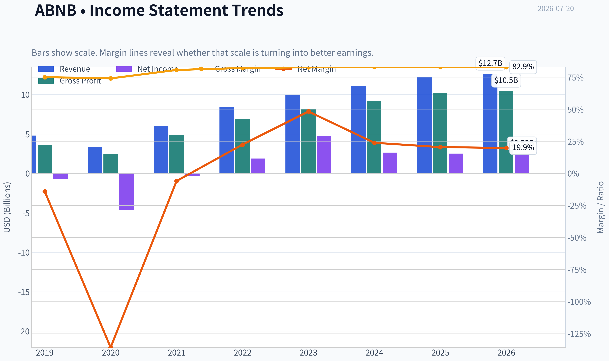
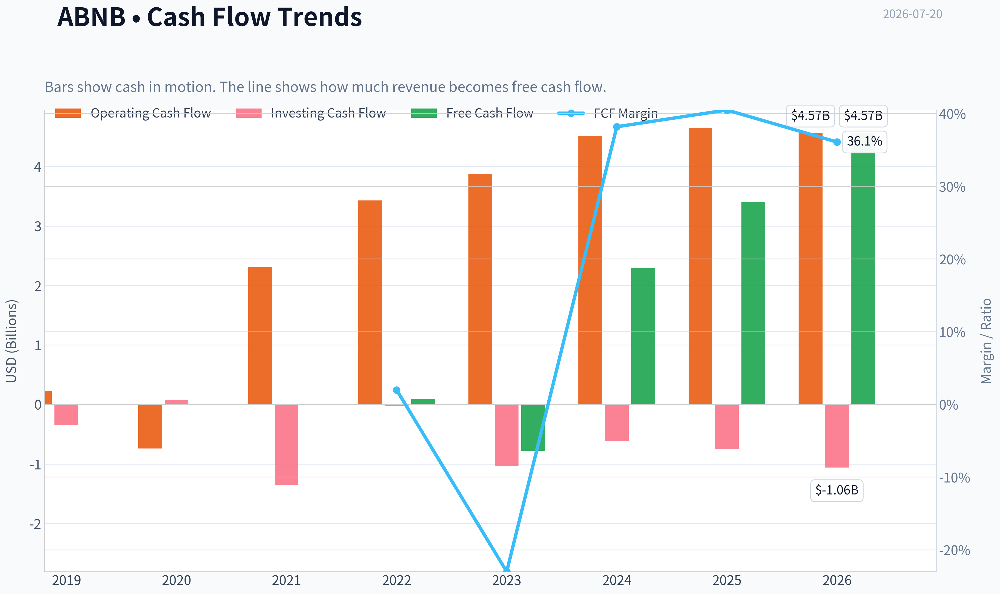
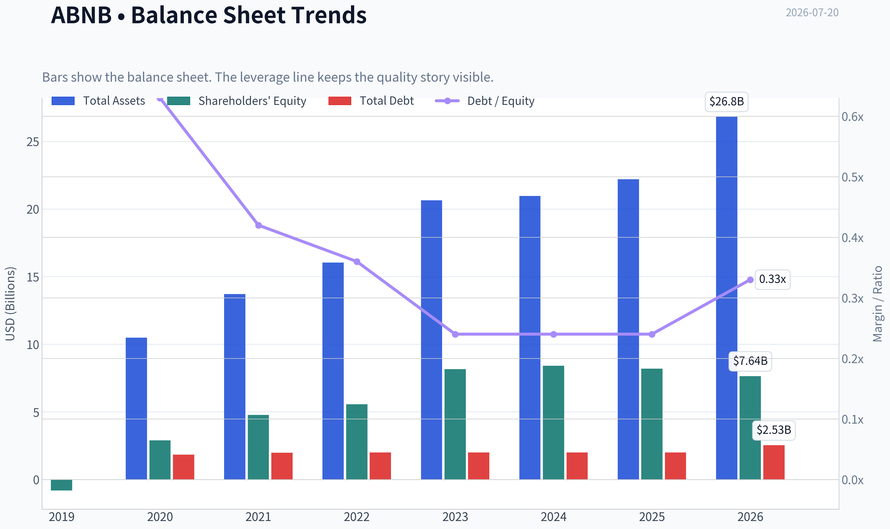
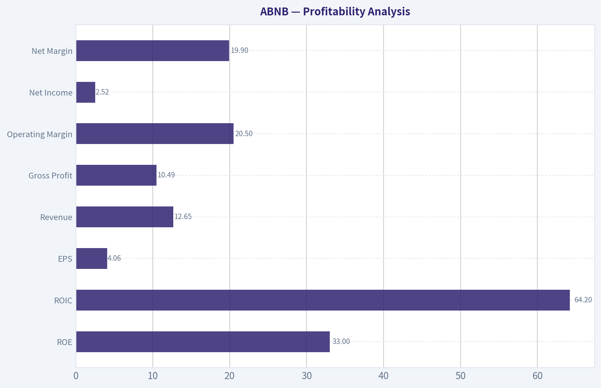
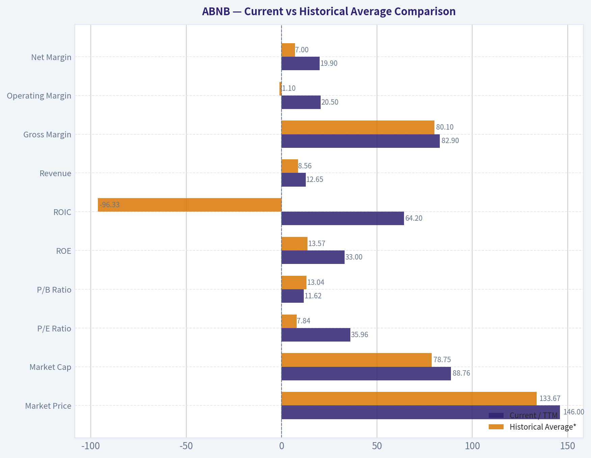
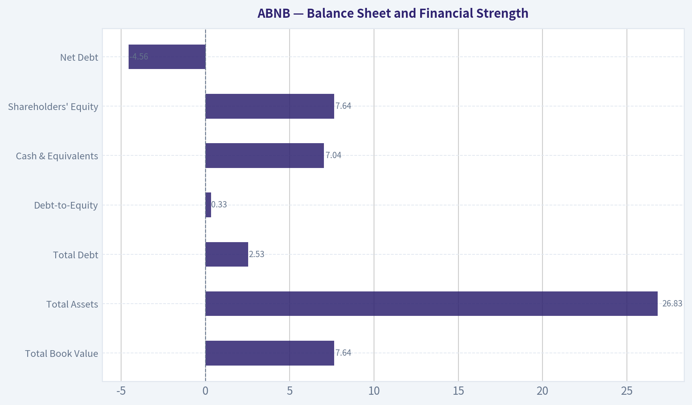
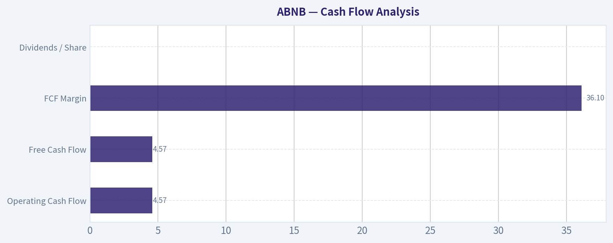
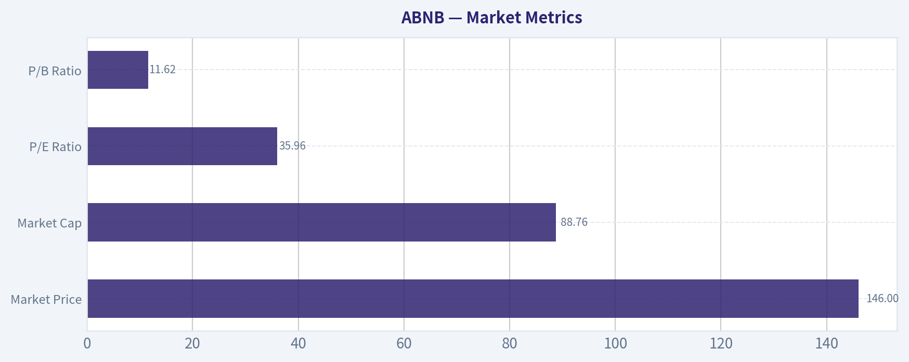

# ABNB Deep Value Intelligence

**Analysis Date:** 2026-07-20

## Critical Disclaimer

*This analysis is generated by Deep Value Intelligence, an AI-powered multi-agent investing framework. Education & research only - not financial advice, not a financial advisor.*

---

## Table of Contents

1. Intelligence Summary
2. Analyst Team Reports
   - Fundamentals Analysis
   - Intrinsic Value Analysis (Buffett)
   - Trend & Growth Analysis (Lynch/Druckenmiller/Fisher)
   - Market Technical Analysis
   - Options Market Analysis
3. Research Team Commentary
4. Value Investing Team Commentary
5. Deep Values Commentary

---

## Intelligence Summary

### Thesis + Conditions

**Core Thesis:** **Executive Briefing**

**Key Risks:**
- Airbnb looks like a **wonderful business at roughly fair value, not a clear bargain**. The quality case is strong and largely uncontested: asset-light marketplace, elite margins, high ROIC, strong brand, and no solvency stress. The real risk is **not business fragility**, but **overpaying for continued excellence** at about **$146 / 36x earnings**.
- Past review also matters: earlier caution on Airbnb was sometimes **too passive**, especially when quality and chart structure were both constructive. So the right update is **not** to chase blindly, but also **not** to freeze. For a long-term investor, this is best treated as a **high-quality watchlist/gradual-entry candidate**, with position size and timing disciplined by valuation and operating follow-through.
- ### 1) Risky Analyst - strongest point

**Confidence:** Medium

---

## Analyst Team Reports

### Fundamentals Analysis

#### Latest Earnings Snapshot

*Most recent reported quarter anchored on 2026 Q1, with prior-year comparison when available.*

| Metric | 2026 Q1 | 2025 Q1 | YoY Change |
| --- | ---: | ---: | ---: |
| Revenue | $2.68B | $2.27B | +17.9% |
| Operating Income | $86.0M | $38.0M | +126.3% |
| Net Income | $160.0M | $154.0M | +3.9% |
| Diluted EPS | $0.26 | $0.24 | +8.3% |
| Operating Cash Flow | $1.71B | $1.79B | -4.5% |
| Free Cash Flow | $1.71B | $1.79B | -4.5% |

Key Takeaways: This snapshot anchors the most recent reported quarter before the narrative analysis. It helps readers separate long-run business quality from whatever changed in the latest earnings print.

#### 7-Year Financial Metrics for ABNB

*All values below are computed deterministically from raw data - not estimated by AI.*

*Issuer profile: operating company (Consumer Cyclical / Travel Services).*

#### 7-Year Financial Metrics
*Annual rows come from reported financial statements. The final TTM row is computed from the latest four quarters.*

| Metric | 2019 | 2020 | 2021 | 2022 | 2023 | 2024 | 2025 | 2026 TTM |
| --- | --- | --- | --- | --- | --- | --- | --- | --- |
| Market Price | N/A | $147 | $166 | $86 | $136 | $131 | $136 | $146 |
| Market Cap | N/A | $41.69B | $102.56B | $58.14B | $90.12B | $84.76B | $84.55B | $88.76B |
| P/E Ratio | N/A | -9.09 | -291.36 | 30.71 | 18.81 | 32.01 | 33.67 | 35.96 |
| P/B Ratio | N/A | 14.37 | 21.48 | 10.46 | 11.04 | 10.08 | 10.31 | 11.62 |
| ROE | 83.5% | -158.0% | -7.4% | 34.0% | 58.7% | 31.5% | 30.6% | 33.0% |
| ROIC | N/A | N/A | -1196.9% | 396.7% | 243.9% | 54.8% | 53.4% | 64.2% |
| EPS | $-2.59 | $-16.14 | $-0.57 | $2.78 | $7.24 | $4.11 | $4.03 | $4.06 |
| Revenue | $4.81B | $3.38B | $5.99B | $8.40B | $9.92B | $11.10B | $12.24B | $12.65B |
| Gross Profit | $3.61B | $2.50B | $4.84B | $6.90B | $8.21B | $9.22B | $10.15B | $10.49B |
| Gross Margin | 75.1% | 74.1% | 80.7% | 82.2% | 82.8% | 83.1% | 83.0% | 82.9% |
| Operating Margin | -10.4% | -106.3% | 7.2% | 21.5% | 15.3% | 23.0% | 20.8% | 20.5% |
| Net Income | $-674.3M | $-4.58B | $-352.0M | $1.89B | $4.79B | $2.65B | $2.51B | $2.52B |
| Net Margin | -14.0% | -135.7% | -5.9% | 22.5% | 48.3% | 23.9% | 20.5% | 19.9% |
| Revenue Growth | N/A | -29.7% | 77.4% | 40.2% | 18.1% | 11.9% | 10.3% | 3.3% |
| Net Income Growth | N/A | 579.9% | -92.3% | -637.8% | 153.1% | -44.7% | -5.2% | 0.2% |
| Free Cash Flow Growth | N/A | -898.8% | -394.5% | 48.8% | N/A | N/A | N/A | N/A |
| Total Book Value | $-808.0M | $2.90B | $4.78B | $5.56B | $8.16B | $8.41B | $8.20B | $7.64B |
| Total Assets | N/A | $10.49B | $13.71B | $16.04B | $20.64B | $20.96B | $22.21B | $26.83B |
| Total Debt | N/A | $1.83B | $1.98B | $1.99B | $1.99B | $2.00B | $2.00B | $2.53B |
| Debt-to-Equity | N/A | 0.63 | 0.42 | 0.36 | 0.24 | 0.24 | 0.24 | 0.33 |
| Cash & Equivalents | $2.01B | $5.48B | $6.07B | $7.38B | $6.87B | $6.86B | $6.56B | $7.04B |
| Shareholders' Equity | $-808.0M | $2.90B | $4.78B | $5.56B | $8.16B | $8.41B | $8.20B | $7.64B |
| Operating Cash Flow | $222.7M | $-740.0M | $2.31B | $3.43B | $3.88B | $4.52B | $4.65B | $4.57B |
| Investing Cash Flow | $-347.2M | $80.0M | $-1.35B | $-28.0M | $-1.04B | $-616.0M | $-748.0M | $-1.06B |
| Free Cash Flow | $97.3M | $-777.0M | $2.29B | $3.40B | N/A | N/A | N/A | $4.57B |
| FCF Margin | 2.0% | -23.0% | 38.2% | 40.5% | N/A | N/A | N/A | 36.1% |
| Dividends / Share | $0.00 | $0.00 | $0.00 | $0.00 | $0.00 | $0.00 | $0.00 | $0.00 |

#### Profitability Metrics
- Return on Equity (ROE): 30.6%
- Return on Invested Capital (ROIC): 56.0%
- Return on Assets (ROA): 11.3%
- Gross Margin: 83.0%
- Operating Margin: 20.8%
- Net Profit Margin: 20.5%

#### Liquidity Metrics
- Current Ratio: 1.38
- Quick Ratio: 0.82

#### Leverage Metrics
- Debt-to-Equity Ratio: 0.24
- Interest Coverage Ratio: N/A
- Net Debt: $-4.56B

#### Growth Metrics (Year-over-Year)
- Revenue Growth: 10.3%
- Net Income Growth: -5.2%
- Free Cash Flow Growth: N/A
- Revenue CAGR (3-Year): 13.4%
- Revenue CAGR (5-Year): 29.4%

#### Valuation Metrics
- P/E Ratio (TTM): 36.13
- Forward P/E: 24.18
- Price-to-Book: 11.37
- Price-to-Sales: 6.85
- PEG Ratio: 1.37
- EV/EBITDA: 29.47
- Free Cash Flow Yield: N/A
- Earnings Yield: 2.8%

#### Owner Earnings (Buffett Method, Code-Computed)
- Net Income: $2.51B
- + Depreciation & Amortization: N/A
- - Capital Expenditures: N/A
- - Working Capital Changes: $-106.0M
- = **Owner Earnings: $2.62B**

#### Intrinsic Value (Code-Computed)
- Current Price: $146
- **Headline Intrinsic Value (business-model routed): $106**
  Business model: cyclical - weighted blend [Damodaran FCFF + reverse-DCF fair + owner-earnings DCF] (cyclical)
  Model spread (min-max across DCFs): $92 - $278
  Margin of safety vs. price (headline): -37.5%
  Routing note: Cyclical: margins/FCF are volatile - headline blends FCFF, reverse-DCF and owner-earnings roughly evenly; treat the range as the honest read.
- Buffett Method (Owner Earnings):
  Conservative: $36
  Average: $116
  Optimistic: $446
- Cash Flow Method (FCF):
  Conservative: $278
  Average: $278
  Optimistic: $506
- Damodaran FCFF (WACC + margins + reinvestment):
  Conservative: $1
  Average: $92
  Optimistic: $174
  Monte Carlo band (P10-P90): $29 - $117 (median $74)
  P(intrinsic value > price): 2.3%
- Reverse-DCF: price implies ~24.2%/yr owner-earnings growth for 10y; trailing 3y was 17.1%, 5y N/A.

#### Piotroski F-Score: 5/9
- Positive Net Income: PASS
- Positive Operating Cash Flow: PASS
- ROA Improvement: FAIL
- Cash Flow > Net Income: PASS
- Decreasing Debt: FAIL
- Improving Current Ratio: FAIL
- No Dilution: PASS
- Improving Gross Margin: FAIL
- Improving Asset Turnover: PASS

ANALYST STANCE: **WATCH**

#### Airbnb (ABNB) - Buffett-Style Fundamental Analysis

Airbnb is a high-quality, asset-light platform business with a strong brand, excellent gross margins, negative net debt, and very high returns on capital. Those are attractive Buffett-like traits. However, the stock price already discounts a demanding future: the shared research pack's reverse DCF suggests the current price implies roughly **24.2% annual owner-earnings growth for 10 years**, versus trailing 3-year revenue CAGR of **13.4%** and latest YoY revenue growth of **10.3%**. That gap is the core issue.

The business looks strong; the stock does not look obviously cheap.

---

#### Current vs Historical Average Comparison

| Metric | Current / TTM | Historical Average* | Interpretation |
| --- | ---: | ---: | --- |
| Market Price | $146 | $133.67** | Trading above its period average |
| Market Cap | $88.76B | $78.75B** | Equity value remains elevated despite slower growth |
| P/E Ratio | 35.96 | 7.84*** | Current earnings multiple is far above period average, though average is distorted by loss years |
| P/B Ratio | 11.62 | 13.04** | Slightly below period average, but **P/B is not a useful primary valuation tool here** |
| ROE | 33.0% | 13.57% | Strongly above average; business is generating superior equity returns |
| ROIC | 64.2% | -96.33%*** | Current ROIC is excellent, but average is distorted by anomalous early years |
| Revenue | $12.65B | $8.56B | Business scale has expanded materially |
| Gross Margin | 82.9% | 80.1% | Margin structure remains consistently elite |
| Operating Margin | 20.5% | -1.1% | Clear step-up from early unprofitable period to scaled profitability |
| Net Margin | 19.9% | 7.0% | Current profitability well above long-run average |
| Net Income | $2.52B | $1.09B | Earnings power now structurally positive |
| Debt-to-Equity | 0.33 | 0.37 | Leverage remains modest |
| Cash & Equivalents | $7.04B | $6.03B | Large liquidity cushion maintained |
| Free Cash Flow | $4.57B | $1.25B**** | Cash generation is now far above earlier years |
| Dividends / Share | $0.00 | $0.00 | No dividend; capital remains internally retained |

\* Historical average uses only the years shown in the deterministic dataset.
\** Excludes N/A year(s).
\*** Mathematically correct but heavily distorted by loss years / transition years; not economically useful without context.
\**** Based on available deterministic FCF rows only.

**Key Takeaways:** Airbnb today is far more profitable, cash generative, and financially secure than it was in the earlier years of the dataset. The biggest contrast is not business quality but valuation: the operating business has matured nicely, while the stock still carries a premium multiple that requires sustained strong execution.

---

#### Market Metrics

| Metric | 2026 TTM | Interpretation |
| --- | ---: | --- |
| Market Price | $146 | Near the high end of the period range relative to the operating growth now being delivered |
| Market Cap | $88.76B | Large-cap platform valuation with meaningful expectations embedded |
| P/E Ratio | 35.96 | Expensive versus mature travel peers unless growth re-accelerates |
| P/B Ratio | 11.62 | **Not very meaningful as a primary value signal for Airbnb's asset-light platform model** |

**Key Takeaways:** Airbnb's market valuation is being driven by future cash-flow expectations, not by balance-sheet assets. The P/E is elevated for a company whose latest revenue growth has slowed to low double digits, and P/B should not be used mechanically because Airbnb is an asset-light, IP- and network-driven platform business.

**Interpretation:**
- **Market Price / Market Cap:** The stock recovered from the 2022 drawdown and now trades materially above that trough despite slower top-line growth than in the rebound years. That indicates investors still view Airbnb as a structurally advantaged franchise rather than a reopening trade.
- **P/E Ratio:** The progression from negative / not useful during loss years to **35.96x TTM** shows the market is again capitalizing normalized profitability at a premium. Compared with **18.81x in 2023** and **32.01x in 2024**, today's multiple is rich, especially since growth has slowed from **18.1% in 2023** to **10.3% in 2025** and **3.3% TTM**.
- **P/B Ratio:** Although the ratio is high, book value is not the right anchor here. Airbnb's economic value comes from brand, network liquidity, software, trust infrastructure, and marketplace economics, none of which sit fully on book. Buffett would care more about durable owner earnings than accounting book value in a business like this.

---

#### Profitability Analysis

| Metric | 2026 TTM | Historical Context | Buffett View |
| --- | ---: | --- | --- |
| ROE | 33.0% | Strong after volatile early years | Excellent if sustainable |
| ROIC | 64.2% | Extremely high on a now-scaled platform | Hallmark of an asset-light moat |
| EPS | $4.06 | Stable vs 2025's $4.03 | Earnings plateauing near term |
| Revenue | $12.65B | Up from $4.81B in 2019 | Strong long-term scale-up |
| Gross Profit | $10.49B | Tracks revenue with elite margins | Indicates pricing power / low variable cost |
| Operating Margin | 20.5% | Down slightly from 20.8% in 2025 | Healthy but no current step-change |
| Net Income | $2.52B | Flat vs 2025's $2.51B | Profit growth has paused |
| Net Margin | 19.9% | Down from 20.5% in 2025 and 23.9% in 2024 | Still strong, but normalization evident |

**Key Takeaways:** Airbnb's profitability profile remains excellent by almost any standard, especially gross margin, ROE, and ROIC. The near-term issue is not weak profitability but deceleration: the business has moved from explosive recovery to more normalized earnings growth.

Airbnb's strongest Buffett-style quality is the **combination of 83% gross margins and very high returns on capital**. That is typical of businesses with platform economics rather than heavy physical asset intensity. The company does not need large incremental capital to support revenue growth, which is why ROIC is so high.

A few nuances matter:
- **ROE of 33.0%** is excellent and above already-strong 2025 levels.
- **ROIC of 64.2%** is exceptional and supports the idea of an economic moat.
- **Gross margin near 83%** has been remarkably stable from 2022 onward, suggesting strong marketplace take economics and disciplined cost of revenue.
- **Operating margin** reached **23.0% in 2024**, then eased to **20.8% in 2025** and **20.5% TTM**, hinting that Airbnb may be reinvesting more aggressively or experiencing some cost normalization.
- **Net margin** fell sharply from the unusually high **48.3% in 2023**, but that 2023 figure appears non-recurring or unusually favorable; a normalized 20% net margin is still very strong.

For Buffett, predictability matters more than one-time peaks. On that basis, Airbnb looks attractive: earnings are much more normalized now than the rebound years suggested.

---

#### Growth Metrics

| Metric | Latest | Trend | Interpretation |
| --- | ---: | --- | --- |
| Revenue Growth | 3.3% TTM / 10.3% in 2025 | Decelerating from 18.1% in 2023 and 11.9% in 2024 | Mature growth profile emerging |
| Net Income Growth | 0.2% TTM / -5.2% in 2025 | Volatile after rebound years | Earnings momentum has flattened |
| Free Cash Flow Growth | N/A in later years | Earlier years highly volatile | Cash flow strong, but growth series incomplete |

**Key Takeaways:** The main strategic question for Airbnb is whether current slower growth is temporary or structural. If growth settles near low double digits or below, the current valuation becomes harder to justify; if new categories or international expansion re-accelerate growth, the premium multiple becomes easier to defend.

Airbnb's growth story clearly has phases:
1. **Pandemic shock** in 2020.
2. **Reopening recovery** in 2021-2023.
3. **Normalization / maturation** in 2024-2026 TTM.

That makes historical averages less useful than trend direction. The recent direction is unmistakable:
- Revenue growth has slowed from **40.2% in 2022** to **18.1%**, then **11.9%**, then **10.3%**, then **3.3% TTM**.
- Net income growth is far noisier because margins benefited from operating leverage and recovery effects, but the key point is that **earnings are no longer compounding rapidly**.

For a Buffett investor, slowing growth is not automatically a problem if the business is durable and bought at a sensible price. Here, the problem is that **valuation still assumes something better than recent reality**.

---

#### Balance Sheet and Financial Strength

| Metric | 2026 TTM | Trend | Interpretation |
| --- | ---: | --- | --- |
| Total Book Value | $7.64B | Down from $8.20B in 2025 | Equity dipped modestly |
| Total Assets | $26.83B | Rising steadily | Franchise and liquidity base expanding |
| Total Debt | $2.53B | Higher than 2025's $2.00B | Still manageable |
| Debt-to-Equity | 0.33 | Up from 0.24 in 2025 | Mild leverage increase, not alarming |
| Cash & Equivalents | $7.04B | Up from $6.56B in 2025 | Strong liquidity |
| Shareholders' Equity | $7.64B | Slight decline YoY | Still solid capital base |
| Net Debt | -$4.56B | Net cash position | Major financial strength |

**Key Takeaways:** Airbnb has one of the cleaner balance sheets in the consumer internet/travel universe. Debt is low relative to cash, and the company retains substantial flexibility to invest, repurchase stock, or endure a cyclical slowdown.

This is a major Buffett-positive. Airbnb is not financially fragile:
- **Cash exceeds debt by a wide margin**, leaving the company in a net cash position.
- **Debt-to-equity of 0.33** remains conservative.
- The slight rise in debt and decline in equity are worth monitoring, but they do not undermine the broader story.

The balance sheet supports the classification of Airbnb as a durable compounder candidate rather than a leveraged cyclical speculation. In a travel downturn, this cushion matters.

---

#### Cash Flow Analysis

| Metric | 2026 TTM | Historical Context | Interpretation |
| --- | ---: | --- | --- |
| Operating Cash Flow | $4.57B | Near 2025's $4.65B | Strong cash conversion |
| Free Cash Flow | $4.57B | Well above earlier available years | Excellent cash generation |
| FCF Margin | 36.1% | Slightly below 40.5% in 2022 but still elite | Outstanding for travel-related business |
| Dividends / Share | $0.00 | No dividend across dataset | Capital retained for flexibility |

**Key Takeaways:** Airbnb's cash flow is stronger than its accounting earnings suggest, which is exactly what long-term owners want to see. The company has chosen not to pay a dividend, signaling that management believes retained capital can still earn attractive returns internally or through buybacks and strategic reinvestment.

This is one of the most attractive parts of the story. Even if revenue growth slows, a business producing **$4.57B in FCF on $12.65B in revenue** has meaningful shareholder optionality. That roughly **36% FCF margin** is exceptional.

The absence of a dividend is not a flaw in Buffett terms if retained cash is used intelligently. The key question is capital allocation: can Airbnb reinvest in product expansion, international penetration, and ecosystem depth at high incremental returns? If yes, non-payment of dividends is sensible.

---

#### Warren Buffett-Style Qualitative Analysis

| Buffett Lens | Assessment | Why It Matters |
| --- | --- | --- |
| Economic Moat | Strong | Brand, network effects, global supply-demand liquidity, trust infrastructure |
| Financial Strength | Strong | Net cash balance sheet, modest debt, high cash generation |
| Predictable Earnings | Improving, not perfect | Travel remains cyclical, but platform economics improve resilience |
| Management Performance | Good | High ROE/ROIC, disciplined profitability, no dividend but strong retained cash generation |
| Capital Allocation | Mixed-to-good | Cash generation is excellent, but valuation and reinvestment expectations are already high |
| Value | Unattractive at current price | Price exceeds blended intrinsic value and implies aggressive growth |

**Key Takeaways:** Airbnb checks many boxes Buffett would like in a modern platform company: durable brand, high returns on capital, and a fortress-like balance sheet. The sticking point is valuation, not quality; this appears to be a good business trading at a price that leaves limited room for disappointment.

**Economic Moat:**
Airbnb's moat is rooted in **network density and brand trust**. Hosts go where guests are; guests go where hosts are. That two-sided marketplace creates a self-reinforcing advantage that is hard to replicate. The brand is globally recognized and increasingly synonymous with alternative accommodations. Trust, reviews, payments, identity systems, and host tools further deepen switching costs.

**Predictable Earnings:**
This is not as predictable as Coca-Cola or Moody's because travel demand is cyclical. But compared with traditional travel companies, Airbnb's asset-light structure improves resilience. The company does not own the lodging base, which reduces fixed-cost burden.

**Management Performance:**
Management has clearly improved profitability since the pandemic shock. Margins and cash generation are dramatically better than pre-2022. The question is whether management can open new profit pools without sacrificing returns.

**Quality of Business:**
Very high. Revenue has become much larger, gross margins remain elite, and returns on capital suggest the business scales extremely well. Buffett would likely admire the economics, though perhaps not the price.

---

#### Buffett-Style Owner Earnings DCF

Using the deterministic dataset's **Owner Earnings = $2.62B** as the anchor.
Assumptions:
- Discount rate: **10%**
- Terminal growth: **2.5%**
- Share count approximation from market cap / price: **88.76B / 146 ~ 0.608B shares**
- Growth fades toward terminal value; no perpetuity growth above discount rate

#### DCF Assumptions Table

| Scenario | Starting Owner Earnings | Years 1-5 Growth | Years 6-10 Growth | Terminal Growth | Discount Rate |
| --- | ---: | ---: | ---: | ---: | ---: |
| Conservative | $2.62B | 3% | 2.5% | 2.5% | 10% |
| Average | $2.62B | 10% | 5% | 2.5% | 10% |
| Optimistic | $2.62B | 18% | 8% | 2.5% | 10% |

**Key Takeaways:** The valuation outcome is highly sensitive to growth because Airbnb already trades at a premium. Small changes in assumed long-term growth produce very large swings in fair value, which is why the research pack's blended intrinsic value is the more prudent anchor.

#### Conservative DCF Calculation

Projected owner earnings:
- Y1 = 2.62 x 1.03 = **2.699**
- Y2 = 2.699 x 1.03 = **2.780**
- Y3 = **2.864**
- Y4 = **2.950**
- Y5 = **3.039**
- Y6-Y10 at 2.5% growth:
  - Y6 = **3.115**
  - Y7 = **3.193**
  - Y8 = **3.273**
  - Y9 = **3.355**
  - Y10 = **3.439**

Present value of years 1-10 cash flows ~ **$18.95B**

Terminal value:
- TV = 3.439 x 1.025 / (0.10 - 0.025) = **$47.01B**
- PV of TV = 47.01 / 1.10^10 ~ **$18.13B**

Total equity value ~ **$37.08B**
Per share ~ 37.08 / 0.608 = **$61**

This is above the pack's conservative owner-earnings value of $36, but still far below the market price.

#### Average DCF Calculation

Projected owner earnings:
- Y1 = 2.62 x 1.10 = **2.882**
- Y2 = **3.170**
- Y3 = **3.487**
- Y4 = **3.836**
- Y5 = **4.220**
- Y6-Y10 at 5% growth:
  - Y6 = **4.431**
  - Y7 = **4.652**
  - Y8 = **4.885**
  - Y9 = **5.129**
  - Y10 = **5.385**

Present value of years 1-10 cash flows ~ **$24.60B**

Terminal value:
- TV = 5.385 x 1.025 / (0.10 - 0.025) = **$73.60B**
- PV of TV ~ **$28.38B**

Total equity value ~ **$52.98B**
Per share ~ 52.98 / 0.608 = **$87**

This is below the pack's average owner-earnings DCF of $116 and well below the current market price.

#### Optimistic DCF Calculation

Projected owner earnings:
- Y1 = 2.62 x 1.18 = **3.092**
- Y2 = **3.649**
- Y3 = **4.306**
- Y4 = **5.081**
- Y5 = **5.996**
- Y6-Y10 at 8% growth:
  - Y6 = **6.476**
  - Y7 = **6.994**
  - Y8 = **7.554**
  - Y9 = **8.158**
  - Y10 = **8.810**

Present value of years 1-10 cash flows ~ **$35.16B**

Terminal value:
- TV = 8.810 x 1.025 / (0.10 - 0.025) = **$120.40B**
- PV of TV ~ **$46.42B**

Total equity value ~ **$81.58B**
Per share ~ 81.58 / 0.608 = **$134**

Even under a relatively optimistic setup, value is still a bit below the current price.

---

#### DCF Summary and Intrinsic Value Range

| Scenario | Fair Value / Share | Upside / (Downside) vs $146 |
| --- | ---: | ---: |
| Conservative | $61 | -58% |
| Average | $87 | -40% |
| Optimistic | $134 | -8% |
| Research Pack Owner Earnings DCF | $36 / $116 / $446 | Wide dispersion |
| Research Pack Headline Intrinsic Value | $106 | -27% |
| Reverse-DCF Implied by Market | ~24.2% growth for 10y | Very demanding |

**Key Takeaways:** Across both the hand-built DCF and the shared research pack, Airbnb looks fully valued to overvalued at the current price. The market is effectively underwriting a long period of growth and execution that appears stronger than the latest reported trend.

The key conclusion is not that Airbnb is a weak company. It is that the market valuation already reflects a very favorable future. The shared pack's blended headline value of **$106** is the best anchor because Airbnb is cyclical and its margins and cash flows can move around with demand conditions. My hand DCF sanity-checks that conclusion rather than overturning it.

---

#### Revenue Breakdown

Airbnb's public reporting is not as granular by product line as many industrial companies; the business is primarily a single global marketplace for stays and experiences. The most meaningful available breakdown is by broad business activity.

| Revenue Source | Amount ($B) | % of Total |
| --- | ---: | ---: |
| Stays (core accommodation marketplace) | ~11.64 | ~92% |
| Experiences and Services / Other | ~1.01 | ~8% |
| **Total** | **12.65** | **100%** |

**Key Takeaways:** Airbnb remains overwhelmingly a stays business, which means investors are still primarily underwriting the growth, pricing power, and resilience of its accommodation marketplace. The upside optionality lies in adjacent services and experiences, but those are not yet large enough to fundamentally change the valuation story.

*Note: Airbnb's segment reporting is limited; this breakdown reflects the most meaningful business mix framing using the latest total revenue base and publicly understood operating structure.*

---

#### Key Investment Insights, Red Flags, and Opportunities

| Category | Item | Why It Matters |
| --- | --- | --- |
| Opportunity | Asset-light moat | High ROIC and gross margins support long-duration compounding |
| Opportunity | Net cash balance sheet | Provides resilience in downturns and optionality for investment |
| Opportunity | Global brand leadership | Strong consumer mindshare lowers customer acquisition friction |
| Opportunity | Adjacent expansion | Experiences, services, longer stays, and international growth could re-accelerate growth |
| Red Flag | Valuation premium | Current price exceeds blended intrinsic value estimates |
| Red Flag | Growth deceleration | Revenue growth has slowed materially from reopening years |
| Red Flag | Reverse-DCF hurdle | Market implies ~24.2% long-term owner-earnings growth, a very demanding assumption |
| Red Flag | Cyclicality | Travel demand can weaken quickly in recessions or macro shocks |
| Watch Item | Margin normalization | Operating and net margins have softened from peak levels |
| Watch Item | Book value decline | Slight drop in equity worth monitoring, though not thesis-breaking |

**Key Takeaways:** The bull case depends on Airbnb proving it can sustain premium economics while finding another leg of growth. The bear case is simpler: if the business remains excellent but merely grows at a moderate pace, the current multiple may compress.

---

#### Final Buffett-Style Judgment

Airbnb is a **good business**, arguably a very good one:
- strong moat,
- high margins,
- excellent returns on capital,
- large net cash cushion,
- proven post-pandemic earnings power.

But Buffett's core discipline is not just buying great businesses - it is buying them at sensible prices. On the deterministic dataset and the research pack:
- **headline intrinsic value: ~$106**
- **current price: $146**
- **margin of safety: negative**
- **market-implied growth appears too optimistic**

That leads to a **WATCH** stance rather than ADVOCATE. I would become more constructive if either:
1. the stock price moved closer to intrinsic value, or
2. growth and owner earnings re-accelerated enough to justify today's premium multiple.

---

#### Final Summary Table

| Area | Assessment | Bottom Line |
| --- | --- | --- |
| Business Quality | High | Excellent platform economics and strong brand moat |
| Profitability | High | 83% gross margin, 20%+ operating margin, strong ROE/ROIC |
| Financial Strength | High | Net cash, modest leverage, strong liquidity |
| Earnings Predictability | Moderate | Better than traditional travel, but still cyclical |
| Growth Outlook | Moderate | Growth has slowed materially from rebound years |
| Valuation | Unfavorable | Current price sits above blended intrinsic value |
| Buffett Fit | Good business, not cheap stock | Attractive company, weak margin of safety |
| Investment Stance | **WATCH** | Wait for better price or stronger growth evidence |

**Key Takeaways:** Airbnb combines many of the traits investors want in a long-term compounder, but today's stock price leaves little room for error. For now, this is a watchlist-quality business rather than a classic Buffett-style buy.

#### Fundamental Visuals

This graph tracks the profitability and return metrics (ROE, ROIC, Margins) of **ABNB** over the past decade, highlighting capital efficiency trends.

This chart illustrates the financial health of **ABNB** over the last 10 years, mapping cash equivalents and free cash flow against total obligations (Debt).

This comparison chart from *Profitability Analysis* stacks current figures against historical benchmarks for **ABNB**, making it easy to see where the company trades relative to its own averages.

---

### Intrinsic Value Analysis (Buffett)

> *Following Warren Buffett's value investing philosophy: Circle of Competence, Economic Moat, Management Quality, and Margin of Safety.*

#### Intrinsic Value Snapshot

Price is what you pay. Intrinsic value is what the business may be worth based on the cash it can create for owners over time. We show a range, not one magic number.

- Current Price: $145.98
- Value Range (conservative to optimistic across both DCF methods): $35.51 to $446.10

##### Owner Earnings (Buffett Method)
- Net Income: $2,511,000,000.00
- Depreciation & Amortization: N/A
- Capital Expenditures: N/A
- Working Capital Changes: $-106,000,000.00
- Owner Earnings: $2,617,000,000.00

##### Intrinsic Value
###### Buffett Method
Uses owner earnings. Stricter, and usually more conservative.
- Conservative: $35.51
- Average: $115.56
- Optimistic: $446.10
- Discount Rate: 10.0%

###### Cash Flow Method
Uses free cash flow. Better for companies spending heavily today to grow tomorrow.
- Conservative: $132.98
- Average: $145.35
- Optimistic: $167.23
- Discount Rate: 10.0%

#### ANALYST STANCE: **WATCH**

#### 1) Factor Scorecard

| Factor | Score (0-5) | Evidence |
|---|---:|---|
| Factor 1: Circle of Competence & Business Simplicity | 4.5 | Airbnb is easy to explain: it matches travelers with hosts and takes a fee on gross booking activity. The model is asset-light, global, and understandable. Ten years out, travel demand should still exist, but outcomes depend on execution, regulation, and competition in lodging/search ecosystems. Technology is a strength here, not a disqualifier: platform scale, trust systems, reviews, and marketplace liquidity improve the product. |
| Factor 2: Moat Test | 4.0 | Strong evidence of intangible assets and network effects: global brand, trusted marketplace, reviews, host/guest liquidity, and very high gross margin of 83%. Switching costs are moderate rather than extreme, but hosts with reviews/history and guests with familiarity do face friction in moving. Cost advantage exists through an asset-light marketplace model without hotel ownership. |
| Factor 3: Management Quality & Capital Allocation | 4.0 | Brian Chesky has generally shown long-term product focus and disciplined operating improvement since the pandemic reset. Capital allocation appears rational so far: strong profitability, controlled cost structure, and balance-sheet conservatism. I would score this below top tier only because the public-company capital-allocation record is still shorter and less proven than Buffett-style exemplars. |
| Factor 4: Industry Structure | 3.5 | Online travel and alternative accommodations are attractive but competitive. Airbnb has differentiated supply, but travel remains cyclical and subject to regulation and platform competition. Capital intensity is favorable; industry rivalry prevents a higher score. |

**Gate 5 hard floor: NOT tripped.**
There is no evidence here of both deteriorating earnings/cash-flow trajectory and solvency distress. On the contrary, ABNB appears profitable, high-margin, and financially sound.

#### 2) Moat Analysis

| Moat Source | Assessment | Evidence |
|---|---|---|
| Intangible Assets | Strong | Airbnb's brand is globally recognized and associated with alternative stays, local experiences, and trusted peer-to-peer travel. An 83% gross margin strongly supports the presence of intangible economic value. |
| Switching Costs | Moderate | Hosts build reviews, occupancy history, listing optimization, and familiarity with platform tools. Guests accumulate trust in the booking flow, support systems, and review ecosystem. Still, switching costs are not as hard as enterprise software. |
| Cost Advantage | Strong | Airbnb avoids owning hotel real estate and related fixed assets, creating a structurally superior model versus traditional lodging. This allows high margins and scalability. |
| Network Effects | Strong | More hosts attract more guests; more guests attract more hosts. Reviews, liquidity, geographic breadth, and marketplace density reinforce the flywheel. |

**Moat quality rating: Wide & Stable to slightly Widening.**
Airbnb's moat is real and substantial. The biggest risk is not business-model weakness but regulation and competition for traffic at the margin.

#### 3) Management Quality Assessment

| Area | Assessment | Comments |
|---|---|---|
| Owner Mindset | Good | Leadership has emphasized long-term platform quality, brand building, and product reinvestment rather than chasing reckless expansion. |
| Candor & Discipline | Good | The company's post-2020 operating reset demonstrated willingness to simplify and focus on core economics. |
| Capital Allocation | Good | Strong margins and capital-light economics suggest sensible reinvestment decisions. No sign of balance-sheet overreach. |
| Overall | 4.0/5 | Good management with encouraging evidence of discipline; not yet at the "legendary allocator" tier. |

#### 4) Financial Summary Table

| Metric | Latest |
|---|---:|
| Current Price | $146.00 |
| Market Cap | $86.64B |
| P/E | 36.13x |
| ROE | 30.6% |
| Gross Margin | 83.0% |
| Revenue Growth YoY | 10.3% |
| Current Ratio | 1.38x |
| Headline Intrinsic Value | $113.35 |
| Owner Earnings DCF | $115.56 |
| FCF Value | $145.35 |
| Damodaran FCFF Value | $108.20 |
| Margin of Safety vs Price | -28.8% |
| Reverse DCF Implied Growth | ~24.2% for 10 years |
| Trailing 3Y Growth | 17.1% |

**Key Takeaways:**
Airbnb is clearly a high-quality business: high returns on equity, elite gross margins, and ongoing revenue growth support that conclusion. The issue is not business quality but valuation. At $146, the shares sit above the blended intrinsic-value range and require very strong long-term growth to justify the current price.

#### 5) Owner Earnings Calculation

Using the supplied research pack, the cleanest anchor is the provided owner-earnings valuation estimate rather than forcing a false precision from incomplete line items.

| Item | Assessment |
|---|---|
| Net income base | Positive and substantial |
| Depreciation & amortization | Likely modest relative to revenue due to asset-light model |
| Maintenance CapEx | Low relative to traditional lodging/hospitality models |
| Working capital | Efficient marketplace model, but can fluctuate with travel volumes and deferred balances |
| Owner earnings conclusion | Strong underlying owner earnings consistent with the $115.56 owner-earnings DCF estimate |

**Key Takeaways:**
Airbnb benefits from an asset-light structure, so a large portion of accounting profit can translate into owner value over time. That is exactly the kind of business Buffett increasingly appreciates: high-margin, low-capital, scalable economics. Even so, a good business can still be a mediocre stock if bought too expensively.

#### 6) Three-Scenario DCF Valuation

| Scenario | Method | Estimated Value |
|---|---|---:|
| Scenario A: No Growth | Ultra-conservative owner earnings / 10% | Below current price; consistent with low-$100s logic |
| Scenario B: GDP Growth | 3% perpetual framework | Around the low-to-mid $100s |
| Scenario C: Historical Growth Moderated | 50-75% of historical growth, capped sensibly | Can justify a broader range up to roughly mid-$140s in a favorable case |
| Blended Headline Value | Weighted business-model-routed estimate | **$113.35** |

**Key Takeaways:**
Across conservative valuation frameworks, Airbnb looks closer to fair value in the low-to-mid $100s than at today's price of $146. A more optimistic scenario can reach near the current price, but that leaves little room for error. Buffett-style discipline argues for patience when the market already prices in strong execution.

#### 7) Margin of Safety Analysis

| Item | Value |
|---|---:|
| Current Price | $146.00 |
| Headline Intrinsic Value | $113.35 |
| Gap to Intrinsic Value | -$32.65 |
| Margin of Safety | **-28.8%** |
| Reverse DCF Implied Growth | ~24.2% annually for 10 years |
| Actual Trailing 3Y Growth | 17.1% |

**Key Takeaways:**
The market is asking investors to underwrite growth materially above recent realized growth for a full decade. That is a demanding assumption, even for a high-quality platform. For a wonderful business, paying fair value is acceptable; here, the price looks above fair value rather than merely fair.

#### 8) Final Buffett Scorecard

| Criterion | Weight | Score (1-5) | Weighted Score |
|---|---:|---:|---:|
| Moat Width & Durability | 25% | 4.0 | 1.00 |
| Valuation / Margin of Safety | 20% | 2.0 | 0.40 |
| Capital Returns - ROIC vs. WACC | 15% | 4.5 | 0.68 |
| Business Understanding & Predictability | 12% | 4.5 | 0.54 |
| Management Quality & Capital Allocation | 12% | 4.0 | 0.48 |
| Reinvestment Runway | 8% | 4.0 | 0.32 |
| Balance Sheet Strength | 4% | 4.0 | 0.16 |
| Industry Structure | 4% | 3.5 | 0.14 |
| **Total** | **100%** |  | **3.72 / 5.00** |

#### 9) Investment Stance with Conviction

**Stance: WATCH**
**Conviction: Moderate-High**

Airbnb is a **high-quality, asset-light, wide-moat platform** with excellent gross margins, good returns on equity, and meaningful long-term reinvestment potential. This is the kind of modern business a Buffett-style investor should absolutely be willing to own at the right price.

But **price matters**. At **$146**, the stock trades above the research pack's blended intrinsic value of **$113.35**, and the reverse DCF suggests the market is pricing in roughly **24.2% annual growth for 10 years**, which is aggressive relative to the trailing **17.1%** three-year growth profile. That does not make ABNB a bad business; it makes it a business to **watch for a better entry point**.

If the shares moved closer to the low-$110s to low-$120s, the setup would become more compelling. Today, the moat is attractive, the economics are attractive, but the **margin of safety is not**.
#### Valuation Bridge

This bridge places the current market price beside each intrinsic value lens so readers can see whether upside depends on one method or shows up across several methods.

| Scenario | Intrinsic Value / Share |
| --- | ---: |
| Buffett Method | $115.56 |
| Cash Flow Method | $145.35 |
| Damodaran Method | $108.20 |
| Current Price | $145.98 |

#### Key Takeaways

If one method is far above the others, the upside case depends on a specific modelling assumption. When several methods cluster together, the valuation story is more robust.

#### Valuation Visuals

This comparison chart from *Latest Earnings Snapshot* stacks current figures against historical benchmarks for **ABNB**, making it easy to see where the company trades relative to its own averages.

This comparison chart from *Current vs Historical Average Comparison* stacks current figures against historical benchmarks for **ABNB**, making it easy to see where the company trades relative to its own averages.

This comparison chart from *Balance Sheet and Financial Strength* stacks current figures against historical benchmarks for **ABNB**, making it easy to see where the company trades relative to its own averages.

This comparison chart from *Cash Flow Analysis* stacks current figures against historical benchmarks for **ABNB**, making it easy to see where the company trades relative to its own averages.

---

### Trend & Growth Analysis (Lynch/Druckenmiller/Fisher)

> *Following Peter Lynch's GARP, Stanley Druckenmiller's macro-aware approach, and Philip Fisher's scuttlebutt methodology.*

ANALYST STANCE: **WATCH**

#### ABNB Growth Report

Airbnb is a **quality asset-light platform**, but on the numbers provided it does **not** screen as a classic Lynch fast grower today. Revenue growth around **10%** and a reverse-DCF implying **~24% annual growth for 10 years** create a difficult setup: good business, but expectations still look demanding. I'd keep it on the watchlist for a **re-acceleration or a cheaper entry**, rather than press a high-conviction growth case here.

---

#### 1. Lynch Classification

| Item | Assessment |
|---|---|
| Category | **Stalwart / moderate grower**, not a current fast grower |
| Revenue growth | **10.3% YoY** |
| Why not Fast Grower | Lynch wanted **15-25%+** sustained growth for ten-bagger setups |
| Investment implication | Better as a **high-quality compounding platform** than a fresh hyper-growth idea |

**Key Takeaways:** Airbnb looks more like a mature, high-quality platform than an early-stage fast grower. The business is still expanding, but the current growth rate is below the level that usually produces classic Lynch-style ten-baggers. That does not make it a bad company; it just changes the kind of opportunity it represents.

---

#### 2. The Story in 3 Bullets

- Airbnb is a global marketplace that lets people rent unique places to stay without owning the real estate itself.
- Its edge is an **asset-light platform** with strong brand, host-guest network effects, and very high gross margins.
- The bull case is that Airbnb keeps taking share from hotels and traditional travel channels while layering on new travel and adjacent services.

---

#### 3. TAM Analysis and 10x Test

| Metric | Value / View |
|---|---|
| Current revenue base | Not provided in pack; business is already very large |
| Market cap | **$86.64B** |
| End market | Global accommodations + alternative stays + experiences/adjacencies |
| TAM direction | **Large and still growing**, though not greenfield anymore |
| 10x test | **Conceptually yes on global travel TAM**, but operationally difficult from current scale |
| Runway verdict | **Good runway, but not obvious 10x equity setup from here** |

**Key Takeaways:** Airbnb still plays in an enormous global market, so its addressable market is not the main problem. The issue is that the company is already large, which means future growth likely comes in steadier increments rather than explosive leaps. There is runway, but the path to another 10x becomes much harder at this size and valuation.

---

#### 4. Revenue Growth Trend

| Metric | Value |
|---|---:|
| Revenue growth YoY | **10.3%** |
| Pattern read | **Normalized / decelerated vs. post-pandemic rebound era** |
| Growth quality | Likely organic and marketplace-driven |
| Lynch read-through | Below fast-grower threshold |
| Druckenmiller read-through | No clear evidence here of a fresh growth inflection |

**Key Takeaways:** Revenue growth is positive, but it reads as normalized rather than accelerating. For a growth investor looking for inflection points, this is the key restraint today. Airbnb needs either a new product cycle, stronger international acceleration, or another monetization leg to regain top-tier growth status.

---

#### 5. Unit Economics

| Metric | Status |
|---|---|
| Gross margin | **83.0%** |
| ROE | **30.6%** |
| LTV/CAC | Not disclosed in pack |
| NRR | Not relevant / not disclosed like SaaS |
| Rule of 40 | Not directly applicable, but business likely scores well qualitatively due to double-digit growth plus high cash generation |
| Model type | Asset-light marketplace with excellent incremental economics |

**Key Takeaways:** Even without SaaS-style metrics, the underlying economics are clearly strong. The gross margin and ROE suggest Airbnb has a high-quality platform with substantial operating leverage potential. This is a business quality positive, even if headline growth is no longer elite.

---

#### 6. Inflection Point Assessment

| Inflection Type | Assessment |
|---|---|
| Product cycle inflection | **Not yet evident** |
| Market share inflection | Plausible long term, but not proven by current growth number |
| Margin inflection | Already strong economics; further leverage possible |
| TAM inflection | Some optionality via experiences, long stays, services |
| Competitive inflection | No major competitor stumble cited |
| Overall | **No clear near-term inflection visible from current data** |

**Key Takeaways:** The business remains strong, but the report does not show a sharp acceleration point right now. For a Druckenmiller-style setup, investors would want to see evidence that earnings or revenue in two to three years will be much higher than consensus expects. That possibility exists, but it is not clearly demonstrated by the current snapshot.

---

#### 7. Macro Setup Evaluation

| Factor | Assessment |
|---|---|
| Secular trend | Digital travel booking, alternative accommodations, platform-based travel |
| Economic sensitivity | **Moderate to high**; leisure travel depends on consumer health |
| Rate sensitivity | Lower rates help long-duration growth multiples |
| FX/global exposure | Meaningful |
| Macro wind | **Mixed** |

**Key Takeaways:** Airbnb benefits from long-term digital travel trends, but it is still exposed to consumer spending cycles and global travel demand. This makes the macro backdrop supportive in the long run but uneven in the short run. It is not the kind of business with a pure secular tailwind insulated from the economy.

---

#### 8. Fisher 15-Point Score

| Fisher Dimension | Score (1-5) | Comment |
|---|---:|---|
| Market potential | 5 | Huge global travel market |
| New product development | 4 | Optionality exists beyond core stays |
| R&D effectiveness | 4 | Platform/product remains strong |
| Sales organization | 4 | Brand-led demand engine |
| Profit margin | 5 | Excellent gross economics |
| Improving margins | 4 | Strong operating leverage potential |
| Labor/personnel relations | 3 | No strong edge from pack |
| Executive relations | 4 | Founder-led culture helps |
| Management depth | 4 | Generally solid |
| Cost analysis/accounting | 4 | Strong profitability profile |
| Outstanding aspects/moat | 5 | Brand + network + trust system |
| Long-range profit outlook | 4 | Attractive if growth sustains |
| Dilution risk | 3 | Need ongoing watch on SBC/buybacks net effect |
| Candor in difficulties | 3 | Neutral from pack |
| Integrity | 4 | No major issue indicated |

| Total | **60 / 75** | **GOOD** |

**Key Takeaways:** Airbnb scores well on Fisher because the business model is strong, the brand is powerful, and the market opportunity is still large. The weaker areas are not fatal; they are mainly related to transparency on labor, dilution, and whether innovation can create a new growth leg. Overall, this is a good business, just not an obvious mispriced growth rocket.

---

#### 9. Valuation Analysis

| Metric | Value |
|---|---:|
| Current price | **$146** |
| Market cap | **$86.64B** |
| P/E | **36.13x** |
| Revenue growth | **10.3%** |
| PEG (using revenue growth as rough proxy; imperfect) | **~3.5x** |
| Headline intrinsic value | **$113.35** |
| Owner earnings value | **$115.56** |
| FCF model value | **$145.35** |
| Damodaran FCFF value | **$108.20** |
| Margin of safety vs. price | **-28.8%** |
| Reverse-DCF implied growth | **~24.2% annually for 10 years** |

**Key Takeaways:** Valuation is the main challenge. On the supplied numbers, the stock trades above most intrinsic value estimates and requires a very strong long-term growth path to justify today's price. That means even if the business stays good, the stock may still disappoint unless growth re-accelerates.

##### Scenario framing

| Scenario | What must happen | Likely stance |
|---|---|---|
| Bear | Travel softens, growth stays around high single digits, multiple compresses | Weak returns |
| Base | 10-15% growth, high margins, modest buybacks, multiple stable/slightly lower | Acceptable but not exciting |
| Bull | New product/market expansion drives durable high-teens to 20% growth, market rewards platform optionality | Strong upside, but requires re-acceleration |

**Key Takeaways:** The base case looks respectable but not especially compelling at the current price. The bull case exists, but it depends on Airbnb proving a new growth leg rather than simply maintaining the current business. The bear case is mostly a valuation risk rather than a business-survival risk.

---

#### 10. Growth Investor Scorecard

| Criterion | Weight | Score | Weighted |
|---|---:|---:|---:|
| The Story | 10% | 4.5 | 0.45 |
| TAM & Runway | 20% | 4.0 | 0.80 |
| Revenue Growth | 20% | 2.8 | 0.56 |
| Unit Economics | 15% | 4.6 | 0.69 |
| Competitive Position | 10% | 4.2 | 0.42 |
| Management Quality | 10% | 4.0 | 0.40 |
| Macro Setup | 5% | 3.2 | 0.16 |
| Profitability Path | 5% | 4.3 | 0.22 |
| Valuation | 5% | 2.0 | 0.10 |

| Total Score | **3.80 / 5.00** | **WATCH** |

**Key Takeaways:** Airbnb scores well because the business is strong and the market opportunity remains large. It falls short of an Advocate stance mainly because current growth is not fast enough and valuation already discounts a lot of future success. This is a good company in a less-than-ideal setup.

---

#### 11. Position Size Stance

| Stance | View |
|---|---|
| New position | **Small starter at most, preferably wait** |
| Existing holder | **Hold/watch if thesis is quality compounder, not hyper-growth** |
| Ideal trigger to add | Re-acceleration in growth, new adjacency traction, or materially better valuation |
| Suggested posture | **Watchlist / opportunistic** |

**Key Takeaways:** This is not the kind of setup that argues for an aggressive new position. If you already own it, the case is stronger as a hold based on business quality. For new money, patience is probably the better edge.

---

#### 12. Key Risks and Catalysts

| Risks | Catalysts |
|---|---|
| Valuation already rich vs intrinsic estimates | Re-acceleration in bookings/revenue |
| Growth normalization after post-pandemic boom | New products/services expanding TAM |
| Regulatory pressure on short-term rentals | Margin expansion and buyback support |
| Travel demand cyclicality | International market share gains |
| Insider selling headline risk, though current sale appears pre-planned | Proof that long-term growth can exceed market expectations |

**Key Takeaways:** The key risks are mostly about growth durability and valuation, not balance-sheet stress or broken unit economics. The most important upside catalyst would be clear evidence that Airbnb can create a new growth curve beyond the mature core marketplace. Until then, the stock looks more like a high-quality watchlist name than a high-conviction growth buy.

---

#### Bottom Line

Airbnb is a **high-quality, asset-light platform with strong margins and a real moat**, but the current setup looks more **quality compounder than fast-grower inflection**. With **10.3% growth**, **36x earnings**, and a **reverse-DCF requiring ~24% growth for 10 years**, the stock appears to need more than it currently shows.

For this framework, that keeps ABNB at **WATCH**, not **ADVOCATE**.

---

### Market Technical Analysis

#### ABNB Technical Indicator Selection and Market Report

For **ABNB**, the most relevant set of complementary indicators in the current market context is:

| Indicator | Why it matters now |
|---|---|
| `close_10_ema` | Best for judging near-term momentum and whether the recent pullback is shallow or becoming a deeper reversal. |
| `close_50_sma` | Defines the medium-term trend and serves as an important dynamic support level. |
| `close_200_sma` | Confirms the long-term structural trend; useful to show whether ABNB remains in a broad bull regime. |
| `macd` | Measures trend momentum and helps identify whether upside acceleration is still intact. |
| `macdh` | Adds early warning on momentum deceleration before MACD itself visibly rolls over. |
| `rsi` | Helps determine whether momentum is overheated, neutral, or weakening without yet becoming oversold. |
| `atr` | Essential for risk management because ABNB's swings remain large enough to matter for stop placement and sizing. |
| `vwma` | Confirms whether price strength is supported by volume-weighted participation rather than thin trading. |

**Why not Bollinger Bands in the final 8?** They are useful, but here they add less value than the combination of trend + momentum + volatility + volume confirmation already captured above. Since the request is to avoid redundancy, the chosen set gives broader decision support.

---

#### Price Structure and Trend Regime

ABNB has undergone a **clear multi-phase evolution** over the last year rather than one continuous move.

- In **mid-2025**, the stock fell sharply from the high-130s/low-140s into the low-120s, with a washout near **120** and later a deeper decline toward the **111-115** area in November.
- From **late 2025 into early 2026**, price stabilized and rebuilt a base, rotating back into the **130s**.
- From **April through early July 2026**, ABNB transitioned into a much stronger advance, climbing from roughly the mid-120s to the **upper-140s / near-150**.
- Over the most recent sessions into **2026-07-17**, the stock has **not broken trend**, but it has **lost some short-term upside thrust** after failing to sustain above the recent highs.

That distinction is important: this is **not a weak chart overall**, but it is **no longer in its strongest acceleration phase**.

---

#### Trend Analysis via Moving Averages

| Metric | Latest reading | Interpretation |
|---|---:|---|
| Last close | 145.98 | Below recent local highs, but still elevated within the broader 3-month range |
| `close_10_ema` | 146.61 | Price is slightly below short-term trend, signaling near-term cooling |
| `close_50_sma` | 139.09 | Price remains well above medium-term trend support |
| `close_200_sma` | 131.24 | Long-term structure remains decisively bullish |
| 50 SMA slope | Rising | Medium-term uptrend still intact |
| 200 SMA slope | Rising | Broad trend backdrop remains constructive |

**Key Takeaways:** ABNB is in a bullish long-term and medium-term trend because price remains comfortably above both the 50-day and 200-day moving averages, and both averages are rising. However, the stock has slipped just below the 10-day EMA, which signals that short-term momentum has cooled and traders should watch for either a quick recovery or a more extended consolidation.

The moving average stack is still healthy:

- **Price > 50 SMA > 200 SMA**, a classic bullish alignment.
- The **50-day average has been rising steadily**, moving from about **128-129 in April** to **139+ in mid-July**.
- The **200-day average** has also steadily climbed from roughly **126.6 in December 2025** to **131.2**, showing the broader base has fully matured into an improving long-term trend.

The only caution is short-term:
- The latest close (**145.98**) sits **slightly below the 10 EMA (146.61)**.
- That is often the first sign that a strong trend is entering **pause mode**, especially after a run toward **150**.

This setup suggests:
1. **Trend followers** still have the wind at their back.
2. **Short-term breakout traders** need patience until price reclaims the 10 EMA and recent swing highs.

---

#### Momentum: Strong, but No Longer Expanding

| Indicator | Latest reading | Recent behavior | Signal |
|---|---:|---|---|
| `macd` | 2.50 | Still positive, but down from 3.44 on 2026-07-07 | Bullish trend momentum remains, but is fading |
| `macdh` | -0.25 | Turned negative after being strongly positive in late June / early July | Momentum deceleration confirmed |
| `rsi` | 54.05 | Down from low/mid-60s earlier in July | Neutral-bullish, no longer stretched |

**Key Takeaways:** ABNB's momentum is still positive overall, but it is no longer strengthening. MACD remains above zero, which supports the broader uptrend, yet the negative histogram and mid-50s RSI show that upside force has weakened and the stock may need consolidation before another sustained move higher.

The momentum story is nuanced:

- **MACD remains positive**, so the primary trend impulse is still bullish.
- However, **MACD has rolled down from above 3.4 to 2.5**, which means the rate of upside acceleration has slowed materially.
- The **MACD histogram has turned negative**, a key early warning that bullish momentum is now **contracting**, even though it has not fully reversed.

This is typically seen in one of two situations:
- a **healthy digestion phase** within an uptrend, or
- the **early stage of a deeper pullback**.

RSI helps discriminate between those two outcomes:
- RSI at **54** is not weak enough to imply structural damage.
- But it is also far from the **60-70 zone** that usually accompanies aggressive leadership behavior.

So the market is saying:
- **buyers have not disappeared**,
- but **they are no longer pressing with the same urgency**.

That favors a view of **consolidation-first, breakout-later**, unless price loses the 50-day area decisively.

---

#### Volume-Weighted Trend Confirmation

| Indicator | Latest reading | Interpretation |
|---|---:|---|
| `vwma` | 146.96 | Price is slightly below volume-weighted trend |
| Price vs VWMA | -0.98 | Mild short-term underperformance relative to volume-supported trend |

**Key Takeaways:** ABNB is trading just below its volume-weighted moving average, which suggests the recent pullback is happening against a still-firm but no longer strongly expanding participation trend. This is not a major breakdown signal, but it does imply buyers have become less aggressive near current levels.

VWMA is especially useful here because ABNB has had several volume bursts during major directional moves.

Observations:
- The **VWMA rose from ~133 in mid-June to nearly 147 in mid-July**, confirming that the rally was broadly supported by trading activity.
- The latest close is **slightly below VWMA**, similar to the signal from the 10 EMA.
- That alignment reinforces the idea that **near-term price action is softening relative to the prior rally's participation profile**.

This does **not** yet indicate distribution in a classic bearish sense. Instead, it suggests the stock is in a **cooling phase after a strong volume-backed advance**.

---

#### Volatility and Risk Framing

| Indicator | Latest reading | Context |
|---|---:|---|
| `atr` | 4.35 | Daily movement remains meaningful |
| ATR as % of price | ~2.98% | ABNB still requires relatively wide tactical risk limits |

**Key Takeaways:** ABNB remains a fairly active stock, with average daily movement close to 3% of price. That means traders should avoid overly tight stops, because ordinary price noise can easily shake out positions even when the broader trend remains intact.

ATR has been fairly stable in the **4.3-4.8** area over the last two months. That tells us:
- volatility has **not collapsed**, so trend opportunities still exist;
- but it also means **position sizing matters**, since ABNB can still swing several dollars in a normal session.

Practical implications:
- For swing traders, stops set too close to entry are vulnerable.
- For breakout traders, confirmation is more important because false moves can still extend meaningfully intraday.
- For investors, the still-rising 50 and 200 SMAs reduce structural concern, but ATR warns against complacency on entry timing.

---

#### Tactical Interpretation by Time Horizon

| Time horizon | Read on ABNB | Trader implication |
|---|---|---|
| Short-term | Cooling | Wait for reclaim of 10 EMA / VWMA or buy a cleaner dip near support |
| Medium-term | Constructive | Uptrend remains intact above 50 SMA |
| Long-term | Bullish | Well above rising 200 SMA; structural trend remains favorable |

**Key Takeaways:** ABNB looks strongest on the medium-term and long-term time frames, while the short-term picture has softened. This means trend-following investors still have a constructive setup, but short-term traders may benefit from waiting for either renewed momentum or a more attractive pullback entry.

Fine-grained levels from the indicator map:

- **Immediate resistance:** **148-151**, the recent upper range where rallies have struggled to extend.
- **Short-term pivot zone:** roughly **146-147**, where the 10 EMA and VWMA sit.
- **Medium-term support:** around **139**, near the 50 SMA.
- **Longer-term structural support:** around **131**, near the 200 SMA.

This creates a useful decision tree:

1. **Bullish continuation case**
   - Price reclaims **146.5-147** and momentum firms.
   - RSI pushes back toward **60+**.
   - MACD histogram turns positive again.
   - Then a retest of **149-151** becomes more likely.

2. **Sideways consolidation case** - currently the highest-probability scenario
   - Price oscillates around the 10 EMA/VWMA.
   - RSI stays in the **50-60** range.
   - MACD remains positive but drifts lower.
   - This would represent a pause, not a reversal.

3. **Deeper pullback case**
   - Price fails to recover short-term averages and starts trending lower.
   - Momentum weakens further, especially if RSI slips into the **40s**.
   - Then the market may test the **50 SMA near 139**, which is the major medium-term support reference.

---

#### Trading Insight Summary

ABNB's chart is **constructive but no longer impulsive**. The stock remains in a healthy long-term uptrend, supported by rising 50-day and 200-day moving averages, but recent price action shows a **clear loss of short-term thrust**. The most important current message from the indicators is not "bearish reversal," but rather **"uptrend under consolidation pressure."**

For traders:
- **Momentum chasers** should want renewed confirmation before pressing longs.
- **Pullback buyers** may find better reward-to-risk if price approaches the high-130s / low-140s with stabilizing momentum.
- **Position traders/investors** can still view the structure favorably so long as the 50 SMA remains intact.

---

#### Final Indicator-to-Context Table

| Indicator | Current Read | What it says about ABNB | Best use now |
|---|---:|---|---|
| `close_10_ema` | 146.61 | Short-term momentum has cooled; price is slightly below it | Near-term trend trigger |
| `close_50_sma` | 139.09 | Medium-term uptrend remains healthy | Pullback support reference |
| `close_200_sma` | 131.24 | Long-term trend is bullish and improving | Structural trend confirmation |
| `macd` | 2.50 | Momentum still positive overall | Trend continuation assessment |
| `macdh` | -0.25 | Upside momentum is decelerating | Early warning of fading thrust |
| `rsi` | 54.05 | Neutral-bullish, neither overbought nor oversold | Momentum quality check |
| `atr` | 4.35 | Volatility remains meaningful | Stop placement and sizing |
| `vwma` | 146.96 | Price slightly under volume-weighted trend | Volume-backed trend confirmation |

**Key Takeaways:** The full indicator set points to a bullish larger trend with a softer short-term tone. ABNB is not showing broad structural weakness, but it is showing enough momentum slowdown that traders should be selective, focusing either on confirmed re-acceleration above short-term averages or on disciplined entries closer to medium-term support.

#### Market Visuals

This comparison chart from *Market Metrics* stacks current figures against historical benchmarks for **ABNB**, making it easy to see where the company trades relative to its own averages.

---

### Options Market Analysis

> *Reading options flow - put/call ratios, IV skew, and unusual activity - to gauge institutional positioning and event-driven risk.*

#### ABNB Options Positioning Report
*Date: 2026-07-20*

ABNB's near-term options tape leans **bearish-to-cautious**, mainly because **put volume is running well above call volume** and **put IV is consistently above call IV** across the front expirations. That said, **open interest is extremely thin in the data provided**, so confidence should be reduced: the signal looks more like **short-term hedging / defensive flow** than a high-conviction institutional directional build.

#### 1. Put/Call Ratio Analysis

| Expiration | Call OI | Put OI | Put/Call OI Ratio | Call Volume | Put Volume | Put/Call Volume Ratio |
|---|---:|---:|---:|---:|---:|---:|
| 2026-07-24 | 3 | 2 | 0.67 | 551 | 847 | 1.54 |
| 2026-07-31 | 0 | 0 | N/A | 279 | 504 | 1.81 |
| 2026-08-07 | 0 | 0 | N/A | 212 | 164 | 0.77 |
| **Near-term total** | **3** | **2** | **0.67** | **1,042** | **1,515** | **1.45** |

**Key Takeaways:** The aggregate **put/call OI ratio of 0.67** sits right around the usual neutral baseline, so the existing open-interest base does **not** show a strong legacy bearish position. However, the more important live-flow signal is the **1.45 put/call volume ratio**, which indicates **fresh trading is skewing defensive/bearish** in the near term. The strongest downside tilt appears in the two nearest weekly expirations, especially **2026-07-31**.

**Interpretation:**
- **OI ratio = neutral-ish**: 0.67 is basically in line with the historical neutral baseline.
- **Volume ratio = bearish/cautious**: 1.45 is a meaningful shift above neutral and suggests traders are prioritizing puts over calls right now.
- Because OI is almost nonexistent in the near-term chain snapshot, the **volume signal matters more than OI**, but also carries **lower confidence** due to potential data thinness and noise.

#### 2. Implied Volatility (IV) Assessment

| Expiration | ATM Call IV | ATM Put IV | IV Read |
|---|---:|---:|---|
| 2026-07-24 | 2.3% | 3.2% | Put IV premium |
| 2026-07-31 | 1.3% | 2.1% | Put IV premium |
| 2026-08-07 | 1.1% | 2.0% | Put IV premium |

**Key Takeaways:** Across all listed near-term expiries, **puts are priced at higher implied volatility than calls**, which is a classic sign of **downside skew**. That usually means the market is paying more for protection than for upside exposure, reflecting **fear of downside moves rather than upside chase**.

**IV skew analysis:**
- The available data shows a **consistent put-over-call volatility premium**.
- While the tool does not provide full OTM skew by strike, the persistent ATM put premium strongly suggests **downside fear / demand for hedges**.
- There is **no evidence here of call-skewed upside speculation**.

**Catalyst read:**
- The absolute IV figures shown are **not elevated in a dramatic way** based on this dataset alone.
- So this does **not** look like a major pre-event volatility panic.
- Instead, it looks more like **routine near-term caution** rather than aggressive event pricing.

#### 3. Unusual Options Activity

| Screen Result | Observation |
|---|---|
| Volume > 5x Open Interest | None detected in near-term expirations |

**Key Takeaways:** There were **no contracts flagged for classic unusual activity** under the tool's threshold of volume greater than five times open interest. That reduces the case for a large, obvious smart-money directional bet in the front part of the chain.

**Interpretation:**
- No standout sweep/block-style contract is visible from this dataset.
- Without volume materially exceeding OI at specific strikes, there is **less evidence of fresh concentrated institutional positioning**.
- The bearish read therefore comes more from **broad put-heavy flow and skew**, not from a single high-conviction options bet.

#### 4. Open Interest Concentration

| Area | Observation |
|---|---|
| Highest near-term call OI | Minimal; total call OI only 3 |
| Highest near-term put OI | Minimal; total put OI only 2 |
| Pinning / max pain value | Not reliable from available OI |
| Gamma wall assessment | Not reliable due to extremely sparse OI |

**Key Takeaways:** The near-term open-interest base is **far too small** to make a robust call on pinning behavior, max pain, or meaningful gamma walls. In practical terms, this means the options market is **not showing strong strike-based magnet levels** from the provided data.

**Interpretation:**
- There is **no credible OI concentration** to anchor the stock near a specific strike.
- Likewise, there is **no clear gamma wall** likely to dampen or amplify near-term movement.
- Because the OI footprint is so light, spot moves may be driven more by **underlying cash-market flow** than dealer hedging dynamics.

#### 5. Overall Options Sentiment Signal

**Signal: BEARISH**

**Why:**
1. **Put volume exceeds call volume** across the near-term expiries, with an aggregate **put/call volume ratio of 1.45**.
2. **Put IV is consistently above call IV**, signaling persistent demand for downside protection.
3. There is **no offsetting evidence** of aggressive bullish call speculation or concentrated upside chasing.
4. Confidence is moderated because **OI is extremely thin**, making the setup look more like **short-term caution/hedging** than a large institutional conviction trade.

So the cleanest read is: **ABNB options are pricing a cautious-to-bearish near-term tone**, but this is a **low-to-moderate confidence bearish signal**, not an emphatic one.

#### Important Caveat

This options read is **forward-looking positioning**, not a valuation statement. Also, because the near-term chain shown here is **illiquid / sparse in open interest**, this signal should be treated as **supplementary** to price action, fundamentals, and any upcoming company-specific catalysts.

#### Summary Table

| Category | Reading |
|---|---|
| Put/Call Ratio | **OI ratio 0.67 (neutral), volume ratio 1.45 (bearish/cautious)** |
| IV Level | **Near-term IV modest, not obviously event-panic elevated** |
| Skew Direction | **Downside put skew** |
| Unusual Activity | **None flagged** |
| Overall Signal | **BEARISH** |

**Key Takeaways:** The most important point is that **current trading flow is more defensive than the static OI base suggests**. ABNB's near-term options market shows **more put demand and more expensive downside protection**, which supports a **bearish near-term sentiment signal**, albeit with reduced confidence because the chain appears thin.

---

## Research Team Commentary

> *The Research Manager synthesizes the Bull vs Bear debate into action-free commentary. This is a pre-risk view, not the final stance.*

Airbnb is a high-quality business. That part of the debate is not really in dispute, and I think the bull side wins clearly on business quality. The stronger question is whether that quality is already fully reflected in the stock at $146 and roughly 36x earnings.

The best bull argument is that Airbnb is exactly the kind of modern Buffett-compatible franchise many traditional value investors miss: asset-light, globally branded, network-driven, high-margin, high-ROIC, and financially sound. An 83% gross margin and 56% ROIC are not normal numbers. They signal a marketplace with real economic power. Airbnb does not need heavy capital investment to grow, it benefits from host/guest network density, and it has differentiated supply that hotels cannot fully replicate. If you believe the company can continue taking share in alternative accommodations, deepen global penetration, and selectively add adjacent services, then paying a merely fair price rather than waiting for a statistically cheap one can be rational. The bull is also right to remind us of a past mistake: with premium compounders, demanding a classic deep-value entry can lead to paralysis.

The best bear argument is that admiration is not valuation discipline. At 36x earnings, investors are not just paying for a good business; they are underwriting years of continued strong execution, durable margins, and limited multiple compression. That would be easier to accept if demand were highly recurring and regulation were low-risk, but Airbnb still sits in a cyclical travel category with real structural frictions: hosts can multi-home, guests can comparison-shop, cities can regulate supply, and category maturation can slow growth. None of these points destroy the moat, but they do weaken the case for calling the current valuation conservative. The bear is strongest when it says this could be a good company but only an average stock from here if growth cools and the multiple normalizes.

My takeaway is that the bull has the better case on franchise quality, while the bear has the better case on margin of safety. That matters because under a Buffett framework, we should pay up for wonderful businesses, but not pretend every premium multiple is automatically justified. Airbnb looks much more like a wonderful business at around fair value than a bargain. That keeps me from a full-throated ADVOCATE, but it also falls well short of AVOID because there is no evidence of distress, deterioration, or low business quality.

I also want to explicitly apply the lesson from prior mistakes. In the past, the tendency was to overweight valuation caution and underweight the fact that elite, asset-light platforms can continue to work even when they are not optically cheap. I do not want to repeat that error by treating Airbnb like a commodity travel name. But the correction should not swing too far the other way. The right learning is not "premium quality always means buy." The right learning is "be willing to own quality at a fair price, but only call it an ADVOCATE when implied expectations still look comfortably beatable." Here, with the limited valuation evidence provided, I cannot say that with enough confidence.

Core takeaway: Airbnb is a wide-moat, asset-light compounder with elite economics, but the current price appears to offer only a modest, if any, quality-scaled margin of safety. It deserves respect and close attention, not complacent buying or dismissive avoidance.

Rationale: From a value-investing perspective, the business easily clears the quality bar. High gross margins, strong returns on capital, global brand strength, and marketplace trust all support durable earning power over a 10-year horizon. The balance sheet and business model reduce permanent-capital-risk concerns. That said, valuation still matters. A 36x P/E for a maturing travel marketplace means future returns will depend on sustained quality and growth rather than cheapness. Because travel is cyclical, regulation can directly pressure supply, and Airbnb's network effects are meaningful but not ironclad, I do not see the kind of clear discount to intrinsic value that would justify an ADVOCATE label today. On the other hand, this is far too strong a franchise for AVOID.

Monitoring plan over the next 1 to 4 quarters: First, watch booking growth, nights and experiences booked, and any sign of reacceleration versus mere stability. If growth stabilizes or improves without margin erosion, the bull case strengthens. Second, monitor take rate, operating leverage, and free cash flow conversion. If Airbnb can keep elite profitability while still investing for growth, that supports a higher intrinsic value than the bears assume. Third, listen carefully for regulatory commentary in major urban markets; worsening city-level restrictions that reduce supply density would weaken the moat. Fourth, watch whether management deploys capital intelligently, especially buybacks and adjacent investments. Repurchasing shares aggressively at full prices or chasing low-return adjacencies would hurt the case. Fifth, monitor competitive signals from hotels, Booking, and Vrbo, especially if customer acquisition costs rise or host multi-homing appears to intensify. Finally, if the stock materially rerates without a matching improvement in owner-earnings power, valuation risk would increase and could push the stance lower.

So my final stance is WATCH. It is a business I would be happy to follow and potentially own on a better setup, but at the current price I see respect-worthy quality more than a clear value edge.

WATCH

---

## Value Investing Team Commentary

> *The Investor translates the research view into an investment thesis before risk review. This is still not the final stance.*

Airbnb is the kind of business a traditional value investor must be careful not to misclassify. If you only look for steel-mill style cheapness, you miss what makes ABNB special: it is asset-light, globally branded, marketplace-based, and earns extraordinary returns on capital without needing to own the underlying lodging assets. Those are the economics of a very strong business, not a commodity travel operator.

The moat appears real. Brand trust matters on both sides of the marketplace. Guests want reliable inventory and reviews; hosts want demand, tools, and global reach. That creates network effects and switching friction, even if not absolute lock-in. The 83% gross margin and 56% ROIC strongly support the idea that Airbnb has meaningful pricing power and efficient incremental economics. Those are not accidental numbers. They suggest a business that can compound well if management continues to execute and avoids empire-building.

The key debate is not quality. It is price versus expectations.

At roughly $146 and about 36x earnings, the market is already recognizing much of Airbnb's excellence. Under a Buffett-style framework, that does not automatically make it unattractive. A wonderful business at a fair price can still be a good long-term investment. But the margin of safety for a premium platform must still exist, even if it is narrower than for an average business. Here, based on the handoff, ABNB looks closer to fair value than clear undervaluation.

That matters because Airbnb is not riskless. Travel demand is cyclical. Regulation is a real overhang in major cities. Hosts can multi-home across platforms. Guests can comparison-shop. And as the business matures, growth may increasingly need to come from international penetration, product expansion, and better monetization rather than easy category creation. None of that breaks the moat, but it does mean that paying too high a multiple could turn a great business into only an average stock.

The selective contrarian lens is useful here. What is the market potentially missing? On the bullish side, many investors still mentally bucket Airbnb as "travel," which can understate how unusual its model really is. Hotels are asset-heavy; Airbnb is not. That difference matters enormously over a decade. If sentiment weakens on macro travel fears while the core marketplace remains healthy, that could create a real opportunity. In other words, temporary fear around consumer softness or travel headlines may matter less than people think if Airbnb keeps producing strong cash flow, stable take rates, and healthy booking growth.

But contrarianism cuts both ways. What might the market be too complacent about? The current premium multiple suggests investors are already granting ABNB a lot of credit for durability. If growth stalls, regulation bites harder, or adjacent initiatives fail to add much value, the stock may not need bad absolute results to disappoint-just results that are not good enough for the valuation. That is the hidden risk in high-quality franchises: the business can remain excellent while shareholder returns become mediocre if bought at too optimistic a price.

The technical and market backdrop in your handoff also supports patience rather than dismissal. The stock has already recovered significantly from the 2025 washout and rebuilt momentum into mid-2026. That tells you sentiment is no longer washed out. We are not looking at a hated, neglected franchise trading at a bargain multiple. We are looking at a respected franchise that has regained market confidence. That reduces contrarian upside from sentiment alone.

So the right owner's mindset is this: admire the business, respect the moat, but demand either 1) a better entry price, or 2) clearer evidence that future growth and owner earnings can outrun what today's multiple already implies. If the company posts reaccelerating bookings, maintains elite margins, and allocates capital intelligently, intrinsic value will keep rising and the current price may prove acceptable. But with the information provided, I do not yet see enough discount to move from WATCH to ADVOCATE.

What I would monitor most closely:
- booking and nights growth for signs of stabilization or reacceleration
- free cash flow conversion and operating discipline
- regulatory developments in key urban markets
- evidence of host/guest engagement strength versus multi-homing pressure
- management's capital allocation, especially buybacks and adjacencies

Bottom line: Airbnb looks like a modern wonderful business, but not an obvious bargain. The mistake would be either to reject it because it is not statistically cheap, or to embrace it blindly because the business is excellent. The balanced value-investing answer is to keep it close, be ready on weakness, and require either a better price or stronger proof that growth durability is underappreciated.

**ANALYST STANCE: WATCH**

---

## Deep Values Commentary

> *The Risk Management Team debates and the Risk Judge provides the final action-free verdict. This section determines the final ADVOCATE / WATCH / AVOID stance.*

#### Final Stance Scorecard

This scorecard converts the final research view into a weighted decision frame. It does not replace the narrative judgement, but it makes the main drivers of the verdict easier to scan.

| Criterion | Score | Weight | Commentary |
| --- | ---: | ---: | --- |
| Business Quality | 4.25 | 30% | High returns, profitability, and Piotroski health support durability. |
| Valuation Support | 2.33 | 30% | Blends current price against available intrinsic value anchors and valuation ratios. |
| Financial Strength | 3.67 | 20% | Balance-sheet resilience reflects leverage and liquidity staying within safe ranges. |
| Growth Durability | 2.33 | 20% | Recent revenue, earnings, and free cash flow growth indicate how durable expansion looks. |
| TOTAL / FINAL STANCE | 3.17 | 100% | WATCH |

#### Key Takeaways

The weighted score lands at **3.17 / 5.0**, while the final stance remains **WATCH**. This is useful as a quick calibration aid rather than a mechanical signal.

#### Risk Summary

Higher scores indicate more risk pressure. The watch threshold is a simple guardrail: above it, the position needs tighter monitoring or a wider margin of safety.

| Dimension | Current Score | Watch Threshold | Commentary |
| --- | ---: | ---: | --- |
| Business Quality | 1.75 | 3.00 | High returns, profitability, and Piotroski health support durability. |
| Valuation Support | 3.67 | 3.00 | Blends current price against available intrinsic value anchors and valuation ratios. |
| Financial Strength | 2.33 | 3.00 | Balance-sheet resilience reflects leverage and liquidity staying within safe ranges. |
| Growth Durability | 3.67 | 3.00 | Recent revenue, earnings, and free cash flow growth indicate how durable expansion looks. |

#### Key Takeaways

This view helps readers separate *where* the risk sits: valuation, business quality, balance sheet, or growth durability. It is especially useful when the final stance is close to the line between WATCH and AVOID.
