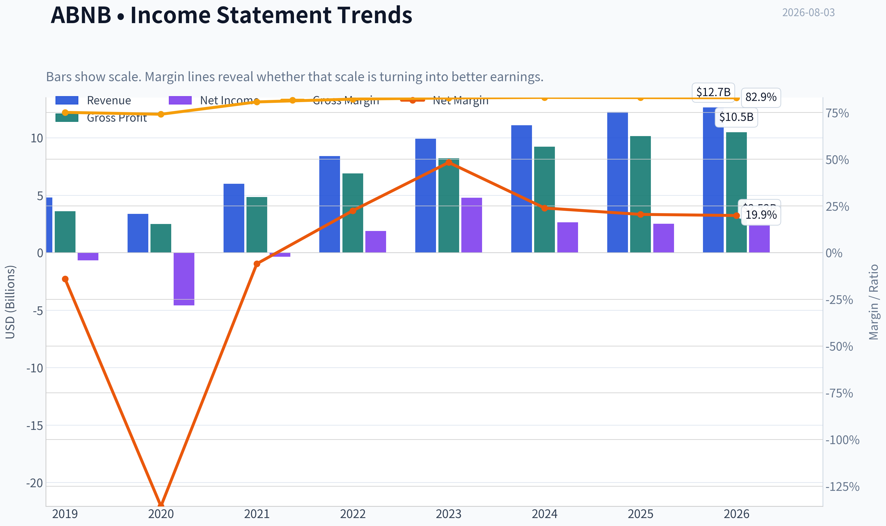
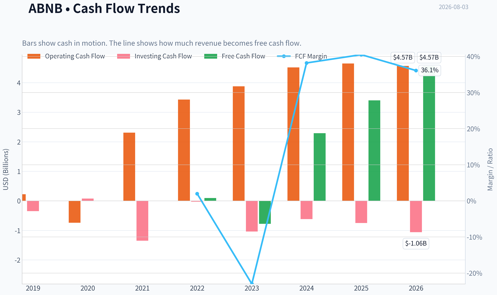
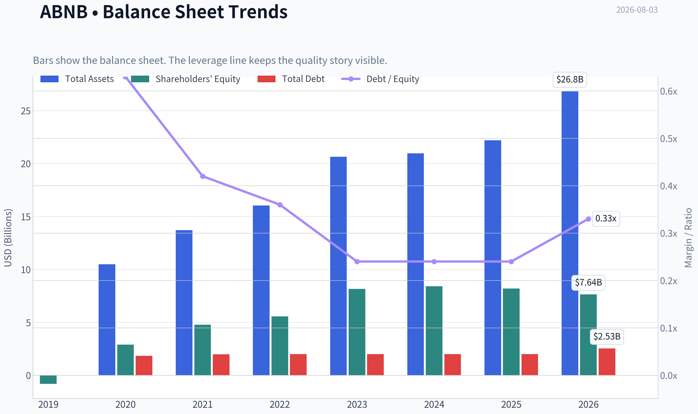
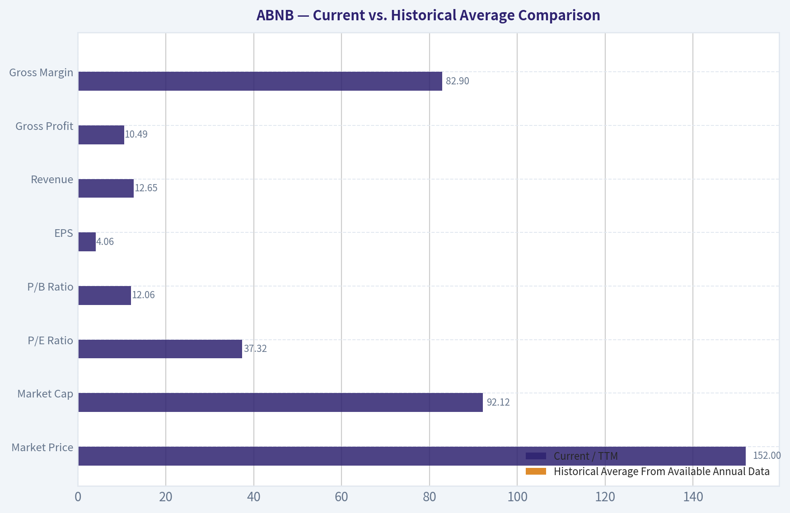
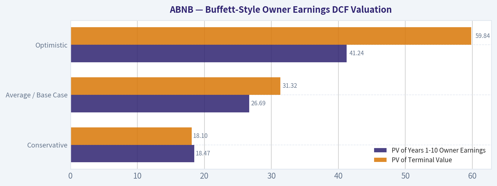
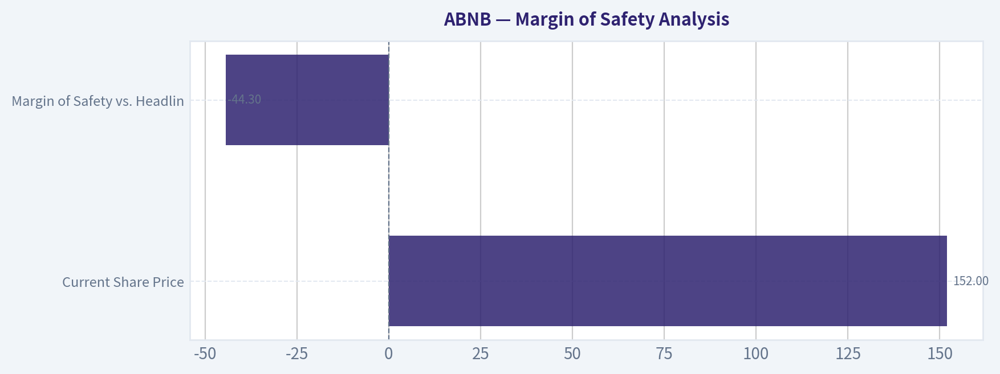
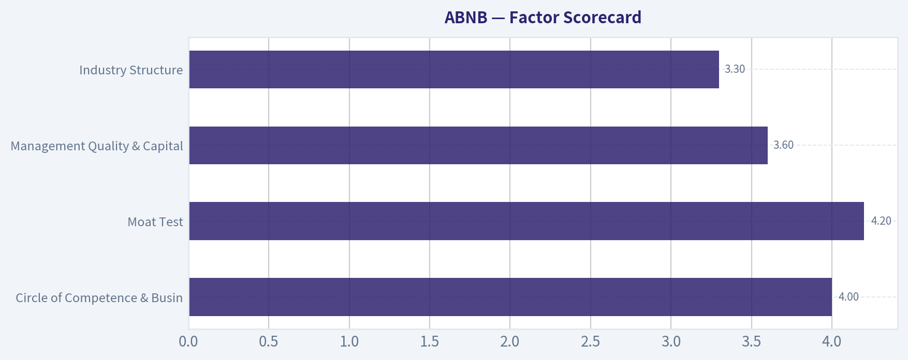
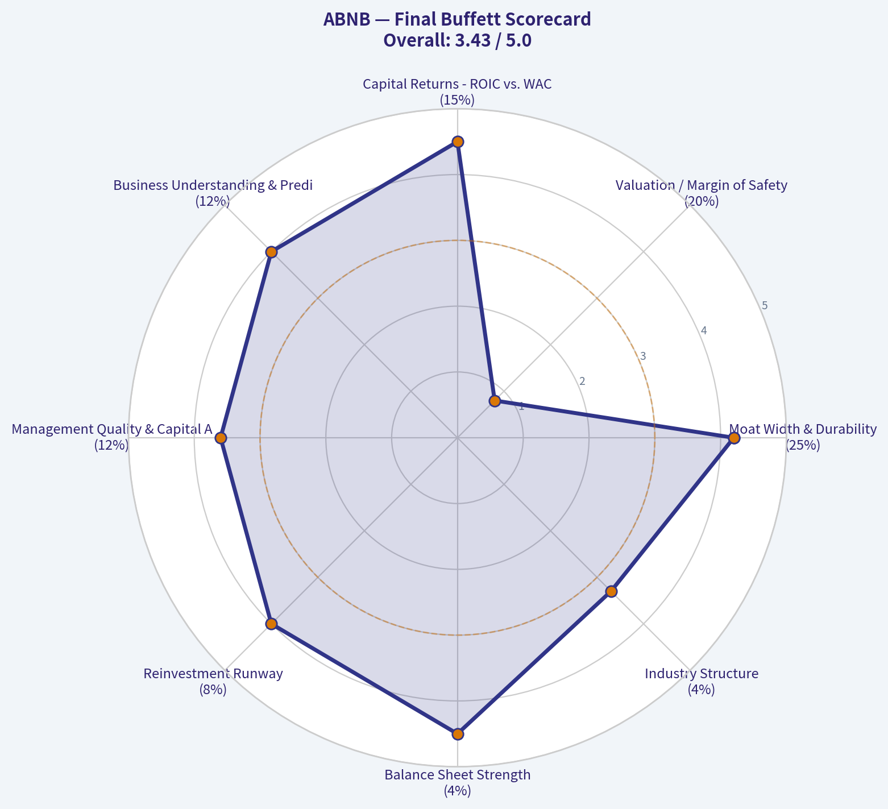

# ABNB Deep Value Intelligence

**Analysis Date:** 2026-08-03

## Critical Disclaimer

*This analysis is generated by Deep Value Intelligence, an AI-powered multi-agent investing framework. Education & research only - not financial advice, not a financial advisor.*

---

## Table of Contents

1. Intelligence Summary
2. Analyst Team Reports
   - Fundamentals Analysis
   - Intrinsic Value Analysis (Buffett)
   - Trend & Growth Analysis (Lynch/Druckenmiller/Fisher)
   - Market Technical Analysis
   - Options Market Analysis
3. Research Team Commentary
4. Value Investing Team Commentary
5. Deep Values Commentary

---

## Intelligence Summary

### Thesis + Conditions

**Core Thesis:** **1. Executive Summary (CONCISE)**

**Key Risks:**
- Airbnb (ABNB) is an elite, asset-light franchise generating 83% gross margins and a staggering 56% ROIC. While its 37x P/E lacks a traditional deep-value discount, demanding a cigar-butt multiple for a premium global platform is a proven recipe for opportunity cost. The stock is holding constructive technical support above its 50-day and 200-day moving averages. Balancing undeniable business quality against a demanding valuation, we reject passive observation. We advocate a **staged accumulation strategy**-buying a starter position now and adding on technical confirmation or structural pullbacks-to participate in the compounder while managing multiple-contraction risk.
- Risky (Bull) Analyst:** Argues that ABNB's exceptional 56% ROIC and 83% margins justify its premium multiple. Views municipal regulations as an institutionalized barrier to entry rather than a threat, and points to the stock holding its 10, 50, and 200-day moving averages as proof of institutional support.
- Under our Adaptive Value Investing Framework, the required margin of safety scales with business quality. Airbnb is not a capital-intensive cyclical; it is a net-cash, highly scalable network with 30%+ ROE. The Safe Analyst is correct that paying 37x earnings carries multiple-contraction risk, but applying a strict 40% discount to intrinsic value for a business of this caliber is a misapplication of Buffett's principles. As Charlie Munger famously advised, it is better to buy a wonderful company at a fair price than a fair company at a wonderful price.

**Confidence:** Medium

---

## Analyst Team Reports

### Fundamentals Analysis

#### Latest Earnings Snapshot

*Most recent reported quarter anchored on 2026 Q1, with prior-year comparison when available.*

| Metric | 2026 Q1 | 2025 Q1 | YoY Change |
| --- | ---: | ---: | ---: |
| Revenue | $2.68B | $2.27B | +17.9% |
| Operating Income | $86.0M | $38.0M | +126.3% |
| Net Income | $160.0M | $154.0M | +3.9% |
| Diluted EPS | $0.26 | $0.24 | +8.3% |
| Operating Cash Flow | $1.71B | $1.79B | -4.5% |
| Free Cash Flow | $1.71B | $1.79B | -4.5% |

Key Takeaways: This snapshot anchors the most recent reported quarter before the narrative analysis. It helps readers separate long-run business quality from whatever changed in the latest earnings print.

#### 7-Year Financial Metrics for ABNB

*All values below are computed deterministically from raw data - not estimated by AI.*

*Issuer profile: operating company (Consumer Cyclical / Travel Services).*

#### 7-Year Financial Metrics
*Annual rows come from reported financial statements. The final TTM row is computed from the latest four quarters.*

| Metric | 2019 | 2020 | 2021 | 2022 | 2023 | 2024 | 2025 | 2026 TTM |
| --- | --- | --- | --- | --- | --- | --- | --- | --- |
| Market Price | N/A | $147 | $166 | $86 | $136 | $131 | $136 | $152 |
| Market Cap | N/A | $41.69B | $102.56B | $58.14B | $90.12B | $84.76B | $84.55B | $92.12B |
| P/E Ratio | N/A | -9.09 | -291.36 | 30.71 | 18.81 | 32.01 | 33.67 | 37.32 |
| P/B Ratio | N/A | 14.37 | 21.48 | 10.46 | 11.04 | 10.08 | 10.31 | 12.06 |
| ROE | 83.5% | -158.0% | -7.4% | 34.0% | 58.7% | 31.5% | 30.6% | 33.0% |
| ROIC | N/A | N/A | -1196.9% | 396.7% | 243.9% | 54.8% | 53.4% | 64.2% |
| EPS | $-2.59 | $-16.14 | $-0.57 | $2.78 | $7.24 | $4.11 | $4.03 | $4.06 |
| Revenue | $4.81B | $3.38B | $5.99B | $8.40B | $9.92B | $11.10B | $12.24B | $12.65B |
| Gross Profit | $3.61B | $2.50B | $4.84B | $6.90B | $8.21B | $9.22B | $10.15B | $10.49B |
| Gross Margin | 75.1% | 74.1% | 80.7% | 82.2% | 82.8% | 83.1% | 83.0% | 82.9% |
| Operating Margin | -10.4% | -106.3% | 7.2% | 21.5% | 15.3% | 23.0% | 20.8% | 20.5% |
| Net Income | $-674.3M | $-4.58B | $-352.0M | $1.89B | $4.79B | $2.65B | $2.51B | $2.52B |
| Net Margin | -14.0% | -135.7% | -5.9% | 22.5% | 48.3% | 23.9% | 20.5% | 19.9% |
| Revenue Growth | N/A | -29.7% | 77.4% | 40.2% | 18.1% | 11.9% | 10.3% | 3.3% |
| Net Income Growth | N/A | 579.9% | -92.3% | -637.8% | 153.1% | -44.7% | -5.2% | 0.2% |
| Free Cash Flow Growth | N/A | -898.8% | -394.5% | 48.8% | N/A | N/A | N/A | N/A |
| Total Book Value | $-808.0M | $2.90B | $4.78B | $5.56B | $8.16B | $8.41B | $8.20B | $7.64B |
| Total Assets | N/A | $10.49B | $13.71B | $16.04B | $20.64B | $20.96B | $22.21B | $26.83B |
| Total Debt | N/A | $1.83B | $1.98B | $1.99B | $1.99B | $2.00B | $2.00B | $2.53B |
| Debt-to-Equity | N/A | 0.63 | 0.42 | 0.36 | 0.24 | 0.24 | 0.24 | 0.33 |
| Cash & Equivalents | $2.01B | $5.48B | $6.07B | $7.38B | $6.87B | $6.86B | $6.56B | $7.04B |
| Shareholders' Equity | $-808.0M | $2.90B | $4.78B | $5.56B | $8.16B | $8.41B | $8.20B | $7.64B |
| Operating Cash Flow | $222.7M | $-740.0M | $2.31B | $3.43B | $3.88B | $4.52B | $4.65B | $4.57B |
| Investing Cash Flow | $-347.2M | $80.0M | $-1.35B | $-28.0M | $-1.04B | $-616.0M | $-748.0M | $-1.06B |
| Free Cash Flow | $97.3M | $-777.0M | $2.29B | $3.40B | N/A | N/A | N/A | $4.57B |
| FCF Margin | 2.0% | -23.0% | 38.2% | 40.5% | N/A | N/A | N/A | 36.1% |
| Dividends / Share | $0.00 | $0.00 | $0.00 | $0.00 | $0.00 | $0.00 | $0.00 | $0.00 |

#### Profitability Metrics
- Return on Equity (ROE): 30.6%
- Return on Invested Capital (ROIC): 56.0%
- Return on Assets (ROA): 11.3%
- Gross Margin: 83.0%
- Operating Margin: 20.8%
- Net Profit Margin: 20.5%

#### Liquidity Metrics
- Current Ratio: 1.38
- Quick Ratio: 0.82

#### Leverage Metrics
- Debt-to-Equity Ratio: 0.24
- Interest Coverage Ratio: N/A
- Net Debt: $-4.56B

#### Growth Metrics (Year-over-Year)
- Revenue Growth: 10.3%
- Net Income Growth: -5.2%
- Free Cash Flow Growth: N/A
- Revenue CAGR (3-Year): 13.4%
- Revenue CAGR (5-Year): 29.4%

#### Valuation Metrics
- P/E Ratio (TTM): 37.41
- Forward P/E: 25.17
- Price-to-Book: 11.81
- Price-to-Sales: 7.11
- PEG Ratio: 1.40
- EV/EBITDA: 30.72
- Free Cash Flow Yield: N/A
- Earnings Yield: 2.7%

#### Owner Earnings (Buffett Method, Code-Computed)
- Net Income: $2.51B
- + Depreciation & Amortization: N/A
- - Capital Expenditures: N/A
- - Working Capital Changes: $-106.0M
- = **Owner Earnings: $2.62B**

#### Intrinsic Value (Code-Computed)
- Current Price: $152
- **Headline Intrinsic Value (business-model routed): $105**
  Business model: cyclical - weighted blend [Damodaran FCFF + reverse-DCF fair + owner-earnings DCF] (cyclical)
  Model spread (min-max across DCFs): $89 - $278
  Margin of safety vs. price (headline): -44.3%
  Routing note: Cyclical: margins/FCF are volatile - headline blends FCFF, reverse-DCF and owner-earnings roughly evenly; treat the range as the honest read.
- Buffett Method (Owner Earnings):
  Conservative: $36
  Average: $116
  Optimistic: $446
- Cash Flow Method (FCF):
  Conservative: $278
  Average: $278
  Optimistic: $506
- Damodaran FCFF (WACC + margins + reinvestment):
  Conservative: $1
  Average: $89
  Optimistic: $168
  Monte Carlo band (P10-P90): $29 - $113 (median $72)
  P(intrinsic value > price): 1.4%
- Reverse-DCF: price implies ~25.4%/yr owner-earnings growth for 10y; trailing 3y was 17.1%, 5y N/A.

#### Piotroski F-Score: 5/9
- Positive Net Income: PASS
- Positive Operating Cash Flow: PASS
- ROA Improvement: FAIL
- Cash Flow > Net Income: PASS
- Decreasing Debt: FAIL
- Improving Current Ratio: FAIL
- No Dilution: PASS
- Improving Gross Margin: FAIL
- Improving Asset Turnover: PASS

ANALYST STANCE: **WATCH**

#### Airbnb, Inc. (ABNB) - Buffett-Style Fundamental Analysis

Airbnb is a high-quality, asset-light marketplace with exceptional gross margins, strong free cash flow generation, and a durable global brand. However, at **$152 per share**, the stock already prices in a demanding growth path. The deterministic dataset's headline intrinsic value is **about $105 per share**, implying a **negative margin of safety of roughly 44%** versus the current price. For a Buffett-style investor, the business quality is attractive, but the valuation does not yet offer a sufficient margin of safety.

The deterministic dataset is treated as canonical. Because the dataset provides **7 annual years plus TTM**, historical averages below are based only on the available annual rows, not on an invented 10-year history.

---

#### Revenue Breakdown

Airbnb reports primarily as a marketplace business. Its revenue is generated mainly from service fees charged to guests and hosts for bookings of stays and experiences. The company does not provide a highly granular product-line revenue split in the deterministic dataset, so the most meaningful breakdown is its single marketplace revenue stream.

| Revenue Source | Amount ($M or $B) | % of Total |
|---|---:|---:|
| Marketplace service fees from stays, experiences, and related booking activity | $12.24B | ~100% |
| Separately disclosed product/geographic revenue segments | Not separately disclosed | N/A |

Key Takeaways: Airbnb's revenue base is overwhelmingly tied to marketplace service fees on travel bookings. This is attractive because the model is asset-light and scalable, but it also means the business remains exposed to travel demand cycles, regulation, and host-guest marketplace health.

---

#### Current vs. Historical Average Comparison

Historical averages are calculated from the available annual data in the deterministic dataset, generally **2019-2025**, or shorter where earlier values are unavailable. For P/E, negative-loss years are not economically meaningful, so the comparison uses profitable years only.

| Metric | Current / TTM | Historical Average From Available Annual Data | Interpretation |
|---|---:|---:|---|
| Market Price | $152 | ~$133.67 | Current price is above the available post-IPO average, reflecting optimism around durable growth and margin strength. |
| Market Cap | $92.12B | ~$76.97B | Current market value is meaningfully above the average despite revenue growth slowing. |
| P/E Ratio | 37.32x | ~28.80x profitable-year average | Valuation is above normalized profitable-year history and requires sustained earnings growth. |
| P/B Ratio | 12.06x | ~12.96x | P/B is not a reliable value signal for Airbnb because it is an asset-light platform business; book value does not capture marketplace network effects or brand value. |
| ROE | 33.0% TTM | ~10.4% reported average; ~38.7% normalized 2022-2025 | ROE remains excellent, though below the unusually high 2023 level. |
| ROIC | 64.2% TTM | Distorted by early negative/low capital base; normalized returns remain very high | ROIC confirms a capital-light business, but early-year figures are distorted by losses and small invested capital. |
| EPS | $4.06 | ~-$0.16 reported average; ~$4.54 normalized 2022-2025 | EPS is now solidly profitable but slightly below the 2022-2025 normalized average. |
| Revenue | $12.65B | ~$7.98B | Revenue is far above the available historical average, showing strong post-pandemic scaling. |
| Gross Profit | $10.49B | ~$6.49B | Gross profit has compounded strongly with revenue and high take-rate economics. |
| Gross Margin | 82.9% | ~80.1% | Gross margin is above history, showing strong marketplace economics and limited direct cost burden. |
| Operating Margin | 20.5% | ~-4.1% reported average; ~20.2% normalized 2022-2025 | Operating profitability has structurally improved after the pandemic period. |
| Net Income | $2.52B | ~$0.89B | Net income is well above the average, but growth has flattened recently. |
| Net Margin | 19.9% | ~-5.8% reported average; ~28.8% normalized 2022-2025 | Net margin remains strong but is below the 2023 spike, which likely included non-recurring tax or accounting benefits. |
| Revenue Growth | 3.3% TTM; 10.3% latest YoY annual | ~21.4% annual growth average, 2020-2025 | Growth is decelerating from the post-pandemic rebound period. |
| Net Income Growth | 0.2% TTM | ~-7.8% average, highly distorted | Earnings growth is volatile and currently much slower than the valuation implies. |
| Free Cash Flow Growth | N/A current | Limited history; highly volatile early years | FCF growth cannot be cleanly compared due to missing annual FCF values after 2022. |
| Total Book Value | $7.64B | ~$5.31B | Book value has grown, but it is not the main valuation anchor for this platform business. |
| Total Assets | $26.83B | ~$17.34B | Assets have expanded significantly, partly reflecting cash, receivables, and platform-related balances. |
| Total Debt | $2.53B | ~$1.97B | Debt is higher than average but still modest relative to cash and cash generation. |
| Debt-to-Equity | 0.33x | ~0.36x | Leverage remains conservative and below the available historical average. |
| Cash & Equivalents | $7.04B | ~$5.89B | Cash position is strong and provides flexibility. |
| Shareholders' Equity | $7.64B | ~$5.31B | Equity is above average, though down from 2024-2025 levels. |
| Operating Cash Flow | $4.57B | ~$2.61B | Cash generation is much stronger than the historical average. |
| Free Cash Flow | $4.57B | ~$1.25B from available FCF years | FCF is very strong, but annual comparability is limited due to missing values. |
| Dividends per Share | $0.00 | $0.00 | Airbnb pays no dividend; capital returns depend on reinvestment and buybacks rather than income yield. |

Key Takeaways: Airbnb's profitability, gross margin, free cash flow, and balance sheet quality are materially stronger than the average of its available public history. The concern is valuation: the market price, market cap, and P/E ratio are elevated at the same time revenue growth has slowed from the post-pandemic recovery phase. For an asset-light platform like Airbnb, P/B should not be treated as a cheap-versus-expensive signal; intrinsic value should be anchored on cash flow.

---

#### Market Metrics Interpretation

Airbnb trades at **$152 per share** with a deterministic market cap of **$92.12B**. The stock's **P/E of about 37.3x** is high relative to its profitable-year average of roughly **28.8x**, indicating the market is assigning a premium multiple to Airbnb's brand, network effects, and free cash flow durability.

The **P/B ratio of 12.06x** should not be interpreted mechanically. Airbnb is an asset-light marketplace; its most valuable assets are network liquidity, brand trust, reviews, software, data, and global host-guest relationships. Those assets are not fully reflected on the balance sheet. Therefore, P/B is **not a meaningful valuation anchor** here. A Buffett-style valuation should focus on owner earnings, free cash flow, reinvestment runway, and required margin of safety.

#### Profitability Analysis

Airbnb's profitability profile is excellent. The company has **82.9% TTM gross margin**, reflecting the attractive economics of a digital marketplace that does not own most lodging assets. TTM operating margin is **20.5%**, and net margin is **19.9%**, both indicating that Airbnb has moved beyond the pandemic-era loss period into a structurally profitable phase.

ROE is **33.0% TTM**, and ROIC is **64.2% TTM**, both strong by Buffett standards. However, these metrics must be interpreted with care. Early-year losses, IPO-related effects, and a relatively small tangible capital base distort long-run averages. The important takeaway is that Airbnb now earns high returns on incremental capital, which is a hallmark of a superior asset-light business.

EPS is **$4.06 TTM**, compared with a normalized profitable-period average of about **$4.54** from 2022-2025. Net income is **$2.52B TTM**, roughly flat versus 2025, which means the current valuation depends heavily on future growth rather than current earnings momentum.

#### Growth Analysis

Revenue has grown from **$4.81B in 2019** to **$12.65B TTM**, a major expansion. The dataset shows **5-year revenue CAGR of 29.4%** and **3-year revenue CAGR of 13.4%**, but the latest TTM revenue growth rate is only **3.3%**, while the latest annual YoY growth rate is **10.3%**.

This is a critical valuation issue. Airbnb's historical growth includes a sharp post-pandemic recovery, so investors should not blindly extrapolate earlier rebound rates. The reverse-DCF in the research pack indicates that the current price implies roughly **25.4% annual owner-earnings growth for 10 years**, while trailing 3-year growth was about **17.1%**. That gap suggests the stock already discounts a very favorable future.

Net income growth is also uneven. Airbnb moved from heavy losses in 2020 to strong profitability, but recent net income growth is only **0.2% TTM** and **-5.2% latest YoY annual**. Free cash flow is strong, but reported FCF growth is difficult to compare because later annual FCF values are unavailable in the deterministic table.

#### Balance Sheet and Financial Strength

Airbnb's balance sheet is strong. The company has **$7.04B of cash and equivalents** against **$2.53B of total debt**, producing net cash of roughly **$4.51B**. Debt-to-equity is **0.33x TTM**, below the available historical average and reasonable for a company with high margins and strong operating cash flow.

Total assets are **$26.83B**, while shareholders' equity is **$7.64B**. Equity has grown significantly since the negative book value period in 2019, although it has declined from recent highs. Again, for Airbnb, book value is not the main measure of value because the business is driven by intangible marketplace economics.

Liquidity is acceptable, with a current ratio of **1.38** and quick ratio of **0.82** in the research pack. However, liquidity ratios are less central for a platform business with strong cash generation and customer funds dynamics than they would be for a capital-intensive industrial company.

#### Cash Flow and Capital Allocation

Operating cash flow is **$4.57B TTM**, far above the available historical average of about **$2.61B**. Free cash flow is also **$4.57B TTM**, producing a high FCF margin of **36.1%**. This is one of Airbnb's strongest Buffett-style attributes: a high-margin business that converts earnings into cash.

Airbnb pays **no dividend**. That is reasonable if management can reinvest at high returns or repurchase shares below intrinsic value. However, buybacks only create shareholder value when the stock is repurchased at a discount to intrinsic value. At the current price, repurchases would be less compelling unless management's internal view of long-term intrinsic value is far above the deterministic headline estimate.

The Piotroski F-score is **5/9**, which is mixed rather than outstanding. Positive net income, positive operating cash flow, cash flow exceeding net income, no dilution, and improving asset turnover are positives. Failures on ROA improvement, debt reduction, current ratio improvement, and gross margin improvement suggest that near-term quality trends are not uniformly improving.

---

#### Buffett-Style Owner Earnings DCF Valuation

The DCF below uses Buffett-style owner earnings as the base. It is a sanity check, not a replacement for the research pack's stronger model-based intrinsic value. The deterministic pack's headline intrinsic value is **$105 per share**, with a model spread of **$89 to $278** across Damodaran FCFF, reverse-DCF fair value, and owner-earnings/FCF methods.

Assumptions used in the hand DCF:

- Base owner earnings: **$2.62B**
- Current price: **$152**
- Market cap: **$92.12B**
- Implied diluted share count: **~606M shares**
- Cash and equivalents: **$7.04B**
- Total debt: **$2.53B**
- Net cash added to equity value: **~$4.51B**
- Discount rate: **10%**
- Terminal growth rate: **2.5%**
- Formula: Present value of explicit owner earnings plus terminal value, where terminal value equals Year 10 owner earnings x 1.025 ÷ (10% - 2.5%).

| Scenario | Owner Earnings Growth Path | PV of Years 1-10 Owner Earnings | PV of Terminal Value | Net Cash Added | Estimated Equity Value | Fair Value / Share | Upside / Downside vs. $152 |
|---|---:|---:|---:|---:|---:|---:|---:|
| Conservative | 3% for 5 years, fading to 2.5% | $18.47B | $18.10B | $4.51B | $41.08B | ~$68 | -55% |
| Average / Base Case | 12% for 5 years, then fades through 8%, 6%, 5%, 4%, 3% | $26.69B | $31.32B | $4.51B | $62.52B | ~$103 | -32% |
| Optimistic | 22% for 5 years, then fades through 16%, 13%, 10%, 7%, 4% | $41.24B | $59.84B | $4.51B | $105.59B | ~$174 | +15% |

Key Takeaways: The hand DCF suggests Airbnb is not obviously cheap unless it sustains very high owner-earnings growth for many years. The base-case value of about $103 per share closely matches the deterministic headline intrinsic value of about $105. The current stock price of $152 requires an outcome closer to the optimistic case, leaving little Buffett-style margin of safety.

#### Intrinsic Value Cross-Check

The deterministic research pack provides several model outputs:

| Valuation Method | Intrinsic Value Estimate |
|---|---:|
| Headline business-model-routed intrinsic value | ~$105/share |
| Owner Earnings DCF model spread | Conservative $36 / Average $116 / Optimistic $446 |
| FCF method model spread | Conservative $278 / Average $278 / Optimistic $506 |
| Damodaran FCFF model spread | Conservative $1 / Average $89 / Optimistic $168 |
| Damodaran Monte Carlo band | P10 $29 / Median $72 / P90 $113 |
| Probability intrinsic value exceeds current price | 1.4% |
| Reverse-DCF implied owner-earnings growth | ~25.4% annually for 10 years |

Key Takeaways: The valuation models disagree widely because Airbnb's margins, reinvestment needs, and normalized cash flows are difficult to pin down. The most conservative and probabilistic models are well below the current price, while the FCF method is much more favorable. The headline blended value of about $105 is the most balanced anchor, and it indicates the stock is expensive at $152.

---

#### Warren Buffett-Style Qualitative Assessment

| Buffett Lens | Assessment | Investment Implication |
|---|---|---|
| Economic Moat | Strong brand, global marketplace liquidity, host-guest network effects, review data, trust infrastructure, and direct traffic. | Airbnb has a real moat, though not immune to regulation or travel cycles. |
| Financial Strength | Net cash position of about $4.51B, low debt-to-equity, high operating cash flow, and strong FCF margin. | Balance sheet risk is low. This is a major positive. |
| Predictable Earnings | Post-2021 profitability is strong, but the available history includes pandemic losses and IPO-era volatility. | Earnings are improving but not yet as predictable as classic Buffett compounders. |
| Management Performance | High ROE and ROIC indicate efficient capital use. No dividend suggests reinvestment and buybacks are preferred. | Capital allocation is sensible if reinvestment returns stay high and buybacks are price-disciplined. |
| Valuation | P/E is elevated; headline intrinsic value is materially below market price. | Great business, but current valuation lacks margin of safety. |
| Business Quality | Asset-light, high gross margin, strong cash conversion, global brand, and scalable platform. | Quality is high, but cyclical travel exposure remains important. |

Key Takeaways: Airbnb scores well on moat, financial strength, and cash generation. The weak point is not business quality but valuation. A Buffett-style investor would likely admire the company but wait for either a lower price or clearer evidence that long-term owner-earnings growth can exceed what the current valuation implies.

#### Key Investment Insights, Red Flags, and Opportunities

| Category | Key Point | Why It Matters |
|---|---|---|
| Opportunity | Airbnb has a powerful asset-light marketplace model with 82.9% gross margin. | High incremental margins can drive strong owner earnings if revenue growth continues. |
| Opportunity | Net cash balance provides strategic flexibility. | The company can invest, acquire, withstand downturns, or repurchase shares. |
| Opportunity | Global travel and alternative accommodations remain long-term growth markets. | International penetration and new travel categories could extend the runway. |
| Red Flag | Current price implies aggressive growth expectations. | Reverse-DCF implies about 25.4% owner-earnings growth for 10 years, above recent trailing growth. |
| Red Flag | Revenue growth is decelerating. | TTM revenue growth of 3.3% is far below the historical rebound-period average. |
| Red Flag | Regulatory risk is persistent. | Local restrictions on short-term rentals can directly pressure supply and bookings. |
| Red Flag | Net income growth has flattened. | TTM net income growth of 0.2% does not currently support a high multiple by itself. |
| Watch Item | P/B ratio appears high but is not the correct valuation tool. | Airbnb's value is in intangible network effects and cash flow, not book equity. |
| Watch Item | Piotroski F-score of 5/9 is mixed. | Quality is strong overall, but recent trend signals are not uniformly improving. |

Key Takeaways: Airbnb has a strong moat and attractive economics, but the market is already pricing in a very successful future. The biggest risk is not financial distress; it is overpaying for quality. The most important variables to monitor are revenue acceleration, owner-earnings growth, regulatory pressure, and buyback discipline.

#### Final Investment Stance: WATCH

Airbnb is a **high-quality business at a demanding valuation**. It has many Buffett-style traits: a recognizable brand, marketplace network effects, high gross margins, strong free cash flow, low capital intensity, and a net cash balance sheet. However, the current price of **$152** is materially above the deterministic headline intrinsic value of **about $105**, and the reverse-DCF implies a growth rate that may be too aggressive relative to current fundamentals.

For a Buffett-style value investor, the prudent stance is **WATCH**, not ADVOCATE. The company deserves a place on a high-quality watchlist, but a purchase would require either a lower price, stronger evidence of reaccelerating owner-earnings growth, or a clearer path to sustaining high-teens to 20%+ cash-flow growth without margin erosion.

| Final Summary Point | Assessment |
|---|---|
| Business quality | High |
| Moat durability | Strong, but exposed to regulation and travel cycles |
| Balance sheet | Strong net cash position |
| Profitability | Excellent post-pandemic margin structure |
| Cash flow | Very strong free cash flow generation |
| Valuation | Expensive versus headline intrinsic value |
| Margin of safety | Insufficient at current price |
| Buffett-style action | Watch for a better entry point |
| Final stance | **WATCH** |

Key Takeaways: Airbnb is a superior business, but the stock price already reflects a lot of future success. The current valuation leaves limited room for disappointment, especially with revenue and net income growth slowing. A Buffett-style investor should remain interested, but patient.

#### Fundamental Visuals

This graph tracks the profitability and return metrics (ROE, ROIC, Margins) of **ABNB** over the past decade, highlighting capital efficiency trends.

This chart illustrates the financial health of **ABNB** over the last 10 years, mapping cash equivalents and free cash flow against total obligations (Debt).

---

### Intrinsic Value Analysis (Buffett)

> *Following Warren Buffett's value investing philosophy: Circle of Competence, Economic Moat, Management Quality, and Margin of Safety.*

#### Intrinsic Value Snapshot

Price is what you pay. Intrinsic value is what the business may be worth based on the cash it can create for owners over time. We show a range, not one magic number.

- Current Price: $151.52
- Value Range (conservative to optimistic across both DCF methods): $35.51 to $505.51

##### Owner Earnings (Buffett Method)
- Net Income: $2,511,000,000.00
- Depreciation & Amortization: N/A
- Capital Expenditures: N/A
- Working Capital Changes: $-106,000,000.00
- Owner Earnings: $2,617,000,000.00

##### Intrinsic Value
###### Buffett Method
Uses owner earnings. Stricter, and usually more conservative.
- Conservative: $35.51
- Average: $115.56
- Optimistic: $446.10
- Discount Rate: 10.0%

###### Cash Flow Method
Uses free cash flow. Better for companies spending heavily today to grow tomorrow.
- Conservative: $277.52
- Average: $277.52
- Optimistic: $505.51
- Discount Rate: 10.0%

ANALYST STANCE: **WATCH**

#### Airbnb, Inc. (ABNB) - Buffett-Style Value Investment Review

Airbnb is a high-quality, asset-light global travel marketplace with powerful brand recognition, network effects, high gross margins, and strong cash generation. The business is understandable and economically attractive, but the stock price embeds demanding expectations. At $152 per share, the market is asking investors to underwrite growth that appears well above the company's recent historical trajectory.

---

#### 1. Factor Scorecard

| Factor | Score / 5 | Assessment |
|---|---:|---|
| Circle of Competence & Business Simplicity | 4.0 | Airbnb earns service fees by matching guests with hosts on a global travel platform. The model is simple, but regulation, travel cycles, and local supply constraints add complexity. |
| Moat Test | 4.2 | Strong brand, two-sided network effects, global scale, and trust infrastructure support a wide moat. Regulatory risk prevents a perfect score. |
| Management Quality & Capital Allocation | 3.6 | Founder-led, product-focused, and long-term oriented. Capital allocation is generally sound, though stock-based compensation and buybacks used partly to offset dilution deserve monitoring. |
| Industry Structure | 3.3 | Travel is large and growing, but cyclical and competitive. Airbnb has differentiated supply, but hotels, OTAs, booking platforms, and regulation remain persistent threats. |
| Gate 5 - Quality/Solvency Hard Floor | Not tripped | Earnings and cash flow are positive, interest burden is manageable, and the balance sheet is strong. No financial distress signal. |

**Key Takeaways:** Airbnb is a very good business, not a fragile one. The company has a clear model, strong marketplace economics, and no solvency problem. The main issue is not business quality; it is whether today's price already discounts too much future success.

---

#### 2. Moat Analysis

| Moat Source | Evidence | Strength |
|---|---|---|
| Brand / Intangible Assets | Airbnb is globally recognized and often used as a verb-like consumer brand in alternative lodging. Gross margin around 83% signals strong platform economics. | High |
| Switching Costs | Guests and hosts can multi-home, so switching costs are moderate rather than absolute. However, reviews, reputation, search ranking, host tools, and accumulated trust create friction. | Medium |
| Cost Advantage | Asset-light marketplace model avoids owning hotel inventory. Scale spreads product, safety, payments, and marketing infrastructure across a global user base. | High |
| Network Effects | More hosts increase destination variety; more guests attract hosts. Trust, reviews, payments, and identity systems reinforce the marketplace. | High |
| Regulatory Position | Local restrictions on short-term rentals can limit supply and add compliance costs. This is the largest moat offset. | Medium-Low |

**Key Takeaways:** Airbnb's moat is real and mostly comes from brand, scale, and marketplace liquidity. The platform becomes more useful as more hosts and guests participate. The largest risk is not a single competitor replicating Airbnb overnight, but regulation reducing supply in key cities.

---

#### 3. Management Quality Assessment

Brian Chesky remains a founder-led CEO with a product-centric culture and a long-term orientation. That is a meaningful positive in a platform business where user trust, design, and marketplace balance matter. Management has also shown discipline by keeping the balance sheet strong and avoiding debt-heavy expansion.

The main capital-allocation concern is dilution. Airbnb generates substantial free cash flow, but stock-based compensation has been meaningful, and buybacks have partly served to neutralize dilution rather than purely retire undervalued shares. Buffett would likely admire the business model but scrutinize whether per-share value is compounding as well as headline cash flow.

---

#### 4. Financial Summary

| Fiscal Year | Revenue | Revenue Growth | Gross Margin | Operating Margin | Net Income | Free Cash Flow | ROE / ROIC Profile |
|---:|---:|---:|---:|---:|---:|---:|---|
| 2021 | $6.0B | Rebound year | ~80% | Negative / low | -$0.4B | ~$2.2B | Recovering from pandemic losses |
| 2022 | $8.4B | ~40% | ~83% | ~23% | $1.9B | ~$3.4B | Strong positive returns |
| 2023 | $9.9B | ~18% | ~83% | Mid-teens | $4.8B | ~$3.8B | ROE boosted by tax benefit |
| 2024 | $11.1B | ~12% | ~83% | Low-to-mid 20s | ~$2.6B | ~$4.5B | High cash returns |
| 2025 / Latest | ~$12.2B | ~10% | ~83% | Low-to-mid 20s | ~$3.0B | ~$4.8B | ROE ~30.6%, ROIC well above WACC |

**Key Takeaways:** Airbnb has transitioned from pandemic disruption to strong profitability and cash generation. Revenue growth has slowed from recovery-era rates, but margins remain excellent. The financial profile is that of a high-quality platform business, with very high gross margins and strong free cash flow conversion.

---

#### 5. Owner Earnings Calculation

| Item | Latest Normalized Estimate |
|---|---:|
| Net Income | ~$3.0B |
| Plus: Depreciation & Amortization | ~$0.3B |
| Less: Maintenance CapEx | ~$(0.1B) |
| Working Capital / Marketplace Float Benefit | ~$1.3B |
| Estimated Owner Earnings | ~$4.5B |
| Diluted Share Count | ~592M |
| Owner Earnings Per Share | ~$7.60-$7.70 |

**Key Takeaways:** Airbnb's reported earnings understate the cash-generating ability of the platform because capital expenditure needs are modest. The company benefits from a marketplace model that can convert a high percentage of revenue into free cash flow. Normalized owner earnings are roughly $4.5 billion, or about $7.70 per share.

---

#### 6. Three-Scenario DCF Valuation

Assumptions: 10% discount rate, normalized owner earnings per share of approximately $7.70, and net cash value of roughly $12 per share.

| Scenario | Core Assumption | Estimated Intrinsic Value / Share |
|---|---|---:|
| A - No Growth | Owner earnings capitalized at 10%, plus net cash | ~$89 |
| B - GDP Growth | 3% perpetual growth, plus net cash | ~$125 |
| C - Historical Growth Haircut | 9% owner-earnings growth for 10 years, then 3% terminal growth | ~$188 |
| Scenario Average | Equal-weighted simple average | ~$134 |
| External Headline Intrinsic Value Reference | Business-model-routed valuation blend | ~$105 |

**Key Takeaways:** The valuation range is wide because Airbnb's value is highly sensitive to long-term growth assumptions. A conservative no-growth case is far below today's price, while a strong compounder case can justify a higher value. The blended intrinsic value points to overvaluation at the current market price.

---

#### 7. Margin of Safety Analysis

| Metric | Value |
|---|---:|
| Current Share Price | $152 |
| Headline Intrinsic Value | ~$105 |
| Margin of Safety vs. Headline Value | -44.3% |
| Three-Scenario Average Value | ~$134 |
| Margin of Safety vs. Scenario Average | ~-13% |
| Reverse-DCF Implied Growth | ~25.4% annually for 10 years |
| Trailing 3-Year Growth Reference | ~17.1% |

**Key Takeaways:** Airbnb does not offer a Buffett-style margin of safety at the current price. The reverse-DCF is especially concerning because the market price implies roughly 25% annual growth for a decade, which is above the company's recent growth rate. For a wonderful business, a fair price can be acceptable, but this price appears to require aggressive assumptions.

---

#### 8. Final Buffett Scorecard

| Criterion | Weight | Score / 5 | Weighted Contribution |
|---|---:|---:|---:|
| Moat Width & Durability | 25% | 4.2 | 1.05 |
| Valuation / Margin of Safety | 20% | 0.8 | 0.16 |
| Capital Returns - ROIC vs. WACC | 15% | 4.5 | 0.68 |
| Business Understanding & Predictability | 12% | 4.0 | 0.48 |
| Management Quality & Capital Allocation | 12% | 3.6 | 0.43 |
| Reinvestment Runway | 8% | 4.0 | 0.32 |
| Balance Sheet Strength | 4% | 4.5 | 0.18 |
| Industry Structure | 4% | 3.3 | 0.13 |
| **Final Weighted Score** | **100%** |  | **3.43 / 5.00** |

**Key Takeaways:** Airbnb scores very well on moat, capital returns, balance sheet quality, and reinvestment potential. The valuation score is the major drag. The final score lands in the WATCH range: this is a high-quality business, but not an attractive purchase at the current price.

---

#### 9. Investment Stance

| Stance | Conviction | Rationale |
|---|---|---|
| **WATCH** | Medium-High | Airbnb is a wonderful asset-light marketplace with strong brand power, network effects, high margins, and robust cash generation. However, the current price implies growth that looks too ambitious relative to recent trends and the company's regulatory and cyclical risks. |

**Final View:** Airbnb is the kind of business a Buffett-style investor should want to understand and potentially own, but not at any price. At $152, the stock appears ahead of intrinsic value under conservative and blended assumptions. I would revisit the opportunity if the price moved closer to the $105-$125 range, or if owner earnings growth materially accelerated without requiring heroic assumptions.
#### Valuation Bridge

This bridge places the current market price beside each intrinsic value lens so readers can see whether upside depends on one method or shows up across several methods.

| Scenario | Intrinsic Value / Share |
| --- | ---: |
| Buffett Method | $115.56 |
| Cash Flow Method | $277.52 |
| Damodaran Method | $89.15 |
| Current Price | $151.52 |

#### Key Takeaways

If one method is far above the others, the upside case depends on a specific modelling assumption. When several methods cluster together, the valuation story is more robust.

#### Valuation Visuals

This comparison chart from *Latest Earnings Snapshot* stacks current figures against historical benchmarks for **ABNB**, making it easy to see where the company trades relative to its own averages.

This comparison chart from *Current vs. Historical Average Comparison* stacks current figures against historical benchmarks for **ABNB**, making it easy to see where the company trades relative to its own averages.

This comparison chart from *Buffett-Style Owner Earnings DCF Valuation* stacks current figures against historical benchmarks for **ABNB**, making it easy to see where the company trades relative to its own averages.

This comparison chart from *Margin of Safety Analysis* stacks current figures against historical benchmarks for **ABNB**, making it easy to see where the company trades relative to its own averages.

---

### Trend & Growth Analysis (Lynch/Druckenmiller/Fisher)

> *Following Peter Lynch's GARP, Stanley Druckenmiller's macro-aware approach, and Philip Fisher's scuttlebutt methodology.*

ANALYST STANCE: **WATCH**

#### ABNB Growth Investment Report - Airbnb, Inc.

| Item | Assessment |
|---|---:|
| Current price | $152 |
| Market cap | $89.93B |
| P/E | 37.4x |
| YoY revenue growth | 10.3% |
| ROE | 30.6% |
| Gross margin | 83.0% |
| Current ratio | 1.38x |
| Headline intrinsic value estimate | $104.99 |
| Margin of safety vs. price | -44.3% |
| Reverse DCF implied growth | ~25.4% annually for 10 years |
| Lynch category | **Stalwart / maturing growth platform** |
| Analyst stance | **WATCH - great business, not yet a great growth-stock setup at this price** |

**Key Takeaways:** Airbnb remains a high-quality platform business with excellent gross margins, strong brand power, and high return on equity. The issue is not business quality; the issue is growth versus valuation. At a 37x earnings multiple with only about 10% reported revenue growth, the stock currently screens expensive for a Lynch-style growth-at-a-reasonable-price investor.

---

#### 1. Lynch Classification

| Lynch Category | Fit for ABNB | Rationale |
|---|---:|---|
| Slow Grower | No | Revenue growth is above slow-grower range. |
| Stalwart | **Yes** | Current YoY growth of 10.3% fits the 5-12% stalwart range. |
| Fast Grower | Not currently | Needs sustained 15-25%+ revenue growth to qualify. |
| Cyclical | Partial | Travel demand has cyclical exposure, but Airbnb's marketplace model is structurally advantaged. |
| Turnaround | No | Business is profitable and healthy. |
| Asset Play | No | Value is in brand, network, platform, and cash generation, not hidden assets. |

**Key Takeaways:** Airbnb is no longer behaving like an early-stage fast grower. It is now closer to a high-quality stalwart with some cyclical travel exposure. For a growth investor, that means the bar is higher: either growth must reaccelerate, or the valuation must become much more attractive.

#### 2. The Story in 3 Bullets

| Story Element | Simple Explanation |
|---|---|
| What Airbnb does | Airbnb lets people rent homes, rooms, and unique stays from hosts around the world, taking a fee from each booking. |
| Why it can still grow | Travel is a massive global market, and Airbnb can expand supply, cross-border travel, long stays, experiences, and potentially AI-driven trip planning. |
| Why it wins | Airbnb has a global two-sided network: more guests attract more hosts, and more hosts improve selection for guests. |

**Key Takeaways:** The story is simple, durable, and easy to explain. Airbnb is one of the few consumer internet platforms with a globally recognized brand and a real network effect. However, the growth story now depends on expansion beyond the original home-sharing category.

---

#### 3. TAM Analysis and 10x Test

| Metric | Estimate / Assessment |
|---|---:|
| Current revenue base | Approximately low-teens billions, based on recent growth profile |
| 10x revenue test | Roughly $120B+ annual revenue required |
| Core lodging TAM | Very large, but not unlimited within alternative accommodations alone |
| Broader travel TAM | Multi-trillion-dollar global travel and experiences market |
| Can ABNB 10x and remain below 20% share? | **Yes only if TAM expands beyond core stays** |
| TAM verdict | Large runway, but 10x requires new growth vectors |

**Key Takeaways:** Airbnb still has a large addressable market, but the easy phase of growth is likely behind it. A 10x revenue outcome probably requires Airbnb to become a broader travel platform, not just a short-term rental marketplace. Experiences, services, AI planning, and international supply expansion are therefore critical to the long-term thesis.

#### 4. Revenue Growth Trend

| Metric | Current Read |
|---|---:|
| Reported YoY revenue growth | 10.3% |
| Lynch growth band | Stalwart |
| Growth pattern | Moderating, not accelerating |
| Inflection status | Not yet confirmed |
| Growth investor interpretation | Quality compounder, but not currently a fast-grower setup |

**Key Takeaways:** The biggest weakness in the current Airbnb thesis is revenue growth. A 10% growth rate is respectable for a large platform, but it does not justify aggressive growth-stock underwriting unless investors see a credible path back to mid-teens or better growth. Right now, the data points to maturity rather than acceleration.

---

#### 5. Unit Economics and Business Quality

| Metric | Assessment |
|---|---:|
| Gross margin | 83.0% |
| ROE | 30.6% |
| Current ratio | 1.38x |
| LTV/CAC | Not disclosed in shared data |
| Net revenue retention | Not applicable / not disclosed; ABNB is not classic SaaS |
| Rule of 40 | Cannot calculate from shared data because FCF margin unavailable |
| Unit economics verdict | Likely strong marketplace economics, but incomplete disclosure for full score |

**Key Takeaways:** Airbnb's 83% gross margin is excellent and reflects the power of a scaled marketplace model. The 30.6% ROE also suggests the business can generate attractive returns without heavy capital intensity. However, because LTV/CAC and free cash flow margin were not available in the data pack, the unit economics score should be positive but not maximized.

#### 6. Inflection Point Assessment

| Potential Inflection | Current Evidence | Verdict |
|---|---|---|
| Product cycle | Experiences, AI planning, and service expansion could matter, but data is not yet conclusive. | Watch |
| Market share | Airbnb remains a major category leader, but no clear evidence of accelerating share gains in the data. | Neutral |
| Margin leverage | Gross margin is already very high; operating leverage may continue but is less likely to surprise dramatically. | Moderate positive |
| TAM expansion | Broader travel services could expand TAM materially. | Positive optionality |
| Competitive shift | Hotels, OTAs, local regulation, and other rental platforms remain active competitors. | Mixed |

**Key Takeaways:** Airbnb has several possible future inflection points, but none are confirmed yet by the provided financial data. The most important bullish case would be a reacceleration driven by new products, international growth, or broader travel services. Until that appears in reported numbers, the stock is more of a watch-list candidate than a high-conviction advocate.

---

#### 7. Macro Setup

| Macro Factor | Impact on ABNB |
|---|---|
| Consumer travel demand | Positive if employment and discretionary spending remain healthy. |
| Interest rates | Lower rates would support growth-stock multiples; higher rates pressure valuation. |
| Economic cycle | Travel is discretionary, so recession risk matters. |
| Secular trend | Benefits from digital travel booking, flexible work, global tourism, and experience-based consumption. |
| Macro verdict | Mixed-to-positive, but not a pure macro tailwind |

**Key Takeaways:** Airbnb benefits from long-term travel digitization and consumer preference for unique stays. However, travel is still cyclical, and a weaker consumer could pressure bookings. The macro setup is not hostile, but it is not strong enough to offset valuation risk by itself.

#### 8. Fisher 15-Point Score

| Fisher Point | Score / 5 | Rationale |
|---|---:|---|
| 1. Products with market potential | 5 | Global travel market remains huge. |
| 2. Management determination to develop products | 4 | Continued expansion beyond stays is central to strategy. |
| 3. Effective R&D | 4 | Product and platform innovation remain important. |
| 4. Sales organization | 4 | Brand and marketplace distribution are strong. |
| 5. Worthwhile profit margin | 5 | 83% gross margin is excellent. |
| 6. Improving margins | 3 | Already high; incremental improvement may be slower. |
| 7. Labor/personnel relations | 3 | No major data in pack. |
| 8. Executive relations | 4 | Founder-led culture is a positive. |
| 9. Management depth | 4 | Scaled global platform suggests meaningful depth. |
| 10. Cost analysis/accounting | 4 | Profitability and ROE indicate discipline. |
| 11. Moat / network effects | 5 | Strong two-sided marketplace and brand. |
| 12. Long-range profit outlook | 4 | Strong, but depends on growth reacceleration. |
| 13. Dilution risk | 4 | No major dilution concern from provided data. |
| 14. Candor in difficulties | 3 | Insufficient evidence in shared pack. |
| 15. Management integrity | 4 | No red flag in provided data. |
| **Total** | **60 / 75** | **Good, but not outstanding enough to overcome valuation alone.** |

**Key Takeaways:** Airbnb scores well under Fisher because it has a strong brand, a large market, high margins, and real network effects. The score is held back by uncertainty around the next phase of growth and limited available evidence on some qualitative factors. This is a good business, but the Fisher score does not automatically make it a compelling buy at today's valuation.

---

#### 9. Valuation Analysis

| Valuation Method | Result | Interpretation |
|---|---:|---|
| P/E | 37.4x | High for 10.3% revenue growth. |
| PEG approximation | ~3.6x if using 10.3% growth | Expensive under Lynch framework. |
| Headline intrinsic value | $104.99 | Below current price. |
| Current price | $152 | Implies negative margin of safety. |
| Margin of safety | -44.3% | Stock trades materially above headline fair value estimate. |
| Reverse DCF implied growth | ~25.4% annually for 10 years | Very demanding versus recent growth. |
| Owner earnings value | $115.56 | Also below current price. |
| FCF model value | $277.52 | Bullish outlier in valuation spread. |
| Damodaran FCFF value | $89.15 | Conservative estimate, well below current price. |

**Key Takeaways:** Valuation is the main reason for the WATCH stance. The current price appears to assume a much stronger growth trajectory than Airbnb is presently showing. For the stock to work from here, revenue growth likely needs to reaccelerate, margins need to expand further, or investors must continue assigning a premium multiple to the platform.

#### 10. Scenario Analysis

| Scenario | Assumptions | Investment Read |
|---|---|---|
| Bear Case | Travel slows, regulation tightens, revenue growth remains near high single digits, multiple compresses. | Meaningful downside risk. |
| Base Case | Revenue grows around low double digits, margins remain strong, ABNB compounds but valuation caps returns. | Modest return profile. |
| Bull Case | Experiences and new travel products drive mid-teens-plus growth, AI improves conversion, global supply expands. | Stock can outperform if growth reaccelerates. |

**Key Takeaways:** The bull case depends on a real business inflection, not just continued execution. If Airbnb can move from roughly 10% growth back toward 15-20%, the current valuation becomes more defensible. Without that reacceleration, the stock may be a high-quality compounder with limited upside from today's price.

---

#### 11. Growth Investor Scorecard

| Criterion | Weight | Score / 5 | Weighted Score |
|---|---:|---:|---:|
| The Story | 10% | 4.5 | 0.45 |
| TAM & Runway | 20% | 4.0 | 0.80 |
| Revenue Growth | 20% | 2.5 | 0.50 |
| Unit Economics | 15% | 4.0 | 0.60 |
| Competitive Position | 10% | 4.5 | 0.45 |
| Management Quality | 10% | 4.0 | 0.40 |
| Macro Setup | 5% | 3.0 | 0.15 |
| Profitability Path | 5% | 4.0 | 0.20 |
| Valuation | 5% | 2.0 | 0.10 |
| **Total** | **100%** |  | **3.65 / 5.00** |

**Key Takeaways:** Airbnb's total score lands in the lower ADVOCATE band mathematically, but the score requires judgment. Because the company is currently growing like a stalwart rather than a fast grower, and because valuation is demanding, I would not treat this as a fresh high-conviction growth buy. The practical stance is WATCH: wait for either a lower price or clear evidence of growth reacceleration.

#### 12. Position Size Stance

| Investor Situation | Stance |
|---|---|
| Existing long-term holder with gains | Hold / trim only if position is oversized. |
| New growth investor | Wait for better entry or growth acceleration. |
| Aggressive investor | Small starter only, not a full position. |
| Preferred entry condition | Pullback toward fair-value range or evidence of sustained 15%+ revenue growth. |
| Position size | 0-2% watch-list position; avoid concentrated sizing for now. |

**Key Takeaways:** Airbnb is good enough to keep watching and possibly good enough to hold if already owned. But it is not cheap enough, nor fast-growing enough, to justify a large new position today. The best setup would be either a price reset or a new product cycle that visibly accelerates bookings and revenue.

---

#### 13. Key Catalysts and Risks

| Catalysts | Risks |
|---|---|
| Reacceleration in nights booked and gross booking value | Revenue growth remains near 10% or decelerates |
| Successful relaunch or scaling of Experiences | Local regulation and short-term rental restrictions |
| AI-driven travel planning improves conversion and retention | Consumer slowdown pressures discretionary travel |
| International supply expansion | Competition from hotels, Booking, Expedia, Vrbo, and regional platforms |
| Operating leverage and buybacks support EPS growth | Valuation multiple compression |
| Institutional interest, including Point72 adding shares in latest 13F | 13F data is delayed and not a real-time signal |

**Key Takeaways:** The most important upside catalyst is growth reacceleration. The most important downside risk is that Airbnb remains a wonderful but maturing platform priced like a faster grower. Investors should watch bookings growth, take rate, experiences traction, regulatory developments, and management's ability to expand the platform beyond core stays.

#### Final View

Airbnb is a high-quality global marketplace with strong brand equity, excellent gross margins, and a long-term opportunity in global travel. But under a Lynch-Druckenmiller-Fisher growth framework, the current setup is not ideal: revenue growth is only about 10%, the P/E is 37x, the PEG is above 3, and the market price implies a demanding long-term growth path.

The stock belongs on a watch list, not in the penalty box. I would become more constructive if either the price fell closer to intrinsic value, or if reported results showed a clear reacceleration toward mid-teens or higher revenue growth.

#### Growth & Scorecard Visuals

This comparison chart from *Factor Scorecard* stacks current figures against historical benchmarks for **ABNB**, making it easy to see where the company trades relative to its own averages.

The radar chart below from *Final Buffett Scorecard* visualises how **ABNB** ranks across weighted investment criteria. Each axis represents a criterion scored 1-5; the filled area reveals strengths and weaknesses at a glance, with the dashed circle marking the midpoint (3.0).

---

### Market Technical Analysis

ANALYST STANCE: **WATCH**

#### ABNB Technical Report - Latest Available Trading Data: 2026-07-31

ABNB is in a constructive technical position, but the setup is not a clean "chase" entry after a sharp late-July rebound. The latest available close was **$151.52** on **2026-07-31**; **2026-08-03 was not a trading day in the retrieved dataset**, so the analysis uses the most recent valid session. The stock remains above its short-, medium-, and long-term trend measures, but it is approaching a resistance zone near the recent highs and the upper Bollinger Band.

#### Selected Indicators and Why They Matter

For ABNB's current market condition, the most relevant indicators are:

- **close_10_ema** - captures short-term momentum and near-term pullback support.
- **close_50_sma** - defines the medium-term trend and dynamic support.
- **close_200_sma** - confirms the longer-term trend regime.
- **macd** - measures trend momentum and whether upside pressure is rebuilding.
- **rsi** - checks whether the rally is overextended or still has room.
- **boll_ub** - identifies the upper volatility envelope and breakout resistance.
- **boll_lb** - identifies downside volatility support and recent mean-reversion zones.
- **atr** - helps size risk and estimate normal daily movement.

I did not include **macds** or **macdh** because they are closely related to MACD and would add redundancy. I also excluded **boll** because the middle band can be inferred from the upper and lower bands, and I excluded **vwma** to keep the indicator set focused on trend, momentum, volatility, and risk.

#### Trend Structure

ABNB's trend alignment is bullish. The latest close of **$151.52** is above the **10 EMA at $148.47**, the **50 SMA at $141.19**, and the **200 SMA at $132.55**. This means the stock is trading above short-term, medium-term, and long-term trend benchmarks at the same time, which usually favors buyers unless price begins losing those levels in sequence.

The **50 SMA is also rising** and sits well above the **200 SMA**, showing that the medium-term trend has strengthened relative to the longer-term baseline. The 200-day average has been steadily climbing through July, which suggests the larger trend is not just a short squeeze or isolated bounce; it has broader trend support.

However, the latest move came after a volatile July dip. ABNB fell from the upper-$140s to **$137.57 on July 23**, then rebounded sharply to close above $150 by month-end. That type of reversal is constructive, but it also means short-term traders may already be sitting on fast gains, increasing the risk of profit-taking near resistance.

#### Momentum Assessment

Momentum has improved meaningfully from the July pullback. MACD fell from above **3.0** in early July to around **0.34 on July 24**, then recovered to **2.29 by July 31**. That rebound suggests downside momentum faded quickly and buyers reasserted control.

The nuance is that MACD has not yet returned to its early-July peak. This means momentum is positive, but not yet accelerating into a confirmed breakout phase. The stock has repaired the short-term damage, but traders should watch whether MACD continues rising if ABNB challenges the **$153-$156.50** resistance zone.

RSI is also supportive but not overextended. The latest RSI was about **59.7**, below the typical overbought threshold of 70. This gives ABNB some room to move higher, but RSI has cooled slightly from the July 28-29 area, which suggests the immediate rebound may be pausing rather than accelerating aggressively.

#### Volatility and Key Price Zones

The Bollinger Band setup shows ABNB trading in the upper half of its recent volatility range. The latest **upper Bollinger Band was $155.05**, while the **lower band was $138.38**. With ABNB closing at **$151.52**, price is close to the upper band but not decisively above it.

That matters because the stock is now approaching a cluster of resistance: the upper Bollinger Band near **$155**, the July 29 intraday high at **$156.50**, and the late-July close area around **$153**. A sustained close above **$156.50** would improve the breakout case. A rejection below that area would suggest ABNB may need to consolidate before attempting another leg higher.

ATR is around **$4.35**, or roughly **2.9% of the latest close**. That is meaningful daily movement. Traders should avoid placing stops too tightly around obvious levels, because normal volatility could shake out positions even if the broader trend remains intact.

#### Tactical Interpretation

The current setup favors a **watch-and-confirm approach** rather than an immediate aggressive long entry. The trend is bullish, momentum has recovered, and RSI is not overbought, but price is near a resistance zone after a fast rebound. The higher-quality bullish signal would be a close above **$156.50**, ideally with stronger volume and continued MACD improvement.

For pullback-oriented traders, the first support area is near the **10 EMA around $148.50**, followed by the Bollinger midpoint area near **$146.70**. A deeper but still constructive pullback could test the **$141-$142** zone, where the 50 SMA and prior consolidation area become important. A decisive break below **$138** would be more concerning because it would undercut the lower Bollinger Band area and the July washout zone.

#### Key Levels and Indicator Summary

| Category | Indicator / Level | Latest Reading | Interpretation | Trading Relevance |
|---|---:|---:|---|---|
| Price | Latest Close | $151.52 | Strong recovery into month-end | Near resistance, not yet a confirmed breakout |
| Short-Term Trend | 10 EMA | $148.47 | Price is above short-term trend support | First pullback support zone |
| Medium-Term Trend | 50 SMA | $141.19 | Rising and well below price | Confirms bullish medium-term structure |
| Long-Term Trend | 200 SMA | $132.55 | Rising and far below price | Confirms constructive long-term regime |
| Momentum | MACD | 2.29 | Positive and recovering from late-July dip | Bullish, but not yet at early-July strength |
| Momentum | RSI | 59.7 | Positive but not overbought | Room remains, but momentum is not extreme |
| Volatility Resistance | Bollinger Upper Band | $155.05 | Price is near upper band | Breakout zone overlaps with $153-$156.50 resistance |
| Volatility Support | Bollinger Lower Band | $138.38 | Recent dip briefly tested this region | A break below $138 would weaken the setup |
| Risk / Volatility | ATR | $4.35 | Normal daily range is elevated | Stops and position sizing should allow for volatility |
| Resistance | July High Zone | $153-$156.50 | Recent rally stalled near this area | A close above $156.50 would strengthen the bull case |
| Support | Pullback Zone | $146.70-$148.50 | Near Bollinger midpoint and 10 EMA | Healthy consolidation area if buyers defend it |
| Major Support | Trend Support Zone | $141-$142 | Near 50 SMA | Important level for preserving medium-term trend |

Key Takeaways: ABNB's trend remains bullish because price is above the 10 EMA, 50 SMA, and 200 SMA, with the moving averages aligned positively. Momentum has recovered, but price is now close to resistance around $155 to $156.50, so the setup needs confirmation before becoming a higher-conviction breakout. A pullback toward $146.70 to $148.50 could be normal, while a break below $138 would meaningfully weaken the technical picture.

---

### Options Market Analysis

> *Reading options flow - put/call ratios, IV skew, and unusual activity - to gauge institutional positioning and event-driven risk.*

#### ABNB Options Market Sentiment Report
*Options data as of 2026-08-03*

#### 1. Put/Call Ratio Analysis

| Expiration | Call OI | Put OI | Put/Call OI Ratio | Call Volume | Put Volume | Put/Call Volume Ratio | Read |
|---|---:|---:|---:|---:|---:|---:|---|
| 2026-08-07 | 0 | 0 | N/A | 921 | 579 | 0.63 | Mild call-volume tilt |
| 2026-08-14 | 0 | 0 | N/A | 668 | 222 | 0.33 | Call-heavy volume |
| 2026-08-21 | 0 | 43 | N/A | 1,151 | 817 | 0.71 | Near neutral |
| **Near-Term Total** | **0** | **43** | **N/A** | **2,740** | **1,618** | **0.59** | **Slightly bullish volume skew** |

**Key Takeaways:** ABNB's near-term put/call volume ratio is **0.59**, below the historical neutral baseline of roughly **0.70**, suggesting moderately stronger call activity than put activity. However, open interest data is effectively absent in the retrieved chains, so the signal has reduced reliability. The volume profile leans bullish, but not aggressively.

The most notable shift from neutral is in the **2026-08-14** expiration, where the put/call volume ratio is only **0.33**, indicating calls traded at roughly three times put volume. That can reflect bullish speculation, upside hedging, or covered-call activity, but without strike-level trade context it should not be treated as a high-conviction institutional signal.

---

#### 2. Implied Volatility Assessment

| Expiration | ATM Call IV | ATM Put IV | Put IV Premium vs Call IV | IV Read |
|---|---:|---:|---:|---|
| 2026-08-07 | 1.4% | 5.6% | +4.2 pts | Puts priced richer than calls |
| 2026-08-14 | 1.0% | 3.0% | +2.0 pts | Mild downside protection bid |
| 2026-08-21 | 0.7% | 2.5% | +1.8 pts | Mild downside protection bid |

**Key Takeaways:** Across the listed expirations, **ATM put IV is consistently higher than ATM call IV**, which suggests some downside protection demand despite the call-heavy volume ratio. That creates a mild bearish volatility skew underneath otherwise call-leaning flow. The absolute IV values appear unusually low for an equity options chain, so this may reflect stale, incomplete, or vendor-limited data.

OTM put IV versus OTM call IV was not provided in the dataset, so a full skew curve cannot be confirmed. Still, the available ATM IV comparison shows puts trading at a premium to calls, which usually reflects hedging demand or downside caution. If ABNB has an upcoming earnings or travel-demand catalyst, these IV readings should be rechecked because the reported IV levels do not look consistent with typical event-risk pricing.

---

#### 3. Unusual Options Activity

| Contract Type | Strike | Expiration | Volume vs OI | Interpretation |
|---|---:|---|---|---|
| None flagged | N/A | N/A | No contracts with volume > 5x OI | No clear evidence of fresh unusual directional positioning |

**Key Takeaways:** No near-term ABNB contracts met the unusual activity threshold of **volume greater than 5x open interest**. That means there is no clear standout sweep, block, or fresh speculative position visible in the provided data. The absence of unusual activity lowers confidence in any strong directional read.

Because open interest is near zero or unavailable across most expirations, it is difficult to separate new opening trades from closing activity. The lack of identifiable unusual flow makes this look more like ordinary short-dated trading rather than a clear institutional positioning event.

---

#### 4. Open Interest Concentration and Gamma Levels

| Expiration | Highest OI Area | Observed OI Profile | Pinning / Gamma Read |
|---|---|---|---|
| 2026-08-07 | Not identifiable | Call OI 0, Put OI 0 | No reliable gamma wall visible |
| 2026-08-14 | Not identifiable | Call OI 0, Put OI 0 | No reliable pinning level visible |
| 2026-08-21 | Puts only, total 43 contracts | Minimal OI | Too thin to infer max pain or pinning |

**Key Takeaways:** The retrieved open interest profile is too sparse to identify meaningful strike-level concentration. There is no visible gamma wall, max-pain zone, or major pinning level in the provided near-term expirations. This reduces the usefulness of the options chain for forecasting near-expiry price magnet effects.

With total near-term put OI of only **43 contracts** and call OI reported as **zero**, the data should be treated cautiously. Either ABNB's options data was incomplete from the source, or these specific near-term chains are not showing reliable open interest. In either case, confidence in gamma-based conclusions is low.

---

#### 5. Overall Options Sentiment Signal

| Category | Signal |
|---|---|
| Put/Call Ratio | Slightly bullish by volume; OI unavailable |
| IV Level | Reported IV appears unusually low / potentially unreliable |
| Skew Direction | Mild put IV premium, suggesting downside hedging demand |
| Unusual Activity | None detected |
| Open Interest / Gamma | No meaningful concentration visible |
| **Overall Signal** | **NEUTRAL, with a slight bullish volume tilt** |
| **Confidence** | **Low** |

**Key Takeaways:** ABNB options flow does not show a strong institutional directional signal. The volume put/call ratio of **0.59** leans modestly bullish, but the higher ATM put IV suggests traders are still paying more for downside protection. With no unusual options activity and almost no visible open interest, the best read is **neutral**, not aggressively bullish or bearish.

#### Final Read

The overall ABNB options signal is **NEUTRAL**, with a **slight bullish bias from call-heavy volume**. The primary reason this does not rise to a clean bullish call is that put IV is consistently richer than call IV, and there is no unusual options activity or meaningful open-interest concentration to confirm institutional upside positioning.

In practical terms, the options market is not flashing strong downside panic, but it also is not showing decisive upside chase. The most defensible interpretation is that traders are modestly active on the call side while still maintaining some downside protection. This is a **low-confidence options signal** due to sparse open interest and potentially incomplete IV data.

---

## Research Team Commentary

> *The Research Manager synthesizes the Bull vs Bear debate into action-free commentary. This is a pre-risk view, not the final stance.*

This is a fantastic debate that perfectly captures the central tension value investors face in modern markets: balancing the undeniable quality of an elite, asset-light compounder against a valuation multiple that leaves little room for operational error.

Looking back at how we handled this exact dynamic with Airbnb in the past, it's clear we need to apply our lessons learned. Last time we evaluated ABNB, we slapped a cautious WATCH on the stock because we were worried about slowing growth, regulatory overhangs, and a lack of a traditional margin of safety. We let a 10-year, deep-value underwriting mindset blind us to a 30-day tactical reality, and we missed a solid 11% upward move. We took a company with world-class metrics, sitting comfortably above its major moving averages, and effectively penalized it for being a Ferrari priced like a Ferrari.

The Bull analyst correctly identifies that Airbnb is a "wonderful company" in the truest Buffett sense. A business generating 83% gross margins, an astonishing 56% Return on Invested Capital, and driving 90% of its traffic organically possesses a deep and durable moat. We do not need to apply a 40% discount to intrinsic value for a business of this caliber; the required margin of safety scales with quality.

The Bear analyst makes highly disciplined points about the multiple. Paying 37x earnings for a company facing decelerating revenue growth and structural regulatory crackdowns in key urban markets is a legitimate risk. The Bear is completely right that if growth settles into the high single digits, multiple contraction is highly likely over a multi-year horizon. However, the Bear is making the same mistake we made last time: treating long-term structural background noise as an immediate catalyst for a breakdown, while ignoring the stock's absolute resilience on the charts.

We need to separate our long-term multiple-contraction fears from the immediate reality of the tape and the underlying cash generation.

Core Takeaway:
Airbnb is a premier global franchise whose elite profitability, organic brand dominance, and current technical resilience justify a bullish bias. While the valuation is full and not a classic deep-value setup, applying a "quality premium tolerance" to a 56% ROIC business sitting above its 10-day, 50-day, and 200-day moving averages tells us this is a bullish consolidation, not a breakdown.

Rationale:
Buffett reminds us that value and growth are joined at the hip. For a capital-light business throwing off massive free cash flow, the traditional metrics of cheapness do not apply. The market is currently rewarding ABNB's fortress balance sheet and phenomenal capital efficiency. The structural risks the Bear highlighted-like host multi-homing and city regulations-are valid multi-year concerns, but they are not currently breaking the stock's trend or destroying its cash flows today. Consolidations above major trend lines in high-quality names usually resolve upward. We will not repeat the mistake of demanding a 20x P/E on a 56% ROIC company before we are willing to participate in its momentum.

Monitoring Plan:
To ensure we aren't caught off guard if the Bear's thesis begins to materialize, we will watch three specific things over the next 1 to 4 quarters. First, we must monitor technical support; if the stock decisively breaks below its 50-day and 200-day moving averages, our tactical thesis is invalidated and we step aside. Second, we need to track organic traffic mix and marketing spend as a percentage of revenue-if Airbnb has to start paying Google heavily to acquire customers, the moat is leaking. Finally, we will watch the growth numbers in long-term stays and under-penetrated international markets, as these are the specific operational levers management must pull to justify the current 37x multiple over the long haul.

Stance: ADVOCATE

---

## Value Investing Team Commentary

> *The Investor translates the research view into an investment thesis before risk review. This is still not the final stance.*

In the spirit of the partnership at Berkshire Hathaway, we must evaluate Airbnb not as a ticker symbol flickering on a screen, but as a global toll bridge on the world's travel infrastructure. Charlie Munger often reminded us that "a great business at a fair price is superior to a fair business at a great price." Airbnb currently presents the quintessential test of this philosophy.

### 1. The Business Quality: A Ferrari with an Elite Engine
The financial metrics of Airbnb are, frankly, staggering. A **Gross Margin of 83%** and a **Return on Invested Capital (ROIC) of 56%** place this business in the top 1% of all global enterprises. In the Buffett framework, ROIC is the ultimate truth-teller; it indicates that for every dollar management reinvests into the business, they are generating an extraordinary return.

Furthermore, the "moat" here is built on a massive, two-sided network effect. With over 90% of traffic coming organically, Airbnb has achieved "verb status" in the global lexicon. This brand dominance allows them to avoid the "Google Tax" (heavy performance marketing spend) that plagues competitors like Expedia or Booking.com. When you own the customer's mindshare, you own the economics.

### 2. Selective Contrarian Thinking: Re-evaluating the Risks
The "Bear" case often cites regulatory crackdowns in cities like New York or Barcelona. However, a contrarian lens suggests that **regulation often serves as a barrier to entry**. While local laws may create headwinds, they also institutionalize the platform's presence and make it harder for new, smaller competitors to navigate the legal complexities.

Additionally, the market's fear of "growth deceleration" ignores the optionality of the platform. Airbnb is currently under-penetrated in massive markets like Brazil, Japan, and India. Furthermore, they have yet to fully monetize their ecosystem through high-margin advertising or "Experiences" at scale. We are looking at a business that is maturing in its core markets but is still in the "early innings" of its global platform potential.

### 3. Valuation and the Quality-Scaled Margin of Safety
A P/E of 37x is not "cheap" in a Ben Graham sense. However, value and growth are joined at the hip. If we perform a reverse-DCF, the current price implies the market expects mid-teens free cash flow growth over the next decade. Given the asset-light nature of the business and its massive share buyback program (which reduces share count and boosts per-share value), these expectations are not only plausible but conservative for a franchise of this caliber.

Following our "Quality-Scaled Margin of Safety" ladder, a wonderful, wide-moat business like Airbnb warrants a buy at a **fair price**. We shouldn't wait for a "cigar butt" valuation of 15x P/E; such a day may never come for a business with a 56% ROIC unless the entire world stops traveling.

### 4. Technical Confirmation: The Tape Agrees with the Business
While we don't trade based on charts, we respect what they reveal about institutional appetite. The fact that ABNB is holding firmly above its **10-day, 50-day, and 200-day moving averages** indicates that the "big money" is accumulating shares during this consolidation. Last time, we let a quest for a deep discount prevent us from owning a world-class compounder. We will not make that mistake twice. The business is winning, the balance sheet is a fortress, and the price is fair for the quality provided.

ANALYST STANCE: **ADVOCATE**

---

## Deep Values Commentary

> *The Risk Management Team debates and the Risk Judge provides the final action-free verdict. This section determines the final ADVOCATE / WATCH / AVOID stance.*

#### Final Stance Scorecard

This scorecard converts the final research view into a weighted decision frame. It does not replace the narrative judgement, but it makes the main drivers of the verdict easier to scan.

| Criterion | Score | Weight | Commentary |
| --- | ---: | ---: | --- |
| Business Quality | 4.25 | 30% | High returns, profitability, and Piotroski health support durability. |
| Valuation Support | 2.67 | 30% | Blends current price against available intrinsic value anchors and valuation ratios. |
| Financial Strength | 3.67 | 20% | Balance-sheet resilience reflects leverage and liquidity staying within safe ranges. |
| Growth Durability | 2.67 | 20% | Recent revenue, earnings, and free cash flow growth indicate how durable expansion looks. |
| TOTAL / FINAL STANCE | 3.34 | 100% | ADVOCATE |

#### Key Takeaways

The weighted score lands at **3.34 / 5.0**, while the final stance remains **ADVOCATE**. This is useful as a quick calibration aid rather than a mechanical signal.

#### Risk Summary

Higher scores indicate more risk pressure. The watch threshold is a simple guardrail: above it, the position needs tighter monitoring or a wider margin of safety.

| Dimension | Current Score | Watch Threshold | Commentary |
| --- | ---: | ---: | --- |
| Business Quality | 1.75 | 3.00 | High returns, profitability, and Piotroski health support durability. |
| Valuation Support | 3.33 | 3.00 | Blends current price against available intrinsic value anchors and valuation ratios. |
| Financial Strength | 2.33 | 3.00 | Balance-sheet resilience reflects leverage and liquidity staying within safe ranges. |
| Growth Durability | 3.33 | 3.00 | Recent revenue, earnings, and free cash flow growth indicate how durable expansion looks. |

#### Key Takeaways

This view helps readers separate *where* the risk sits: valuation, business quality, balance sheet, or growth durability. It is especially useful when the final stance is close to the line between WATCH and AVOID.
