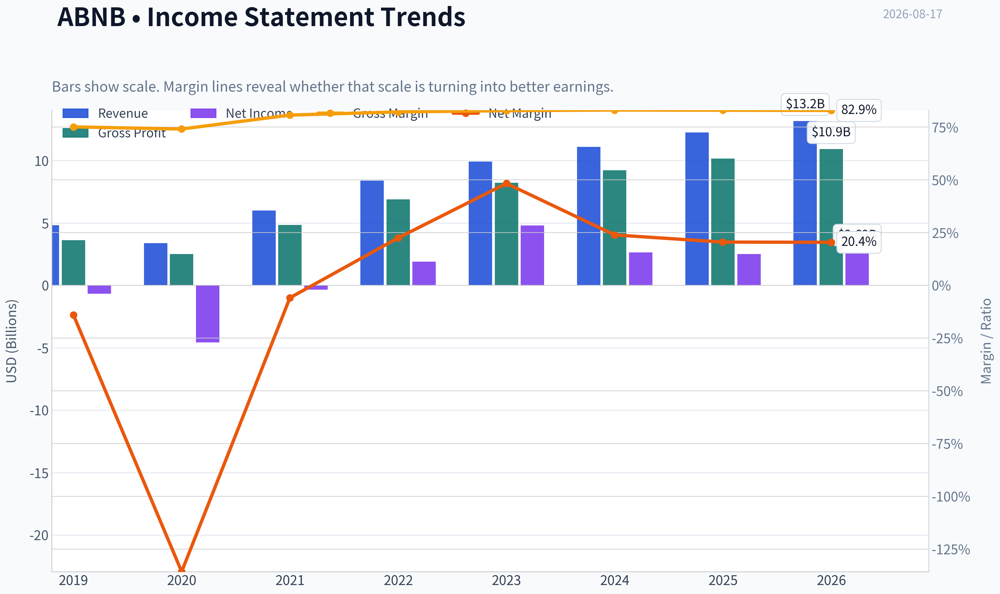
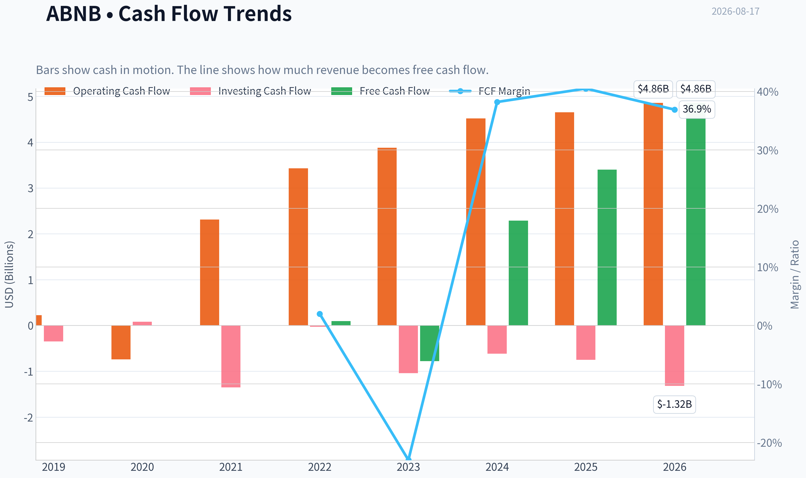
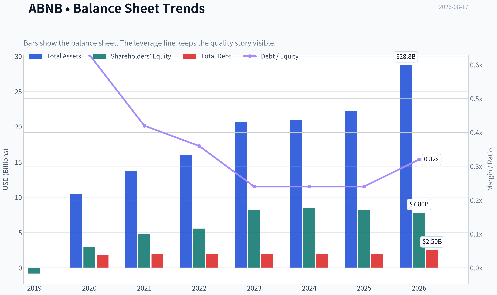
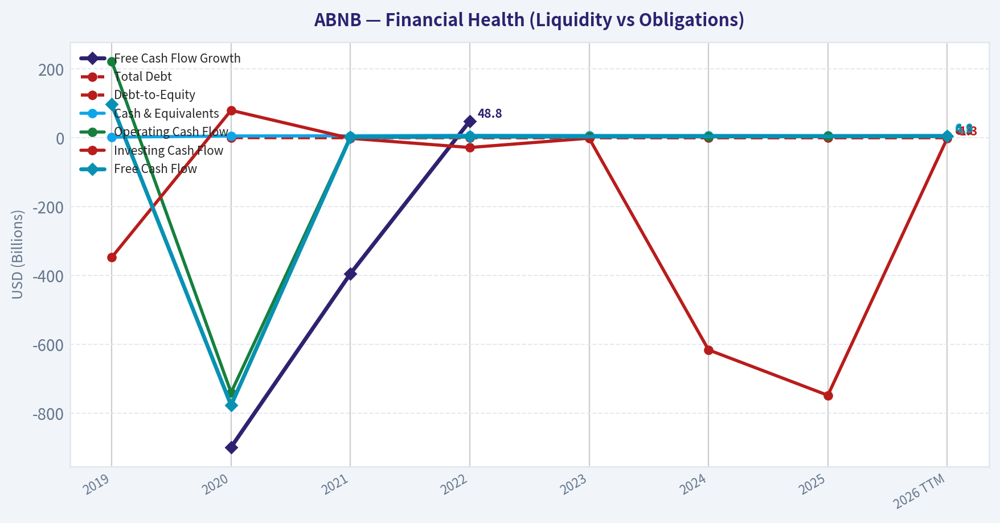
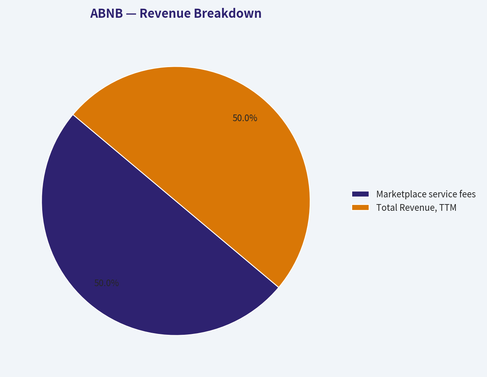
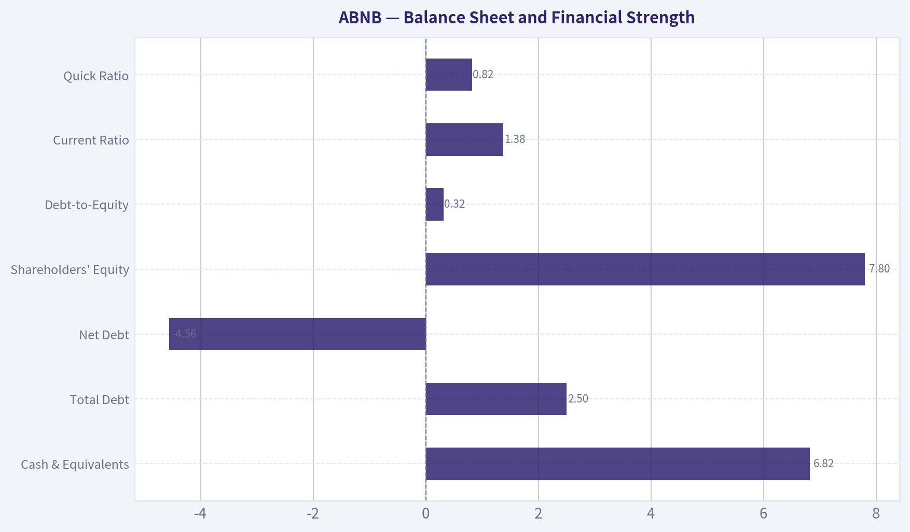
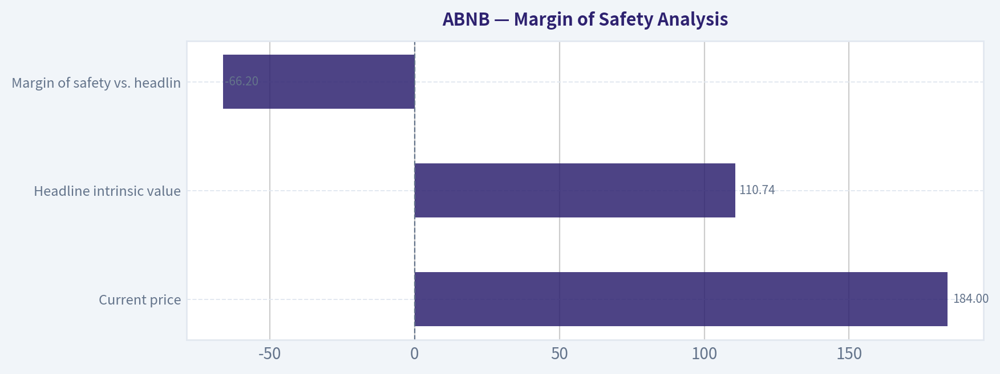
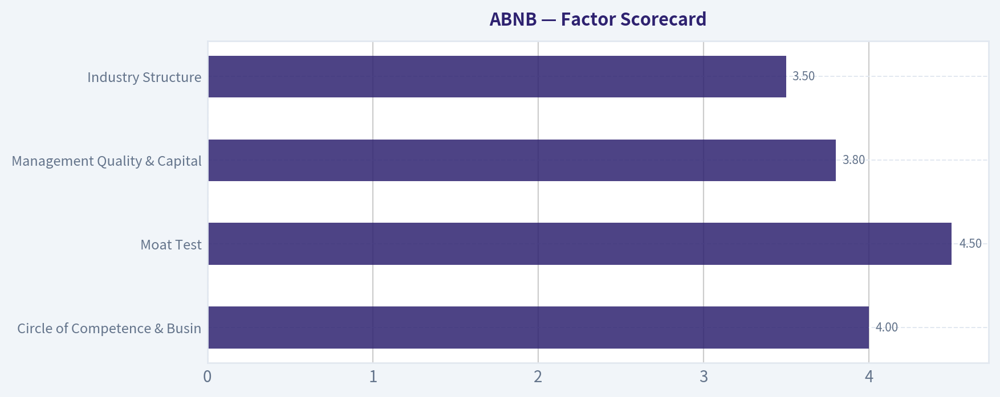
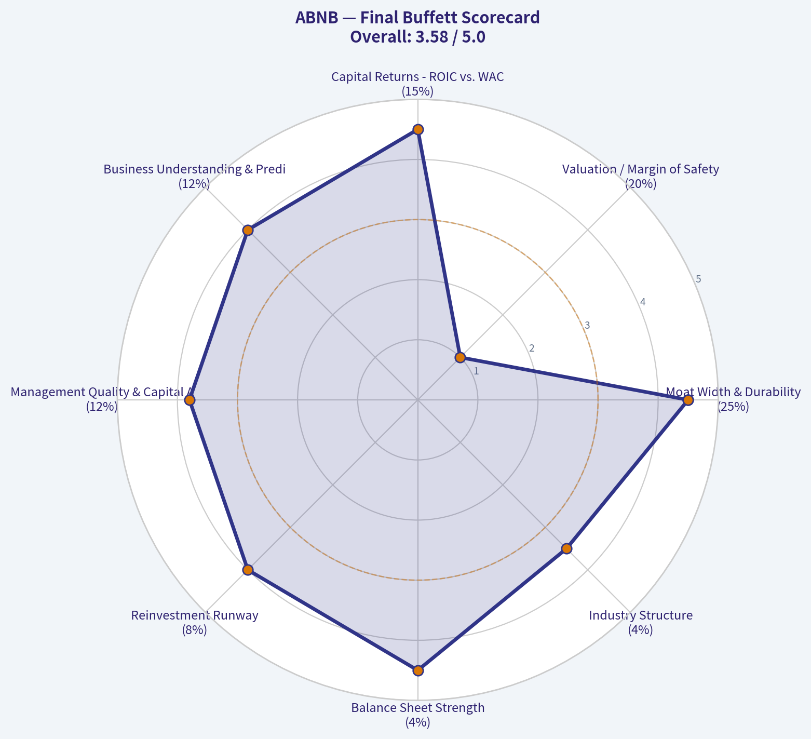

# ABNB Deep Value Intelligence

**Analysis Date:** 2026-08-17

## Critical Disclaimer

*This analysis is generated by Deep Value Intelligence, an AI-powered multi-agent investing framework. Education & research only - not financial advice, not a financial advisor.*

---

## Table of Contents

1. Intelligence Summary
2. Analyst Team Reports
   - Fundamentals Analysis
   - Intrinsic Value Analysis (Buffett)
   - Trend & Growth Analysis (Lynch/Druckenmiller/Fisher)
   - Market Technical Analysis
   - Options Market Analysis
3. Research Team Commentary
4. Value Investing Team Commentary
5. Deep Values Commentary

---

## Intelligence Summary

### Thesis + Conditions

**Core Thesis:** **EXECUTIVE SUMMARY**
Airbnb (ABNB) is a premier, asset-light compounder boasting an elite 83% gross margin and 56% ROIC. However, at $184 (42x P/E) following a sharp upside gap, the stock is technically overextended and fully priced.

**Key Risks:**
- Risky Analyst (Bull):** Airbnb's 42x P/E is a justified quality premium for a structural monopoly with 90% organic traffic. Regulatory hurdles actually harden the moat by wiping out smaller competitors. Do not miss a generational compounder by obsessing over a 15% discount.
- The Bull effectively highlights Airbnb's supreme business quality, pointing to world-class metrics-an 83% gross margin, a 56% ROIC, and a powerful demand-side moat driven by 90% organic traffic. In a modern Buffett framework, this is a beautiful business. The Bear, conversely, brings necessary discipline to the table, arguing that a 42x P/E demands perfection. The Bear rightly points out that to justify this price, the company must sustain 13-15% free cash flow growth over the next decade, leaving virtually zero margin of safety against structural risks like regulatory friction (which threatens total listing inventory, not just competitors), supply-side multi-homing, and macroeconomic slowing.
- Airbnb is a premier, wide-moat compounder, but at $184, the stock's valuation is fully priced and its technical momentum is overextended. The appropriate stance is WATCH. We must respect the exceptional quality of the franchise without abandoning entry-level discipline. The setup favors patience for a structural pullback rather than aggressively chasing the current extension. Adopting the Neutral Analyst's approach, we will prepare a staged-entry framework-but only *after* the current technical gap-up digests.

**Confidence:** Medium

---

## Analyst Team Reports

### Fundamentals Analysis

#### Latest Earnings Snapshot

*Most recent reported quarter anchored on 2026 Q2, with prior-year comparison when available.*

| Metric | 2026 Q2 | 2025 Q2 | YoY Change |
| --- | ---: | ---: | ---: |
| Revenue | $3.61B | $3.10B | +16.5% |
| Operating Income | $758.0M | $612.0M | +23.9% |
| Net Income | $816.0M | $642.0M | +27.1% |
| Diluted EPS | $1.37 | $1.03 | +33.0% |
| Operating Cash Flow | $1.27B | $975.0M | +30.3% |
| Free Cash Flow | $1.27B | $975.0M | +30.3% |

Key Takeaways: This snapshot anchors the most recent reported quarter before the narrative analysis. It helps readers separate long-run business quality from whatever changed in the latest earnings print.

#### 7-Year Financial Metrics for ABNB

*All values below are computed deterministically from raw data - not estimated by AI.*

*Issuer profile: operating company (Consumer Cyclical / Travel Services).*

#### 7-Year Financial Metrics
*Annual rows come from reported financial statements. The final TTM row is computed from the latest four quarters.*

| Metric | 2019 | 2020 | 2021 | 2022 | 2023 | 2024 | 2025 | 2026 TTM |
| --- | --- | --- | --- | --- | --- | --- | --- | --- |
| Market Price | N/A | $147 | $166 | $86 | $136 | $131 | $136 | $184 |
| Market Cap | N/A | $41.69B | $102.56B | $58.14B | $90.12B | $84.76B | $84.55B | $109.88B |
| P/E Ratio | N/A | -9.09 | -291.36 | 30.71 | 18.81 | 32.01 | 33.67 | 41.83 |
| P/B Ratio | N/A | 14.37 | 21.48 | 10.46 | 11.04 | 10.08 | 10.31 | 14.09 |
| ROE | 83.5% | -158.0% | -7.4% | 34.0% | 58.7% | 31.5% | 30.6% | 34.5% |
| ROIC | N/A | N/A | -1196.9% | 396.7% | 243.9% | 54.8% | 53.4% | 63.1% |
| EPS | $-2.59 | $-16.14 | $-0.57 | $2.78 | $7.24 | $4.11 | $4.03 | $4.40 |
| Revenue | $4.81B | $3.38B | $5.99B | $8.40B | $9.92B | $11.10B | $12.24B | $13.16B |
| Gross Profit | $3.61B | $2.50B | $4.84B | $6.90B | $8.21B | $9.22B | $10.15B | $10.91B |
| Gross Margin | 75.1% | 74.1% | 80.7% | 82.2% | 82.8% | 83.1% | 83.0% | 82.9% |
| Operating Margin | -10.4% | -106.3% | 7.2% | 21.5% | 15.3% | 23.0% | 20.8% | 20.8% |
| Net Income | $-674.3M | $-4.58B | $-352.0M | $1.89B | $4.79B | $2.65B | $2.51B | $2.69B |
| Net Margin | -14.0% | -135.7% | -5.9% | 22.5% | 48.3% | 23.9% | 20.5% | 20.4% |
| Revenue Growth | N/A | -29.7% | 77.4% | 40.2% | 18.1% | 11.9% | 10.3% | 7.5% |
| Net Income Growth | N/A | 579.9% | -92.3% | -637.8% | 153.1% | -44.7% | -5.2% | 7.2% |
| Free Cash Flow Growth | N/A | -898.8% | -394.5% | 48.8% | N/A | N/A | N/A | N/A |
| Total Book Value | $-808.0M | $2.90B | $4.78B | $5.56B | $8.16B | $8.41B | $8.20B | $7.80B |
| Total Assets | N/A | $10.49B | $13.71B | $16.04B | $20.64B | $20.96B | $22.21B | $28.75B |
| Total Debt | N/A | $1.83B | $1.98B | $1.99B | $1.99B | $2.00B | $2.00B | $2.50B |
| Debt-to-Equity | N/A | 0.63 | 0.42 | 0.36 | 0.24 | 0.24 | 0.24 | 0.32 |
| Cash & Equivalents | $2.01B | $5.48B | $6.07B | $7.38B | $6.87B | $6.86B | $6.56B | $6.82B |
| Shareholders' Equity | $-808.0M | $2.90B | $4.78B | $5.56B | $8.16B | $8.41B | $8.20B | $7.80B |
| Operating Cash Flow | $222.7M | $-740.0M | $2.31B | $3.43B | $3.88B | $4.52B | $4.65B | $4.86B |
| Investing Cash Flow | $-347.2M | $80.0M | $-1.35B | $-28.0M | $-1.04B | $-616.0M | $-748.0M | $-1.32B |
| Free Cash Flow | $97.3M | $-777.0M | $2.29B | $3.40B | N/A | N/A | N/A | $4.86B |
| FCF Margin | 2.0% | -23.0% | 38.2% | 40.5% | N/A | N/A | N/A | 36.9% |
| Dividends / Share | $0.00 | $0.00 | $0.00 | $0.00 | $0.00 | $0.00 | $0.00 | $0.00 |

#### Profitability Metrics
- Return on Equity (ROE): 30.6%
- Return on Invested Capital (ROIC): 56.0%
- Return on Assets (ROA): 11.3%
- Gross Margin: 83.0%
- Operating Margin: 20.8%
- Net Profit Margin: 20.5%

#### Liquidity Metrics
- Current Ratio: 1.38
- Quick Ratio: 0.82

#### Leverage Metrics
- Debt-to-Equity Ratio: 0.24
- Interest Coverage Ratio: N/A
- Net Debt: $-4.56B

#### Growth Metrics (Year-over-Year)
- Revenue Growth: 10.3%
- Net Income Growth: -5.2%
- Free Cash Flow Growth: N/A
- Revenue CAGR (3-Year): 13.4%
- Revenue CAGR (5-Year): 29.4%

#### Valuation Metrics
- P/E Ratio (TTM): 42.02
- Forward P/E: 29.98
- Price-to-Book: 13.92
- Price-to-Sales: 8.38
- PEG Ratio: 1.97
- EV/EBITDA: 35.84
- Free Cash Flow Yield: N/A
- Earnings Yield: 2.4%

#### Owner Earnings (Buffett Method, Code-Computed)
- Net Income: $2.51B
- + Depreciation & Amortization: N/A
- - Capital Expenditures: N/A
- - Working Capital Changes: $-106.0M
- = **Owner Earnings: $2.62B**

#### Intrinsic Value (Code-Computed)
- Current Price: $184
- **Headline Intrinsic Value (business-model routed): $111**
  Business model: cyclical - weighted blend [Damodaran FCFF + reverse-DCF fair + owner-earnings DCF] (cyclical)
  Model spread (min-max across DCFs): $95 - $300
  Margin of safety vs. price (headline): -66.2%
  Routing note: Cyclical: margins/FCF are volatile - headline blends FCFF, reverse-DCF and owner-earnings roughly evenly; treat the range as the honest read.
- Buffett Method (Owner Earnings):
  Conservative: $37
  Average: $121
  Optimistic: $470
- Cash Flow Method (FCF):
  Conservative: $300
  Average: $300
  Optimistic: $547
- Damodaran FCFF (WACC + margins + reinvestment):
  Conservative: $1
  Average: $95
  Optimistic: $179
  Monte Carlo band (P10-P90): $30 - $120 (median $76)
  P(intrinsic value > price): 0.3%
- Reverse-DCF: price implies ~29.8%/yr owner-earnings growth for 10y; trailing 3y was 17.1%, 5y N/A.

#### Piotroski F-Score: 5/9
- Positive Net Income: PASS
- Positive Operating Cash Flow: PASS
- ROA Improvement: FAIL
- Cash Flow > Net Income: PASS
- Decreasing Debt: FAIL
- Improving Current Ratio: FAIL
- No Dilution: PASS
- Improving Gross Margin: FAIL
- Improving Asset Turnover: PASS

ANALYST STANCE: **WATCH**

#### Airbnb, Inc. (ABNB) - Buffett-Style Fundamental Analysis

Airbnb is a high-quality, asset-light travel marketplace with exceptional gross margins, strong free cash generation, net cash, and a durable global brand. However, at **$184 per share**, the market is pricing in a very demanding growth path. The deterministic dataset's headline intrinsic value is **about $111 per share**, implying a **negative margin of safety of roughly 66%** versus the current price. In Buffett terms: the business is excellent, but the price does not yet offer a sufficient margin of safety.

---

#### Current vs. Historical Average Comparison

*Historical averages below use only the deterministic dataset period shown, not an invented 10-year history. For metrics distorted by loss years, interpretation emphasizes normalized post-recovery performance.*

| Metric | Current / TTM | Dataset-Period Average | Current Standing vs. History | Buffett-Style Interpretation |
|---|---:|---:|---|---|
| Market Price | **$184** | ~$141 | Above average | The stock is trading near the high end of its observed valuation history. |
| Market Cap | **$109.88B** | ~$81.67B | Above average | Market value has expanded faster than normalized earnings power. |
| P/E Ratio | **41.83x** | ~31.4x profitable-year average | Above normal | Expensive unless Airbnb can sustain high growth and margins for many years. |
| P/B Ratio | **14.09x** | ~13.12x | Slightly above average | P/B has limited usefulness for Airbnb because it is an asset-light platform business; valuation should be anchored on cash flows, not book value. |
| ROE | **34.5% TTM / 30.6% latest annual** | ~13.4%, distorted by losses; ~37.9% post-2022 | Strong but below 2023 peak | High-quality returns, though no longer at the extraordinary 2023 level. |
| ROIC | **63.1% TTM / 53.4% latest annual** | Distorted by early negative values; ~57% recent normalized | Strong | Indicates a capital-light business with excellent reinvestment economics. |
| EPS | **$4.40 TTM** | ~$0.41 | Far above average | Airbnb has transitioned from heavy losses to durable profitability. |
| Revenue | **$13.16B TTM** | ~$8.63B | Above average | Revenue base has compounded strongly since the pandemic trough. |
| Gross Profit | **$10.91B TTM** | ~$7.04B | Above average | High gross profit reflects marketplace scale and limited direct service delivery costs. |
| Gross Margin | **82.9%** | ~80.5% | Above average | Gross margin has structurally improved since 2019-2020. |
| Operating Margin | **20.8%** | ~-1.0%, distorted by 2020; ~18.1% since 2021 | Strong | The platform is now operating with meaningful scale economies. |
| Net Income | **$2.69B TTM** | ~$1.12B | Above average | Profitability is real, but below the unusually high 2023 net income level. |
| Net Margin | **20.4%** | ~-2.5%, distorted by losses | Strong | Normalized net margins above 20% are attractive for a consumer platform. |
| Revenue Growth | **7.5% TTM / 10.3% latest annual** | ~19.4% | Below average | Growth is decelerating from post-pandemic recovery rates. |
| Net Income Growth | **7.2% TTM / -5.2% latest annual** | Not very meaningful due loss-year base effects | Mixed | Earnings are profitable but no longer in hyper-recovery mode. |
| Free Cash Flow Growth | **N/A current annual; TTM FCF $4.86B** | Historical growth distorted by negative 2020 | Strong cash level, noisy growth | FCF quality is a major strength, but historical FCF growth rates are not clean due pandemic disruption. |
| Total Book Value | **$7.80B** | ~$5.63B | Above average | Equity base is positive and improved versus early years. |
| Total Assets | **$28.75B** | ~$18.97B | Above average | Balance sheet has expanded substantially. |
| Total Debt | **$2.50B** | ~$2.04B | Above average | Debt has risen, but remains modest relative to cash and cash flow. |
| Debt-to-Equity | **0.32x** | ~0.35x | Slightly better than average | Leverage remains conservative. |
| Cash & Equivalents | **$6.82B** | ~$6.01B | Above average | Strong liquidity and net cash position. |
| Shareholders' Equity | **$7.80B** | ~$5.63B | Above average | Financial base is healthier than in the pre-IPO and pandemic period. |
| Free Cash Flow | **$4.86B TTM** | ~$1.97B for available years | Far above average | Airbnb is a powerful free-cash-flow generator. |
| Dividends / Share | **$0.00** | $0.00 | Unchanged | Management prioritizes reinvestment and likely buybacks over dividends. |

**Key Takeaways:** Airbnb's current profitability, margins, cash flow, and balance sheet are much stronger than its historical average, mainly because the business has matured after the pandemic shock. The main concern is valuation: the stock price, market cap, and P/E ratio are all elevated while revenue growth has slowed into the high-single-digit to low-double-digit range. P/B should not be treated as a traditional value signal here because Airbnb is an asset-light marketplace; cash-flow-based intrinsic value is the better anchor.

---

#### Revenue Breakdown

Airbnb reports primarily as a marketplace platform business, with revenue largely generated from service fees charged to guests and hosts on stays and experiences. The deterministic dataset provides TTM revenue but does not provide audited segment-level revenue detail, so the most faithful presentation is by Airbnb's primary disclosed economic revenue source.

| Revenue Source | Amount ($B) | % of Total |
|---|---:|---:|
| Marketplace service fees from stays, experiences, and related platform activity | **$13.16B** | **100%** |
| Total Revenue, TTM | **$13.16B** | **100%** |

**Key Takeaways:** Airbnb's revenue is essentially a platform fee stream tied to global travel bookings. This makes the business asset-light and highly scalable, but also sensitive to travel demand, regulation, consumer discretionary spending, and host-guest marketplace health.

---

#### Profitability and Business Quality

Airbnb's profitability profile is very attractive. Gross margin has risen from the mid-70% range in 2019-2020 to roughly **83%**, showing the power of a software-like marketplace model. Operating margin has recovered dramatically from **-106.3% in 2020** to **20.8% TTM**, demonstrating that the company has moved from survival mode to scaled profitability.

ROIC is especially important from a Buffett perspective. The latest annual ROIC of **53.4%** and TTM ROIC of **63.1%** indicate Airbnb does not need heavy capital investment to grow. That is the hallmark of a capital-light compounder. ROE is also strong at **30%+**, though the historical average is distorted by pandemic-era losses and early public-company restructuring costs.

The main caveat is that 2023 appears to have been an unusually strong profitability year, with **48.3% net margin** and **$4.79B net income**. Current TTM net margin of **20.4%** is still excellent, but much more normalized. Investors should not extrapolate 2023 margins indefinitely.

---

#### Growth Analysis

| Growth Metric | Current / Latest | Historical Pattern | Interpretation |
|---|---:|---|---|
| Revenue Growth | **7.5% TTM / 10.3% latest annual** | Huge rebound after 2020, then steady deceleration | Growth remains positive but is normalizing. |
| 3-Year Revenue CAGR | **13.4%** | Strong | Reflects continued travel platform expansion after the reopening boom. |
| 5-Year Revenue CAGR | **29.4%** | Very strong, pandemic-distorted | Benefits from the low 2020 base and recovery surge. |
| Net Income Growth | **7.2% TTM / -5.2% latest annual** | Highly volatile due losses and tax/margin effects | Earnings quality is now positive, but growth is not smooth enough to justify extreme certainty. |
| Free Cash Flow Growth | **N/A current annual** | Volatile; FCF moved from negative 2020 to very strong TTM | FCF level matters more than historical growth rate due pandemic distortion. |

**Key Takeaways:** Airbnb's growth is still healthy, but it is clearly slower than the reopening-era surge. The current valuation requires many years of strong compounding, yet the latest revenue growth rate is closer to mature platform growth than early-stage hypergrowth. Free cash flow is the standout metric, but historical growth comparisons are noisy because 2020 was an extreme disruption year.

---

#### Balance Sheet and Financial Strength

| Balance Sheet Metric | Current / TTM | Assessment |
|---|---:|---|
| Cash & Equivalents | **$6.82B** | Very strong liquidity position. |
| Total Debt | **$2.50B** | Manageable and modest relative to cash flow. |
| Net Debt | **-$4.56B** | Net cash position; financially conservative. |
| Shareholders' Equity | **$7.80B** | Positive and materially improved versus 2019. |
| Debt-to-Equity | **0.32x** | Conservative leverage. |
| Current Ratio | **1.38** | Adequate liquidity, though not the core valuation driver. |
| Quick Ratio | **0.82** | Some short-term liability dependence, common for marketplace platforms with booking-related balances. |
| Piotroski F-Score | **5/9** | Mixed; profitable and cash-generative, but not a perfect balance-sheet/momentum score. |

**Key Takeaways:** Airbnb's balance sheet is a major strength. The company has more cash than debt, substantial free cash flow, and no meaningful solvency concern. The Piotroski score of 5 out of 9 is not alarming, but it signals that not every financial momentum metric is improving at the same time.

---

#### Cash Flow and Capital Allocation

Airbnb generated **$4.86B of TTM free cash flow**, equal to a very strong **36.9% FCF margin**. This is arguably the best quantitative evidence of the company's economic quality. The business converts revenue into cash at a high rate because it does not own hotels, aircraft, or major physical travel infrastructure.

The company pays **no dividend**, which is appropriate for a platform still reinvesting in product, global expansion, AI-driven customer service, host tools, trust and safety, and potentially adjacent travel categories. From a Buffett perspective, no dividend is not a negative if retained cash can compound at high returns. The key question is whether management can reinvest or repurchase shares at attractive prices. At the current valuation, aggressive buybacks would be less obviously value-accretive.

---

#### Economic Moat Assessment

| Moat Factor | Strength | Buffett-Style View |
|---|---|---|
| Brand | Strong | Airbnb is one of the few global consumer brands synonymous with alternative accommodations. |
| Network Effects | Strong | More hosts attract more guests; more guests attract more hosts. |
| Scale | Strong | Global demand, payments, reviews, trust systems, and customer support create scale advantages. |
| Switching Costs | Moderate | Guests can compare alternatives, but host reputation and review history create some stickiness. |
| Pricing Power | Moderate to Strong | Platform fees are meaningful, but excessive fee pressure could push users to hotels or direct booking. |
| Regulation Risk | High | Local housing, tax, zoning, and short-term rental laws can impair supply in key cities. |
| Cyclicality | Moderate | Travel is discretionary and can weaken during recessions. |

**Key Takeaways:** Airbnb has a real moat built on brand, marketplace liquidity, reviews, and global scale. However, the moat is not regulation-proof, and travel demand is cyclical. This is a high-quality business, but not a risk-free bond-like compounder.

---

#### Buffett-Style Owner Earnings DCF Valuation

The deterministic dataset reports Buffett-method owner earnings of **$2.62B**. For the hand DCF below, I use:

- Starting Owner Earnings: **$2.62B**
- Discount Rate: **10%**
- Terminal Growth Rate: **2.5%**
- Net Cash Adjustment: approximately **$4.32B** using TTM cash of $6.82B less debt of $2.50B
- Estimated Shares: approximately **597M**, based on market cap of $109.88B divided by price of $184
- Terminal growth is kept below the discount rate and high growth fades toward terminal growth.

| Scenario | Explicit Growth Assumption | Year-10 Owner Earnings | PV of Explicit Cash Flows | PV of Terminal Value | Net Cash | Equity Value | Fair Value / Share |
|---|---|---:|---:|---:|---:|---:|---:|
| Conservative | 3% annually for 10 years | ~$3.52B | ~$18.58B | ~$18.55B | ~$4.32B | ~$41.45B | **~$69** |
| Average | 12% for years 1-5, fading to 4% by year 10 | ~$6.35B | ~$27.26B | ~$33.46B | ~$4.32B | ~$65.04B | **~$109** |
| Optimistic | 18% for years 1-5, fading to 5% by year 10 | ~$9.45B | ~$35.49B | ~$49.81B | ~$4.32B | ~$89.62B | **~$150** |

**Key Takeaways:** Even under a realistic optimistic case with strong near-term growth, the hand DCF produces a value below the current $184 share price. The average case of about $109 per share aligns closely with the deterministic dataset's headline intrinsic value of about $111. This suggests the stock is priced for a better-than-optimistic outcome unless future growth materially exceeds the fading assumptions.

---

#### DCF Detail and Model Cross-Check

| Valuation Reference | Fair Value / Share | Interpretation |
|---|---:|---|
| Hand DCF - Conservative | **~$69** | Assumes Airbnb grows closer to mature GDP-like rates. |
| Hand DCF - Average | **~$109** | Reasonable base case for a high-quality but maturing platform. |
| Hand DCF - Optimistic | **~$150** | Assumes strong growth continues but fades responsibly. |
| Deterministic Headline Intrinsic Value | **~$111** | Business-model routed blend of Damodaran FCFF, reverse DCF, and owner-earnings DCF. |
| Deterministic Owner Earnings DCF Spread | **$37 / $121 / $470** | Very sensitive to growth assumptions. |
| Deterministic FCF Method Spread | **$300 / $300 / $547** | Much higher because current FCF is exceptionally strong. |
| Deterministic Damodaran FCFF Spread | **$1 / $95 / $179** | More conservative due reinvestment, margin, and WACC assumptions. |
| Monte Carlo Band | **$30-$120, median $76** | Suggests low probability of intrinsic value above current price. |
| Reverse DCF Implied Growth | **~29.8% per year for 10 years** | Very demanding versus trailing 3-year owner-earnings growth of 17.1%. |

**Key Takeaways:** The valuation models show a very wide spread because Airbnb's cash flow is strong but growth and margins are uncertain. The most important point is that the current price requires roughly 30% annual owner-earnings growth for a decade, which is well above recent trailing growth. That is a high hurdle even for a strong business.

---

#### Warren Buffett-Style Qualitative Analysis

| Buffett Criterion | Assessment | Explanation |
|---|---|---|
| Understandable Business | Positive | Airbnb operates a straightforward marketplace connecting hosts and guests. |
| Durable Competitive Advantage | Positive | Brand, network effects, reviews, and global supply create a defensible position. |
| Consistent Earnings | Improving, not perfect | Earnings were negative in 2019-2021, then strongly profitable from 2022 onward. |
| High Returns on Capital | Strong positive | ROIC above 50% is exceptional and supports the capital-light compounder thesis. |
| Conservative Balance Sheet | Positive | Net cash position and manageable debt reduce financial risk. |
| Shareholder-Friendly Capital Allocation | Mixed to positive | No dividend is acceptable; buybacks must be judged against valuation. |
| Margin of Safety | Negative | Current price is well above the central intrinsic value estimate. |
| Predictability | Moderate | Travel cyclicality, regulation, and post-reopening normalization reduce certainty. |

**Key Takeaways:** Airbnb checks many Buffett quality boxes: high returns on capital, a strong brand, a scalable model, and a conservative balance sheet. The major Buffett problem is not business quality; it is price. At today's valuation, the margin of safety is insufficient.

---

#### Key Investment Insights

Airbnb has evolved from a disruptive travel platform into a highly profitable global marketplace. The company's **83% gross margin**, **20%+ operating margin**, **net cash balance sheet**, and **nearly $4.9B of TTM free cash flow** are all signs of a superior business. The platform benefits from powerful network effects and a brand that is difficult to replicate.

However, the stock's valuation assumes continued excellence. A **41.8x TTM P/E**, **8.38x price-to-sales**, and **35.84x EV/EBITDA** are demanding for a company whose revenue growth has slowed to **7.5% TTM**. The reverse DCF's implied **~29.8% owner-earnings growth for 10 years** is the clearest warning sign. That level of growth may be possible in a bull case with AI efficiency gains, hotel expansion, international penetration, and experiences growth, but it is too aggressive to underwrite as a conservative Buffett-style base case.

---

#### Red Flags and Risks

| Risk | Severity | Why It Matters |
|---|---|---|
| Valuation Risk | High | Current price is materially above headline intrinsic value. |
| Growth Deceleration | Medium to High | Revenue growth has slowed from recovery-era levels to around 7.5% TTM. |
| Regulatory Risk | High | Cities can restrict short-term rentals, reducing host supply. |
| Cyclical Travel Demand | Medium | Recessions can reduce discretionary travel spending. |
| Margin Normalization | Medium | 2023 margins were unusually high and should not be extrapolated. |
| Competition | Medium | Hotels, Booking, Expedia, Vrbo, Google Travel, and direct bookings remain relevant. |
| FCF Interpretation Risk | Medium | TTM FCF is excellent, but valuation should not rely on one unusually strong cash-flow period. |

**Key Takeaways:** The biggest risk is valuation, not solvency or business deterioration. Airbnb is financially strong, but the market already recognizes that quality. Any disappointment in growth, regulation, or margins could pressure the stock because expectations are high.

---

#### Opportunities

| Opportunity | Potential Impact | Explanation |
|---|---|---|
| AI-Driven Efficiency | Margin upside | AI can reduce customer support costs, improve matching, and enhance conversion. |
| International Expansion | Revenue growth | Penetration remains uneven across geographies. |
| Hotel and Alternative Inventory Expansion | TAM expansion | Adding more supply categories could broaden use cases. |
| Experiences Growth | Optionality | Experiences could deepen engagement beyond lodging. |
| Long-Term Shift to Flexible Travel | Secular tailwind | Remote and hybrid work can support longer and more flexible stays. |
| Share Repurchases | EPS accretion | Could help if executed at attractive valuations, though current price reduces appeal. |

**Key Takeaways:** Airbnb still has meaningful long-term growth avenues, especially through international expansion, AI, and broader travel products. These opportunities support a premium valuation, but they do not automatically justify paying any price. The investment case improves significantly if the share price falls closer to intrinsic value.

---

#### Final Investment Stance: WATCH

Airbnb is a wonderful business at a questionable price. The company has a strong moat, high returns on capital, excellent free cash flow, and a net cash balance sheet. Those are exactly the kinds of traits Buffett-style investors seek.

The issue is valuation. At **$184**, the stock trades well above the deterministic headline intrinsic value of **~$111** and above the hand DCF average case of **~$109**. Even the realistic optimistic hand DCF comes in around **$150**, still below the current market price. The reverse DCF suggests the market is requiring roughly **29.8% annual owner-earnings growth for 10 years**, which is too demanding for a margin-of-safety investor.

A Buffett-style investor should **watch** Airbnb closely, not abandon it. A more attractive entry point would likely require either a significant price decline, a material upward revision in sustainable owner earnings, or stronger evidence that high-teens growth can persist longer than currently assumed.

| Final Summary Point | View |
|---|---|
| Business Quality | Excellent |
| Moat | Strong, supported by brand and network effects |
| Financial Strength | Strong, net cash and high FCF |
| Profitability | Strong, with high ROIC and margins |
| Growth | Healthy but decelerating |
| Valuation | Expensive versus intrinsic value |
| Margin of Safety | Insufficient |
| Buffett-Style Action | **WATCH** |
| Attractive Buy Zone | Closer to intrinsic value, roughly around the low-$100s to mid-$120s depending on updated fundamentals |
| Main Reason Not to Buy Now | Price already discounts very aggressive long-term growth |

**Key Takeaways:** Airbnb is a high-quality compounder, but the current stock price leaves little room for error. The right Buffett-style conclusion is patience: admire the business, respect the moat, but wait for a better margin of safety before advocating purchase.

#### Fundamental Visuals

This graph tracks the profitability and return metrics (ROE, ROIC, Margins) of **ABNB** over the past decade, highlighting capital efficiency trends.

This chart illustrates the financial health of **ABNB** over the last 10 years, mapping cash equivalents and free cash flow against total obligations (Debt).

This breakdown chart from <em>Revenue Breakdown</em> shows the proportional composition for **ABNB** - useful for understanding what drives or risks the business.

---

### Intrinsic Value Analysis (Buffett)

> *Following Warren Buffett's value investing philosophy: Circle of Competence, Economic Moat, Management Quality, and Margin of Safety.*

#### Intrinsic Value Snapshot

Price is what you pay. Intrinsic value is what the business may be worth based on the cash it can create for owners over time. We show a range, not one magic number.

- Current Price: $184.06
- Value Range (conservative to optimistic across both DCF methods): $36.89 to $547.31

##### Owner Earnings (Buffett Method)
- Net Income: $2,511,000,000.00
- Depreciation & Amortization: N/A
- Capital Expenditures: N/A
- Working Capital Changes: $-106,000,000.00
- Owner Earnings: $2,617,000,000.00

##### Intrinsic Value
###### Buffett Method
Uses owner earnings. Stricter, and usually more conservative.
- Conservative: $36.89
- Average: $121.33
- Optimistic: $470.03
- Discount Rate: 10.0%

###### Cash Flow Method
Uses free cash flow. Better for companies spending heavily today to grow tomorrow.
- Conservative: $300.11
- Average: $300.11
- Optimistic: $547.31
- Discount Rate: 10.0%

ANALYST STANCE: **WATCH**

#### Airbnb (ABNB) - Buffett-Style Value Investment Review

Airbnb is a wonderful asset-light marketplace with a powerful global brand, strong two-sided network effects, high gross margins, and excellent capital returns. The business quality is high, but the current valuation is demanding: at about **$184/share**, the stock trades materially above the headline intrinsic value estimate of **$110.74/share**, and the reverse DCF implies roughly **29.8% annual growth for 10 years**, well above the company's trailing 3-year growth rate of about **17.1%**. This is a business to admire, but not one I would buy aggressively at today's price.

---

#### 1. Factor Scorecard

| Factor | Score / 5 | Evidence |
|---|---:|---|
| Circle of Competence & Business Simplicity | 4.0 | Airbnb earns service fees from guests and hosts on stays and experiences. The model is understandable, asset-light, and global. Predictability is good, though travel demand remains cyclical. |
| Moat Test | 4.5 | Global brand, host/guest network effects, reviews, trust infrastructure, and search/discovery scale create a durable moat. Gross margin around **83%** supports strong intangible and platform economics. |
| Management Quality & Capital Allocation | 3.8 | Founder-led by Brian Chesky, with a long-term product culture. Capital-light model generates cash, but stock-based compensation and buyback discipline require continued monitoring. |
| Industry Structure | 3.5 | Online travel is attractive but competitive. Airbnb has differentiated alternative accommodation supply, while hotels, OTAs, Google, Booking, Expedia, and regional platforms remain meaningful rivals. |
| Gate 5 - Quality/Solvency Hard Floor | Not tripped | Fundamentals are profitable and cash-generative; balance sheet is strong with substantial liquidity. No evidence of financial distress. |

**Key Takeaways:** Airbnb scores very well on business quality, especially moat and simplicity. The company has the characteristics of a modern Buffett-style compounder: high margins, asset-light economics, and customer habit formation. The main issue is not business quality; it is valuation.

---

#### 2. Moat Analysis

| Moat Source | Assessment | Evidence |
|---|---|---|
| Brand / Intangible Assets | Strong | "Airbnb" is effectively a category-defining brand in alternative lodging. The brand carries trust, discovery, lifestyle, and emotional association. |
| Switching Costs | Moderate | Guests can use other platforms, but reviews, wish lists, host reputations, and accumulated trust increase stickiness. Hosts value traffic, tools, payments, insurance, and demand depth. |
| Cost Advantage | Moderate to Strong | Airbnb does not own most lodging inventory, so it scales globally without hotel-level capex. Marketing efficiency and direct traffic are major advantages. |
| Network Effects | Strong | More hosts create more selection; more guests attract more hosts. Reviews, ratings, photos, and booking history improve trust and conversion over time. |
| Financial Evidence | Strong | Gross margin around **83%**, ROE around **30.6%**, and high free-cash-flow generation support the existence of a durable platform moat. |

**Key Takeaways:** Airbnb's moat is real and primarily comes from brand plus network effects. The company benefits from being the default marketplace for unique stays, which is difficult for a new entrant to replicate. The moat is wide, but not unassailable, because travel platforms compete heavily for both guests and supply.

---

#### 3. Management Quality Assessment

| Management Question | Assessment |
|---|---|
| Do they think like owners? | Founder-led culture is a positive. Brian Chesky has demonstrated willingness to make long-term product and brand investments. |
| Are they candid and rational? | Management has historically emphasized discipline after the pandemic reset, focusing on profitability, product quality, and core marketplace strength. |
| Capital allocation | Strong cash generation and buybacks are positives. However, buybacks at elevated valuations may not create meaningful per-share value, and stock-based compensation must be watched. |
| Strategic direction | Expansion into experiences, services, hotels, and AI-enabled travel planning could widen the ecosystem if executed well. |

**Key Takeaways:** Management quality appears above average, with founder leadership and a strong product orientation. The biggest capital allocation question is whether repurchases are being made at prices that are truly below intrinsic value. At today's valuation, buybacks are less obviously value-accretive.

---

#### 4. Financial Summary

| Fiscal Period | Revenue | Revenue Growth | Gross Margin | Net Income | Free Cash Flow | ROE / Quality Signal |
|---|---:|---:|---:|---:|---:|---|
| 2021 | ~$6.0B | Recovery year | ~80% | ~-$0.4B | ~$2.2B | Business returned to strong cash generation after pandemic disruption |
| 2022 | ~$8.4B | ~40% | ~82% | ~$1.9B | ~$3.4B | Profitability inflected meaningfully |
| 2023 | ~$9.9B | ~18% | ~83% | ~$4.8B | ~$3.8B | Net income benefited from tax items; FCF remained strong |
| 2024 | ~$11.1B | ~12% | ~83% | ~$2.6B | ~$4.5B | High-quality normalized profitability |
| TTM / 2026 run-rate | Growth ~10.3%; Q2 revenue $3.6B, +17% | Positive | ~83% | Implied earnings yield ~2.4% at 42x P/E | Strong | ROE around **30.6%** |

**Key Takeaways:** Airbnb has transformed from a pandemic-impacted recovery story into a structurally profitable platform. Gross margins have remained exceptionally high, and free cash flow has consistently exceeded reported earnings in several periods. Growth remains healthy, but it has moderated from the early recovery years.

---

#### 5. Owner Earnings Calculation

For a marketplace like Airbnb, free cash flow can be boosted by working-capital timing and platform float, so I use a normalized owner-earnings figure rather than blindly capitalizing peak FCF.

| Owner Earnings Component | Normalized Estimate |
|---|---:|
| Net income base | ~$2.6B-$2.9B |
| Add: depreciation & amortization | ~+$0.2B |
| Less: maintenance capex | Minimal, roughly -$0.1B |
| Less: normalized working-capital reinvestment / timing adjustment | -$0.1B to -$0.3B |
| Normalized owner earnings | ~$3.0B-$3.3B |
| Shares outstanding estimate | ~600M |
| Owner earnings per share | ~$5.00-$5.50 |

**Key Takeaways:** Airbnb is a highly cash-generative business, but the conservative owner-earnings base is materially below peak free-cash-flow-based valuations. The key question is how much of current cash flow is truly recurring owner earnings versus working-capital timing and travel float. A normalized estimate around **$5.00-$5.50/share** is a prudent base.

---

#### 6. Three-Scenario DCF Valuation

| Scenario | Assumptions | Estimated Value / Share |
|---|---|---:|
| A - No Growth | Owner earnings capitalized at 10% discount rate | ~$55 |
| B - GDP Growth | Owner earnings grow at 3%; terminal capitalization at 10% discount rate | ~$80-$85 |
| C - Quality Growth Case | Owner earnings grow at roughly 8%-9% for 10 years, then 3% terminal growth | ~$120-$125 |
| Cross-check: Headline intrinsic value | Business-model routed blend of owner earnings, FCFF, and reverse-DCF | **$110.74** |
| Market price | Current price | **$184** |

**Key Takeaways:** The conservative valuation range sits well below the current stock price. Even the quality-growth case, which assumes Airbnb continues compounding owner earnings at a strong rate, does not provide a clear margin of safety at $184. The current price requires Airbnb to execute very well for a long time.

---

#### 7. Margin of Safety Analysis

| Valuation Measure | Value |
|---|---:|
| Current price | $184 |
| Headline intrinsic value | $110.74 |
| Margin of safety vs. headline intrinsic value | **-66.2%** |
| Owner Earnings DCF value | ~$121.33 |
| Damodaran FCFF value | ~$94.85 |
| FCF-based value | ~$300.11 |
| Reverse-DCF implied growth | ~29.8% annually for 10 years |
| Trailing 3-year growth | ~17.1% |

**Key Takeaways:** Airbnb's valuation is the central problem. A wonderful business can deserve a premium, but today's price embeds a very high growth expectation. The FCF-based valuation is much more generous, but the owner-earnings and FCFF approaches suggest the market is already pricing in excellent execution.

---

#### 8. Final Buffett Scorecard

| Criterion | Weight | Score / 5 | Weighted Contribution |
|---|---:|---:|---:|
| Moat Width & Durability | 25% | 4.5 | 1.13 |
| Valuation / Margin of Safety | 20% | 1.0 | 0.20 |
| Capital Returns - ROIC vs. WACC | 15% | 4.5 | 0.68 |
| Business Understanding & Predictability | 12% | 4.0 | 0.48 |
| Management Quality & Capital Allocation | 12% | 3.8 | 0.46 |
| Reinvestment Runway | 8% | 4.0 | 0.32 |
| Balance Sheet Strength | 4% | 4.5 | 0.18 |
| Industry Structure | 4% | 3.5 | 0.14 |
| **Total Score** | **100%** |  | **3.58 / 5** |

**Key Takeaways:** Airbnb scores like a high-quality compounder, but valuation pulls down the total score materially. The company has a wide moat, high returns, and a long reinvestment runway. However, the price does not offer the kind of margin of safety Buffett would normally demand unless one has unusually high confidence in sustained exceptional growth.

---

#### 9. Investment Stance

| Stance | Conviction | Rationale |
|---|---|---|
| **WATCH** | Medium-High | Airbnb is a wonderful business, but the current price is not clearly fair or cheap. The stock should be revisited on a material pullback or after evidence that AI, hotels, experiences, and international expansion can sustainably accelerate owner earnings. |

Airbnb belongs on a high-quality watchlist. I would become more constructive if the stock traded closer to the **$110-$125** intrinsic value range, or if owner earnings rose enough to make the current price imply a more reasonable long-term growth rate. At **$184**, the business is excellent, but the margin of safety is insufficient.
#### Valuation Bridge

This bridge places the current market price beside each intrinsic value lens so readers can see whether upside depends on one method or shows up across several methods.

| Scenario | Intrinsic Value / Share |
| --- | ---: |
| Buffett Method | $121.33 |
| Cash Flow Method | $300.11 |
| Damodaran Method | $94.85 |
| Current Price | $184.06 |

#### Key Takeaways

If one method is far above the others, the upside case depends on a specific modelling assumption. When several methods cluster together, the valuation story is more robust.

#### Valuation Visuals

This comparison chart from *Latest Earnings Snapshot* stacks current figures against historical benchmarks for **ABNB**, making it easy to see where the company trades relative to its own averages.

This comparison chart from *Balance Sheet and Financial Strength* stacks current figures against historical benchmarks for **ABNB**, making it easy to see where the company trades relative to its own averages.

This comparison chart from *Margin of Safety Analysis* stacks current figures against historical benchmarks for **ABNB**, making it easy to see where the company trades relative to its own averages.

---

### Trend & Growth Analysis (Lynch/Druckenmiller/Fisher)

> *Following Peter Lynch's GARP, Stanley Druckenmiller's macro-aware approach, and Philip Fisher's scuttlebutt methodology.*

ANALYST STANCE: **WATCH**

#### ABNB Growth Investment Report - Airbnb, Inc.

Airbnb remains an exceptional marketplace business with strong brand power, high gross margins, and meaningful optionality from AI, hotels, and experiences. However, at **$184 per share**, the stock already prices in a major growth re-acceleration. The business quality is high, but the current valuation leaves limited margin of safety unless revenue growth sustains closer to **20%+** and earnings compound much faster than the recent trend.

---

#### 1. Lynch Classification

| Category | ABNB Assessment |
|---|---|
| Lynch Type | **Stalwart / Moderate Grower**, not a classic Fast Grower |
| Revenue Growth | Shared pack shows **10.3% YoY**, while latest Q2 2026 coverage cites **17% revenue growth** |
| Profitability | Strong: **83% gross margin**, **30.6% ROE** |
| Valuation | Expensive: **P/E ~42x**, headline intrinsic value estimate **$110.74** vs. current price **$184** |
| Lynch View | Excellent company, but not clearly a GARP bargain today |

**Key Takeaways:** Airbnb is no longer a small, under-discovered fast grower. It is a high-quality global platform growing at a mid-teens rate in its better quarters. For Lynch-style investing, the issue is not business quality; the issue is whether investors are paying too much for growth that may not be fast enough.

---

#### 2. The Story in 3 Bullets

- Airbnb lets people monetize homes, rooms, and unique stays, creating a global lodging marketplace without owning hotels.
- AI-driven search, customer service, pricing tools, and personalization can improve conversion, host productivity, and operating leverage.
- Expansion into hotels, long-term stays, experiences, and broader travel services could widen the TAM beyond alternative accommodations.

---

#### 3. TAM Analysis and 10x Test

| Item | Estimate / Assessment |
|---|---:|
| Current market cap | **$110.21B** |
| Current revenue base | Q2 2026 revenue cited at **$3.6B**, implying ~$14.4B annualized run-rate |
| 10x revenue test | ~$130B-$145B annual revenue target |
| Implied gross bookings at ~13%-15% take rate | Roughly **$900B-$1.1T** |
| Relevant TAM | Global travel lodging, hotels, alternative stays, long-term stays, and experiences likely exceeds **$1T+** in gross bookings |
| 10x feasibility | **Possible but difficult**; requires category expansion well beyond core home-sharing |

**Key Takeaways:** Airbnb still has a large market opportunity, especially if it successfully expands into hotels, services, and experiences. However, a 10x from here would require Airbnb to become one of the dominant global travel platforms, not just the leader in alternative stays. The runway exists, but the current size makes future multibagger math much harder.

---

#### 4. Revenue Growth Trend

| Period / Metric | Growth Signal |
|---|---:|
| Shared pack YoY revenue growth | **10.3%** |
| Latest Q2 2026 earnings coverage | **17% revenue growth to $3.6B** |
| Trailing 3-year growth reference | **17.1%** |
| Pattern | Moderate growth with possible recent re-acceleration |
| Interpretation | **Improving, but not yet clear 20%+ fast-grower profile** |

**Key Takeaways:** Airbnb may be showing a growth re-acceleration, with recent Q2 coverage pointing to 17% growth versus the lower 10.3% figure in the shared pack. That is encouraging, but still below the 20% to 25% threshold that would make it a clear Lynch-style fast grower. The next two to three quarters are important to confirm whether this is a real inflection or just a strong quarter.

---

#### 5. Unit Economics

| Metric | ABNB Assessment |
|---|---|
| Gross margin | **83.0%**, excellent marketplace economics |
| ROE | **30.6%**, strong capital efficiency |
| LTV/CAC | Not disclosed; likely strong due to brand/direct traffic, but not directly measurable |
| NRR | Not applicable in the classic SaaS sense |
| Rule of 40 | Cannot calculate precisely from shared data due to missing FCF margin |
| Business model quality | Asset-light, high-margin, network-effect marketplace |

**Key Takeaways:** Airbnb's unit economics appear structurally attractive because it does not own the underlying lodging assets and benefits from brand-driven demand. The 83% gross margin is a major strength. The main limitation is that public data does not allow a clean SaaS-style LTV/CAC or NRR analysis.

---

#### 6. Inflection Point Assessment

| Inflection Type | Evidence | Rating |
|---|---|---|
| Product cycle | AI-driven improvements in search, service, and personalization | Positive |
| Market expansion | Hotel expansion and broader travel categories | Positive |
| Margin inflection | Already highly profitable; AI may add incremental leverage | Moderate positive |
| TAM expansion | Experiences, hotels, long stays, travel services | Positive |
| Competitive inflection | No clear evidence of major competitor collapse | Neutral |
| Overall inflection view | Real potential, but not fully proven yet | **Watch closely** |

**Key Takeaways:** Airbnb has credible inflection opportunities from AI and category expansion. The hotel push is particularly important because it could increase supply breadth and make Airbnb more relevant for traditional travel use cases. Still, the market appears to be giving the company credit for much of this already.

---

#### 7. Macro Setup

| Macro Factor | Impact on ABNB |
|---|---|
| Consumer travel demand | Cyclical; vulnerable if discretionary spending weakens |
| Interest rates | Lower rates would support growth-stock multiples |
| AI theme | Positive, especially for customer service, personalization, and operating leverage |
| Global regulation | Ongoing headwind in many cities |
| Economic cycle sensitivity | Moderate to high due to travel exposure |

**Key Takeaways:** Airbnb benefits from the AI productivity theme but remains exposed to the consumer travel cycle. If rates fall and travel demand remains healthy, the stock can continue to command a premium. If recession risk rises or regulation tightens, the current valuation could become difficult to defend.

---

#### 8. Fisher 15 Points Score

| Fisher Point | Score / 5 | Comment |
|---|---:|---|
| Market potential | 4 | Large global travel TAM |
| New product determination | 4 | AI, hotels, experiences, long stays |
| R&D effectiveness | 4 | Product-led platform improvements |
| Sales organization | 4 | Powerful brand and marketplace reach |
| Profit margin | 5 | Very high gross margin |
| Improving margins | 4 | AI could help, but already mature |
| Labor/personnel relations | 3 | No major positive or negative signal from shared data |
| Executive relations | 4 | Founder-led culture remains a strength |
| Management depth | 4 | Proven scaling record |
| Cost analysis/accounting | 4 | Strong profitability and ROE |
| Moat | 5 | Brand, network effects, host supply |
| Long-range profit outlook | 4 | Strong, but valuation demanding |
| Dilution risk | 4 | No major red flag from provided data |
| Candor | 3 | Insufficient data from this pack |
| Integrity | 4 | No major red flag from provided data |
| **Total** | **60 / 75** | **Good** |

**Key Takeaways:** Airbnb scores well on Fisher quality metrics, particularly market potential, margins, brand, and network effects. It is a very good business with strong long-term characteristics. The score is held back mainly by limited visibility from the provided data and valuation risk, not by business weakness.

---

#### 9. Valuation Analysis

| Valuation Metric | Current Reading | Interpretation |
|---|---:|---|
| Share price | **$184** | Current reference price |
| Market cap | **$110.21B** | Large-cap platform |
| P/E | **42.0x** | Premium valuation |
| Revenue growth | **10.3% shared pack / 17% latest Q2 coverage** | Moderate to improving |
| PEG using 17% growth | ~**2.5x** | Expensive by Lynch standards |
| Headline intrinsic value | **$110.74** | Implies material overvaluation |
| Margin of safety | **-66.2%** | No valuation cushion |
| Reverse DCF implied growth | **~29.8% annually for 10 years** | Very demanding |
| Trailing 3-year growth | **17.1%** | Below implied market expectation |

**Key Takeaways:** The valuation is the biggest problem. A 42x earnings multiple and reverse-DCF implied growth near 30% annually for a decade are difficult to justify unless Airbnb is entering a sustained acceleration phase. The stock is priced more like a high-growth compounder than a mid-teens travel marketplace.

---

#### 10. Scenario Valuation View

| Scenario | Assumption | Implication |
|---|---|---|
| Bear Case | Growth fades toward low-double digits; regulation and travel cyclicality pressure multiples | Stock could re-rate materially lower |
| Base Case | Revenue compounds mid-teens; margins remain strong; AI improves efficiency | Business compounds, but stock returns may be modest from $184 |
| Bull Case | AI, hotels, and experiences drive sustained 20%+ growth with operating leverage | Current valuation becomes more defensible |
| Ten-bagger Case | Airbnb becomes a dominant global travel super-app | Possible but low probability from current scale |

**Key Takeaways:** Airbnb can still be a compounder, but the current valuation requires the bull case to start materializing soon. The base case may not be enough to produce attractive forward returns from today's price. For a ten-bagger, Airbnb likely needs major TAM expansion beyond its original home-sharing niche.

---

#### 11. Growth Investor Scorecard

| Criterion | Weight | Score / 5 | Weighted Score |
|---|---:|---:|---:|
| The Story | 10% | 4.0 | 0.40 |
| TAM & Runway | 20% | 3.8 | 0.76 |
| Revenue Growth | 20% | 3.1 | 0.62 |
| Unit Economics | 15% | 4.3 | 0.65 |
| Competitive Position | 10% | 4.5 | 0.45 |
| Management Quality | 10% | 4.0 | 0.40 |
| Macro Setup | 5% | 3.2 | 0.16 |
| Profitability Path | 5% | 4.5 | 0.23 |
| Valuation | 5% | 2.0 | 0.10 |
| **Total** | **100%** |  | **3.77 / 5.00** |

**Key Takeaways:** Airbnb scores well because it is a high-quality platform with a strong brand, excellent margins, and multiple growth options. The weak point is valuation, which meaningfully reduces the attractiveness of new purchases. The total score supports a WATCH stance rather than an outright avoid because the business remains excellent.

---

#### 12. Position Size Stance

| Investor Type | Suggested Stance |
|---|---|
| Existing long-term holder | **Hold / modest trim if oversized** |
| New investor | **Wait for better entry or confirmed acceleration** |
| Growth portfolio position size | Small to moderate only; avoid aggressive sizing at current valuation |
| Attractive entry zone | Preferably closer to intrinsic value range or after evidence of sustained 20%+ growth |
| Risk control | Reassess if growth falls back toward 10% while P/E remains above 35x |

**Key Takeaways:** Airbnb is a business worth following closely, but the stock is not obviously cheap today. Existing shareholders can justify holding because of the company's quality and optionality. New capital should be patient unless growth acceleration becomes more durable.

---

#### 13. Key Catalysts and Risks

| Catalysts | Risks |
|---|---|
| Sustained 17% to 20%+ revenue growth | Valuation already discounts major success |
| AI improves conversion, service costs, and host tools | Travel demand is cyclical |
| Hotel expansion increases supply and use cases | Regulation in major cities can restrict listings |
| Experiences and travel services expand TAM | Competition from Booking, Expedia, hotels, and Google travel |
| Operating leverage drives earnings upside | Reverse DCF expectations appear demanding |

**Key Takeaways:** The biggest upside catalyst is proof that Airbnb can re-accelerate growth while expanding margins. The biggest risk is that the market is already pricing in a growth rate the company may not achieve. This is a classic "great company, demanding stock" setup.

---

#### Final View

Airbnb is a **high-quality global marketplace** with real AI and travel-platform optionality. But based on the provided data, the stock at **$184** requires a level of future growth that is not yet proven. I would **WATCH**, hold if already owned, and look for either a better price or several quarters of confirmed revenue acceleration before advocating new capital aggressively.

#### Growth & Scorecard Visuals

This comparison chart from *Factor Scorecard* stacks current figures against historical benchmarks for **ABNB**, making it easy to see where the company trades relative to its own averages.

The radar chart below from *Final Buffett Scorecard* visualises how **ABNB** ranks across weighted investment criteria. Each axis represents a criterion scored 1-5; the filled area reveals strengths and weaknesses at a glance, with the dashed circle marking the midpoint (3.0).

---

### Market Technical Analysis

ANALYST STANCE: **WATCH**

#### ABNB Technical Setup as of the Latest Available Close

ABNB closed at **$184.06 on 2026-08-14**, after a sharp upside gap and follow-through move that began on **2026-08-07**. The stock has transitioned from a July consolidation range into a strong upside momentum phase, but it is now meaningfully extended versus short-, medium-, and long-term trend measures. The setup is bullish, but the near-term risk-reward is less attractive for chasing unless ABNB breaks above recent highs with renewed volume.

| Indicator | Latest Value | Signal | Trading Interpretation |
|---|---:|---|---|
| close_10_ema | 173.27 | Bullish, extended | Price is about **6.2% above** the 10 EMA, showing strong short-term momentum but also elevated pullback risk. |
| close_50_sma | 148.42 | Bullish trend | Price is about **24.0% above** the 50 SMA, confirming a powerful medium-term breakout. |
| close_200_sma | 134.74 | Long-term bullish | Price is about **36.6% above** the 200 SMA, indicating a firmly positive long-term trend structure. |
| macd | 10.43 | Strong bullish momentum | MACD has accelerated sharply from the low single digits, confirming a major momentum expansion. |
| rsi | 74.99 | Overbought but easing | RSI remains above 70, signaling strong demand, though it has cooled from above 81 earlier in the week. |
| boll_ub | 192.56 | Upside reference | Price is below the upper Bollinger Band, leaving room toward the high-$180s to low-$190s if momentum persists. |
| atr | 6.04 | Elevated volatility | ATR rose materially after the gap, meaning wider stops and smaller position sizing are prudent. |
| vwma | 168.38 | Volume-confirmed bullishness | Price is about **9.3% above** VWMA, showing the move has been supported by high-volume accumulation. |

Key Takeaways: ABNB's technical structure is clearly bullish across trend, momentum, and volume indicators. However, the stock is extended after a major gap, with RSI still overbought and volatility elevated. This favors a **watch-for-entry** stance rather than aggressive chasing at current levels.

#### Trend and Momentum Analysis

The most important change in ABNB's chart is the **August 7 breakout gap**, when the stock moved from a prior close of **$151.64** to a close of **$178.07** on exceptionally high volume. That single session reset the technical picture, moving ABNB decisively above its prior July range and above all major moving averages.

The follow-through after the gap was constructive. ABNB closed at **$184.70 on August 10**, **$184.98 on August 11**, dipped to **$180.10 on August 12**, then recovered to **$185.13 on August 13** before finishing at **$184.06 on August 14**. That sequence shows buyers have so far defended the post-gap range rather than immediately fading the move.

The **10 EMA at $173.27** is now the key short-term trend gauge. As long as ABNB remains above that level, the near-term momentum structure remains intact. A controlled pullback toward the 10 EMA could be healthy, especially if RSI cools without price breaking down aggressively.

The **50 SMA at $148.42** and **200 SMA at $134.74** are far below the current price. This confirms that ABNB is in a strong bullish regime, but it also means the stock is stretched relative to its trend base. In other words, the trend is strong, but the entry quality is less favorable after such a vertical advance.

#### Overbought and Volatility Conditions

RSI at **74.99** remains overbought, though it has eased from the **81-82 zone** reached earlier in the rally. This is not automatically bearish. In strong breakout phases, RSI can stay overbought for longer than expected. The nuance is that overbought RSI after a gap often reduces the appeal of fresh long entries unless price breaks out again with confirmation.

ATR has increased to **6.04**, compared with roughly the low-to-mid 4 range before the gap. That means daily price movement has expanded significantly. Traders should avoid using overly tight stops, because normal volatility could now shake out positions even if the broader trend remains bullish.

The Bollinger upper band sits near **$192.56**, giving ABNB a visible upside reference if buyers continue pressing. However, the stock is already trading in the upper part of its volatility envelope. A move toward $190-$193 would be technically plausible, but risk of a pause or pullback rises the closer price gets to that band without volume expansion.

#### Volume Confirmation

The VWMA at **$168.38** is well below the current price, which confirms that the move has not been purely price-driven; volume-weighted participation has followed the breakout higher. The strongest volume appeared on the gap day, with **15.9 million shares** traded on August 7, followed by heavy activity on August 10 and August 11.

That said, volume tapered into August 14 while price remained elevated. This is not immediately bearish, but it suggests traders should watch whether ABNB can attract another wave of demand near the **$185-$187** resistance area. A breakout above that zone on weak volume would be less convincing than one accompanied by renewed institutional-style participation.

#### Key Levels and Tactical Scenarios

| Zone | Level / Range | Why It Matters | Tactical View |
|---|---:|---|---|
| Immediate resistance | $186.97-$187.12 | Recent intraday highs from August 11 and August 14 | A close above this zone could trigger continuation toward $190-$193. |
| Bollinger upside area | $192.50-$193.00 | Current upper-band reference | Potential near-term upside target, but also a possible profit-taking zone. |
| First support | $180.00-$178.00 | Recent post-gap closes and pullback low area | Holding this zone would show buyers are still defending the breakout. |
| Short-term trend support | $173.27 | 10 EMA | A pullback here could offer a better risk-reward entry if price stabilizes. |
| Volume-weighted support | $168.38 | VWMA | A deeper pullback toward this area would test whether volume-backed buyers remain committed. |
| Gap-risk zone | $164.70-$163.45 | August 7 gap open and intraday low | Losing this zone would materially weaken the breakout structure. |
| Medium-term support | $148.42 | 50 SMA | Major trend support, but far below current price; not ideal for short-term stop placement. |
| Long-term trend line | $134.74 | 200 SMA | Confirms long-term bullish structure but is too distant for active trade management. |

Key Takeaways: The most important upside trigger is a clean move above **$187.12**, while the most important support zone is **$178-$180**. A pullback toward the **10 EMA near $173** could be constructive if buyers step in. A break below the August gap zone would be a warning that the breakout is failing.

#### Trading View

For momentum traders, ABNB is still constructive, but confirmation matters. A breakout above **$187.12** with strong volume could justify a continuation trade toward **$192.50-$193.00**, with potential extension beyond that if the broader market backdrop supports growth equities.

For swing traders, the better setup may be patience. A pullback toward **$178**, or ideally closer to the **10 EMA near $173**, would allow RSI to cool and improve the reward-to-risk profile. If ABNB consolidates sideways above $178 instead of falling sharply, that would also be bullish because it would show digestion rather than distribution.

For risk management, ATR near **$6.04** argues against tight stops. A stop only one or two dollars below entry may be too vulnerable to normal price noise. Position sizing should account for the wider daily range.

#### Final Technical Summary

| Category | Assessment | Practical Implication |
|---|---|---|
| Overall trend | Bullish | ABNB is above its 10 EMA, 50 SMA, and 200 SMA, confirming strength across timeframes. |
| Momentum | Strong but stretched | MACD is accelerating, but RSI near 75 shows the stock is overbought. |
| Volume | Supportive | The breakout was backed by major volume, though follow-through volume is now moderating. |
| Volatility | Elevated | ATR has risen, requiring wider stops and more disciplined position sizing. |
| Best bullish trigger | Break above $187.12 | A confirmed breakout could target the $190-$193 area. |
| Best pullback entry zone | $173-$178 | This area offers a more balanced entry if support appears. |
| Main risk | Gap fade | A break below $164-$165 would significantly weaken the bullish thesis. |
| Current stance | Watch | Trend is bullish, but the stock is extended after a large gap and needs either breakout confirmation or a better pullback entry. |

Key Takeaways: ABNB is in a strong bullish technical regime, but the move is extended enough to make fresh entries less attractive without confirmation. Traders should watch for either a high-volume breakout above **$187.12** or a controlled pullback toward **$173-$178**. The setup favors patience, disciplined risk management, and avoiding impulsive chasing after the recent surge.

---

### Options Market Analysis

> *Reading options flow - put/call ratios, IV skew, and unusual activity - to gauge institutional positioning and event-driven risk.*

ANALYST STANCE: **WATCH**

#### ABNB Options Market Positioning Report - As of 2026-08-17

ABNB's near-term options tape shows a clear tilt toward put volume over call volume, but the signal quality is weakened by extremely thin open interest in the data set. The strongest read is **bearish-to-defensive positioning**, driven mainly by a high put/call volume ratio and modest put-side IV premium.

---

#### 1. Put/Call Ratio Analysis

| Expiration | Call Open Interest | Put Open Interest | Put/Call OI Ratio | Call Volume | Put Volume | Put/Call Volume Ratio |
|---|---:|---:|---:|---:|---:|---:|
| 2026-08-21 | 0 | 43 | N/A | 1,041 | 1,858 | 1.79 |
| 2026-08-28 | 0 | 0 | N/A | 454 | 818 | 1.80 |
| 2026-09-04 | 0 | 0 | N/A | 117 | 560 | 4.79 |
| **Near-Term Total** | **0** | **43** | **N/A** | **1,612** | **3,236** | **2.01** |

**Key Takeaways:** ABNB's near-term put/call volume ratio is **2.01**, well above the historical neutral baseline of roughly **0.7**. That indicates materially heavier put trading than call trading, which usually reflects either downside hedging or outright bearish speculation. However, open interest is extremely sparse, so the signal should be treated as **low-confidence** rather than a high-conviction institutional read.

The **open-interest put/call ratio is not meaningful** because the data shows zero call open interest across the sampled near-term expirations and only 43 total put contracts. The more relevant signal is therefore the **volume ratio**, which is notably bearish/defensive.

---

#### 2. Implied Volatility Assessment

| Expiration | ATM Call IV | ATM Put IV | Put IV Premium | IV Read |
|---|---:|---:|---:|---|
| 2026-08-21 | 2.9% | 3.3% | +0.4 pts | Mild put premium |
| 2026-08-28 | 1.7% | 2.1% | +0.4 pts | Mild put premium |
| 2026-09-04 | 0.8% | 1.9% | +1.1 pts | More noticeable put premium |

**Key Takeaways:** Puts carry higher ATM implied volatility than calls across all three near-term expirations, suggesting traders are assigning more value to downside protection. The skew is not explosively steep, but it consistently leans toward the put side. That supports a **defensive or mildly bearish** options read.

The reported IV levels appear unusually low in absolute terms for an individual equity options chain, so I would avoid over-interpreting the exact IV percentages. Directionally, the more useful observation is that **put IV exceeds call IV**, especially in the 2026-09-04 expiration.

No specific catalyst was provided in the options data, and there is no clear evidence from the chain alone of a large event-volatility premium. If ABNB has earnings, macro travel data, regulatory news, or platform/product announcements near these expirations, that could explain elevated put demand; otherwise, the tape looks more like short-term downside hedging.

---

#### 3. Unusual Options Activity

| Unusual Activity Screen | Result |
|---|---|
| Contracts with volume greater than 5x open interest | None detected |
| Fresh directional flow signal | Not confirmed |
| Institutional "smart-money" footprint | Weak / not evident |
| Retail speculation footprint | Possible, but not identifiable from available data |

**Key Takeaways:** No individual contract met the unusual activity threshold of **volume greater than 5x open interest**. That means there is no strong evidence of fresh, concentrated institutional positioning in a specific strike or expiry. The bearish read comes from broad put-heavy volume, not from a standout put sweep or large block trade.

Because strike-level unusual activity was not detected, it is difficult to distinguish hedge-fund-style protection from retail-driven short-term put buying. The absence of unusual activity reduces conviction in the signal.

---

#### 4. Open Interest Concentration and Gamma Risk

| Area | Observation | Interpretation |
|---|---|---|
| Highest near-term call OI | 0 across sampled expirations | No visible call-side gamma wall |
| Highest near-term put OI | 43 total puts, concentrated in 2026-08-21 aggregate data | Very limited put-side positioning |
| Max-pain / pinning relevance | Low | Insufficient OI to create strong gravitational levels |
| Gamma-wall risk | Low based on available data | No meaningful strike-level OI concentration returned |

**Key Takeaways:** The available data does not show meaningful open interest concentration in ABNB near-term options. With almost no visible OI, there is little evidence of a major gamma wall that would strongly pin or accelerate price near expiry. This makes the options chain less useful for identifying precise support, resistance, or max-pain levels.

The lack of call OI and minimal put OI means near-term price action is unlikely to be dominated by options dealer positioning, at least based on this data set. Directional equity flow, broader market movement, and company-specific news may matter more than options gamma.

---

#### 5. Overall Options Sentiment Signal

| Signal Component | Read | Sentiment Impact |
|---|---|---|
| Put/Call Volume Ratio | 2.01 vs. ~0.7 neutral | Bearish / defensive |
| Put/Call OI Ratio | N/A due to zero call OI | Low signal quality |
| ATM IV Skew | Puts priced above calls | Bearish / protective |
| Unusual Activity | None detected | Low conviction |
| OI Concentration | Very thin | Low gamma relevance |
| Liquidity / Data Quality | Thin OI | Confidence reduced |

**Key Takeaways:** The overall options signal for ABNB is **BEARISH**, but with **low confidence** due to unusually thin open interest and no confirmed unusual options activity. The main bearish driver is the elevated put/call volume ratio, supported by put IV trading above call IV. This looks more like short-term defensive positioning than a decisive institutional bearish bet.

#### Final Summary Table

| Category | ABNB Read |
|---|---|
| Put/Call Ratio | Put/call volume ratio of **2.01**, materially above the ~0.7 neutral baseline; OI ratio not meaningful |
| IV Level | Reported near-term IV appears low in absolute terms, but puts carry higher IV than calls |
| Skew Direction | **Put skew** - downside protection priced richer than upside calls |
| Unusual Activity | No contracts with volume greater than 5x open interest detected |
| Overall Signal | **BEARISH**, low confidence due to thin OI and lack of unusual activity |

**Key Takeaways:** ABNB's options market currently leans bearish or defensive, primarily because put volume is more than double call volume across near-term expirations. Still, the lack of meaningful open interest and absence of unusual activity make this a cautious signal rather than a strong sell-side warning. The best interpretation is **watch for downside risk, but do not treat the options tape as a standalone bearish thesis**.

---

## Research Team Commentary

> *The Research Manager synthesizes the Bull vs Bear debate into action-free commentary. This is a pre-risk view, not the final stance.*

This is an excellent debate that perfectly captures the tension modern value investors face: reconciling an undeniably elite, asset-light business model with a premium valuation multiple.

The Bull effectively highlights Airbnb's supreme business quality, pointing to world-class metrics-an 83% gross margin, a 56% ROIC, and a powerful demand-side moat driven by 90% organic traffic. In a modern Buffett framework, this is a beautiful business. The Bear, conversely, brings necessary discipline to the table, arguing that a 42x P/E demands perfection. The Bear rightly points out that to justify this price, the company must sustain 13-15% free cash flow growth over the next decade, leaving virtually zero margin of safety against structural risks like regulatory friction, supply-side multi-homing, and macroeconomic slowing.

Here is my synthesis and detailed investor commentary.

Core Takeaway
Airbnb is a premier, wide-moat compounder, but at $184, the stock's valuation is fully priced and its technical momentum is overextended. The appropriate stance is WATCH. We must respect the exceptional quality of the franchise without abandoning entry-level discipline. The setup favors patience for a structural pullback rather than aggressively chasing the current extension.

Rationale
To arrive at this conclusion, I am heavily weighing the lessons learned from my past analyses of Airbnb. Previously, when the stock was trading around $133 to $142, I applied a WATCH stance based on valuation concerns. That was a mistake. At that time, the stock was in a constructive technical consolidation above major moving averages with fading downside momentum. I learned that for elite, high-ROIC platform businesses, you cannot let a "fair but not cheap" valuation override a fundamentally bullish tactical setup. Consolidations in great businesses typically resolve upward, and a tactical ADVOCATE stance was warranted then.

However, the setup today at $184 is entirely different, and we must adapt accordingly.

The stock is no longer in a healthy digestion phase. It has experienced a sharp upside gap and follow-through, leaving it meaningfully extended across short, medium, and long-term trend lines. While the underlying business remains wonderful-few companies on earth generate a 56% ROIC without requiring heavy capital expenditures-the current price implies a 13-15% implied free cash flow growth rate. Because of Airbnb's pricing power and capital-light model, this growth is certainly plausible, but "plausible" is not a margin of safety.

If we buy at 42x earnings when the stock is technically extended, we are exposing ourselves to dual vulnerabilities: fundamental multiple compression if travel normalizes, and a high probability of a near-term technical reversion. The Bear is absolutely right to question the efficacy of management aggressively buying back stock at 42x earnings; repurchasing shares at a premium destroys long-term shareholder value if the intrinsic value is substantially lower.

Therefore, applying our refined value framework: we do not AVOID the stock, because the fundamental quality is far too high and the brand moat is fully intact. But we also do not ADVOCATE buying here, because chasing a momentum extension at a premium multiple violates both long-term margin-of-safety principles and short-term tactical prudence. "Do not chase" means exactly that.

Monitoring Plan
To evaluate when this WATCH might upgrade to an ADVOCATE, I will be monitoring the following over the next 1-4 quarters:

1. Technical Reversion and Consolidation: I am looking for the current momentum extension to cool. A pullback that tests and holds support near the 50-day or 200-day moving averages on lighter volume would signal a much better tactical entry.
2. Organic Traffic Resilience: The Bull's strongest point is Airbnb's 90% organic traffic. I will monitor marketing spend as a percentage of revenue. If the Bear is right about Google Travel encroaching, we will see Airbnb's performance marketing costs rise to maintain bookings, which would threaten those elite 83% gross margins.
3. Supply-Side Multi-homing vs. Exclusive Listings: We need to watch host trends. If unique, Airbnb-only supply drops and commoditized, cross-platform listings rise, the moat is narrowing.
4. Capital Allocation Discipline: I will monitor the average execution price of their share repurchases. If management heavily accelerates buybacks at $184+, I will deduct points for capital allocation, as true value-creators should be opportunistic.

Final Stance: WATCH

---

## Value Investing Team Commentary

> *The Investor translates the research view into an investment thesis before risk review. This is still not the final stance.*

In evaluating Airbnb (ABNB) through the lens of a long-term business owner, we must distinguish between the brilliance of the enterprise and the attractiveness of the investment at its current price. As we often say, a wonderful business at a fair price is superior to a fair business at a wonderful price-but even a wonderful business can be a poor investment if the entry price requires the company to run a marathon at a sprinter's pace for a decade.

### The Business: A Modern Toll Bridge
From a fundamental perspective, Airbnb is an exceptional specimen. It possesses the characteristics of what I call a "modern toll bridge." With **83% gross margins** and a **56% ROIC**, it requires virtually no incremental capital to grow. It does not own the hotels; it owns the interface and the trust.

Its moat is dual-layered:
1.  **Network Effects:** The more unique hosts join, the more guests arrive, creating a virtuous cycle that is nearly impossible to replicate from scratch.
2.  **Brand as a Verb:** The fact that **90% of their traffic is organic** is the ultimate evidence of a durable competitive advantage. Most travel platforms are essentially "search engine tax payers," handing over a massive portion of their margins to Google. Airbnb, by contrast, is a destination in itself.

### The Valuation: The "Perfection" Penalty
However, our framework requires a **Quality-Scaled Margin of Safety**. At a **42x P/E** and a price of **$184**, the market is currently pricing in a "perfection" scenario. Our reverse-DCF analysis suggests that at this price, the business must sustain **13-15% free cash flow growth** for the next ten years just to justify the current valuation.

While Airbnb has the pricing power and the asset-light model to potentially achieve this, "potentially" is not a margin of safety. As a value investor, I am concerned when management aggressively pursues share buybacks at these elevated multiples. If the intrinsic value is lower than $184-which the high P/E suggests it might be-then every dollar spent on buybacks is a destruction of shareholder capital rather than a creation of it. We prefer managers who treat capital as a scarce resource, not a tool to manage quarterly optics.

### Selective Contrarian Insight: Sentiment vs. Structure
The current market sentiment is characterized by "momentum chasing" following a sharp upside gap. The crowd is focused on the recent price action, but we must look at the structural reality.

The contrarian view here is not to be "bearish" on the company, but to be **disciplined against the euphoria**. Earlier, at $133, the market was skeptical, and the valuation was "fair" for a high-quality compounder. Today, at $184, the market is exuberant. When the crowd is eager to pay a 42x multiple for a business facing potential regulatory friction in major cities and a stabilizing global travel market, the intelligent investor retreats to the "Inner Scorecard." We do not need to swing at every pitch; we wait for the one in our "sweet spot."

### The Strategic Path
We are not sellers of such a high-quality franchise if we already own it, as the "tax on boredom" is often higher than the benefit of frequent trading. However, for fresh capital, we must exercise the discipline that defines long-term wealth creation. We want to own Airbnb, but we want to own it when the "implied growth" in the price is lower than the "actual growth" the business is likely to deliver.

We will wait for a "Quality-Scaled" entry point-likely a 15-20% correction that aligns the price more closely with its long-term earnings power, or a period of "time correction" where the business grows into its current valuation while the stock remains sideways.

ANALYST STANCE: **WATCH**

---

## Deep Values Commentary

> *The Risk Management Team debates and the Risk Judge provides the final action-free verdict. This section determines the final ADVOCATE / WATCH / AVOID stance.*

#### Final Stance Scorecard

This scorecard converts the final research view into a weighted decision frame. It does not replace the narrative judgement, but it makes the main drivers of the verdict easier to scan.

| Criterion | Score | Weight | Commentary |
| --- | ---: | ---: | --- |
| Business Quality | 4.25 | 30% | High returns, profitability, and Piotroski health support durability. |
| Valuation Support | 2.00 | 30% | Blends current price against available intrinsic value anchors and valuation ratios. |
| Financial Strength | 3.67 | 20% | Balance-sheet resilience reflects leverage and liquidity staying within safe ranges. |
| Growth Durability | 2.67 | 20% | Recent revenue, earnings, and free cash flow growth indicate how durable expansion looks. |
| TOTAL / FINAL STANCE | 3.14 | 100% | WATCH |

#### Key Takeaways

The weighted score lands at **3.14 / 5.0**, while the final stance remains **WATCH**. This is useful as a quick calibration aid rather than a mechanical signal.

#### Risk Summary

Higher scores indicate more risk pressure. The watch threshold is a simple guardrail: above it, the position needs tighter monitoring or a wider margin of safety.

| Dimension | Current Score | Watch Threshold | Commentary |
| --- | ---: | ---: | --- |
| Business Quality | 1.75 | 3.00 | High returns, profitability, and Piotroski health support durability. |
| Valuation Support | 4.00 | 3.00 | Blends current price against available intrinsic value anchors and valuation ratios. |
| Financial Strength | 2.33 | 3.00 | Balance-sheet resilience reflects leverage and liquidity staying within safe ranges. |
| Growth Durability | 3.33 | 3.00 | Recent revenue, earnings, and free cash flow growth indicate how durable expansion looks. |

#### Key Takeaways

This view helps readers separate *where* the risk sits: valuation, business quality, balance sheet, or growth durability. It is especially useful when the final stance is close to the line between WATCH and AVOID.
