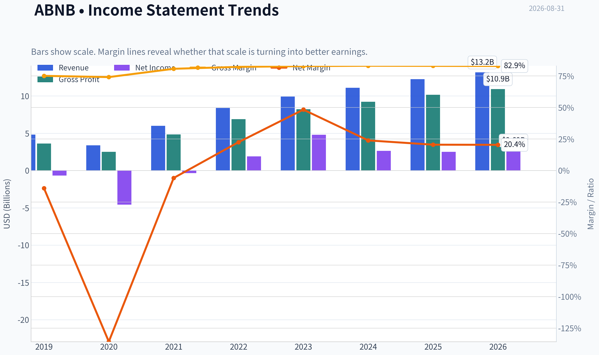
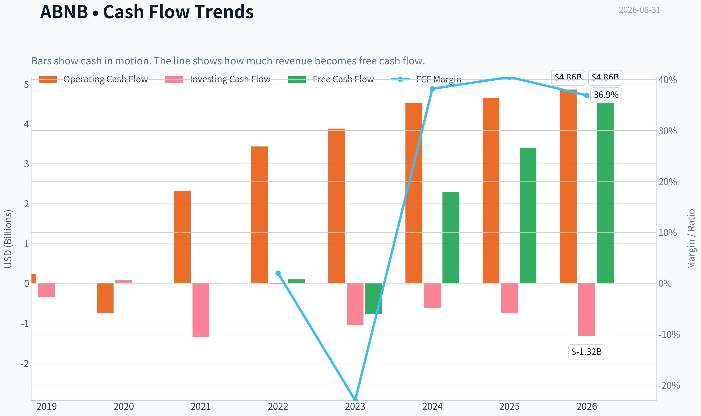
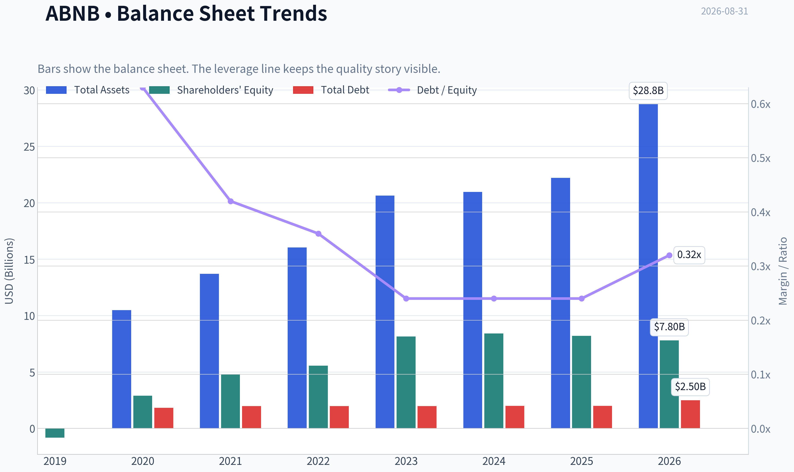
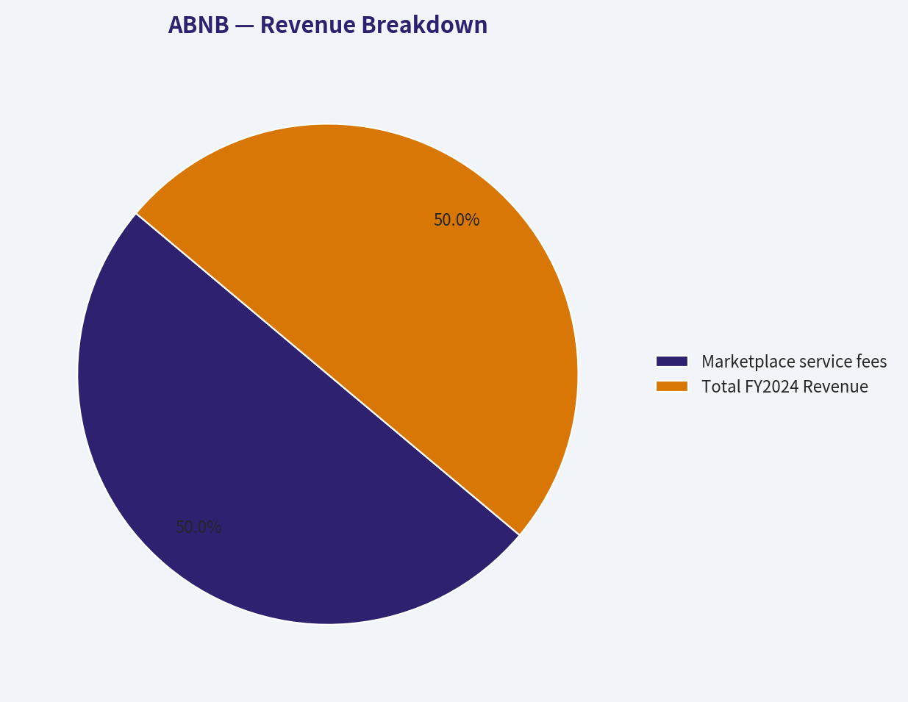
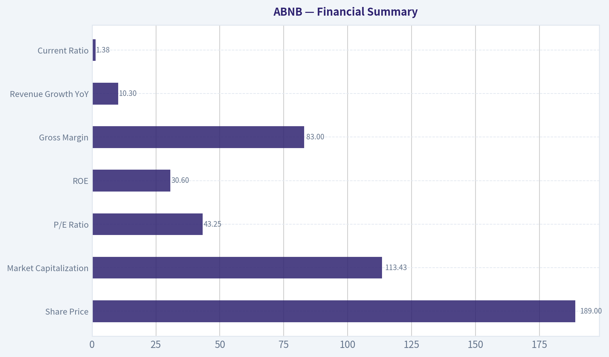
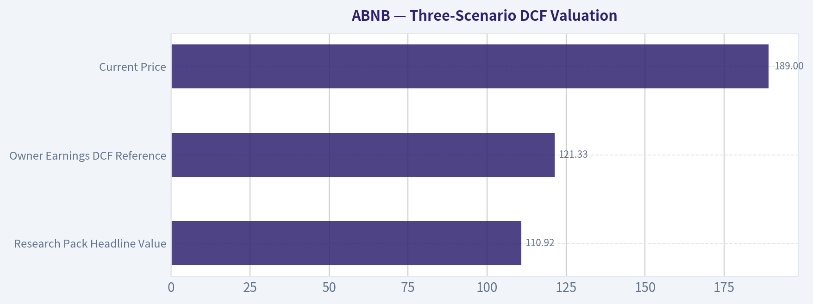
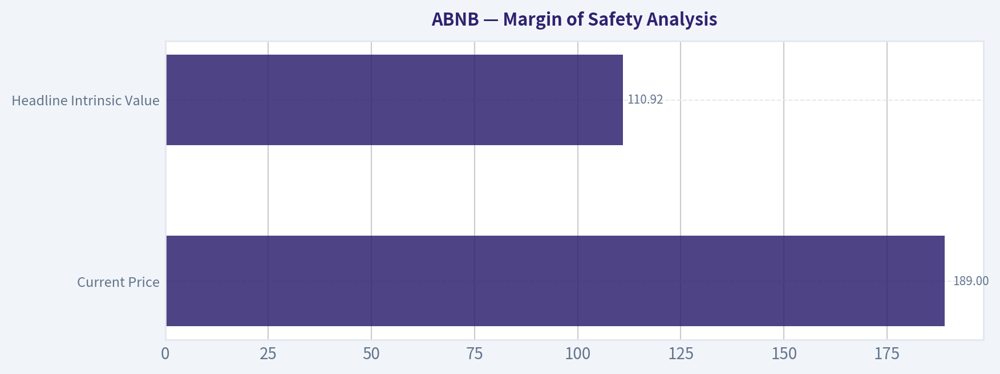
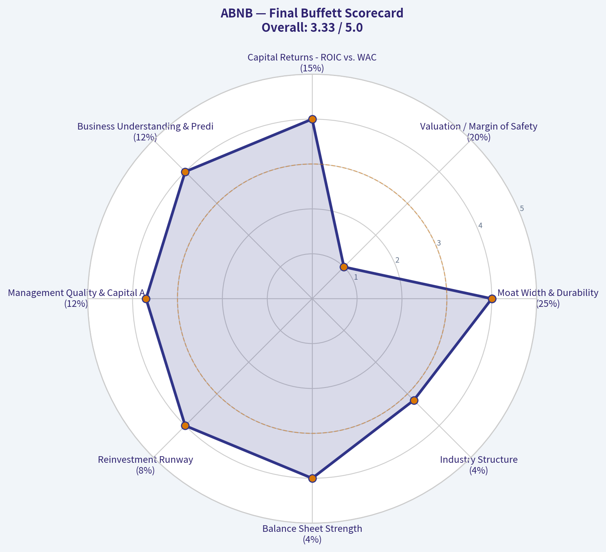

# ABNB Deep Value Intelligence

**Analysis Date:** 2026-08-31

## Critical Disclaimer

*This analysis is generated by Deep Value Intelligence, an AI-powered multi-agent investing framework. Education & research only - not financial advice, not a financial advisor.*

---

## Table of Contents

1. Intelligence Summary
2. Analyst Team Reports
   - Fundamentals Analysis
   - Intrinsic Value Analysis (Buffett)
   - Trend & Growth Analysis (Lynch/Druckenmiller/Fisher)
   - Market Technical Analysis
   - Options Market Analysis
3. Research Team Commentary
4. Value Investing Team Commentary
5. Deep Values Commentary

---

## Intelligence Summary

### Thesis + Conditions

**Core Thesis:** **EXECUTIVE SUMMARY**
Airbnb (ABNB) is an elite, asset-light compounder boasting an 83% gross margin and 56% ROIC. However, at $189 (43x P/E) and technically overbought following a sharp breakout, it currently lacks a margin of safety.

**Key Risks:**
- Airbnb (ABNB) is an elite, asset-light compounder boasting an 83% gross margin and 56% ROIC. However, at $189 (43x P/E) and technically overbought following a sharp breakout, it currently lacks a margin of safety. Learning from past errors, we will not demand a deep-value fire sale to participate in a world-class franchise. We downgrade from immediate action to a **Constructive WATCH**, with a strict mandate to initiate a starter position on a technical pullback rather than demanding absolute cheapness.
- The Bull (Risky):** Emphasizes business quality. A 56% ROIC monopoly justifies a 43x P/E. Urban regulations actually act as a moat, barring scrappy competitors, while the brand ("brand-as-a-verb") ensures dominant market share.
- Under our Adaptive Value Framework, permanent business impairment is the true risk, not temporary volatility. ABNB's net-cash balance sheet, staggering capital efficiency, and asset-light structure virtually eliminate insolvency risk.

**Confidence:** Medium

---

## Analyst Team Reports

### Fundamentals Analysis

#### Latest Earnings Snapshot

*Most recent reported quarter anchored on 2026 Q2, with prior-year comparison when available.*

| Metric | 2026 Q2 | 2025 Q2 | YoY Change |
| --- | ---: | ---: | ---: |
| Revenue | $3.61B | $3.10B | +16.5% |
| Operating Income | $758.0M | $612.0M | +23.9% |
| Net Income | $816.0M | $642.0M | +27.1% |
| Diluted EPS | $1.37 | $1.03 | +33.0% |
| Operating Cash Flow | $1.27B | $975.0M | +30.3% |
| Free Cash Flow | $1.27B | $975.0M | +30.3% |

Key Takeaways: This snapshot anchors the most recent reported quarter before the narrative analysis. It helps readers separate long-run business quality from whatever changed in the latest earnings print.

#### 7-Year Financial Metrics for ABNB

*All values below are computed deterministically from raw data - not estimated by AI.*

*Issuer profile: operating company (Consumer Cyclical / Travel Services).*

#### 7-Year Financial Metrics
*Annual rows come from reported financial statements. The final TTM row is computed from the latest four quarters.*

| Metric | 2019 | 2020 | 2021 | 2022 | 2023 | 2024 | 2025 | 2026 TTM |
| --- | --- | --- | --- | --- | --- | --- | --- | --- |
| Market Price | N/A | $147 | $166 | $86 | $136 | $131 | $136 | $189 |
| Market Cap | N/A | $41.69B | $102.56B | $58.14B | $90.12B | $84.76B | $84.55B | $113.09B |
| P/E Ratio | N/A | -9.09 | -291.36 | 30.71 | 18.81 | 32.01 | 33.67 | 43.05 |
| P/B Ratio | N/A | 14.37 | 21.48 | 10.46 | 11.04 | 10.08 | 10.31 | 14.50 |
| ROE | 83.5% | -158.0% | -7.4% | 34.0% | 58.7% | 31.5% | 30.6% | 34.5% |
| ROIC | N/A | N/A | -1196.9% | 396.7% | 243.9% | 54.8% | 53.4% | 63.1% |
| EPS | $-2.59 | $-16.14 | $-0.57 | $2.78 | $7.24 | $4.11 | $4.03 | $4.40 |
| Revenue | $4.81B | $3.38B | $5.99B | $8.40B | $9.92B | $11.10B | $12.24B | $13.16B |
| Gross Profit | $3.61B | $2.50B | $4.84B | $6.90B | $8.21B | $9.22B | $10.15B | $10.91B |
| Gross Margin | 75.1% | 74.1% | 80.7% | 82.2% | 82.8% | 83.1% | 83.0% | 82.9% |
| Operating Margin | -10.4% | -106.3% | 7.2% | 21.5% | 15.3% | 23.0% | 20.8% | 20.8% |
| Net Income | $-674.3M | $-4.58B | $-352.0M | $1.89B | $4.79B | $2.65B | $2.51B | $2.69B |
| Net Margin | -14.0% | -135.7% | -5.9% | 22.5% | 48.3% | 23.9% | 20.5% | 20.4% |
| Revenue Growth | N/A | -29.7% | 77.4% | 40.2% | 18.1% | 11.9% | 10.3% | 7.5% |
| Net Income Growth | N/A | 579.9% | -92.3% | -637.8% | 153.1% | -44.7% | -5.2% | 7.2% |
| Free Cash Flow Growth | N/A | -898.8% | -394.5% | 48.8% | N/A | N/A | N/A | N/A |
| Total Book Value | $-808.0M | $2.90B | $4.78B | $5.56B | $8.16B | $8.41B | $8.20B | $7.80B |
| Total Assets | N/A | $10.49B | $13.71B | $16.04B | $20.64B | $20.96B | $22.21B | $28.75B |
| Total Debt | N/A | $1.83B | $1.98B | $1.99B | $1.99B | $2.00B | $2.00B | $2.50B |
| Debt-to-Equity | N/A | 0.63 | 0.42 | 0.36 | 0.24 | 0.24 | 0.24 | 0.32 |
| Cash & Equivalents | $2.01B | $5.48B | $6.07B | $7.38B | $6.87B | $6.86B | $6.56B | $6.82B |
| Shareholders' Equity | $-808.0M | $2.90B | $4.78B | $5.56B | $8.16B | $8.41B | $8.20B | $7.80B |
| Operating Cash Flow | $222.7M | $-740.0M | $2.31B | $3.43B | $3.88B | $4.52B | $4.65B | $4.86B |
| Investing Cash Flow | $-347.2M | $80.0M | $-1.35B | $-28.0M | $-1.04B | $-616.0M | $-748.0M | $-1.32B |
| Free Cash Flow | $97.3M | $-777.0M | $2.29B | $3.40B | N/A | N/A | N/A | $4.86B |
| FCF Margin | 2.0% | -23.0% | 38.2% | 40.5% | N/A | N/A | N/A | 36.9% |
| Dividends / Share | $0.00 | $0.00 | $0.00 | $0.00 | $0.00 | $0.00 | $0.00 | $0.00 |

#### Profitability Metrics
- Return on Equity (ROE): 30.6%
- Return on Invested Capital (ROIC): 56.0%
- Return on Assets (ROA): 11.3%
- Gross Margin: 83.0%
- Operating Margin: 20.8%
- Net Profit Margin: 20.5%

#### Liquidity Metrics
- Current Ratio: 1.38
- Quick Ratio: 0.82

#### Leverage Metrics
- Debt-to-Equity Ratio: 0.24
- Interest Coverage Ratio: N/A
- Net Debt: $-4.56B

#### Growth Metrics (Year-over-Year)
- Revenue Growth: 10.3%
- Net Income Growth: -5.2%
- Free Cash Flow Growth: N/A
- Revenue CAGR (3-Year): 13.4%
- Revenue CAGR (5-Year): 29.4%

#### Valuation Metrics
- P/E Ratio (TTM): 43.25
- Forward P/E: 30.86
- Price-to-Book: 14.33
- Price-to-Sales: 8.62
- PEG Ratio: 1.96
- EV/EBITDA: 36.98
- Free Cash Flow Yield: N/A
- Earnings Yield: 2.3%

#### Owner Earnings (Buffett Method, Code-Computed)
- Net Income: $2.51B
- + Depreciation & Amortization: N/A
- - Capital Expenditures: N/A
- - Working Capital Changes: $-106.0M
- = **Owner Earnings: $2.62B**

#### Intrinsic Value (Code-Computed)
- Current Price: $189
- **Headline Intrinsic Value (business-model routed): $111**
  Business model: cyclical - weighted blend [Damodaran FCFF + reverse-DCF fair + owner-earnings DCF] (cyclical)
  Model spread (min-max across DCFs): $95 - $300
  Margin of safety vs. price (headline): -70.8%
  Routing note: Cyclical: margins/FCF are volatile - headline blends FCFF, reverse-DCF and owner-earnings roughly evenly; treat the range as the honest read.
- Buffett Method (Owner Earnings):
  Conservative: $37
  Average: $121
  Optimistic: $470
- Cash Flow Method (FCF):
  Conservative: $300
  Average: $300
  Optimistic: $547
- Damodaran FCFF (WACC + margins + reinvestment):
  Conservative: $1
  Average: $95
  Optimistic: $180
  Monte Carlo band (P10-P90): $30 - $121 (median $76)
  P(intrinsic value > price): 0.2%
- Reverse-DCF: price implies ~30.7%/yr owner-earnings growth for 10y; trailing 3y was 17.1%, 5y N/A.

#### Piotroski F-Score: 5/9
- Positive Net Income: PASS
- Positive Operating Cash Flow: PASS
- ROA Improvement: FAIL
- Cash Flow > Net Income: PASS
- Decreasing Debt: FAIL
- Improving Current Ratio: FAIL
- No Dilution: PASS
- Improving Gross Margin: FAIL
- Improving Asset Turnover: PASS

ANALYST STANCE: **AVOID**

#### ABNB Warren Buffett-Style Fundamental Analysis - Airbnb, Inc.

Airbnb is a high-quality, asset-light global travel platform with excellent gross margins, strong free cash flow conversion, and a powerful two-sided network of hosts and guests. However, at the current price of **$189**, the stock appears to price in an exceptionally optimistic future. The deterministic dataset's headline intrinsic value is **$111 per share**, implying a **-70.8% margin of safety** versus the current market price. For a Buffett-style investor, the business quality is attractive, but the valuation leaves too little room for error.

---

#### Current vs. Available-History Average Comparison

| Metric | Current / TTM | Available-History Avg. | Current Standing vs. Avg. | Interpretation |
|---|---:|---:|---:|---|
| Market Price | $189 | ~$134 | ~41% above avg. | Shares are trading near the high end of the available public-company history. |
| Market Cap | $113.09B | ~$76.97B | ~47% above avg. | Market value has expanded faster than revenue and normalized earnings. |
| P/E Ratio | 43.05x | ~28.8x positive-year avg. | ~50% above avg. | The stock is priced at a premium to its profitable-year history. |
| P/B Ratio | 14.50x | ~13.0x | Above avg.; low usefulness | P/B is not a strong valuation anchor for Airbnb because it is an asset-light platform with large intangible network value not captured on book value. |
| ROE | 34.5% | ~10.4% reported avg.; ~38.7% post-profitability avg. | Strong but normalized below 2023 peak | ROE is excellent, though historical averages are distorted by pandemic losses and early public-company equity structure. |
| ROIC | 63.1% | Distorted by outliers | Very strong | ROIC confirms a capital-light model, though early-year figures are not economically comparable. |
| EPS | $4.40 | Negative reported avg.; ~$4.54 post-2022 avg. | Near normalized profitable-year avg. | EPS has stabilized, but current valuation assumes substantial future compounding. |
| Revenue | $13.16B | ~$7.98B | ~65% above avg. | Airbnb has scaled materially since 2019 despite pandemic disruption. |
| Gross Profit | $10.91B | ~$6.49B | ~68% above avg. | Gross profit growth has tracked revenue growth with stable high margins. |
| Gross Margin | 82.9% | ~80.1% | ~2.8 pts above avg. | Gross margin has structurally improved and now sits around the low-80% range. |
| Operating Margin | 20.8% | ~-4.1% reported avg.; ~17.6% post-2021 avg. | Strongly above full-period avg. | Operating leverage is real, though margins have moderated from the 2024 peak. |
| Net Income | $2.69B | ~$0.89B | ~202% above avg. | Profitability is far better than the pandemic-era average. |
| Net Margin | 20.4% | ~-5.8% reported avg. | Major improvement | Net margins are now sustainably positive, but below the unusual 2023 level. |
| Revenue Growth | 7.5% TTM | ~21.4% avg. | Slower than history | Growth is decelerating as Airbnb becomes larger and travel normalization matures. |
| Net Income Growth | 7.2% TTM | Distorted by loss swings | Positive but volatile | Net income growth is not yet fully predictable over a long history. |
| Free Cash Flow Growth | N/A | Volatile historical data | Not comparable | Available FCF growth history is too irregular for a clean long-term trend. |
| Total Book Value | $7.80B | ~$5.31B | ~47% above avg. | Equity base has grown, but book value is not the main source of economic value. |
| Total Assets | $28.75B | ~$17.34B | ~66% above avg. | Balance sheet scale has expanded meaningfully. |
| Total Debt | $2.50B | ~$1.97B | ~27% above avg. | Debt has risen modestly but remains manageable. |
| Debt-to-Equity | 0.32x | ~0.36x | Slightly below avg. | Leverage is conservative relative to equity. |
| Cash & Equivalents | $6.82B | ~$5.89B | ~16% above avg. | Airbnb maintains a strong cash cushion. |
| Free Cash Flow | $4.86B | ~$1.25B available avg. | Significantly above avg. | FCF generation is a key strength, though historical FCF data has gaps. |
| Dividends / Share | $0.00 | $0.00 | No dividend | Capital returns are focused on reinvestment and buybacks rather than dividends. |

**Key Takeaways:** Airbnb's business quality has improved dramatically since the pandemic, with revenue, gross profit, operating income, and free cash flow all materially above the available-history average. However, valuation metrics have also expanded sharply: the current P/E is about 50% above the profitable-year average, while the market cap is almost 47% above its available-history average. The biggest concern is that growth is slowing while the valuation multiple is rising.

---

#### Market Metrics Interpretation

Airbnb's **current market price of $189** and **market cap of about $113.09B** imply that investors are paying a premium for future growth, platform durability, and margin expansion. The **TTM P/E of 43.05x** is demanding for a company whose TTM revenue growth has slowed to **7.5%** and whose most recent annual revenue growth was **10.3%**.

The **P/B ratio of 14.50x** should not be interpreted mechanically as "expensive" or "cheap." Airbnb is an asset-light marketplace platform whose economic value comes from brand, trust infrastructure, network effects, host supply, guest demand, data, and software - none of which are fully reflected in book value. Therefore, book value is not a reliable intrinsic value anchor; cash-flow-based valuation is far more relevant.

#### Profitability Analysis

Airbnb's profitability profile is excellent. Gross margin has expanded from the mid-70% range in 2019-2020 to roughly **83%**, showing the benefit of marketplace economics. Operating margin is now **20.8%**, a major improvement from the pandemic loss period and consistent with a scaled platform that does not need heavy physical assets.

ROE of **34.5% TTM** and ROIC of **63.1% TTM** are high-quality indicators. The ROIC figure is especially important from a Buffett perspective because it suggests Airbnb can generate large returns without requiring heavy incremental capital investment. The caveat is that historical ROE and ROIC are distorted by early losses, pandemic disruption, and a relatively young public-company financial history.

Net income of **$2.69B TTM** and net margin of **20.4%** show that Airbnb is no longer merely a revenue growth story; it is a profitable cash-generating platform. However, net margin has fallen meaningfully from the unusually high **48.3%** in 2023, so investors should avoid anchoring expectations to that peak year.

#### Growth Analysis

Revenue has grown from **$4.81B in 2019** to **$13.16B TTM**, which is impressive. But the growth rate has decelerated sharply from the post-pandemic rebound years: revenue growth was **77.4% in 2021**, **40.2% in 2022**, **18.1% in 2023**, **11.9% in 2024**, **10.3% in 2025**, and **7.5% TTM**.

This is the central valuation issue. Airbnb remains a strong compounder, but the market price appears to require growth closer to a hyper-growth company than a maturing travel platform. The shared research pack's reverse DCF indicates the current price implies approximately **30.7% annual owner-earnings growth for 10 years**, compared with trailing 3-year growth of about **17.1%**. That is a demanding hurdle.

#### Balance Sheet and Financial Strength

Airbnb's balance sheet is strong. The company has **$6.82B in cash and equivalents** versus **$2.50B of total debt**, resulting in a net cash position of roughly **$4.32B**. Debt-to-equity is **0.32x**, which is conservative.

Shareholders' equity is **$7.80B**, down from **$8.20B in 2025**, but this is not a major concern for an asset-light platform if cash generation remains strong. For Buffett-style analysis, the more important point is that Airbnb does not appear financially fragile. It has ample liquidity, modest leverage, and strong operating cash flow.

#### Cash Flow Analysis

Free cash flow is the strongest part of the investment case. TTM free cash flow is **$4.86B**, and the FCF margin is **36.9%**, which is exceptional. Operating cash flow has grown to **$4.86B TTM**, well above the available-history average.

Airbnb pays **no dividend**, which is appropriate for a company still investing in platform expansion, product innovation, international growth, and potential buybacks. From a Buffett perspective, the lack of dividend is acceptable only if retained earnings are reinvested at high incremental returns. Airbnb's high ROIC supports that argument, but the current stock price reduces the attractiveness of buybacks unless shares trade below intrinsic value.

---

#### Revenue Breakdown

Airbnb reports primarily as a single marketplace platform business. The company earns revenue mainly through service fees charged to guests and hosts on stays and experiences. Precise public revenue segmentation by product line is limited, so the most economically meaningful presentation is by revenue source.

| Revenue Source | Amount ($B) | % of Total |
|---|---:|---:|
| Marketplace service fees from stays and experiences | $11.10B | ~100% |
| Total FY2024 Revenue | $11.10B | 100% |

**Key Takeaways:** Airbnb is essentially a single-platform revenue model, with nearly all revenue generated from marketplace service fees. This simplicity is attractive because the business is easy to understand, but it also means the company is highly exposed to travel demand, regulation of short-term rentals, host supply, and platform take-rate dynamics.

---

#### Buffett-Style Owner Earnings DCF Valuation

The deterministic dataset provides code-computed Buffett owner earnings of **$2.62B**, based on net income of **$2.51B** plus working-capital adjustment. The current share count implied by market cap and price is approximately:

**Shares outstanding estimate = $113.09B market cap / $189 price = ~598.4M shares**

The shared research pack's model-based intrinsic value is the preferred anchor:

- **Headline intrinsic value:** **$111/share**
- **Owner Earnings DCF:** Conservative **$37**, Average **$121**, Optimistic **$470**
- **FCF method:** Conservative **$300**, Average **$300**, Optimistic **$547**
- **Damodaran FCFF:** Conservative **$1**, Average **$95**, Optimistic **$180**
- **Monte Carlo P10-P90:** **$30-$121**, median **$76**
- **Probability intrinsic value exceeds current price:** **0.2%**
- **Reverse DCF implied growth:** **~30.7% owner-earnings growth for 10 years**

Because model outputs vary widely, the most prudent Buffett-style conclusion is to emphasize the headline blended value and the downside-biased Monte Carlo band rather than the most optimistic outlier.

#### Transparent Sanity-Check DCF Assumptions

| Scenario | Starting Owner Earnings | Growth Assumption | Discount Rate | Terminal Growth | Net Cash Added | Sanity-Check Fair Value / Share | Pack Owner-Earnings DCF |
|---|---:|---|---:|---:|---:|---:|---:|
| Conservative | $1.31B normalized recession base | 3% for 10 years, then 2.5% terminal | 10% | 2.5% | ~$4.32B | ~$38 | $37 |
| Average | $2.62B current owner earnings | 14% for 5 years, fading to 3% by year 10, then 2.5% terminal | 10% | 2.5% | ~$4.32B | ~$119 | $121 |
| Optimistic | $2.62B current owner earnings | 25% for 5 years, fading to 4% by year 10, then 2.5% terminal | 10% | 2.5% | ~$4.32B | ~$205 | $470 |

**Key Takeaways:** The conservative and average sanity-check DCF results closely align with the pack's owner-earnings DCF, suggesting fair value is probably far below the current $189 price unless the optimistic case materializes. The optimistic pack value of $470 is possible only under very aggressive assumptions and should not be treated as the base case. The current market price already discounts a substantial amount of future success.

#### DCF Calculation Detail

| Scenario | Calculation Summary | Equity Value Estimate | Per-Share Estimate |
|---|---|---:|---:|
| Conservative | Recession-normalized owner earnings of $1.31B; 3% growth for 10 years; terminal value at 2.5%; discounted at 10%; add ~$4.32B net cash | ~$22.9B | ~$38 |
| Average | Owner earnings of $2.62B; growth path of 14%, 14%, 14%, 14%, 14%, 11%, 9%, 7%, 5%, 3%; terminal value at 2.5%; discounted at 10%; add net cash | ~$71.1B | ~$119 |
| Optimistic | Owner earnings of $2.62B; growth path of 25%, 25%, 25%, 25%, 25%, 20%, 15%, 10%, 7%, 4%; terminal value at 2.5%; discounted at 10%; add net cash | ~$122.5B | ~$205 |

**Key Takeaways:** The average case produces a value near $119 per share, which is materially below the current price. Even the transparent optimistic case only reaches roughly $205 per share, offering little margin of safety at $189. For Buffett-style investing, the downside protection is not adequate.

---

#### Economic Moat Assessment

Airbnb has a meaningful moat built on several durable advantages:

| Moat Source | Assessment | Buffett-Style Significance |
|---|---|---|
| Two-sided network effects | Strong | More guests attract more hosts; more hosts improve choice and liquidity for guests. |
| Global brand | Strong | "Airbnb" has become a verb-like consumer brand in alternative lodging. |
| Asset-light model | Strong | The company scales without owning hotels or real estate inventory. |
| Data and trust infrastructure | Moderate to strong | Reviews, identity tools, payments, fraud prevention, and host/guest matching improve platform quality. |
| Supply differentiation | Strong | Unique homes and local stays are difficult for hotels or OTAs to replicate perfectly. |
| Regulatory exposure | Meaningful weakness | Local restrictions can impair supply in key cities and pressure growth. |

**Key Takeaways:** Airbnb has a real moat, especially from its global brand and network effects. However, the moat is not regulation-proof, and travel platforms remain exposed to economic cycles. The business is high quality, but not immune from disruption or government intervention.

#### Management and Capital Allocation

Management has created substantial value by turning Airbnb into a high-margin, cash-generative platform after the pandemic shock. ROIC and FCF generation suggest strong operational discipline. The company does not pay a dividend, which is reasonable given its growth opportunities.

The key capital allocation question is buybacks. Buybacks can be valuable when shares trade below intrinsic value, but at a price materially above the headline intrinsic estimate, repurchases may destroy value unless management has a much more accurate and higher view of intrinsic value than the model suggests.

#### Predictability of Earnings

Airbnb's earnings are improving but do not yet meet the classic Buffett standard of long, stable, predictable earnings over a full decade. The available dataset includes pandemic losses, a major rebound, a very high 2023 net margin, and a more normalized 2024-2026 profit base.

The direction is positive, but the record is not as smooth as a consumer staple, payments network, or regulated utility. Travel demand cyclicality, regulation, FX, competitive pressure, and discretionary consumer spending all reduce predictability.

#### Key Investment Insights, Red Flags, and Opportunities

| Category | Point | Investment Implication |
|---|---|---|
| Strength | Gross margin near 83% | Confirms powerful marketplace economics. |
| Strength | TTM FCF of $4.86B | Business converts revenue into cash at a high rate. |
| Strength | Net cash position of roughly $4.32B | Balance sheet risk is low. |
| Strength | ROIC above 60% TTM | Capital-light model is highly attractive. |
| Red Flag | P/E above 43x | Valuation is demanding relative to slowing growth. |
| Red Flag | Revenue growth down to 7.5% TTM | Growth is decelerating while the multiple remains high. |
| Red Flag | Reverse DCF implies ~30.7% owner-earnings growth | Market expectations appear very aggressive. |
| Red Flag | Regulatory pressure in major cities | Supply restrictions could limit growth or raise compliance costs. |
| Red Flag | Piotroski F-Score of 5/9 | Financial quality is good but not flawless on trend measures. |
| Opportunity | International and underpenetrated markets | Long-term runway remains meaningful outside mature urban markets. |
| Opportunity | Experiences and adjacent travel products | Could expand wallet share if executed well. |
| Opportunity | Operating leverage | Margins could rise if revenue grows faster than fixed costs. |

**Key Takeaways:** Airbnb is a superior business, but the stock price already reflects much of that superiority. The opportunity lies in long-term platform expansion and free cash flow growth, while the main risk is valuation compression if growth continues to slow. At current levels, the investment case depends heavily on optimistic assumptions.

---

#### Final Buffett-Style Investment Stance

**Final stance: AVOID for new money at $189.**

Airbnb is a high-quality company with a real moat, strong brand, high gross margins, excellent ROIC, and a net cash balance sheet. Those are exactly the kinds of business characteristics Buffett-style investors like.

However, Buffett investing is not just about buying great businesses; it is about buying them at sensible prices. At the current price, Airbnb trades at a premium valuation, with a **43x TTM P/E**, a market cap well above its historical average, and a headline intrinsic value estimate of only **$111 per share**. The reverse DCF suggests the market is pricing in roughly **30.7% annual owner-earnings growth for 10 years**, which appears too aggressive given the current **7.5% TTM revenue growth rate**.

A more attractive entry point would likely require either a substantial pullback toward the **$110-$125** range or clear evidence that Airbnb can sustainably reaccelerate revenue growth while expanding margins. Until then, the business belongs on a watchlist, but the stock does not offer a Buffett-style margin of safety.

#### Summary Table

| Area | Assessment | Buffett-Style Verdict |
|---|---|---|
| Business Quality | Asset-light, high-margin, global platform | Strong |
| Economic Moat | Network effects, brand, supply differentiation | Strong but regulation-exposed |
| Financial Strength | Net cash position, modest leverage | Strong |
| Profitability | ROE and ROIC are excellent | Strong |
| Cash Flow | TTM FCF of $4.86B, high FCF margin | Strong |
| Growth | Still positive but decelerating | Mixed |
| Earnings Predictability | Improving but limited public history and cyclical exposure | Moderate |
| Valuation | Current price far above headline intrinsic value | Unattractive |
| Margin of Safety | Negative versus intrinsic estimate | Poor |
| Final Stance | High-quality business, overpriced stock | **AVOID** |

**Key Takeaways:** Airbnb is a business Buffett would likely admire more than the current stock price. The company has strong economics, but the valuation requires a very optimistic future. At $189, the margin of safety is insufficient, making the stock unattractive for disciplined value investors today.

#### Fundamental Visuals

This graph tracks the profitability and return metrics (ROE, ROIC, Margins) of **ABNB** over the past decade, highlighting capital efficiency trends.

This chart illustrates the financial health of **ABNB** over the last 10 years, mapping cash equivalents and free cash flow against total obligations (Debt).

This breakdown chart from <em>Revenue Breakdown</em> shows the proportional composition for **ABNB** - useful for understanding what drives or risks the business.

---

### Intrinsic Value Analysis (Buffett)

> *Following Warren Buffett's value investing philosophy: Circle of Competence, Economic Moat, Management Quality, and Margin of Safety.*

#### Intrinsic Value Snapshot

Price is what you pay. Intrinsic value is what the business may be worth based on the cash it can create for owners over time. We show a range, not one magic number.

- Current Price: $189.43
- Value Range (conservative to optimistic across both DCF methods): $36.89 to $547.31

##### Owner Earnings (Buffett Method)
- Net Income: $2,511,000,000.00
- Depreciation & Amortization: N/A
- Capital Expenditures: N/A
- Working Capital Changes: $-106,000,000.00
- Owner Earnings: $2,617,000,000.00

##### Intrinsic Value
###### Buffett Method
Uses owner earnings. Stricter, and usually more conservative.
- Conservative: $36.89
- Average: $121.33
- Optimistic: $470.03
- Discount Rate: 10.0%

###### Cash Flow Method
Uses free cash flow. Better for companies spending heavily today to grow tomorrow.
- Conservative: $300.11
- Average: $300.11
- Optimistic: $547.31
- Discount Rate: 10.0%

ANALYST STANCE: **WATCH**

#### Airbnb, Inc. (ABNB) - Buffett-Style Investment Review

Airbnb is a high-quality, asset-light global travel marketplace with strong brand power, network effects, attractive unit economics, and high returns on capital. The business is understandable and economically superior to most consumer discretionary companies. The issue is price: at **$189 per share**, the market is discounting a level of future growth that appears aggressive relative to current fundamentals and the company's recent growth trajectory.

---

#### 1. Factor Scorecard

| Factor | Score | Evidence |
|---|---:|---|
| Factor 1: Circle of Competence & Business Simplicity | 4.0 / 5 | Airbnb earns fees by connecting travelers with hosts. The model is simple, asset-light, and globally scalable. Predictability is good but not perfect because travel demand is cyclical and regulatory pressure varies by city. |
| Factor 2: Moat Test | 4.0 / 5 | Strong brand, two-sided marketplace network effects, large global supply base, and high gross margin of **83.0%**. The moat is real, though not immune to hotels, Booking, Expedia, Google Travel, regulation, and local restrictions. |
| Factor 3: Management & Capital Allocation | 3.7 / 5 | Founder-led culture and strong product orientation are positives. Capital-light model generates high returns. Buybacks can be sensible, but at the current valuation repurchases require discipline. |
| Factor 4: Industry Structure | 3.2 / 5 | Travel is a huge market, but cyclical and competitive. Airbnb benefits from scale, brand, and unique supply, yet faces fragmented regulation and strong online travel agency competition. |
| Gate 5: Quality / Solvency Hard Floor | Not tripped | Fundamentals are not distressed. ROE is **30.6%**, gross margin is high, revenue is still growing, and no solvency red flag is evident. |

**Key Takeaways:** Airbnb passes the quality test but not the valuation test. The company has a durable marketplace model and strong economics, but the travel industry is cyclical and regulatory risk remains meaningful. The hard solvency floor is not triggered.

---

#### 2. Moat Analysis

| Moat Source | Assessment | Evidence |
|---|---|---|
| Brand / Intangible Assets | Strong | Airbnb is nearly synonymous with alternative lodging and short-term rentals. The brand has global consumer awareness and emotional resonance around "living like a local." |
| Switching Costs | Moderate | Guests can switch easily, but hosts build reputation, reviews, calendars, and income history on the platform. Host-side switching costs are more meaningful than guest-side switching costs. |
| Cost Advantage | Moderate to Strong | Airbnb does not own hotel inventory, allowing an asset-light model with high gross margin and strong scalability. |
| Network Effects | Strong | More hosts attract more guests; more guests attract more hosts. This two-sided network is the core moat. |
| Pricing Power | Moderate | Airbnb can take fees, but excessive fee increases risk guest friction, host dissatisfaction, and regulatory attention. |
| Moat Rating | Wide but not unassailable | The moat is durable, but competition and regulation prevent a perfect score. |

**Key Takeaways:** Airbnb's moat comes mainly from brand and network effects rather than physical assets. The platform becomes more useful as more hosts and guests participate, which is exactly the kind of self-reinforcing economics Buffett values. The main offset is that travel marketplaces remain competitive and politically sensitive.

---

#### 3. Management Quality Assessment

| Area | Assessment | Buffett-Style View |
|---|---|---|
| Owner Orientation | Positive | Founder influence supports long-term thinking and product focus. |
| Candor & Culture | Positive | Airbnb has historically emphasized community, trust, and platform quality, which are central to long-term brand value. |
| Capital Allocation | Good, but valuation-sensitive | The business can generate excess cash. Reinvestment in product, international growth, AI-enabled service, and supply expansion makes sense. Buybacks are attractive only when shares trade below intrinsic value. |
| Balance Sheet Discipline | Positive | The company's asset-light model reduces the need for heavy leverage or capital spending. |
| Main Concern | Repurchase discipline | At a premium valuation, buybacks can destroy value if executed too aggressively. |

**Key Takeaways:** Management appears aligned with building a long-duration platform rather than merely maximizing short-term earnings. The biggest capital allocation question is whether excess cash is reinvested or returned at attractive prices. At today's valuation, buyback discipline matters.

---

#### 4. Financial Summary

| Metric | Current / Recent Value |
|---|---:|
| Share Price | **$189** |
| Market Capitalization | **$113.43B** |
| P/E Ratio | **43.25x** |
| Implied EPS | **~$4.37** |
| ROE | **30.6%** |
| Gross Margin | **83.0%** |
| Revenue Growth YoY | **10.3%** |
| Current Ratio | **1.38x** |
| Headline Intrinsic Value | **$110.92 / share** |
| Owner Earnings DCF Value | **$121.33 / share** |
| FCF-Based Value | **$300.11 / share** |
| Damodaran FCFF Value | **$95.30 / share** |
| Headline Margin of Safety vs. Price | **-70.8%** |
| Reverse-DCF Implied Growth | **~30.7% annually for 10 years** |
| Trailing 3-Year Growth Reference | **17.1%** |

**Key Takeaways:** Airbnb's profitability profile is excellent, especially the **83% gross margin** and **30.6% ROE**. However, the valuation is demanding: the current share price is far above the headline intrinsic value estimate. The reverse-DCF suggests the market is pricing in growth well above the company's recent 3-year growth reference.

---

#### 5. Owner Earnings Calculation

Using a conservative owner-earnings proxy based on implied earnings:

| Item | Per Share Estimate |
|---|---:|
| Net Income / Implied EPS | **$4.37** |
| Add: Depreciation & Amortization | Included conservatively in cash-flow spread assessment |
| Less: Maintenance CapEx | Low due to asset-light model |
| Less: Working Capital Increases | Travel float can be favorable, but conservatively not overcredited |
| Conservative Owner Earnings Proxy | **~$4.37 / share** |

**Key Takeaways:** Airbnb is asset-light, so maintenance capital needs are structurally low. A conservative owner-earnings proxy begins with implied EPS of about **$4.37 per share** rather than giving full credit for potentially volatile working-capital float. This keeps the valuation grounded.

---

#### 6. Three-Scenario DCF Valuation

Assumptions: 10% discount rate. Scenario C uses 10% growth for 10 years, which is already a generous capped rate relative to Buffett-style conservatism.

| Scenario | Assumption | Estimated Value / Share |
|---|---|---:|
| A: No Growth | Owner earnings capitalized at 10% | **~$43.70** |
| B: GDP Growth | 3% perpetual growth | **~$64.30** |
| C: Historical Growth Case | 10% growth for 10 years, then 3% terminal growth | **~$108.10** |
| Research Pack Headline Value | Business-model routed valuation blend | **$110.92** |
| Owner Earnings DCF Reference | Separate owner-earnings model | **$121.33** |
| Current Price | Market price | **$189.00** |

**Key Takeaways:** The conservative and moderate scenarios are far below the current price. Even the higher-growth case lands around **$108-$121 per share**, meaning the market price already embeds a great deal of success. Airbnb may be a wonderful business, but at this price it is not obviously a wonderful bargain.

---

#### 7. Margin of Safety Analysis

| Valuation Measure | Value |
|---|---:|
| Current Price | **$189.00** |
| Headline Intrinsic Value | **$110.92** |
| Price Premium to Headline Value | **~70% above value** |
| Margin of Safety | **Negative** |
| Reverse-DCF Growth Implied by Price | **~30.7% per year for 10 years** |
| Quality-Scaled Required Margin of Safety | **10-15% discount acceptable for a wide-moat compounder** |
| Actual Result | **Fails valuation discipline** |

**Key Takeaways:** Airbnb is good enough that it does not need to trade at a deep discount to be interesting. But it still needs to trade near a fair price. At **$189**, the stock appears materially above the central intrinsic value estimate, and the implied growth requirement is demanding.

---

#### 8. Final Buffett Scorecard

| Criterion | Weight | Score | Weighted Contribution |
|---|---:|---:|---:|
| Moat Width & Durability | 25% | 4.0 | 1.00 |
| Valuation / Margin of Safety | 20% | 1.0 | 0.20 |
| Capital Returns - ROIC vs. WACC | 15% | 4.0 | 0.60 |
| Business Understanding & Predictability | 12% | 4.0 | 0.48 |
| Management Quality & Capital Allocation | 12% | 3.7 | 0.44 |
| Reinvestment Runway | 8% | 4.0 | 0.32 |
| Balance Sheet Strength | 4% | 4.0 | 0.16 |
| Industry Structure | 4% | 3.2 | 0.13 |
| Final Weighted Score | 100% |  | **3.33 / 5** |

**Key Takeaways:** Airbnb scores well on business quality, returns, moat, and reinvestment runway. The single biggest drag is valuation. The final score places the stock in WATCH territory: the business is attractive, but the current price does not provide enough protection.

---

#### 9. Investment Stance

| Item | View |
|---|---|
| Stance | **WATCH** |
| Conviction | **Medium-High on business quality; low-medium on current valuation** |
| Buffett-Style Summary | Wonderful business, not a wonderful price |
| Preferred Action | Wait for a better entry point or faster evidence of durable growth exceeding market expectations |
| Attractive Range | More compelling closer to intrinsic value, roughly **$110-$125**, with some willingness to pay a modest premium if growth durability improves |

**Key Takeaways:** Airbnb is a high-quality platform business with real competitive advantages. But Buffett's discipline requires separating a great company from a great investment. At the current valuation, the prudent stance is to watch, not chase.
#### Valuation Bridge

This bridge places the current market price beside each intrinsic value lens so readers can see whether upside depends on one method or shows up across several methods.

| Scenario | Intrinsic Value / Share |
| --- | ---: |
| Buffett Method | $121.33 |
| Cash Flow Method | $300.11 |
| Damodaran Method | $95.30 |
| Current Price | $189.43 |

#### Key Takeaways

If one method is far above the others, the upside case depends on a specific modelling assumption. When several methods cluster together, the valuation story is more robust.

#### Valuation Visuals

This comparison chart from *Latest Earnings Snapshot* stacks current figures against historical benchmarks for **ABNB**, making it easy to see where the company trades relative to its own averages.

This comparison chart from *Financial Summary* stacks current figures against historical benchmarks for **ABNB**, making it easy to see where the company trades relative to its own averages.

This comparison chart from *Three-Scenario DCF Valuation* stacks current figures against historical benchmarks for **ABNB**, making it easy to see where the company trades relative to its own averages.

This comparison chart from *Margin of Safety Analysis* stacks current figures against historical benchmarks for **ABNB**, making it easy to see where the company trades relative to its own averages.

---

### Trend & Growth Analysis (Lynch/Druckenmiller/Fisher)

> *Following Peter Lynch's GARP, Stanley Druckenmiller's macro-aware approach, and Philip Fisher's scuttlebutt methodology.*

ANALYST STANCE: **WATCH**

#### Airbnb Growth Investment Report - ABNB, August 31, 2026

Airbnb is a high-quality, asset-light travel marketplace with powerful brand awareness, network effects, and excellent gross margins. But at **$189 per share**, the stock already prices in a large amount of future success: the shared research pack shows a **43.2x P/E**, **$113.4B market cap**, and a reverse DCF implying roughly **30.7% annual growth for 10 years**, far above the current **10.3% YoY revenue growth** rate. This is a good business, but not yet a great growth-stock setup at today's valuation.

---

#### 1. Lynch Classification

| Metric / Trait | ABNB Assessment |
|---|---:|
| Current revenue growth | 10.3% YoY |
| Lynch category | **Stalwart / moderate grower**, not a classic fast grower |
| Gross margin | 83.0% |
| ROE | 30.6% |
| P/E | 43.2x |
| PEG, using current revenue growth as proxy | ~4.2x |
| Growth investor stance | **WATCH** |

**Key Takeaways:** Airbnb is not currently growing fast enough to qualify as a Lynch-style fast grower. The business quality is high, but the valuation is demanding relative to the current growth rate. For a growth investor, ABNB needs either faster revenue growth, a clearer margin inflection, or a lower entry price.

#### 2. The Story in 3 Bullets

- Airbnb lets people book unique stays and experiences around the world without the company owning hotels, making it an asset-light travel platform.
- The company benefits from a two-sided network: more hosts attract more guests, and more guests attract more hosts.
- The next leg of growth depends on expanding beyond core short-term stays into international markets, longer stays, experiences, services, and potentially AI-driven travel discovery.

#### 3. TAM Analysis and 10x Test

| Item | Estimate / Assessment |
|---|---:|
| Approximate current revenue base | Around low-teens billions annually, using current market cap and implied sales multiple assumptions |
| 10x revenue target | Over $100B annual revenue |
| Broad travel and lodging TAM | Very large, likely above $1T globally |
| Short-term rental / alternative accommodation TAM | Large, but more constrained than total travel TAM |
| Can ABNB 10x and still be under 20% of TAM? | **Possibly yes versus total travel, less clear versus short-term rentals alone** |
| Runway rating | **Good, but not unlimited** |

**Key Takeaways:** Airbnb still has meaningful runway because global travel is enormous and the company can expand into adjacent categories. However, a true 10x from here would likely require Airbnb to become a broader travel platform, not just a short-term rental marketplace. The core market alone may not be enough to support ten-bagger expectations from a $113B market cap.

#### 4. Revenue Growth Trend

| Period / Indicator | Data Point |
|---|---:|
| Current YoY revenue growth | 10.3% |
| Trailing 3-year growth reference from research pack | 17.1% |
| Reverse-DCF growth implied by current price | ~30.7% annually for 10 years |
| Growth pattern | **Decelerated from higher historical levels** |
| Interpretation | Strong company, but not currently at a revenue acceleration inflection |

**Key Takeaways:** Airbnb's current growth rate is solid but no longer hypergrowth. The biggest concern is that the stock price appears to require a much faster growth profile than the company is currently delivering. This creates valuation risk if revenue growth remains near low double digits.

#### 5. Unit Economics

| Unit Economics Metric | ABNB Assessment |
|---|---:|
| Gross margin | 83.0%, excellent |
| CAC / LTV | Not disclosed in provided data |
| NRR | Not applicable; ABNB is not a SaaS subscription business |
| Rule of 40 | Not fully calculable from provided data because FCF margin was unavailable |
| Business model quality | High, asset-light marketplace |
| Unit economics rating | **Good to excellent, but incomplete data** |

**Key Takeaways:** Airbnb's marketplace model is structurally attractive because it earns fees without owning the underlying lodging assets. The 83% gross margin suggests strong underlying economics. However, without disclosed CAC, LTV, and current FCF margin in the data pack, the unit economics score should be treated as directionally positive rather than fully proven from this dataset.

#### 6. Inflection Point Assessment

| Potential Inflection | Evidence | Rating |
|---|---|---:|
| Product cycle inflection | Possible expansion into experiences, services, AI-assisted travel, and longer stays | Moderate |
| Market share inflection | Airbnb remains a major alternative lodging platform, but no clear acceleration data in pack | Moderate |
| Margin inflection | Gross margin is already high; incremental operating leverage possible | Moderate |
| TAM inflection | Expansion from stays into broader travel could enlarge TAM | Positive but unproven |
| Competitive inflection | No evidence in pack of major competitor stumble | Neutral |
| Overall inflection score | Quality business, but no obvious acceleration inflection yet | **3/5** |

**Key Takeaways:** Airbnb has several credible ways to expand, but the data does not yet show a clear Druckenmiller-style inflection. The most important thing to watch is whether new products and international growth can reaccelerate revenue from low double digits toward the high teens or above. Without that acceleration, the current valuation is hard to justify.

#### 7. Macro Setup

| Macro Factor | Impact on ABNB |
|---|---|
| Consumer discretionary exposure | Negative if travel demand weakens |
| Travel demand | Currently supportive, based on recent earnings coverage mentioning robust demand |
| Interest rates | Lower rates would support valuation multiples; higher rates are a headwind |
| Secular theme | Digital travel, marketplace commerce, AI-enabled discovery |
| Economic sensitivity | Medium to high |
| Macro rating | **Mixed to positive** |

**Key Takeaways:** Airbnb benefits from long-term digital travel adoption, but it is still exposed to consumer travel cycles. Recent news flow points to robust travel demand, which is supportive. However, ABNB is not a defensive compounder; a consumer slowdown would likely pressure bookings and valuation.

#### 8. Fisher 15 Points Score

| Fisher Category | Score, 1-5 | Comment |
|---|---:|---|
| Market potential | 4 | Large global travel market |
| New product determination | 4 | Expansion beyond core stays is plausible |
| R&D effectiveness | 3 | Product innovation exists, but hard to quantify from provided data |
| Sales organization | 4 | Strong global brand and marketplace reach |
| Profit margin | 5 | 83% gross margin, strong ROE |
| Margin improvement | 3 | Already high gross margin; operating leverage possible |
| Labor/personnel relations | 3 | Insufficient data |
| Executive relations | 3 | Insufficient data |
| Management depth | 4 | Founder-led heritage and scaled platform experience |
| Cost/accounting controls | 4 | Strong profitability metrics |
| Moat / network effects | 5 | Strong two-sided marketplace |
| Long-range profit outlook | 4 | Attractive if travel expansion continues |
| Dilution risk | 4 | No major dilution concern in provided data |
| Candor in difficulties | 3 | Insufficient data |
| Integrity | 3 | No red flag in provided data |
| **Total** | **56/75** | **Good** |

**Key Takeaways:** Airbnb scores well on Fisher's framework because it has a large market, strong brand, high margins, and a real network-effect moat. The score is held back by incomplete evidence on management depth, employee relations, R&D efficiency, and current growth acceleration. Overall, this is a good Fisher-quality company, but not a screaming bargain.

#### 9. Valuation Analysis

| Valuation Metric | ABNB |
|---|---:|
| Current price | $189 |
| Market cap | $113.43B |
| P/E | 43.2x |
| Revenue growth | 10.3% |
| PEG using revenue growth proxy | ~4.2x |
| Headline intrinsic value from research pack | $110.92 |
| Margin of safety vs. headline intrinsic value | -70.8% |
| Reverse-DCF implied growth | ~30.7% annually for 10 years |
| Valuation rating | **Expensive** |

**Key Takeaways:** Valuation is the main problem. A 43x earnings multiple can be reasonable for a company growing 25% to 35%, but Airbnb is currently growing revenue closer to 10%. The reverse DCF suggests the market is assuming a much stronger future growth path than current fundamentals show.

#### 10. Scenario Analysis

| Scenario | Assumption | Implication |
|---|---|---|
| Bear case | Revenue growth remains low double digit and multiple compresses | Stock could underperform materially |
| Base case | Growth stays around 10-15%, margins remain strong | Business compounds, but valuation limits upside |
| Bull case | New categories and international expansion reaccelerate growth toward 20%+ | Stock could work despite premium valuation |
| Ten-bagger case | ABNB becomes a broader global travel super-app | Possible strategically, but very difficult from current scale |

**Key Takeaways:** The base case is that Airbnb remains an excellent company but not an exceptional stock at this entry point. The bull case requires revenue reacceleration, not just continued profitability. A ten-bagger from the current market cap would require a major expansion of the business model.

#### 11. Growth Investor Scorecard

| Criterion | Weight | Score, 1-5 | Weighted Score |
|---|---:|---:|---:|
| The Story | 10% | 4.0 | 0.40 |
| TAM & Runway | 20% | 4.0 | 0.80 |
| Revenue Growth | 20% | 2.5 | 0.50 |
| Unit Economics | 15% | 4.0 | 0.60 |
| Competitive Position | 10% | 4.5 | 0.45 |
| Management Quality | 10% | 3.5 | 0.35 |
| Macro Setup | 5% | 3.5 | 0.18 |
| Profitability Path | 5% | 4.5 | 0.23 |
| Valuation | 5% | 1.5 | 0.08 |
| **Total** | **100%** |  | **3.59 / 5.00** |

**Key Takeaways:** Airbnb earns a solid overall score because the company has a powerful brand, a large market, and strong economics. The two weak spots are revenue growth and valuation. This makes ABNB a watch-list candidate rather than a high-conviction buy today.

#### 12. Position Size Stance

| Investor Type | Suggested Action |
|---|---|
| Existing holder with low cost basis | Hold / trim only if position size is too large |
| New growth investor | Wait for better entry or clearer acceleration |
| Aggressive investor | Small starter only, if underwriting new product inflection |
| Position size stance | **Watch / small position max** |

**Key Takeaways:** Airbnb is good enough to keep monitoring closely, but the current price does not offer much margin of safety. Existing holders can justify patience because the business remains strong. New buyers should demand either a better price or proof that growth is reaccelerating.

#### Key Catalysts

| Catalyst | Why It Matters |
|---|---|
| Reacceleration in nights and experiences booked | Would show renewed demand momentum |
| Expansion into experiences and services | Could increase TAM beyond lodging |
| International penetration | Long runway if underpenetrated regions scale |
| AI-driven travel planning | Could improve conversion and customer engagement |
| Operating leverage | Could drive EPS growth faster than revenue growth |

**Key Takeaways:** The most important catalyst is revenue acceleration. If Airbnb can prove that new products and geographies are lifting growth back toward the high teens or better, the valuation becomes more defensible. Without that, earnings growth must carry the story.

#### Key Risks

| Risk | Severity |
|---|---:|
| Valuation already prices in aggressive growth | High |
| Consumer travel cyclicality | Medium-high |
| Regulatory pressure in major cities | Medium-high |
| Competition from hotels, Booking, Expedia, and local platforms | Medium |
| Core short-term rental growth maturation | Medium-high |
| Guru tracking: Point72 trimmed position by 78% in latest 13F | Mild negative signal, but not decisive |

**Key Takeaways:** The largest risk is not business failure; it is valuation compression. Airbnb can remain a great company while the stock underperforms if growth does not accelerate. Regulatory and consumer-cycle risks add further uncertainty.

#### Final View

Airbnb is a **high-quality global marketplace**, but it currently looks more like a **premium-priced stalwart** than a Lynch-style fast grower. The company has strong margins, strong brand power, and a credible long-term runway, yet the current valuation requires growth well above what the business is presently showing.

**Stance: WATCH.** I would revisit more aggressively if either the stock falls closer to intrinsic value estimates or revenue growth reaccelerates meaningfully toward 18-20%+.

#### Growth & Scorecard Visuals

The radar chart below from *Final Buffett Scorecard* visualises how **ABNB** ranks across weighted investment criteria. Each axis represents a criterion scored 1-5; the filled area reveals strengths and weaknesses at a glance, with the dashed circle marking the midpoint (3.0).

---

### Market Technical Analysis

ANALYST STANCE: **WATCH**

#### ABNB Technical Report - As of Last Trading Day, 2026-08-28

ABNB is in a strong bullish trend, but the stock is also technically extended after a sharp early-August breakout. The last available close was **$189.43 on 2026-08-28**, since **2026-08-31 was not a trading day** in the retrieved dataset. Price remains well above its short-, medium-, and long-term trend references, confirming strong trend structure, but momentum has cooled slightly from extremely overbought levels.

The most relevant indicators for this market condition are: **close_10_ema, close_50_sma, close_200_sma, macd, rsi, boll_ub, atr, and vwma**. These provide a balanced view of short-term trend, intermediate trend, long-term regime, momentum, overextension risk, volatility, and volume-confirmed price behavior.

| Indicator | Latest Value | Interpretation |
|---|---:|---|
| Close | 189.43 | Near recent highs after a sharp August breakout |
| close_10_ema | 185.47 | Price is above short-term trend support |
| close_50_sma | 158.77 | Medium-term trend is strongly bullish |
| close_200_sma | 137.85 | Long-term trend is decisively bullish |
| macd | 9.56 | Momentum remains positive but has softened from recent peak |
| rsi | 67.79 | Strong momentum, no longer extremely overbought |
| boll_ub | 206.86 | Price is below upper band after prior breakout extension |
| atr | 5.52 | Volatility remains elevated versus July levels |
| vwma | 185.54 | Price is slightly above volume-weighted trend confirmation |

Key Takeaways: ABNB's trend structure is bullish across all major timeframes, with price trading above the 10 EMA, 50 SMA, 200 SMA, and VWMA. However, the stock has already made a large move, and momentum has cooled from very overbought readings. This favors monitoring for either a controlled pullback toward support or a renewed breakout with strong volume.

---

#### Trend Structure

ABNB's trend alignment is very constructive. The **10 EMA at 185.47** sits just below the latest close of **189.43**, suggesting short-term buyers are still defending the move. More importantly, the **50 SMA at 158.77** and **200 SMA at 137.85** are far below price, showing that the August surge was not just a short-term bounce but a major expansion above established trend levels.

The slope of the moving averages is also important. The 50 SMA has risen from roughly **139.09 on 2026-07-17** to **158.77 on 2026-08-28**, a substantial medium-term acceleration. The 200 SMA rose more gradually from about **131.24** to **137.85**, confirming that the longer-term base has improved but is not overheated in the same way the shorter-term indicators are.

| Trend Metric | 2026-07-17 | 2026-08-28 | Change | Signal |
|---|---:|---:|---:|---|
| close_10_ema | 146.61 | 185.47 | +38.85 | Strong short-term upside acceleration |
| close_50_sma | 139.09 | 158.77 | +19.68 | Medium-term trend strengthening |
| close_200_sma | 131.24 | 137.85 | +6.61 | Long-term trend improving steadily |
| Close vs 10 EMA | - | +2.13% | - | Price remains above near-term support |
| Close vs 50 SMA | - | +19.31% | - | Extended above medium-term trend |
| Close vs 200 SMA | - | +37.42% | - | Strong bull regime, but stretched |

Key Takeaways: ABNB is in a clear bullish alignment, with price above all key moving averages. The 10 EMA is the first tactical support area, while the 50 SMA and 200 SMA confirm a much broader uptrend. The main caution is that price is now nearly 20% above the 50-day average, which means chasing strength carries elevated pullback risk.

#### Momentum and RSI

Momentum remains positive, but the rate of acceleration has slowed. MACD rose sharply after the August breakout, reaching above **10.7** around 2026-08-24 to 2026-08-25, then faded to **9.56** by 2026-08-28. This is not bearish by itself, but it suggests the most aggressive upside thrust may have already passed unless buyers reaccelerate.

RSI provides a similar message. RSI reached extreme levels above **80** on 2026-08-10 and 2026-08-11, then settled to **67.79** by 2026-08-28. That is still a strong reading, but it is no longer in the most dangerous overbought zone. This type of RSI cooling can be healthy if price holds above short-term support, but it can also precede a deeper consolidation if price loses the 10 EMA.

| Momentum Metric | Recent Peak | Latest | Interpretation |
|---|---:|---:|---|
| macd | 10.76 on 2026-08-24/25 | 9.56 | Bullish but decelerating |
| rsi | 81.64 on 2026-08-11 | 67.79 | Momentum cooled from extreme overbought |
| Price action | 190.50 close on 2026-08-25 | 189.43 | Holding near highs after pullback attempt |
| Momentum risk | Elevated | Moderate-high | Upside trend intact, but less explosive |

Key Takeaways: Momentum is still bullish, but it is no longer accelerating as aggressively as it did immediately after the breakout. RSI has cooled from extreme overbought territory, which reduces immediate exhaustion risk. Traders should watch whether MACD stabilizes or continues to roll over.

#### Volatility and Breakout Context

ABNB's volatility expanded meaningfully after the August 7 breakout. ATR rose from around **4.35 in mid-July** to above **6.3** shortly after the breakout, before easing to **5.52** by 2026-08-28. This means the stock is still moving in wider daily ranges than it did before the breakout, so position sizing and stop placement should account for larger swings.

The Bollinger Upper Band is now at **206.86**, while price is at **189.43**. Earlier in August, price pushed near or above the upper-band zone during the explosive move, but now the upper band has expanded far above price. This suggests the market is digesting the breakout rather than currently pressing into a fresh upper-band exhaustion event.

| Volatility Metric | 2026-07-17 | 2026-08-28 | Signal |
|---|---:|---:|---|
| atr | 4.35 | 5.52 | Volatility remains elevated |
| boll_ub | 151.60 | 206.86 | Bands expanded sharply after breakout |
| Close vs boll_ub | - | -8.43% below upper band | Not currently pressing upper-band resistance |
| Practical implication | - | Wider stops needed | Avoid overly tight stop placement |

Key Takeaways: ABNB is still volatile, even though volatility has eased from the immediate post-breakout spike. The stock is no longer pinned to the upper Bollinger Band, which suggests some consolidation has already occurred. Risk management remains important because normal daily movement is now wider than it was before August.

#### Volume-Weighted Confirmation

The VWMA is particularly useful here because ABNB's August breakout came with very heavy volume. On **2026-08-07**, the stock closed at **178.07** on **15.9 million shares**, far above typical volume, confirming institutional-level participation or a major repricing event. Since then, VWMA has climbed sharply and now sits at **185.54**, just below the latest close.

Price being above VWMA is constructive because it means buyers are still paying above the recent volume-weighted average price. However, the gap between price and VWMA is not excessive now, which implies the stock is not as stretched on a volume-weighted basis as it was immediately after the surge.

| Volume/Price Metric | Latest Value | Interpretation |
|---|---:|---|
| vwma | 185.54 | Volume-weighted support is near current price |
| Close vs VWMA | +2.10% | Mildly bullish confirmation |
| Major volume day | 2026-08-07: 15.9M shares | Breakout was volume-supported |
| Recent close | 189.43 | Still above volume-weighted trend |

Key Takeaways: Volume-weighted trend confirmation remains positive because ABNB is trading above its VWMA. The August breakout was backed by unusually high volume, making the move more credible than a low-volume spike. A close below VWMA would be an early warning that buyers are losing control of the short-term trend.

---

#### Trading Interpretation

For trend-following traders, ABNB remains constructive as long as price holds above the **10 EMA near 185.47** and the **VWMA near 185.54**. A pullback into the **184-186 area** that stabilizes could offer a better risk-adjusted entry than buying strength near recent highs. If price breaks below that zone, the next meaningful downside risk is a deeper retracement toward the post-breakout base and eventually the rising 50 SMA, though the 50 SMA is far lower at **158.77**.

For breakout traders, a clean move back above the **190.50-193.45** area would matter. The stock recently reached an intraday high of **193.45 on 2026-08-24**, so a close above that level could signal renewed upside continuation. However, because ATR is above **5.5**, traders should avoid interpreting small intraday moves as decisive breakouts.

For swing traders, the best setup may be patience: either buy a controlled pullback near short-term support or wait for a high-volume close above the recent high zone. The current chart is bullish, but not low-risk.

| Scenario | Key Level / Signal | Trading Read |
|---|---|---|
| Bullish continuation | Close above 193.45 | Breakout continuation becomes more credible |
| Healthy pullback | Holds 184-186 area | Trend remains intact; potential buy-the-dip zone |
| Early caution | Close below 185 and VWMA | Short-term momentum may be weakening |
| Deeper caution | MACD keeps falling while price stalls | Momentum divergence risk increases |
| Risk management | ATR near 5.52 | Stops should allow for wider daily movement |
| Strategic support | 50 SMA near 158.77 | Major trend support, but far below current price |
| Long-term regime | Price above 200 SMA by over 37% | Strong bull trend, but extended |
| Overall stance | WATCH | Bullish trend, but better entry discipline needed |

Key Takeaways: ABNB's technical picture is bullish, but the stock is extended after a powerful breakout. The best trading approach is to watch for either a controlled pullback toward the 185 area or a decisive breakout above the recent high zone. The trend supports staying interested, but current levels do not offer an especially forgiving entry.

---

### Options Market Analysis

> *Reading options flow - put/call ratios, IV skew, and unusual activity - to gauge institutional positioning and event-driven risk.*

ANALYST STANCE: **WATCH**

#### ABNB Options Market Sentiment Report
*Options data as of 2026-08-31. Near-term expirations reviewed: 2026-09-04, 2026-09-11, 2026-09-18.*

#### 1. Put/Call Ratio Analysis

| Expiration | Call OI | Put OI | Put/Call OI Ratio | Call Volume | Put Volume | Put/Call Volume Ratio | Read |
|---|---:|---:|---:|---:|---:|---:|---|
| 2026-09-04 | 0 | 0 | N/A | 1,851 | 1,699 | 0.92 | Slightly call-leaning volume, no usable OI signal |
| 2026-09-11 | 0 | 0 | N/A | 401 | 305 | 0.76 | Near neutral to slightly call-leaning |
| 2026-09-18 | 101 | 237 | 2.35 | 956 | 1,329 | 1.39 | Bearish / defensive |
| **Total Near-Term** | **101** | **237** | **2.35** | **3,208** | **3,333** | **1.04** | Mildly bearish, but low-confidence |

**Key Takeaways:** ABNB's near-term put/call open-interest ratio is **2.35**, well above the historical neutral baseline of roughly **0.7**, suggesting defensive or bearish positioning where OI exists. However, most near-term OI is either unavailable or extremely thin, so the OI signal should be treated cautiously. Volume is much closer to balanced, with a total put/call volume ratio of **1.04**, pointing to only modest downside demand rather than aggressive panic hedging.

#### 2. Implied Volatility Assessment

| Expiration | ATM Call IV | ATM Put IV | Put IV Premium vs. Call IV | IV Read |
|---|---:|---:|---:|---|
| 2026-09-04 | 2.1% | 3.5% | +1.4 pts | Puts priced richer than calls |
| 2026-09-11 | 1.6% | 2.1% | +0.5 pts | Mild put-side premium |
| 2026-09-18 | 1.0% | 1.8% | +0.8 pts | Puts again richer than calls |

**Key Takeaways:** Across all listed near-term expirations, ABNB puts carry higher ATM implied volatility than calls. That indicates a **downside-protection bid**, even if the absolute IV figures appear unusually low for single-stock equity options and should be validated against a live chain. The skew direction is more important than the raw level here: traders are paying more for downside exposure than upside exposure.

#### 3. IV Skew and Catalyst Risk

| Skew / Event Factor | Observation | Interpretation |
|---|---|---|
| ATM skew | Put IV exceeds call IV across all near-term expirations | Bearish / defensive skew |
| OTM skew | Strike-level OTM IV data not provided | Cannot confirm steep crash-risk skew |
| Catalyst premium | No explicit catalyst identified in the provided data | No clear evidence of event-driven IV expansion |
| Overall IV message | Puts consistently richer than calls | Market is assigning more value to downside protection |

**Key Takeaways:** The available IV data points to a **put skew**, which usually reflects downside hedging or bearish demand. There is not enough strike-level data to determine whether ABNB has a steep OTM put skew or a meaningful upside call chase. There is also no clear evidence from the data alone of elevated IV ahead of a specific event such as earnings or a major company catalyst.

#### 4. Unusual Options Activity

| Contract Type | Expiration | Strike | Volume vs. OI | Signal |
|---|---|---:|---|---|
| No unusual contracts flagged | Near-term expirations | N/A | No contracts with volume > 5x OI | No clear fresh institutional directional bet identified |

**Key Takeaways:** There were **no near-term ABNB contracts flagged with volume greater than five times open interest**, so the chain does not show obvious fresh sweep-like activity or large new directional bets. That reduces conviction in any aggressive bullish or bearish interpretation. The current signal is therefore more about broad put/call balance and IV skew than a single standout institutional trade.

#### 5. Open Interest Concentration and Gamma Levels

| Category | Available Data | Interpretation |
|---|---|---|
| Highest OI expiration | 2026-09-18 has the only meaningful reported OI | September 18 may be the most relevant near-term expiry |
| Highest OI strikes | Strike-level OI not provided | Cannot identify max-pain or pinning strikes |
| Gamma walls | Strike-level OI not provided | Cannot confirm specific call wall or put wall |
| Pinning risk | Limited data | Potentially low-confidence due to thin OI |

**Key Takeaways:** The only meaningful open interest in the provided data appears in the **2026-09-18** expiration, where put OI exceeds call OI. However, without strike-level open interest, it is not possible to identify specific price magnets, max-pain levels, or gamma walls. This limits the ability to forecast pinning or acceleration zones around expiry.

---

#### 6. Overall Options Sentiment Signal: **BEARISH, Low Confidence**

ABNB's near-term options flow leans **bearish / defensive**. The main evidence is the elevated near-term put/call OI ratio of **2.35**, combined with consistently higher ATM put IV than call IV across the reviewed expirations. That suggests traders are paying more for downside exposure than upside participation.

However, confidence is **low** because open interest is extremely thin or unavailable for the closest expirations, no unusual options activity was flagged, and the total volume ratio is only slightly put-heavy at **1.04**. This does not look like a high-conviction institutional bearish attack; it looks more like cautious hedging or modest downside positioning.

#### Final Summary Table

| Category | ABNB Options Signal | Interpretation |
|---|---|---|
| Put/Call Ratio | OI ratio **2.35**, volume ratio **1.04** | Bearish OI skew, but volume only mildly put-heavy |
| IV Level | Near-term ATM IV reported between **1.0% and 3.5%** | Absolute IV appears low; use with caution |
| Skew Direction | Put IV higher than call IV across expiries | Downside protection bid |
| Unusual Activity | None flagged | No clear fresh institutional directional trade |
| Open Interest / Gamma | Strike-level OI unavailable | Cannot identify max-pain or gamma walls |
| Overall Signal | **BEARISH, low confidence** | Defensive positioning, but thin data reduces conviction |

**Key Takeaways:** ABNB options currently point to a **mild bearish or defensive setup**, primarily because puts have more open interest and richer implied volatility than calls. The signal is not strong enough to call aggressive institutional downside positioning because unusual activity is absent and liquidity appears thin. Best stance from the options tape alone: **watch for confirmation**, especially if put volume accelerates or strike-level OI builds around key downside levels.

---

## Research Team Commentary

> *The Research Manager synthesizes the Bull vs Bear debate into action-free commentary. This is a pre-risk view, not the final stance.*

This debate perfectly captures the central tension in modern value investing: how much of a premium should we pay for an undeniably elite business?

The Bull correctly identifies Airbnb's phenomenal economic engine. With 83 percent gross margins and a staggering 56 percent Return on Invested Capital, this is not a traditional hospitality company; it is an incredibly efficient, asset-light toll booth on global travel. The Bull's argument that "brand as a verb" creates a self-sustaining, low-customer-acquisition-cost flywheel is spot on. Quality this high rarely goes on a deep-discount sale.

However, the Bear delivers a crucial dose of reality regarding valuation and structural risk. Paying 43 times earnings for a company tied to cyclical travel spending leaves absolutely zero margin of safety. The Bear rightly dismantles the Bull's comparison to Buffett's Apple investment-Buffett bought Apple at 12 to 15 times earnings with massive balance sheet cash and high switching costs. Airbnb, while a great platform, does not have the same switching costs. Professional hosts multi-home across Booking.com and Vrbo, and guests can easily compare prices. The regulatory ceiling in major urban centers is also a real headwind to the total addressable market.

Reflecting on my past analysis of Airbnb, I must be careful not to learn the wrong lesson. Previously, when the stock was consolidating in the 130s at a 33 multiple, I placed a rigid, long-term valuation constraint on a highly constructive, short-term technical setup. I was too passive and missed an upward resolution. My takeaway then was that I should not let a "fair-but-not-cheap" valuation stop me from participating in a high-quality compounder breaking out of a technical base.

But at $189, the facts have changed. We are no longer looking at a quiet consolidation near support. The technicals are now heavily extended following a sharp breakout, and the multiple has stretched to over 43. To buy here wouldn't be correcting my past mistake; it would be overcorrecting into a new one by chasing an overbought stock priced for absolute perfection.

Core Takeaway
Airbnb is a world-class franchise with elite profitability, but at 43 times earnings and technically extended, the current price offers no margin of safety. We will admire the business quality from the sidelines until the valuation normalizes or the stock digests its recent run.

Rationale
Under our adaptive Buffett framework, we demand a quality-scaled margin of safety. A 56 percent ROIC business deserves a premium, but a reverse-DCF at this price implies a decade of uninterrupted mid-to-high teens free cash flow growth. Given the law of large numbers, urban regulatory clampdowns, and the cyclical nature of travel, that is a heroic assumption. Furthermore, technical exhaustion combined with a priced-for-perfection multiple is a classic recipe for a multiple-contraction pullback. We respect the business too much to label it an AVOID, but the price is too rich to ADVOCATE.

Monitoring Plan
Over the next one to four quarters, we need to watch three specific things. First, monitor the take-rate and gross margins; if competition from Booking.com or multi-homing forces Airbnb to increase performance marketing spend, that 83 percent margin could compress. Second, track the rollout and financial contribution of their new "Experiences" and services-if they successfully monetize adjacent services, they might actually grow into this multiple. Third, wait for a technical pullback toward the moving averages (the 140 to 150 range) where the risk-to-reward ratio and valuation become far more palatable for a long-term entry.

Stance: WATCH

---

## Value Investing Team Commentary

> *The Investor translates the research view into an investment thesis before risk review. This is still not the final stance.*

The paradox of Airbnb is that it is a world-class, economically superior business currently being priced as if it has already conquered every challenge it has yet to face. As business owners, we must distinguish between the brilliance of the enterprise and the sanity of the price.

### The Business: An Asset-Light Toll Bridge
Airbnb represents the pinnacle of modern "toll bridge" investing. With a **56% ROIC** and **83% gross margins**, it operates with an efficiency that traditional hotel chains-burdened by property taxes, maintenance, and heavy labor-cannot dream of. It is a "brand-as-a-verb" franchise, benefiting from a massive two-sided network effect and a unique advantage: the majority of its traffic is direct or organic. This low customer acquisition cost (CAC) is the "secret sauce" that allows for such elite profitability.

Under our adaptive framework, this is a business we want to own. It is inside the circle of competence, it has a durable moat, and the management has shown remarkable capital discipline.

### The Valuation: Chasing Perfection
However, value and growth are joined at the hip, and at **$189 (43.2x P/E)**, the growth side of that hip is being asked to do too much heavy lifting. Using a reverse-DCF lens, a $189 price tag implies that Airbnb must sustain high-teens free cash flow growth for the next decade. While not impossible for a platform of this caliber, it leaves **zero margin of safety** for the inevitable cyclicality of global travel or the "regulatory ceiling" currently being hit in major hubs like New York and Paris.

In my previous analysis, I admitted to being too passive when the stock sat in the $130s at a 33x multiple. That was a "wonderful business at a fair price" (a 10-15% discount to intrinsic value for high-quality names). At $189, we have transitioned from a fair price to a **premium price**. To buy now would be to commit the classic error of "FOMO-investing" - overcorrecting for a past missed opportunity by chasing a technically extended stock.

### Selective Contrarian Thinking: The "Host Loyalty" Myth
The market currently views Airbnb as the "Apple of Travel." While the comparison is tempting, a contrarian analysis reveals a key weakness: **Switching Costs.**
Unlike the iOS ecosystem, where hardware and software create high friction for users to leave, Airbnb hosts are increasingly "multi-homing." Professional hosts-the backbone of the platform's inventory-frequently list on Booking.com and Vrbo simultaneously. If Airbnb cannot successfully transition from a "short-term rental site" to a "total travel platform" (including Services and AI-led discovery), it risks becoming a commodity distribution channel rather than a walled garden. The market is currently pricing in the "Walled Garden" outcome as a certainty; we view it as a probability that is not yet fully secured.

### Decision Criteria Check:
*   **Business Quality:** Elite. Durable earnings power and massive network effects.
*   **Moat:** Strong brand, but vulnerable to host multi-homing and regulatory caps.
*   **Management:** High quality; founder-led with a focus on long-term platform evolution.
*   **Margin of Safety:** Non-existent. A 43x multiple for a consumer discretionary business is "priced for perfection."
*   **Technical Context:** Heavily extended. Buying at the top of a vertical breakout is speculation, not investing.

### Conclusion
We admire the business, but we do not admire the current entry point. The "Quality-Scaled Margin of Safety" ladder dictates that for a business of this quality, we should look for an entry closer to a 25-30x multiple, which would align with a price back in the $140-$155 range. We will remain patient, waiting for a "fat pitch" provided by either a market-wide correction or a temporary sentiment shift regarding travel demand.

ANALYST STANCE: **WATCH**

---

## Deep Values Commentary

> *The Risk Management Team debates and the Risk Judge provides the final action-free verdict. This section determines the final ADVOCATE / WATCH / AVOID stance.*

#### Final Stance Scorecard

This scorecard converts the final research view into a weighted decision frame. It does not replace the narrative judgement, but it makes the main drivers of the verdict easier to scan.

| Criterion | Score | Weight | Commentary |
| --- | ---: | ---: | --- |
| Business Quality | 4.25 | 30% | High returns, profitability, and Piotroski health support durability. |
| Valuation Support | 2.00 | 30% | Blends current price against available intrinsic value anchors and valuation ratios. |
| Financial Strength | 3.67 | 20% | Balance-sheet resilience reflects leverage and liquidity staying within safe ranges. |
| Growth Durability | 2.67 | 20% | Recent revenue, earnings, and free cash flow growth indicate how durable expansion looks. |
| TOTAL / FINAL STANCE | 3.14 | 100% | WATCH |

#### Key Takeaways

The weighted score lands at **3.14 / 5.0**, while the final stance remains **WATCH**. This is useful as a quick calibration aid rather than a mechanical signal.

#### Risk Summary

Higher scores indicate more risk pressure. The watch threshold is a simple guardrail: above it, the position needs tighter monitoring or a wider margin of safety.

| Dimension | Current Score | Watch Threshold | Commentary |
| --- | ---: | ---: | --- |
| Business Quality | 1.75 | 3.00 | High returns, profitability, and Piotroski health support durability. |
| Valuation Support | 4.00 | 3.00 | Blends current price against available intrinsic value anchors and valuation ratios. |
| Financial Strength | 2.33 | 3.00 | Balance-sheet resilience reflects leverage and liquidity staying within safe ranges. |
| Growth Durability | 3.33 | 3.00 | Recent revenue, earnings, and free cash flow growth indicate how durable expansion looks. |

#### Key Takeaways

This view helps readers separate *where* the risk sits: valuation, business quality, balance sheet, or growth durability. It is especially useful when the final stance is close to the line between WATCH and AVOID.
