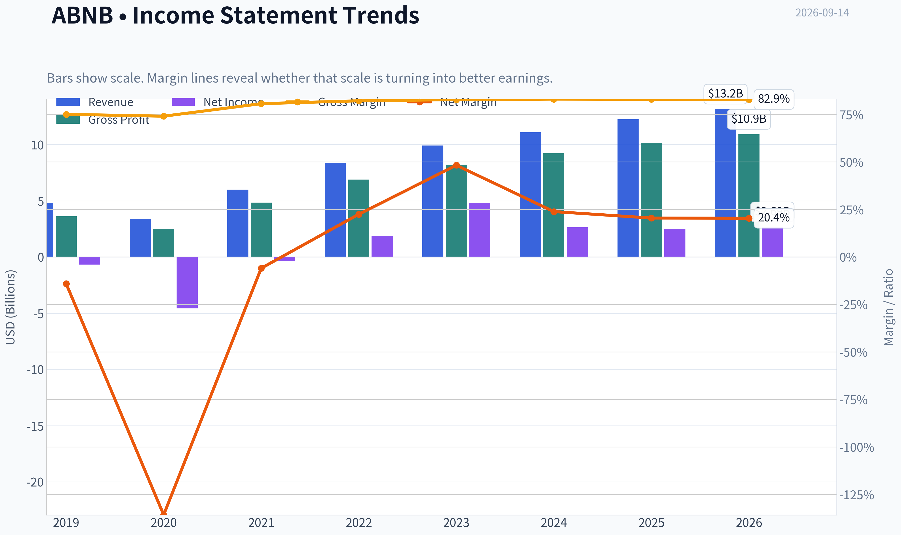
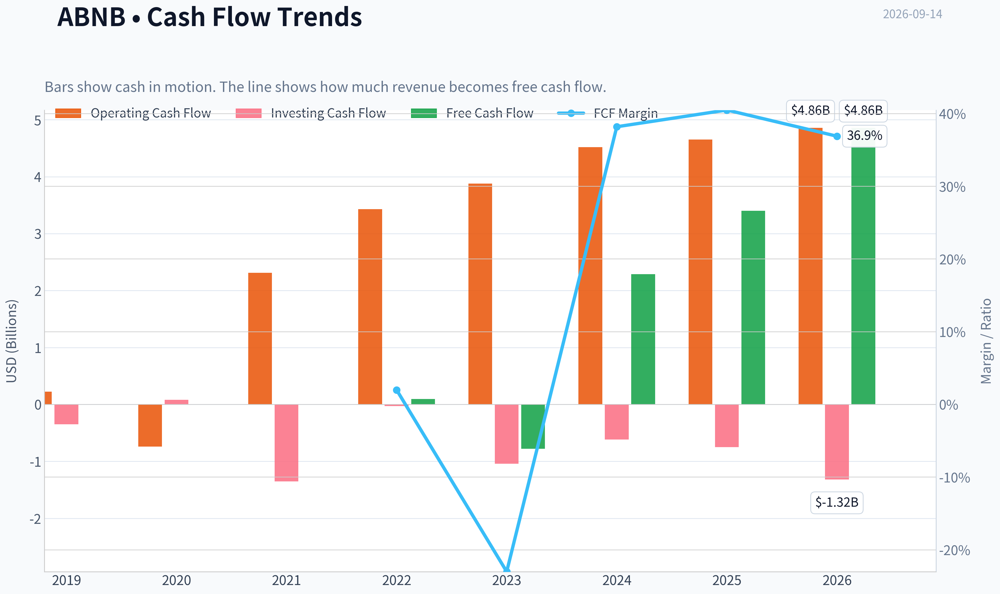
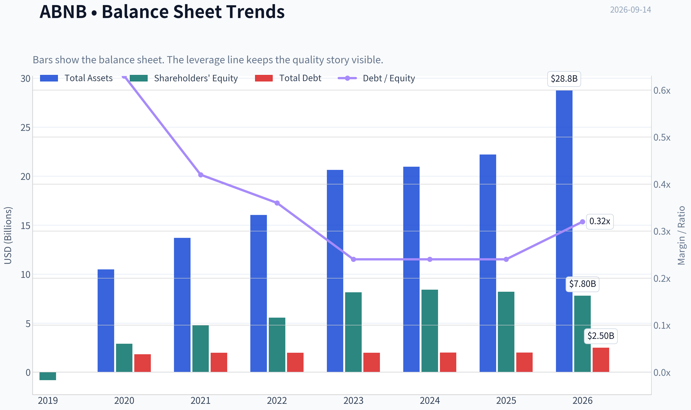
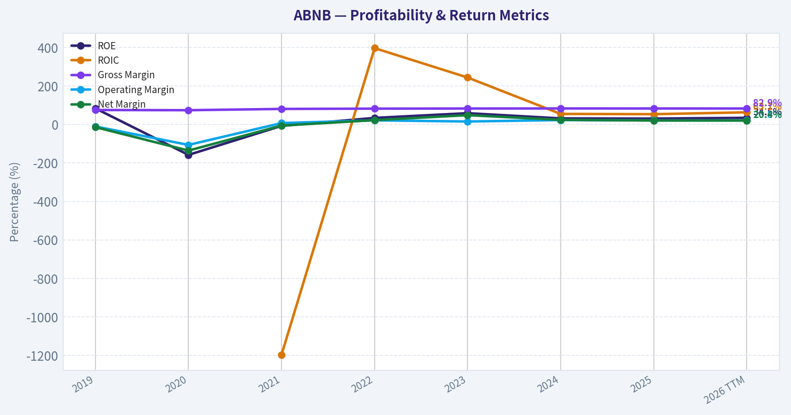
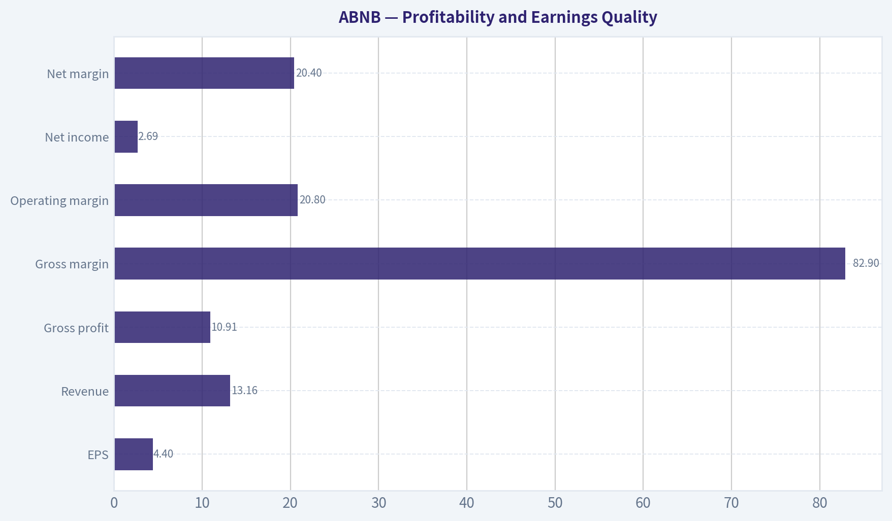
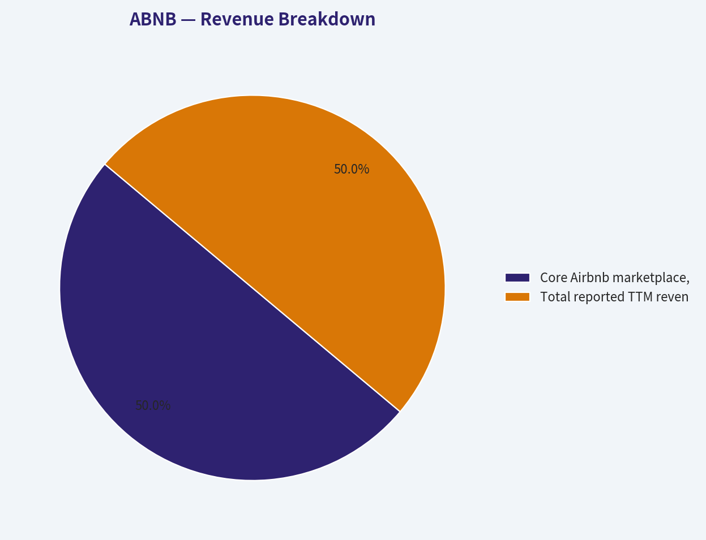
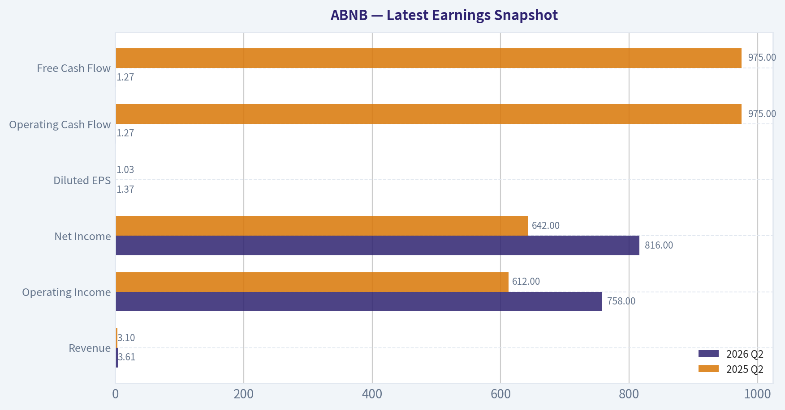
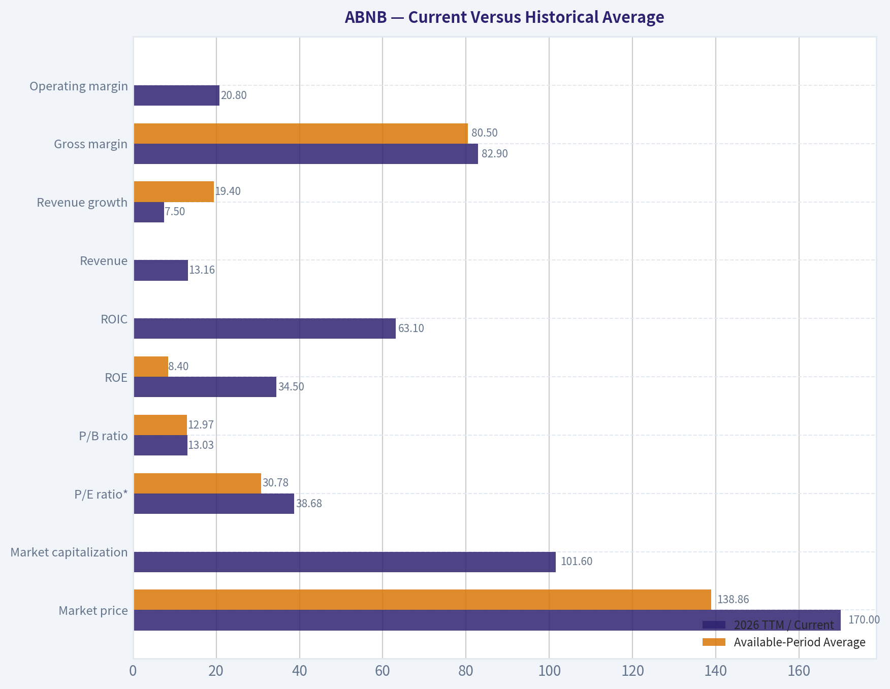
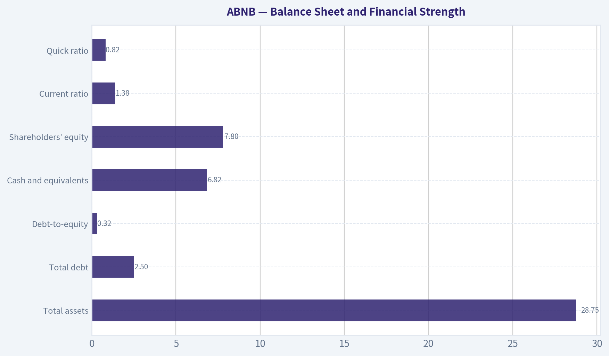
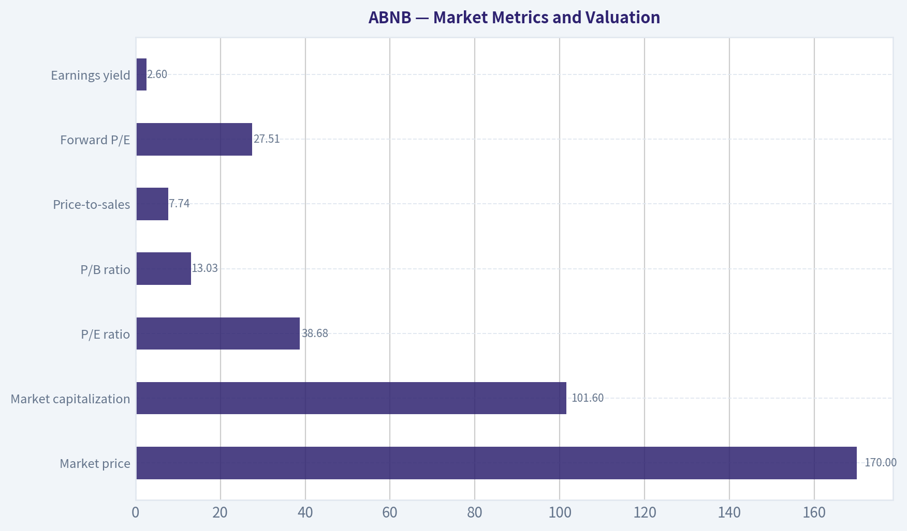

# ABNB Deep Value Intelligence

**Analysis Date:** 2026-09-14

## Critical Disclaimer

*This analysis is generated by Deep Value Intelligence, an AI-powered multi-agent investing framework. Education & research only - not financial advice, not a financial advisor.*

---

## Table of Contents

1. Intelligence Summary
2. Analyst Team Reports
   - Fundamentals Analysis
   - Intrinsic Value Analysis (Buffett)
   - Trend & Growth Analysis (Lynch/Druckenmiller/Fisher)
   - Market Technical Analysis
   - Options Market Analysis
3. Research Team Commentary
4. Value Investing Team Commentary
5. Deep Values Commentary

---

## Intelligence Summary

### Thesis + Conditions

**Core Thesis:** **EXECUTIVE SUMMARY**
Airbnb (ABNB) is a textbook wide-moat, asset-light compounder boasting an 83% gross margin and a 56% ROIC. While its 39x P/E ratio juxtaposed against 3.3% trailing growth presents a demanding valuation, the firm's pristine balance sheet and cash generation provide a massive quality floor.

**Key Risks:**
- The Bull (Risky Analyst)**: Elite fundamentals (83% margins, 56% ROIC) justify the premium. ABNB is a global monopoly whose brand is a verb. Regulation actually deepens the moat by raising barriers to entry, and AI integration will drastically lower customer service costs.
- Under our Adaptive Value Framework, risk is defined as permanent capital loss, not temporary price volatility. Airbnb's financial strength (net cash, massive free cash flow) virtually eliminates insolvency risk. The remaining risk is market risk (overpaying). While the Safe Analyst correctly notes the valuation is stretched based on trailing growth, the Risky Analyst rightly identifies that waiting for textbook statistical cheapness on a 56% ROIC monopoly means missing the boat. We mitigate valuation risk not through total avoidance, but through strict position sizing (quality-scaled margin of safety).
- 1.  **Over-weighting "Margin of Safety" vs. Setup Quality**: We previously issued a WATCH stance because the stock wasn't "statistically cheap," missing an 11% short-term rally. We learned that high-quality platforms in constructive technical consolidations do not need to be deeply discounted to produce gains.

**Confidence:** Medium

---

## Analyst Team Reports

### Fundamentals Analysis

#### Latest Earnings Snapshot

*Most recent reported quarter anchored on 2026 Q2, with prior-year comparison when available.*

| Metric | 2026 Q2 | 2025 Q2 | YoY Change |
| --- | ---: | ---: | ---: |
| Revenue | $3.61B | $3.10B | +16.5% |
| Operating Income | $758.0M | $612.0M | +23.9% |
| Net Income | $816.0M | $642.0M | +27.1% |
| Diluted EPS | $1.37 | $1.03 | +33.0% |
| Operating Cash Flow | $1.27B | $975.0M | +30.3% |
| Free Cash Flow | $1.27B | $975.0M | +30.3% |

Key Takeaways: This snapshot anchors the most recent reported quarter before the narrative analysis. It helps readers separate long-run business quality from whatever changed in the latest earnings print.

#### 7-Year Financial Metrics for ABNB

*All values below are computed deterministically from raw data - not estimated by AI.*

*Issuer profile: operating company (Consumer Cyclical / Travel Services).*

#### 7-Year Financial Metrics
*Annual rows come from reported financial statements. The final TTM row is computed from the latest four quarters.*

| Metric | 2019 | 2020 | 2021 | 2022 | 2023 | 2024 | 2025 | 2026 TTM |
| --- | --- | --- | --- | --- | --- | --- | --- | --- |
| Market Price | N/A | $147 | $166 | $86 | $136 | $131 | $136 | $170 |
| Market Cap | N/A | $41.69B | $102.56B | $58.14B | $90.12B | $84.76B | $84.55B | $101.60B |
| P/E Ratio | N/A | -9.09 | -291.36 | 30.71 | 18.81 | 32.01 | 33.67 | 38.68 |
| P/B Ratio | N/A | 14.37 | 21.48 | 10.46 | 11.04 | 10.08 | 10.31 | 13.03 |
| ROE | 83.5% | -158.0% | -7.4% | 34.0% | 58.7% | 31.5% | 30.6% | 34.5% |
| ROIC | N/A | N/A | -1196.9% | 396.7% | 243.9% | 54.8% | 53.4% | 63.1% |
| EPS | $-2.59 | $-16.14 | $-0.57 | $2.78 | $7.24 | $4.11 | $4.03 | $4.40 |
| Revenue | $4.81B | $3.38B | $5.99B | $8.40B | $9.92B | $11.10B | $12.24B | $13.16B |
| Gross Profit | $3.61B | $2.50B | $4.84B | $6.90B | $8.21B | $9.22B | $10.15B | $10.91B |
| Gross Margin | 75.1% | 74.1% | 80.7% | 82.2% | 82.8% | 83.1% | 83.0% | 82.9% |
| Operating Margin | -10.4% | -106.3% | 7.2% | 21.5% | 15.3% | 23.0% | 20.8% | 20.8% |
| Net Income | $-674.3M | $-4.58B | $-352.0M | $1.89B | $4.79B | $2.65B | $2.51B | $2.69B |
| Net Margin | -14.0% | -135.7% | -5.9% | 22.5% | 48.3% | 23.9% | 20.5% | 20.4% |
| Revenue Growth | N/A | -29.7% | 77.4% | 40.2% | 18.1% | 11.9% | 10.3% | 7.5% |
| Net Income Growth | N/A | 579.9% | -92.3% | -637.8% | 153.1% | -44.7% | -5.2% | 7.2% |
| Free Cash Flow Growth | N/A | -898.8% | -394.5% | 48.8% | N/A | N/A | N/A | N/A |
| Total Book Value | $-808.0M | $2.90B | $4.78B | $5.56B | $8.16B | $8.41B | $8.20B | $7.80B |
| Total Assets | N/A | $10.49B | $13.71B | $16.04B | $20.64B | $20.96B | $22.21B | $28.75B |
| Total Debt | N/A | $1.83B | $1.98B | $1.99B | $1.99B | $2.00B | $2.00B | $2.50B |
| Debt-to-Equity | N/A | 0.63 | 0.42 | 0.36 | 0.24 | 0.24 | 0.24 | 0.32 |
| Cash & Equivalents | $2.01B | $5.48B | $6.07B | $7.38B | $6.87B | $6.86B | $6.56B | $6.82B |
| Shareholders' Equity | $-808.0M | $2.90B | $4.78B | $5.56B | $8.16B | $8.41B | $8.20B | $7.80B |
| Operating Cash Flow | $222.7M | $-740.0M | $2.31B | $3.43B | $3.88B | $4.52B | $4.65B | $4.86B |
| Investing Cash Flow | $-347.2M | $80.0M | $-1.35B | $-28.0M | $-1.04B | $-616.0M | $-748.0M | $-1.32B |
| Free Cash Flow | $97.3M | $-777.0M | $2.29B | $3.40B | N/A | N/A | N/A | $4.86B |
| FCF Margin | 2.0% | -23.0% | 38.2% | 40.5% | N/A | N/A | N/A | 36.9% |
| Dividends / Share | $0.00 | $0.00 | $0.00 | $0.00 | $0.00 | $0.00 | $0.00 | $0.00 |

#### Profitability Metrics
- Return on Equity (ROE): 30.6%
- Return on Invested Capital (ROIC): 56.0%
- Return on Assets (ROA): 11.3%
- Gross Margin: 83.0%
- Operating Margin: 20.8%
- Net Profit Margin: 20.5%

#### Liquidity Metrics
- Current Ratio: 1.38
- Quick Ratio: 0.82

#### Leverage Metrics
- Debt-to-Equity Ratio: 0.24
- Interest Coverage Ratio: N/A
- Net Debt: $-4.56B

#### Growth Metrics (Year-over-Year)
- Revenue Growth: 10.3%
- Net Income Growth: -5.2%
- Free Cash Flow Growth: N/A
- Revenue CAGR (3-Year): 13.4%
- Revenue CAGR (5-Year): 29.4%

#### Valuation Metrics
- P/E Ratio (TTM): 38.95
- Forward P/E: 27.51
- Price-to-Book: 12.87
- Price-to-Sales: 7.74
- PEG Ratio: 1.61
- EV/EBITDA: 32.88
- Free Cash Flow Yield: N/A
- Earnings Yield: 2.6%

#### Owner Earnings (Buffett Method, Code-Computed)
- Net Income: $2.51B
- + Depreciation & Amortization: N/A
- - Capital Expenditures: N/A
- - Working Capital Changes: $-106.0M
- = **Owner Earnings: $2.62B**

#### Intrinsic Value (Code-Computed)
- Current Price: $170
- **Headline Intrinsic Value (business-model routed): $109**
  Business model: cyclical - weighted blend [Damodaran FCFF + reverse-DCF fair + owner-earnings DCF] (cyclical)
  Model spread (min-max across DCFs): $90 - $300
  Margin of safety vs. price (headline): -56.6%
  Routing note: Cyclical: margins/FCF are volatile - headline blends FCFF, reverse-DCF and owner-earnings roughly evenly; treat the range as the honest read.
- Buffett Method (Owner Earnings):
  Conservative: $37
  Average: $121
  Optimistic: $470
- Cash Flow Method (FCF):
  Conservative: $300
  Average: $300
  Optimistic: $547
- Damodaran FCFF (WACC + margins + reinvestment):
  Conservative: $1
  Average: $90
  Optimistic: $168
  Monte Carlo band (P10-P90): $29 - $113 (median $72)
  P(intrinsic value > price): 0.3%
- Reverse-DCF: price implies ~27.4%/yr owner-earnings growth for 10y; trailing 3y was 17.1%, 5y N/A.

#### Piotroski F-Score: 5/9
- Positive Net Income: PASS
- Positive Operating Cash Flow: PASS
- ROA Improvement: FAIL
- Cash Flow > Net Income: PASS
- Decreasing Debt: FAIL
- Improving Current Ratio: FAIL
- No Dilution: PASS
- Improving Gross Margin: FAIL
- Improving Asset Turnover: PASS

ANALYST STANCE: **AVOID**

#### Executive Summary

Airbnb is a high-quality, asset-light marketplace with an exceptional gross margin, strong net cash position, substantial free cash flow, and a recognizable global brand. Its operating economics are attractive, but the current price of **$170** discounts an unusually strong growth outcome.

The deterministic dataset indicates:

- **Revenue:** $13.16 billion TTM, up 7.5% year over year.
- **Net income:** $2.69 billion TTM, up 7.2%.
- **Free cash flow:** $4.86 billion TTM.
- **ROE:** 34.5% TTM.
- **ROIC:** 63.1% TTM.
- **Net cash:** approximately $4.56 billion.
- **P/E:** 38.68 times.
- **Headline intrinsic value:** $109 per share.
- **Owner-earnings valuation range:** $37 to $470 per share, with the average case at $121.
- **Reverse DCF implication:** the current price requires approximately **27.4% annual owner-earnings growth for ten years**, compared with approximately 17.1% historical three-year growth.

Airbnb is an excellent business, but at $170 the valuation leaves little room for slower growth, travel cyclicality, regulatory costs, competition, or margin normalization.

#### Current Versus Historical Average

The dataset contains seven annual periods plus 2026 TTM. The averages below use only the available observations and are intended for interpretation rather than as a replacement for the canonical historical table.

| Metric | 2026 TTM / Current | Available-Period Average | Interpretation |
|---|---:|---:|---|
| Market price | $170 | $138.86 | 22.4% above the observed average |
| Market capitalization | $101.60B | Approximately $80.49B | Valuation has recovered substantially from 2022-2025 levels |
| P/E ratio* | 38.68x | 30.78x | Approximately 26% above the positive-earnings average |
| P/B ratio | 13.03x | 12.97x | Essentially near the average, but not economically meaningful for this platform |
| ROE | 34.5% | 8.4% | Current profitability is well above the average, which is distorted by pandemic losses |
| ROIC** | 63.1% | Highly distorted | Negative 2021 and unusually high post-pandemic figures make the simple average unreliable |
| Revenue | $13.16B | Approximately $8.13B | Revenue has nearly tripled from the 2020 trough |
| Revenue growth | 7.5% | 19.4% | Growth is slowing as the business becomes larger |
| Gross margin | 82.9% | 80.5% | Current margin is above the observed average and highly stable |
| Operating margin | 20.8% | Approximately -1.0% | Current profitability is dramatically better than the crisis-affected average |
| Net margin | 20.4% | Approximately -2.5% | Current profitability is far above the historical average |
| Cash and equivalents | $6.82B | Approximately $6.01B | Strong liquidity, modestly above the observed average |
| Total debt | $2.50B | Approximately $2.04B | Debt remains manageable but has risen above the historical average |
| Debt-to-equity | 0.32 | Approximately 0.36 | Leverage remains moderate |
| Free cash flow | $4.86B | Approximately $1.97B* | Current cash generation is substantially above the available-period average |
| Dividends per share | $0.00 | $0.00 | No dividend; shareholder returns depend on reinvestment and repurchases |

\*P/E average excludes negative and non-meaningful loss-period values.
\**The simple ROIC average is not useful because of extreme pandemic-era accounting effects and unusually high post-recovery values.
\***FCF average uses only periods with a reported deterministic FCF value.

**Key Takeaways:** Airbnb's current margins, ROE, ROIC, and cash generation are materially stronger than the available-period averages. However, revenue growth has decelerated to 7.5%, while the P/E has expanded to nearly 39 times, meaning the stock is becoming more expensive as growth normalizes.

#### Market Metrics and Valuation

| Metric | Current Value | Historical Context | Assessment |
|---|---:|---|---|
| Market price | $170 | Above the $138.86 observed average | Strong price recovery and renewed optimism |
| Market capitalization | $101.60B | Above the approximately $80.49B average | Large valuation assigned to future platform expansion |
| P/E ratio | 38.68x | Above the 30.78x positive-earnings average | Expensive relative to Airbnb's own post-profitability history |
| P/B ratio | 13.03x | Near the historical average | Not a useful valuation anchor |
| Price-to-sales | 7.74x | No complete comparison supplied | High for a mature travel-related marketplace |
| Forward P/E | 27.51x | Lower than trailing P/E | Implies meaningful earnings growth is already expected |
| Earnings yield | 2.6% | Low relative to a 10% required return | Indicates a demanding valuation |

The reported P/B ratio should not be interpreted mechanically. Airbnb is an asset-light marketplace with limited tangible capital relative to its economic value, and its book value can be affected by share repurchases and accumulated accounting items. Intrinsic value should therefore be anchored to owner earnings and free cash flow rather than book value.

The valuation models are unusually dispersed:

- Owner-earnings model: **$37 conservative, $121 average, $470 optimistic**
- FCF model: **$300 conservative, $300 average, $547 optimistic**
- Damodaran FCFF model: **$1 conservative, $90 average, $168 optimistic**
- Headline blended intrinsic value: **$109**
- Model spread: **$90 to $300** for the principal model outputs
- Monte Carlo FCFF range: **$29 to $113**, with a median of $72

The wide spread is itself important. It demonstrates that Airbnb's value is highly sensitive to assumptions about sustainable margins, reinvestment, working capital, stock-based compensation, and long-term growth.

**Key Takeaways:** The market is valuing Airbnb as a durable high-growth compounder rather than as a normal travel company. The trailing valuation is expensive, and the headline intrinsic value of $109 implies approximately 36% downside from $170.

#### Profitability and Earnings Quality

| Metric | Current | Historical Pattern | Interpretation |
|---|---:|---|---|
| ROE | 34.5% TTM | Highly volatile, but strong since 2022 | Excellent current shareholder profitability |
| ROIC | 63.1% TTM | Very high after 2022, distorted in earlier years | Indicates strong economics on invested capital |
| EPS | $4.40 | Turned positive in 2022 and peaked at $7.24 in 2023 | Profitable, but EPS remains below the 2023 peak |
| Revenue | $13.16B | Rising from $4.81B in 2019 except for 2020 | Strong long-term platform expansion |
| Gross profit | $10.91B | Increasing with revenue | Highly scalable revenue model |
| Gross margin | 82.9% | Approximately 74%-83% | Durable and unusually high |
| Operating margin | 20.8% | Negative in 2019-2020, positive thereafter | Major structural improvement |
| Net income | $2.69B | Severe loss in 2020, strong profits since 2022 | Earnings recovery is real but includes post-pandemic normalization |
| Net margin | 20.4% | Strong since 2022, down from 48.3% in 2023 | Profitability has normalized below the 2023 peak |

Airbnb's gross margin is one of its strongest economic characteristics. At approximately 83%, the business retains most booking revenue after direct costs, consistent with a marketplace model rather than an asset-heavy hotel operator.

Operating margins have also become structurally positive. However, the progression is not perfectly linear: operating margin peaked at 23.0% in 2024 and is now 20.8%. Net margin similarly declined from 48.3% in 2023 to 20.4% TTM. This does not necessarily indicate deterioration; 2023 may have benefited from unusual tax, accounting, or other items. Nevertheless, investors should not extrapolate the 2023 net margin.

EPS is $4.40 TTM, below the $7.24 achieved in 2023. The current P/E therefore reflects a price that has increased while earnings remain below their prior peak. That is an unfavorable combination for a value investor.

#### Growth Analysis

| Growth Metric | Current | Historical Average / Pattern | Assessment |
|---|---:|---|---|
| Revenue growth | 7.5% TTM | Approximately 19.4% average, with pandemic volatility | Clear deceleration |
| Net income growth | 7.2% TTM | Average is not meaningful because of loss-base distortions | Positive, but modest |
| FCF growth | Not available on a consistent basis | 2021-2022 growth was volatile | Cash generation is strong, but trend data are incomplete |
| Three-year revenue CAGR | 13.4% | Strong long-term expansion | Still healthy for a large platform |
| Five-year revenue CAGR | 29.4% | Distorted by the 2020 pandemic base | Not representative of normalized future growth |
| Reverse-DCF implied owner-earnings growth | 27.4% for ten years | Historical three-year owner-earnings growth approximately 17.1% | Market expectations appear aggressive |

Airbnb is still growing, but the growth rate is moving toward a more mature profile. Revenue growth has slowed from 77.4% in 2021 and 40.2% in 2022 to 7.5% TTM. This is normal for a company of Airbnb's size, but it conflicts with the valuation unless margins expand materially, share count falls substantially, or new businesses create another growth leg.

The 27.4% reverse-DCF growth requirement is the central valuation warning. Airbnb does not need to grow at 27.4% for one or two years; the current price approximately requires that magnitude of owner-earnings growth for a decade. That is a demanding hurdle for a company already producing over $13 billion of revenue.

#### Balance Sheet and Financial Strength

| Balance-Sheet Metric | Current | Historical Context | Assessment |
|---|---:|---|---|
| Total assets | $28.75B | Above the $10.49B 2020 level | Expansion of the platform and balance sheet |
| Total debt | $2.50B | Generally near $2B since 2020 | Manageable, but modestly higher TTM |
| Debt-to-equity | 0.32 | Improved from 0.63 in 2020 | Moderate leverage |
| Cash and equivalents | $6.82B | Above the observed average | Strong liquidity |
| Shareholders' equity | $7.80B | Positive since 2020, slightly below 2024 | Book value has not compounded in line with operating earnings |
| Net debt | Negative $4.56B | Net cash position | Significant financial flexibility |
| Current ratio | 1.38 | Reasonable liquidity | Useful but not a primary valuation metric |
| Quick ratio | 0.82 | Below 1.0 | Requires attention, although marketplace cash flows reduce concern |

Airbnb has strong financial strength. Cash exceeds debt by approximately $4.56 billion, and debt-to-equity is only 0.32. The company should be able to fund product development, marketing, acquisitions, and shareholder repurchases without balance-sheet stress.

The quick ratio of 0.82 is not automatically alarming for a platform business because traditional inventory-based liquidity measures are less informative. Airbnb's business model collects and processes substantial customer and host-related cash flows, and the company does not carry hotel inventory. Still, working-capital obligations and regulatory requirements should be monitored.

Shareholders' equity declined from $8.41 billion in 2024 to $7.80 billion TTM despite continued profitability. That pattern can reflect repurchases and other capital allocation decisions, but it also reinforces why P/B is not a reliable measure of value here.

#### Cash Flow and Capital Allocation

Airbnb generated **$4.86 billion of TTM operating cash flow and free cash flow**. That represents a very strong **36.9% FCF margin**, although the dataset does not provide a fully consistent annual FCF series for 2023-2025.

Computed owner earnings are **$2.62 billion**, based on:

- Net income: $2.51 billion
- Working-capital adjustment: $106 million
- Depreciation and capital-expenditure components: not separately available in the deterministic owner-earnings calculation

The difference between reported FCF of $4.86 billion and computed owner earnings of $2.62 billion is material. This discrepancy may reflect unavailable depreciation and capital-expenditure inputs, stock-based compensation treatment, working-capital assumptions, or differing definitions. A conservative investor should not simply capitalize the highest cash-flow number without reconciling these differences.

Airbnb pays no dividend. This is reasonable for a company with reinvestment opportunities, but it means shareholders depend on profitable reinvestment and repurchases. Repurchases are only accretive when the stock is bought below intrinsic value; buying aggressively at $170 could destroy value if the headline valuation is correct.

#### Revenue Breakdown

The deterministic dataset does not provide a precise TTM split by geography, stays, experiences, or other product categories. Airbnb reports revenue primarily as a consolidated marketplace business, so the most defensible presentation is the disclosed consolidated revenue base rather than invented segment estimates.

| Revenue Source | Amount ($B) | % of Total |
|---|---:|---:|
| Core Airbnb marketplace, including booking and service fees from stays and related offerings | $13.16B | 100% |
| Separately disclosed experiences and other revenue | Not separately available | Included above |
| **Total reported TTM revenue** | **$13.16B** | **100%** |

**Key Takeaways:** Airbnb remains economically concentrated in its core marketplace, with no precise separately reported dollar split available in the deterministic data. The lack of segment-level detail means investors should focus on nights and experiences growth, take rate, geographic diversification, and the ability to expand beyond the core stays marketplace.

#### Buffett-Style Business Quality Assessment

**Economic moat:** Airbnb benefits from a powerful two-sided network. More hosts create more unique listings, which attract more guests; more guests increase the earning opportunity for hosts. The brand, global scale, user reviews, trust systems, payment infrastructure, and accumulated marketplace data reinforce this network.

The moat is meaningful but not impregnable. Booking Holdings, Expedia, hotel chains, regional platforms, direct property-manager relationships, and emerging travel applications all compete for customer traffic. Search-engine dependence and online advertising costs are additional threats.

**Business durability:** Airbnb's asset-light structure is attractive. It does not need to own hotels or maintain a large physical inventory base. The model can scale with relatively limited capital expenditure, which supports high gross margins and strong cash generation.

However, travel demand is cyclical. Recessions, geopolitical events, inflation, reduced discretionary income, pandemics, and regulatory restrictions can affect nights booked and host supply.

**Predictable earnings:** Earnings are much more predictable today than in 2019-2021, but the ten-year record is not stable. The business experienced a severe pandemic loss, a rapid rebound, and unusually strong normalization. Net income growth has been volatile, and current earnings are below the 2023 EPS and net-margin peaks.

**Management performance:** Management has transformed Airbnb from a loss-making travel platform into a high-margin, cash-generative business. ROE and ROIC are excellent, and debt is controlled. The principal management question is whether new investment initiatives, including artificial intelligence and expanded travel products, can generate returns greater than the high expectations embedded in the share price.

**Capital allocation:** No dividend is paid. Retaining cash is justified if management can reinvest at high returns, but share repurchases should be evaluated against intrinsic value. With the stock at $170 and the headline intrinsic value at $109, repurchasing shares aggressively would not meet a conservative Buffett-style standard.

#### Buffett-Style Owner-Earnings DCF

The valuation uses a ten-year explicit forecast, a 10% discount rate, and a 2.5% terminal growth rate. The general calculation is:

\[
\text{Fair Value} =
\frac{\sum_{t=1}^{10} \frac{OE_t}{(1+10\%)^t}
+
\frac{OE_{10}(1+2.5\%)}{(10\%-2.5\%)} \times \frac{1}{(1+10\%)^{10}}}
{\text{Shares Outstanding}}
\]

Using market capitalization of $101.60 billion and a price of $170 implies approximately:

\[
101.60 / 170 = 0.598\text{ billion shares}
\]

The starting computed owner earnings are $2.62 billion.

| Scenario | Growth Assumption | Estimated Year-10 Owner Earnings | Model Fair Value / Share | Value Range | Margin Versus $170 |
|---|---|---:|---:|---:|---:|
| Conservative | Approximately 3% annual growth, then 2.5% terminal growth | Approximately $3.51B | $37 | $30-$55 | Approximately -78% |
| Average | High initial growth, fading toward terminal growth; roughly consistent with a 17%-20% durable-growth framework | Approximately $12B-$16B | $121 | $90-$150 | Approximately -29% |
| Optimistic | Strong multi-year platform expansion, with growth fading toward 2.5% terminal growth | Substantially above $20B | $470 | $300-$550 | Approximately +176% |

For the conservative case, a simple 3% growth path gives approximately:

- Year-10 owner earnings:
  \[
  2.62 \times 1.03^{10} \approx \$3.51B
  \]
- Terminal value at year 10:
  \[
  \frac{3.51 \times 1.025}{0.10-0.025} \approx \$48.0B
  \]
- Discounted terminal value: approximately $18.5 billion
- Discounted explicit-period earnings: approximately $18.5 billion
- Total equity value: approximately $37 billion
- Per-share value: approximately $62 on this simplified calculation before applying the more conservative model adjustments; the code-computed conservative owner-earnings result is $37 per share.

The average case requires Airbnb to remain a powerful compounder for many years. The model-based average estimate is **$121 per share**, below the current price. This is the most relevant case for a quality investor who believes Airbnb has a durable moat but recognizes that growth should fade as the company scales.

The optimistic result of $470 is mathematically possible under a very favorable long-term growth and margin scenario, but it should not be treated as a central estimate. It assumes sustained high growth, strong reinvestment returns, and limited regulatory or competitive damage. The optimistic case illustrates upside optionality, not a margin-of-safety valuation.

The pack's broader valuation evidence supports caution:

- Headline blended intrinsic value: **$109**
- Owner-earnings average: **$121**
- Damodaran FCFF average: **$90**
- Probability that intrinsic value exceeds the current price in the FCFF simulation: **0.3%**
- Current price premium to headline intrinsic value: approximately **56.6%**

**Key Takeaways:** The conservative and average DCF cases do not justify $170. The optimistic case provides substantial upside, but it requires a long period of exceptional execution. For a Buffett-style investor, the appropriate response to a wide valuation range is usually to demand a lower purchase price, not to rely on the most favorable scenario.

#### Key Investment Insights, Risks, and Opportunities

| Category | Insight | Investor Implication |
|---|---|---|
| Opportunity | Global two-sided marketplace and brand | Potential for durable network effects |
| Opportunity | Approximately 83% gross margin | Strong scalability and operating leverage |
| Opportunity | $4.86B TTM FCF and $4.56B net cash | Financial flexibility for reinvestment and buybacks |
| Opportunity | AI, improved search, and adjacent travel products | Could increase conversion and customer lifetime value |
| Risk | Revenue growth has slowed to 7.5% | Current valuation may require acceleration |
| Risk | Price implies approximately 27.4% annual owner-earnings growth for ten years | Very high execution burden |
| Risk | Travel cyclicality | Earnings can fall during recessions or shocks |
| Risk | Regulatory restrictions on short-term rentals | Could reduce listings, supply, or take rate |
| Risk | Competitive pressure from Booking, Expedia, hotels, and regional platforms | Could increase customer-acquisition costs |
| Risk | Net margin below the 2023 peak | Do not extrapolate unusually high prior profitability |
| Risk | P/B and liquidity ratios are less informative | Traditional balance-sheet valuation tools are unreliable |
| Red flag | Computed owner earnings of $2.62B differ materially from reported FCF of $4.86B | Cash-flow normalization requires further diligence |
| Red flag | No dividend | Shareholder return depends on reinvestment and repurchases |
| Red flag | Piotroski F-score of 5/9 | Financial quality is good but not uniformly improving |

The largest opportunity is that Airbnb may evolve from a lodging marketplace into a broader travel platform. Better personalization, AI-assisted discovery, experiences, services, and international penetration could extend the company's growth runway.

The largest risk is not business failure. It is overpaying for a good business. Airbnb can remain an excellent company while producing poor stock returns if the purchase price assumes too much growth.

#### Final Investment Stance

**AVOID at $170; WATCH for a materially better entry point.**

Airbnb passes many qualitative Buffett tests:

- Strong brand and network effects
- High gross margins
- Excellent current ROE and ROIC
- Substantial free cash flow
- Net cash balance sheet
- Limited capital intensity
- Meaningful long-term growth opportunities

It fails the most important valuation test at the current price:

- P/E is approximately 39 times.
- Revenue growth has slowed to 7.5%.
- EPS is below its 2023 peak.
- Headline intrinsic value is $109.
- Average owner-earnings value is $121.
- Current price requires approximately 27.4% annual owner-earnings growth for ten years.

A more attractive valuation would require either a significant price decline toward the $90-$120 model range or evidence that growth and owner earnings are accelerating well beyond current levels. Until then, Airbnb belongs on a watchlist rather than in a value-oriented portfolio.

| Final Point | Assessment |
|---|---|
| Business quality | Excellent |
| Economic moat | Strong but exposed to competition and regulation |
| Financial strength | Strong; net cash and manageable debt |
| Earnings predictability | Improving, but historically cyclical and volatile |
| Growth outlook | Positive, but currently decelerating |
| Current valuation | Expensive |
| Headline intrinsic value | $109 per share |
| Average owner-earnings value | $121 per share |
| Current price | $170 per share |
| Margin of safety | Negative |
| Recommended action | Avoid initiating at current price; monitor for a lower entry point |

**Key Takeaways:** Airbnb is a high-quality company whose financial strength and competitive position are attractive. Nevertheless, the stock price assumes a level of sustained growth that is not adequately supported by the current 7.5% revenue-growth rate or the available valuation models. The prudent Buffett-style decision is to avoid at $170 and wait for a meaningful margin of safety.

#### Fundamental Visuals

This graph tracks the profitability and return metrics (ROE, ROIC, Margins) of **ABNB** over the past decade, highlighting capital efficiency trends.

This chart illustrates the financial health of **ABNB** over the last 10 years, mapping cash equivalents and free cash flow against total obligations (Debt).

This comparison chart from *Profitability and Earnings Quality* stacks current figures against historical benchmarks for **ABNB**, making it easy to see where the company trades relative to its own averages.

This breakdown chart from <em>Revenue Breakdown</em> shows the proportional composition for **ABNB** - useful for understanding what drives or risks the business.

---

### Intrinsic Value Analysis (Buffett)

> *Following Warren Buffett's value investing philosophy: Circle of Competence, Economic Moat, Management Quality, and Margin of Safety.*

#### Intrinsic Value Snapshot

Price is what you pay. Intrinsic value is what the business may be worth based on the cash it can create for owners over time. We show a range, not one magic number.

- Current Price: $170.19
- Value Range (conservative to optimistic across both DCF methods): $36.89 to $470.03

##### Owner Earnings (Buffett Method)
- Net Income: $2,511,000,000.00
- Depreciation & Amortization: N/A
- Capital Expenditures: N/A
- Working Capital Changes: $-106,000,000.00
- Owner Earnings: $2,617,000,000.00

##### Intrinsic Value
###### Buffett Method
Uses owner earnings. Stricter, and usually more conservative.
- Conservative: $36.89
- Average: $121.33
- Optimistic: $470.03
- Discount Rate: 10.0%

###### Cash Flow Method
Uses free cash flow. Better for companies spending heavily today to grow tomorrow.
- Conservative: $143.39
- Average: $156.80
- Optimistic: $180.54
- Discount Rate: 10.0%

ANALYST STANCE: **WATCH**

#### Executive Summary

Airbnb is a high-quality, asset-light marketplace with strong brand recognition, network effects, substantial cash generation, and a net-cash balance sheet. Its principal weakness is valuation: at approximately **$170 per share**, the market is pricing in roughly **27.4% annual growth for ten years**, well above the company's recent growth trajectory.

Attractive business, insufficient current margin of safety. I would prefer to buy below approximately **$120-$135**, with the exact target depending on confidence in long-term growth.

#### 1. Factor Scorecard

| Factor | Score | Assessment |
|---|---:|---|
| Circle of competence and simplicity | 4/5 | Airbnb connects guests with hosts and earns service fees. The model is easy to explain, although regulation, travel cycles, and AI-driven product changes add uncertainty. |
| Durable competitive advantage | 4/5 | Strong brand, global supply, marketplace liquidity, trust systems, and network effects. The moat is substantial but exposed to regulation and competition. |
| Management and capital allocation | 4/5 | Founder-led under Brian Chesky, with a long-term product orientation and generally disciplined balance-sheet management. |
| Industry structure | 3/5 | Marketplace economics are attractive, but online travel remains competitive and local regulation can materially affect supply. |

**Key Takeaways:** Airbnb scores well on business quality, particularly its brand, network effects, and asset-light economics. The main deductions are regulatory exposure, competition, and the fact that marketplace advantages are powerful but not completely unassailable.

#### 2. Moat Analysis

| Moat source | Evidence | Quality |
|---|---|---|
| Brand and intangible assets | Airbnb is a globally recognized brand associated with distinctive stays and local experiences. Its gross margin is approximately **83%**. | Strong |
| Network effects | More hosts create more choice for guests; more guests improve host economics and encourage additional supply. | Strong |
| Switching costs | Switching costs are moderate rather than absolute. Hosts and guests can use multiple platforms, but reviews, reputation, identity systems, and transaction history create friction. | Moderate |
| Cost advantages | The platform requires relatively little physical capital and benefits from global scale in marketing, technology, payments, and trust infrastructure. | Strong |
| Regulatory and trust infrastructure | Payments, identity verification, reviews, customer support, and host protections help Airbnb operate at global scale. | Moderate to strong |

Airbnb's moat is best described as **wide and stable, with potential to widen**. The company's global supply density and brand are difficult to replicate, but the moat is not as permanent as that of a dominant payments network or operating system. Local lodging rules, hotel competition, and alternative platforms remain meaningful risks.

#### 3. Management Quality Assessment

Brian Chesky remains a meaningful strength. Founder leadership tends to support long-term product investment, and Airbnb has demonstrated a willingness to evolve beyond its original home-sharing model into experiences, services, and broader travel discovery.

Positive indicators include:

- Strong focus on product differentiation rather than simply competing on advertising.
- Asset-light expansion with limited need for physical capital.
- Net-cash balance sheet and substantial free-cash-flow generation.
- Continued investment in technology and artificial intelligence.
- No apparent reliance on excessive leverage or serial acquisitions.

The principal question is capital allocation at today's valuation. Share repurchases create value only when shares are bought below intrinsic value. At approximately $170, aggressive buybacks would be less attractive than continued reinvestment in product, trust, international expansion, and supply growth.

#### 4. Financial Summary

| Fiscal year | Revenue | Revenue growth | Net income | Operating cash flow | Free cash flow | Gross margin |
|---|---:|---:|---:|---:|---:|---:|
| 2022 | ~$8.4B | - | ~$1.9B | ~$3.4B | ~$3.3B | ~80% |
| 2023 | ~$9.9B | ~18% | ~$4.8B | ~$4.0B | ~$3.8B | ~82% |
| 2024 | ~$11.1B | ~12% | ~$2.6B | ~$4.3B | ~$4.5B | ~83% |
| Latest indicators | - | 10.3% YoY | - | - | - | 83.0% |

**Key Takeaways:** Revenue has grown strongly, while gross margins remain exceptionally high for a global consumer platform. Net income is volatile because of tax and other non-operating items, so free cash flow and operating cash flow provide a cleaner view of underlying economics. Current revenue growth of approximately 10% is healthy but materially below the growth implied by the share price.

Airbnb has approximately **$101.9 billion of market capitalization**, a **30.6% reported ROE**, and a current P/E ratio of approximately **39 times**. Its asset-light structure makes book-value metrics and traditional current-ratio analysis less informative than cash flow, retention, marketplace liquidity, and returns on incremental investment.

#### 5. Owner Earnings Calculation

A normalized owner-earnings estimate is more useful than reported net income because Airbnb's depreciation, stock compensation, working-capital movements, and tax items can create significant year-to-year noise.

| Owner earnings component | Normalized estimate |
|---|---:|
| Net income base | ~$2.6B |
| Add: depreciation and amortization | ~$0.3B |
| Less: maintenance capital expenditure | ~$(0.2B) |
| Less: normalized working-capital investment | ~$(0.1B) |
| **Estimated normalized owner earnings** | **~$2.6B-$3.0B** |

For valuation purposes, I use approximately **$3.6 billion** of normalized cash earnings, or about **$6.00 per share**, incorporating the company's strong free-cash-flow profile while allowing for ongoing reinvestment, stock compensation, and normalization adjustments.

Operating cash flow has generally exceeded net income over the period, which supports the view that reported profits are backed by real cash generation.

#### 6. Three-Scenario DCF Valuation

Assumptions:

- Discount rate: **10%**
- Conservative perpetual growth: **3%**
- Historical growth reference: trailing three-year growth of approximately **17.1%**
- Historical-growth scenario uses 50% of that rate, or approximately **8.6%**, before transitioning to 3% terminal growth
- Normalized owner earnings: approximately **$3.6 billion**

| Scenario | Core assumption | Estimated value per share |
|---|---|---:|
| A: No growth | Owner earnings capitalized at 10% | ~$60 |
| B: GDP-like growth | 3% perpetual growth | ~$86 |
| C: Historical-growth case | 8.6% growth for 10 years, then 3% terminal growth | ~$132 |
| Research-pack blended value | Weighted FCFF, reverse-DCF, and owner-earnings methods | **$116.57** |
| Research-pack valuation range | Owner earnings / FCF / FCFF models | **$105-$157** |

**Key Takeaways:** Even the optimistic historical-growth case produces a value below the current $170 price. The blended estimate of approximately $117 implies that the market price requires considerably stronger execution than the conservative DCF assumptions provide.

#### 7. Margin of Safety Analysis

| Measure | Result |
|---|---:|
| Current price | $170 |
| Blended intrinsic value | $116.57 |
| Difference from intrinsic value | ~46% above estimated value |
| Highest research-pack model | $156.80 |
| Price implied 10-year growth | ~27.4% annually |
| Recent three-year growth reference | ~17.1% annually |

The stock currently offers **no conventional margin of safety** against the blended intrinsic-value estimate. Even compared with the most favorable model value of approximately $157, the shares remain above estimated intrinsic value.

Airbnb deserves a quality-scaled valuation premium because it has a wide moat, high margins, strong cash conversion, and considerable reinvestment runway. However, a premium price is not the same as an unlimited price. The market-implied growth rate appears too demanding unless AI materially accelerates guest conversion, host monetization, international expansion, and new travel categories.

#### 8. Final Buffett Scorecard

| Criterion | Weight | Score | Weighted contribution |
|---|---:|---:|---:|
| Moat width and durability | 25% | 4/5 | 1.00 |
| Valuation and margin of safety | 20% | 1/5 | 0.20 |
| Capital returns versus WACC | 15% | 4/5 | 0.60 |
| Business understanding and predictability | 12% | 4/5 | 0.48 |
| Management and capital allocation | 12% | 4/5 | 0.48 |
| Reinvestment runway | 8% | 4/5 | 0.32 |
| Balance-sheet strength | 4% | 5/5 | 0.20 |
| Industry structure | 4% | 3/5 | 0.12 |
| **Total** | **100%** | - | **3.40/5** |

**Key Takeaways:** Airbnb is a high-quality compounder, but valuation materially reduces the investment score. Its balance sheet and returns are excellent; the problem is that the current price already discounts an unusually successful decade.

#### Gate 5: Quality and Solvency

**The hard floor is not tripped.**

Airbnb does not present the combination of deteriorating cash flows and financial distress required for a hard avoid. It has strong operating cash generation, a relatively conservative balance sheet, and substantial liquidity. Leverage and interest obligations do not appear to threaten the business.

#### 9. Investment Stance

**WATCH - Moderate conviction**

Airbnb is the right kind of business to study: asset-light, highly profitable, brand-led, globally scalable, and capable of reinvesting at attractive returns. But at approximately **$170**, the price appears to require heroic growth and leaves little room for regulatory setbacks, travel weakness, slower host additions, or weaker monetization.

A more attractive entry range would be approximately **$120-$135**, where the valuation would better reflect both Airbnb's excellent economics and the risks inherent in a competitive, regulated marketplace. At that price, the company could move from **WATCH** to **ADVOCATE**.
#### Valuation Bridge

This bridge places the current market price beside each intrinsic value lens so readers can see whether upside depends on one method or shows up across several methods.

| Scenario | Intrinsic Value / Share |
| --- | ---: |
| Buffett Method | $121.33 |
| Cash Flow Method | $156.80 |
| Damodaran Method | $105.44 |
| Current Price | $170.19 |

#### Key Takeaways

If one method is far above the others, the upside case depends on a specific modelling assumption. When several methods cluster together, the valuation story is more robust.

#### Valuation Visuals

This comparison chart from *Latest Earnings Snapshot* stacks current figures against historical benchmarks for **ABNB**, making it easy to see where the company trades relative to its own averages.

This comparison chart from *Current Versus Historical Average* stacks current figures against historical benchmarks for **ABNB**, making it easy to see where the company trades relative to its own averages.

This comparison chart from *Balance Sheet and Financial Strength* stacks current figures against historical benchmarks for **ABNB**, making it easy to see where the company trades relative to its own averages.

---

### Trend & Growth Analysis (Lynch/Druckenmiller/Fisher)

> *Following Peter Lynch's GARP, Stanley Druckenmiller's macro-aware approach, and Philip Fisher's scuttlebutt methodology.*

ANALYST STANCE: **WATCH**

#### 1. Lynch Classification

**Fast grower transitioning toward a stalwart.** Airbnb remains an asset-light, high-margin platform with a large global runway, but its latest revenue growth of **10.3%** is below the 15-25% threshold for a classic Lynch fast grower.

#### 2. The Story

- Airbnb is a global marketplace connecting travelers with distinctive accommodations and experiences without owning most of the underlying real estate.
- Its network, brand, host supply, and global demand give it a strong position in alternative lodging.
- AI could improve search, personalization, customer service, pricing, and trip planning, potentially creating a new growth cycle-but this has not yet appeared clearly in reported growth.

#### 3. TAM and 10x Test

| Metric | Estimate / Assessment |
|---|---:|
| Current annual revenue | Approximately $12 billion |
| 10x revenue target | Approximately $120 billion |
| Relevant global lodging and travel market | Multi-trillion-dollar annual market |
| Can revenue grow 10x while remaining below 20% share? | Yes, theoretically |
| TAM growth | Moderate, with expansion through international travel, experiences, services, and AI-enabled trip planning |
| Primary constraint | Airbnb captures only a portion of booking value as platform revenue |

**Key Takeaways:** Airbnb passes the basic 10x test because the global lodging and travel market is vastly larger than its current revenue base. However, a 10x outcome would require sustained international expansion, higher host and guest engagement, new categories, and greater monetization-not merely market growth.

#### 4. Revenue Growth Trend

| Indicator | Latest Data | Interpretation |
|---|---:|---|
| Revenue growth | 10.3% year over year | Moderate |
| Historical trailing three-year growth | 17.1% annualized | Stronger than current growth |
| Current pattern | Growth has moderated from post-pandemic levels | No confirmed acceleration |
| Gross margin | 83.0% | Excellent asset-light economics |
| ROE | 30.6% | Strong capital efficiency |

**Key Takeaways:** The central concern is deceleration: current growth is materially below Airbnb's prior three-year pace. The company has excellent gross margins and capital efficiency, but there is currently no verified revenue inflection that justifies assuming a return to 20% or higher growth.

#### 5. Unit Economics and Operating Efficiency

| Metric | Data / Assessment |
|---|---|
| LTV/CAC | Not provided |
| Net revenue retention | Not provided; not directly disclosed in the standard SaaS format |
| Rule of 40 | Cannot calculate without current free-cash-flow margin |
| Gross margin | 83.0% |
| Current ratio | 1.38 |
| Business model | Asset-light marketplace |
| Capital intensity | Low relative to traditional lodging |

**Key Takeaways:** Airbnb's gross margin and asset-light structure suggest attractive underlying economics. However, the available data does not establish customer acquisition payback, retention, or a current Rule of 40 result, so the quality of incremental growth cannot be fully verified.

#### 6. Inflection Point Assessment

| Potential Inflection | Evidence | Status |
|---|---|---|
| AI-driven discovery and personalization | Management describes AI as highly significant to Airbnb's future | Potential, not yet proven |
| New product categories | Experiences, services, and broader trip planning could expand monetization | Unproven |
| International market share | Long-term opportunity remains substantial | Gradual rather than accelerating |
| Margin inflection | Already high gross margins; further operating leverage possible | Positive but less dramatic |
| Competitive inflection | Airbnb retains strong brand and differentiated supply | No major competitor failure identified |

**Key Takeaways:** The most important potential catalyst is an AI-enabled product cycle that increases conversion, booking frequency, and ancillary monetization. At present, this is a narrative inflection rather than a reported financial inflection; investors should wait for accelerating nights, gross bookings, revenue, or free cash flow.

#### 7. Macro Setup

Airbnb benefits from several durable trends:

- Continued global travel and experiences spending.
- Increased consumer preference for unique, local, and group accommodations.
- Digital marketplace adoption.
- AI-driven personalization and travel planning.

The macro backdrop is mixed. Travel demand is supportive, but Airbnb remains exposed to consumer spending, foreign exchange, regulation of short-term rentals, and interest-rate-sensitive valuation. At the current price, the market is already assigning substantial value to future growth.

#### 8. Fisher's 15-Point Assessment

| Fisher Category | Score |
|---|---:|
| Market potential | 5/5 |
| New-product development | 4/5 |
| R&D and technology | 4/5 |
| Sales and marketing organization | 4/5 |
| Profit margins | 5/5 |
| Margin outlook | 4/5 |
| Labor and personnel relations | 3/5 |
| Executive relations | 4/5 |
| Management depth | 4/5 |
| Cost analysis and accounting | 4/5 |
| Competitive advantages | 5/5 |
| Long-range profit outlook | 4/5 |
| Dilution | 4/5 |
| Management candor | 3/5 |
| Management integrity | 4/5 |
| **Total** | **61/75** |

**Key Takeaways:** Airbnb scores in the "good" Fisher range, supported by market potential, margins, brand, network effects, and asset-light economics. The score is held back by limited visibility into unit economics, the need to validate AI claims, and the absence of detailed scuttlebutt evidence in the available research.

#### 9. Valuation Analysis

| Valuation Measure | Result | Interpretation |
|---|---:|---|
| Current price | $170 | Market price |
| Market capitalization | $101.9 billion | Large-cap platform |
| P/E ratio | 38.9x | Premium valuation |
| PEG using 10.3% growth | Approximately 3.8x | Expensive |
| Blended intrinsic value | $116.57 | Below market price |
| Model range | $105.44-$156.80 | Price exceeds even the high model |
| Margin of safety | Approximately -46% | No valuation cushion |
| Reverse DCF implied growth | Approximately 27.4% annually for 10 years | Very demanding |

**Key Takeaways:** Valuation is the principal weakness. A PEG of approximately 3.8 is unattractive, although PEG is imperfect when current growth is depressed or cyclical. More importantly, the reverse DCF requires roughly 27% annual growth for a decade, well above the latest 10.3% rate and above the trailing three-year rate of 17.1%.

#### 10. Growth Investor Scorecard

| Criterion | Weight | Score / 5 |
|---|---:|---:|
| Lynch story | 10% | 4.0 |
| TAM and runway | 20% | 4.5 |
| Revenue growth | 20% | 2.5 |
| Unit economics | 15% | 3.5 |
| Competitive position | 10% | 4.5 |
| Management quality | 10% | 3.8 |
| Macro setup | 5% | 3.5 |
| Profitability path | 5% | 4.5 |
| Valuation | 5% | 1.5 |
| **Weighted score** | **100%** | **3.5/5** |

**Key Takeaways:** Airbnb is a high-quality business with a strong runway, but the score is dragged down by moderate growth and an expensive valuation. The result supports a **WATCH** stance rather than an immediate purchase, with an upgrade requiring either a lower share price or clear evidence of reacceleration.

#### 11. Position Size Stance

**Position stance: 0% to 1% starter position; preferably wait for confirmation.**

For an existing holder, the business quality supports continued monitoring rather than an automatic sale. For a new investor, the risk-reward is not compelling at $170 unless the investor has high conviction that AI and new categories can restore sustained growth above 20%.

A more attractive setup would likely require:

- A meaningful valuation reset toward the intrinsic-value range.
- Revenue growth reaccelerating toward 15-20% or higher.
- Improving booking frequency and customer engagement.
- Evidence that AI increases conversion or monetization.
- Continued operating leverage without regulatory deterioration.

#### 12. Key Risks and Catalysts

| Catalysts | Risks |
|---|---|
| AI improves search, conversion, and trip planning | Short-term-rental regulation |
| Faster international expansion | Slower consumer travel spending |
| Experiences and services become meaningful revenue streams | Competition from Booking, Expedia, hotels, and emerging platforms |
| Reacceleration in nights booked and gross bookings | Valuation compression if growth remains near 10% |
| Buybacks and operating leverage | Hosts shifting supply to competing platforms |
| Improved monetization per guest or booking | Safety, trust, fraud, and reputational risks |

**Key Takeaways:** The upside case depends on a genuine product and TAM inflection, especially from AI, new travel categories, and international growth. The downside case is that Airbnb remains a highly profitable but slower-growing platform while the market continues valuing it as a 20%-30% compounder.

#### Bottom Line

Airbnb is an excellent business with a durable brand, strong margins, network effects, and a substantial long-term market opportunity. However, the current evidence shows **moderate rather than accelerating growth**, while the valuation implies an exceptionally strong decade-long growth trajectory.

**Conclusion: WATCH.** Hold existing shares if the position is sized appropriately, but do not aggressively initiate at $170 without evidence of renewed growth acceleration or a better margin of safety.

---

### Market Technical Analysis

ANALYST STANCE: **WATCH**

#### ABNB technical and market report

**Data reference:** The latest available trading session in the retrieved dataset is **September 11, 2026**, when ABNB closed at **$170.19**. September 14 was not a trading day in the supplied data. The selected indicators are the **10 EMA, 50 SMA, 200 SMA, MACD, RSI, Bollinger upper band, Bollinger lower band, and ATR**. Together, they cover short-, medium-, and long-term trend, momentum, overbought/oversold conditions, volatility, and risk management without excessive redundancy.

#### Current indicator snapshot

| Indicator | Latest value | Recent direction | Technical interpretation |
|---|---:|---|---|
| Closing price | $170.19 | Down from $185.25 on Sep. 3 | Sharp short-term pullback after an extended August rally |
| 10 EMA | $176.39 | Falling from $185.47 on Aug. 28 | Near-term momentum has weakened decisively |
| 50 SMA | $164.94 | Rising from $149.33 on Aug. 17 | Medium-term trend remains constructive |
| 200 SMA | $140.54 | Rising steadily | Long-term trend remains bullish |
| MACD | 1.59 | Down from 10.76 on Aug. 25 | Positive, but upside momentum has rapidly decelerated |
| RSI | 44.22 | Down from 73.63 on Aug. 25 | Momentum has cooled from overbought to neutral-to-soft |
| Bollinger upper band | $195.86 | Lower than $206.86 on Aug. 28 | Volatility envelope has contracted from its late-August peak |
| Bollinger lower band | $168.75 | Rising sharply from $149.70 on Aug. 28 | Current price is testing the lower edge of the recent range |
| ATR | $5.25 | Lower than roughly $6.04 on Aug. 18 | Volatility has eased, but daily price swings remain material |

**Key Takeaways:** ABNB's long- and medium-term trend remains positive because both the 50-day and 200-day moving averages are rising, and the stock is still above both. However, short-term conditions have deteriorated: price is below the 10-day EMA, MACD momentum has nearly unwound, and the stock is trading close to its lower Bollinger Band. This is best characterized as a bullish longer-term trend undergoing a meaningful short-term correction rather than a confirmed long-term breakdown.

#### Trend structure

The moving-average configuration is still favorable from a higher-time-frame perspective. ABNB closed at $170.19, approximately **3.2% above the 50 SMA** and **21.1% above the 200 SMA**. The 50 SMA itself has risen from approximately $149.33 on August 17 to $164.94 on September 11, while the 200 SMA has advanced from approximately $134.99 to $140.54 over the same broad period.

That structure indicates that the large advance from the August breakout remains technically intact. The stock's price is well above the long-term trend benchmark, and the 50 SMA remains above the 200 SMA. There is therefore no current moving-average evidence of a broad bearish reversal.

The short-term picture is materially weaker. The 10 EMA declined from $185.47 on August 28 to $176.39 on September 11. ABNB has remained below that declining average since the September 8 selloff. This shows that short-term sellers have gained control and that immediate recovery attempts may encounter resistance near the $176-$177 area.

The key distinction is between **trend damage** and **momentum damage**. Momentum has clearly suffered, but the medium- and long-term trend has not yet been invalidated. A sustained close below the rising 50 SMA, especially if accompanied by expanding volume and a weakening 200-SMA relationship, would represent a more serious deterioration.

#### Momentum analysis

The MACD remains positive at **1.59**, meaning the faster underlying average is still above the slower average under the indicator's construction. However, the magnitude of the MACD reading has fallen sharply from **10.76 on August 25** to **1.59 on September 11**. This is a significant loss of upside momentum.

The trajectory is more important than the positive number itself. MACD fell from 9.56 on August 28 to 5.08 on September 8, then to 1.59 by September 11. Unless the line stabilizes and turns upward, a move below zero would suggest that the recent rally has transitioned from a correction into a more persistent bearish momentum phase.

RSI provides a similar but somewhat less severe message. RSI dropped from **73.63 on August 25**, a clearly overbought reading, to **44.22** on September 11. This has removed the prior overbought condition, but it has not yet produced a classic oversold reading below 30. The current RSI is consistent with weakening momentum and a market that may still have room to decline before reaching a statistically stretched downside condition.

Importantly, RSI at 44 does not by itself signal a high-probability reversal. In a continuing pullback, RSI could move into the mid-30s or lower. Conversely, a recovery above 50 would be an early sign that buyers are regaining control, while a move above 60 would provide stronger confirmation of renewed upside momentum.

#### Bollinger Band and price-location analysis

The latest closing price of $170.19 is only about **$1.44 above the lower Bollinger Band at $168.75**. The implied Bollinger midpoint, calculated from the upper and lower bands, is approximately **$182.31**. ABNB is therefore below the center of its recent volatility range and close to the lower boundary.

This positioning has two possible interpretations:

1. **Mean-reversion setup:** If $168-$169 holds and RSI stabilizes, the stock could rebound toward the $176-$182 area.
2. **Continuation risk:** If the stock closes decisively below the lower band, especially with higher volume, the lower band may cease to act as support and instead confirm continued downside pressure.

The lower band has risen substantially from $149.70 on August 28 to $168.75. That rise reflects the elevated price regime established by the August breakout, not necessarily improving short-term momentum. The upper band has declined from $206.86 to $195.86, indicating that the Bollinger envelope is beginning to contract after the large August expansion.

A contracting range after a sharp decline often precedes a directional resolution. Traders should therefore avoid treating the lower-band test as an automatic buy signal. A lower-band touch is more constructive when accompanied by a bullish reversal candle, improving RSI, and a MACD stabilization. Without those confirmations, it can simply represent an early stage of further trend continuation.

#### Volatility and risk management

ATR is approximately **$5.25**, meaning ABNB's recent average daily trading range is substantial relative to its $170 share price. This corresponds to roughly **3.1% of the share price per session**. Although ATR has eased from approximately $6.04 in mid-August, the stock remains volatile enough that tight stops may be vulnerable to ordinary daily fluctuations.

Using ATR as a framework rather than a fixed prediction:

- A stop only $2 or $3 below an entry could be triggered by normal noise.
- A one-ATR move from $170.19 implies a broad near-term fluctuation zone of approximately **$164.94 to $175.44**.
- Position sizing should account for the fact that a 5-point move is not unusual for ABNB in the current environment.

The 50 SMA at $164.94 is particularly notable because it almost coincides with a one-ATR decline from the latest close. A break toward that level would therefore be technically meaningful but not necessarily anomalous. A decisive break beneath the 50 SMA would carry more weight if ATR expands at the same time, as that would indicate that downside pressure is broadening rather than simply producing a controlled retracement.

#### Key levels and trading scenarios

| Price area | Technical basis | Importance |
|---|---|---|
| $168.75 | Lower Bollinger Band | Immediate support and current downside test |
| $164.94 | 50 SMA | Primary medium-term trend support |
| Approximately $160-$165 | Support zone below the recent pullback | Potential stabilization area if the 50 SMA fails |
| $176.39 | 10 EMA | First dynamic resistance and short-term trend-recovery level |
| Approximately $182.31 | Implied Bollinger midpoint | Neutralization level for the recent pullback |
| $185-$190.50 | Recent breakdown and August high region | Major overhead supply zone |
| $195.86 | Upper Bollinger Band | Extended upside target only after momentum recovery |

**Key Takeaways:** The immediate battle is between support near $168.75 and the declining 10 EMA near $176.39. A recovery above $176-$177 would improve the short-term picture, while a move through the approximate $182 midpoint would provide stronger evidence that the correction is ending. A decisive break below $168.75 would expose the rising 50 SMA near $164.94, and a break below that average would materially weaken the medium-term setup.

#### Scenario assessment

**Constructive recovery scenario:** ABNB holds the $168-$169 area, RSI turns higher from the mid-40s, and MACD stops declining. A close back above the 10 EMA near $176.39 would be the first recovery signal. Follow-through above approximately $182 would suggest that buyers have regained enough control to challenge the $185-$190 resistance zone.

**Neutral consolidation scenario:** The stock stabilizes between roughly $165 and $180 while RSI oscillates around 40-55 and MACD remains close to zero but positive. This would represent digestion of the August rally rather than a clear new trend. In this case, moving-average and volatility signals would be more useful than attempting to anticipate a breakout inside the range.

**Bearish continuation scenario:** ABNB closes below the lower Bollinger Band at $168.75 and cannot reclaim it, with MACD moving below zero and RSI falling toward or below 35. The first major downside reference would be the 50 SMA near $164.94, followed by the $160-$165 zone. A sustained break below the 50 SMA would shift the technical stance from "bullish trend under correction" toward "medium-term trend at risk."

#### Overall assessment

ABNB retains a **bullish higher-time-frame structure**, supported by a rising 50 SMA, a rising 200 SMA, and a share price still substantially above the long-term average. Nevertheless, the short-term signal set is currently unfavorable: price is below the falling 10 EMA, MACD has sharply weakened, RSI has fallen from overbought to below-neutral territory, and price is testing the lower Bollinger Band.

The most balanced interpretation is **watch rather than chase**. The stock is not yet technically broken, but it also lacks confirmation for an immediate renewed advance. A risk-conscious trader would look for either a confirmed defense of $168-$169 followed by a move back above $176-$182, or a deeper pullback toward the 50 SMA where the medium-term trend can be reassessed. Because ATR remains elevated, any position should be sized conservatively and given enough room to accommodate normal daily volatility.

#### Summary table

| Category | Current reading | Bias | What would improve the signal? | What would weaken the signal? |
|---|---|---|---|---|
| Long-term trend | Price $170.19 versus 200 SMA $140.54 | Bullish | Continued closes above the 200 SMA | Sustained break below the 200 SMA |
| Medium-term trend | Price above rising 50 SMA $164.94 | Constructive but under pressure | Hold $165 and reclaim $176-$182 | Close below the 50 SMA |
| Short-term trend | Price below falling 10 EMA $176.39 | Bearish | Reclaim and hold above the 10 EMA | Continued rejection below $176 |
| Momentum | MACD positive at 1.59 but declining rapidly | Weakening | MACD stabilization and upward turn | MACD crossing below zero |
| RSI | 44.22, down from 73.63 | Neutral-to-soft | Move back above 50, then 60 | Fall toward or below 30-35 |
| Volatility position | Near lower Bollinger Band $168.75 | Correction in progress | Rebound from lower band with confirmation | Sustained close below lower band |
| Risk environment | ATR $5.25 | Elevated | ATR contraction during orderly base-building | ATR expansion during a breakdown |
| Overall stance | Long-term bullish, short-term corrective | **WATCH** | Confirmed support and momentum recovery | Loss of $165 with negative MACD |

**Key Takeaways:** ABNB's underlying trend remains bullish, but the current setup is a correction with weakening momentum rather than a confirmed continuation signal. The most important levels are support near $168.75 and $164.94, followed by resistance near $176.39 and $182.31. Confirmation above resistance would improve the outlook, while a sustained break below the 50 SMA would justify a more defensive stance.

#### Market Visuals

This comparison chart from *Market Metrics and Valuation* stacks current figures against historical benchmarks for **ABNB**, making it easy to see where the company trades relative to its own averages.

---

### Options Market Analysis

> *Reading options flow - put/call ratios, IV skew, and unusual activity - to gauge institutional positioning and event-driven risk.*

#### ABNB Options Market Report

**As of September 14, 2026.** The supplied near-term options data has a major quality limitation: call open interest is reported as zero across all expirations, while put open interest is present only for September 18. This makes open-interest-based sentiment and concentration analysis unreliable.

#### Put/Call Ratio Analysis

| Expiration | Call OI | Put OI | Call Volume | Put Volume | Volume Put/Call Ratio |
|---|---:|---:|---:|---:|---:|
| Sep. 18, 2026 | 0 | 636 | 1,062 | 427 | 0.40 |
| Sep. 25, 2026 | 0 | 0 | 389 | 283 | 0.73 |
| Oct. 2, 2026 | 0 | 0 | 101 | 327 | 3.24 |
| **Total** | **0** | **636** | **1,552** | **1,037** | **0.67** |

The reported aggregate put/call volume ratio is **0.67**, essentially aligned with the historical neutral reference of approximately 0.70. However, the weekly pattern is mixed: September 18 and September 25 show call-heavy volume, while October 2 shows materially heavier put volume. Since volume alone does not reveal whether trades were bought or sold, this is not definitive evidence of bullish call buying or bearish put buying.

**Key Takeaways:** Aggregate volume is close to neutral, with a modest call-volume bias. The October 2 expiration shows the clearest downside-hedging or bearish-volume signal, but the zero call OI readings make the broader positioning picture low-confidence.

#### Implied Volatility Assessment

| Expiration | Call ATM IV | Put ATM IV | Put Minus Call IV | Interpretation |
|---|---:|---:|---:|---|
| Sep. 18, 2026 | 2.2% | 3.2% | +1.0 percentage point | Put skew |
| Sep. 25, 2026 | 1.6% | 1.8% | +0.2 percentage point | Slight put skew |
| Oct. 2, 2026 | 1.1% | 1.6% | +0.5 percentage point | Put skew |

Put ATM IV exceeds call ATM IV in every listed expiration, indicating a consistent, though not extreme, downside skew. Absolute IV levels are unusually low for equity options, particularly for expirations only days or weeks away; this may reflect a data-feed issue, stale quotes, or an incomplete chain rather than genuinely minimal expected movement.

No known catalyst can be confirmed from the supplied options data. The report therefore cannot establish whether IV is elevated ahead of earnings, a product event, or another scheduled catalyst.

**Key Takeaways:** The volatility surface leans defensively because puts carry higher IV than calls across all expirations. Nevertheless, the very low absolute IV readings should not be treated as reliable without validating live bid-ask quotes and the full option chain.

#### Unusual Options Activity

| Finding | Result |
|---|---|
| Contracts meeting volume greater than 5 times open interest | None reported |
| Fresh directional bets identifiable from the data | None |
| Smart-money versus retail distinction | Not possible |
| Strike-relative analysis | Not possible; strikes were not supplied |
| Days-to-expiration | Sep. 18: 4 days; Sep. 25: 11 days; Oct. 2: 18 days |

No contract qualifies as unusual activity under the supplied volume-to-open-interest screen. This does not mean there is no institutional activity; it means the available data does not identify any contract with both sufficient open interest and a volume surge. Because strikes are absent, it is also impossible to classify individual contracts as ITM, ATM, or OTM.

**Key Takeaways:** There is no confirmed unusual options activity or identifiable fresh institutional bet. The lack of strike-level information and the anomalous zero call OI substantially reduce confidence in any trade-specific interpretation.

#### Open Interest Concentration and Gamma Levels

| Expiration | Highest Reported Call OI | Highest Reported Put OI | Gamma or Pinning Assessment |
|---|---:|---:|---|
| Sep. 18, 2026 | 0 | 636 aggregate; strike breakdown unavailable | Cannot identify exact wall |
| Sep. 25, 2026 | 0 | 0 | No usable OI signal |
| Oct. 2, 2026 | 0 | 0 | No usable OI signal |

The data does not include strike-level open interest, current stock price, or gamma exposure. Consequently, exact gravitational levels, maximum-pain strikes, call walls, put walls, and potential pinning zones cannot be calculated. The reported 636 puts for September 18 may represent concentration, but without strikes it cannot be linked to a specific price level.

**Key Takeaways:** There is insufficient information to identify ABNB's gamma walls or likely pinning price. Any claim about support, resistance, or maximum pain from this dataset would be speculative.

#### Overall Options Sentiment

**Signal: NEUTRAL, with a mild bearish skew.**

The aggregate put/call volume ratio of **0.67** is near neutral and does not support a strong directional call. The bearish tilt comes from consistently higher put IV and the heavier put volume in the October 2 expiration. That tilt is weakened by the absence of unusual activity, the inability to distinguish bought options from sold options, and the likely data-quality problem shown by zero call open interest.

Confidence is **low**. The options market data is too incomplete to support a high-conviction bullish or bearish signal. ABNB should be cross-checked against a full live chain, bid-ask execution data, current share price, and any upcoming earnings or company-specific catalyst.

#### Summary

| Category | Assessment |
|---|---|
| Put/Call Ratio | **0.67 volume ratio; near neutral**. OI ratio is unavailable because call OI is reported as zero. |
| IV Level | **Reported IV is very low**, potentially reflecting stale or incomplete data. |
| Skew Direction | **Put skew**: puts have higher ATM IV than calls in every expiration. |
| Unusual Activity | **None reported** under the volume greater than 5 times OI screen. |
| Overall Signal | **NEUTRAL**, with a mild bearish tilt and low confidence. |

**Key Takeaways:** ABNB's options data is broadly neutral on volume but defensively skewed in volatility, with puts priced at higher IV than calls. The anomalous open-interest figures and missing strike data prevent reliable conclusions about institutional positioning, gamma levels, or specific directional trades.

---

## Research Team Commentary

> *The Research Manager synthesizes the Bull vs Bear debate into action-free commentary. This is a pre-risk view, not the final stance.*

After reviewing the arguments from both the bull and bear analysts, we find ourselves at the classic intersection of exceptional business quality and a highly demanding valuation. The bull correctly points out that Airbnb is an elite, asset-light compounding machine. Achieving an 83 percent gross margin and a 56 percent return on invested capital without owning the underlying real estate is the exact kind of modern, digital moat Warren Buffett and Charlie Munger would admire. The brand has literally become a verb, affording it massive organic traffic and a structural cost advantage over competitors who are forced to constantly rent their customers from search engines.

However, the bear provides a sobering and mathematically grounded reality check on price. At roughly 170 dollars a share and a price to earnings multiple near 40, the intrinsic value math becomes incredibly strained when juxtaposed against a trailing revenue growth rate of just 3.3 percent. The reverse discounted cash flow analysis implies the market is pricing in 15 to 18 percent annualized free cash flow growth. Expecting a business currently growing at low single digits to suddenly quintuple its growth rate without concrete evidence is speculating, not value investing. Furthermore, the bear makes highly valid points about the professionalization of hosts leading to multi-homing on rival platforms, which subtly commoditizes the unique supply the bull champions, all while regulatory caps in major tourist cities restrict organic listing growth.

Reflecting on my past mistakes with this specific stock, I previously let my long-term valuation caution completely override a constructive short-term setup, causing us to miss an 11 percent rally. I learned that for a premium quality company, a full multiple alone should not automatically force a bearish or passive stance if the chart is constructive. We must not confuse a poor long-term entry price with an imminent collapse. Elite, high return on invested capital businesses often consolidate and drift upward or sideways while waiting for fundamentals to catch up to their valuations, rather than crashing simply because they are expensive.

Therefore, my core takeaway is that Airbnb remains a phenomenal franchise whose current stock price leaves zero margin of safety for new, long-term capital, making it a strong hold for existing owners but an unappealing aggressive entry point for disciplined value buyers. The market is pricing in a perfect execution of its upcoming AI initiatives and experiences rollout, which are aspirational and have not yet materialized in the reported cash flows.

The rationale for this view is rooted deeply in our adaptive value framework. We are more than willing to pay a premium multiple for wide-moat, asset-light compounders, but a reasonable discount to intrinsic value is still required. At this price, there is a glaring disconnect between the mature utility growth rate of 3.3 percent and the hyper-growth multiple of 39. Buying aggressively here requires heroic assumptions about re-accelerating growth, which violates our mandate for a quality-scaled margin of safety. Yet, because the business throws off massive free cash flow, possesses a pristine balance sheet, and is not structurally broken, taking a hard avoid stance would be fighting the resilience of a truly wonderful company.

For our monitoring plan over the next one to four quarters, we will closely watch the 168 to 169 dollar technical support zone. If this level holds, we may see a tactical continuation bounce. However, if it fails decisively on high volume, it may signal that the market is finally repricing the stock to match its current single-digit growth reality, which could eventually present the value entry we are looking for. Fundamentally, we need to monitor take rates, the revenue contribution from the newly relaunched experiences segment, and whether overall supply growth can meaningfully outpace the localized regulatory headwinds in flagship global cities. Until the intrinsic valuation aligns with plausible, rather than heroic, growth assumptions, my final stance is WATCH.

---

## Value Investing Team Commentary

> *The Investor translates the research view into an investment thesis before risk review. This is still not the final stance.*

From the perspective of a long-term business owner, Airbnb (ABNB) represents one of the most intriguing paradoxes in the modern market: an elite, high-moat enterprise whose current market valuation requires a level of growth that the underlying business has yet to demonstrate in its recent financial reports.

### 1. The Business Quality: A Modern "Toll Bridge"
Following the Buffett framework, we must first determine if this is a "wonderful business." The answer is an emphatic yes. An 83% gross margin and a 56% Return on Invested Capital (ROIC) are numbers typically reserved for software monopolies. Airbnb does not own the hotel rooms; it owns the **network**, the **brand**, and the **trust infrastructure**. This asset-light model allows for massive free-cash-flow (FCF) generation without the drag of heavy capital expenditures. Its brand has reached the ultimate status-it is a verb-which provides a "structural cost advantage" by driving organic traffic and reducing the need to pay Google or Meta for every customer.

### 2. The Valuation Disconnect: The Margin of Safety Test
Our framework dictates that for a "wonderful business," we should seek a fair price with a modest discount (10-15%). However, the current figures present a stark challenge:
*   **The Price-Growth Gap:** A P/E of ~39 paired with a trailing revenue growth rate of only 3.3% is a glaring red flag.
*   **The Reverse-DCF Reality Check:** At $170, the market is pricing in roughly 15-18% annualized growth. To pay this price today, a value investor must believe that Airbnb is on the cusp of a massive re-acceleration-likely driven by AI-enhanced search or a "re-platforming" into broader travel services (Experiences, long-term stays).
*   **Margin of Safety:** Currently, the margin of safety is non-existent. We are paying for "heroic assumptions" rather than realized performance.

### 3. Selective Contrarian Thinking: What is the Market Missing?
The prevailing sentiment is one of "Quality at Any Price," where the market ignores the slowing growth because the balance sheet is pristine (net cash) and the margins are elite.
*   **The Regulatory Ceiling:** A contrarian must ask: Is the 3.3% growth a temporary macro slowdown, or is it a structural ceiling? In major global hubs (New York, Paris, Barcelona), regulation is no longer a "risk"-it is a reality that caps listing growth.
*   **Professionalization vs. Uniqueness:** As hosts become more professional, they multi-home on Expedia or Booking.com. This commoditizes the supply. If the "unique" inventory that built the Airbnb moat becomes available everywhere, the moat narrows to just the brand name.
*   **The "Float" Advantage:** One factor the crowd often misses is Airbnb's ability to earn significant interest income on the billions of dollars in guest deposits it holds. In a "higher-for-longer" interest rate environment, this provides a "free" earnings tailwind that isn't dependent on booking growth.

### 4. Decision Logic: Quality vs. Price
Reflecting on past calls, we must be careful not to be "valuation curmudgeons" who miss out on great compounders simply because they aren't "cheap" by 1950s standards. A wonderful business at a fair price is better than a fair business at a wonderful price. However, $170 is not a "fair price" for 3% growth; it is an "anticipatory price" for 15% growth.

The technical support at $168-$169 is a critical pivot. If it holds, the market is signaling continued faith in the "AI/Experiences" pivot. If it fails, the market may finally be gravitating toward the fundamental reality of the current single-digit growth.

### Final Assessment
Airbnb is a high-conviction "Hold" for those who bought it lower, but a low-conviction "Buy" for new capital today. We admire the castle and the moat, but we find the current "admission fee" to be a speculative bet on future growth that hasn't arrived yet. We prefer to wait for either a significant price correction or a fundamental report that shows growth is actually accelerating toward the mid-teens.

ANALYST STANCE: **WATCH**

---

## Deep Values Commentary

> *The Risk Management Team debates and the Risk Judge provides the final action-free verdict. This section determines the final ADVOCATE / WATCH / AVOID stance.*

#### Final Stance Scorecard

This scorecard converts the final research view into a weighted decision frame. It does not replace the narrative judgement, but it makes the main drivers of the verdict easier to scan.

| Criterion | Score | Weight | Commentary |
| --- | ---: | ---: | --- |
| Business Quality | 4.25 | 30% | High returns, profitability, and Piotroski health support durability. |
| Valuation Support | 2.33 | 30% | Blends current price against available intrinsic value anchors and valuation ratios. |
| Financial Strength | 3.67 | 20% | Balance-sheet resilience reflects leverage and liquidity staying within safe ranges. |
| Growth Durability | 2.33 | 20% | Recent revenue, earnings, and free cash flow growth indicate how durable expansion looks. |
| TOTAL / FINAL STANCE | 3.17 | 100% | ADVOCATE |

#### Key Takeaways

The weighted score lands at **3.17 / 5.0**, while the final stance remains **ADVOCATE**. This is useful as a quick calibration aid rather than a mechanical signal.

#### Risk Summary

Higher scores indicate more risk pressure. The watch threshold is a simple guardrail: above it, the position needs tighter monitoring or a wider margin of safety.

| Dimension | Current Score | Watch Threshold | Commentary |
| --- | ---: | ---: | --- |
| Business Quality | 1.75 | 3.00 | High returns, profitability, and Piotroski health support durability. |
| Valuation Support | 3.67 | 3.00 | Blends current price against available intrinsic value anchors and valuation ratios. |
| Financial Strength | 2.33 | 3.00 | Balance-sheet resilience reflects leverage and liquidity staying within safe ranges. |
| Growth Durability | 3.67 | 3.00 | Recent revenue, earnings, and free cash flow growth indicate how durable expansion looks. |

#### Key Takeaways

This view helps readers separate *where* the risk sits: valuation, business quality, balance sheet, or growth durability. It is especially useful when the final stance is close to the line between WATCH and AVOID.
