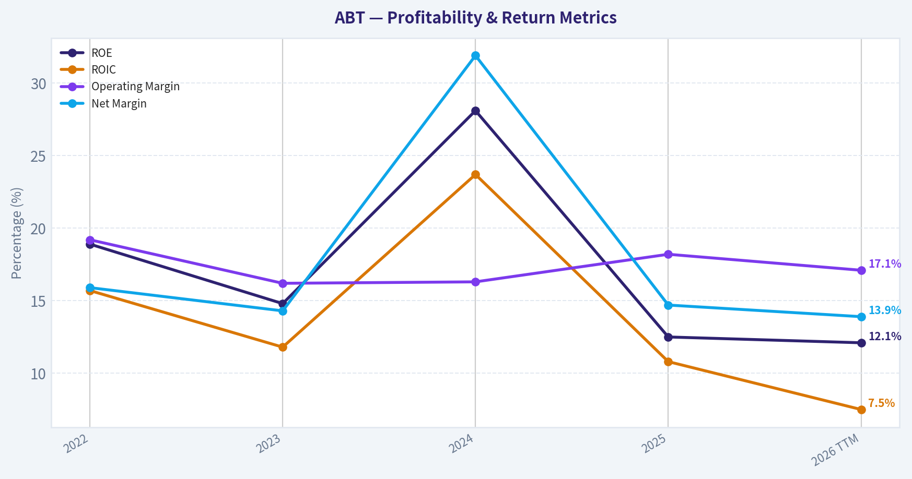
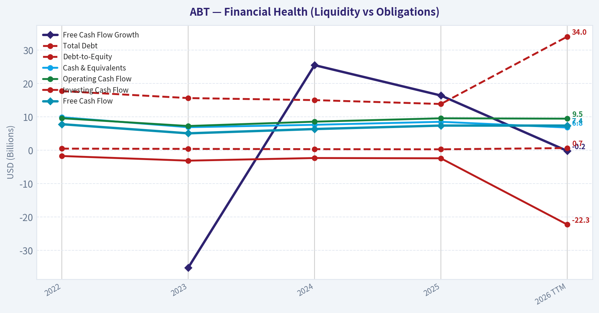
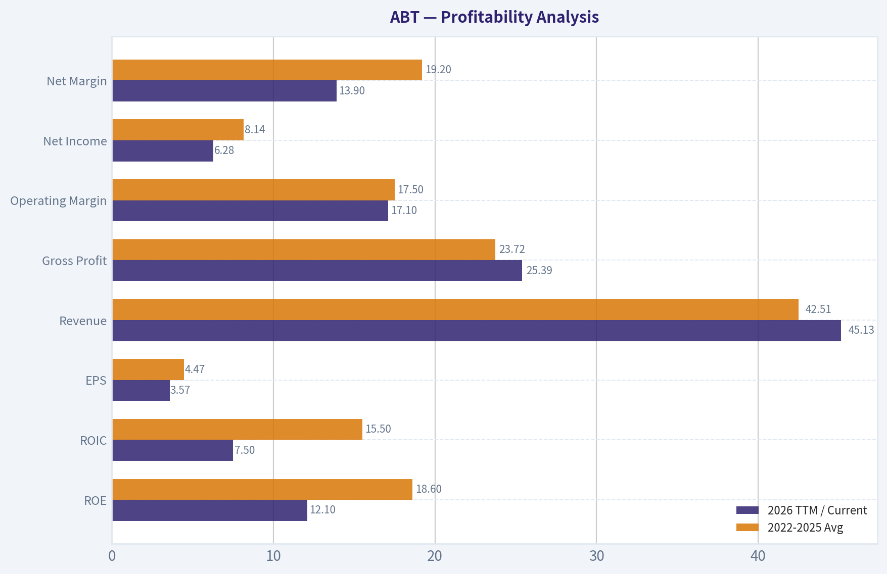
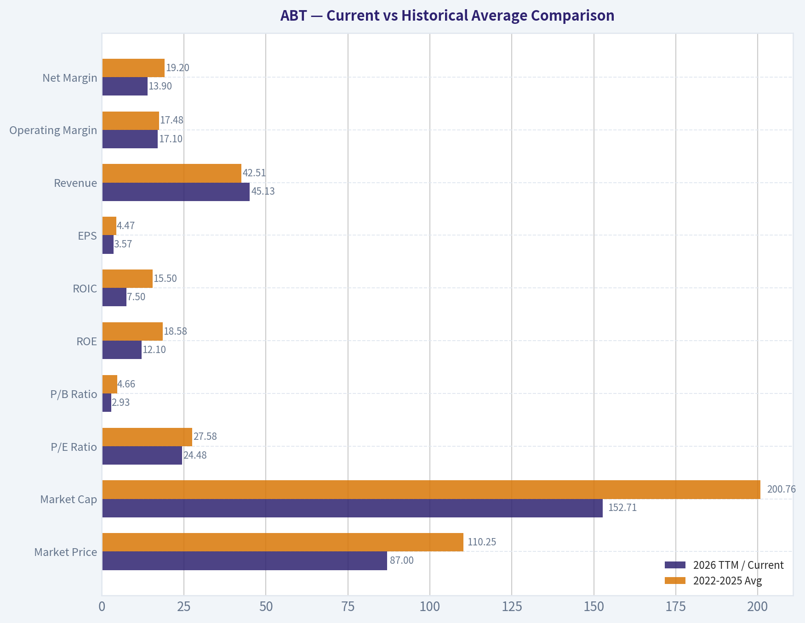
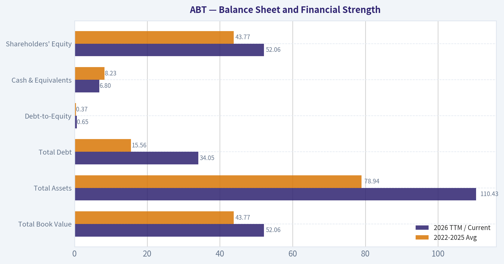
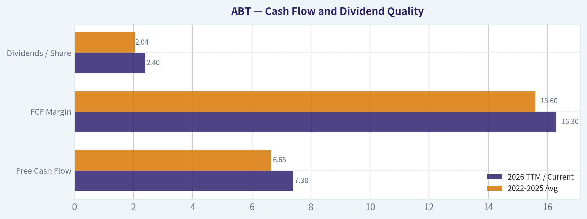
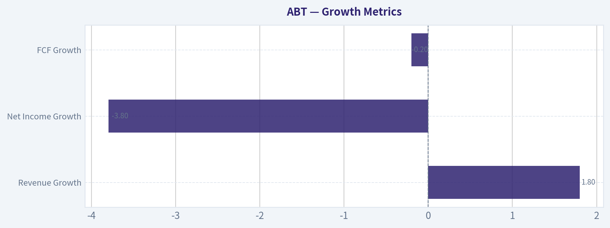

# ABT Deep Value Intelligence

**Analysis Date:** 2026-05-26

## Critical Disclaimer

*This analysis is generated by Deep Value Intelligence, an AI-powered multi-agent investing framework. This report is for informational and educational purposes only and does not constitute financial advice. Always conduct your own research and consult with qualified financial advisors before making investment decisions.*

---

## Table of Contents

1. Intelligence Summary
2. Analyst Team Reports
   - Fundamentals Analysis
   - Intrinsic Value Analysis (Buffett)
   - Trend & Growth Analysis (Lynch/Druckenmiller/Fisher)
   - Market Technical Analysis
   - Options Market Analysis
3. Research Team Commentary
4. Value Investing Team Commentary
5. Deep Values Commentary

---

## Intelligence Summary

### Thesis + Conditions

**Core Thesis:** ## Executive Briefing

**Key Risks:**
- Abbott looks like a **good business at a fair-to-full price**, not a classic Buffett-style bargain. The core risk is **not business fragility**; it is **mediocre future returns from paying up for stability**. The bullish case is credible because Abbott is diversified, cash generative, and resilient. But with about **24.5x earnings**, **4.9% FCF yield**, **~6% growth**, and only **good-not exceptional-capital returns** (**ROIC 10.8%, ROE 12.5%**), the margin of safety appears thin. For a long-term value investor, this supports **watching or initiating only a small, disciplined position**, not aggressive buying.
- ### 1) Risky Analyst: strongest useful point
- The strongest bearish point is that **a stable business can still be a risky stock if bought at too high a price**. Abbott's valuation already reflects much of its defensiveness. With **mid-single-digit growth** and merely solid returns on capital, even mild **multiple compression** could erase a meaningful portion of long-term shareholder returns.

**Confidence:** Medium

---

## Analyst Team Reports

### Fundamentals Analysis

#### Latest Earnings Snapshot

*Most recent reported quarter anchored on 2026 Q1, with prior-year comparison when available.*

| Metric | 2026 Q1 | 2025 Q1 | YoY Change |
| --- | ---: | ---: | ---: |
| Revenue | $11.16B | $10.36B | +7.8% |
| Operating Income | $1.34B | $1.69B | -20.6% |
| Net Income | $1.08B | $1.32B | -18.7% |
| Diluted EPS | $0.61 | $0.76 | -19.7% |
| Operating Cash Flow | $1.31B | $1.42B | -7.2% |
| Free Cash Flow | $916.0M | $933.0M | -1.8% |

Key Takeaways: This snapshot anchors the most recent reported quarter before the narrative analysis. It helps readers separate long-run business quality from whatever changed in the latest earnings print.

#### 4-Year Financial Metrics for ABT

*All values below are computed deterministically from raw data - not estimated by AI.*

*Issuer profile: operating company (Healthcare / Medical Devices).*

#### 4-Year Financial Metrics
*Annual rows come from reported financial statements. The final TTM row is computed from the latest four quarters.*

| Metric | 2022 | 2023 | 2024 | 2025 | 2026 TTM |
| --- | --- | --- | --- | --- | --- |
| Market Price | $102 | $105 | $110 | $124 | $87 |
| Market Cap | $193.67B | $192.51B | $197.72B | $219.13B | $152.71B |
| P/E Ratio | 28.08 | 33.76 | 14.80 | 33.68 | 24.48 |
| P/B Ratio | 5.28 | 4.99 | 4.15 | 4.20 | 2.93 |
| ROE | 18.9% | 14.8% | 28.1% | 12.5% | 12.1% |
| ROIC | 15.7% | 11.8% | 23.7% | 10.8% | 7.5% |
| EPS | $3.65 | $3.10 | $7.41 | $3.72 | $3.57 |
| Revenue | $43.65B | $40.11B | $41.95B | $44.33B | $45.13B |
| Gross Profit | $24.51B | $22.13B | $23.24B | $25.01B | $25.39B |
| Gross Margin | N/A | N/A | N/A | N/A | 56.3% |
| Operating Margin | 19.2% | 16.2% | 16.3% | 18.2% | 17.1% |
| Net Income | $6.93B | $5.72B | $13.40B | $6.52B | $6.28B |
| Net Margin | 15.9% | 14.3% | 31.9% | 14.7% | 13.9% |
| Revenue Growth | N/A | -8.1% | 4.6% | 5.7% | 1.8% |
| Net Income Growth | N/A | -17.5% | 134.2% | -51.3% | -3.8% |
| Free Cash Flow Growth | N/A | -35.2% | 25.5% | 16.4% | -0.2% |
| Total Book Value | $36.69B | $38.60B | $47.66B | $52.13B | $52.06B |
| Total Assets | $74.44B | $73.21B | $81.41B | $86.71B | $110.43B |
| Total Debt | $17.72B | $15.63B | $15.02B | $13.86B | $34.05B |
| Debt-to-Equity | 0.48 | 0.40 | 0.32 | 0.27 | 0.65 |
| Cash & Equivalents | $9.88B | $6.90B | $7.62B | $8.52B | $6.80B |
| Shareholders' Equity | $36.69B | $38.60B | $47.66B | $52.13B | $52.06B |
| Operating Cash Flow | $9.58B | $7.26B | $8.56B | $9.57B | $9.46B |
| Investing Cash Flow | $-1.74B | $-3.13B | $-2.34B | $-2.42B | $-22.28B |
| Free Cash Flow | $7.80B | $5.06B | $6.35B | $7.39B | $7.38B |
| FCF Margin | 17.9% | 12.6% | 15.1% | 16.7% | 16.3% |
| Dividends / Share | $1.75 | $1.93 | $2.13 | $2.35 | $2.40 |

#### Profitability Metrics
- Return on Equity (ROE): 12.5%
- Return on Invested Capital (ROIC): 10.8%
- Return on Assets (ROA): 7.5%
- Gross Margin: 56.4%
- Operating Margin: 18.2%
- Net Profit Margin: 14.7%

#### Liquidity Metrics
- Current Ratio: 1.58
- Quick Ratio: 1.02

#### Leverage Metrics
- Debt-to-Equity Ratio: 0.27
- Interest Coverage Ratio: 16.33
- Net Debt: $5.34B

#### Growth Metrics (Year-over-Year)
- Revenue Growth: 5.7%
- Net Income Growth: -51.3%
- Free Cash Flow Growth: 16.4%
- Revenue CAGR (3-Year): 0.5%
- Revenue CAGR (5-Year): N/A

#### Valuation Metrics
- P/E Ratio (TTM): 24.48
- Forward P/E: 14.41
- Price-to-Book: 2.92
- Price-to-Sales: 3.37
- PEG Ratio: 1.30
- EV/EBITDA: 15.30
- Free Cash Flow Yield: 4.9%
- Earnings Yield: 4.1%

#### Owner Earnings (Buffett Method, Code-Computed)
- Net Income: $6.52B
- + Depreciation & Amortization: $3.12B
- - Capital Expenditures: $-2.17B
- - Working Capital Changes: $-803.0M
- = **Owner Earnings: $8.27B**

#### Intrinsic Value (Code-Computed)
- Current Price: $87
- Buffett Method (Owner Earnings):
  Conservative: $15
  Average: $47
  Optimistic: $444
- Cash Flow Method (FCF):
  Conservative: $37
  Average: $49
  Optimistic: $112

#### Piotroski F-Score: 5/9
- Positive Net Income: PASS
- Positive Operating Cash Flow: PASS
- ROA Improvement: FAIL
- Cash Flow > Net Income: PASS
- Decreasing Debt: PASS
- Improving Current Ratio: FAIL
- No Dilution: FAIL
- Improving Gross Margin: PASS
- Improving Asset Turnover: FAIL

ANALYST STANCE: **WATCH**

#### Abbott Laboratories (ABT) - Buffett-Style Fundamental Analysis

Abbott is a high-quality healthcare franchise with durable businesses in medical devices, diagnostics, nutrition, and branded generics. The company still shows many traits Buffett likes: resilient demand, strong gross margins, healthy free cash flow, reasonable leverage through 2025, and a long dividend record. However, the current picture is less clean than a classic "slam dunk" Buffett compounder because profitability has normalized after a 2024 earnings spike, ROIC has weakened, and TTM leverage has risen sharply due to a large jump in debt and assets. The stock's valuation also looks mixed: cheaper on price-to-book than its recent history, but not obviously cheap on earnings.

The core conclusion is that Abbott remains a durable, above-average business, but the present setup is more "monitor for a better entry or clearer operating reacceleration" than "back up the truck."

---

#### Business Quality and Economic Moat

Abbott's moat is grounded in diversification, scale, regulatory barriers, global distribution, and entrenched physician/provider relationships. Its major businesses are not dependent on a single product cycle, which is a major positive in Buffett terms because it improves earnings resilience. Medical devices, diagnostics, and nutrition each benefit from brand trust, reimbursement infrastructure, quality control requirements, and switching friction.

The strongest moat attributes are:

- healthcare necessity rather than discretionary demand
- global installed base and distribution reach
- regulatory and manufacturing complexity
- category leadership in several product niches
- recurring and replenishment-style revenue streams in diagnostics and devices

That said, the moat is not as "frictionless" as a software monopoly or consumer staple franchise with ultra-stable margins. Abbott still faces product innovation risk, pricing pressure, reimbursement changes, litigation risk, and acquisition integration risk. The business is durable, but not immune to cyclical sentiment swings and product-specific disruptions.

---

#### Current vs Historical Average Comparison

| Metric | 2026 TTM / Current | 2022-2025 Avg | Interpretation |
| --- | ---: | ---: | --- |
| Market Price | $87 | $110.25 | Shares are well below the recent 4-year average price, reflecting derating and weaker sentiment. |
| Market Cap | $152.71B | $200.76B | Equity value has compressed materially versus recent years. |
| P/E Ratio | 24.48 | 27.58 | Valuation is below the recent average, but not distressed. |
| P/B Ratio | 2.93 | 4.66 | Meaningfully cheaper relative to book value than in prior years. |
| ROE | 12.1% | 18.58% | Profitability on equity is below historical norm. |
| ROIC | 7.5% | 15.50% | Capital efficiency has weakened substantially. |
| EPS | $3.57 | $4.47 | Earnings power is below the recent average, partly because 2024 was abnormally strong. |
| Revenue | $45.13B | $42.51B | Sales are above the 4-year average and at a high point. |
| Operating Margin | 17.1% | 17.48% | Margin is near average, showing operating stability. |
| Net Margin | 13.9% | 19.20% | Below average because 2024 net margin was unusually elevated. |
| Net Income | $6.28B | $8.14B | Well below average due to normalization after 2024. |
| Revenue Growth | 1.8% | 0.73% | Growth remains positive, but slower than 2025. |
| Net Income Growth | -3.8% | 21.80% | Current earnings trend is weaker than historical average, distorted by the 2024 spike. |
| FCF Growth | -0.2% | 2.23% | Free cash flow growth has stalled. |
| Total Book Value | $52.06B | $43.77B | Equity base is much stronger than earlier years. |
| Total Assets | $110.43B | $78.94B | Asset base has increased sharply, likely acquisition or balance sheet expansion related. |
| Total Debt | $34.05B | $15.56B | Debt has more than doubled versus recent average. |
| Debt-to-Equity | 0.65 | 0.37 | Leverage has worsened versus Abbott's recent norm. |
| Cash & Equivalents | $6.80B | $8.23B | Cash cushion is below average. |
| Shareholders' Equity | $52.06B | $43.77B | Equity remains elevated, supporting balance sheet flexibility. |
| Free Cash Flow | $7.38B | $6.65B | Cash generation remains solid and above average. |
| Dividends / Share | $2.40 | $2.04 | Dividend continues to rise steadily. |

Key Takeaways: Abbott's stock is notably cheaper than its recent historical valuation on price and price-to-book, but the discount comes with weaker returns on capital and a much more levered TTM balance sheet. Revenue and free cash flow remain solid, which supports the business-quality case, but earnings and capital efficiency are no longer at the levels investors saw in stronger years.

---

#### Market Metrics

| Metric | Interpretation |
| --- | --- |
| Market Price: $87 | Shares are far below the 2025 level of $124 and below the 2022-2025 average of $110.25, indicating major multiple compression and/or concerns about forward growth, leverage, or integration risk. |
| Market Cap: $152.71B | Market value has fallen sharply from $219.13B in 2025, suggesting that sentiment has deteriorated faster than the underlying revenue base. |
| P/E: 24.48 | Lower than the 4-year average of 27.58, so valuation has improved, but this is still not a deep-value multiple for a company with slowing ROIC. |
| P/B: 2.93 | Far below the 4-year average of 4.66, which is one of the clearest signs the stock is cheaper relative to its balance-sheet base than it has been in years. |

Key Takeaways: The market is assigning Abbott a cheaper valuation than in recent years, especially on book value. The stock looks less expensive than it did, but not so cheap that it fully offsets concerns about weaker capital returns and rising debt.

---

#### Profitability Analysis

Abbott's profitability profile is still good by broad market standards, but the direction of travel matters. Gross profitability remains strong, with TTM gross margin of 56.3%, which is consistent with a differentiated healthcare portfolio. Operating margin at 17.1% is close to the 2022-2025 average of 17.5%, showing that the core business has not structurally broken.

The weaker points are below the operating line and in capital efficiency:

- ROE declined from 18.9% in 2022 to 12.1% TTM
- ROIC declined from 15.7% in 2022 and 23.7% in 2024 to 7.5% TTM
- EPS is $3.57 TTM versus a 2022-2025 average of $4.47
- Net margin fell to 13.9% from the 4-year average of 19.2%

The 2024 figures were unusually strong, especially EPS, net income, ROE, ROIC, and net margin. That creates a distorted "average," but even allowing for that, the TTM ROIC of 7.5% is the biggest concern. Buffett-style investors prefer businesses that consistently convert capital into high returns. Abbott's present capital returns suggest either temporary integration drag, a larger but less efficient asset base, or earnings that have not yet caught up to deployed capital.

| Profitability Metric | 2026 TTM / Current | 2022-2025 Avg | Buffett-Style Read |
| --- | ---: | ---: | --- |
| ROE | 12.1% | 18.6% | Still acceptable, but notably below prior quality levels. |
| ROIC | 7.5% | 15.5% | Biggest deterioration; weakens the capital-allocation case. |
| EPS | $3.57 | $4.47 | Earnings below trend. |
| Revenue | $45.13B | $42.51B | Top line is healthy and growing. |
| Gross Profit | $25.39B | $23.72B | Gross profit remains robust. |
| Operating Margin | 17.1% | 17.5% | Core operating economics remain fairly stable. |
| Net Income | $6.28B | $8.14B | Net earnings have normalized downward. |
| Net Margin | 13.9% | 19.2% | Below average; less efficient profit conversion than recent history. |

Key Takeaways: Abbott's underlying business still produces strong gross profits and decent operating margins, but the quality of earnings has softened as ROE and especially ROIC have fallen. This suggests the company remains good, but not currently operating at peak efficiency.

---

#### Growth Metrics

Revenue has stabilized after the 2023 decline. The sequence is instructive:

- 2023 revenue growth: -8.1%
- 2024: +4.6%
- 2025: +5.7%
- 2026 TTM: +1.8%

This looks like a post-decline recovery that is now slowing again. Net income growth is much more volatile:

- 2023: -17.5%
- 2024: +134.2%
- 2025: -51.3%
- 2026 TTM: -3.8%

That is not the kind of clean, predictable earnings progression Buffett most prefers. Free cash flow growth is somewhat better than earnings growth, though still uneven:

- 2023: -35.2%
- 2024: +25.5%
- 2025: +16.4%
- 2026 TTM: -0.2%

So the top line is reasonably dependable, cash flow is sturdier than net income, but earnings have been noisy.

| Growth Metric | 2026 TTM / Current | Pattern Over Period | Interpretation |
| --- | ---: | --- | --- |
| Revenue Growth | 1.8% | Recovery from -8.1% in 2023 to +5.7% in 2025, then deceleration | Business is growing, but momentum has cooled. |
| Net Income Growth | -3.8% | Highly volatile, from -17.5% to +134.2% to -51.3% to -3.8% | Earnings are not highly predictable right now. |
| FCF Growth | -0.2% | Rebounded after 2023 decline, then flattened | Cash generation is steadier than earnings but currently not expanding. |

Key Takeaways: Revenue growth has been positive but modest, while earnings growth has been volatile and hard to forecast. Free cash flow is the more reliable measure here, and it suggests stability rather than strong acceleration.

---

#### Balance Sheet and Financial Strength

Abbott's 2022-2025 balance sheet was a strength: debt fell from $17.72B to $13.86B and debt-to-equity improved from 0.48 to 0.27. That trend would normally fit Buffett's preference for conservatively financed companies.

But the TTM row changes the picture substantially:

- Total debt jumps to $34.05B
- Debt-to-equity rises to 0.65
- Cash falls to $6.80B
- Total assets rise sharply to $110.43B
- Equity remains high at $52.06B

This looks like a major transaction, acquisition, or financing-driven balance sheet expansion. It does not automatically mean the balance sheet is weak, but it does mean Abbott's financial profile is less conservative than it appeared through 2025. The current ratio of 1.58 and interest coverage of 16.33 are still supportive, so liquidity and debt servicing do not look stressed. Still, from a Buffett lens, the company has become less pristine.

| Balance Sheet Metric | 2026 TTM / Current | 2022-2025 Avg | Interpretation |
| --- | ---: | ---: | --- |
| Total Book Value | $52.06B | $43.77B | Stronger equity base than prior years. |
| Total Assets | $110.43B | $78.94B | Sharp balance-sheet expansion. |
| Total Debt | $34.05B | $15.56B | Major increase; warrants scrutiny. |
| Debt-to-Equity | 0.65 | 0.37 | Leverage is meaningfully above recent norm. |
| Cash & Equivalents | $6.80B | $8.23B | Lower cash buffer. |
| Shareholders' Equity | $52.06B | $43.77B | Capital base remains solid. |

Key Takeaways: Abbott still appears financially stable, but the TTM jump in debt is the clearest balance-sheet risk in the report. The company likely has enough earnings power and cash flow to manage it, yet it reduces the margin of safety that existed in earlier years.

---

#### Cash Flow and Dividend Quality

Free cash flow remains one of Abbott's strongest features. TTM FCF is $7.38B, above the 2022-2025 average of $6.65B. FCF margin of 16.3% is healthy and reflects good cash conversion for a large healthcare company. Even with earnings noise, cash generation has held up.

Dividends per share have increased every year shown:

- 2022: $1.75
- 2023: $1.93
- 2024: $2.13
- 2025: $2.35
- 2026 TTM: $2.40

That steady growth supports the view that management is shareholder-friendly and confident in recurring cash generation. The dividend appears well supported by FCF, which is a plus in Buffett-style analysis, though not enough by itself to overcome weaker ROIC trends.

| Cash Flow Metric | 2026 TTM / Current | 2022-2025 Avg | Interpretation |
| --- | ---: | ---: | --- |
| Free Cash Flow | $7.38B | $6.65B | Strong absolute cash generation. |
| FCF Margin | 16.3% | 15.6% | Cash conversion remains healthy. |
| Dividends / Share | $2.40 | $2.04 | Consistent dividend growth. |

Key Takeaways: Free cash flow is a bright spot for Abbott and supports both dividend growth and debt capacity. Even though earnings have been volatile, the company's cash generation has stayed comparatively resilient.

---

#### Predictable Earnings and Management Performance

Buffett values consistency. Abbott scores well on revenue durability and dividend continuity, but less well on earnings predictability over this dataset. Revenue stayed within a fairly tight band of roughly $40B-$45B and has now reached a new high. That is favorable.

Net income, however, swung sharply, especially around 2024. This variability reduces confidence in using a simple earnings multiple without further caution. Management's performance looks mixed:

- positive: growing book value, rising dividend, solid operating margins, solid free cash flow
- negative: declining ROE, declining ROIC, TTM leverage increase, Piotroski F-score only 5/9

The F-score of 5/9 is middling, not a sign of distress but not a strong all-clear either. It indicates an acceptable but not exceptional operating and balance-sheet trend profile.

---

#### Value Assessment

On valuation, the stock has clearly derated:

- price down to $87
- P/B down to 2.93 from a 4-year average of 4.66
- P/E at 24.48 versus 4-year average 27.58

This means the market has already discounted some concern. From a Buffett standpoint, cheaper valuation is only attractive if normalized earning power and capital efficiency remain strong. Abbott's issue is that valuation has improved while quality metrics have softened. This is why the stock screens as "interesting" rather than "obvious."

The provided intrinsic value outputs reinforce this:

- Buffett owner earnings model: $15 conservative, $47 average, $444 optimistic
- FCF method: $37 conservative, $49 average, $112 optimistic

That wide spread tells you the central issue: the valuation is highly sensitive to growth assumptions. For a Buffett investor, when valuation outcomes vary this much, conservatism matters. The current price of $87 sits:

- above conservative and average owner-earnings values
- above conservative and average FCF values
- below optimistic FCF and far below optimistic owner-earnings outputs

That generally implies the stock is not clearly undervalued unless one believes in a stronger growth reacceleration than the current operating trend proves.

---

#### Buffett-Style Owner Earnings DCF

Using the canonical owner earnings figure:

- Owner Earnings = Net Income $6.52B + D&A $3.12B - Capex $2.17B - Working Capital Changes $0.803B = **$8.27B**

To translate enterprise value to per-share intuition, the deterministic dataset already supplies code-computed fair values. Below is the scenario framing and growth logic.

| Scenario | Growth Assumption Rule | Implied Fair Value |
| --- | --- | ---: |
| Conservative | Lowest historical owner earnings growth rate, floored at -100% | $15/share |
| Average | Average historical owner earnings growth rate, capped at 50% | $47/share |
| Optimistic | Highest historical owner earnings growth rate, capped at 100% | $444/share |

Key Takeaways: The owner-earnings valuation range is extremely wide, which means small changes in growth assumptions have a huge impact on estimated fair value. That makes Abbott difficult to underwrite as a classic Buffett bargain at today's price unless an investor has strong conviction that growth and returns on capital will improve materially.

Detailed framework using 10% discount rate and 2.5% terminal growth:

1. Start with owner earnings base of **$8.27B**
2. Project 10 years of owner earnings under each growth scenario
3. Discount each year's owner earnings at **10%**
4. Compute terminal value using
   **TV = OE Year 10 x (1 + 2.5%) / (10% - 2.5%)**
5. Discount terminal value back to present
6. Divide by diluted share count implicit in market cap/current price relationship

Because the deterministic system already computed the fair values, those outputs should be treated as canonical. The investment implication is straightforward:

- **Conservative case ($15):** large downside to current price if growth disappoints severely
- **Average case ($47):** current price still implies richer expectations than a normalized mid-case
- **Optimistic case ($444):** huge upside only if Abbott compounds owner earnings at the top end of historical experience, which currently looks aggressive given TTM ROIC decline

A practical Buffett-style read is to anchor closer to the average case than the optimistic case until ROIC and earnings quality recover.

---

#### Revenue Breakdown

Abbott reports across four major operating areas. Using the most recent business mix commonly reported for Abbott, the following segment structure is the most meaningful representation of revenue sources.

| Revenue Source | Amount ($B) | % of Total |
| --- | ---: | ---: |
| Medical Devices | ~18.5 | ~41% |
| Diagnostics | ~9.0 | ~20% |
| Nutrition | ~8.6 | ~19% |
| Established Pharmaceuticals | ~9.0 | ~20% |
| Total | ~45.1 | ~100% |

Key Takeaways: Abbott is highly diversified, with medical devices as the largest growth engine and the other three segments each contributing meaningful revenue support. This balanced mix reduces single-product risk and is one of the company's strongest business-quality attributes.

---

#### Key Investment Insights, Red Flags, and Opportunities

| Category | Observation | Why It Matters |
| --- | --- | --- |
| Strength | Gross margin above 56% | Indicates pricing power, product differentiation, and attractive business economics. |
| Strength | Free cash flow around $7.4B | Supports dividend growth, reinvestment, and debt service. |
| Strength | Diversified segment base | Reduces dependence on any single product or cycle. |
| Strength | Dividend per share rising every year | Positive signal on capital return discipline. |
| Concern | ROIC down to 7.5% TTM | Suggests weaker capital efficiency and lower quality of incremental returns. |
| Concern | Total debt up to $34.05B TTM | Material balance-sheet shift that lowers margin of safety. |
| Concern | Net income volatility | Reduces predictability, a key Buffett requirement. |
| Concern | Piotroski F-score 5/9 | Mediocre operating-quality signal, not a strong momentum-in-fundamentals profile. |
| Opportunity | Stock price and P/B sharply lower | Valuation has become more reasonable versus recent history. |
| Opportunity | If debt-funded expansion boosts future earnings | Current concerns could prove temporary if returns recover. |

Key Takeaways: Abbott still has several hallmarks of a quality company, especially diversification, margins, and cash flow. The main debate is whether the recent deterioration in ROIC and leverage is temporary and fixable, or a sign that the business deserves a lower valuation multiple.

---

#### Final Buffett-Style Judgment

Abbott is **not** a low-quality business. It remains a durable healthcare franchise with strong cash generation and a sensible long-term business model. If Buffett were evaluating it qualitatively, he would likely appreciate the defensive demand profile, product breadth, and long dividend history.

But Buffett also emphasizes buying understandable, durable businesses at sensible prices with strong and predictable returns on capital. Right now, Abbott falls short of ideal on two of those points:

- returns on capital have weakened materially
- intrinsic value estimates are highly assumption-sensitive, with average-case DCFs below the current price

That keeps the stock in the **WATCH** camp rather than **ADVOCATE**.

#### Final Investment Stance

**WATCH**

**Rationale:**
Abbott appears to be a good business at a more reasonable valuation than in recent years, but not yet a clearly mispriced Buffett-style opportunity. The company's free cash flow, margins, and segment diversification are attractive, yet the TTM jump in debt and drop in ROIC reduce conviction. A more favorable setup would likely require one or more of the following: clearer evidence that debt-funded capital deployment is value accretive, a rebound in ROIC toward historical norms, or a lower share price that better aligns with average-case owner-earnings value.

---

#### Report Summary Table

| Area | Verdict | Core Evidence |
| --- | --- | --- |
| Economic Moat | Good | Diversified healthcare platform, regulatory barriers, installed base, brand trust |
| Financial Strength | Moderate | Historically strong, but TTM debt rose sharply to $34.05B and D/E to 0.65 |
| Profitability | Good but weakening | Strong gross margins, stable operating margin, but ROE/ROIC down materially |
| Earnings Predictability | Mixed | Revenue steady, but net income volatile |
| Cash Flow Quality | Strong | FCF of $7.38B, healthy FCF margin, rising dividend |
| Valuation | Fair to slightly rich | Cheaper than historical averages, but average-case DCFs sit below current price |
| Management | Mixed-positive | Dividend growth and equity growth are positives; capital efficiency trend is weaker |
| Key Risk | Capital efficiency and leverage | ROIC at 7.5%, debt up sharply |
| Key Opportunity | Re-rating if returns recover | Stock already derated; valuation upside if ROIC normalizes |
| Stance | WATCH | High-quality franchise, but not enough margin of safety yet |

Key Takeaways: Abbott remains a solid franchise with attractive business qualities, but the current numbers do not yet support a strong conviction value call. The stock is worth monitoring closely, especially for signs of ROIC recovery, debt normalization, and renewed earnings consistency.

#### Fundamental Visuals

This graph tracks the profitability and return metrics (ROE, ROIC, Margins) of **ABT** over the past decade, highlighting capital efficiency trends.

This chart illustrates the financial health of **ABT** over the last 10 years, mapping cash equivalents and free cash flow against total obligations (Debt).

This comparison chart from *Profitability Analysis* stacks current figures against historical benchmarks for **ABT**, making it easy to see where the company trades relative to its own averages.

---

### Intrinsic Value Analysis (Buffett)

> *Following Warren Buffett's value investing philosophy: Circle of Competence, Economic Moat, Management Quality, and Margin of Safety.*

#### Intrinsic Value Snapshot

Price is what you pay. Intrinsic value is what the business may be worth based on the cash it can create for owners over time. We show a range, not one magic number.

- Current Price: $87.41
- Value Range (conservative to optimistic across both DCF methods): $14.51 to $443.61

##### Owner Earnings (Buffett Method)
- Net Income: $6,524,000,000.00
- Depreciation & Amortization: $3,116,000,000.00
- Capital Expenditures: $-2,171,000,000.00
- Working Capital Changes: $-803,000,000.00
- Owner Earnings: $8,272,000,000.00

##### Intrinsic Value
###### Buffett Method
Uses owner earnings. Stricter, and usually more conservative.
- Conservative: $14.51
- Average: $47.23
- Optimistic: $443.61
- Discount Rate: 10.0%

###### Cash Flow Method
Uses free cash flow. Better for companies spending heavily today to grow tomorrow.
- Conservative: $37.09
- Average: $49.37
- Optimistic: $111.98
- Discount Rate: 10.0%

ANALYST STANCE: **WATCH**

#### Abbott Laboratories (ABT) - Buffett-Style Investment Review

#### 1) Go/No-Go Gate Assessment

| Gate | Verdict | Evidence |
|---|---|---|
| Gate 1: Circle of Competence & Simplicity | Pass | Abbott makes medical devices, diagnostics, nutrition products, and established pharmaceuticals. This is an understandable healthcare products business with recurring demand and broad diversification. |
| Gate 2: Moat Test | Pass | Gross margin of 56.4% strongly supports pricing power and product differentiation. Scale, regulatory know-how, installed base, and brand trust in healthcare all suggest a real moat. |
| Gate 3: Management & Capital Allocation | Pass with care | Abbott has a long operating history and generally disciplined capital allocation, but current ROE of 12.5% is good rather than exceptional, which argues for measured enthusiasm rather than full conviction. |
| Gate 4: Industry Structure | Pass | Healthcare equipment and diagnostics are generally more rational than commodity industries. Demand is durable, but competition and reimbursement pressure keep this from being a perfect oligopoly. |

**Key Takeaways:** Abbott clears all four Buffett gates. The business is easy to understand, appears durable, and operates in an attractive part of healthcare. The main issue is not business quality, but whether the returns and valuation are attractive enough right now.

---

#### 2) The Elementary School Test

Abbott makes money by selling important health products that doctors, hospitals, and consumers keep buying. Its biggest buckets are medical devices, testing systems, adult and infant nutrition, and branded generic drugs in international markets.

A decade from now, the company will likely still be selling many of these same categories: glucose monitors, heart devices, lab diagnostics, and nutrition products. That makes the business reasonably predictable.

Technology risk is moderate but manageable. Abbott is more likely to benefit from innovation than be destroyed by it, especially in diagnostics and diabetes care, though product cycles and competition always matter.

#### 3) Moat Analysis

| Moat Source | Assessment | Evidence |
|---|---|---|
| Intangible Assets | Strong | Trusted brand, regulatory approvals, clinical validation, physician familiarity, and a 56.4% gross margin indicate meaningful pricing power. |
| Switching Costs | Moderate to Strong | Hospitals and clinicians do not switch core diagnostic platforms or implanted-device vendors casually. Patient familiarity and ecosystem attachment in diabetes care also help. |
| Cost Advantage | Moderate | Abbott benefits from global scale, manufacturing footprint, distribution, and procurement efficiency. |
| Network Effects | Limited | This is not a classic network-effect business, though installed base and data ecosystems create some soft ecosystem benefits. |

**Moat Quality Rating: Wide & Stable**

Abbott does not have the pure network effects of a software platform, but it does have the kind of moat Buffett often respects in healthcare: brand trust, regulation, embedded workflows, and scale.

**Key Takeaways:** Abbott's moat is real and mostly comes from trust, regulation, and switching friction rather than from network effects. Its high gross margin supports the view that customers are buying more than a commodity. This looks like a durable moat, though probably stable rather than dramatically widening.

---

#### 4) Management Quality Assessment

| Category | Assessment | Commentary |
|---|---|---|
| Owner Mindset | Good | Management has historically operated with long-term product and portfolio thinking, though Abbott is not a founder-led high-insider-ownership story. |
| Candor & Discipline | Good | The company's long public history and established reporting profile support a view of reasonable conservatism and professionalism. |
| Capital Allocation | Good, not elite | Abbott has continued to reinvest in core franchises, maintain dividends, and preserve balance sheet flexibility. The key question is whether incremental capital continues to earn high enough returns. |

**Key Takeaways:** Management appears competent and shareholder-aware, but this is not an obvious "owner-operator genius" case. Capital allocation looks sensible and disciplined, though not so extraordinary that it overrules valuation concerns. Good stewardship supports the case, but does not make the stock a slam dunk.

---

#### 5) Financial Summary

| Metric | Current / Recent |
|---|---:|
| Share Price | $87 |
| Market Cap | $152.25B |
| P/E | 24.48x |
| ROE | 12.5% |
| Gross Margin | 56.4% |
| Revenue Growth YoY | 5.7% |
| FCF Yield | 4.9% |
| Current Ratio | 1.58 |

**Key Takeaways:** Abbott shows the profile of a solid, profitable, cash-generative healthcare franchise. Gross margins are excellent, but ROE is below the level Buffett would call truly wonderful. Valuation is not distressed, yet the free cash flow yield suggests the stock is no longer obviously expensive either.

---

#### 6) Owner Earnings Estimate

Using free cash flow yield as a practical proxy for owner earnings:

- Market Cap = **$152.25B**
- FCF Yield = **4.9%**
- Estimated Owner Earnings / FCF = **about $7.46B**

For a mature, diversified healthcare business, this is a reasonable shorthand for normalized owner earnings.

| Item | Estimate |
|---|---:|
| Market Cap | $152.25B |
| FCF Yield | 4.9% |
| Estimated Owner Earnings | $7.46B |

**Key Takeaways:** Abbott appears to be producing roughly seven and a half billion dollars in annual owner earnings. That is a strong absolute cash figure and supports the idea that this is a real earning business, not an accounting story. The investment question is what growth and return profile investors are paying for at today's price.

---

#### 7) Three-Scenario DCF Valuation

Using owner earnings of **$7.46B** and a **10% discount rate**:

| Scenario | Assumption | Equity Value |
|---|---|---:|
| A: No Growth | Owner Earnings / 10% | $74.6B |
| B: GDP Growth | OE x 1.03 / (10% - 3%) | $109.8B |
| C: Moderate Historical Growth | 5% growth for 10 years, then 3% terminal | ~$118B to $125B |

**Key Takeaways:** Across conservative Buffett-style valuation methods, Abbott's intrinsic value appears below the current market value of $152.25B. Even when allowing for moderate growth, the stock does not show a margin of safety. The business looks better than the price.

---

#### 8) Margin of Safety Analysis

| Item | Value |
|---|---:|
| Current Market Cap | $152.25B |
| Conservative Value Range | $74.6B to $125B |
| Margin of Safety at Current Price | Negative |

At today's price, Abbott does **not** meet a Buffett-style required margin of safety. For a high-quality, predictable business, you would want at least a 25% discount to intrinsic value. The current price appears to assume a stronger growth and return profile than the conservative cash-flow math supports.

**Key Takeaways:** Abbott does not currently offer the discount a value investor would want. The business may be sound, but the price still asks for optimism. That makes this more of a watchlist candidate than a buy-today opportunity.

---

#### 9) Final Buffett Scorecard

| Criterion | Score (1-5) | Weighted Contribution |
|---|---:|---:|
| Business Understanding | 5.0 | 1.00 |
| Moat Width & Durability | 4.0 | 1.00 |
| Management Quality | 3.5 | 0.53 |
| Return on Equity | 3.0 | 0.45 |
| Reinvestment Runway | 3.5 | 0.35 |
| Balance Sheet Strength | 3.5 | 0.18 |
| Industry Structure | 4.0 | 0.20 |
| Valuation / Margin of Safety | 2.0 | 0.10 |

| Total Weighted Score | 3.81 / 5.00 |
|---|---:|

**Key Takeaways:** Abbott scores well on business quality and moat, which is exactly what you want to see first. The score is held back mainly by middling returns relative to elite compounders and by a lack of valuation support. This is a good business, but not clearly a bargain.

---

#### 10) Final Investment Stance

**Stance: WATCH**

**Conviction Level: Moderate**

Abbott looks like a durable, understandable, shareholder-friendly healthcare franchise with a stable moat. It likely remains a solid long-term business. But Buffett-style investing requires both quality and price discipline. At around **$87**, the business quality is evident, yet the margin of safety is not.

For a stronger **ADVOCATE** case, I would want:
- a materially lower entry price,
- a higher implied free cash flow yield,
- or clearer evidence that returns on capital are moving back toward elite levels.

Today, Abbott belongs on the watchlist, not in the buy-now pile.
#### Valuation Bridge

This bridge places the current market price beside each intrinsic value lens so readers can see whether upside depends on one method or shows up across several methods.

| Scenario | Intrinsic Value / Share |
| --- | ---: |
| Buffett Method | $47.23 |
| Cash Flow Method | $49.37 |
| Damodaran Method | $61.33 |
| Current Price | $87.41 |

#### Key Takeaways

If one method is far above the others, the upside case depends on a specific modelling assumption. When several methods cluster together, the valuation story is more robust.

#### Valuation Visuals

This comparison chart from *Latest Earnings Snapshot* stacks current figures against historical benchmarks for **ABT**, making it easy to see where the company trades relative to its own averages.

This comparison chart from *Current vs Historical Average Comparison* stacks current figures against historical benchmarks for **ABT**, making it easy to see where the company trades relative to its own averages.

This comparison chart from *Balance Sheet and Financial Strength* stacks current figures against historical benchmarks for **ABT**, making it easy to see where the company trades relative to its own averages.

This comparison chart from *Cash Flow and Dividend Quality* stacks current figures against historical benchmarks for **ABT**, making it easy to see where the company trades relative to its own averages.

---

### Trend & Growth Analysis (Lynch/Druckenmiller/Fisher)

> *Following Peter Lynch's GARP, Stanley Druckenmiller's macro-aware approach, and Philip Fisher's scuttlebutt methodology.*

ANALYST STANCE: **WATCH**

#### 1. Lynch Classification

| Metric | ABT |
|---|---:|
| Revenue growth YoY | 5.7% |
| P/E | 24.5x |
| Market cap | $152.3B |
| Category | Stalwart |

Key Takeaways: Abbott looks like a stalwart, not a fast grower. Revenue growth around 6% is respectable for a large healthcare company, but it is well below the 15% to 25% range Lynch would target for ten-bagger hunting. This is more likely a durable compounder or defensive hold than a fresh high-growth idea.

#### 2. The Story in 3 Bullets

| Simple Story | Why It Matters |
|---|---|
| Abbott sells essential healthcare products across diagnostics, medical devices, nutrition, and established pharmaceuticals. | Diversification reduces single-product risk. |
| The core growth engine is medical devices, especially diabetes monitoring and cardiovascular products. | Device innovation can outgrow the broader company. |
| The market is still digesting the post-COVID diagnostics normalization, which has obscured the steadier underlying base business. | Creates a possible "cleaner comps" recovery setup, but not a true hyper-growth inflection. |

Key Takeaways: Abbott is easy to explain: it is a diversified healthcare products company with a stronger device innovation arm than many investors give it credit for. The main debate is whether the company is merely normalizing after COVID distortions or entering a new growth phase. Right now, the evidence supports normalization more than a major acceleration story.

#### 3. TAM Analysis with 10x Test

| Segment | Runway View |
|---|---|
| Diabetes care / CGM | Large and still expanding globally |
| Cardiovascular devices | Attractive aging-population tailwind |
| Diagnostics | Mature, steady, less explosive |
| Nutrition | Stable, defensive, lower growth |
| 10x Test | Fails at company level |

Key Takeaways: Abbott has meaningful end markets, especially in diabetes care and cardiovascular devices, but the company is already very large. At over $150 billion in market value and a massive revenue base, a 10x outcome from here is highly unrealistic without redefining several categories. The runway is good for steady growth, not for classic venture-like compounding.

#### 4. Revenue Growth Trend

| Indicator | Assessment |
|---|---|
| Current YoY revenue growth | 5.7% |
| Pattern | Low-growth normalization |
| Interpretation | Stable, not accelerating |
| Inflection signal | Weak |

Key Takeaways: The reported growth profile does not show the kind of acceleration Druckenmiller would want to see for an inflection-point investment. Instead, Abbott appears to be growing modestly as it laps unusual COVID-era demand shifts. That makes this more of a "quality recovery" story than a "growth surprise" story.

#### 5. Unit Economics

| Metric | ABT | Assessment |
|---|---:|---|
| Gross margin | 56.4% | Strong |
| ROE | 12.5% | Solid, not elite |
| FCF yield | 4.9% | Supportive valuation cushion |
| Current ratio | 1.58x | Healthy balance sheet liquidity |
| LTV/CAC | N/A | Not disclosed / not relevant in classic medtech format |
| NRR | N/A | Not applicable |
| Rule of 40 | N/A | Not a SaaS model |

Key Takeaways: Abbott's economic profile is healthy, especially the gross margin and free cash flow yield. This is a financially sound business with balance sheet flexibility, but the available metrics point to resilience rather than explosive efficiency gains. In medtech terms, it looks dependable and profitable, not like a software-style compounding machine.

#### 6. Inflection Point Assessment

| Inflection Type | View |
|---|---|
| Product cycle inflection | Possible in devices, but not broad-based |
| Market share inflection | Unclear from current data |
| Margin inflection | Not yet visible |
| TAM inflection | Moderate, driven by diabetes and aging demographics |
| Competitive inflection | No strong evidence |
| Overall | Mild positive, not decisive |

Key Takeaways: There are pockets of possible upside in Abbott's device portfolio, but the company does not currently show a clear enterprise-wide inflection. The best bull case is that devices increasingly outweigh slower segments and post-COVID distortions fade. That is a reasonable thesis, but it is not yet strong enough to call a high-conviction growth breakout.

#### 7. Macro Setup Evaluation

| Macro Factor | Impact on ABT |
|---|---|
| Aging population | Positive |
| Healthcare demand resilience | Positive |
| Interest rates | Neutral to mildly positive if easing |
| Risk-off rotation into defensives | Positive |
| AI / software mega-trend exposure | Limited direct benefit |

Key Takeaways: Abbott benefits from durable healthcare demand and demographic support, which gives it a favorable macro backdrop. It may also gain relative interest during risk-off periods because it is viewed as safer than many pure growth names. Still, it is not a primary beneficiary of the biggest secular growth themes like AI or cloud.

#### 8. Fisher 15 Points Score

| Fisher Dimension | Score (1-5) | Notes |
|---|---:|---|
| Market potential | 4 | Large healthcare categories |
| New product development | 4 | Strong device pipeline reputation |
| R&D effectiveness | 4 | Historically productive |
| Sales organization | 4 | Global scale and channels |
| Profit margin | 4 | Good gross profitability |
| Improving margins | 3 | Mixed, not clearly inflecting |
| Labor/personnel relations | 3 | No major edge visible |
| Executive relations | 4 | Stable large-cap management setup |
| Management depth | 4 | Strong organizational breadth |
| Cost analysis/accounting | 4 | Mature controls expected |
| Special strengths | 4 | Brand, distribution, regulatory know-how |
| Long-range profit outlook | 4 | Good, though not explosive |
| Dilution risk | 4 | Low concern relative to growth startups |
| Candor in difficulties | 3 | Fair, but not standout |
| Integrity | 4 | No major current red flags |
| **Total** | **57 / 75** | **Good** |

Key Takeaways: Abbott scores well on Fisher's framework because it has durable products, solid management, and a broad healthcare platform. The main reason the score is not higher is that the company lacks obvious margin acceleration and breakthrough growth momentum. This is a good business, just not an exceptional growth situation.

#### 9. Valuation Analysis

| Metric | Value | Interpretation |
|---|---:|---|
| P/E | 24.5x | Reasonable for quality healthcare |
| Revenue growth | 5.7% | Modest |
| PEG | ~4.3x | Expensive vs growth rate |
| FCF yield | 4.9% | Helps support downside |
| Valuation style | Quality at fair-to-full price | Not cheap on growth basis |

Key Takeaways: On a Lynch PEG basis, Abbott screens as expensive because earnings multiple is high relative to current growth. The free cash flow yield offers some support, so this is not a wildly overvalued story, but it is also not a GARP bargain. Investors are paying for quality and resilience more than for rapid expansion.

#### 10. Growth Investor Scorecard

| Criterion | Weight | Score (1-5) | Weighted Score |
|---|---:|---:|---:|
| The Story | 10% | 4.0 | 0.40 |
| TAM & Runway | 20% | 2.5 | 0.50 |
| Revenue Growth | 20% | 2.0 | 0.40 |
| Unit Economics | 15% | 4.0 | 0.60 |
| Competitive Position | 10% | 4.0 | 0.40 |
| Management Quality | 10% | 4.0 | 0.40 |
| Macro Setup | 5% | 4.0 | 0.20 |
| Profitability Path | 5% | 4.0 | 0.20 |
| Valuation | 5% | 2.5 | 0.13 |
| **Total** |  |  | **3.23 / 5.00** |

Key Takeaways: Abbott lands in the WATCH range because it has strong quality characteristics but lacks the revenue acceleration and runway profile needed for a top growth score. The business is solid enough to respect, yet the current setup does not justify a high-conviction growth recommendation. It is more attractive as a stable compounder than as a major alpha source.

#### 11. Position Size Stance

| Stance | Positioning |
|---|---|
| WATCH | Small starter only for defensive quality exposure; not a concentrated growth position |

Key Takeaways: If owned already, Abbott is the kind of stock Lynch might say to keep understanding rather than rush to sell. If not owned, it does not merit a large new position for a growth-focused portfolio. Any entry would be for stability and optionality, not for ten-bagger expectations.

#### 12. Key Risks and Catalysts

| Risks | Catalysts |
|---|---|
| Growth remains stuck in mid-single digits | Device segment outperformance |
| Competitive pressure in CGM and devices | Cleaner post-COVID comps improve optics |
| Multiple compression if rates stay higher | Margin recovery and operating leverage |
| Large-cap law of large numbers | New product cycles in diabetes/cardiovascular |
| Sentiment damage after one-year decline | Defensive rotation into healthcare |

Key Takeaways: The central risk is simple: Abbott may remain a good company with only average growth, which leaves little room for multiple expansion. The main upside catalyst is that medical devices become a larger share of the story and produce a visible acceleration in growth and margins. Until that shows up in the numbers, patience is warranted.

#### Bottom Line

Abbott is a **high-quality healthcare stalwart**, not a classic Lynch fast grower. The business has durable franchises, healthy margins, and device-driven optionality, but **5.7% revenue growth and a ~4.3 PEG do not support an ADVOCATE growth stance**. For a growth investor, this is a **WATCH** name: worth monitoring for a device-led acceleration, but not currently a clear inflection-point buy.

#### Growth & Scorecard Visuals

This comparison chart from *Growth Metrics* stacks current figures against historical benchmarks for **ABT**, making it easy to see where the company trades relative to its own averages.

---

### Market Technical Analysis

#### ABT Technical Report

ABT is in a **clear multi-timeframe downtrend**, but the latest few sessions show a **tactical rebound attempt** rather than a confirmed trend reversal.

Over the last 12 months, price has fallen from roughly **130** in late May 2025 to **87.41** on 2026-05-22, a drawdown of about **33%**. The decline was not smooth. It unfolded in several distinct legs: a sharp earnings-style break in **July 2025**, a deeper regime shift in **January 2026**, then a persistent grinding selloff from **March through early May 2026**. That sequence matters because it suggests this is not just a temporary pullback inside an uptrend; it is a prolonged repricing process with repeated failed recoveries.

The most relevant indicator set for this market context is:

1. **close_200_sma** - long-term trend filter
2. **close_50_sma** - medium-term trend and dynamic resistance
3. **close_10_ema** - short-term rebound tracking
4. **macd** - momentum direction
5. **macdh** - momentum acceleration / early improvement
6. **rsi** - oversold recovery context
7. **atr** - volatility and risk calibration
8. **vwma** - volume-weighted trend confirmation

These eight are complementary: trend across 3 horizons, momentum level plus momentum change, stretch/mean-reversion, volatility, and volume confirmation.

---

#### Price Structure and Trend State

ABT's trend remains bearish across all major timeframes.

- **Close (2026-05-22): 87.41**
- **10 EMA: 87.17**
- **50 SMA: 95.78**
- **200 SMA: ~116.57** (latest available 2026-05-21)

Price is only marginally above the 10 EMA, but it remains **well below the 50 SMA** and **far below the 200 SMA**. This is the classic signature of a stock attempting a short-term bounce inside a larger downtrend. The 50-day average has fallen from about **117.16** in late February to **95.78** in late May, which shows the intermediate trend is still deteriorating quickly. The 200-day average has also rolled lower from about **125.73** in late February to **116.57** in late May, confirming strategic weakness rather than a brief dislocation.

A key nuance: the gap between price and the 50-day average is still large, but much smaller than the gap to the 200-day average. That means any rebound is more likely to first encounter resistance around the low-to-mid **90s**, long before the stock can challenge the longer-term bearish structure.

#### Indicator Snapshot

| Indicator | Latest reading | Interpretation |
|---|---:|---|
| Close | 87.41 | Short-term rebound zone, still in broader downtrend |
| close_10_ema | 87.17 | Price slightly above fast trend line; rebound still alive |
| close_50_sma | 95.78 | Medium-term trend remains bearish; overhead resistance |
| close_200_sma | 116.57 | Long-term trend firmly bearish |
| macd | -2.47 | Momentum still negative overall |
| macdh | 0.87 | Downside momentum is fading; recovery impulse improving |
| rsi | 41.86 | Rebounded from oversold, but not yet strong bullish momentum |
| atr | 2.17 | Volatility remains elevated for risk sizing |
| vwma | 85.92 | Price above VWMA suggests near-term buying support |

Key Takeaways: ABT is still in a firmly bearish longer-term structure because price sits far below both the 50-day and 200-day averages. However, short-term conditions have improved: price is now slightly above the 10-day EMA and above the VWMA, while the MACD histogram has turned positive, indicating the bounce has real momentum even if the larger trend has not yet reversed.

---

#### Momentum Analysis

Momentum is improving, but from a deeply damaged base.

The **MACD at -2.47** is still negative, so the broader momentum regime remains bearish. However, the **MACD histogram at +0.87** has improved materially from negative readings in early May. This combination is important: it means momentum is still below zero, but the rate of decline has stopped and is now recovering. In practice, this often describes a **countertrend rally phase**.

The progression is notable:
- Early to mid-May: MACD remained deeply negative, around **-4.55 to -4.20**
- By 2026-05-22: MACD improved to **-2.47**
- Histogram turned from negative to strongly positive, indicating upward momentum acceleration

This is not a trivial improvement. It suggests sellers are no longer fully in control in the immediate term. Still, until MACD itself approaches or crosses above zero, traders should treat strength as **repair**, not confirmed trend reversal.

#### RSI and Mean-Reversion Context

The **RSI at 41.86** tells a very specific story.

Earlier in May, RSI fell to deeply oversold levels:
- **21.28 on 2026-05-11**
- Mostly sub-30 readings through early/mid May

That was an exhaustion condition. Since then, RSI has recovered into the low 40s. This indicates:
- the stock is no longer in panic selling mode,
- but it has not yet entered a strong bullish momentum regime.

For ABT to signal a more durable recovery, RSI would likely need to push through **50**, ideally while price also reclaims the 10 EMA decisively and starts compressing the gap to the 50 SMA. As it stands, RSI recovery supports a **bounce thesis**, not a **trend reversal thesis**.

---

#### Volume and Participation

The **VWMA at 85.92** sits below the current close of **87.41**, which is constructive in the short run. It suggests recent buying volume has been supportive enough to lift price above its recent volume-weighted average. That improves the credibility of the rebound.

However, the broader tape shows that many of the most violent downside moves over the last year came on strong volume:
- **2025-07-17** collapse to **118.63** on **27.6M**
- **2026-01-22** collapse to **107.93** on **37.1M**
- **2026-03-20** drop to **104.80** on **81.3M**
- **2026-04-16** drop to **95.47** on **27.8M**

That pattern implies institutional distribution has likely played a role in the trend. So while the current price > VWMA relationship is positive, it does not yet erase the longer-term evidence of heavy-volume selling during breakdown phases.

---

#### Volatility and Risk Management

**ATR is 2.17**, which is meaningful relative to an **87.41** stock price. That is roughly **2.5% of price**, indicating daily swings remain large enough to punish tight stops.

This matters because traders can be directionally right on a rebound and still get stopped out if they use stops that are too close. In current conditions:

- a very tight stop under recent lows may be vulnerable to noise,
- position sizing should likely be smaller than normal,
- resistance tests can fail abruptly because ABT still trades in a fragile trend regime.

ATR has eased modestly from higher readings in late April, which suggests volatility is no longer expanding aggressively, but it remains elevated enough that the stock is not yet "stable."

---

#### Fine-Grained Trend Narrative

| Timeframe | Observed condition | Trading implication |
|---|---|---|
| Long-term | Price far below 200 SMA; 200 SMA falling | Strategic trend remains bearish |
| Medium-term | 50 SMA falling sharply; price below it by a wide margin | Rally likely faces strong overhead supply |
| Short-term | Price slightly above 10 EMA and above VWMA | Bounce remains active for now |
| Momentum | MACD negative, but histogram positive | Bear trend losing force near term |
| Mean-reversion | RSI recovered from extreme oversold to low 40s | Relief rally has room, but not yet strong trend momentum |
| Volatility | ATR elevated near 2.17 | Wider stops and smaller sizing are prudent |

Key Takeaways: The long-term and medium-term picture is still bearish, with falling moving averages showing that ABT has not repaired its trend damage. But the short-term picture has improved enough to support a tradable rebound, especially because momentum deterioration has reversed and RSI has climbed out of deeply oversold territory.

---

#### What Traders Should Watch Next

The most important near-term question is whether ABT can turn this rebound into a higher-low base.

**Bullish evidence would include:**
- sustained closes above the **10 EMA**
- RSI pushing above **50**
- MACD continuing to rise toward zero
- price holding above **VWMA**
- eventual push toward the **50 SMA near 95.8**

**Bearish evidence would include:**
- loss of the **10 EMA**
- RSI rolling back toward **30**
- MACD histogram fading back below zero
- failure of the recent rebound highs followed by a retest of the **84-82** zone

The nearest practical resistance zone appears to be the **88.8-90.0** area first, then the much more important **95-96** area around the 50-day average. Support sits around **87**, then **84.3**, and then the recent panic area near **82.6**.

My read is that ABT currently looks like a **short-term stabilization / relief rally candidate inside a larger bearish trend**, not a fully repaired chart. That distinction is crucial. Swing traders may find opportunity if momentum continues to improve, but position traders should remain cautious until the stock can reclaim at least the 50-day average and flatten the medium-term downtrend.

#### Trading Bias Summary

| Style | Bias | Rationale |
|---|---|---|
| Long-term investor | Cautious / defensive | Long-term trend still weak; price far below 200 SMA |
| Swing trader | Selectively constructive | Short-term rebound supported by positive histogram and RSI recovery |
| Trend follower | Bearish until proven otherwise | 50 SMA and 200 SMA both falling |
| Risk manager | Elevated caution | ATR implies meaningful daily movement and stop risk |

Key Takeaways: For long-term participants, the chart still argues for caution because the major trend remains decisively down. For swing traders, there is a real rebound in progress, but it should be treated as tactical unless ABT can reclaim key resistance levels and show stronger momentum confirmation.

---

#### Key Points Table

| Area | Signal | Conclusion |
|---|---|---|
| Long-term trend | Price well below falling 200 SMA | Bearish |
| Medium-term trend | Price below falling 50 SMA | Bearish |
| Short-term trend | Price slightly above 10 EMA | Mildly constructive |
| Momentum level | MACD below zero | Still bearish overall |
| Momentum change | MACD histogram above zero | Improving near-term |
| Mean reversion | RSI rose from oversold to 41.9 | Bounce underway, not overbought |
| Volume confirmation | Price above VWMA | Near-term support from recent buying |
| Risk backdrop | ATR elevated | Use disciplined sizing/stops |

Key Takeaways: ABT shows a split between weak longer-term trend and improving shorter-term momentum. The stock may continue a relief rally, but until it reclaims higher resistance and repairs the medium-term trend, the dominant interpretation remains bearish with a tactical rebound overlay.

---

### Options Market Analysis

> *Reading options flow - put/call ratios, IV skew, and unusual activity - to gauge institutional positioning and event-driven risk.*

#### ABT Options Positioning Report
*Data as of 2026-05-26*

ABT's near-term options tape leans **bullish/constructive**, but with an important caveat: the reported open interest is extremely sparse, which lowers confidence. The cleaner signal comes from **volume flow**, where calls are outpacing puts by roughly 2-to-1, while implied volatility looks **very subdued** and skew does **not** show meaningful downside panic.

#### 1. Put/Call Ratio Analysis

| Expiration | Call OI | Put OI | Put/Call OI Ratio | Call Volume | Put Volume | Put/Call Volume Ratio |
|---|---:|---:|---:|---:|---:|---:|
| 2026-05-29 | 31 | 0 | 0.00 | 1,899 | 979 | 0.52 |
| 2026-06-05 | 0 | 0 | N/A | 1,013 | 448 | 0.44 |
| 2026-06-12 | 0 | 0 | N/A | 144 | 159 | 1.10 |
| **Near-term total** | **31** | **0** | **0.00** | **3,056** | **1,586** | **0.52** |

**Key Takeaways:** The near-term **put/call volume ratio of 0.52** is below the typical neutral baseline near **0.7**, which points to **more aggressive call participation than put demand**. That is a modestly bullish read. However, the **open interest dataset is too thin** to treat the OI ratio as reliable institutional conviction, so volume matters more here than OI.

**Interpretation:**
- A **0.52 put/call volume ratio** suggests **call-heavy trading**, typically associated with bullish speculation or yield-oriented overwriting.
- Versus the historical neutral baseline of about **0.7**, ABT is showing a **noticeable shift toward call activity**.
- Because ABT is not showing robust near-term OI depth in this dataset, I would classify this as **bullish flow, but not high-conviction institutional bullishness** based on OI alone.

---

#### 2. Implied Volatility (IV) Assessment

| Expiration | ATM Call IV | ATM Put IV | Call vs Put IV Read |
|---|---:|---:|---|
| 2026-05-29 | 3.3% | 2.9% | Slight call premium |
| 2026-06-05 | 1.8% | 1.7% | Essentially flat |
| 2026-06-12 | 1.7% | 1.5% | Slight call premium |

**Key Takeaways:** ABT's near-term ATM implied volatility is **very low**, which tells you the options market is **not pricing a major near-term catalyst or large directional move**. Also notable: puts are **not** carrying a premium to calls, so there is **no visible downside-fear skew** in the near-term tape.

**IV read:**
- Near-term ATM IV is **subdued across the board**, especially in the June expirations.
- There is **no steep put skew** here. In fact, calls are marginally richer than puts in the available ATM snapshot, which is mildly supportive of upside interest rather than defensive hedging.
- Since no major catalyst is evident in the pricing, the market appears to expect **orderly trading rather than an event-driven move**.

**Skew interpretation:**
- Normally, a steep put skew would imply investors are paying up for downside insurance.
- Here, the available data suggests **flat-to-slight call skew**, which is **not consistent with fear-driven hedging**.
- That weakens any bearish interpretation from the options market.

---

#### 3. Unusual Options Activity

| Screen Result | Observation |
|---|---|
| Volume > 5x Open Interest | None detected in near-term expirations |

**Key Takeaways:** There were **no flagged contracts** where volume exceeded 5 times open interest, so there is **no clear fresh block of aggressive directional positioning** in the near-term chain. That lowers the odds that a large institution is making an urgent event-driven bet right now.

**Interpretation:**
- No standout unusual activity means **no obvious smart-money tell** from the near-term contracts.
- The bullish tilt in ABT is therefore coming more from the **aggregate call-heavy volume mix** than from any single high-conviction options strike.
- In practical terms, this looks more like **routine constructive flow** than a dramatic tactical positioning shift.

---

#### 4. Open Interest Concentration

| Expiration | Notable OI Observation | Market Structure Implication |
|---|---|---|
| 2026-05-29 | Call OI present (31 total), put OI absent | Very thin chain; weak pinning signal |
| 2026-06-05 | No reported OI | No meaningful near-term OI anchor |
| 2026-06-12 | No reported OI | No meaningful near-term OI anchor |

**Key Takeaways:** There is **not enough open interest concentration** in the reported near-term expirations to identify a reliable **pinning level, max-pain zone, or gamma wall**. In other words, the options chain does **not** appear to be exerting a strong magnetic pull on ABT's spot price in the immediate term.

**Interpretation:**
- The chain appears **thin/illiquid in this near-term snapshot**, especially on OI.
- Without concentrated OI at specific strikes, it is difficult to argue that dealers will strongly dampen or amplify price movement around a known level.
- That means the options market is currently **not giving a strong structural roadmap** for where ABT "should" pin into expiry.

---

#### 5. Overall Options Sentiment Signal

| Category | Signal |
|---|---|
| Directional Read | **BULLISH** |
| Confidence Level | **Moderate-Low** |
| Primary Driver | Call-heavy near-term volume and absence of downside put skew |

**Key Takeaways:** The best overall read is **bullish**, not because of dramatic institutional accumulation, but because **calls are consistently out-trading puts** while **IV remains calm** and **puts are not being bid up for protection**. The main limitation is that the chain looks **thin on open interest**, so the signal should be treated as **constructive but not forceful**.

**Synthesis:**
ABT's options market is giving a **BULLISH** signal. The primary reason is the **sub-neutral put/call volume ratio (0.52)** combined with **lack of defensive put premium**. If traders were worried about an imminent downside break, you would expect stronger put demand and steeper put IV; that is **not** what the current tape shows.

That said, this is **not a high-conviction bullish setup** from options alone because:
- open interest is sparse,
- no unusual activity is surfacing,
- and there is no clear gamma structure reinforcing the move.

So the best characterization is: **modestly bullish, low-drama, low-fear positioning**.

#### Final Summary Table

| Metric | Reading | Interpretation |
|---|---|---|
| Put/Call Ratio | OI ratio: 0.00; Volume ratio: 0.52 | Volume favors calls; bullish tilt, but OI is too thin for strong conviction |
| IV Level | Very low near-term ATM IV | Market not pricing a large near-term move or catalyst |
| Skew Direction | Flat to slight call skew | No meaningful downside fear; not a defensive tape |
| Unusual Activity | None flagged | No obvious fresh institutional directional bet |
| Overall Signal | **BULLISH** | Constructive call flow and calm vol backdrop, with low confidence due to thin OI |

**Key Takeaways:** ABT's options market is **leaning bullish**, mainly because call activity is stronger than put activity and there is **no sign of urgent hedging demand**. Still, because the near-term chain appears **illiquid/thin on open interest**, this should be used as a **supplementary sentiment signal**, not a standalone trade trigger.

---

## Research Team Commentary

> *The Research Manager synthesizes the Bull vs Bear debate into action-free commentary. This is a pre-risk view, not the final stance.*

The strongest bull argument is that Abbott is a real business, not a story stock: diversified healthcare exposure, entrenched customer relationships, regulatory barriers, solid margins, and steady cash generation. From a Buffett lens, that matters. This is the type of company that can keep earning through many environments, and the 6% growth profile is acceptable if the cash flows are durable and management remains disciplined. The bull is also right that Buffett does not require explosive growth; a defensive compounder bought at a sensible price can work very well over a decade.

The strongest bear argument is that the business may be better described as solid than exceptional, while the valuation still asks investors to pay for exceptional stability. A roughly 24.5x P/E and 4.9% FCF yield are not bargain territory for a company with only mid-single-digit growth and merely good-not elite-returns on capital. The moat also looks somewhat overstated: diversification reduces volatility, but it does not automatically create the kind of concentrated pricing power or capital-light economics Buffett loves most. If growth slows even modestly or the market trims the multiple, long-term returns could be only mediocre.

My takeaway is that Abbott is a high-quality, understandable healthcare franchise, but the current evidence does not show enough margin of safety to justify a full-throated value endorsement. I want to be careful not to repeat a past mistake in the opposite direction: with Alphabet, valuation caution overrode evidence of strength in a situation where momentum and narrative mattered. Here, though, this is explicitly a long-duration value judgment, so valuation deserves heavier weight. The lesson is not "ignore valuation," but "match valuation discipline to the time horizon." For Abbott, the long-term underwriting case looks decent, yet the entry price does not appear clearly favorable.

Core takeaway: Abbott looks like a respectable defensive compounder, not a bargain. The business quality is good enough for the watchlist, but the stock does not appear cheap enough today to provide the margin of safety a Buffett-style portfolio should demand.

Rationale: The positives are real. Abbott has broad healthcare exposure, resilient demand, solid profitability, and meaningful free cash flow. Those are attributes worth paying attention to, especially in a market where predictability has value. But Buffett's framework is not just about buying good businesses; it is about buying durable businesses at prices that leave room for error. Here, ROIC around 10.8% and ROE around 12.5% suggest a competent franchise, not an extraordinary one. Revenue growth around 6% supports a stalwart label, but not a premium that can easily absorb execution stumbles, reimbursement pressure, or product-cycle risk. In other words, I can believe in the business without loving the stock at this price.

The contrarian angle is limited. There is no obvious panic or dislocation here creating a classic value opportunity. If anything, the market seems to be giving Abbott appropriate credit for defensiveness and durability. That means the burden shifts back to fundamentals and valuation, and on that basis the upside looks adequate rather than compelling.

Monitoring plan for the next 1-4 quarters: First, watch organic revenue growth by segment, especially whether devices and diagnostics can sustain enough momentum to support at least mid-single-digit consolidated growth. Second, monitor gross margin and operating margin stability; if margins strengthen despite modest growth, the quality case improves. Third, watch free cash flow conversion and capital allocation discipline-whether owner earnings remain robust and whether buybacks, dividends, or M&A look value-creative rather than merely supportive. Fourth, track returns on invested capital; if ROIC begins to move meaningfully higher, the moat argument gets stronger. Fifth, pay attention to any product, regulatory, recall, or reimbursement issues, because a "steady compounder" thesis depends heavily on avoiding unpleasant surprises. Finally, I'd reassess valuation if the stock fell to a level where the FCF yield became clearly more attractive and the multiple better reflected the company's moderate growth profile.

Final stance: WATCH

---

## Value Investing Team Commentary

> *The Investor translates the research view into an investment thesis before risk review. This is still not the final stance.*

Abbott is the kind of business a long-term owner can understand and reasonably trust: essential healthcare products, diversified revenue streams, regulatory know-how, entrenched distribution, and demand that is less cyclical than most industries. That immediately makes it more interesting than a fashionable growth story. From a business-ownership perspective, the core question is not whether Abbott is "good." It is whether this is a good business at a good enough price.

On business quality, the answer is mostly favorable. Gross margins around 56% are healthy, free cash flow is meaningful, and returns on capital-ROIC near 10.8%, ROE near 12.5%-suggest a solid franchise with decent economics. But I would stop short of calling it a truly exceptional business in the Buffett sense. Exceptional businesses usually show either very high returns on incremental capital, unusually strong pricing power, or a moat so wide that reinvestment becomes almost automatic and highly lucrative. Abbott looks more like a durable operator than a dominant toll bridge. Diversification helps resilience, but diversification alone is not a moat.

The growth profile also matters. Around 6% revenue growth fits the description of a stalwart: dependable, useful in a portfolio, but not likely to bail out an expensive purchase price with explosive compounding. That means valuation discipline must be stricter, not looser. At roughly 24.5x earnings and an FCF yield of about 4.9%, the stock does not look obviously mispriced in the investor's favor. For a business with moderate growth and good-but-not-spectacular capital returns, that feels closer to fair value than bargain territory.

The contrarian angle is limited, and that is important. Often the best Buffett-style opportunities emerge when sentiment temporarily punishes a strong business over short-term noise. I do not see clear evidence of that here. The market seems to understand Abbott fairly well: stable, defensive, reliable, but not dramatically underappreciated. When sentiment is already appropriately respectful, there is less chance that one is buying a dollar for sixty cents. In fact, the subtle risk is the opposite: investors may be paying a premium for stability at a time when stability is fashionable.

What might the market be missing? Possibly the durability of certain device and nutrition franchises if execution improves, or the chance that margin expansion and disciplined capital allocation could lift owner earnings faster than top-line growth suggests. If management can quietly push ROIC higher while maintaining segment resilience, intrinsic value could compound satisfactorily even from a merely fair starting point. But that is not the same as saying the stock is mispriced today. It simply means the business remains worth following closely.

The main long-term risks are not dramatic collapse risks, but return-on-entry-price risks. If growth stays mid-single-digit and the valuation multiple compresses even modestly, shareholder returns could be uninspiring despite a stable business. That is the kind of trap value investors should avoid: not a bad company, just a mediocre long-term investment because too much safety was priced in upfront. In healthcare, there is also always the possibility of reimbursement pressure, product-specific issues, regulatory surprises, or slower innovation cycles. For a company priced for steadiness, even small disappointments can matter.

What would change my view? A more attractive entry point would help considerably. If the stock declined enough to offer a meaningfully higher free cash flow yield and a better multiple relative to its modest growth, I would become much more interested. Alternatively, if the business began showing sustained improvement in ROIC, margin structure, and segment growth quality, that would justify a somewhat richer valuation. Right now, neither the valuation nor the business trajectory appears compelling enough to demand action.

So the practical conclusion is straightforward: Abbott deserves respect, but not urgency. It belongs on a serious watchlist as a potential defensive compounder. It does not yet appear to offer the margin of safety that a disciplined Buffett-style investor should insist upon.

**ANALYST STANCE: WATCH**
Abbott is a high-quality, understandable healthcare franchise with resilient cash generation and defensible demand, but the current valuation appears more fair than attractive. The market is already giving the company credit for its stability, leaving limited contrarian upside. A better entry price or a clear improvement in returns on capital would be needed before turning constructive.

---

## Deep Values Commentary

> *The Risk Management Team debates and the Risk Judge provides the final action-free verdict. This section determines the final ADVOCATE / WATCH / AVOID stance.*

#### Final Stance Scorecard

This scorecard converts the final research view into a weighted decision frame. It does not replace the narrative judgement, but it makes the main drivers of the verdict easier to scan.

| Criterion | Score | Weight | Commentary |
| --- | ---: | ---: | --- |
| Business Quality | 3.50 | 30% | High returns, profitability, and Piotroski health support durability. |
| Valuation Support | 2.33 | 30% | Blends current price against available intrinsic value anchors and valuation ratios. |
| Financial Strength | 4.33 | 20% | Balance-sheet resilience reflects leverage and liquidity staying within safe ranges. |
| Growth Durability | 2.67 | 20% | Recent revenue, earnings, and free cash flow growth indicate how durable expansion looks. |
| TOTAL / FINAL STANCE | 3.15 | 100% | WATCH |

#### Key Takeaways

The weighted score lands at **3.15 / 5.0**, while the final stance remains **WATCH**. This is useful as a quick calibration aid rather than a mechanical signal.

#### Risk Summary

Higher scores indicate more risk pressure. The watch threshold is a simple guardrail: above it, the position needs tighter monitoring or a wider margin of safety.

| Dimension | Current Score | Watch Threshold | Commentary |
| --- | ---: | ---: | --- |
| Business Quality | 2.50 | 3.00 | High returns, profitability, and Piotroski health support durability. |
| Valuation Support | 3.67 | 3.00 | Blends current price against available intrinsic value anchors and valuation ratios. |
| Financial Strength | 1.67 | 3.00 | Balance-sheet resilience reflects leverage and liquidity staying within safe ranges. |
| Growth Durability | 3.33 | 3.00 | Recent revenue, earnings, and free cash flow growth indicate how durable expansion looks. |

#### Key Takeaways

This view helps readers separate *where* the risk sits: valuation, business quality, balance sheet, or growth durability. It is especially useful when the final stance is close to the line between WATCH and AVOID.
