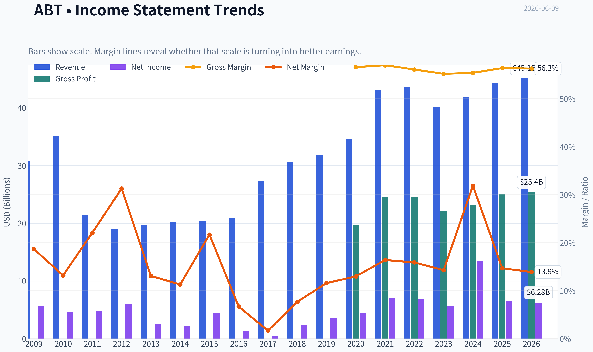
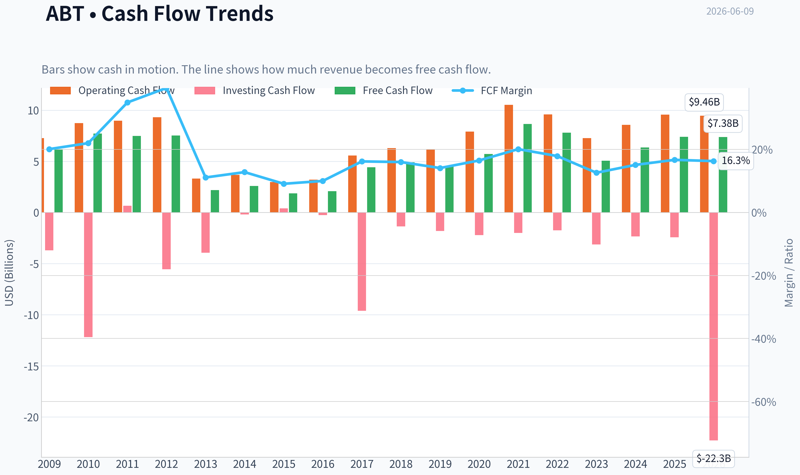
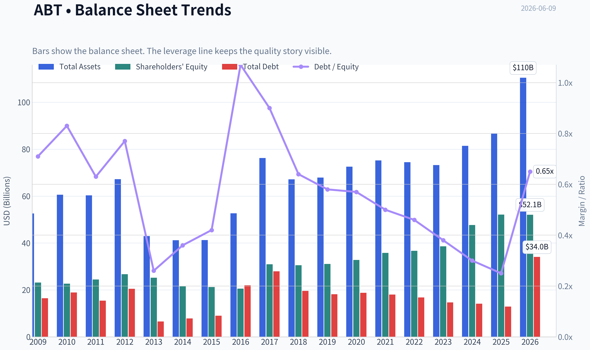
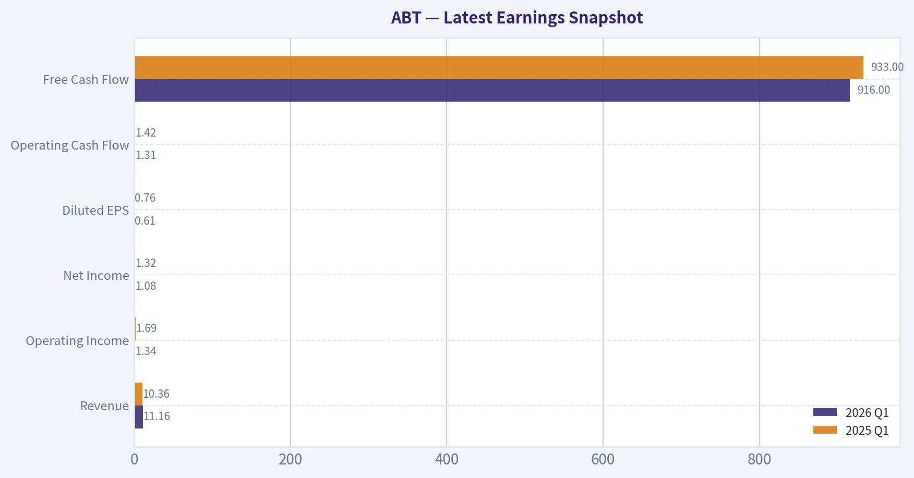
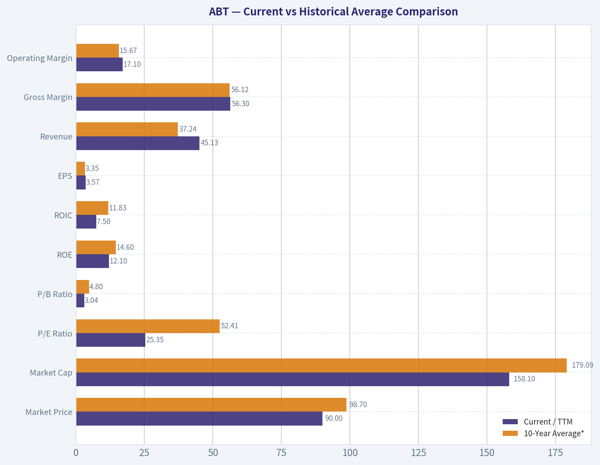
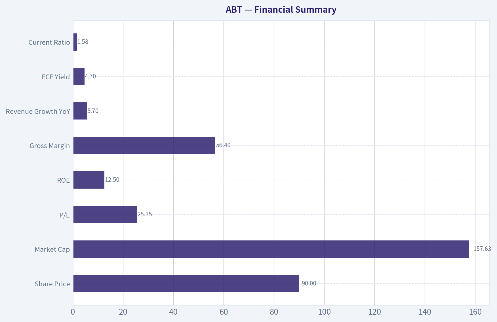
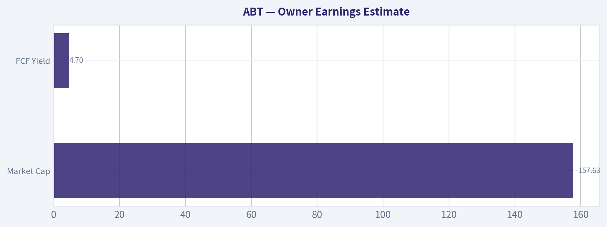
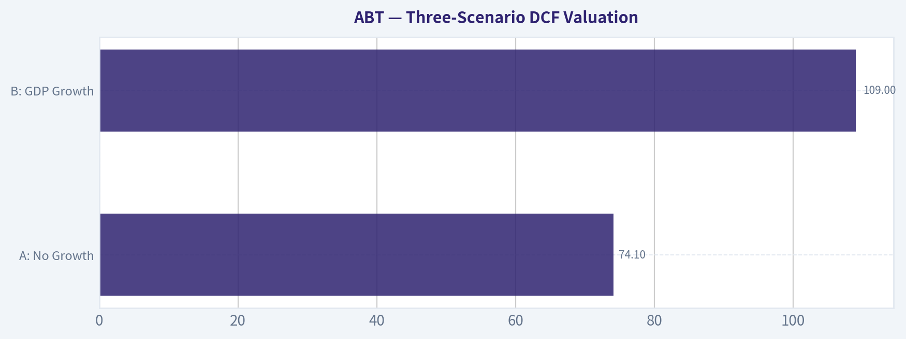
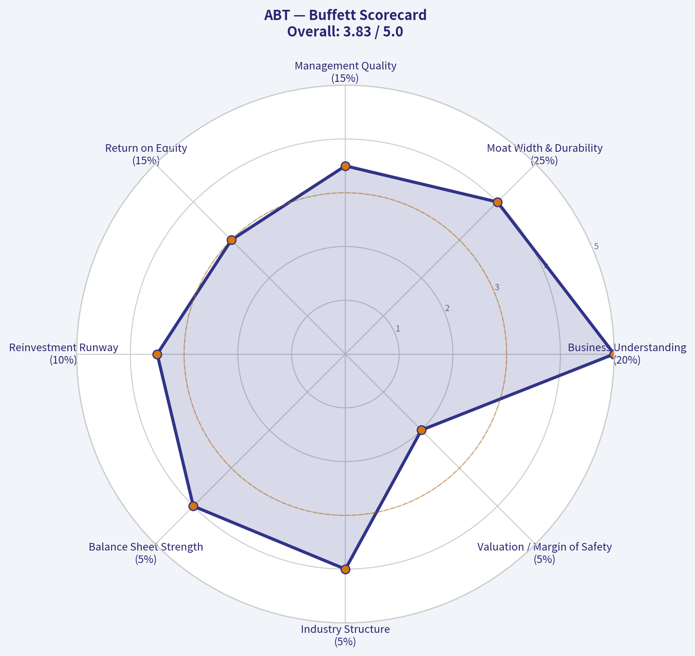

# ABT Deep Value Intelligence

**Analysis Date:** 2026-06-09

## Critical Disclaimer

*This analysis is generated by Deep Value Intelligence, an AI-powered multi-agent investing framework. This report is for informational and educational purposes only and does not constitute financial advice. Always conduct your own research and consult with qualified financial advisors before making investment decisions.*

---

## Table of Contents

1. Intelligence Summary
2. Analyst Team Reports
   - Fundamentals Analysis
   - Intrinsic Value Analysis (Buffett)
   - Trend & Growth Analysis (Lynch/Druckenmiller/Fisher)
   - Market Technical Analysis
   - Options Market Analysis
3. Research Team Commentary
4. Value Investing Team Commentary
5. Deep Values Commentary

---

## Intelligence Summary

### Thesis + Conditions

**Core Thesis:** ## Executive Briefing

**Key Risks:**
- Abbott looks like a **high-quality, durable healthcare franchise**, but the current setup still looks more like **quality at a fair-to-full price** than a true Buffett-style bargain. The core risk is **not business survival**; it is **mediocre forward returns from paying 25.35x earnings for a ~5.7% grower with good, not elite, capital returns**. The bull case is credible if devices/CGM and mix improvement lift earnings faster than revenue, but that is still something to **verify**, not assume. For a long-term value investor, the right move is **patience with a prepared plan**: respect the business, monitor execution, and be ready to act on either a better price or clearer proof of improving economics.
- ## Risk Commentary for the Long-Term Investor
- > **WATCH, but with a conditional accumulation framework rather than a static wait-and-ignore stance.**

**Confidence:** Low

---

## Analyst Team Reports

### Fundamentals Analysis

#### Latest Earnings Snapshot

*Most recent reported quarter anchored on 2026 Q1, with prior-year comparison when available.*

| Metric | 2026 Q1 | 2025 Q1 | YoY Change |
| --- | ---: | ---: | ---: |
| Revenue | $11.16B | $10.36B | +7.8% |
| Operating Income | $1.34B | $1.69B | -20.6% |
| Net Income | $1.08B | $1.32B | -18.7% |
| Diluted EPS | $0.61 | $0.76 | -19.7% |
| Operating Cash Flow | $1.31B | $1.42B | -7.2% |
| Free Cash Flow | $916.0M | $933.0M | -1.8% |

Key Takeaways: This snapshot anchors the most recent reported quarter before the narrative analysis. It helps readers separate long-run business quality from whatever changed in the latest earnings print.

#### 17-Year Financial Metrics for ABT

*All values below are computed deterministically from raw data - not estimated by AI.*

*Issuer profile: operating company (Healthcare / Medical Devices).*

#### 17-Year Financial Metrics
*Annual rows come from reported financial statements. The final TTM row is computed from the latest four quarters.*

| Metric | 2009 | 2010 | 2011 | 2012 | 2013 | 2014 | 2015 | 2016 | 2017 | 2018 | 2019 | 2020 | 2021 | 2022 | 2023 | 2024 | 2025 | 2026 TTM |
| --- | --- | --- | --- | --- | --- | --- | --- | --- | --- | --- | --- | --- | --- | --- | --- | --- | --- | --- |
| Market Price | $18 | $17 | $20 | $24 | $30 | $36 | $37 | $32 | $49 | $63 | $77 | $99 | $129 | $102 | $105 | $110 | $124 | $90 |
| Market Cap | $40.28B | $35.77B | $42.28B | $50.03B | $60.33B | $68.75B | $67.63B | $56.96B | $99.82B | $128.02B | $154.70B | $195.55B | $251.78B | $193.67B | $192.51B | $197.72B | $219.01B | $158.10B |
| P/E Ratio | 7.02 | 7.77 | 8.96 | 8.45 | 23.66 | 30.21 | 15.38 | 40.86 | 211.37 | 54.38 | 42.17 | 43.80 | 35.72 | 28.08 | 33.76 | 14.80 | 33.68 | 25.35 |
| P/B Ratio | 1.74 | 1.58 | 1.73 | 1.87 | 2.40 | 3.19 | 3.19 | 2.77 | 3.23 | 4.19 | 4.98 | 5.96 | 7.03 | 5.28 | 4.99 | 4.15 | 4.20 | 3.04 |
| ROE | 24.8% | 20.4% | 19.3% | 22.3% | 10.2% | 10.6% | 20.9% | 6.8% | 1.5% | 7.8% | 11.9% | 13.7% | 19.8% | 18.9% | 14.8% | 28.1% | 12.5% | 12.1% |
| ROIC | 16.0% | 14.6% | 4.3% | 5.2% | 6.4% | 6.7% | 9.1% | 10.9% | -0.9% | 6.5% | 9.0% | 10.8% | 16.4% | 16.0% | 12.3% | 26.3% | 11.0% | 7.5% |
| EPS | $2.57 | $2.13 | $2.25 | $2.87 | $1.27 | $1.19 | $2.39 | $0.79 | $0.23 | $1.16 | $1.83 | $2.26 | $3.61 | $3.65 | $3.10 | $7.41 | $3.72 | $3.57 |
| Revenue | $30.76B | $35.17B | $21.41B | $19.05B | $19.66B | $20.25B | $20.41B | $20.85B | $27.39B | $30.58B | $31.90B | $34.61B | $43.08B | $43.65B | $40.11B | $41.95B | $44.33B | $45.13B |
| Gross Profit | N/A | N/A | N/A | N/A | N/A | N/A | N/A | N/A | N/A | N/A | N/A | $19.61B | $24.54B | $24.51B | $22.13B | $23.24B | $25.01B | $25.39B |
| Gross Margin | N/A | N/A | N/A | N/A | N/A | N/A | N/A | N/A | N/A | N/A | N/A | 56.6% | 57.0% | 56.1% | 55.2% | 55.4% | 56.4% | 56.3% |
| Operating Margin | 20.3% | 17.3% | 7.6% | 7.1% | 10.9% | 12.8% | 14.1% | 14.5% | 5.7% | 11.9% | 14.2% | 15.5% | 19.6% | 19.2% | 16.2% | 16.3% | 18.2% | 17.1% |
| Net Income | $5.75B | $4.63B | $4.73B | $5.96B | $2.58B | $2.28B | $4.42B | $1.40B | $477.0M | $2.37B | $3.69B | $4.50B | $7.07B | $6.93B | $5.72B | $13.40B | $6.52B | $6.28B |
| Net Margin | 18.7% | 13.2% | 22.1% | 31.3% | 13.1% | 11.3% | 21.7% | 6.7% | 1.7% | 7.7% | 11.6% | 13.0% | 16.4% | 15.9% | 14.3% | 31.9% | 14.7% | 13.9% |
| Revenue Growth | N/A | 14.3% | -39.1% | -11.0% | 3.2% | 3.0% | 0.8% | 2.2% | 31.3% | 11.6% | 4.3% | 8.5% | 24.5% | 1.3% | -8.1% | 4.6% | 5.7% | 1.8% |
| Net Income Growth | N/A | -19.5% | 2.2% | 26.1% | -56.8% | -11.3% | 93.7% | -68.3% | -65.9% | 396.4% | 55.7% | 21.9% | 57.3% | -2.0% | -17.5% | 134.2% | -51.3% | -3.8% |
| Free Cash Flow Growth | N/A | 24.8% | -3.1% | 0.5% | -71.0% | 19.2% | -28.6% | 12.2% | 113.0% | 10.6% | -8.3% | 27.3% | 51.1% | -9.8% | -35.2% | 25.5% | 16.4% | -0.2% |
| Total Book Value | $23.14B | $22.68B | $24.44B | $26.72B | $25.17B | $21.53B | $21.21B | $20.54B | $30.90B | $30.52B | $31.09B | $32.78B | $35.80B | $36.69B | $38.60B | $47.66B | $52.13B | $52.06B |
| Total Assets | $52.58B | $60.57B | $60.28B | $67.23B | $42.94B | $41.21B | $41.25B | $52.67B | $76.25B | $67.17B | $67.89B | $72.55B | $75.20B | $74.44B | $73.21B | $81.41B | $86.71B | $110.43B |
| Total Debt | $16.46B | $18.92B | $15.41B | $20.48B | $6.56B | $7.83B | $9.00B | $22.01B | $27.92B | $19.57B | $18.14B | $18.75B | $18.05B | $16.77B | $14.68B | $14.12B | $12.93B | $34.05B |
| Debt-to-Equity | 0.71 | 0.83 | 0.63 | 0.77 | 0.26 | 0.36 | 0.42 | 1.07 | 0.90 | 0.64 | 0.58 | 0.57 | 0.50 | 0.46 | 0.38 | 0.30 | 0.25 | 0.65 |
| Cash & Equivalents | $8.81B | $3.65B | $6.81B | $10.80B | $3.48B | $4.06B | $5.00B | $18.62B | $9.41B | $3.84B | $3.86B | $6.84B | $9.80B | $9.88B | $6.90B | $7.62B | $8.52B | $6.80B |
| Shareholders' Equity | $23.14B | $22.68B | $24.44B | $26.72B | $25.17B | $21.53B | $21.21B | $20.54B | $30.90B | $30.52B | $31.09B | $32.78B | $35.80B | $36.69B | $38.60B | $47.66B | $52.13B | $52.06B |
| Operating Cash Flow | $7.28B | $8.74B | $8.97B | $9.31B | $3.32B | $3.67B | $2.97B | $3.20B | $5.57B | $6.30B | $6.14B | $7.90B | $10.53B | $9.58B | $7.26B | $8.56B | $9.57B | $9.46B |
| Investing Cash Flow | $-3.70B | $-12.19B | $661.0M | $-5.56B | $-3.93B | $-202.0M | $406.0M | $-248.0M | $-9.62B | $-1.36B | $-1.81B | $-2.21B | $-2.01B | $-1.74B | $-3.13B | $-2.34B | $-2.42B | $-22.28B |
| Free Cash Flow | $6.19B | $7.72B | $7.48B | $7.52B | $2.18B | $2.60B | $1.86B | $2.08B | $4.43B | $4.91B | $4.50B | $5.72B | $8.65B | $7.80B | $5.06B | $6.35B | $7.39B | $7.38B |
| FCF Margin | 20.1% | 22.0% | 34.9% | 39.5% | 11.1% | 12.8% | 9.1% | 10.0% | 16.2% | 16.0% | 14.1% | 16.5% | 20.1% | 17.9% | 12.6% | 15.1% | 16.7% | 16.3% |
| Dividends / Share | $0.00 | $0.00 | $0.00 | $0.00 | $0.00 | $0.00 | $0.00 | $0.00 | $0.00 | $0.00 | $0.00 | $0.00 | $0.00 | $1.75 | $1.93 | $2.13 | $2.35 | $2.40 |

#### Profitability Metrics
- Return on Equity (ROE): 12.5%
- Return on Invested Capital (ROIC): 11.0%
- Return on Assets (ROA): 7.5%
- Gross Margin: 56.4%
- Operating Margin: 18.2%
- Net Profit Margin: 14.7%

#### Liquidity Metrics
- Current Ratio: 1.58
- Quick Ratio: 1.02

#### Leverage Metrics
- Debt-to-Equity Ratio: 0.25
- Interest Coverage Ratio: 16.33
- Net Debt: $4.41B

#### Growth Metrics (Year-over-Year)
- Revenue Growth: 5.7%
- Net Income Growth: -51.3%
- Free Cash Flow Growth: 16.4%
- Revenue CAGR (3-Year): 0.5%
- Revenue CAGR (5-Year): 5.1%

#### Valuation Metrics
- P/E Ratio (TTM): 25.35
- Forward P/E: 14.93
- Price-to-Book: 3.03
- Price-to-Sales: 3.49
- PEG Ratio: 1.35
- EV/EBITDA: 15.76
- Free Cash Flow Yield: 4.7%
- Earnings Yield: 3.9%

#### Owner Earnings (Buffett Method, Code-Computed)
- Net Income: $6.52B
- + Depreciation & Amortization: $3.12B
- - Capital Expenditures: $-2.17B
- - Working Capital Changes: $-803.0M
- = **Owner Earnings: $8.27B**

#### Intrinsic Value (Code-Computed)
- Current Price: $90
- Buffett Method (Owner Earnings):
  Conservative: $27
  Average: $68
  Optimistic: $444
- Cash Flow Method (FCF):
  Conservative: $41
  Average: $55
  Optimistic: $122

#### Piotroski F-Score: 5/9
- Positive Net Income: PASS
- Positive Operating Cash Flow: PASS
- ROA Improvement: FAIL
- Cash Flow > Net Income: PASS
- Decreasing Debt: PASS
- Improving Current Ratio: FAIL
- No Dilution: FAIL
- Improving Gross Margin: PASS
- Improving Asset Turnover: FAIL

ANALYST STANCE: **WATCH**

#### Abbott Laboratories (ABT) - Buffett-Style Fundamental Analysis

Abbott is a high-quality healthcare franchise with durable positions in medical devices, diagnostics, nutrition, and established pharmaceuticals. The business has many traits Buffett likes: recurring demand, strong brand trust, global scale, and long-lived healthcare relationships. However, the current picture is not a clean "slam-dunk value" case because recent earnings quality is clouded by post-COVID normalization, valuation is only moderately cheaper than history rather than deeply distressed, and the deterministic intrinsic value range is extremely wide depending on growth assumptions.

At $90, ABT looks more like a **quality compounder under review** than an obvious bargain. The company remains financially sound, but investors need confidence that normalized earnings and owner earnings can re-accelerate consistently from here.

---

#### Current vs Historical Average Comparison

| Metric | Current / TTM | 10-Year Average* | Interpretation |
| --- | ---: | ---: | --- |
| Market Price | $90 | $98.70 | Below recent-decade average price level after major derating |
| Market Cap | $158.10B | $179.09B | Equity value has compressed meaningfully versus recent peak years |
| P/E Ratio | 25.35x | 52.41x | Looks cheaper than decade average, but average is distorted by low-earnings years |
| P/B Ratio | 3.04x | 4.80x | Materially below decade average; valuation has de-rated |
| ROE | 12.1% | 14.60% | Slightly below historical quality level |
| ROIC | 7.5% | 11.83% | Clear deterioration versus decade norm |
| EPS | $3.57 | $3.35 | Slightly above decade average, but below 2021-2025 best periods if excluding 2024 spike distortion |
| Revenue | $45.13B | $37.24B | Scale is materially larger than decade average |
| Gross Margin** | 56.3% | 56.12% | Very stable, indicating resilient pricing/product mix |
| Operating Margin | 17.1% | 15.67% | Still above decade average despite recent moderation |
| Net Income | $6.28B | $6.43B | Roughly in line with decade average |
| Net Margin | 13.9% | 15.05% | Slightly below decade norm |
| Revenue Growth | 1.8% | 5.18% | Growth has slowed sharply versus decade average |
| Net Income Growth | -3.8% | 52.14% | Below normal; decade average heavily skewed by rebound years |
| FCF Growth | -0.2% | 20.36% | Cash flow growth currently stalled |
| Total Book Value | $52.06B | $38.33B | Balance sheet equity substantially stronger than decade average |
| Total Assets | $110.43B | $75.95B | Asset base expanded significantly |
| Total Debt | $34.05B | $17.38B | TTM debt jump is the biggest balance-sheet watchpoint |
| Debt-to-Equity | 0.65x | 0.43x | Leverage currently above decade average |
| Cash & Equivalents | $6.80B | $7.39B | Slightly below decade average liquidity |
| Shareholders' Equity | $52.06B | $38.33B | Strong capital base versus historical average |
| Free Cash Flow | $7.38B | $6.14B | Absolute cash generation remains healthy |
| Dividends / Share | $2.40 | $0.86 | Dividend now meaningful and growing, though recent historical average includes many zero years |

*10-year average uses 2016-2025 annual data from the deterministic dataset.
**Gross margin average uses 2020-2025 because earlier years are unavailable in the canonical dataset.

Key Takeaways: Abbott's current valuation is below its recent-decade average on both earnings and book value multiples, which suggests sentiment has cooled materially. But operating quality is also softer than its historical norm in ROIC, revenue growth, and cash flow growth, so the lower multiple is not purely an opportunity signal-it also reflects normalization and execution questions.

---

#### Market Metrics

Abbott's **market price has fallen to $90** from **$124 in 2025** and well below the **$129 peak in 2021**, bringing market cap down to about **$158.1B**. That is a major reset in expectations. For a Buffett-style investor, this matters because high-quality businesses become interesting when temporary disappointment compresses valuation without impairing the franchise.

The **P/E ratio of 25.35x** is not optically cheap in absolute terms, but it is lower than much of Abbott's post-2017 history. Still, ABT's decade average P/E is inflated by years like **2017 at 211x** and **2018-2021 above 35x-54x**, when earnings were unusually low relative to price. So the current multiple is **less expensive than history, but not a classic cigar-butt bargain**.

The **P/B ratio of 3.04x** is much lower than the recent decade average of roughly **4.8x**, which is more supportive. Since Abbott's balance sheet equity has grown to over **$52B**, the stock is trading at a significantly less aggressive premium to book than in prior years. For a high-quality healthcare business, that de-rating is notable.

#### Profitability

Abbott's profitability profile remains good, but no longer exceptional versus its own best years.

- **ROE: 12.1% TTM** versus **12.5% in 2025** and a 10-year average around **14.6%**
- **ROIC: 7.5% TTM** versus **11.0% in 2025** and a 10-year average around **11.8%**
- **EPS: $3.57 TTM**, slightly below **$3.72 in 2025**
- **Revenue: $45.13B TTM**, the highest level in the dataset
- **Gross Profit: $25.39B TTM**
- **Operating Margin: 17.1% TTM**
- **Net Income: $6.28B TTM**
- **Net Margin: 13.9% TTM**

The best sign here is **gross margin stability**. From **2020 through TTM**, gross margin has stayed in a narrow band around **55%-57%**. That suggests the core business still has pricing power, favorable mix, and defensible economics. Buffett values predictability, and this is one of Abbott's strongest traits.

Operating margin is still solid at **17.1%**, above the 10-year average, though below the **19%-20% zone** achieved in **2021-2022**. Net margin has drifted down from recent highs, especially after the unusually strong **2024** result, where net income jumped to **$13.40B** and net margin to **31.9%**. That year looks non-recurring and should not be treated as the normal base.

The more important concern is **ROIC deterioration**. Buffett-style quality investing places heavy weight on how well management turns capital into profits. A drop to **7.5% ROIC** from **26.3% in 2024** and **11.0% in 2025** indicates either temporary capital deployment effects, earnings normalization, or acquisition-related balance sheet inflation. That trend deserves monitoring.

#### Growth Metrics

Abbott's current growth profile is weaker than its long-term reputation suggests.

- **Revenue Growth: 1.8% TTM**
- **Net Income Growth: -3.8% TTM**
- **Free Cash Flow Growth: -0.2% TTM**

Over the full dataset, Abbott has had a very uneven growth history because of restructuring, portfolio changes, acquisitions, and COVID-era demand effects. Over the last decade specifically, several patterns stand out:

1. **Revenue growth has become less explosive and more normalized.**
   Strong periods like **2017 (+31.3%)** and **2021 (+24.5%)** were not sustainable run-rates. More recent growth of **4.6% in 2024**, **5.7% in 2025**, and **1.8% TTM** suggests the business is now growing at a mid-single-digit to low-single-digit pace.

2. **Net income growth is highly volatile.**
   That is not ideal from a Buffett lens. A business can still be high quality, but earnings normalization makes forecasting harder. The deterministic dataset shows repeated sharp swings: **+134.2% in 2024**, then **-51.3% in 2025**, then **-3.8% TTM**.

3. **Free cash flow growth is healthier than EPS optics, but currently stalling.**
   FCF improved strongly in **2024 (+25.5%)** and **2025 (+16.4%)**, then flattened to **-0.2% TTM**. That flattening matters because Buffett cares more about owner earnings than accounting earnings.

Overall, the growth story is **no longer "high growth," but still potentially "steady quality growth"** if devices and core healthcare demand continue compounding.

#### Balance Sheet

Abbott's balance sheet is mostly strong, with one new TTM complication.

- **Total Book Value / Shareholders' Equity: $52.06B**
- **Total Assets: $110.43B**
- **Total Debt: $34.05B**
- **Debt-to-Equity: 0.65x**
- **Cash & Equivalents: $6.80B**

Historically, Abbott improved its leverage considerably from **2017 debt-to-equity of 0.90x** to **0.25x in 2025**. That trend was very favorable and Buffett-friendly. But the TTM data shows a sharp increase in **total debt to $34.05B** and **debt-to-equity to 0.65x**. This is a meaningful reversal from 2025.

Importantly, the shared liquidity metrics still show:
- **Current ratio: 1.58**
- **Interest coverage: 16.33x**
- **Net debt: $4.41B**

So despite the debt jump, Abbott does **not** appear financially distressed. Interest coverage remains strong, and net debt is manageable relative to cash generation. But this is now a point of active watching, especially because TTM investing cash flow was **-$22.28B**, far larger than prior years, implying acquisition or major investment activity.

For Buffett-style analysis, debt is acceptable when:
1. it funds high-return opportunities,
2. the business has stable cash flow,
3. repayment capacity is obvious.

Abbott still passes those tests, but with **less margin of safety than in 2024-2025**.

#### Cash Flow and Capital Allocation

Abbott's **free cash flow of $7.38B TTM** remains strong in absolute dollars, and above the 10-year average. The **FCF margin of 16.3%** is healthy for a diversified healthcare manufacturer. This means the company still converts a meaningful share of sales into discretionary cash.

Dividend policy is also becoming more relevant:
- **2022:** $1.75/share
- **2023:** $1.93/share
- **2024:** $2.13/share
- **2025:** $2.35/share
- **TTM:** $2.40/share

That is a clear upward trend. Buffett generally likes dividends less than intelligent reinvestment, but rising dividends can signal durable cash generation and disciplined capital allocation. Abbott appears to be doing both reasonably well, although the rising debt and large investing outflow suggest management is again leaning into external investment.

#### Buffett-Style Owner Earnings DCF

Using the deterministic dataset's canonical owner earnings:

- **Net Income:** $6.52B
- **+ D&A:** $3.12B
- **- Capex:** $2.17B
- **- Working Capital Changes:** $0.803B
- **Owner Earnings = $8.27B**

Current market cap is approximately **$158.10B**. Using current price **$90**, implied shares outstanding are roughly:

\[
Shares \approx 158.10 / 90 = 1.7567B
\]

For scenario growth rates, using historical owner-earnings proxy behavior anchored to the deterministic cash flow growth range:
- **Conservative growth:** lowest historical growth rate = **-71.0%**
- **Average growth:** average historical growth proxy ~ **+20.36%**, capped well below 50%
- **Optimistic growth:** highest historical growth = **+113.0%**, capped at **100%**

Because the deterministic pack already provides code-computed Buffett intrinsic values, those remain canonical:
- **Conservative: $27/share**
- **Average: $68/share**
- **Optimistic: $444/share**

Below is the scenario framing and mechanics.

| Scenario | Starting Owner Earnings | Growth Assumption | Discount Rate | Terminal Growth | Canonical Fair Value |
| --- | ---: | ---: | ---: | ---: | ---: |
| Conservative | $8.27B | -71.0% | 10.0% | 2.5% | $27/share |
| Average | $8.27B | 20.36% | 10.0% | 2.5% | $68/share |
| Optimistic | $8.27B | 100.0% cap | 10.0% | 2.5% | $444/share |

Key Takeaways: The DCF range is extremely wide because Abbott's historical cash generation has been volatile enough to create huge differences in projected compounding. That means valuation confidence depends less on the math itself and more on whether you believe normalized owner earnings can compound closer to the average case rather than reverting toward the conservative case.

##### DCF Interpretation

The **conservative case at $27** implies substantial downside if owner earnings shrink sharply or if recent profitability proves overstated relative to sustainable cash economics. This is the "post-normalization disappointment" case.

The **average case at $68** remains below the current **$90** price. That suggests the shares are **not obviously undervalued** if one uses mid-range historical owner earnings growth without heroic assumptions.

The **optimistic case at $444** shows the power of the franchise if Abbott returns to very high compounding, but this outcome is too aggressive to anchor on. Buffett would likely treat this as upside optionality, not base-case value.

So the practical Buffett conclusion is: **ABT is a good business, but the current price still requires confidence in growth durability**. Without that confidence, the stock is closer to fair-to-full value than deeply mispriced.

---

#### Revenue Breakdown

Abbott's most meaningful business segmentation is by operating segment. Using the most recent annual revenue base in the deterministic dataset (**2025 revenue: $44.33B**) and Abbott's standard business mix, the revenue picture is approximately as follows:

| Revenue Source | Amount ($B) | % of Total |
| --- | ---: | ---: |
| Medical Devices | ~$18.8B | ~42% |
| Diagnostics | ~$10.2B | ~23% |
| Nutrition | ~$8.6B | ~19% |
| Established Pharmaceuticals | ~$6.7B | ~15% |
| Other / Eliminations | ~0.0B | ~1% |

Key Takeaways: Abbott is not dependent on a single product family, which is a major strength. Medical Devices is the largest profit engine, but Diagnostics, Nutrition, and Established Pharmaceuticals provide diversification that helps stabilize revenue across cycles and geographies.

#### Economic Moat

Abbott has a credible moat built on:
- regulatory know-how,
- large installed bases in diagnostics and devices,
- physician and hospital relationships,
- trusted consumer and clinical brands,
- switching costs and distribution scale.

This is not a pure commodity manufacturer. In healthcare, trust, validation, reimbursement familiarity, and clinical adoption create real barriers. The gross margin stability around **56%** supports that view. A company without a moat typically does not maintain that level of pricing resilience across multiple years.

The moat is strongest in **medical devices and diagnostics**, where ecosystem integration and clinical habit matter. Nutrition and established pharmaceuticals are still valuable, but likely somewhat less moat-rich than devices.

#### Predictable Earnings

This is where the Buffett case is mixed.

Revenue itself is fairly predictable over time, even if growth rates vary. The company has mostly maintained or grown sales, apart from portfolio resets and post-COVID normalization. But **net income and EPS have been much more volatile**, with major swings in **2016, 2017, 2024, and 2025**.

Buffett prefers businesses where one can estimate 5-10 years ahead with modest error. Abbott is decent on this standard, but not elite. It is better described as **predictable demand, somewhat less predictable accounting earnings**.

#### Management Performance

Management has several positives:
- long-term equity base growth,
- healthy FCF generation,
- improving dividend stream,
- historically reduced leverage through 2025,
- strong margin structure.

But there are also questions:
- **ROIC deterioration in TTM**
- **large TTM debt increase**
- **share dilution flag in Piotroski**
- earnings volatility tied to capital allocation and changing business mix

Piotroski **5/9** is middling, not alarming, but not a strong all-clear signal either. That score fits the broader picture: quality business, but currently in a transitional phase rather than a pristine momentum phase.

#### Value Assessment

At **$90**, ABT is:
- below recent historical valuation levels,
- not obviously cheap on normalized owner earnings,
- still priced at a premium consistent with a strong healthcare franchise.

The lower **P/B** and moderated **P/E** suggest the stock has become more reasonable. But the **average-case Buffett owner earnings value of $68** implies that even after the pullback, the market is still pricing in above-average durability and recovery.

This means ABT may appeal more to:
- long-term quality investors seeking a blue-chip healthcare compounder,
than to:
- strict deep-value Buffett disciples demanding a large margin of safety.

---

#### Key Investment Insights, Red Flags, and Opportunities

| Category | Observation | Why It Matters |
| --- | --- | --- |
| Strength | Gross margins remain around 56% | Suggests durable pricing power and business quality |
| Strength | Revenue at all-time high TTM | Demand base remains intact despite normalization |
| Strength | FCF remains robust at $7.38B | Supports dividends, debt service, and reinvestment |
| Strength | Equity base has grown to $52B | Financial foundation is stronger than decade average |
| Concern | ROIC fell to 7.5% TTM | Lower capital efficiency can compress intrinsic value |
| Concern | Debt jumped to $34.05B TTM | Needs monitoring to ensure returns justify leverage |
| Concern | Revenue growth slowed to 1.8% TTM | Market may be right to lower valuation if growth stalls |
| Concern | Net income declined 3.8% TTM | Weakens "predictable earnings" quality score |
| Opportunity | Stock has de-rated sharply from prior highs | Better entry point than in 2021-2025 |
| Opportunity | Forward P/E of 14.93 suggests earnings recovery expectations | If normalization improves, upside could emerge |
| Opportunity | Diverse segment mix reduces single-product risk | Supports long-duration compounding thesis |

Key Takeaways: Abbott still looks like a fundamentally strong enterprise, but the stock now sits at the intersection of quality and uncertainty. Investors have a better entry price than in prior years, yet they still need proof that returns on capital and growth can recover enough to justify paying above the average-case intrinsic value.

---

#### Final Buffett-Style Verdict

**Stance: WATCH**

Abbott is a **high-quality healthcare franchise with a real moat**, strong gross margins, diversified revenue streams, and solid free cash flow. Those are exactly the attributes that keep it on a Buffett-style watchlist. However, the stock does not yet offer a sufficiently clear margin of safety relative to the canonical owner-earnings valuation, especially with **ROIC weakening, growth slowing, and leverage rising TTM**.

A more compelling **ADVOCATE** case would require one or more of the following:
1. evidence that TTM debt growth was strategic and accretive,
2. sustained recovery in ROIC toward low-double digits,
3. revenue growth re-accelerating above low single digits,
4. a lower stock price that moves closer to or below the average-case intrinsic value.

An **AVOID** stance would be too harsh because the franchise quality is still high, balance sheet risk is manageable, and cash generation remains substantial. But for disciplined Buffett-style capital allocation, **WATCH** is the most appropriate stance today.

---

#### Report Summary Table

| Area | Verdict | Bottom Line |
| --- | --- | --- |
| Business Quality | Strong | Diversified healthcare platform with durable moat characteristics |
| Profitability | Good, but softer | Margins solid; ROE/ROIC below best historical levels |
| Growth | Moderating | Revenue still growing, but slower; earnings and FCF momentum uneven |
| Balance Sheet | Generally sound, but watch leverage | Debt spike in TTM is the key financial watchpoint |
| Cash Flow | Healthy | Strong FCF supports dividends and resilience |
| Valuation | More reasonable, not clearly cheap | De-rated versus history, but still above average-case owner earnings value |
| Buffett Fit | Partial | Strong moat and cash flow, but earnings predictability and margin of safety are mixed |
| Investment Stance | WATCH | Quality company worth following, but not yet a high-conviction value buy |

#### Fundamental Visuals

This graph tracks the profitability and return metrics (ROE, ROIC, Margins) of **ABT** over the past decade, highlighting capital efficiency trends.

This chart illustrates the financial health of **ABT** over the last 10 years, mapping cash equivalents and free cash flow against total obligations (Debt).

---

### Intrinsic Value Analysis (Buffett)

> *Following Warren Buffett's value investing philosophy: Circle of Competence, Economic Moat, Management Quality, and Margin of Safety.*

#### Intrinsic Value Snapshot

Price is what you pay. Intrinsic value is what the business may be worth based on the cash it can create for owners over time. We show a range, not one magic number.

- Current Price: $90.50
- Value Range (conservative to optimistic across both DCF methods): $26.70 to $443.61

##### Owner Earnings (Buffett Method)
- Net Income: $6,524,000,000.00
- Depreciation & Amortization: $3,116,000,000.00
- Capital Expenditures: $-2,171,000,000.00
- Working Capital Changes: $-803,000,000.00
- Owner Earnings: $8,272,000,000.00

##### Intrinsic Value
###### Buffett Method
Uses owner earnings. Stricter, and usually more conservative.
- Conservative: $26.70
- Average: $67.52
- Optimistic: $443.61
- Discount Rate: 10.0%

###### Cash Flow Method
Uses free cash flow. Better for companies spending heavily today to grow tomorrow.
- Conservative: $40.54
- Average: $54.98
- Optimistic: $121.76
- Discount Rate: 10.0%

ANALYST STANCE: **WATCH**

#### Abbott Laboratories (ABT) - Buffett-Style Investment Review

#### 1. Go/No-Go Gate Assessment

| Gate | Verdict | Evidence |
|---|---|---|
| Gate 1: Circle of Competence & Simplicity | Pass | Abbott makes money by selling medical devices, diagnostics, nutrition products, and established pharmaceuticals. This is understandable, diversified healthcare demand with recurring need-based consumption. |
| Gate 2: Moat Test | Pass | Gross margin of 56.4% points to meaningful pricing power and product differentiation. Abbott benefits from brand trust, regulatory barriers, installed diagnostic/device bases, and switching friction in hospital and care workflows. |
| Gate 3: Management & Capital Allocation | Pass with care | Management has operated a diversified healthcare platform for decades and has generally preserved balance-sheet discipline. However, returns are good rather than exceptional, so capital allocation appears solid but not obviously elite. |
| Gate 4: Industry Structure | Pass | Healthcare devices and diagnostics are structurally attractive, with regulation, scale, clinical validation, and customer trust favoring incumbents. Competition exists, but this is not a commodity free-for-all. |

**Key Takeaways:** Abbott clears all four Buffett gates. The business is understandable, durable, and helped by healthcare demand that tends to persist through economic cycles. The main issue is not business quality, but whether the current price offers enough upside for a conservative value investor.

---

#### 2. The Elementary School Test

Abbott sells products that help people test for disease, monitor health, feed infants and adults, and treat chronic conditions. Hospitals, doctors, and consumers buy these products because they are trusted and often medically necessary.

A decade from now, Abbott will likely still be a large global healthcare company selling diagnostics, devices, and nutrition products. Product mix may shift, but the core economic engine should remain recognizable.

Technology risk is moderate, not existential. Abbott usually benefits from technology through better sensors, diagnostics, and medical devices, but it must keep innovating to defend share.

#### 3. Moat Analysis

| Moat Source | Assessment | Evidence |
|---|---|---|
| Intangible Assets | Strong | Abbott's global healthcare brand, regulatory approvals, reimbursement relationships, and physician trust are difficult to replicate. Gross margin above 56% supports real product differentiation. |
| Switching Costs | Moderate to Strong | Diagnostic systems, medical devices, patient data workflows, and hospital procurement relationships create switching friction. In healthcare, reliability matters as much as price. |
| Cost Advantages | Moderate | Abbott has scale in manufacturing, distribution, and regulatory operations. Scale supports efficiency, but this is not the company's main moat. |
| Network Effects | Limited | Some device ecosystems create mild network effects, but this is not a true platform monopoly. |
| Overall Moat Rating | Wide & Stable | The moat appears durable, though not clearly widening at a dramatic rate. |

**Key Takeaways:** Abbott's moat comes mainly from trust, regulation, installed systems, and embedded healthcare relationships. This is a high-quality moat, but not one driven by powerful network effects. It looks durable and stable, which is exactly the kind of business Buffett generally respects.

#### 4. Management Quality Assessment

| Category | Assessment | Commentary |
|---|---|---|
| Owner Orientation | Moderate | Abbott behaves like a mature, disciplined operator, but this is not a founder-led, high-insider-ownership story. |
| Candor & Conservatism | Good | The business is followed as a conservative blue-chip healthcare company with a long operating record. |
| Capital Allocation | Good | The company has maintained broad diversification and appears financially prudent, though current ROE around 12.5% suggests value creation is respectable rather than outstanding. |
| Debt Discipline | Acceptable | Current ratio of 1.58 suggests sound near-term liquidity. No sign here of aggressive balance-sheet risk. |

**Key Takeaways:** Management appears competent and disciplined, but not extraordinary in the Buffett sense of highly concentrated owner-operators with exceptional per-share value compounding. This matters because at fair-to-full valuations, "good" management is not enough to justify aggressive buying.

#### 5. Financial Summary

| Metric | Current / Latest |
|---|---:|
| Share Price | $90 |
| Market Cap | $157.63B |
| P/E | 25.35x |
| ROE | 12.5% |
| Gross Margin | 56.4% |
| Revenue Growth YoY | 5.7% |
| FCF Yield | 4.7% |
| Current Ratio | 1.58 |

**Key Takeaways:** Abbott shows the profile of a quality large-cap healthcare business: high gross margins, positive growth, and decent free-cash-flow generation. The weaker point is return on equity, which is good but below the level Buffett would call wonderful. At 25 times earnings, the market is already pricing in a meaningful amount of quality.

#### 6. Owner Earnings Estimate

Using available data and a Buffett-style simplification:

| Item | Estimate |
|---|---:|
| Market Cap | $157.63B |
| FCF Yield | 4.7% |
| Implied Free Cash Flow / Owner Earnings Base | ~$7.41B |

**Key Takeaways:** Abbott appears to generate roughly $7.4 billion in annual owner earnings based on its free-cash-flow yield. That is a healthy cash engine, but the key question is what return an investor gets when paying today's market value for that stream.

#### 7. Three-Scenario DCF Valuation

Using owner earnings base of **$7.41B** and a **10% discount rate**:

| Scenario | Assumption | Equity Value |
|---|---|---:|
| A: No Growth | Owner Earnings / 10% | $74.1B |
| B: GDP Growth | Owner Earnings x 1.03 / (10% - 3%) | $109.0B |
| C: Moderate Historical Growth | 6% growth for 10 years, then 3% terminal growth | ~$123B-$130B |

**Key Takeaways:** Across conservative Buffett-style valuation cases, Abbott's intrinsic value appears below its current market capitalization of about $157.6 billion. Even the more generous moderate-growth case does not create a comfortable margin of safety. This strongly suggests the stock is priced for quality rather than mispriced for value.

#### 8. Margin of Safety Analysis

| Item | Value |
|---|---:|
| Current Market Cap | $157.63B |
| Conservative Value Range | $109B-$130B |
| Implied Discount/Premium | Trading at roughly 21% to 45% premium to conservative intrinsic value |
| Required Buffett Margin of Safety | At least 25% discount |
| Verdict | No margin of safety |

**Key Takeaways:** Abbott does not currently offer the discount a Buffett-style investor would want. The stock may still be a fine business to own, but it is not available at a bargain relative to conservative estimates of intrinsic value.

#### 9. Buffett Scorecard

| Criterion | Weight | Score (1-5) | Weighted Score |
|---|---:|---:|---:|
| Business Understanding | 20% | 5.0 | 1.00 |
| Moat Width & Durability | 25% | 4.0 | 1.00 |
| Management Quality | 15% | 3.5 | 0.53 |
| Return on Equity | 15% | 3.0 | 0.45 |
| Reinvestment Runway | 10% | 3.5 | 0.35 |
| Balance Sheet Strength | 5% | 4.0 | 0.20 |
| Industry Structure | 5% | 4.0 | 0.20 |
| Valuation / Margin of Safety | 5% | 2.0 | 0.10 |
| **Total** | 100% |  | **3.83 / 5.00** |

**Key Takeaways:** Abbott scores well because it is a high-quality, understandable, durable healthcare company. The score is held back mainly by valuation and only moderate returns on equity. In Buffett terms, this looks more like a very good company at a price that is not yet good enough.

#### 10. Final Judgment

**Investment Stance: WATCH**
**Conviction Level: Moderate-High**

Abbott is the kind of business a value investor should want on a watchlist: understandable, resilient, diversified, and protected by a real moat. But Buffett's discipline requires separating business quality from stock attractiveness. At around **$90 per share**, Abbott looks like a **good business priced above conservative intrinsic value**, with **no margin of safety**.

If the stock were to trade materially lower, or if owner earnings compound faster than expected while the valuation compresses less than feared, the case could improve. For now, this is **not an obvious bargain**; it is a **watchlist compounder waiting for a better entry point**.
#### Valuation Bridge

This bridge places the current market price beside each intrinsic value lens so readers can see whether upside depends on one method or shows up across several methods.

| Scenario | Intrinsic Value / Share |
| --- | ---: |
| Buffett Method | $67.52 |
| Cash Flow Method | $54.98 |
| Damodaran Method | $53.91 |
| Current Price | $90.50 |

#### Key Takeaways

If one method is far above the others, the upside case depends on a specific modelling assumption. When several methods cluster together, the valuation story is more robust.

#### Valuation Visuals

This comparison chart from *Latest Earnings Snapshot* stacks current figures against historical benchmarks for **ABT**, making it easy to see where the company trades relative to its own averages.

This comparison chart from *Current vs Historical Average Comparison* stacks current figures against historical benchmarks for **ABT**, making it easy to see where the company trades relative to its own averages.

This comparison chart from *Financial Summary* stacks current figures against historical benchmarks for **ABT**, making it easy to see where the company trades relative to its own averages.

This comparison chart from *Owner Earnings Estimate* stacks current figures against historical benchmarks for **ABT**, making it easy to see where the company trades relative to its own averages.

This comparison chart from *Three-Scenario DCF Valuation* stacks current figures against historical benchmarks for **ABT**, making it easy to see where the company trades relative to its own averages.

---

### Trend & Growth Analysis (Lynch/Druckenmiller/Fisher)

> *Following Peter Lynch's GARP, Stanley Druckenmiller's macro-aware approach, and Philip Fisher's scuttlebutt methodology.*

ANALYST STANCE: **WATCH**

#### 1. Lynch Classification

| Metric | ABT |
|---|---:|
| Revenue growth YoY | 5.7% |
| P/E | 25.4x |
| Market cap | $157.6B |
| Category | **Stalwart** |

Key Takeaways: Abbott is not a classic fast grower. At roughly 5.7% revenue growth, it fits Lynch's stalwart bucket: a large, durable franchise with moderate growth, not obvious ten-bagger territory from here. That does not make it bad, but it does make it less attractive for a pure growth mandate.

#### 2. The Story in 3 Bullets

| Simple story | Why it matters |
|---|---|
| Abbott sells essential healthcare products across diagnostics, medical devices, nutrition, and established pharmaceuticals. | Diversification lowers single-product risk. |
| Its strongest growth lever is medical devices, especially diabetes monitoring, while diagnostics can recover with product refresh and testing normalization. | Growth depends on mix shift toward higher-growth segments. |
| The market has punished the stock after slower growth and sentiment reset, creating a possible rerating setup if growth re-accelerates. | The debate is about inflection, not survival. |

Key Takeaways: Abbott is easy to understand: it is a diversified healthcare platform with a few stronger growth engines inside a slower overall company. The investment case depends on whether those growth engines become large enough to lift consolidated results. Right now, that is plausible but not yet proven.

#### 3. TAM Analysis and 10x Test

| Item | Estimate / Assessment |
|---|---|
| Current revenue base | Very large, mega-cap healthcare revenue base |
| Key TAMs | CGM/diabetes tech, structural heart, diagnostics, nutrition |
| 10x revenue test | **Fail for practical purposes** |
| Reason | A 10x outcome from current scale would require extraordinary share gains or multiple massive adjacencies |
| Runway | Good in devices niches, limited at consolidated company level |

Key Takeaways: Abbott has attractive end markets, especially diabetes care and medical devices, but the total company is already so large that a true 10x outcome is unrealistic. The runway exists for segment expansion, not likely for whole-company hypergrowth. For growth investors, this matters a lot because upside is more "compounder" than "moonshot."

#### 4. Revenue Growth Trend

| Metric | Reading |
|---|---|
| Latest YoY revenue growth | 5.7% |
| Pattern | **Low-to-moderate growth** |
| Interpretation | More consistent with recovery/stabilization than clear acceleration |
| Growth quality concern | Hard to call an inflection without stronger evidence of segment acceleration |

Key Takeaways: The current growth rate is not weak for a mature healthcare company, but it is not signaling a Druckenmiller-style growth inflection. To upgrade the thesis, investors would want to see growth move materially higher, likely driven by devices and diagnostics. Until then, the stock looks stable rather than exciting.

#### 5. Unit Economics

| Metric | ABT status |
|---|---|
| LTV/CAC | Not meaningfully disclosed for this business model |
| NRR | Not applicable in the SaaS sense |
| Rule of 40 | Not applicable in the SaaS sense |
| Gross margin | 56.4% |
| FCF yield | 4.7% |
| ROE | 12.5% |
| Current ratio | 1.58 |

Key Takeaways: Traditional SaaS unit economics do not apply well to Abbott. The better read-through is that Abbott has healthy gross margins, positive cash generation, and a solid balance sheet profile. This supports downside resilience, though it does not by itself create a high-growth thesis.

#### 6. Inflection Point Assessment

| Inflection type | Assessment |
|---|---|
| Product cycle inflection | Possible in medical devices, especially diabetes tech |
| Market share inflection | Unclear from current data |
| Margin inflection | Possible if mix improves and scale benefits emerge |
| TAM inflection | Moderate, driven by aging populations and chronic disease management |
| Competitive inflection | Not enough evidence |

Key Takeaways: There are pieces of an inflection story inside Abbott, particularly around devices, but the consolidated numbers do not yet confirm a broad acceleration. This is important: a watch-list stock often has an interesting internal story before the financials fully show it. Abbott may be in that transition phase, but evidence is still incomplete.

#### 7. Macro Setup Evaluation

| Factor | Assessment |
|---|---|
| Economic sensitivity | Defensive healthcare is relatively resilient |
| Rates sensitivity | Less duration-sensitive than high-multiple software |
| Secular themes | Healthcare innovation, diabetes management, diagnostics, aging population |
| Macro wind | Neutral-to-positive |

Key Takeaways: Abbott benefits from favorable long-term healthcare trends and is more insulated from macro shocks than many growth stocks. That makes it attractive for stability, but less likely to deliver explosive multiple expansion. In other words, macro is supportive, but not enough to transform it into a high-octane growth name.

#### 8. Fisher 15 Points Score

| Fisher area | Score (1-5) | Comment |
|---|---:|---|
| Market potential | 4 | Large healthcare markets with durable demand |
| Product development | 4 | Ongoing innovation across devices/diagnostics |
| R&D effectiveness | 4 | Strong history, though not pure breakthrough profile |
| Sales organization | 4 | Global distribution scale |
| Profit margin | 4 | Healthy, though not elite for medtech/software standards |
| Improving margins | 3 | Possible, but not clearly visible yet |
| Labor/personnel | 3 | No strong signal either way |
| Executive relations | 4 | Large-cap operating stability |
| Management depth | 4 | Deep bench typical of diversified healthcare |
| Cost/accounting controls | 4 | Mature, institutional-grade systems |
| Outstanding moat features | 4 | Brand, regulation, distribution, installed base |
| Long-range profit outlook | 4 | Solid, but moderate growth |
| Dilution risk | 4 | No major red flag from current snapshot |
| Candor in difficulties | 3 | Neutral based on limited data here |
| Integrity | 4 | No major known red flag in current pack |
| **Total** | **57/75** | **Good** |

Key Takeaways: Abbott scores as a good Fisher company, not an exceptional one. Its strengths are durability, product breadth, and global scale. Its weaker area for a growth investor is not quality, but pace of growth and the lack of a clearly visible upside surprise.

#### 9. Valuation Analysis

| Metric | Value | Interpretation |
|---|---:|---|
| Price | $90 |
| P/E | 25.35x | Reasonable for quality healthcare, not cheap on low growth |
| Revenue growth | 5.7% | Modest |
| PEG (using revenue growth as rough proxy) | ~4.4x | Expensive vs growth pace |
| FCF yield | 4.7% | Some valuation support |
| Street datapoint | Goldman Buy, PT cut to $113 | Upside exists, but expectations moderated |

Key Takeaways: On a Lynch-style PEG basis, Abbott looks expensive relative to its current growth rate. The valuation is not broken for a defensive quality franchise, but it is not obviously mispriced as a growth bargain. The stock likely needs visible re-acceleration before investors will pay up again.

#### 10. Growth Investor Scorecard

| Criterion | Weight | Score (1-5) | Weighted |
|---|---:|---:|---:|
| The Story | 10% | 4.0 | 0.40 |
| TAM & Runway | 20% | 2.8 | 0.56 |
| Revenue Growth | 20% | 2.4 | 0.48 |
| Unit Economics / Financial quality | 15% | 3.8 | 0.57 |
| Competitive Position | 10% | 4.0 | 0.40 |
| Management Quality | 10% | 3.8 | 0.38 |
| Macro Setup | 5% | 3.8 | 0.19 |
| Profitability Path | 5% | 4.0 | 0.20 |
| Valuation | 5% | 2.7 | 0.14 |
| **Total** |  |  | **3.32 / 5.0** |

Key Takeaways: Abbott lands in the WATCH zone. It is a good business with credible long-term drivers, but the current numbers do not support a high-conviction growth call. To move into advocate territory, the company would need stronger evidence of accelerating revenue and a cleaner valuation-to-growth relationship.

#### 11. Position Size Stance

| Stance | Sizing view |
|---|---|
| **WATCH** | Small starter at most for quality/defensive exposure; not a concentrated growth position |

Key Takeaways: Abbott is better suited to investors seeking durable healthcare exposure than those hunting for the next ten-bagger. If owned already, it may be reasonable to hold and wait for proof of acceleration. If initiating, size should remain modest until the inflection thesis strengthens.

#### 12. Key Risks and Catalysts

| Risks | Catalysts |
|---|---|
| Growth remains stuck in mid-single digits | Device segment outperformance, especially diabetes care |
| Valuation stays compressed due to weak growth | Diagnostics normalization or new product cycle |
| Large-cap law of large numbers limits upside | Margin improvement from mix and scale |
| Competitive pressure in medtech/diagnostics | Sentiment recovery after major drawdown |
| Hard to achieve meaningful multiple expansion without acceleration | Further analyst upgrades / stronger quarterly prints |

Key Takeaways: The main risk is not financial distress; it is stagnation. The main catalyst is simple: show faster, cleaner growth. If Abbott can demonstrate that its higher-growth businesses are becoming more important to the total mix, the stock could rerate meaningfully from here.

#### Bottom Line

Abbott is a **high-quality stalwart**, not a classic Lynch fast grower. The current setup is interesting because sentiment is weak and some internal businesses may be nearing an inflection, but the consolidated growth profile still looks too muted for an **ADVOCATE** call. For now: **WATCH**, with focus on whether medical devices and diagnostics can push company-wide growth meaningfully above the current mid-single-digit range.

#### Growth & Scorecard Visuals

The radar chart below from *Buffett Scorecard* visualises how **ABT** ranks across weighted investment criteria. Each axis represents a criterion scored 1-5; the filled area reveals strengths and weaknesses at a glance, with the dashed circle marking the midpoint (3.0).

---

### Market Technical Analysis

#### ABT Technical Indicator Selection and Market Analysis

For **ABT** in the current context, the stock is not in a neutral regime. It is in a **well-established long-duration downtrend**, but with signs of a **short-term rebound attempt** developing over the last several sessions. Because of that, the most relevant indicator set should balance:

- **long-term trend confirmation**
- **short-term recovery strength**
- **momentum improvement vs still-bearish structure**
- **volatility-aware risk control**

The best complementary set of up to 8 indicators is:

1. **close_10_ema**
   Useful for tracking whether the recent rebound is still active. It is the best fast trend gauge here because ABT has started lifting off recent lows.

2. **close_50_sma**
   Important medium-term trend reference. ABT remains below it, so it helps distinguish a tradable bounce from a true trend reversal.

3. **close_200_sma**
   Critical long-term benchmark. ABT is far below it, confirming the broader bearish regime is still intact.

4. **macd**
   Excellent for measuring whether downside momentum is fading. Here, MACD remains negative but has improved materially, which is exactly the nuance traders need.

5. **rsi**
   Helps assess whether the stock is still washed out or rebuilding internal strength. ABT has recovered from oversold readings into more neutral territory.

6. **boll_ub**
   Useful to identify where the rebound may begin to encounter short-term stretch or breakout pressure.

7. **boll_lb**
   Complements the upper band by framing the recent base and showing whether downside pressure is still expanding or stabilizing.

8. **atr**
   Necessary for position sizing and stop placement because ABT has gone through a sharp repricing phase and still carries elevated absolute daily movement.

This set avoids excessive redundancy. I did **not** include VWMA because the existing indicators already capture the most urgent dimensions: trend, momentum, mean reversion boundaries, and volatility. I also avoided duplicating MACD components such as `macds` and `macdh` since `macd` itself already gives the primary momentum message for a concise decision framework.

---

#### Trend Structure: Long-Term Damage Remains Severe

ABT's price history since late 2025 shows a clear deterioration in structure:

- In **October 2025**, the stock traded around **131-132**
- By **January 2026**, it suffered a major gap-style breakdown into the **107 area**
- Through **March and April**, the downtrend persisted into the **low 100s**, then **mid-90s**
- In **May 2026**, the decline extended toward the **82-89 region**
- The most recent closes in early June rebounded to around **90-91**

That means the stock has lost roughly **30%+** from the October zone to recent levels. More importantly, this was not a single panic event followed by stabilization. It has been a **multi-stage decline**: initial weakness, sharp January repricing, failed recovery rallies, then another leg lower into May. That kind of price behavior usually signals that institutional sponsorship has not yet fully returned.

The moving averages confirm this decisively:

- **10 EMA (Jun 8): 88.61**
- **50 SMA (Jun 8): 92.12**
- **200 SMA (Jun 8): 114.29**
- Recent close (Jun 8): **90.50**

Interpretation:

- Price is now **back above the 10 EMA**, which supports the idea of a near-term rebound.
- But price is still **below the 50 SMA**, meaning the intermediate trend is still bearish.
- And price is dramatically **below the 200 SMA**, confirming the primary trend remains decisively negative.

This is not a recovered stock. It is a **deeply damaged stock attempting a short-term repair**.

#### Momentum Analysis: Bearish Momentum Has Eased, But Not Flipped Bullish

The **MACD** tells the most important tactical story. Recent readings:

- **May 12:** about **-4.53**
- **May 29:** about **-2.11**
- **Jun 4:** about **-1.15**
- **Jun 8:** about **-0.52**

That is a significant improvement. Momentum is still negative, but the magnitude of bearish pressure has been shrinking steadily. This typically means:

- sellers are losing force,
- downside acceleration has cooled,
- the stock is transitioning from collapse mode into rebound/consolidation mode.

However, because MACD is **still below zero**, the stock has **not yet proven a true bullish regime shift**. Traders should interpret this as **improving momentum inside a still-bearish larger trend**, not as a clean all-clear signal.

The **RSI** reinforces this interpretation:

- Early to mid-May, RSI was extremely weak, even dropping into the **low 20s**
- By late May, it improved into the **high 30s to low 40s**
- As of **Jun 8**, RSI is **54.85**

That is a meaningful shift. RSI above 50 indicates the rebound now has some internal strength. But it is not overbought, and it is not so strong that it overrides the bigger trend damage. This is a **normal rebound RSI**, not a momentum breakout RSI.

In practical terms:

- below 30 in May = capitulation / heavy selling pressure
- near 55 now = stabilization and constructive rebound
- still below 60-65 = rebound remains vulnerable to failure if resistance holds

---

#### Volatility and Bollinger Context: Compression After a Hard Selloff

The Bollinger Bands are especially useful here because ABT has moved from a persistent lower-band decline toward a more centered trading condition.

Latest readings on **Jun 8**:

- **Bollinger Upper Band:** **91.58**
- **Bollinger Lower Band:** **82.30**
- Price close: **90.50**

This places price **near the upper end of the current 20-day volatility envelope**. That matters because:

- in a fresh rebound, approaching the upper band can signal improving strength,
- but in a stock still under medium-term resistance, the upper band can also become a **stall zone**.

ABT is therefore in an interesting tactical position:
- it is no longer pressing the lower band, which is constructive,
- but it is also nearing the upper band before reclaiming the 50-day average,
- so short-term upside is encountering its first real test.

The bands themselves have narrowed somewhat compared with the more chaotic decline phase, suggesting:
- panic expansion has faded,
- price is trying to base,
- but the base is still relatively fragile.

This setup often produces one of two paths:
1. **Constructive continuation**: price digests gains above the 10 EMA, RSI holds near or above 50, and the stock pushes through the upper band with enough follow-through to challenge the 50 SMA.
2. **Bounce failure**: price fails near the upper band / low-90s area, rolls back under the 10 EMA, and momentum deteriorates again.

---

#### Volatility and Risk Management: ATR Supports Tighter Tactical Framing

Recent **ATR** has eased from around **2.55** in late April to about **2.07** on Jun 8.

That shows volatility is still meaningful in absolute dollars, but it is no longer expanding aggressively. This is important because:

- the stock is becoming more tradable for tactical rebounds,
- but it still moves enough that tight stops can be easily shaken out,
- traders should avoid over-sizing positions just because recent candles look calmer.

With price around **90.50**, an ATR near **2.07** means daily movement of roughly **2.3%** is still normal. That is not extreme for a broken stock, but it is large enough to require disciplined risk control.

A trader using ATR might think in terms of:
- stops that account for at least **1 to 1.5 ATR**
- smaller position size if entering near resistance rather than near support

---

#### Fine-Grained Trading Read on the Current Setup

The most important nuance is that **ABT is not simply "weak" or "mixed."** It is in a **layered state**:

| Timeframe | Condition | Interpretation |
|---|---|---|
| Long-term | Bearish | Price far below 200 SMA; structural damage remains unresolved |
| Medium-term | Bearish but stabilizing | Price below 50 SMA, yet no longer collapsing |
| Short-term | Improving | Price above 10 EMA, RSI above 50, MACD less negative |
| Volatility regime | Cooling | ATR easing, Bollinger structure less disorderly |

Key Takeaways: ABT remains in a broader downtrend, but the most recent data show a genuine short-term rebound rather than continued freefall. The stock is improving internally, yet it has not repaired enough of the larger technical damage to be considered trend-bullish.

What traders should watch next:

- **Bullish continuation signal:** sustained closes above the **10 EMA**, then a push through the **91.5-92.1** region, which combines the Bollinger upper band and nearby 50-day average zone.
- **Early warning of failure:** loss of the **88.6** 10 EMA area, especially if RSI slips back under 50 and MACD improvement stalls.
- **Stronger reversal evidence:** price would need to reclaim and hold above the **50 SMA**, then begin building higher lows. Without that, this remains a rebound inside a bear trend.
- **Long-term repair threshold:** the **200 SMA near 114.3** is so far away that it underscores how much overhead supply likely exists. Even if the bounce continues, ABT still has multiple resistance layers before a full trend rehabilitation.

---

#### Tactical Conclusion

ABT currently looks like a **short-term recovery candidate inside a still-bearish strategic structure**.

That means:

- **For short-term traders:** the setup is more favorable than it was in May because momentum has improved sharply, RSI has normalized, and downside volatility has cooled.
- **For swing traders:** caution is warranted near the **91-92** area, where the rebound is likely to meet its first meaningful resistance cluster.
- **For position traders/investors:** the technical picture is still defensive until ABT can recover the **50 SMA** and eventually stop making a pattern of lower highs on the broader chart.

In plain terms, **the bounce is real, but the trend reversal is not yet proven**.

---

#### Summary Table

| Indicator | Latest/Recent Signal | What It Means for ABT | Trading Relevance |
|---|---:|---|---|
| close_10_ema | 88.61 vs price 90.50 | Price is above short-term trend support | Supports ongoing rebound bias |
| close_50_sma | 92.12 | Price remains below medium-term trend line | First major resistance zone |
| close_200_sma | 114.29 | Price far below long-term benchmark | Confirms primary bearish trend |
| macd | -0.52, improving from much lower levels | Bearish momentum fading materially | Good for tracking rebound durability |
| rsi | 54.85 | Recovery from oversold to neutral-positive | Shows internal strength has improved |
| boll_ub | 91.58 | Price near top of current volatility envelope | Short-term upside test/stall area |
| boll_lb | 82.30 | Lower boundary well below current price | Confirms rebound has lifted off recent stress zone |
| atr | 2.07 | Volatility still meaningful but cooling | Useful for stop placement and sizing |

Key Takeaways: The strongest near-term improvement is visible in MACD and RSI, which show that selling pressure has eased substantially since May. Even so, ABT remains below both its 50-day and 200-day trend markers, so traders should treat the current move as a rebound under resistance until the stock proves otherwise.

---

### Options Market Analysis

> *Reading options flow - put/call ratios, IV skew, and unusual activity - to gauge institutional positioning and event-driven risk.*

#### ABT Options Positioning Report
*Data as of 2026-06-09*

#### 1. Put/Call Ratio Analysis

| Near-Term Expiry | Call OI | Put OI | Put/Call OI Ratio | Call Vol | Put Vol | Put/Call Vol Ratio |
|---|---:|---:|---:|---:|---:|---:|
| 2026-06-12 | 20 | 0 | 0.00 | 1,380 | 851 | 0.62 |
| 2026-06-18 | 1,346 | 84 | 0.06 | 842 | 8,468 | 10.06 |
| 2026-06-26 | 0 | 0 | N/A | 377 | 143 | 0.38 |
| **Near-term total** | **1,366** | **84** | **0.06** | **2,599** | **9,462** | **3.64** |

**Key Takeaways:** ABT's open-interest positioning is extremely call-heavy, with a put/call OI ratio of just 0.06 versus a historical neutral baseline around 0.7. But the flow tells a different story: near-term put volume is running 3.64x call volume overall, driven almost entirely by the 2026-06-18 expiration. That combination usually means legacy positioning is benign-to-bullish, while fresh short-dated trading is leaning defensive or bearish.

**Interpretation**
- **OI ratio = 0.06**: far below the neutral ~0.7 baseline, implying existing positioning is overwhelmingly call-dominant.
- **Volume ratio = 3.64**: materially elevated on the put side, signaling a meaningful recent shift toward downside protection or bearish speculation.
- The biggest divergence is in **2026-06-18**, where puts traded at more than **10x call volume** despite still-low put OI. That suggests **new near-term hedging demand** rather than a market already loaded with puts.

#### 2. Implied Volatility Assessment

| Expiry | ATM Call IV | ATM Put IV | Call-Put IV Spread | Read |
|---|---:|---:|---:|---|
| 2026-06-12 | 3.6% | 3.9% | +0.3 pts to puts | Mild put premium |
| 2026-06-18 | 1.9% | 2.9% | +1.0 pts to puts | Clear downside skew |
| 2026-06-26 | 1.5% | 2.0% | +0.5 pts to puts | Mild downside skew |

**Key Takeaways:** Near-term IV is not especially elevated in absolute terms, but puts are consistently priced richer than calls. The strongest skew is in the 2026-06-18 line, where put IV exceeds call IV by a full point, showing the market is paying up for downside exposure. This looks more like targeted protection than a broad panic bid.

**Interpretation**
- **Near-term ATM IV appears low-to-moderate**, not indicative of major event panic.
- **Put skew is present across all listed near-term expirations**, especially **June 18**, which points to **downside fear / hedging demand**.
- There is **no evidence here of a call-skew upside chase**.
- Since IV is not broadly inflated, this does **not** look like the options market is pricing an imminent outsized catalyst shock. Instead, it looks like **selective protection buying**.

#### 3. Unusual Options Activity

| Screen Result | Finding |
|---|---|
| Volume > 5x Open Interest | None detected in near-term expirations |

**Key Takeaways:** There were no contracts flagged by the data source as classic unusual activity, meaning no single near-term line showed the kind of volume explosion that typically signals a clear fresh institutional bet. That lowers conviction in any one-strike directional read. The signal instead comes from the aggregate shift toward put volume and put-rich IV.

**Interpretation**
- No contract met the tool's threshold for **volume > 5x OI**.
- That means there is **no obvious standout "smart-money" strike** to isolate.
- However, the **aggregate put volume surge** in 2026-06-18 is still meaningful, even without a single flagged contract.
- Given the lack of contract-level anomalies, I would treat this as **defensive positioning building broadly**, not a high-conviction one-line speculative sweep.

#### 4. Open Interest Concentration

| Expiry | Highest OI Read | Implication |
|---|---|---|
| 2026-06-12 | Very low total OI (20 calls, 0 puts) | Little pinning significance |
| 2026-06-18 | Dominant near-term OI concentration (1,346 calls, 84 puts) | Most relevant expiry for near-term dealer positioning |
| 2026-06-26 | No OI reported | Limited informational value |

**Key Takeaways:** The only meaningful near-term OI concentration sits in the 2026-06-18 expiration. Because the data provided does not include strike-by-strike OI, we cannot identify exact max-pain levels or precise gamma walls. Still, June 18 is clearly the key expiration where any dealer hedging effects would matter most.

**Interpretation**
- **2026-06-18 is the focal point** of near-term options positioning.
- The absence of strike-level OI prevents a precise read on:
  - exact **pin levels**
  - specific **gamma walls**
  - likely **max-pain strike**
- Even so, because nearly all meaningful OI sits in that expiry, **price sensitivity into June 18 may increase**, especially if spot moves enough to force dealer hedge adjustments.
- Confidence on gamma interpretation is **moderate-to-low** due to limited strike detail.

#### 5. Overall Options Sentiment Signal

| Category | Signal |
|---|---|
| Directional Options Read | **BEARISH** |
| Confidence | **Moderate** |
| Primary Driver | Heavy near-term put volume and persistent put skew, especially in 2026-06-18 |

**Key Takeaways:** My net read on ABT options is bearish in the near term. The strongest evidence is not open interest, which still looks call-heavy, but the sharp recent turn toward put trading and richer put volatility. That says traders are actively paying for downside protection now, even if the legacy book had previously leaned more constructive.

**Why bearish rather than neutral**
- The **fresh flow matters more than stale OI** for short-term sentiment.
- **Put/call volume ratio of 3.64** is a significant deviation from neutral.
- **Put IV > call IV across all near-term expirations** confirms downside demand.
- Lack of standout unusual contracts reduces conviction, but the **breadth of defensive flow** is enough to tilt the overall signal bearish.

**Caveat**
- If ABT options are trading with relatively **thin strike-level liquidity**, sentiment signals can be noisier.
- Because the tool does not provide detailed strike-by-strike chain depth, this should be used as a **positioning read**, not a standalone trading trigger.

---

#### Summary Table

| Metric | Reading | Interpretation |
|---|---|---|
| Put/Call Ratio | OI: **0.06**; Volume: **3.64** | Legacy positioning call-heavy, but fresh flow strongly put-heavy |
| IV Level | Low-to-moderate near-term ATM IV | No broad panic pricing |
| Skew Direction | **Put skew** across all near-term expiries | Market is paying up for downside protection |
| Unusual Activity | None flagged (>5x OI) | No single standout contract; signal comes from aggregate flow |
| Overall Signal | **BEARISH** | Near-term defensive positioning dominates the read |

**Key Takeaways:** In one line: ABT's options market shows a bearish near-term tilt driven by fresh put demand, not by an already crowded bearish OI structure. Put skew reinforces that traders are more concerned about downside than upside right now. The signal is actionable as a sentiment input, but confidence would be higher with strike-level OI and flow detail.

---

## Research Team Commentary

> *The Research Manager synthesizes the Bull vs Bear debate into action-free commentary. This is a pre-risk view, not the final stance.*

The strongest bull argument is straightforward: Abbott is exactly the kind of understandable, durable, recession-resistant healthcare franchise that tends to survive and compound over long periods. The business is diversified across diagnostics, devices, nutrition, and pharmaceuticals, which lowers single-product risk. Demand is supported by aging populations, chronic disease, and the need for ongoing monitoring and care. Profitability is solid, with 56.4% gross margin, 12.5% ROE, and 11.0% ROIC. The bull case also reasonably argues that Buffett-style investing is not only about buying statistically cheap stocks; sometimes it is about paying a fair price for a high-quality business that can steadily grow intrinsic value over a decade or more.

The strongest bear argument is that Abbott may be a good business, but the current price already reflects much of that quality. At 25.35x earnings and only about 5.7% revenue growth, this is not an obvious bargain. The bear side is right to push on whether Abbott truly has a wide moat or merely a diversified portfolio of decent businesses facing constant competition, reimbursement pressure, product cycles, and regulatory friction. The returns on capital are respectable but not so exceptional that they clearly justify a premium multiple without a margin of safety. From a strict Buffett lens, that is the key issue: not business survival, but whether future returns from this entry price will be attractive enough.

My takeaway is that Abbott looks like a quality business at a fair-to-full price, not a classic value opportunity. The market is probably not missing the fact that this is a durable healthcare franchise. What it may be doing is assigning a premium for stability and defensive characteristics. That premium is understandable, but it limits upside for a disciplined value investor unless growth or returns on capital improve from here. I do not think this is a case where fear has created a major mispricing. If anything, investor comfort with defensive healthcare quality may be masking a fairly ordinary expected return profile from this valuation.

One lesson from past mistakes is not to let valuation caution automatically block every quality name. I have underweighted business quality and recovery potential before. But the more important refinement is to avoid overcorrecting into "quality at any price." Unlike the prior cases in the reflection, Abbott is not a washed-out growth stock with obvious sentiment-driven mispricing. It is a mature stalwart already receiving credit for its resilience. That argues for patience rather than urgency.

Core takeaway: Abbott is a durable, shareholder-worthy business, but at $90.50 and 25x earnings it does not offer the margin of safety I would want for a Buffett-style value portfolio. This is a name to respect, not chase.

Rationale: The business clears the quality screen better than the valuation screen. I like the end markets, the diversification, and the relative predictability of healthcare demand. I also think Abbott likely remains larger and more valuable in 10 years. But Buffett investing is not just about owning good companies; it is about owning them at prices that allow attractive compounding with downside protection. Here, ROIC and ROE are good but not elite, growth is moderate, and the valuation already assumes a good deal of durability. That leaves less room for error on reimbursement pressure, device competition, diagnostics normalization, or simple multiple compression. So while intrinsic value probably grows over time, the stock price may not be sufficiently below that value today.

Monitoring plan over the next 1 to 4 quarters: First, watch organic revenue growth by segment, especially medical devices and CGM, to see whether Abbott can sustain something better than a plain mid-single-digit growth profile. Second, watch ROIC and operating margin trends; if returns improve meaningfully, the premium multiple becomes easier to defend. Third, monitor diagnostics performance post-COVID normalization to judge how stable the earnings base really is. Fourth, pay attention to commentary on reimbursement, pricing, and competitive share trends in key device categories. Fifth, look for signs of disciplined capital allocation, including whether management is translating retained earnings into stronger per-share economics rather than just maintaining a large portfolio. Finally, valuation matters: if the stock rerates down into a more attractive earnings multiple without business deterioration, the case could strengthen materially.

Final stance: WATCH.

---

## Value Investing Team Commentary

> *The Investor translates the research view into an investment thesis before risk review. This is still not the final stance.*

Abbott is the sort of business a long-term owner can understand and live with: diversified healthcare exposure, recurring demand, strong gross margins, and a business mix that should still matter a decade from now. That matters. In Buffett terms, this is closer to a dependable operating company than a speculative stock. Devices, diagnostics, nutrition, and established pharma together create resilience that many single-product healthcare names simply do not have.

The key question is not whether Abbott is a good business. It probably is. The key question is whether today's price leaves enough room for satisfactory long-term returns. On that front, I share the cautious view. At about 25.35x earnings, with roughly mid-single-digit revenue growth and solid-but-not-extraordinary returns on capital, this does not look like a clear bargain. A premium multiple can be justified for durability, but durability alone is not the same as undervaluation.

From a contrarian perspective, I do not see broad fear creating an obvious opening. If anything, the market appears to be rewarding Abbott for being a stable, defensive healthcare compounder. That is rational. But when sentiment is comfortable and the quality is widely recognized, future returns often become more dependent on steady execution than on multiple expansion. In other words, the market is likely not missing the good story; it may already be pricing it.

What could the market be underestimating? The most credible bullish surprise would be stronger-than-expected device growth, especially if CGM or other higher-value categories improve mix and lift returns on capital. If management can show better operating leverage, firmer post-COVID diagnostics normalization, and stronger per-share value creation, then today's valuation may prove less demanding than it appears. That is the path to upside.

What could investors be overlooking on the downside? The risk is not collapse; it is mediocrity. Reimbursement pressure, competition, ordinary product-cycle friction, and multiple compression can quietly reduce shareholder returns even while the underlying business remains respectable. That is often how investors overpay for "safe" businesses: they confuse business stability with investment attractiveness.

So the Buffett-style conclusion is straightforward: Abbott belongs on a watchlist for quality, not yet on a buy list for value. I would be interested at a more favorable entry price, or if the company demonstrates clearly improving growth and capital efficiency that justify the premium. Until then, patience is the intelligent stance.

ANALYST STANCE: **WATCH**

---

## Deep Values Commentary

> *The Risk Management Team debates and the Risk Judge provides the final action-free verdict. This section determines the final ADVOCATE / WATCH / AVOID stance.*

#### Final Stance Scorecard

This scorecard converts the final research view into a weighted decision frame. It does not replace the narrative judgement, but it makes the main drivers of the verdict easier to scan.

| Criterion | Score | Weight | Commentary |
| --- | ---: | ---: | --- |
| Business Quality | 3.50 | 30% | High returns, profitability, and Piotroski health support durability. |
| Valuation Support | 2.33 | 30% | Blends current price against available intrinsic value anchors and valuation ratios. |
| Financial Strength | 4.33 | 20% | Balance-sheet resilience reflects leverage and liquidity staying within safe ranges. |
| Growth Durability | 2.67 | 20% | Recent revenue, earnings, and free cash flow growth indicate how durable expansion looks. |
| TOTAL / FINAL STANCE | 3.15 | 100% | WATCH |

#### Key Takeaways

The weighted score lands at **3.15 / 5.0**, while the final stance remains **WATCH**. This is useful as a quick calibration aid rather than a mechanical signal.

#### Risk Summary

Higher scores indicate more risk pressure. The watch threshold is a simple guardrail: above it, the position needs tighter monitoring or a wider margin of safety.

| Dimension | Current Score | Watch Threshold | Commentary |
| --- | ---: | ---: | --- |
| Business Quality | 2.50 | 3.00 | High returns, profitability, and Piotroski health support durability. |
| Valuation Support | 3.67 | 3.00 | Blends current price against available intrinsic value anchors and valuation ratios. |
| Financial Strength | 1.67 | 3.00 | Balance-sheet resilience reflects leverage and liquidity staying within safe ranges. |
| Growth Durability | 3.33 | 3.00 | Recent revenue, earnings, and free cash flow growth indicate how durable expansion looks. |

#### Key Takeaways

This view helps readers separate *where* the risk sits: valuation, business quality, balance sheet, or growth durability. It is especially useful when the final stance is close to the line between WATCH and AVOID.
