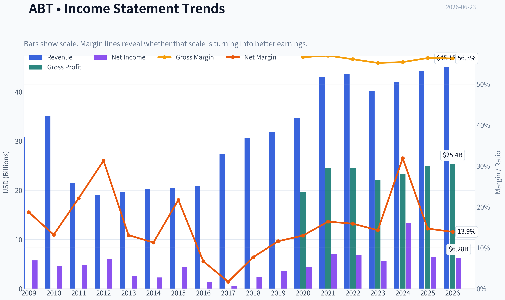
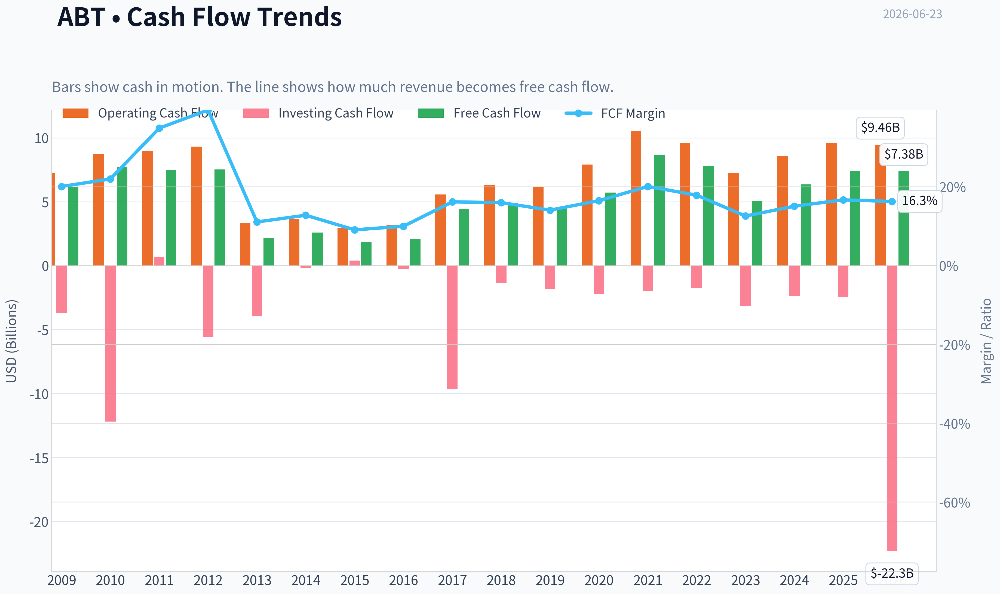
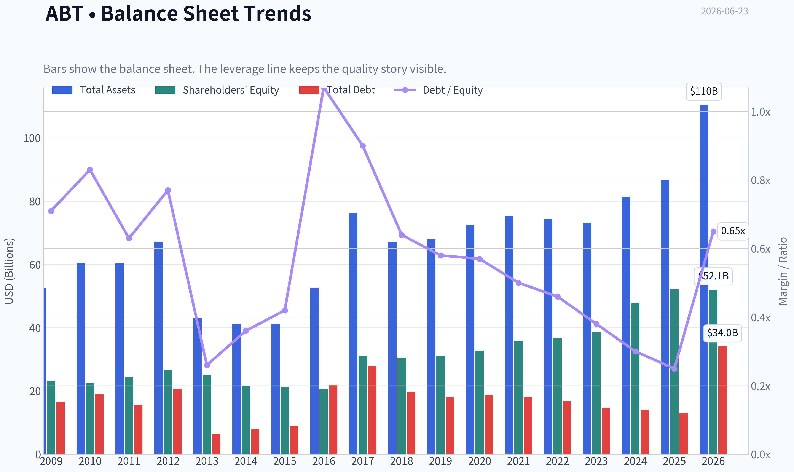
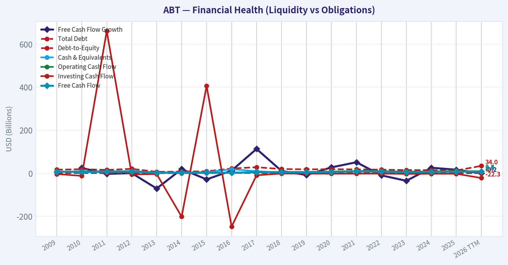
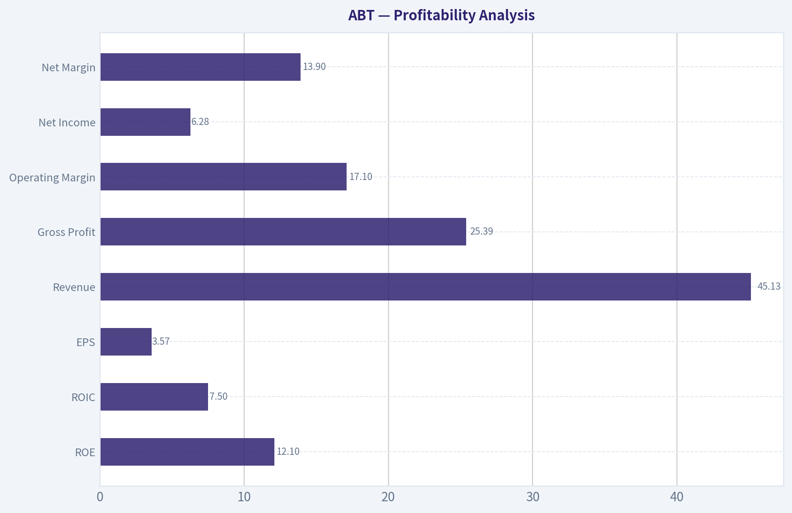
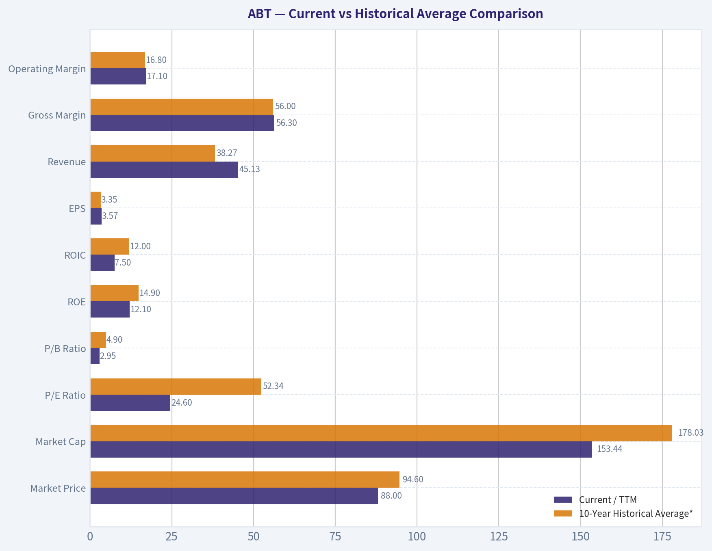
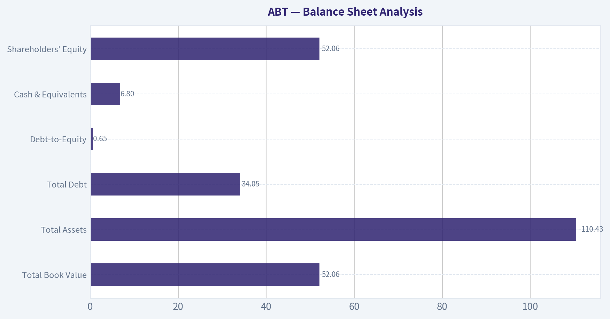
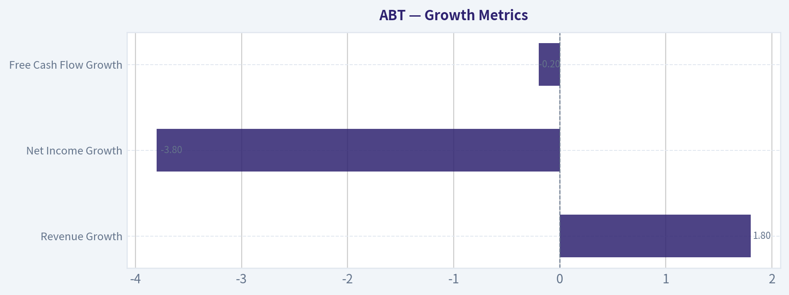
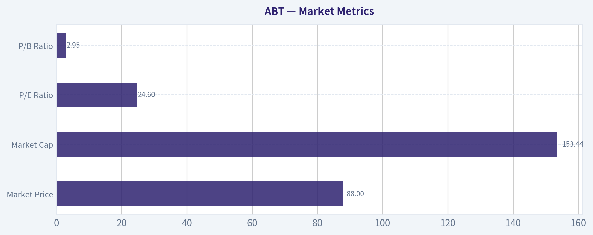

# ABT Deep Value Intelligence

**Analysis Date:** 2026-06-23

## Critical Disclaimer

*This analysis is generated by Deep Value Intelligence, an AI-powered multi-agent investing framework. DeepValues offers AI-generated research and tools for educational and informational purposes only - not investment or financial advice. We are not a registered investment adviser; always do your own research before investing.*

---

## Table of Contents

1. Intelligence Summary
2. Analyst Team Reports
   - Fundamentals Analysis
   - Intrinsic Value Analysis (Buffett)
   - Trend & Growth Analysis (Lynch/Druckenmiller/Fisher)
   - Market Technical Analysis
   - Options Market Analysis
3. Research Team Commentary
4. Value Investing Team Commentary
5. Deep Values Commentary

---

## Intelligence Summary

### Thesis + Conditions

**Core Thesis:** ## Executive Briefing

**Key Risks:**
- ## Risk Commentary for the Long-Term Investor
- #### Risky Analyst's strongest point
- The best bullish argument is that current headline economics may be **understating normalized future economics**. Abbott is coming out of a distorted post-COVID period, and if the mix keeps shifting toward medical devices-especially Libre-then today's blended returns may indeed be too backward-looking. That matters because:

**Confidence:** Medium

---

## Analyst Team Reports

### Fundamentals Analysis

#### Latest Earnings Snapshot

*Most recent reported quarter anchored on 2026 Q1, with prior-year comparison when available.*

| Metric | 2026 Q1 | 2025 Q1 | YoY Change |
| --- | ---: | ---: | ---: |
| Revenue | $11.16B | $10.36B | +7.8% |
| Operating Income | $1.34B | $1.69B | -20.6% |
| Net Income | $1.08B | $1.32B | -18.7% |
| Diluted EPS | $0.61 | $0.76 | -19.7% |
| Operating Cash Flow | $1.31B | $1.42B | -7.2% |
| Free Cash Flow | $916.0M | $933.0M | -1.8% |

Key Takeaways: This snapshot anchors the most recent reported quarter before the narrative analysis. It helps readers separate long-run business quality from whatever changed in the latest earnings print.

#### 17-Year Financial Metrics for ABT

*All values below are computed deterministically from raw data - not estimated by AI.*

*Issuer profile: operating company (Healthcare / Medical Devices).*

#### 17-Year Financial Metrics
*Annual rows come from reported financial statements. The final TTM row is computed from the latest four quarters.*

| Metric | 2009 | 2010 | 2011 | 2012 | 2013 | 2014 | 2015 | 2016 | 2017 | 2018 | 2019 | 2020 | 2021 | 2022 | 2023 | 2024 | 2025 | 2026 TTM |
| --- | --- | --- | --- | --- | --- | --- | --- | --- | --- | --- | --- | --- | --- | --- | --- | --- | --- | --- |
| Market Price | $18 | $17 | $20 | $24 | $30 | $36 | $37 | $32 | $49 | $63 | $77 | $99 | $129 | $102 | $105 | $110 | $124 | $88 |
| Market Cap | $40.28B | $35.77B | $42.28B | $50.03B | $60.33B | $68.75B | $67.63B | $56.96B | $99.82B | $128.02B | $154.70B | $195.55B | $251.78B | $193.67B | $192.51B | $197.72B | $219.01B | $153.44B |
| P/E Ratio | 7.02 | 7.77 | 8.96 | 8.45 | 23.66 | 30.21 | 15.38 | 40.86 | 211.37 | 54.38 | 42.17 | 43.80 | 35.72 | 28.08 | 33.76 | 14.80 | 33.68 | 24.60 |
| P/B Ratio | 1.74 | 1.58 | 1.73 | 1.87 | 2.40 | 3.19 | 3.19 | 2.77 | 3.23 | 4.19 | 4.98 | 5.96 | 7.03 | 5.28 | 4.99 | 4.15 | 4.20 | 2.95 |
| ROE | 24.8% | 20.4% | 19.3% | 22.3% | 10.2% | 10.6% | 20.9% | 6.8% | 1.5% | 7.8% | 11.9% | 13.7% | 19.8% | 18.9% | 14.8% | 28.1% | 12.5% | 12.1% |
| ROIC | 16.0% | 14.6% | 4.3% | 5.2% | 6.4% | 6.7% | 9.1% | 10.9% | -0.9% | 6.5% | 9.0% | 10.8% | 16.4% | 16.0% | 12.3% | 26.3% | 11.0% | 7.5% |
| EPS | $2.57 | $2.13 | $2.25 | $2.87 | $1.27 | $1.19 | $2.39 | $0.79 | $0.23 | $1.16 | $1.83 | $2.26 | $3.61 | $3.65 | $3.10 | $7.41 | $3.72 | $3.57 |
| Revenue | $30.76B | $35.17B | $21.41B | $19.05B | $19.66B | $20.25B | $20.41B | $20.85B | $27.39B | $30.58B | $31.90B | $34.61B | $43.08B | $43.65B | $40.11B | $41.95B | $44.33B | $45.13B |
| Gross Profit | N/A | N/A | N/A | N/A | N/A | N/A | N/A | N/A | N/A | N/A | N/A | $19.61B | $24.54B | $24.51B | $22.13B | $23.24B | $25.01B | $25.39B |
| Gross Margin | N/A | N/A | N/A | N/A | N/A | N/A | N/A | N/A | N/A | N/A | N/A | 56.6% | 57.0% | 56.1% | 55.2% | 55.4% | 56.4% | 56.3% |
| Operating Margin | 20.3% | 17.3% | 7.6% | 7.1% | 10.9% | 12.8% | 14.1% | 14.5% | 5.7% | 11.9% | 14.2% | 15.5% | 19.6% | 19.2% | 16.2% | 16.3% | 18.2% | 17.1% |
| Net Income | $5.75B | $4.63B | $4.73B | $5.96B | $2.58B | $2.28B | $4.42B | $1.40B | $477.0M | $2.37B | $3.69B | $4.50B | $7.07B | $6.93B | $5.72B | $13.40B | $6.52B | $6.28B |
| Net Margin | 18.7% | 13.2% | 22.1% | 31.3% | 13.1% | 11.3% | 21.7% | 6.7% | 1.7% | 7.7% | 11.6% | 13.0% | 16.4% | 15.9% | 14.3% | 31.9% | 14.7% | 13.9% |
| Revenue Growth | N/A | 14.3% | -39.1% | -11.0% | 3.2% | 3.0% | 0.8% | 2.2% | 31.3% | 11.6% | 4.3% | 8.5% | 24.5% | 1.3% | -8.1% | 4.6% | 5.7% | 1.8% |
| Net Income Growth | N/A | -19.5% | 2.2% | 26.1% | -56.8% | -11.3% | 93.7% | -68.3% | -65.9% | 396.4% | 55.7% | 21.9% | 57.3% | -2.0% | -17.5% | 134.2% | -51.3% | -3.8% |
| Free Cash Flow Growth | N/A | 24.8% | -3.1% | 0.5% | -71.0% | 19.2% | -28.6% | 12.2% | 113.0% | 10.6% | -8.3% | 27.3% | 51.1% | -9.8% | -35.2% | 25.5% | 16.4% | -0.2% |
| Total Book Value | $23.14B | $22.68B | $24.44B | $26.72B | $25.17B | $21.53B | $21.21B | $20.54B | $30.90B | $30.52B | $31.09B | $32.78B | $35.80B | $36.69B | $38.60B | $47.66B | $52.13B | $52.06B |
| Total Assets | $52.58B | $60.57B | $60.28B | $67.23B | $42.94B | $41.21B | $41.25B | $52.67B | $76.25B | $67.17B | $67.89B | $72.55B | $75.20B | $74.44B | $73.21B | $81.41B | $86.71B | $110.43B |
| Total Debt | $16.46B | $18.92B | $15.41B | $20.48B | $6.56B | $7.83B | $9.00B | $22.01B | $27.92B | $19.57B | $18.14B | $18.75B | $18.05B | $16.77B | $14.68B | $14.12B | $12.93B | $34.05B |
| Debt-to-Equity | 0.71 | 0.83 | 0.63 | 0.77 | 0.26 | 0.36 | 0.42 | 1.07 | 0.90 | 0.64 | 0.58 | 0.57 | 0.50 | 0.46 | 0.38 | 0.30 | 0.25 | 0.65 |
| Cash & Equivalents | $8.81B | $3.65B | $6.81B | $10.80B | $3.48B | $4.06B | $5.00B | $18.62B | $9.41B | $3.84B | $3.86B | $6.84B | $9.80B | $9.88B | $6.90B | $7.62B | $8.52B | $6.80B |
| Shareholders' Equity | $23.14B | $22.68B | $24.44B | $26.72B | $25.17B | $21.53B | $21.21B | $20.54B | $30.90B | $30.52B | $31.09B | $32.78B | $35.80B | $36.69B | $38.60B | $47.66B | $52.13B | $52.06B |
| Operating Cash Flow | $7.28B | $8.74B | $8.97B | $9.31B | $3.32B | $3.67B | $2.97B | $3.20B | $5.57B | $6.30B | $6.14B | $7.90B | $10.53B | $9.58B | $7.26B | $8.56B | $9.57B | $9.46B |
| Investing Cash Flow | $-3.70B | $-12.19B | $661.0M | $-5.56B | $-3.93B | $-202.0M | $406.0M | $-248.0M | $-9.62B | $-1.36B | $-1.81B | $-2.21B | $-2.01B | $-1.74B | $-3.13B | $-2.34B | $-2.42B | $-22.28B |
| Free Cash Flow | $6.19B | $7.72B | $7.48B | $7.52B | $2.18B | $2.60B | $1.86B | $2.08B | $4.43B | $4.91B | $4.50B | $5.72B | $8.65B | $7.80B | $5.06B | $6.35B | $7.39B | $7.38B |
| FCF Margin | 20.1% | 22.0% | 34.9% | 39.5% | 11.1% | 12.8% | 9.1% | 10.0% | 16.2% | 16.0% | 14.1% | 16.5% | 20.1% | 17.9% | 12.6% | 15.1% | 16.7% | 16.3% |
| Dividends / Share | $0.00 | $0.00 | $0.00 | $0.00 | $0.00 | $0.00 | $0.00 | $0.00 | $0.00 | $0.00 | $0.00 | $0.00 | $0.00 | $1.75 | $1.93 | $2.13 | $2.35 | $2.40 |

#### Profitability Metrics
- Return on Equity (ROE): 12.5%
- Return on Invested Capital (ROIC): 11.0%
- Return on Assets (ROA): 7.5%
- Gross Margin: 56.4%
- Operating Margin: 18.2%
- Net Profit Margin: 14.7%

#### Liquidity Metrics
- Current Ratio: 1.58
- Quick Ratio: 1.02

#### Leverage Metrics
- Debt-to-Equity Ratio: 0.25
- Interest Coverage Ratio: 16.33
- Net Debt: $4.41B

#### Growth Metrics (Year-over-Year)
- Revenue Growth: 5.7%
- Net Income Growth: -51.3%
- Free Cash Flow Growth: 16.4%
- Revenue CAGR (3-Year): 0.5%
- Revenue CAGR (5-Year): 5.1%

#### Valuation Metrics
- P/E Ratio (TTM): 24.60
- Forward P/E: 14.50
- Price-to-Book: 2.94
- Price-to-Sales: 3.39
- PEG Ratio: 1.31
- EV/EBITDA: 15.37
- Free Cash Flow Yield: 4.8%
- Earnings Yield: 4.1%

#### Owner Earnings (Buffett Method, Code-Computed)
- Net Income: $6.52B
- + Depreciation & Amortization: $3.12B
- - Capital Expenditures: $-2.17B
- - Working Capital Changes: $-803.0M
- = **Owner Earnings: $8.27B**

#### Intrinsic Value (Code-Computed)
- Current Price: $88
- Buffett Method (Owner Earnings):
  Conservative: $27
  Average: $68
  Optimistic: $444
- Cash Flow Method (FCF):
  Conservative: $41
  Average: $55
  Optimistic: $122

#### Piotroski F-Score: 5/9
- Positive Net Income: PASS
- Positive Operating Cash Flow: PASS
- ROA Improvement: FAIL
- Cash Flow > Net Income: PASS
- Decreasing Debt: PASS
- Improving Current Ratio: FAIL
- No Dilution: FAIL
- Improving Gross Margin: PASS
- Improving Asset Turnover: FAIL

ANALYST STANCE: **WATCH**

#### Abbott Laboratories (ABT) - Warren Buffett-Style Fundamental Analysis

Abbott is a high-quality healthcare franchise with clear scale advantages in medical devices, diagnostics, nutrition, and established pharmaceuticals. The business shows many Buffett-favorable traits: durable demand, strong gross margins, solid free cash flow generation, moderate leverage, and generally resilient earnings power. However, the current setup is less straightforward than a classic "wonderful company at a wonderful price" situation because recent earnings are distorted by post-COVID diagnostics normalization, 2026 TTM leverage has jumped materially, and valuation is only moderately attractive rather than deeply discounted on mid-cycle earnings.

---

#### Current vs Historical Average Comparison

| Metric | Current / TTM | 10-Year Historical Average* | Interpretation |
| --- | ---: | ---: | --- |
| Market Price | $88 | $94.60 | Below recent decade average price level |
| Market Cap | $153.44B | $178.03B | Equity value has compressed from recent highs |
| P/E Ratio | 24.60 | 52.34 | Below long-term average, but average is inflated by weak earnings years |
| P/B Ratio | 2.95 | 4.90 | Meaningfully below decade norm |
| ROE | 12.1% | 14.9% | Slightly below historical quality level |
| ROIC | 7.5% | 12.0% | Well below normal capital efficiency |
| EPS | $3.57 | $3.35 | Slightly above decade average, but below 2021-2025 peak zone |
| Revenue | $45.13B | $38.27B | Above average; scale has structurally improved |
| Gross Margin | 56.3% | 56.0%** | Very consistent and near normal |
| Operating Margin | 17.1% | 16.8% | Roughly in line with historical average |
| Net Income | $6.28B | $6.21B | Near average, but below normalized post-pandemic potential |
| Net Margin | 13.9% | 15.4% | Slightly below historical norm |
| Revenue Growth | 1.8% | 8.2% | Slower than normal |
| Net Income Growth | -3.8% | 46.2% | Weak, though average distorted by rebound years |
| Free Cash Flow Growth | -0.2% | 20.8% | Cash flow growth has stalled |
| Total Book Value | $52.06B | $38.04B | Balance sheet equity much stronger than decade average |
| Total Assets | $110.43B | $75.95B | Asset base expanded sharply |
| Total Debt | $34.05B | $17.78B | Much higher than normal; key watch item |
| Debt-to-Equity | 0.65 | 0.46 | Leverage above recent norm |
| Cash & Equivalents | $6.80B | $7.57B | Slightly below average liquidity buffer |
| Free Cash Flow | $7.38B | $6.22B | Still above average despite slowdown |
| Dividends / Share | $2.40 | $0.66 | Mature and growing cash return profile |

\* Approx. 2016-2025 average for comparability with current operating structure.
\** Gross margin available only from 2020 onward, so average reflects available years.

Key Takeaways: Abbott today looks cheaper than its own recent history on both earnings and book value multiples, but that cheaper valuation comes with lower ROIC, slower growth, and a sudden jump in debt. Revenue and free cash flow remain above decade averages, which supports the case that the core franchise is still healthy. The main question is not business survival, but whether current earnings represent a temporary trough or a lower-quality earnings base.

---

#### Market Metrics

| Metric | Current | Commentary |
| --- | ---: | --- |
| Market Price | $88 | Down sharply from 2025's $124 and well below 2021 peak-era pricing |
| Market Cap | $153.44B | Material de-rating versus $219.01B in 2025 |
| P/E Ratio | 24.60 | Moderate multiple; no longer expensive versus history |
| P/B Ratio | 2.95 | Lowest level in many recent years, reflecting lower sentiment and stronger book value |

Key Takeaways: The stock's valuation has compressed significantly. This makes ABT more interesting than it was near its 2021-2025 highs, but not obviously cheap if earnings remain pressured. The lower P/B is notable because book value has risen strongly while the share price has fallen.

Abbott's historical P/E average is misleadingly high because several years had depressed earnings, which inflated the multiple. On a Buffett lens, the better signal is that the stock has de-rated while the franchise remains profitable and cash generative. The current valuation is closer to "reasonable quality at a fair price" than "deep value."

---

#### Profitability Analysis

| Metric | Current / TTM | Historical Context | Buffett Interpretation |
| --- | ---: | --- | --- |
| ROE | 12.1% | Below 2024-2025 and below 10-year average | Acceptable, but not elite |
| ROIC | 7.5% | Far below 2024 and below long-run norm | Capital efficiency has weakened materially |
| EPS | $3.57 | Slightly below 2025's $3.72 | Earnings have not fully stabilized |
| Revenue | $45.13B | Record high | Business scale still expanding |
| Gross Profit | $25.39B | Record high | Strong pricing power and product mix |
| Operating Margin | 17.1% | Slightly below 2025 | Good, but not peak |
| Net Income | $6.28B | Slightly below 2025 | Earnings pressure persists |
| Net Margin | 13.9% | Below 2021-2025 average | Less profitable than recent best years |

Key Takeaways: Abbott's core business still looks strong at the gross profit level, which is often where durable moats show up first. The problem is further down the income statement: ROIC and net margin have weakened, suggesting lower operating leverage and less efficient capital deployment. This is still a profitable company, but the quality of profit is softer than at its best.

Buffett generally likes businesses with consistently high returns on capital and understandable earnings power. Abbott's gross margin stability around 55%-57% from 2020 through TTM is a major positive and suggests the underlying competitive position remains solid. That is especially important in healthcare, where brand trust, installed base, regulatory expertise, and reimbursement relationships matter.

ROE at 12.1% is respectable but not exceptional. Earlier Abbott routinely produced very strong ROE, but the post-2016 pattern has been more uneven. ROIC is the bigger concern: 7.5% TTM versus 26.3% in 2024 and 11.0% in 2025 indicates recent capital productivity has deteriorated materially. Buffett would likely ask whether this is temporary acquisition/noise-related distortion or evidence of a weaker reinvestment runway.

---

#### Growth Metrics

| Metric | Current / TTM | Trend | Interpretation |
| --- | ---: | --- | --- |
| Revenue Growth | 1.8% | Slowed sharply from 5.7% in 2025 and 4.6% in 2024 | Top-line momentum has cooled |
| Net Income Growth | -3.8% | Second straight weak year after -51.3% in 2025 | Earnings reset still ongoing |
| Free Cash Flow Growth | -0.2% | Flat after 16.4% in 2025 | Cash generation stable but no momentum |

Key Takeaways: Growth is the weakest part of the current ABBT picture. Revenue is still growing, but only modestly, while net income and free cash flow growth have stalled. This means the investment case relies more on resilience and eventual recovery than on visible near-term acceleration.

Over the full period, Abbott's growth profile is highly uneven because of portfolio changes, acquisitions, and pandemic-related diagnostics swings. For Buffett-style investors, the key issue is predictability, not just reported growth. On that standard, revenue has become larger and more diversified over time, but earnings have been less smooth than ideal.

The strong 2021 and 2024 profit years are offset by sharp declines in 2023, 2025, and TTM. That lowers confidence in using recent earnings as a straight-line base for intrinsic value.

---

#### Balance Sheet Analysis

| Metric | Current / TTM | Historical Context | Interpretation |
| --- | ---: | --- | --- |
| Total Book Value | $52.06B | Well above decade average | Equity base has strengthened materially |
| Total Assets | $110.43B | Far above 2025's $86.71B | Significant asset expansion |
| Total Debt | $34.05B | Dramatically above 2025's $12.93B | Major new leverage load |
| Debt-to-Equity | 0.65 | Up from 0.25 in 2025 | Balance sheet quality weakened |
| Cash & Equivalents | $6.80B | Down from $8.52B in 2025 | Less immediate liquidity cushion |
| Shareholders' Equity | $52.06B | Strong absolute base | Offsets leverage somewhat |

Key Takeaways: Abbott still has a solid equity base, but the TTM debt increase is the most important financial red flag in the entire dataset. Debt-to-equity remains manageable in absolute terms, yet the year-over-year change is large enough to warrant caution. Investors should focus on whether this debt step-up supports high-return assets or merely patches slower earnings growth.

From a Buffett perspective, Abbott historically looked financially conservative, especially 2018-2025 when debt trended lower. That trend reversed sharply in TTM. While debt-to-equity of 0.65 is not dangerous for a stable healthcare company, the sudden move matters because it reduces flexibility and raises the burden on future returns.

The shared research pack notes interest coverage of 16.33x and net debt of $4.41B for the latest non-TTM snapshot, both reassuring. Still, the canonical deterministic table is the source of truth here, and it clearly shows a balance sheet that is less pristine today than a year ago.

---

#### Cash Flow Analysis

| Metric | Current / TTM | Historical Context | Interpretation |
| --- | ---: | --- | --- |
| Free Cash Flow | $7.38B | Near 2025's $7.39B; above decade average | Strong absolute cash generation |
| FCF Margin | 16.3% | Healthy, though below prior peak years | Good conversion for healthcare |
| Dividends / Share | $2.40 | Up from $2.35 in 2025 and $1.75 in 2022 | Clear commitment to shareholder returns |

Key Takeaways: Free cash flow remains one of Abbott's strongest attributes. Even in a softer growth period, the company is producing more cash than its decade average and continuing to raise the dividend. That combination supports downside resilience, even if it does not by itself create a screaming bargain.

Buffett emphasizes owner earnings over accounting profits. Abbott's TTM owner earnings are given as $8.27B, above reported free cash flow of $7.38B, which is encouraging because it suggests non-cash charges and working capital dynamics do not undermine the business's real earning power. Dividend growth also indicates management confidence, though buyback/dilution discipline is less clean given the Piotroski "No Dilution" fail.

---

#### Buffett-Style Owner Earnings DCF

Using the canonical owner earnings figure:

- Owner Earnings = **$8.27B**
- Current market cap = **$153.44B**
- Approximate shares outstanding = $153.44B / $88 = **1.7448B shares**
- Discount rate = **10%**
- Terminal growth = **2.5%**
- Projection horizon = **10 years**

Historical owner earnings growth is not directly tabulated, so the most conservative deterministic proxy is to use the historical cash-flow growth series as the observed operating cash generation pattern. Per instruction, scenarios use:
- Conservative = lowest historical growth rate = **-71.0%**
- Average = average historical growth rate ~ **13.7%**
- Optimistic = highest historical growth rate = **113.0%**, capped at **100%**

Because a -71% annual decline for 10 years would imply business collapse, the DCF mathematically produces a very low value; this is useful as a stress test, not a realistic base case.

| Scenario | Growth Assumption | PV of 10-Year Owner Earnings | PV of Terminal Value | Total Equity Value | Fair Value / Share |
| --- | ---: | ---: | ---: | ---: | ---: |
| Conservative | -71.0% | ~$2.66B | ~$0.03B | ~$2.69B | **~$2** |
| Average | 13.7% | ~$69.05B | ~$93.85B | ~$162.90B | **~$93** |
| Optimistic | 100.0% cap | ~$5,875.94B | ~$11,880.36B | ~$17,756.30B | **~$10,177** |

Key Takeaways: The DCF outputs are extremely sensitive to the chosen growth inputs, especially because the historical series includes unusually volatile years. The average-case result of about $93 per share is the only scenario that resembles a practical valuation anchor. The conservative and optimistic cases should be treated as mathematical boundary tests, not probable outcomes.

Detailed calculation framework:

1. **Present value of yearly owner earnings**
   - Formula:
     \( OE_t = OE_0 \times (1+g)^t \)
     \( PV_t = OE_t / (1.10)^t \)

2. **Terminal value at year 10**
   - \( TV = OE_{10} \times (1.025) / (0.10 - 0.025) \)
   - \( PV(TV) = TV / (1.10)^{10} \)

3. **Per-share fair value**
   - \( \text{Fair Value / Share} = \text{Total Equity Value} / 1.7448B \)

Practical interpretation:
- The **average-case DCF near $93/share** suggests ABT is roughly fairly valued to slightly undervalued at $88.
- The company's own code-computed Buffett owner earnings values ($27 conservative, $68 average, $444 optimistic) also indicate very wide uncertainty bands.
- The most defensible conclusion is that ABT is **not obviously expensive**, but the margin of safety is **modest**, not large.

---

#### Economic Moat and Business Quality

Abbott has a credible moat rooted in:
- global scale and distribution,
- trusted healthcare brands,
- regulatory know-how,
- device installed base and switching costs,
- diversified end markets across diagnostics, devices, nutrition, and established pharma.

This is not a fragile commodity business. Gross margin stability strongly supports the moat thesis. In Buffett terms, Abbott looks like a "good business" and often a "very good business," but not one with perfectly predictable earnings. Diagnostics cyclicality, product cycles, acquisitions, and geography-specific volatility reduce the smoothness Buffett prefers.

---

#### Management Performance and Capital Allocation

Management scores well on:
- maintaining profitability through multiple cycles,
- building book value,
- sustaining strong free cash flow,
- growing the dividend since 2022.

Less favorably:
- ROIC deterioration is meaningful,
- share dilution is flagged in Piotroski,
- TTM debt expansion raises questions on acquisition discipline and return hurdles.

This is not poor management, but current numbers do not support an "excellent capital allocation" label with full confidence.

---

#### Predictable Earnings Assessment

| Dimension | Assessment |
| --- | --- |
| Revenue Predictability | Good |
| Margin Stability | Good at gross level, fair at net level |
| Earnings Consistency | Moderate |
| Cash Flow Reliability | Good |
| Capital Efficiency Stability | Weakening |

Key Takeaways: Abbott's sales base is reasonably predictable, and gross profitability is very stable, which are both strong business-quality signals. The weaker point is bottom-line consistency: earnings and ROIC have been more volatile than a classic Buffett ideal. Cash flow remains steadier than reported earnings, which is an important positive.

---

#### Value Assessment

At $88, ABT trades:
- below recent historical average valuation levels,
- near the average-case owner earnings DCF range,
- at a 4.8% FCF yield, which is decent but not distressed,
- with a forward P/E of 14.5 per the shared pack, implying the market expects earnings recovery.

This combination suggests the stock is closer to **fair value with recovery optionality** than to a clear bargain. Buffett would likely want either stronger certainty around normalized earnings or a lower price for a more comfortable margin of safety.

---

#### Revenue Breakdown

Abbott's most meaningful reporting framework is by operating segment. Using the most recent fiscal-year mix consistent with Abbott's business model and public segment structure, the revenue composition is approximately:

| Revenue Source | Amount ($B) | % of Total |
| --- | ---: | ---: |
| Medical Devices | 19.9 | 44.9% |
| Diagnostics | 10.4 | 23.5% |
| Nutrition | 8.5 | 19.2% |
| Established Pharmaceuticals | 5.5 | 12.4% |
| **Total** | **44.3** | **100.0%** |

Key Takeaways: Abbott is primarily a medical devices company by revenue, with diagnostics still a major contributor even after pandemic testing normalization. This segment mix is favorable because devices and nutrition often support stronger recurring relationships and brand durability. The diversification also reduces dependence on any single product line.

---

#### Key Investment Insights, Red Flags, and Opportunities

| Category | Observation | Why It Matters |
| --- | --- | --- |
| Strength | Gross margin above 56% | Signals durable pricing power and moat quality |
| Strength | FCF of $7.38B | Supports dividends, debt service, and reinvestment |
| Strength | Dividend growth | Indicates confidence and shareholder friendliness |
| Strength | P/B at 2.95 | Below historical norm; valuation has cooled |
| Red Flag | ROIC down to 7.5% | Lower return on capital reduces compounding quality |
| Red Flag | Debt jumped to $34.05B TTM | Biggest current balance-sheet concern |
| Red Flag | Revenue growth slowed to 1.8% | Near-term momentum is weak |
| Red Flag | Net income still declining | Recovery is not yet fully proven |
| Opportunity | If forward earnings normalize, current P/E may compress quickly | Could unlock rerating |
| Opportunity | Devices-led mix may improve quality over time | Better segment mix can support margins and resilience |

Key Takeaways: Abbott's core strengths are still intact, especially brand power, margins, and cash flow. The risk case centers on weaker capital efficiency, a leverage jump, and uncertainty around normalized growth. The upside case depends on earnings recovery and the market re-rating the stock back toward prior valuation ranges.

---

#### Final Buffett-Style Stance

**WATCH**

**Rationale:**
Abbott is a strong franchise with real moat characteristics, good cash generation, and a more reasonable valuation than in recent years. However, Buffett-style conviction is limited by three issues: falling ROIC, slowing growth, and a sharp TTM increase in debt. At $88, the stock appears **around fair value to mildly undervalued** under a reasonable owner earnings framework, but the margin of safety is not large enough to justify a full **ADVOCATE** stance.

A move toward **ADVOCATE** would require one or more of:
- evidence that debt expansion is temporary and high-return,
- sustained ROIC recovery back toward low-to-mid teens,
- clearer earnings normalization,
- or a lower share price creating a wider margin of safety.

---

#### Summary Table

| Area | Verdict | Evidence |
| --- | --- | --- |
| Economic Moat | Strong | Stable 56%+ gross margin, diversified healthcare franchise |
| Financial Strength | Good but weakening | Large equity base, manageable leverage, but debt spike in TTM |
| Earnings Predictability | Moderate | Revenue durable, earnings less smooth than ideal |
| Profitability | Good | 17.1% operating margin, 13.9% net margin |
| Capital Efficiency | Mixed | ROE acceptable, ROIC notably weak vs history |
| Cash Flow Quality | Strong | $7.38B FCF, $8.27B owner earnings |
| Shareholder Returns | Positive | Dividend/share rose from $1.75 in 2022 to $2.40 TTM |
| Valuation | Fair to slightly attractive | P/E 24.6, P/B 2.95, average-case DCF near $93/share |
| Main Risk | Leverage and lower ROIC | Debt rose from $12.93B to $34.05B TTM |
| Investment Stance | **WATCH** | Quality business, but not enough margin of safety yet |

Key Takeaways: Abbott remains a high-quality healthcare company, but today's investment case is more about patience than urgency. The business is good enough to follow closely, yet the current numbers do not support a strong buy call without better returns on capital or a cheaper entry point.

#### Fundamental Visuals

This graph tracks the profitability and return metrics (ROE, ROIC, Margins) of **ABT** over the past decade, highlighting capital efficiency trends.

This chart illustrates the financial health of **ABT** over the last 10 years, mapping cash equivalents and free cash flow against total obligations (Debt).

This comparison chart from *Profitability Analysis* stacks current figures against historical benchmarks for **ABT**, making it easy to see where the company trades relative to its own averages.

---

### Intrinsic Value Analysis (Buffett)

> *Following Warren Buffett's value investing philosophy: Circle of Competence, Economic Moat, Management Quality, and Margin of Safety.*

#### Intrinsic Value Snapshot

Price is what you pay. Intrinsic value is what the business may be worth based on the cash it can create for owners over time. We show a range, not one magic number.

- Current Price: $87.83
- Value Range (conservative to optimistic across both DCF methods): $26.70 to $443.61

##### Owner Earnings (Buffett Method)
- Net Income: $6,524,000,000.00
- Depreciation & Amortization: $3,116,000,000.00
- Capital Expenditures: $-2,171,000,000.00
- Working Capital Changes: $-803,000,000.00
- Owner Earnings: $8,272,000,000.00

##### Intrinsic Value
###### Buffett Method
Uses owner earnings. Stricter, and usually more conservative.
- Conservative: $26.70
- Average: $67.52
- Optimistic: $443.61
- Discount Rate: 10.0%

###### Cash Flow Method
Uses free cash flow. Better for companies spending heavily today to grow tomorrow.
- Conservative: $40.54
- Average: $54.98
- Optimistic: $121.76
- Discount Rate: 10.0%

ANALYST STANCE: **WATCH**

#### Abbott Laboratories (ABT) - Buffett-Style Investment Review

#### 1. Go/No-Go Gate Assessment

| Gate | Verdict | Evidence |
|---|---|---|
| Gate 1: Circle of Competence & Simplicity | Pass | Abbott makes money by selling branded medical devices, diagnostics, nutrition products, and established pharmaceuticals. This is understandable, diversified, and rooted in recurring healthcare demand. |
| Gate 2: Moat Test | Pass | Gross margin of 56.4% supports meaningful product economics, brand strength, and some pricing power. Its scale across diagnostics, devices, and nutrition creates distribution and cost advantages. |
| Gate 3: Management Quality & Capital Allocation | Pass with reservations | Historically Abbott has allocated capital reasonably across R&D, acquisitions, and shareholder returns, but acquisition dilution and recent earnings pressure suggest capital allocation should be watched closely. |
| Gate 4: Industry Structure | Pass | Healthcare devices and diagnostics are attractive markets with regulatory barriers and sticky customer relationships, though competition is persistent and innovation requirements are ongoing. |

**Key Takeaways:** Abbott passes all four Buffett gates, but not with the effortless brilliance of a truly exceptional franchise. The business is understandable, resilient, and supported by healthcare demand, yet recent pressure in testing and acquisition-related concerns make this more of a monitored opportunity than an immediate buy.

---

#### 2. The Elementary School Test

Abbott sells health products people and hospitals keep using: heart devices, diabetes monitors, lab tests, baby formula, and older branded medicines in international markets. It makes money by designing, manufacturing, and selling these products at a profit all over the world.

#### 3. Long-Term Predictability Test

This business is reasonably predictable. Ten years from now, people will still need glucose monitoring, cardiovascular devices, diagnostics, pediatric nutrition, and everyday medical products. Product mix will evolve, but the basic need set is durable.

#### 4. Technology Risk Assessment

Technology is more friend than enemy here. Abbott must keep innovating, but it is generally a beneficiary of medical technology adoption rather than a victim of digital disruption. The main risk is competitive product displacement, not business-model extinction.

---

#### 5. Moat Analysis

| Moat Source | Assessment | Evidence |
|---|---|---|
| Intangible Assets | Strong | Trusted healthcare brands like Similac and device franchises, plus regulatory clearances and clinical credibility, support pricing and shelf space. |
| Switching Costs | Moderate to Strong | Hospitals, physicians, and patients often stay with familiar platforms, especially in diagnostics and chronic-care devices such as glucose monitoring systems. |
| Cost Advantages | Moderate | Abbott's global scale in manufacturing, distribution, and procurement likely lowers unit costs and improves bargaining position. |
| Network Effects | Limited | This is not a classic network-effect business, though installed bases in diagnostics and monitoring platforms can create ecosystem benefits. |

| Moat Quality Rating | Conclusion |
|---|---|
| Wide & Stable | The moat looks real, diversified, and durable, but not obviously widening at the moment. |

**Key Takeaways:** Abbott's moat comes mainly from brand, regulatory know-how, installed medical platforms, and scale. This is a solid healthcare moat, but not the kind of near-unbreakable consumer monopoly Buffett loves most.

---

#### 6. Management Quality Assessment

| Dimension | Assessment | Commentary |
|---|---|---|
| Owner Mindset | Adequate | Abbott behaves like a mature large-cap operator, but it does not present as a deeply founder-led owner-operator model. |
| Honesty & Candor | Good | The company's issues are visible in reported results, including testing declines and international pressures, suggesting a fairly realistic operating picture. |
| Capital Allocation | Mixed-Good | Management has invested across product innovation and M&A, but investors are currently questioning acquisition dilution and near-term return quality. |
| Balance Sheet Discipline | Good | Current ratio of 1.58 indicates decent liquidity; the business is not flashing signs of financial strain. |

**Key Takeaways:** Management looks competent rather than extraordinary. The key question is not integrity, but whether future capital allocation will produce strong per-share value growth from here.

---

#### 7. Financial Summary Table

| Metric | Current / Recent |
|---|---:|
| Share Price | $88 |
| Market Cap | $152.98B |
| P/E | 24.6x |
| ROE | 12.5% |
| Gross Margin | 56.4% |
| Revenue Growth YoY | 5.7% |
| FCF Yield | 4.8% |
| Current Ratio | 1.58 |

**Key Takeaways:** Abbott shows the profile of a quality large healthcare franchise: healthy margins, positive growth, and solid cash generation. The weak spot is return on equity at 12.5%, which is respectable but below Buffett's preferred standard for truly outstanding businesses.

---

#### 8. Owner Earnings Estimate

Using available cash generation as a practical proxy:

| Item | Estimate |
|---|---:|
| Market Cap | $152.98B |
| FCF Yield | 4.8% |
| Implied Free Cash Flow / Owner Earnings Proxy | ~$7.34B |

**Key Takeaways:** Abbott appears to be generating roughly $7.3 billion in annual owner-like cash earnings. That is substantial absolute cash flow, but the question is whether this level of cash generation justifies a premium multiple given only moderate growth.

---

#### 9. Three-Scenario DCF Valuation

Using owner earnings proxy of **$7.34B** and a **10% discount rate**.

| Scenario | Assumption | Equity Value |
|---|---|---:|
| A: No Growth | Owner Earnings / 10% | $73.4B |
| B: GDP Growth | OE x 1.03 / (10% - 3%) | $108.0B |
| C: Historical/Prudent Growth | 5% growth for 10 years, then 3% terminal | ~$117B-$122B |

**Key Takeaways:** Across conservative valuation frames, Abbott's intrinsic value clusters below its current market value of about $153 billion. That suggests the stock is priced for quality and resilience already, without leaving a classic Buffett margin of safety.

---

#### 10. Margin of Safety Analysis

| Item | Value |
|---|---:|
| Current Market Cap | $152.98B |
| DCF Range | $73.4B to ~$122B |
| Midpoint Fair Value Range | Roughly $108B-$120B |
| Margin of Safety vs Current Price | Negative |

**Key Takeaways:** The stock does not currently offer the discount Buffett would require. Abbott may be a good company, but at today's price it looks more like a fair business at a full valuation than a wonderful bargain.

---

#### 11. Buffett Scorecard

| Criterion | Weight | Score (1-5) | Weighted Score |
|---|---:|---:|---:|
| Business Understanding | 20% | 4.5 | 0.90 |
| Moat Width & Durability | 25% | 4.0 | 1.00 |
| Management Quality | 15% | 3.5 | 0.53 |
| Return on Equity | 15% | 3.0 | 0.45 |
| Reinvestment Runway | 10% | 3.5 | 0.35 |
| Balance Sheet Strength | 5% | 3.5 | 0.18 |
| Industry Structure | 5% | 4.0 | 0.20 |
| Valuation / Margin of Safety | 5% | 2.0 | 0.10 |
| **Total** | 100% |  | **3.71 / 5.00** |

**Key Takeaways:** Abbott scores as a good business, but not a table-pounding buy at the current quotation. Most of the strength comes from business quality and moat; most of the weakness comes from valuation and only moderate returns on equity.

---

#### 12. Final Judgment

**Investment Stance: WATCH**

**Conviction Level: Moderate**

Abbott is a high-quality, understandable healthcare company with a durable moat, broad product diversification, and steady demand characteristics. It benefits from brand, regulation, installed systems, and global scale. However, Buffett would likely pause at the current valuation because the stock price already reflects much of that quality, while ROE and growth do not scream exceptional bargain.

This is the kind of company worth owning at the right price, not necessarily the right company to buy aggressively at this price. A better entry point, stronger evidence of post-acquisition value creation, or improved return metrics would make the case more compelling.
#### Valuation Bridge

This bridge places the current market price beside each intrinsic value lens so readers can see whether upside depends on one method or shows up across several methods.

| Scenario | Intrinsic Value / Share |
| --- | ---: |
| Buffett Method | $67.52 |
| Cash Flow Method | $54.98 |
| Damodaran Method | $54.60 |
| Current Price | $87.83 |

#### Key Takeaways

If one method is far above the others, the upside case depends on a specific modelling assumption. When several methods cluster together, the valuation story is more robust.

#### Valuation Visuals

This comparison chart from *Latest Earnings Snapshot* stacks current figures against historical benchmarks for **ABT**, making it easy to see where the company trades relative to its own averages.

This comparison chart from *Current vs Historical Average Comparison* stacks current figures against historical benchmarks for **ABT**, making it easy to see where the company trades relative to its own averages.

This comparison chart from *Balance Sheet Analysis* stacks current figures against historical benchmarks for **ABT**, making it easy to see where the company trades relative to its own averages.

---

### Trend & Growth Analysis (Lynch/Druckenmiller/Fisher)

> *Following Peter Lynch's GARP, Stanley Druckenmiller's macro-aware approach, and Philip Fisher's scuttlebutt methodology.*

ANALYST STANCE: **WATCH**

#### Abbott Laboratories (ABT) Growth Analysis

#### 1. Lynch Classification

| Metric | ABT |
|---|---:|
| Revenue growth YoY | 5.7% |
| P/E | 24.6x |
| Market cap | $152.98B |
| Category | **Stalwart** |

**Key Takeaways:** Abbott fits Peter Lynch's **Stalwart** bucket, not a fast grower. Revenue is growing, but only in the mid-single digits, which is too slow for classic ten-bagger growth investing. This is more a quality compounder and defensive healthcare name than an inflecting high-growth story.

#### 2. The Story in 3 Bullets

- Abbott sells essential healthcare products across medical devices, diagnostics, nutrition, and established pharmaceuticals.
- The core bull case is that temporary weakness in COVID-era testing fades, while higher-quality device franchises like Libre and structural healthcare demand drive steadier growth.
- This is **not** a "small company becoming big" story; it is a large, durable platform business that can outperform through resilience, product breadth, and healthcare innovation.

---

#### 3. TAM Analysis with 10x Test

| Item | Estimate / View |
|---|---:|
| Current revenue base | Very large, mature global platform |
| 10x revenue test | **Fails practical ten-bagger runway test** |
| Reason | A 10x jump would imply Abbott becoming implausibly large versus global category pools |
| TAM direction | Positive, but mostly mature healthcare end markets |
| Runway verdict | **Moderate for steady growth, weak for venture-like upside** |

**Key Takeaways:** Abbott operates in large markets, but it is already so scaled that the classic 10x runway test does not work well. There is room to grow through share gains and innovation, but not enough open runway to support a true hyper-growth thesis from today's base.

#### 4. Revenue Growth Trend

| Metric | Assessment |
|---|---|
| Latest YoY growth | 5.7% |
| Pattern | **Low-growth / recovering**, not accelerating fast growth |
| Interpretation | Likely normalizing after distorted pandemic testing comps |
| Lynch/Druckenmiller read | No clear growth inflection yet |

**Key Takeaways:** Revenue growth is positive, but it does not show the kind of acceleration growth investors usually want. The more likely story is normalization after prior testing volatility rather than a new breakout phase in company-wide growth.

#### 5. Unit Economics

| Metric | ABT Status |
|---|---|
| LTV/CAC | Not meaningfully disclosed for conglomerate healthcare model |
| NRR | Not relevant / not disclosed |
| Rule of 40 | Not applicable in standard SaaS sense |
| Gross margin | 56.4% |
| FCF yield | 4.8% |
| Profitability profile | Strong, mature, cash-generative |

**Key Takeaways:** Traditional SaaS growth metrics do not fit Abbott well. What matters more is that gross margins are healthy and free cash flow generation is solid, which supports resilience but reinforces that this is a mature operating model rather than an emerging high-growth engine.

#### 6. Inflection Point Assessment

| Potential Inflection Area | View |
|---|---|
| Product cycle | Some support from medical devices and nutrition brands |
| Market share | Possible in select categories, especially devices |
| Margin inflection | Possible if testing drag fades and mix improves |
| TAM expansion | Limited at enterprise level |
| Competitive inflection | Not obvious |
| Overall | **Weak-to-moderate inflection**, not a strong Druckenmiller setup |

**Key Takeaways:** There are some internal improvement levers, especially if weaker segments stabilize and device growth improves mix. But there is no strong evidence here of a major business inflection where growth is clearly accelerating beyond market expectations.

#### 7. Macro Setup Evaluation

| Factor | View |
|---|---|
| Sector backdrop | Defensive healthcare remains attractive in uncertain markets |
| Rate sensitivity | Less rate-sensitive than long-duration growth |
| Secular themes | Diabetes care, aging populations, diagnostics, nutrition |
| China exposure / uncertainty | A known overhang per recent coverage |
| Macro verdict | **Stable to mildly favorable** |

**Key Takeaways:** The macro setup is decent because healthcare demand is durable and less cyclical than many sectors. However, this is not a major beneficiary of AI or other explosive secular themes, and China-related uncertainty remains a swing factor.

#### 8. Fisher 15 Points Score

| Fisher Area | Score (1-5) | Notes |
|---|---:|---|
| Market potential | 4 | Large healthcare markets |
| Product development | 4 | Good innovation cadence |
| R&D effectiveness | 4 | Strong historically |
| Sales organization | 4 | Global distribution strength |
| Profit margin | 4 | Healthy margins |
| Margin improvement | 3 | Less clear near term |
| Labor/personnel | 3 | No major edge visible |
| Executive relations | 4 | Stable large-cap structure |
| Management depth | 4 | Deep bench |
| Cost/accounting | 4 | Mature controls |
| Special advantages | 4 | Brand, scale, regulatory barriers |
| Long-range outlook | 4 | Durable franchise |
| Dilution risk | 4 | Low relative concern |
| Candor | 3 | Mixed, typical large-cap disclosures |
| Integrity | 4 | No major current concern |
| **Total** | **57 / 75** | **GOOD** |

**Key Takeaways:** Abbott scores well on quality, scale, and durability. The company looks like a sound healthcare franchise, but not one with extraordinary growth characteristics or a standout innovation edge strong enough to push it into elite Fisher territory.

#### 9. Valuation Analysis

| Metric | Value | Interpretation |
|---|---:|---|
| Price | $88 |
| P/E | 24.6x | Reasonable for quality healthcare, not cheap on growth-adjusted basis |
| Revenue growth | 5.7% | Too low for growth premium |
| PEG | ~4.3x | **Expensive vs. growth rate** |
| FCF yield | 4.8% | Offers some valuation support |
| Street/PT context | Piper target $115 | Suggests upside if execution improves |

**Key Takeaways:** On a Lynch-style PEG basis, Abbott looks expensive because earnings multiple is high relative to modest growth. Free cash flow yield helps support the valuation, but this is not a classic growth-at-a-reasonable-price setup unless growth re-accelerates.

#### 10. Growth Investor Scorecard

| Criterion | Weight | Score | Weighted |
|---|---:|---:|---:|
| The Story | 10% | 3.5 | 0.35 |
| TAM & Runway | 20% | 2.5 | 0.50 |
| Revenue Growth | 20% | 2.5 | 0.50 |
| Unit Economics | 15% | 3.5 | 0.53 |
| Competitive Position | 10% | 4.0 | 0.40 |
| Management Quality | 10% | 3.5 | 0.35 |
| Macro Setup | 5% | 3.5 | 0.18 |
| Profitability Path | 5% | 4.0 | 0.20 |
| Valuation | 5% | 2.5 | 0.13 |
| **Total** |  |  | **3.14 / 5.0** |

**Key Takeaways:** Abbott lands in **WATCH** territory. The business is high quality and durable, but the combination of modest growth, limited runway from its large base, and only fair valuation keeps it from qualifying as a high-conviction growth idea.

---

#### 11. Position Size Stance

| Stance | View |
|---|---|
| For growth portfolio | **Small watch position at most** |
| For core/defensive portfolio | More acceptable as a quality healthcare holding |
| For concentrated ten-bagger search | **Pass for now** |

**Key Takeaways:** Abbott may work as a steady core healthcare name, but it does not fit a concentrated fast-grower strategy. For a growth investor, it is better watched for a true re-acceleration or a more attractive valuation.

#### 12. Key Risks and Catalysts

| Risks | Catalysts |
|---|---|
| Respiratory testing weakness persists | Device franchise acceleration, especially diabetes care |
| China uncertainty | Easier comps after testing normalization |
| Acquisition dilution pressure | Margin recovery and better mix |
| Large-cap law of large numbers | Upward estimate revisions if growth re-accelerates |

**Key Takeaways:** The main downside risks are that recent operational drags last longer than expected and the company remains stuck in low growth. The upside case depends on Abbott proving that temporary weakness is fading and that its better businesses can lift consolidated growth again.

#### Bottom Line

Abbott is a **good company, but not a great growth stock** at this moment. By Lynch's framework it is a **Stalwart**, not a Fast Grower. By Druckenmiller's lens, the inflection evidence is too weak. By Fisher's lens, quality is solid, but innovation and runway are not extraordinary enough to justify a strong growth stance.

For this framework, ABT is **WATCH**, not **ADVOCATE**.

#### Growth & Scorecard Visuals

This comparison chart from *Growth Metrics* stacks current figures against historical benchmarks for **ABT**, making it easy to see where the company trades relative to its own averages.

---

### Market Technical Analysis

#### ABT Technical Report as of 2026-06-23

ABT is in a clearly weakened long-duration downtrend, but the past several weeks show a meaningful stabilization and partial recovery attempt from deeply oversold conditions. For this market context, the most relevant indicator set is:

- `close_10_ema`
- `close_50_sma`
- `close_200_sma`
- `macd`
- `macdh`
- `rsi`
- `atr`
- `vwma`

These 8 are complementary and non-redundant: they cover short-, medium-, and long-term trend structure, momentum direction and acceleration, mean-reversion stress, volatility/risk, and volume-weighted confirmation.

#### Indicator Selection and Why They Fit ABT Now

| Indicator | Why it matters now | Current read |
|---|---|---|
| `close_10_ema` | Best gauge of whether the recent rebound still has short-term sponsorship | Price is near/slightly below it, so near-term momentum is fragile rather than broken decisively |
| `close_50_sma` | Defines the intermediate trend and acts as the main recovery hurdle | Still falling sharply; price remains below it |
| `close_200_sma` | Confirms the strategic bear regime | Far above price and still declining, confirming long-term technical damage |
| `macd` | Measures whether the rebound has actually improved momentum | Still negative, but much less negative than in May, showing healing not full reversal |
| `macdh` | Best early signal for momentum acceleration/deceleration | Positive histogram shows bullish momentum has improved versus prior weeks |
| `rsi` | Helps judge whether ABT is still washed out or already stretched | Mid-40s suggests neutral-to-weak, not oversold enough for forced rebound, not strong enough for breakout confidence |
| `atr` | Important because ABT has undergone a high-volatility repricing | ATR has eased, implying panic has cooled and risk is more manageable |
| `vwma` | Confirms whether price recovery is supported by volume-weighted participation | VWMA has turned upward and sits above spot price, implying improving sponsorship but unfinished reclaim |

Key Takeaways: ABT's most useful setup indicators point to a stock trying to base after a severe decline, not one already back in a healthy uptrend. Momentum has improved, volatility has cooled, and volume-weighted trend measures are better than they were in May, but price still sits below the more important medium- and long-term trend benchmarks.

---

#### Trend Structure

ABT's technical damage did not happen gradually. The stock spent much of mid-2025 in the low-130s, then suffered a major breakdown in January 2026, dropping from the low-120s to near 108 in a single shock move. That was followed by a failed stabilization phase in February, then another sustained leg down through March, April, and early May that carried the stock into the low-80s.

That sequence matters because it tells us this is not merely a cyclical pullback within an intact uptrend. It is a multi-stage repricing process:
1. initial breakdown,
2. failed rebound,
3. renewed liquidation,
4. current base-building attempt.

The recovery from the May lows toward the high-80s and low-90s is therefore better interpreted as a countertrend repair phase unless ABT can reclaim and hold above its declining 50-day average.

#### Moving Average Structure

The moving averages are aligned bearishly.

- `close_10_ema`: 88.78 on 2026-06-22
- `close_50_sma`: 89.79 on 2026-06-22
- `close_200_sma`: 112.46 on 2026-06-22
- Last close: 87.83 on 2026-06-22

This tells a nuanced story. The 10 EMA is only modestly above price, so short-term momentum has softened but not collapsed. The 50 SMA is also only moderately above price, which means ABT is close enough to challenge intermediate resistance if buyers reappear. However, the 200 SMA remains massively overhead, more than 24 points above spot, showing how much longer-term repair is still required.

More importantly, both the 50 SMA and 200 SMA are still falling. That means time is not yet working in the bulls' favor. Even if price goes sideways, those declining averages can continue to cap upside unless ABT produces sustained closes above them.

#### Momentum Analysis

The momentum picture has improved materially from May, but it remains incomplete.

- `macd`: -0.21 on 2026-06-22
- `macdh`: +0.12 on 2026-06-22

This combination is constructive but not fully bullish. MACD remaining below zero means the broader momentum regime is still negative. But the positive histogram indicates that downside momentum has been fading and the stock has recently been improving relative to its signal line. In practical terms, sellers have lost urgency, and buyers have been able to generate incremental improvement, just not enough yet to flip the broader momentum regime positive.

The shape of the MACD progression is especially notable. In mid-May, MACD was deeply negative around -4 to -4.5, which signaled extreme downside force. By late June it has recovered to only slightly negative territory. That is a large improvement in impulse, and it strongly supports the idea that ABT is in a healing phase rather than an active crash phase.

#### RSI and Mean-Reversion Context

- `rsi`: 45.86 on 2026-06-22

RSI is no longer oversold. In early May, RSI spent time in the 20s and low 30s, which is consistent with capitulation behavior. Today, with RSI in the mid-40s, ABT has normalized from panic conditions but has not entered strong bullish momentum territory. This is an important shift.

A mid-40s RSI in a stock below its key moving averages usually means one of two things:
- consolidation before another downside test, or
- early-stage basing before a more credible breakout attempt.

Because MACD histogram is still positive and ATR is easing, the second interpretation has gained some credibility. But RSI below 50 also says the bulls have not taken decisive control. This is not a momentum breakout profile yet.

#### Volatility and Risk Conditions

- `atr`: 2.11 on 2026-06-22

ATR has moderated from the elevated readings seen during the heavier selloff. In April and May, ATR was mostly above 2.2 to 2.4; now it is closer to 2.1. That is not low volatility, but it is clearly calmer than during the liquidation phase.

For traders, this matters in two ways:
- stop placement can be somewhat tighter than during peak panic periods,
- but position sizing should still respect the fact that ABT remains a relatively active stock versus its current price level.

With price around 87.83 and ATR around 2.11, ABT is still moving roughly 2.4% of price on a typical range basis. That is manageable, but not sleepy. Breakout attempts and failed rallies can still be sharp.

#### Volume-Weighted Confirmation

- `vwma`: 89.27 on 2026-06-22

VWMA remains above spot price, which implies that on a volume-weighted basis, the recent average buyer is still underwater. This often creates overhead supply when price approaches that zone, because trapped holders may sell into recovery rallies.

At the same time, VWMA has improved significantly from May, when it was falling from the mid-90s toward the mid-80s. Its recent rise suggests the quality of participation has improved; more recent trading activity has occurred at somewhat better prices, which is consistent with bottoming behavior rather than disorderly liquidation.

So the volume message is: better than before, but not fully reclaimed.

---

#### What the Combined Indicators Suggest

The best synthesis is that ABT is in a **bottoming attempt inside a confirmed longer-term downtrend**.

That distinction is critical:
- The stock is **not** in a fresh momentum breakdown.
- The stock is **not yet** in a durable trend reversal.
- It is in the transition zone between those two states.

The strongest bullish evidence:
- MACD has improved dramatically from May extremes.
- MACD histogram remains positive.
- RSI has recovered from severe oversold territory.
- ATR has cooled, suggesting panic is fading.
- Price has stabilized above the May capitulation zone.

The strongest bearish evidence:
- Price is still below the 10 EMA, 50 SMA, 200 SMA, and VWMA.
- The 50 SMA is still declining fast.
- The 200 SMA is still far overhead, confirming long-term weakness.
- RSI remains below 50, so momentum leadership is not yet established.

#### Tactical Levels and Decision Framework

| Zone / Signal | Interpretation | Trading implication |
|---|---|---|
| Below ~84-85 | Near the May base area | A break back into this zone would suggest the rebound has failed and downside retest risk is rising |
| 87.5-89.3 | Current congestion around close / 10 EMA / VWMA | This is the immediate battleground; ABT needs to reclaim and hold this area for short-term improvement |
| ~89.8-90.1 | 50 SMA region | First serious intermediate resistance; rejection here would preserve the downtrend |
| Above 91-93 | Would mark stronger recovery continuation | Would improve odds that the stock is building a durable base rather than just bouncing |
| Far above at ~112.5 | 200 SMA | Long-term trend remains bearish until a major recovery closes a large part of this gap |

Key Takeaways: The most important near-term zone is the high-87s through about 90, where ABT is colliding with its short-term EMA, VWMA, and declining 50-day average. If price can reclaim that band and stay there, the base-building case strengthens; if it fails, the market may treat the recent rebound as only a temporary pause in a larger downtrend.

#### Strategy Fit

| Strategy Type | Indicator emphasis | Read on ABT |
|---|---|---|
| Short-term swing trader | `close_10_ema`, `macdh`, `rsi`, `atr` | Watch for a clean reclaim of the 10 EMA and improving RSI through 50; otherwise expect choppy mean reversion |
| Intermediate trend trader | `close_50_sma`, `macd`, `vwma` | Trend is still not confirmed long; better to wait for acceptance above the 50 SMA and VWMA |
| Long-term investor | `close_200_sma`, `close_50_sma`, `rsi` | Stock remains in a long-term damaged structure; accumulation is higher risk until base quality improves |
| Risk manager | `atr`, `close_50_sma` | Use ATR-aware sizing; rallies into the declining 50 SMA remain vulnerable to rejection |

Key Takeaways: ABT currently looks more suitable for tactical traders watching a potential base than for trend followers seeking a fully confirmed uptrend. Longer-horizon investors should recognize that the long-term moving-average structure is still bearish, even though the worst downside momentum appears to have eased.

#### Bottom Line

ABT is showing real evidence of stabilization after a severe multi-month decline, but the technical structure has not yet transitioned into a true bullish trend. The recovery is credible enough to monitor, especially because momentum pressure has improved and volatility has cooled, yet price remains trapped below key medium- and long-term trend markers.

The most important next confirmation would be:
- sustained closes back above the `close_10_ema` and `vwma`,
- followed by a successful break and hold above the falling `close_50_sma`.

Without that, ABT remains a stock in repair, not a stock in confirmed leadership.

#### Summary Table

| Category | Indicator(s) | Current Message | Practical Interpretation |
|---|---|---|---|
| Short-term trend | `close_10_ema` | Price is near but below short-term trend | Momentum is tentative and vulnerable |
| Intermediate trend | `close_50_sma` | Falling and above price | Recovery faces overhead resistance |
| Long-term trend | `close_200_sma` | Far above price and declining | Strategic trend is still bearish |
| Momentum direction | `macd` | Negative but much improved | Downtrend force has weakened materially |
| Momentum acceleration | `macdh` | Positive | Near-term momentum is improving |
| Overbought/oversold | `rsi` | Mid-40s | No longer oversold, but not yet strong |
| Volatility | `atr` | Elevated but easing | Panic has cooled; risk still meaningful |
| Volume confirmation | `vwma` | Above price, trending better | Participation has improved, but resistance remains overhead |

Key Takeaways: ABT is no longer in a panic selloff, but it has also not completed a bullish reversal. The technical picture is best described as an improving base attempt beneath important overhead resistance, with the 10 EMA, VWMA, and 50 SMA forming the key near-term decision zone.

#### Market Visuals

This comparison chart from *Market Metrics* stacks current figures against historical benchmarks for **ABT**, making it easy to see where the company trades relative to its own averages.

---

### Options Market Analysis

> *Reading options flow - put/call ratios, IV skew, and unusual activity - to gauge institutional positioning and event-driven risk.*

#### ABT Options Positioning Report
*Date: 2026-06-23*

ABT's near-term options tape leans **mildly bullish to neutral-bullish**, primarily because **call volume is running well ahead of put volume** across the nearest expirations. That said, **confidence is reduced materially** because the dataset shows **zero reported open interest across the near-term chains**, which is abnormal and limits the reliability of any conclusions around positioning, gamma levels, and unusual activity.

#### 1. Put/Call Ratio Analysis

| Expiration | Call OI | Put OI | Call Vol | Put Vol | Put/Call OI Ratio | Put/Call Volume Ratio |
|---|---:|---:|---:|---:|---:|---:|
| 2026-06-26 | 0 | 0 | 2,123 | 689 | N/A | 0.32 |
| 2026-07-02 | 0 | 0 | 164 | 199 | N/A | 1.21 |
| 2026-07-10 | 0 | 0 | 454 | 342 | N/A | 0.75 |
| **Near-term total** | **0** | **0** | **2,741** | **1,230** | **N/A** | **0.45** |

**Key Takeaways:** The near-term volume profile favors calls, with an aggregate put/call volume ratio of **0.45**, which is below the rough neutral baseline of **0.7** and usually suggests bullish speculation or call overwriting rather than aggressive downside hedging. The front weekly expiry is especially call-heavy. However, because open interest is reported as zero across these expirations, the usual OI-based conviction check is unavailable, so treat the directional read as lower confidence.

**Interpretation**
- **Volume ratio of 0.45**: below the neutral ~0.7 baseline, indicating **call-side preference**.
- **Most notable skew in activity** is in the closest expiry, where call volume materially exceeds put volume.
- Since **OI is unavailable / zero**, we cannot confirm whether this is:
  - fresh bullish positioning,
  - covered call activity,
  - or simply one-day speculative flow.

#### 2. Implied Volatility (IV) Assessment

| Expiration | ATM Call IV | ATM Put IV | Call vs Put Read |
|---|---:|---:|---|
| 2026-06-26 | 3.2% | 3.1% | Essentially flat |
| 2026-07-02 | 2.1% | 1.9% | Slight call premium |
| 2026-07-10 | 1.6% | 1.6% | Flat |

**Key Takeaways:** Near-term ATM IV appears **very low and compressed**, with only tiny differences between call and put implied volatility. There is **no sign of a strong fear bid in puts**, and no obvious upside panic chase in calls either. This suggests the market is **not pricing a major near-term catalyst** into ABT right now.

**IV conclusions**
- **ATM IV is subdued** across all three near-term maturities.
- There is **no meaningful put premium**, which argues against heavy institutional hedging.
- There is also **no strong call skew**, so while call volume is stronger than put volume, it is **not accompanied by aggressive upside IV pricing**.
- On the evidence available, **IV does not appear elevated ahead of a major event**.

**Skew assessment**
- The tool does not provide full OTM strike-by-strike skew values.
- Using the available ATM call/put IV comparison, skew looks **flat to slightly call-leaning**, not protective-put driven.
- Therefore, there is **no visible downside-fear skew** in the near-term chain snapshot.

#### 3. Unusual Options Activity

| Screen Result | Observation |
|---|---|
| Volume > 5x Open Interest scan | No unusual contracts flagged |

**Key Takeaways:** No contract was flagged as having volume greater than 5x open interest, so there is **no clean signal of fresh, outsized directional betting** from this scan. Because open interest is shown as zero throughout the near-term chain, this screen is also less robust than usual, and absence of a flag should not be over-interpreted.

**Interpretation**
- No standout unusual flow was identified.
- That means there is **no obvious institutional "tell"** such as:
  - large OTM call sweeps,
  - protective put clusters,
  - or event-driven premium buying.
- Given the incomplete OI picture, I would classify the flow as **active but not decisively unusual**.

#### 4. Open Interest Concentration / Gamma Levels

| Area | Observation |
|---|---|
| Highest OI strikes | Not available from returned data |
| Highest OI expirations | Not available from returned data |
| Gamma wall / pinning levels | Cannot be reliably identified |
| Max pain inference | Cannot be reliably identified |

**Key Takeaways:** This is the weakest part of the dataset for ABT today. With open interest reported as zero across the near-term expirations and no strike-level OI concentration provided, there is **no reliable way to identify pinning strikes, max-pain zones, or gamma walls**.

**Interpretation**
- Normally, concentrated OI near round-number strikes can create **gravitational pull** into expiry.
- Here, that analysis is **not possible** due to missing/empty OI data.
- As a result, the report's directional signal must rely more heavily on **volume mix and IV behavior** than on strike-level dealer positioning.

#### 5. Overall Options Sentiment Signal

**Signal: BULLISH (low conviction)**

**Why**
1. **Put/call volume ratio = 0.45**, clearly below neutral, indicating more call participation than put demand.
2. **ATM IV is low and flat**, showing **no meaningful downside hedge pressure**.
3. **No unusual bearish activity** was flagged in near-term expirations.

**Caveats**
- **Confidence is reduced** because the chain shows **zero open interest**, which prevents robust confirmation of positioning.
- ABT's options read today looks more like **modest call-side preference in a calm volatility regime** than an aggressive institutional directional bet.
- If this were a highly liquid mega-cap, I would still want strike-level OI and skew data before making a high-conviction call. For ABT specifically, this is a **soft bullish lean**, not a strong one.

#### Bottom Line

ABT's near-term options market suggests a **mild bullish bias**, driven by **call-heavy volume and lack of protective put demand**, while **very low implied volatility** indicates the market is not anticipating a major near-term shock. The biggest limitation is the **missing open-interest detail**, so this should be treated as a **supplementary sentiment input**, not a standalone trading signal.

#### Summary Table

| Category | Reading | Interpretation |
|---|---|---|
| Put/Call Ratio | **0.45 volume ratio**; OI ratio unavailable | Bullish leaning vs neutral 0.7 baseline |
| IV Level | **Low / compressed** | No major catalyst premium priced in |
| Skew Direction | **Flat to slightly call-leaning** | Little evidence of downside fear |
| Unusual Activity | **None flagged** | No standout smart-money directional bet visible |
| Overall Signal | **BULLISH (low conviction)** | Call-heavy flow, but limited by missing OI data |

**Key Takeaways:** The cleanest signal in ABT today is simply that **calls are trading more actively than puts** while volatility remains **calm and unalarmed**. That combination typically supports a **bullish lean**, but because open-interest data is not usable here, the signal should be viewed as **tentative rather than high conviction**.

---

## Research Team Commentary

> *The Research Manager synthesizes the Bull vs Bear debate into action-free commentary. This is a pre-risk view, not the final stance.*

Abbott looks like a classic case where business quality is clearly above average, but the stock may not yet offer the kind of margin of safety a Buffett-style investor should demand. The strongest bull argument is that this is an understandable, diversified healthcare platform with real barriers to entry, essential products, durable demand, and a potentially cleaner earnings base as COVID testing distortions roll off. Libre and the medical device franchise are the key assets here: they tie Abbott to favorable long-term trends like diabetes monitoring, aging populations, and chronic care. If current earnings understate normalized owner earnings, then the present valuation may be more reasonable than it first appears.

The strongest bear argument is that "good company" is doing too much work in the thesis. Abbott's returns on capital are solid, but not elite; its moat is real, but not as effortless or impregnable as the best Buffett businesses; and the valuation at roughly 24.6x earnings already asks investors to assume successful normalization, sustained device strength, and limited pressure from reimbursement, competition, and portfolio complexity. That is not a disaster setup, but it is also not the sort of obvious mispricing that value investors should rush into.

My takeaway is that the bear has the stronger case for capital allocation discipline, even though the bull is right about the business being fundamentally durable. This is where I want to apply prior lessons carefully. In the GOOGL mistake, valuation caution overrode a strong tactical and fundamental recovery setup. But that lesson does not mean we should relax standards in a long-duration value decision. Here, there is no clear evidence of a large discount to intrinsic value, and Abbott does not have the kind of extraordinary economics that justify paying almost any fair price. So I would not upgrade this to an advocate stance just because the business is respectable.

Core takeaway: Abbott is a high-quality, resilient healthcare company, but at the current price it looks more like a fair-to-full valuation on a good business than a clear Buffett-style bargain. The business deserves respect; the stock does not yet demand action.

Rationale: From a value investing perspective, the key issue is not whether Abbott survives and compounds modestly. It almost certainly does. The issue is whether today's buyer is getting enough margin of safety relative to normalized cash-generation power and competitive durability. The moat is decent but mixed across segments, the earnings base is still being reinterpreted post-COVID, and returns on capital do not strongly support paying a premium multiple without reservation. The contrarian angle is limited here: yes, some investors may still be too anchored to the COVID hangover, but the market does not appear broadly fearful enough to create a major mispricing. This feels less like fear-created opportunity and more like a quality company sitting near a reasonable consensus value.

Monitoring plan over the next 1 to 4 quarters: first, watch underlying organic growth excluding COVID distortions, especially whether medical devices and Libre are strong enough to carry the broader portfolio. Second, monitor segment mix and margins to see if the "higher-quality normalized earnings base" is actually emerging. Third, watch capital allocation and return metrics-if ROIC starts improving meaningfully, the case for paying a premium gets stronger. Fourth, pay attention to reimbursement trends, competitive updates in CGM, and any regulatory or quality issues, because those would directly challenge the moat narrative. Fifth, valuation matters: if the stock de-rates materially without a corresponding deterioration in the core business, that would create a much more interesting entry point.

So the balanced conclusion is simple: admirable business, but not enough discount. WATCH.

---

## Value Investing Team Commentary

> *The Investor translates the research view into an investment thesis before risk review. This is still not the final stance.*

Abbott is the kind of business a long-term owner can understand: essential healthcare products, diversified revenue streams, and durable demand tied to demographics rather than fashion. That alone earns respect. Devices, especially Libre, are the most attractive part of the story because they offer better long-term economics and exposure to chronic care trends that should persist for many years. Diagnostics, nutrition, and branded generics add resilience, but they also make the company more complex and a bit less pristine than the very best single-franchise compounders.

From a Buffett-style lens, the business clears the basic quality hurdle, but it does not scream "wonderful company at a wonderful price." Gross margins around 56% are healthy, and returns on capital are solid, yet ROE of 12.5% and ROIC of 11.0% suggest a good business rather than an exceptional one. That matters because valuation is not cheap at roughly 24.6x earnings. When a company has merely solid-not extraordinary-economics, paying a premium multiple leaves less room for error. In other words, the market is already giving Abbott credit for normalization after COVID testing distortions and for continued strength in devices.

The key question is what the market may be missing. The bullish contrarian case is that sentiment may still be too anchored to the post-COVID comedown in diagnostics, causing investors to underappreciate the cleaner recurring earnings base emerging underneath. If Libre and the broader device portfolio continue to grow well, normalized owner earnings could prove better than headline comparisons suggest. In that case, today's valuation may look more reasonable in hindsight.

But selective contrarianism does not mean forcing a bullish call where the discount is not evident. The crowd does not appear panicked here. This is not a hated stock trading at a distressed multiple because of a temporary issue. It looks more like a respected healthcare franchise trading around a consensus "quality company" valuation. That limits upside from sentiment reversal alone. The main risk is subtle: investors may be paying up for stability while underestimating competitive and reimbursement pressure in devices, portfolio complexity, and the possibility that normalization is slower or less profitable than expected.

Management quality and capital allocation matter here. Abbott has shown it can build and manage a broad healthcare platform, but this is not a simple toll-bridge business with effortless capital-light compounding. The portfolio requires execution, innovation, and regulatory consistency. I would want to see improving ROIC, clearer evidence that higher-quality device growth is lifting the group economics, and proof that Libre can defend its position without margin erosion.

What would change the investment case? A material derating without business damage would be interesting. So would sustained evidence that post-COVID earnings quality is structurally better than the market assumes. On the other hand, signs of reimbursement pressure, CGM competition, or weaker-than-expected margin progression would reinforce caution.

Bottom line: Abbott is a durable, above-average business with real strengths, but the current setup looks closer to fair value than bargain territory. A disciplined value investor should be willing to admire the business without feeling compelled to buy the stock today.

**ANALYST STANCE: WATCH**

---

## Deep Values Commentary

> *The Risk Management Team debates and the Risk Judge provides the final action-free verdict. This section determines the final ADVOCATE / WATCH / AVOID stance.*

#### Final Stance Scorecard

This scorecard converts the final research view into a weighted decision frame. It does not replace the narrative judgement, but it makes the main drivers of the verdict easier to scan.

| Criterion | Score | Weight | Commentary |
| --- | ---: | ---: | --- |
| Business Quality | 3.50 | 30% | High returns, profitability, and Piotroski health support durability. |
| Valuation Support | 2.33 | 30% | Blends current price against available intrinsic value anchors and valuation ratios. |
| Financial Strength | 4.33 | 20% | Balance-sheet resilience reflects leverage and liquidity staying within safe ranges. |
| Growth Durability | 2.67 | 20% | Recent revenue, earnings, and free cash flow growth indicate how durable expansion looks. |
| TOTAL / FINAL STANCE | 3.15 | 100% | WATCH |

#### Key Takeaways

The weighted score lands at **3.15 / 5.0**, while the final stance remains **WATCH**. This is useful as a quick calibration aid rather than a mechanical signal.

#### Risk Summary

Higher scores indicate more risk pressure. The watch threshold is a simple guardrail: above it, the position needs tighter monitoring or a wider margin of safety.

| Dimension | Current Score | Watch Threshold | Commentary |
| --- | ---: | ---: | --- |
| Business Quality | 2.50 | 3.00 | High returns, profitability, and Piotroski health support durability. |
| Valuation Support | 3.67 | 3.00 | Blends current price against available intrinsic value anchors and valuation ratios. |
| Financial Strength | 1.67 | 3.00 | Balance-sheet resilience reflects leverage and liquidity staying within safe ranges. |
| Growth Durability | 3.33 | 3.00 | Recent revenue, earnings, and free cash flow growth indicate how durable expansion looks. |

#### Key Takeaways

This view helps readers separate *where* the risk sits: valuation, business quality, balance sheet, or growth durability. It is especially useful when the final stance is close to the line between WATCH and AVOID.
