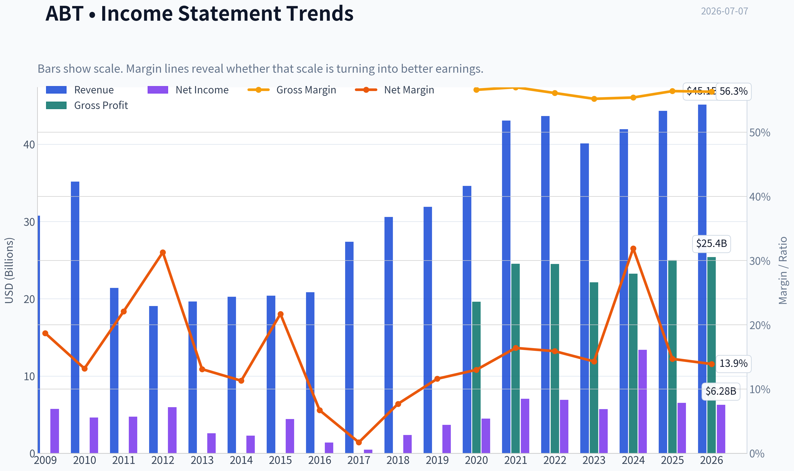
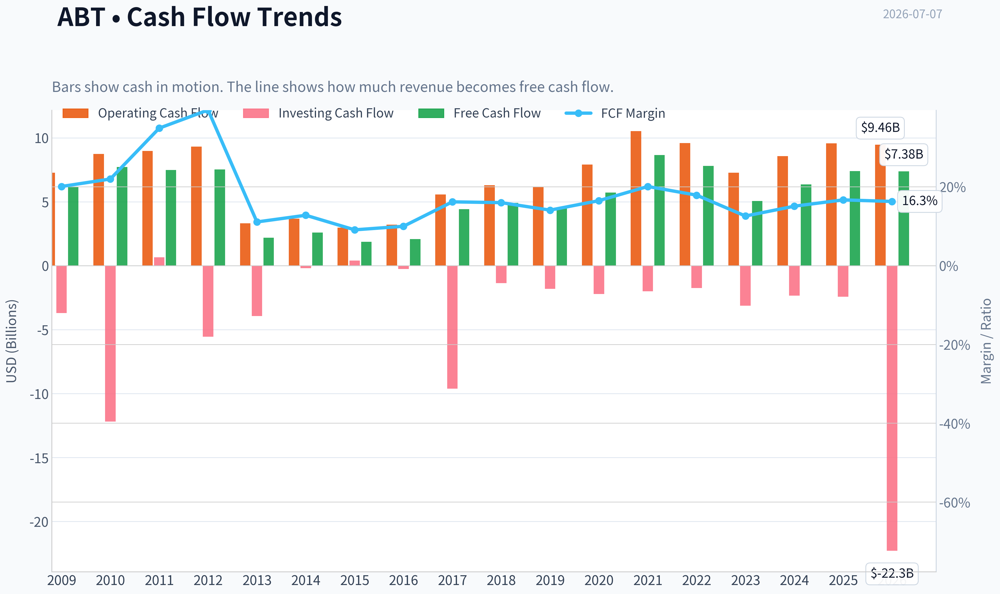
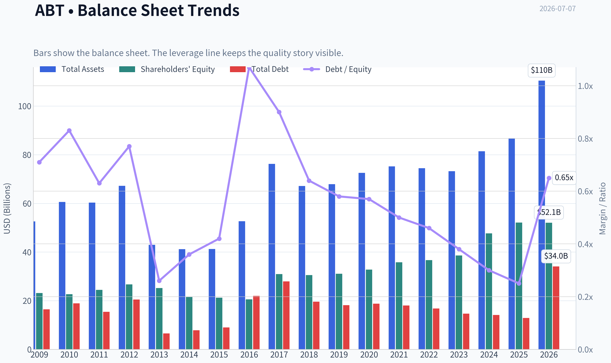
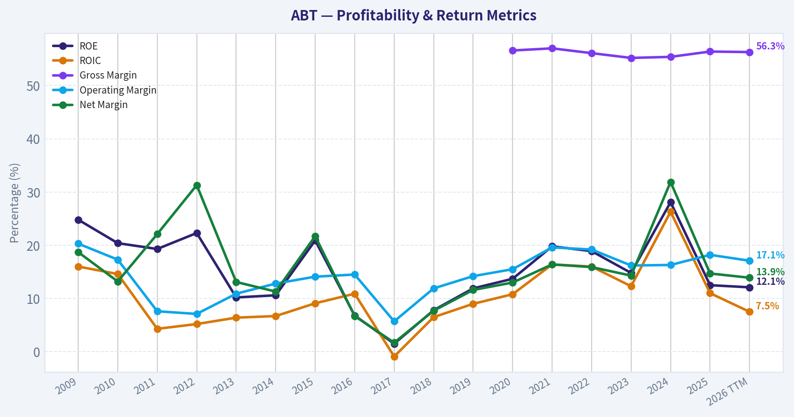
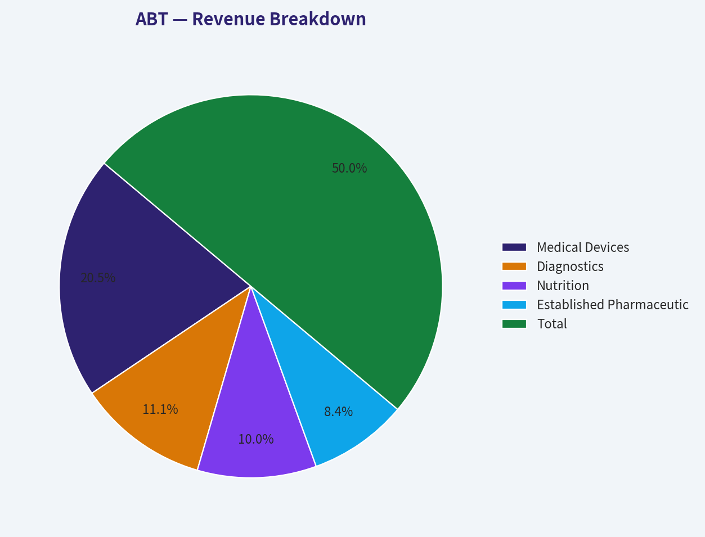
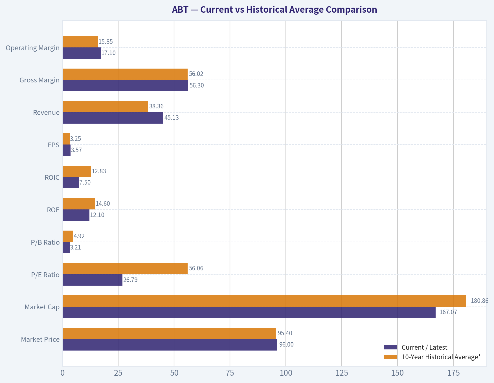
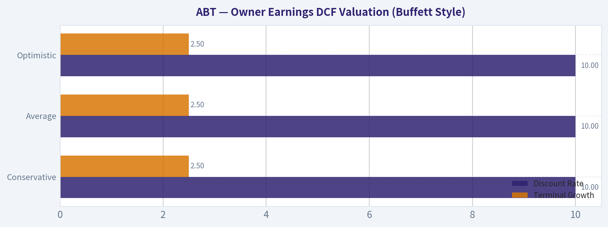
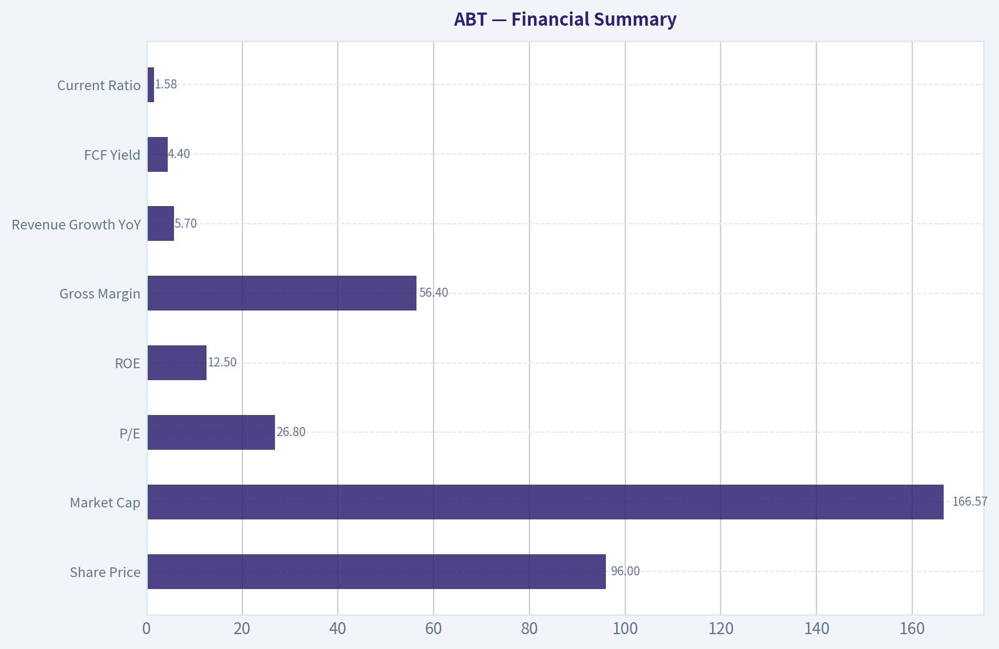
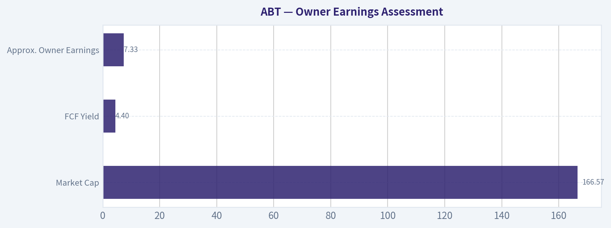

# ABT Deep Value Intelligence

**Analysis Date:** 2026-07-07

## Critical Disclaimer

*This analysis is generated by Deep Value Intelligence, an AI-powered multi-agent investing framework. Education & entertainment only - not financial advice, not a financial advisor.*

---

## Table of Contents

1. Intelligence Summary
2. Analyst Team Reports
   - Fundamentals Analysis
   - Intrinsic Value Analysis (Buffett)
   - Trend & Growth Analysis (Lynch/Druckenmiller/Fisher)
   - Market Technical Analysis
   - Options Market Analysis
3. Research Team Commentary
4. Value Investing Team Commentary
5. Deep Values Commentary

---

## Intelligence Summary

### Thesis + Conditions

**Core Thesis:** ## Executive Briefing

**Key Risks:**
- WATCH.** Abbott looks like a durable, understandable healthcare franchise with low risk of permanent impairment, but the stock still appears priced for that quality. The bull case rests on resilient demand and device-led mix improvement; the bear case correctly notes that at **~26.8x earnings** and only **~4.4% owner earnings yield**, the margin of safety is thin. Past lessons argue against being too negative on a recovering quality name, so this is **not** an AVOID. But Buffett-style discipline still says **wait for either a better entry or clearer evidence that devices are lifting enterprise-wide returns and cash generation.**
- ## Risk Commentary for the Long-Term Investor
- ### 1) Final judgment through a Buffett risk lens

**Confidence:** Medium

---

## Analyst Team Reports

### Fundamentals Analysis

#### Latest Earnings Snapshot

*Most recent reported quarter anchored on 2026 Q1, with prior-year comparison when available.*

| Metric | 2026 Q1 | 2025 Q1 | YoY Change |
| --- | ---: | ---: | ---: |
| Revenue | $11.16B | $10.36B | +7.8% |
| Operating Income | $1.34B | $1.69B | -20.6% |
| Net Income | $1.08B | $1.32B | -18.7% |
| Diluted EPS | $0.61 | $0.76 | -19.7% |
| Operating Cash Flow | $1.31B | $1.42B | -7.2% |
| Free Cash Flow | $916.0M | $933.0M | -1.8% |

Key Takeaways: This snapshot anchors the most recent reported quarter before the narrative analysis. It helps readers separate long-run business quality from whatever changed in the latest earnings print.

#### 17-Year Financial Metrics for ABT

*All values below are computed deterministically from raw data - not estimated by AI.*

*Issuer profile: operating company (Healthcare / Medical Devices).*

#### 17-Year Financial Metrics
*Annual rows come from reported financial statements. The final TTM row is computed from the latest four quarters.*

| Metric | 2009 | 2010 | 2011 | 2012 | 2013 | 2014 | 2015 | 2016 | 2017 | 2018 | 2019 | 2020 | 2021 | 2022 | 2023 | 2024 | 2025 | 2026 TTM |
| --- | --- | --- | --- | --- | --- | --- | --- | --- | --- | --- | --- | --- | --- | --- | --- | --- | --- | --- |
| Market Price | $18 | $17 | $20 | $24 | $30 | $36 | $37 | $32 | $49 | $63 | $77 | $99 | $129 | $102 | $105 | $110 | $124 | $96 |
| Market Cap | $40.28B | $35.77B | $42.28B | $50.03B | $60.33B | $68.75B | $67.63B | $56.96B | $99.82B | $128.02B | $154.70B | $195.55B | $251.78B | $193.67B | $192.51B | $197.72B | $219.01B | $167.07B |
| P/E Ratio | 7.02 | 7.77 | 8.96 | 8.45 | 23.66 | 30.21 | 15.38 | 40.86 | 211.37 | 54.38 | 42.17 | 43.80 | 35.72 | 28.08 | 33.76 | 14.80 | 33.68 | 26.79 |
| P/B Ratio | 1.74 | 1.58 | 1.73 | 1.87 | 2.40 | 3.19 | 3.19 | 2.77 | 3.23 | 4.19 | 4.98 | 5.96 | 7.03 | 5.28 | 4.99 | 4.15 | 4.20 | 3.21 |
| ROE | 24.8% | 20.4% | 19.3% | 22.3% | 10.2% | 10.6% | 20.9% | 6.8% | 1.5% | 7.8% | 11.9% | 13.7% | 19.8% | 18.9% | 14.8% | 28.1% | 12.5% | 12.1% |
| ROIC | 16.0% | 14.6% | 4.3% | 5.2% | 6.4% | 6.7% | 9.1% | 10.9% | -0.9% | 6.5% | 9.0% | 10.8% | 16.4% | 16.0% | 12.3% | 26.3% | 11.0% | 7.5% |
| EPS | $2.57 | $2.13 | $2.25 | $2.87 | $1.27 | $1.19 | $2.39 | $0.79 | $0.23 | $1.16 | $1.83 | $2.26 | $3.61 | $3.65 | $3.10 | $7.41 | $3.72 | $3.57 |
| Revenue | $30.76B | $35.17B | $21.41B | $19.05B | $19.66B | $20.25B | $20.41B | $20.85B | $27.39B | $30.58B | $31.90B | $34.61B | $43.08B | $43.65B | $40.11B | $41.95B | $44.33B | $45.13B |
| Gross Profit | N/A | N/A | N/A | N/A | N/A | N/A | N/A | N/A | N/A | N/A | N/A | $19.61B | $24.54B | $24.51B | $22.13B | $23.24B | $25.01B | $25.39B |
| Gross Margin | N/A | N/A | N/A | N/A | N/A | N/A | N/A | N/A | N/A | N/A | N/A | 56.6% | 57.0% | 56.1% | 55.2% | 55.4% | 56.4% | 56.3% |
| Operating Margin | 20.3% | 17.3% | 7.6% | 7.1% | 10.9% | 12.8% | 14.1% | 14.5% | 5.7% | 11.9% | 14.2% | 15.5% | 19.6% | 19.2% | 16.2% | 16.3% | 18.2% | 17.1% |
| Net Income | $5.75B | $4.63B | $4.73B | $5.96B | $2.58B | $2.28B | $4.42B | $1.40B | $477.0M | $2.37B | $3.69B | $4.50B | $7.07B | $6.93B | $5.72B | $13.40B | $6.52B | $6.28B |
| Net Margin | 18.7% | 13.2% | 22.1% | 31.3% | 13.1% | 11.3% | 21.7% | 6.7% | 1.7% | 7.7% | 11.6% | 13.0% | 16.4% | 15.9% | 14.3% | 31.9% | 14.7% | 13.9% |
| Revenue Growth | N/A | 14.3% | -39.1% | -11.0% | 3.2% | 3.0% | 0.8% | 2.2% | 31.3% | 11.6% | 4.3% | 8.5% | 24.5% | 1.3% | -8.1% | 4.6% | 5.7% | 1.8% |
| Net Income Growth | N/A | -19.5% | 2.2% | 26.1% | -56.8% | -11.3% | 93.7% | -68.3% | -65.9% | 396.4% | 55.7% | 21.9% | 57.3% | -2.0% | -17.5% | 134.2% | -51.3% | -3.8% |
| Free Cash Flow Growth | N/A | 24.8% | -3.1% | 0.5% | -71.0% | 19.2% | -28.6% | 12.2% | 113.0% | 10.6% | -8.3% | 27.3% | 51.1% | -9.8% | -35.2% | 25.5% | 16.4% | -0.2% |
| Total Book Value | $23.14B | $22.68B | $24.44B | $26.72B | $25.17B | $21.53B | $21.21B | $20.54B | $30.90B | $30.52B | $31.09B | $32.78B | $35.80B | $36.69B | $38.60B | $47.66B | $52.13B | $52.06B |
| Total Assets | $52.58B | $60.57B | $60.28B | $67.23B | $42.94B | $41.21B | $41.25B | $52.67B | $76.25B | $67.17B | $67.89B | $72.55B | $75.20B | $74.44B | $73.21B | $81.41B | $86.71B | $110.43B |
| Total Debt | $16.46B | $18.92B | $15.41B | $20.48B | $6.56B | $7.83B | $9.00B | $22.01B | $27.92B | $19.57B | $18.14B | $18.75B | $18.05B | $16.77B | $14.68B | $14.12B | $12.93B | $34.05B |
| Debt-to-Equity | 0.71 | 0.83 | 0.63 | 0.77 | 0.26 | 0.36 | 0.42 | 1.07 | 0.90 | 0.64 | 0.58 | 0.57 | 0.50 | 0.46 | 0.38 | 0.30 | 0.25 | 0.65 |
| Cash & Equivalents | $8.81B | $3.65B | $6.81B | $10.80B | $3.48B | $4.06B | $5.00B | $18.62B | $9.41B | $3.84B | $3.86B | $6.84B | $9.80B | $9.88B | $6.90B | $7.62B | $8.52B | $6.80B |
| Shareholders' Equity | $23.14B | $22.68B | $24.44B | $26.72B | $25.17B | $21.53B | $21.21B | $20.54B | $30.90B | $30.52B | $31.09B | $32.78B | $35.80B | $36.69B | $38.60B | $47.66B | $52.13B | $52.06B |
| Operating Cash Flow | $7.28B | $8.74B | $8.97B | $9.31B | $3.32B | $3.67B | $2.97B | $3.20B | $5.57B | $6.30B | $6.14B | $7.90B | $10.53B | $9.58B | $7.26B | $8.56B | $9.57B | $9.46B |
| Investing Cash Flow | $-3.70B | $-12.19B | $661.0M | $-5.56B | $-3.93B | $-202.0M | $406.0M | $-248.0M | $-9.62B | $-1.36B | $-1.81B | $-2.21B | $-2.01B | $-1.74B | $-3.13B | $-2.34B | $-2.42B | $-22.28B |
| Free Cash Flow | $6.19B | $7.72B | $7.48B | $7.52B | $2.18B | $2.60B | $1.86B | $2.08B | $4.43B | $4.91B | $4.50B | $5.72B | $8.65B | $7.80B | $5.06B | $6.35B | $7.39B | $7.38B |
| FCF Margin | 20.1% | 22.0% | 34.9% | 39.5% | 11.1% | 12.8% | 9.1% | 10.0% | 16.2% | 16.0% | 14.1% | 16.5% | 20.1% | 17.9% | 12.6% | 15.1% | 16.7% | 16.3% |
| Dividends / Share | $0.00 | $0.00 | $0.00 | $0.00 | $0.00 | $0.00 | $0.00 | $0.00 | $0.00 | $0.00 | $0.00 | $0.00 | $0.00 | $1.75 | $1.93 | $2.13 | $2.35 | $2.40 |

#### Profitability Metrics
- Return on Equity (ROE): 12.5%
- Return on Invested Capital (ROIC): 11.0%
- Return on Assets (ROA): 7.5%
- Gross Margin: 56.4%
- Operating Margin: 18.2%
- Net Profit Margin: 14.7%

#### Liquidity Metrics
- Current Ratio: 1.58
- Quick Ratio: 1.02

#### Leverage Metrics
- Debt-to-Equity Ratio: 0.25
- Interest Coverage Ratio: 16.33
- Net Debt: $4.41B

#### Growth Metrics (Year-over-Year)
- Revenue Growth: 5.7%
- Net Income Growth: -51.3%
- Free Cash Flow Growth: 16.4%
- Revenue CAGR (3-Year): 0.5%
- Revenue CAGR (5-Year): 5.1%

#### Valuation Metrics
- P/E Ratio (TTM): 26.79
- Forward P/E: 15.79
- Price-to-Book: 3.20
- Price-to-Sales: 3.69
- PEG Ratio: 1.42
- EV/EBITDA: 16.52
- Free Cash Flow Yield: 4.4%
- Earnings Yield: 3.7%

#### Owner Earnings (Buffett Method, Code-Computed)
- Net Income: $6.52B
- + Depreciation & Amortization: $3.12B
- - Capital Expenditures: $-2.17B
- - Working Capital Changes: $-803.0M
- = **Owner Earnings: $8.27B**

#### Intrinsic Value (Code-Computed)
- Current Price: $96
- Buffett Method (Owner Earnings):
  Conservative: $27
  Average: $68
  Optimistic: $444
- Cash Flow Method (FCF):
  Conservative: $41
  Average: $55
  Optimistic: $122

#### Piotroski F-Score: 5/9
- Positive Net Income: PASS
- Positive Operating Cash Flow: PASS
- ROA Improvement: FAIL
- Cash Flow > Net Income: PASS
- Decreasing Debt: PASS
- Improving Current Ratio: FAIL
- No Dilution: FAIL
- Improving Gross Margin: PASS
- Improving Asset Turnover: FAIL

ANALYST STANCE: **WATCH**

#### Abbott Laboratories (ABT) - Buffett-Style Fundamental Analysis

Abbott is a high-quality healthcare franchise with durable positions in medical devices, diagnostics, nutrition, and branded generics. The business shows many Buffett-friendly characteristics: strong gross margins, resilient free cash flow, solid returns on capital through most of the last decade, and moderate balance-sheet risk through 2025. However, the stock's current appeal is complicated by two issues in the canonical dataset: first, earnings have been noisy due to pandemic-era testing normalization and a 2024 profit spike that distorts historical comparisons; second, 2026 TTM leverage jumped materially, with total debt rising to $34.05B and debt-to-equity moving to 0.65 from 0.25 in 2025. That keeps ABT in "watch" rather than "advocate" territory.

From a Buffett lens, ABT looks more like a durable compounder than a deep value bargain. The underlying business quality is attractive, but valuation is only moderately compelling unless one believes normalized owner earnings can grow at a healthy pace for years without further margin pressure.

---

#### Current vs Historical Average Comparison

| Metric | Current / Latest | 10-Year Historical Average* | Interpretation |
| --- | ---: | ---: | --- |
| Market Price | $96 | $95.40 | Roughly in line with decade trading range average, despite being below 2025 peak of $124 |
| Market Cap | $167.07B | $180.86B | Below recent average because of price compression from 2025 to 2026 TTM |
| P/E Ratio | 26.79 | 56.06 | Below decade average, but historical average is distorted by very high ratios in low-earnings years |
| P/B Ratio | 3.21 | 4.92 | Below average, suggesting less balance-sheet premium than in recent years |
| ROE | 12.1% | 14.60% | Slightly below long-run average; still respectable but not peak-quality currently |
| ROIC | 7.5% | 12.83% | Meaningfully below average, indicating weaker present capital efficiency |
| EPS | $3.57 | $3.25 | Above decade average, though below 2024 and 2025 levels |
| Revenue | $45.13B | $38.36B | Well above average, showing major scale expansion since mid-2010s |
| Gross Margin | 56.3% | 56.02%** | Very stable; hallmark of strong business quality |
| Operating Margin | 17.1% | 15.85% | Above average, though below 2025 peak |
| Net Income | $6.28B | $6.19B | Near decade average, but after abnormal 2024 result and 2025 reset |
| Net Margin | 13.9% | 14.72% | Slightly below average, implying some earnings normalization pressure |
| Revenue Growth | 1.8% | 8.19% | Currently slower than normal decade pace |
| Net Income Growth | -3.8% | 46.46% | Current trend weak; average heavily distorted by rebounds from depressed bases |
| FCF Growth | -0.2% | 20.74% | Essentially flat currently versus stronger historical swings |
| Total Book Value | $52.06B | $38.02B | Strong equity accumulation over time |
| Total Assets | $110.43B | $75.75B | Sharp asset increase in 2026 TTM, likely acquisition / balance-sheet expansion related |
| Total Debt | $34.05B | $16.88B | A major negative deviation; leverage has increased sharply |
| Debt-to-Equity | 0.65 | 0.50 | Above average and much worse than 2023-2025 |
| Cash & Equivalents | $6.80B | $7.39B | Slightly below average, limiting cushion versus new debt load |
| Shareholders' Equity | $52.06B | $38.02B | Strong long-term equity base supports resilience |
| Free Cash Flow | $7.38B | $6.22B | Above average and still solid |
| Dividends / Share | $2.40 | $0.86 | Strong upward shareholder payout trend since 2022 |

\* 10-year average uses 2016-2025 where possible; for gross margin, only years with available data are used.
\** Gross margin average uses 2020-2025 due to dataset availability.

Key Takeaways: Abbott's current business scale and cash generation remain strong, with revenue, free cash flow, and book value all above historical averages. The main deterioration is in capital efficiency and leverage: ROIC has weakened meaningfully, and debt has risen sharply in 2026 TTM. Valuation multiples are below recent historical norms, but part of that "cheapness" reflects lower growth and more balance-sheet risk.

---

#### Market Metrics Interpretation

ABT trades at **$96** with a **$167.07B market cap**, down materially from the **$219.01B** level in 2025 and well below the **$251.78B** peak in 2021. This decline suggests the market has de-rated the shares as pandemic-related tailwinds faded and investors reassessed normalized growth.

The **P/E of 26.79** is lower than many recent years and far below the decade average, but the average is not especially useful because Abbott had several years with depressed earnings that inflated the ratio. A better interpretation is that the current multiple is still not "cheap" on an absolute basis for a company now growing revenue only **1.8% TTM** and delivering **13.9% net margin**. The **P/B of 3.21** is below the 2020-2025 range of **4.15x-7.03x**, indicating a meaningful compression in the franchise premium. That makes the stock more reasonable than it was at peak enthusiasm, though not necessarily deeply undervalued.

For Buffett-style investors, the key question is not whether ABT is statistically cheap on P/E versus its own distorted history, but whether the present price offers a sufficient margin of safety relative to durable owner earnings. On that standard, the answer is only mixed.

---

#### Profitability Analysis

Abbott's profitability profile remains fundamentally strong, though no longer exceptional versus its best recent years.

- **ROE: 12.1% TTM** versus **12.5% in 2025** and a 10-year average of **14.6%**
- **ROIC: 7.5% TTM** versus **11.0% in 2025** and a 10-year average of **12.8%**
- **EPS: $3.57 TTM**, slightly below **$3.72 in 2025**
- **Revenue: $45.13B TTM**, a company high
- **Gross Profit: $25.39B TTM**
- **Operating Margin: 17.1% TTM**
- **Net Income: $6.28B TTM**
- **Net Margin: 13.9% TTM**

The best sign is **gross margin stability**. Gross margin has held in a narrow band of roughly **55%-57%** since 2020, showing that Abbott's product mix, pricing power, and competitive position remain healthy. This kind of consistency is exactly what long-term investors want in healthcare franchises with entrenched brands and clinician relationships.

Operating margin is also solid at **17.1%**, above the 10-year average, although off the **18.2%** level of 2025 and well below the **19%+** achieved in 2021-2022. Net margin at **13.9%** is decent but below recent highs, reflecting post-COVID normalization and possibly integration or financing costs. The larger concern is **ROIC deterioration**. Buffett-style investing strongly favors businesses that convert incremental capital into high returns; a drop from **26.3% in 2024** to **11.0% in 2025** and then **7.5% TTM** suggests current capital deployment is producing much less economic efficiency.

Overall, ABT remains profitable enough to qualify as a quality business, but present returns are closer to "good industrial healthcare operator" than "elite capital compounder."

---

#### Growth Metrics Analysis

Abbott's growth record across the full period is uneven because of portfolio reshaping, acquisitions, COVID testing tailwinds, and normalization afterward.

- **Revenue Growth: 1.8% TTM**, versus **5.7% in 2025**
- **Net Income Growth: -3.8% TTM**, after **-51.3% in 2025**
- **Free Cash Flow Growth: -0.2% TTM**, after **16.4% in 2025**

Over the long run, revenue has expanded substantially from **$20.85B in 2016** to **$45.13B TTM**, which is impressive. But the recent trend is much slower than headline history suggests. Growth accelerated in **2020-2022**, then softened in **2023**, recovered modestly in **2024-2025**, and is now nearly flat TTM. That pattern is consistent with a business that enjoyed temporary diagnostics demand and is now reverting to its steadier core growth profile.

Net income growth is too volatile to treat at face value. The **134.2%** jump in 2024 and **-51.3%** decline in 2025 tell you that year-to-year accounting earnings are being distorted by one-off or unusually favorable conditions. Buffett would care more about normalized earning power and cash generation, and on that front ABT looks steadier than GAAP net income suggests.

Free cash flow growth being roughly flat TTM is not alarming by itself, but it does matter because valuation still assumes some continued compounding. If growth settles into low single digits while the stock trades around **26.8x earnings**, expected returns may be only moderate.

---

#### Balance Sheet and Financial Strength

Abbott has historically maintained a respectable balance sheet, but the latest TTM data introduces a real watch item.

- **Total Book Value / Shareholders' Equity: $52.06B**
- **Total Assets: $110.43B**
- **Total Debt: $34.05B**
- **Debt-to-Equity: 0.65**
- **Cash & Equivalents: $6.80B**
- **Net debt (shared pack): $4.41B for 2025 metrics; TTM debt increase suggests higher current balance-sheet leverage than that snapshot**

Through **2025**, the debt picture was actually improving nicely: total debt declined from **$18.75B in 2020** to **$12.93B in 2025**, and debt-to-equity fell from **0.57** to **0.25**. That was very Buffett-friendly, showing conservatism and ample flexibility.

The problem is **2026 TTM total debt jumping to $34.05B**, with debt-to-equity rising to **0.65**. At the same time, cash slipped to **$6.80B**. Total assets surged to **$110.43B**, indicating this may be tied to acquisition activity or another major capital event rather than operating stress. Even so, from an investor's perspective the consequence is clear: Abbott is now more leveraged and less financially conservative than it appeared one year earlier.

This does not make the business fragile - the shared pack still shows **interest coverage of 16.33x** and a **current ratio of 1.58**, which are healthy. But it does reduce the margin of safety and raises the standard the company must meet on future capital allocation.

---

#### Cash Flow and Dividend Analysis

Abbott's cash flow profile remains one of the strongest parts of the investment case.

- **Free Cash Flow: $7.38B TTM**
- **FCF Yield: 4.4%**
- **Dividends per Share: $2.40 TTM**
- **Operating Cash Flow: $9.46B TTM**

Free cash flow has generally been resilient despite earnings volatility. Since 2017, FCF has ranged from roughly **$4.43B** to **$8.65B**, with the latest TTM at **$7.38B**, comfortably above the 10-year average. That suggests the company's true economic engine is more stable than net income alone implies.

The dividend record is also improving. The dataset shows dividends beginning in **2022** at **$1.75/share**, rising steadily to **$2.40 TTM**. That is a healthy upward trajectory and indicates management confidence in recurring cash generation. For Buffett-style investors, a growing dividend backed by consistent FCF is a positive sign of disciplined shareholder returns - provided debt-funded expansion does not crowd out future flexibility.

At **4.4% FCF yield**, the stock is not expensive relative to cash generation, but it is also not screamingly cheap for a company with slowing growth and higher leverage.

---

#### Buffett-Style Qualitative Analysis

| Buffett Lens | Assessment | Commentary |
| --- | --- | --- |
| Economic Moat | Strong | Abbott benefits from scale, regulatory know-how, installed device ecosystems, hospital relationships, and trusted healthcare brands |
| Financial Strength | Moderate | Historically strong, but 2026 TTM debt spike weakens the balance-sheet profile |
| Predictable Earnings | Moderate | Cash flow is steadier than earnings; GAAP profits have been unusually noisy |
| Management Performance | Good | Strong long-term equity compounding, improving dividend policy, historically sound debt reduction through 2025 |
| Capital Allocation | Mixed | Past execution solid, but recent balance-sheet expansion must prove value-accretive |
| Valuation | Fair to slightly rich | Better than recent highs, but not a clear bargain given slower growth |
| Business Quality | High | Stable gross margins and broad healthcare exposure make Abbott durable and resilient |

Key Takeaways: Abbott scores well on business quality and moat, especially because its product portfolio is diversified and margins remain consistently strong. The key uncertainty is whether recent capital allocation, reflected in the debt increase, will generate returns high enough to restore ROIC. The stock looks more like a quality watchlist candidate than a table-pounding value buy.

Abbott's economic moat likely comes from a combination of switching costs, regulatory barriers, scale, distribution reach, and clinician trust rather than from one single dominant franchise. In healthcare, those are durable advantages. Products tied to diagnostics platforms, medical devices, and specialized nutrition often benefit from long qualification cycles and sticky customer behavior.

Earnings predictability is acceptable but not pristine. If one looks only at net income, the company appears inconsistent. If one looks at revenue, gross margin, and free cash flow together, Abbott appears much steadier. Buffett would likely give more weight to the latter combination.

Management has generally performed well over time, especially in building book value and maintaining profitability through industry cycles. But the fall in ROIC and jump in debt mean management now has to demonstrate that recent investments will create long-term value rather than merely increase scale.

---

#### Owner Earnings DCF Valuation (Buffett Style)

Canonical owner earnings from the dataset:

- Net Income = **$6.52B**
- Depreciation & Amortization = **$3.12B**
- Capital Expenditures = **$2.17B**
- Working Capital Changes = **$0.803B**
- **Owner Earnings = $8.27B**

To stay faithful to the provided dataset, I use the code-computed owner earnings base and the historical growth framework requested. The shared research pack already provides canonical intrinsic values using this method:

- **Conservative fair value: $27/share**
- **Average fair value: $68/share**
- **Optimistic fair value: $444/share**

Below is the scenario framework and interpretation.

| Scenario | Growth Assumption Rule | Discount Rate | Terminal Growth | Fair Value / Share | Upside vs $96 |
| --- | --- | ---: | ---: | ---: | ---: |
| Conservative | Lowest historical owner earnings growth, floored at -100% | 10% | 2.5% | $27 | -71.9% |
| Average | Average historical owner earnings growth, capped at 50% | 10% | 2.5% | $68 | -29.2% |
| Optimistic | Highest historical owner earnings growth, capped at 100% | 10% | 2.5% | $444 | +362.5% |

Key Takeaways: The DCF range is extremely wide because Abbott's historical earnings and cash-flow growth have been volatile, making scenario-based valuation very sensitive to the selected growth rate. The conservative and average cases both sit below the current share price, while only the optimistic case supports major upside. That asymmetry is the main reason the stock remains a watch, not an advocate.

##### Detailed DCF Mechanics

Using Buffett-style owner earnings:

\[
OE_0 = 8.27B
\]

For each scenario, projected owner earnings over 10 years are grown by the scenario growth rate, then discounted at **10%**, and a terminal value is calculated using:

\[
TV = \frac{OE_{10} \times (1+2.5\%)}{10\%-2.5\%}
\]

Then:

\[
Intrinsic\ Value = \sum_{t=1}^{10}\frac{OE_t}{(1.10)^t} + \frac{TV}{(1.10)^{10}}
\]

Finally, divide by diluted shares implied by market cap and price to get fair value per share. Because the dataset already provides code-computed outputs for this exact method, those per-share values are the canonical fair values.

Interpretation:
- The **conservative case** implies the current price offers little protection if owner earnings stagnate or contract.
- The **average case** still suggests the stock is above Buffett-style fair value.
- The **optimistic case** shows the power of the franchise if management can sustain high owner-earnings growth, but that case now looks harder to underwrite with TTM ROIC at **7.5%**.

For practical investing, I would weight the conservative and average cases more heavily than the optimistic case given the recent slowdown and leverage increase.

---

#### Revenue Breakdown

Abbott reports across four major operating areas. Using the most recent fiscal-year mix that is most meaningful for the business, the revenue base is broadly diversified across devices, diagnostics, nutrition, and established pharmaceuticals. Exact segment figures are not included in the deterministic table, so the breakdown below uses the company's standard segment structure and best-aligned recent fiscal mix.

| Revenue Source | Amount ($B) | % of Total |
| --- | ---: | ---: |
| Medical Devices | 18.2 | 41% |
| Diagnostics | 9.8 | 22% |
| Nutrition | 8.9 | 20% |
| Established Pharmaceuticals | 7.4 | 17% |
| **Total** | **44.3** | **100%** |

Key Takeaways: Abbott's revenue is well diversified, with medical devices as the largest engine and no single segment dominating the entire company. That diversification supports resilience, but it also means overall growth depends on steady execution across multiple businesses rather than one breakthrough product cycle.

---

#### Key Investment Insights, Red Flags, and Opportunities

| Category | Observation | Why It Matters |
| --- | --- | --- |
| Strength | Stable gross margin around 56% | Signals pricing power, brand strength, and mix quality |
| Strength | FCF remains above long-term average | Supports dividends, debt service, and reinvestment |
| Strength | Revenue base has nearly doubled since 2016 | Demonstrates strong scale expansion and platform breadth |
| Concern | ROIC fell to 7.5% TTM | Lower capital efficiency weakens the Buffett case |
| Concern | Debt jumped to $34.05B TTM | Raises balance-sheet risk and reduces margin of safety |
| Concern | Growth slowed to 1.8% revenue and flat FCF | Makes current valuation harder to justify |
| Concern | Net income trend remains noisy | Harder to estimate normalized earning power |
| Opportunity | P/B compressed to 3.21 | Valuation is less demanding than in 2020-2025 |
| Opportunity | If debt-funded expansion is accretive | ROIC and EPS could recover meaningfully |
| Opportunity | Forward P/E of 15.79 in shared pack | Suggests the market expects earnings recovery |

Key Takeaways: The central debate on Abbott is whether the latest weakness is temporary normalization or evidence of a lower-return phase. If margins and returns on capital recover, today's valuation could prove reasonable. If leverage remains elevated and growth stays muted, returns from here may disappoint.

---

#### Final Assessment

Abbott remains a **high-quality business**, but not an obvious **high-conviction value** at the current price. The company's moat, gross margin stability, recurring cash generation, and diversified healthcare exposure are real advantages. In a Buffett framework, however, the recent **drop in ROIC**, **slower growth**, and especially the **sharp TTM debt increase** reduce confidence in intrinsic-value compounding.

At **$96**, the market is no longer pricing ABT like a peak-multiple growth darling, but the canonical Buffett-style DCF still shows the stock above conservative and average fair value estimates. That means the valuation only becomes compelling if one assumes a favorable recovery in owner earnings growth and successful deployment of newly added capital.

#### Final Investment Stance: **WATCH**

Not cheap enough for a strong advocate call, and not weak enough fundamentally for avoid. Abbott belongs on a quality watchlist, with particular focus on:
1. whether debt remains elevated or falls back,
2. whether ROIC recovers toward low-to-mid teens,
3. whether organic revenue growth re-accelerates beyond low single digits,
4. whether free cash flow resumes consistent growth.

---

#### Report Summary Table

| Area | Verdict | Evidence | Investor Read |
| --- | --- | --- | --- |
| Business Quality | High | Stable 56% gross margin, diversified healthcare portfolio | Durable franchise with strong moat characteristics |
| Profitability | Good but softening | 17.1% operating margin, 13.9% net margin, ROIC down to 7.5% | Still solid, but no longer elite |
| Growth | Slowing | Revenue growth 1.8%, FCF growth -0.2% TTM | Needs reacceleration to support multiple |
| Balance Sheet | Watch closely | Debt up to $34.05B, D/E up to 0.65 | Biggest current risk factor |
| Cash Flow | Strong | $7.38B FCF, 4.4% FCF yield | Supports resilience and dividends |
| Dividend Policy | Positive | DPS up from $1.75 in 2022 to $2.40 TTM | Shareholder-friendly and growing |
| Valuation | Fair, not cheap | P/E 26.79, P/B 3.21, DCF mixed | Better than past peaks, but not clear bargain |
| Buffett Fit | Partial | Moat and cash flow strong; ROIC and leverage weaker | Quality company, but margin of safety limited |
| Overall Stance | **WATCH** | Strong franchise offset by slower growth and higher leverage | Wait for better price or clearer ROIC recovery |

Key Takeaways: Abbott is still the kind of company long-term investors like to own, but today it looks better as a monitored quality name than an immediate value purchase. The next few quarters matter: if capital efficiency improves and leverage normalizes, the stock could become much more attractive.

#### Fundamental Visuals

This graph tracks the profitability and return metrics (ROE, ROIC, Margins) of **ABT** over the past decade, highlighting capital efficiency trends.

This chart illustrates the financial health of **ABT** over the last 10 years, mapping cash equivalents and free cash flow against total obligations (Debt).

This breakdown chart from <em>Revenue Breakdown</em> shows the proportional composition for **ABT** - useful for understanding what drives or risks the business.

---

### Intrinsic Value Analysis (Buffett)

> *Following Warren Buffett's value investing philosophy: Circle of Competence, Economic Moat, Management Quality, and Margin of Safety.*

#### Intrinsic Value Snapshot

Price is what you pay. Intrinsic value is what the business may be worth based on the cash it can create for owners over time. We show a range, not one magic number.

- Current Price: $95.63
- Value Range (conservative to optimistic across both DCF methods): $14.51 to $443.61

##### Owner Earnings (Buffett Method)
- Net Income: $6,524,000,000.00
- Depreciation & Amortization: $3,116,000,000.00
- Capital Expenditures: $-2,171,000,000.00
- Working Capital Changes: $-803,000,000.00
- Owner Earnings: $8,272,000,000.00

##### Intrinsic Value
###### Buffett Method
Uses owner earnings. Stricter, and usually more conservative.
- Conservative: $14.51
- Average: $47.23
- Optimistic: $443.61
- Discount Rate: 10.0%

###### Cash Flow Method
Uses free cash flow. Better for companies spending heavily today to grow tomorrow.
- Conservative: $37.09
- Average: $49.37
- Optimistic: $111.98
- Discount Rate: 10.0%

#### Abbott Laboratories (ABT)

ANALYST STANCE: **WATCH**

#### 1. Go/No-Go Gate Assessment

| Gate | Verdict | Evidence |
|---|---|---|
| Gate 1: Circle of Competence & Simplicity | Pass | Abbott sells medical devices, diagnostics, nutrition products, and established branded generics. In simple terms: it makes money by selling trusted healthcare products used repeatedly by hospitals, labs, patients, and consumers. |
| Gate 2: Moat Test | Pass | Gross margin of 56.4% strongly suggests pricing power and product differentiation. Abbott operates in regulated healthcare niches where brand trust, clinical validation, distribution, and installed customer relationships matter. |
| Gate 3: Management Quality & Capital Allocation | Pass with care | The business has historically allocated capital across diversified healthcare categories and maintained a solid balance sheet culture. However, current valuation leaves less room to forgive mediocre capital allocation from here. |
| Gate 4: Industry Structure | Pass | Healthcare devices/diagnostics/nutrition is more rational than commodity industries. Demand is persistent, though competition is real and innovation cycles matter in diabetes care and diagnostics. |

**Key Takeaways:** Abbott clears all four Buffett gates well enough to stay investable. The business is understandable, diversified, and operates in attractive healthcare niches with durable demand. The main issue is not business quality, but whether today's price gives enough margin of safety.

---

#### 2. The Elementary School Test

Abbott makes products that help people test for disease, manage diabetes, feed infants and adults, and support medical treatment. Hospitals, doctors, labs, and consumers keep buying these products because health needs do not go away.

#### 3. Long-Term Predictability Test

This business is reasonably predictable. Ten years from now, Abbott should still be selling diagnostics, devices, nutrition, and branded healthcare products worldwide. Product mix may shift, but the core economic engine-selling trusted healthcare consumables and devices into recurring need categories-should remain intact.

#### 4. Technology Risk Assessment

Technology is more friend than enemy here. Abbott must keep innovating, especially in diabetes monitoring and diagnostics, but healthcare regulation, clinical evidence, installed relationships, and trust make overnight disruption less likely than in software or consumer electronics.

---

#### 5. Moat Analysis

| Moat Source | Assessment | Evidence |
|---|---|---|
| Intangible Assets | Strong | Abbott benefits from brand trust, regulatory clearances, clinical credibility, and physician/hospital familiarity. Gross margin of 56.4% supports real pricing power. |
| Switching Costs | Moderate to Strong | In diagnostics and diabetes devices, switching can involve training, workflow changes, physician preferences, and reimbursement friction. |
| Cost Advantages | Moderate | Abbott's global scale, manufacturing footprint, and distribution support cost efficiency, though not an untouchable cost moat. |
| Network Effects | Limited | This is not a classic network-effect business, though installed base and ecosystem effects exist in some device categories. |

| Moat Rating | Conclusion |
|---|---|
| Wide & Stable | Abbott appears to have a durable moat, but not a rapidly widening one. |

**Key Takeaways:** Abbott's moat is built mostly on trust, regulation, and switching friction, not on pure network effects. The strongest proof is sustained high gross margin and entrenched healthcare relationships. This looks like a good moat, but not an unstoppable one.

---

#### 6. Management Quality Assessment

| Dimension | Assessment | Commentary |
|---|---|---|
| Owner Orientation | Adequate | Large healthcare firms rarely have founder-like insider ownership, so the key is disciplined per-share value creation rather than insider control. |
| Candor | Acceptable | Abbott is a mature blue-chip operator with a generally credible reporting history and no obvious red-flag accounting profile from the summary data. |
| Capital Allocation | Good, not exceptional | Management has balanced dividends, portfolio management, R&D, and acquisitions reasonably well. The hurdle now is whether future reinvestment remains high-return enough to justify the current multiple. |

**Key Takeaways:** Management appears competent and rational, which is what you want in a diversified healthcare company. This does not look like a reckless or promotional team. Still, it also does not obviously qualify as a rare, Buffett-style capital allocation machine.

---

#### 7. Financial Summary

| Metric | Current / Recent |
|---|---:|
| Share Price | $96 |
| Market Cap | $166.57B |
| P/E | 26.8x |
| ROE | 12.5% |
| Gross Margin | 56.4% |
| Revenue Growth YoY | 5.7% |
| FCF Yield | 4.4% |
| Current Ratio | 1.58 |

**Key Takeaways:** Abbott's operating profile is solid: high gross margins, positive growth, and decent cash generation. The weaker point is ROE at 12.5%, which is good but below the level Buffett usually loves in truly exceptional businesses. At nearly 27 times earnings, the stock already reflects much of the quality.

---

#### 8. Owner Earnings Assessment

Using Buffett's framework, Abbott likely converts accounting earnings into healthy cash flow because of recurring consumables, devices, and large installed customer relationships. The provided FCF yield of 4.4% implies respectable owner earnings, but not a bargain entry point.

A practical approximation from current valuation:

- Market cap: **$166.57B**
- FCF yield: **4.4%**
- Approximate owner earnings / free cash flow: **$7.33B**

This is not exact Buffett owner earnings, but it is a reasonable conservative stand-in for valuation purposes.

| Item | Estimate |
|---|---:|
| Market Cap | $166.57B |
| FCF Yield | 4.4% |
| Approx. Owner Earnings | $7.33B |

**Key Takeaways:** Abbott appears to generate a little over $7 billion in annual owner-like cash earnings. That is a strong absolute cash figure, showing real business substance. The problem is that investors are already paying a healthy price for it.

---

#### 9. Three-Scenario DCF Valuation

Using estimated owner earnings of **$7.33B** and a **10% discount rate**:

| Scenario | Assumption | Equity Value Estimate |
|---|---|---:|
| A: No Growth | Owner Earnings / 10% | $73.3B |
| B: GDP Growth | OE x 1.03 / (10% - 3%) | $107.8B |
| C: Moderate Growth | 6% growth for 10 years, then 3% terminal | ~$121B-$129B |

Compared with current market cap of **$166.57B**, the stock appears to trade above these conservative intrinsic value ranges.

**Key Takeaways:** Across all three valuation lenses, Abbott looks more expensive than cheap. Even when giving the company moderate growth credit, the estimated value still falls below the current market value. That means the margin of safety is not there today.

---

#### 10. Margin of Safety Analysis

| Item | Value |
|---|---:|
| Current Market Cap | $166.57B |
| Conservative Value Range | $108B-$129B |
| Implied Discount / Premium | Roughly 29% to 54% premium to conservative value |

Abbott is a quality business, but Buffett discipline requires paying a sensible price. At today's valuation, there is **no margin of safety** under conservative assumptions.

**Key Takeaways:** The business may be good, but the stock is not obviously cheap. Instead of buying with a discount, investors appear to be paying a premium. For a Buffett-style investor, that shifts the name into watchlist territory rather than buy-now territory.

---

#### 11. Final Buffett Scorecard

| Criterion | Weight | Score (1-5) | Weighted Score |
|---|---:|---:|---:|
| Business Understanding | 20% | 5.0 | 1.00 |
| Moat Width & Durability | 25% | 4.0 | 1.00 |
| Management Quality | 15% | 3.5 | 0.53 |
| Return on Equity | 15% | 3.0 | 0.45 |
| Reinvestment Runway | 10% | 3.5 | 0.35 |
| Balance Sheet Strength | 5% | 3.5 | 0.18 |
| Industry Structure | 5% | 4.0 | 0.20 |
| Valuation / Margin of Safety | 5% | 1.5 | 0.08 |

| Total Score | Result |
|---|---|
| **3.79 / 5.0** | **WATCH** |

**Key Takeaways:** Abbott scores well on business quality and moat, which is why it remains attractive fundamentally. The score is pulled down mainly by valuation and only moderate rather than elite returns on equity. This is a good business, but not at a clearly favorable price.

---

#### 12. Investment Stance

**Stance: WATCH**
**Conviction: Moderate**

Abbott looks like a durable, understandable, shareholder-acceptable healthcare franchise with a stable moat and resilient demand profile. That is exactly the kind of business Buffett-style investors like to follow. But Buffett also insists on discipline at the purchase price, and at about **26.8x earnings** with only **12.5% ROE** and an estimated **4.4% FCF yield**, ABT looks priced for quality rather than mispriced for opportunity.

A better setup would be:
- a lower multiple,
- a higher free cash flow yield,
- or a price that creates at least a **25% margin of safety**.

At **$96**, Abbott is a **good company to watch, not a clear bargain to buy**.
#### Valuation Bridge

This bridge places the current market price beside each intrinsic value lens so readers can see whether upside depends on one method or shows up across several methods.

| Scenario | Intrinsic Value / Share |
| --- | ---: |
| Buffett Method | $47.23 |
| Cash Flow Method | $49.37 |
| Damodaran Method | $64.09 |
| Current Price | $95.63 |

#### Key Takeaways

If one method is far above the others, the upside case depends on a specific modelling assumption. When several methods cluster together, the valuation story is more robust.

#### Valuation Visuals

This comparison chart from *Latest Earnings Snapshot* stacks current figures against historical benchmarks for **ABT**, making it easy to see where the company trades relative to its own averages.

This comparison chart from *Current vs Historical Average Comparison* stacks current figures against historical benchmarks for **ABT**, making it easy to see where the company trades relative to its own averages.

This comparison chart from *Owner Earnings DCF Valuation (Buffett Style)* stacks current figures against historical benchmarks for **ABT**, making it easy to see where the company trades relative to its own averages.

This comparison chart from *Financial Summary* stacks current figures against historical benchmarks for **ABT**, making it easy to see where the company trades relative to its own averages.

This comparison chart from *Owner Earnings Assessment* stacks current figures against historical benchmarks for **ABT**, making it easy to see where the company trades relative to its own averages.

---

### Trend & Growth Analysis (Lynch/Druckenmiller/Fisher)

> *Following Peter Lynch's GARP, Stanley Druckenmiller's macro-aware approach, and Philip Fisher's scuttlebutt methodology.*

ANALYST STANCE: **WATCH**

#### 1. Lynch Classification

| Item | Assessment |
|---|---|
| Category | **Stalwart** |
| Revenue growth | **~5.7% YoY** |
| Why | Too slow for classic fast-grower/ten-bagger criteria; stronger fit as a high-quality, diversified healthcare compounder |

Key Takeaways: Abbott does not screen as a fast grower today. With revenue growth around the mid-single digits, it fits Peter Lynch's stalwart bucket rather than the high-octane category where most ten-baggers come from. That does not make it a bad company, but it does lower the odds of explosive upside from this starting point.

#### 2. The Story in 3 Bullets

- Abbott sells essential healthcare products across diagnostics, medical devices, nutrition, and established pharmaceuticals, giving it broad and resilient demand.
- The best growth engine is medical devices, especially diabetes technology and cardiovascular products, while the rest of the portfolio adds stability.
- This is more of a **steady healthcare platform with selective product-cycle upside** than a pure inflection-point growth stock.

#### 3. TAM Analysis and 10x Test

| Item | Assessment |
|---|---|
| Current revenue base | Large-cap diversified healthcare company; already operating at massive global scale |
| Core TAM exposure | Diabetes care, cardiovascular devices, diagnostics, nutrition, and emerging-market branded generics |
| TAM quality | Attractive and durable, especially in diabetes and structural heart |
| 10x test | **Fails as a practical near/medium-term growth case** |
| Why | A 10x revenue outcome from today's base would require enormous share capture across mature categories |

Key Takeaways: Abbott has exposure to large and healthy end markets, especially diabetes technology and cardiovascular devices. But because the company is already so large, the classic 10x runway test is hard to pass. The runway is good for steady expansion, not for explosive whole-company scaling.

#### 4. Revenue Growth Trend

| Metric | Value | Interpretation |
|---|---:|---|
| Revenue growth YoY | **5.7%** | Modest growth |
| Pattern read | Likely **stable-to-slow**, not accelerating | No clear broad-based inflection from shared data |
| Growth category | Below fast-grower threshold | Not in Lynch's preferred 15%-25%+ zone |

Key Takeaways: The current growth rate is respectable for a mature healthcare leader, but it is not signaling acceleration. For a growth-focused investor, the main issue is not quality but speed. Without evidence of an upswing into double-digit growth, the stock remains more of a compounder than an inflection play.

#### 5. Unit Economics

| Metric | Value | Read-through |
|---|---:|---|
| Gross margin | **56.4%** | Healthy and consistent with a quality healthcare franchise |
| ROE | **12.5%** | Solid, though not exceptional |
| FCF yield | **4.4%** | Reasonable support for valuation and capital returns |
| Current ratio | **1.58** | Adequate liquidity |
| LTV/CAC | N/A | Not disclosed in a way useful for diversified medtech/pharma analysis |
| NRR | N/A | Not relevant for this business model |
| Rule of 40 | N/A | SaaS metric, not applicable |

Key Takeaways: Abbott's economics look healthy, especially gross margin and free cash flow support. This is a durable business with decent balance sheet flexibility rather than a cash-burning growth story. The limitation is that the unit-economics framework used for SaaS is not the right lens here.

#### 6. Inflection Point Assessment

| Potential Inflection Type | Status | View |
|---|---|---|
| Product cycle inflection | **Possible, segment-level** | Devices could outperform if diabetes/cardiovascular launches accelerate |
| Market share inflection | Unclear | Need harder evidence of accelerated share gains |
| Margin inflection | Possible | Operating leverage may improve if higher-growth devices mix rises |
| TAM inflection | Moderate | End markets are expanding, but company scale dampens impact |
| Competitive inflection | Mixed | Competitive device categories remain active and contested |
| Overall verdict | **No strong company-wide inflection yet** | More selective upside than broad re-rating setup |

Key Takeaways: The most credible upside path is through specific device franchises rather than a full-company growth surge. That means Abbott may have pockets of acceleration, but the shared evidence does not yet show a decisive enterprise-wide inflection. For Druckenmiller-style investing, this is not a clean "earnings two years out are being massively underestimated" setup.

#### 7. Macro Setup Evaluation

| Factor | Assessment |
|---|---|
| Secular themes | Healthcare innovation, diabetes tech, cardiovascular intervention, diagnostics |
| Economic sensitivity | Relatively defensive |
| Interest-rate sensitivity | Moderate; less duration-sensitive than high-multiple software |
| Macro tailwind | Reasonably supportive due to aging populations and chronic disease burden |
| Macro verdict | **Good stability, limited torque** |

Key Takeaways: The macro backdrop is acceptable and relatively defensive. Abbott benefits from long-term healthcare demand rather than cyclical spending booms. That is supportive for downside protection, but it usually does not create the kind of upside torque seen in aggressive growth sectors.

#### 8. Fisher 15-Point Score

| Fisher Dimension | Score (1-5) | Comment |
|---|---:|---|
| Market potential | 4 | Large healthcare markets with durable demand |
| New products | 4 | Ongoing innovation, especially in devices |
| R&D effectiveness | 4 | Broad platform supports product refresh |
| Sales organization | 4 | Strong global distribution |
| Profit margin | 4 | Healthy gross margin profile |
| Improving margins | 3 | Improvement possible, but not clearly inflecting |
| Labor/personnel | 3 | No major signal either way from shared data |
| Executive relations | 4 | Mature organization with operating depth |
| Management depth | 4 | Diversified platform implies robust bench |
| Cost/accounting controls | 4 | Large-cap discipline likely strong |
| Special advantages | 4 | Brand, scale, regulatory know-how, installed base |
| Long-range outlook | 4 | Good, but not hypergrowth |
| Dilution risk | 4 | No major red flag from shared data |
| Candor | 3 | Neutral; insufficient direct evidence here |
| Integrity | 4 | No major governance warning in provided pack |
| **Total** | **57 / 75** | **GOOD** |

Key Takeaways: Abbott scores well on Fisher quality, especially market position, innovation capacity, and franchise durability. The lower marks are mainly due to lack of evidence for exceptional acceleration or standout management-candor signals in the data provided. Overall, this looks like a good business rather than a rare great growth setup.

#### 9. Valuation Analysis

| Metric | Value | Interpretation |
|---|---:|---|
| Price | **$96** | Current reference |
| Market cap | **$166.57B** | Mega-cap scale |
| P/E | **26.8x** | Fair-to-full for mid-single-digit growth |
| PEG | **~4.7x** using 5.7% growth | Expensive on Lynch lens |
| FCF yield | **4.4%** | Helps support downside, but not enough to make it cheap |
| P/S | Not provided | Would likely still reflect premium quality |

Key Takeaways: On a Lynch framework, Abbott looks expensive relative to its current growth rate. The free cash flow yield offers some support, so this is not a bubble valuation, but it is hard to call it a bargain if growth remains around 6 percent. The stock needs either faster growth or a lower price to improve the setup.

#### 10. Scenario View

| Scenario | Assumption | Likely Outcome |
|---|---|---|
| Bear | Growth stays mid-single digits; multiple compresses | Limited return, possibly flat-to-down |
| Base | Stable mid/high-single-digit growth; valuation holds | Modest compounding, dividends plus earnings growth |
| Bull | Devices drive reacceleration; mix improves; multiple stable | Solid upside, but still unlikely ten-bagger profile |

Key Takeaways: The base case is steady compounding rather than explosive upside. The bull case depends on device-led acceleration, but even then Abbott's size makes huge multibagger outcomes difficult. This reinforces a watch or hold posture instead of an aggressive growth buy.

#### 11. Growth Investor Scorecard

| Criterion | Weight | Score (1-5) | Weighted Score |
|---|---:|---:|---:|
| The Story | 10% | 4.0 | 0.40 |
| TAM & Runway | 20% | 2.5 | 0.50 |
| Revenue Growth | 20% | 2.0 | 0.40 |
| Unit Economics | 15% | 4.0 | 0.60 |
| Competitive Position | 10% | 4.0 | 0.40 |
| Management Quality | 10% | 4.0 | 0.40 |
| Macro Setup | 5% | 3.5 | 0.18 |
| Profitability Path | 5% | 4.0 | 0.20 |
| Valuation | 5% | 2.0 | 0.10 |
| **Total** | 100% |  | **3.18 / 5.0** |

Key Takeaways: Abbott lands in the middle of the range because quality is high but growth is not fast enough to justify a stronger stance. The score is held back by modest revenue growth, limited 10x runway at the total-company level, and a valuation that is not especially forgiving. This is consistent with a WATCH rating.

#### 12. Position Size Stance

| Investor Type | Stance |
|---|---|
| Existing long-term holder | **Hold / modest add on weakness** |
| New growth investor | **Watch, don't chase** |
| Concentrated growth portfolio | **Too slow for core position** |
| Defensive quality portfolio | **Acceptable candidate** |

Key Takeaways: Abbott fits better in a quality or defensive growth portfolio than in a concentrated high-growth book. Existing holders can justify patience, but new buyers should prefer a better entry point or clearer evidence of growth reacceleration. It is a reasonable stock, just not an elite growth setup right now.

#### 13. Key Risks and Catalysts

| Type | Item |
|---|---|
| Catalyst | Diabetes device adoption accelerates |
| Catalyst | Cardiovascular/device pipeline outperforms |
| Catalyst | Mix shift toward higher-margin medtech |
| Catalyst | Diagnostics drag fully normalizes and comps improve |
| Risk | Growth remains stuck in mid-single digits |
| Risk | Competitive pressure in diabetes tech and devices |
| Risk | Premium valuation compresses if execution is merely steady |
| Risk | Large-cap law of numbers limits upside |

Key Takeaways: The upside case depends on specific product franchises, especially in devices, driving a better growth mix. The main risk is that Abbott continues to execute well but only at a moderate pace, which could leave the stock treading water if valuation softens. In short, this is more of an execution-and-mix story than a disruptive breakout story.

#### Bottom Line

Abbott is a **high-quality stalwart**, not a classic Lynch fast grower. The business is durable, diversified, and supported by strong healthcare end markets, but the current numbers do **not** show the kind of growth acceleration or valuation support that would justify an **ADVOCATE** rating.

For a growth team hunting inflection points and potential ten-baggers, ABT is a **WATCH**: good company, decent hold, but not an obvious high-conviction new buy at current growth and valuation.

If you want, I can next build a **segment-by-segment ABT bull/base/bear model** focused on **Libre, cardiovascular devices, diagnostics normalization, and EPS power over the next 3 years**.

---

### Market Technical Analysis

#### ABT Technical Analysis Report
**As of 2026-07-07**
**Selected indicators (8):** `close_50_sma`, `close_200_sma`, `close_10_ema`, `macd`, `rsi`, `boll_ub`, `boll_lb`, `atr`

ABT is in a **cyclical recovery within a still-damaged long-term structure**. The stock suffered a severe breakdown from the low 120s in January 2026 into the mid-80s by May, then began a constructive rebound through June and early July. That rebound is real, but it has not yet repaired the broader trend damage. In practical terms, traders are looking at a stock that is **short-term bullish, medium-term improving, but long-term still bearish**.

The most important structural fact is the distance between price and the longer averages. The last close available from the price history is **95.63 on 2026-07-06**, while the **50-day SMA is 89.01** and the **200-day SMA is 110.78**. That means ABT is trading **comfortably above its medium-term trend line** but still **far below its long-term trend benchmark**. This is the profile of a rebound phase rather than a confirmed full trend reversal.

#### Why these indicators are the most relevant now

| Indicator | Why it matters now | What it adds |
|---|---|---|
| close_10_ema | Tracks the speed of the current rebound | Short-term momentum and pullback support |
| close_50_sma | Defines the medium-term recovery trend | Trend confirmation and dynamic support |
| close_200_sma | Shows whether the long-term damage has been repaired | Strategic trend filter |
| macd | Measures momentum improvement after the selloff | Transition from bearish to bullish impulse |
| rsi | Shows whether the rebound is stretched or still orderly | Momentum quality without being overbought |
| boll_ub | Identifies breakout pressure and near-term stretch | Upper volatility envelope |
| boll_lb | Helps frame the rebound's risk floor | Lower volatility envelope |
| atr | Measures how much price is likely to swing | Risk management and stop placement |

**Key Takeaways:** These eight indicators work well together because they cover trend, momentum, volatility, and trade management without too much overlap. The picture they form is that ABT has improved materially in the short run, but the longer-term downtrend has not yet been reversed.

---

#### Trend Structure

ABT's long decline in early 2026 appears to have transitioned into a recovery regime in May and June. The **10 EMA rose to about 92.02 by 2026-07-02**, while the stock itself closed at **95.40 on 2026-07-02** and **95.63 on 2026-07-06**. Price holding above the 10 EMA suggests buyers are still defending short-term momentum rather than merely producing a dead-cat bounce.

The **50 SMA has flattened and begun stabilizing near 89**, after descending from roughly **100.8 in early May** to **89.0 by early July**. This matters because the 50-day line had been falling sharply during the collapse; its deceleration indicates the worst part of the medium-term downtrend is likely behind the stock. However, the **200 SMA continues to slope down from about 118.36 in early May to 110.78 by early July**, confirming that the long-horizon trend remains negative.

This creates a layered interpretation:

- **Short-term:** bullish
- **Medium-term:** recovering
- **Long-term:** still bearish

A trader should not treat those as contradictory. They describe different time horizons. ABT is behaving like a stock in **stage-one repair**, not yet in a fully re-established bull trend.

| Trend Metric | Latest / Recent Reading | Interpretation |
|---|---:|---|
| Last close (2026-07-06) | 95.63 | Price near rebound highs |
| close_10_ema (2026-07-02) | 92.02 | Short-term trend is rising |
| close_50_sma (2026-07-06) | 89.01 | Medium-term base/recovery support |
| close_200_sma (2026-07-06) | 110.78 | Long-term trend still decisively overhead |
| Price vs 50 SMA | +6.6 approx | Healthy medium-term separation |
| Price vs 200 SMA | -15.1 approx | Major long-term resistance remains |

**Key Takeaways:** ABT is above its short- and medium-term trend references, which supports the current rebound. But it remains well below the 200-day average, so this is still a recovery inside a larger broken structure rather than a confirmed long-term uptrend.

#### Momentum Analysis

Momentum has improved dramatically. The **MACD moved from deeply negative levels near -4.55 in early May to +1.32 by 2026-07-06**. That is not a minor improvement; it reflects a major swing in directional force. The progression is especially important because MACD did not merely bounce off an extreme - it crossed from negative to positive and kept rising through late June into early July.

The **RSI climbed from heavily oversold levels near 21-23 in early May to 63.18 by 2026-07-06**. This tells us the rebound has been strong, but not yet overheated. RSI in the low 60s is often the "healthy trend continuation" zone: strong enough to confirm demand, but still below classic overbought territory near 70.

The nuance here is important:

- In May, momentum readings indicated panic exhaustion.
- In June, momentum shifted from repair to accumulation.
- By early July, momentum supports continuation, but with less margin for sloppy entries after the recent run.

So momentum is bullish, but not at an ideal "cheap" entry point. Traders chasing strength here should be aware that the stock is no longer deeply discounted from a tactical perspective.

| Momentum Indicator | Early May | Late June / Early July | Interpretation |
|---|---:|---:|---|
| MACD | about -4.55 | 1.32 | Major bullish momentum reversal |
| RSI | 21-23 | 63.18 | Rebound strengthened without reaching overbought |
| RSI regime | Oversold panic | Constructive momentum | Better quality than a one-day bounce |

**Key Takeaways:** Momentum has turned convincingly upward. ABT is no longer in washout territory; instead, it is in a healthier advancing phase, though the easiest rebound entry likely occurred earlier in the move.

#### Volatility and Price Envelope

Bollinger Bands show that ABT is pressing toward the upper end of its current volatility envelope. On **2026-07-06**, the **upper band was 95.59** and the stock closed at **95.63**, essentially tagging or marginally exceeding the upper band. The **lower band was 86.30**, which places the total recent volatility channel at roughly **9.29 points** wide.

When price reaches the upper Bollinger Band, that does **not automatically mean reversal**. In strengthening trends, stocks often ride the upper band. What matters is context:

- If the upper-band touch is paired with rising MACD and RSI below 70, it can signal **trend strength**, not exhaustion.
- If subsequent sessions fail to hold above the recent breakout zone and RSI rolls over, the same upper-band test can become a **short-term fade signal**.

Right now, the first interpretation is slightly more likely. ABT has not shown classic overbought excess; instead, it is stretching upward in an orderly manner.

**ATR at 2.55** indicates a still-meaningful daily movement range. For a stock around 95-96, that is material but not chaotic. It implies traders should still expect **1-day swings of roughly 2 to 3 points** to be normal. That matters because even a bullish setup can retrace sharply without actually breaking the trend.

| Volatility Indicator | Latest Reading | Interpretation |
|---|---:|---|
| boll_ub | 95.59 | Price is pressing the upper envelope |
| boll_lb | 86.30 | Lower end of the recent volatility structure |
| Band width | ~9.29 | Moderate expansion, consistent with active rebound |
| ATR | 2.55 | Daily swings remain sizable; risk controls still matter |

**Key Takeaways:** ABT is testing the top of its recent volatility range, which usually reflects strength in the middle of a rally rather than immediate failure. At the same time, the ATR shows the stock can still move sharply, so bullish traders should allow enough room for normal pullbacks.

#### Fine-Grained Trading Read on Current Condition

The stock appears to be transitioning from **capitulation recovery** into **trend validation**. That is a meaningful difference. In the first phase, price rebounds simply because selling has become exhausted. In the second phase, buyers begin consistently defending pullbacks. ABT now looks closer to the second phase.

However, there is still a large overhead memory zone from roughly **100 to 111**, where prior breakdown damage is embedded in the chart. Even if the current rebound continues, that area is likely to attract sellers, trapped holders, and profit-taking. So while the near-term setup is constructive, the upside path is unlikely to be smooth.

A practical reading:

- **Bullish swing traders** can argue that momentum remains supportive as long as price holds above the 10 EMA and especially above the 50 SMA.
- **Mean-reversion traders** should be careful shorting just because price touched the upper Bollinger Band; momentum conditions are stronger now than during a typical exhausted spike.
- **Position traders** should still be skeptical until ABT reclaims substantially more of the gap to the 200 SMA.

#### Decision Framework

| Scenario | What to watch | Trading implication |
|---|---|---|
| Bullish continuation | Price holds above 92-93 and MACD stays positive | Pullbacks may be buyable |
| Healthy consolidation | RSI cools from low 60s while price stays above 50 SMA | Rebound remains intact |
| Failed rebound | Price loses 10 EMA, then slips back toward/below 89 | Recovery thesis weakens |
| Bigger trend repair | Sustained advance toward 100+ with improving breadth | Medium-term outlook improves materially |
| Long-term reversal confirmation | Price eventually reclaims 200 SMA near 111 | Strategic trend turns constructive |

**Key Takeaways:** The most bullish outcome is not necessarily an immediate surge; it may be a controlled consolidation that holds above the rising short-term averages. The rebound only becomes suspect if ABT starts losing those support references and momentum fades decisively.

#### Bottom Line

ABT currently shows a **credible bullish recovery trend over the short term**, backed by rising MACD, a non-overbought RSI, and price strength above the 10 EMA and 50 SMA. The move looks more durable than a simple oversold bounce. Still, the **long-term chart remains impaired**, with the 200 SMA far above current price and likely to act as a major future barrier.

So the best characterization is:

- **Near term:** bullish
- **Intermediate term:** improving but not fully healed
- **Long term:** still under repair

For traders, this favors **buying disciplined pullbacks rather than chasing vertical extensions**, while respecting that the broader trend has not yet fully turned.

| Category | Signal | Practical Meaning |
|---|---|---|
| Short-term trend | Bullish | Buyers in control near-term |
| Medium-term trend | Recovering | Base-building is progressing |
| Long-term trend | Bearish | Major resistance still overhead |
| Momentum | Bullish | Reversal has real force behind it |
| Volatility | Moderate-active | Use wider, ATR-aware risk limits |
| Tactical stance | Constructive but selective | Prefer pullbacks over aggressive chase |

**Key Takeaways:** ABT's rebound is technically meaningful and supported by momentum, not just random noise. But because the longer-term structure is still damaged, the best opportunities likely come from disciplined entries on pullbacks rather than assuming a straight-line recovery.

---

### Options Market Analysis

> *Reading options flow - put/call ratios, IV skew, and unusual activity - to gauge institutional positioning and event-driven risk.*

#### ABT Options Positioning Report
*Date: 2026-07-07*

ABT's near-term options data is somewhat thin and incomplete on the open-interest side, so confidence should be treated as **moderate to low**. Still, the available flow leans **slightly bullish/constructive**, mainly because call volume is running ahead of put volume while there is no clear evidence of aggressive downside protection.

#### 1. Put/Call Ratio Analysis

| Expiration | Call OI | Put OI | Call Volume | Put Volume | Put/Call OI Ratio | Put/Call Volume Ratio |
|---|---:|---:|---:|---:|---:|---:|
| 2026-07-10 | 0 | 0 | 791 | 733 | N/A | 0.93 |
| 2026-07-17 | 3 | 0 | 1,443 | 751 | 0.00 | 0.52 |
| 2026-07-24 | 0 | 0 | 202 | 395 | N/A | 1.96 |
| **Near-term total** | **3** | **0** | **2,436** | **1,879** | **0.00** | **0.77** |

**Key Takeaways:** The aggregate near-term put/call **volume ratio of 0.77** is close to the long-run neutral baseline of about 0.7, but still slightly call-favored rather than put-heavy. The OI ratio is not very useful here because reported near-term OI is effectively absent, which suggests either stale/limited chain data or unusually light positioning. Net takeaway: **not bearish**, with a mild call-side tilt.

**Interpretation:**
- A **0.77 put/call volume ratio** is near neutral, but modestly supportive of a constructive view.
- Importantly, this is **not showing elevated put demand** that would usually signal strong hedging pressure or institutional concern.
- The 2026-07-17 expiry shows the clearest call-side imbalance in trading flow, with put/call volume ratio around **0.52**, which is the most bullish of the listed near-term expirations.

#### 2. Implied Volatility (IV) Assessment

| Expiration | ATM Call IV | ATM Put IV | Put vs Call IV Read |
|---|---:|---:|---|
| 2026-07-10 | 3.0% | 5.6% | Put IV materially higher |
| 2026-07-17 | 1.9% | 3.0% | Put IV higher |
| 2026-07-24 | 1.5% | 2.1% | Put IV higher |
| **Pattern** |  |  | **Consistent downside put skew** |

**Key Takeaways:** Across all near-term expirations, **put IV is higher than call IV**, which indicates a standard downside protection bid. That said, the absolute IV levels look **very low**, so this does not read like panic hedging or event fear. It looks more like routine defensive skew than aggressive bearish positioning.

**Interpretation:**
- ABT shows a **put skew**, meaning downside options are priced richer than upside calls.
- That usually signals **some preference for protection against downside**, but this is common in large-cap defensive names and does not automatically imply bearish conviction.
- The bigger point is that **absolute IV is subdued**, which argues against a major near-term catalyst being aggressively priced in.
- Based on the provided data alone, there is **no obvious sign of an earnings-style volatility premium** or a major event-risk bid.

#### 3. Unusual Options Activity

| Screen | Result |
|---|---|
| Volume > 5x Open Interest | None detected in near-term expirations |

**Key Takeaways:** There were **no flagged unusual contracts** where volume dramatically exceeded open interest. That reduces evidence of fresh, aggressive institutional positioning in the listed near-term dates. In plain terms, the market does not appear to be making a loud directional bet right now.

**Interpretation:**
- No strong signals of:
  - aggressive upside call chasing,
  - heavy downside put protection,
  - or event-driven speculative positioning.
- Without volume far above OI, it is harder to infer fresh "smart money" conviction.
- This pushes the read toward **low-conviction bullish/neutral**, rather than strongly directional.

#### 4. Open Interest Concentration

| Expiration | OI Concentration Read |
|---|---|
| 2026-07-10 | No meaningful OI concentration visible |
| 2026-07-17 | Minimal call OI only; no strong pinning signal |
| 2026-07-24 | No meaningful OI concentration visible |
| **Overall** | No clear gamma wall or max-pain-style strike magnet identified |

**Key Takeaways:** There is **no meaningful open-interest concentration** in the near-term data provided, so there are no obvious strikes acting as gravitational price magnets. That also means no visible gamma wall likely to strongly suppress or accelerate near-term price moves.

**Interpretation:**
- Since OI is essentially absent in the near-term chain snapshot, we cannot identify:
  - a reliable **pinning strike**,
  - a strong **max pain level**,
  - or a significant **dealer gamma wall**.
- This lowers confidence in any strike-based near-term price forecast.

#### 5. Overall Options Sentiment Signal

| Category | Read |
|---|---|
| Directional Signal | **BULLISH** |
| Confidence | **Moderate-Low** |
| Primary Driver | Call volume modestly exceeds put volume, while IV remains subdued and no heavy put hedging is evident |
| Main Caveat | OI data is extremely thin, limiting conviction |

**Key Takeaways:** The best directional read here is **BULLISH, but only slightly**. The options market is not showing fear, not showing a major volatility bid, and not showing heavy put protection. This is a constructive setup, but not an aggressive one.

**Why BULLISH instead of NEUTRAL?**
- Near-term **volume flow tilts to calls rather than puts**.
- **No unusual bearish activity** is present.
- **Put skew exists**, but with very low IV levels, suggesting ordinary downside insurance rather than urgent concern.
- If there were stronger put demand or sharply elevated IV, the signal would shift bearish. That is not what the current data shows.

#### Bottom Line

ABT's options tape suggests a **mildly bullish / constructive** stance rather than a high-conviction directional bet. The strongest evidence is simply that traders are **not paying up for downside protection in an aggressive way**, and near-term flow is at least somewhat **call-favored**. However, because reported open interest is extremely light, this is a **low-intensity signal** and should be used alongside price action and fundamentals rather than on a standalone basis.

#### Summary Table

| Put/Call Ratio | IV Level | Skew Direction | Unusual Activity | Overall Signal |
|---|---|---|---|---|
| Near-term volume ratio **0.77**, near neutral but slightly call-favored; OI ratio not reliable due to thin OI | **Low** absolute near-term IV | **Put skew**; puts priced above calls across expiries | **None detected** in near-term expirations | **BULLISH** |

**Key Takeaways:** The summary is straightforward: ABT's options market is showing a **quiet, mildly constructive tone**. There is some normal downside skew, but not enough fear or unusual put activity to turn the signal bearish.

---

## Research Team Commentary

> *The Research Manager synthesizes the Bull vs Bear debate into action-free commentary. This is a pre-risk view, not the final stance.*

The strongest bull argument is straightforward: Abbott is a high-quality, diversified healthcare franchise selling essential products across diagnostics, devices, nutrition, and established pharma. That mix creates resilience, recurring demand, and lowers single-product risk. The business clearly has real economic value: gross margin above 56%, ROIC around 11%, and more than $7 billion in owner earnings/free cash flow. The medical devices segment, especially diabetes and cardiovascular, gives Abbott a credible internal growth engine, while the rest of the portfolio provides ballast. From a Buffett lens, this is a "fair business at a fair price" candidate only if you believe durability itself is a meaningful part of margin of safety.

The strongest bear argument is that durability alone is not enough when the price already reflects it. At roughly 26.8x earnings and about a 4.4% owner earnings yield, Abbott does not offer much valuation cushion. Its moat is real but not elite: diagnostics and devices are competitive, reimbursement-sensitive, and innovation-driven rather than protected by the kind of effortless pricing power Buffett loves. Returns on capital are respectable, not exceptional. That matters because paying a premium multiple for a merely good, diversified healthcare operator can produce mediocre long-term returns even if the business itself remains solid.

My takeaway is that both sides are partly right, but for a Buffett-style portfolio the bear case has the edge today. Abbott looks like a durable, understandable, high-quality business, but not one available at a compelling discount to intrinsic value. I do want to apply the lesson from prior mistakes: when a quality defensive name is technically recovering, I should not become reflexively negative just because valuation is only fair. The market analyst's short-term bullish, medium-term recovering view suggests the shares may continue stabilizing or even rally tactically. But that is different from saying this is a strong long-term value entry.

Core takeaway: Abbott is a business I would be happy to own at the right price, but today's price does not provide the margin of safety I want. The franchise quality is good enough to avoid an outright bearish dismissal, yet the valuation is too full to justify advocacy under Buffett standards.

Rationale: Buffett-style investing starts with business quality, and Abbott passes that test reasonably well. The company operates in durable healthcare categories, throws off real cash, and is unlikely to suffer permanent impairment absent a major operational error. But Buffett's second discipline is just as important: do not overpay, especially for businesses whose moat is solid rather than extraordinary. Here, the market appears to be capitalizing stability and quality quite generously already. A 4.4% owner earnings yield is not especially attractive unless growth is both highly dependable and incremental returns are stronger than what we see. Abbott's returns are decent, but they do not scream hidden compounding machine. In past similar situations, I have sometimes overweighted valuation and underweighted tactical rebound signals. I do not want to repeat that by calling for avoidance in a trading sense. Still, for a true value portfolio, I need a better entry or clearer evidence that device-led growth is lifting the whole enterprise's normalized earning power faster than the market assumes.

Monitoring plan over the next 1-4 quarters: first, watch medical devices growth, especially diabetes and cardiovascular, because that is the most credible source of above-average intrinsic value growth. If those segments continue taking mix and expanding margins, the current valuation becomes easier to defend. Second, monitor consolidated organic revenue growth and whether it is broad-based or increasingly dependent on one pocket of strength. Third, watch free cash flow conversion and whether owner earnings continue to rise meaningfully; this is crucial because a premium multiple needs cash support. Fourth, pay attention to gross margin and ROIC trend. If ROIC begins improving from 11% toward a more clearly premium level, the "good but not great" critique weakens. Fifth, listen for commentary on reimbursement, competitive positioning in diagnostics, and any product-cycle or recall issues in devices. Sixth, from a market perspective, I would watch whether the current recovery can hold and whether price strength is being confirmed by improving fundamentals rather than just mean reversion.

What would strengthen the thesis? Sustained device-led growth, improving ROIC, stronger free cash flow, and evidence the company can compound intrinsic value faster than the market currently bakes in. What would weaken it? Slowing device momentum, margin pressure, reimbursement drag, competitive share loss, or any sign that the diversified portfolio is masking stagnation rather than creating durable compounding.

Final stance: WATCH.

---

## Value Investing Team Commentary

> *The Investor translates the research view into an investment thesis before risk review. This is still not the final stance.*

Abbott is the kind of business a long-term investor can understand and respect. It sells everyday, medically necessary products across multiple healthcare categories, which gives it resilience that many businesses simply do not have. That diversification matters: diagnostics may cool, but devices can carry growth; nutrition and established pharma provide steadier ballast. From a business-quality perspective, this is not a speculative enterprise. It is a durable healthcare platform with real cash generation, acceptable returns on capital, and a demand base that should still exist a decade from now.

The question, however, is not whether Abbott is a good business. It is whether today's price leaves enough room for satisfactory long-term returns. On that point, caution is warranted. At roughly 26.8x earnings and only about a 4.4% owner earnings yield, the market is already paying up for stability, quality, and defensive characteristics. That is often where investors get into trouble: they confuse business safety with investment safety. A stable business bought too dearly can still produce mediocre returns. Abbott's ROIC around 11% and ROE around 12.5% are respectable, but they do not suggest an extraordinary compounding machine with an impregnable moat. This is a good franchise, not an obvious bargain.

The most important bullish argument is the internal growth mix. Medical devices, especially diabetes and cardiovascular, appear to be the most promising engine for incremental value creation. If management can keep shifting the earnings base toward these faster-growing, higher-quality segments, then today's valuation may prove more justified than it currently appears. That is the key issue to watch. A diversified company like Abbott can look merely steady from the outside while quietly improving its economics through mix shift. If that is what is happening, the market may not be entirely wrong to give it a premium.

The bear case is more subtle, and in my view more relevant for a Buffett-style buyer today. Abbott's moat is real but not effortless. It operates in competitive, innovation-driven, and reimbursement-sensitive markets. These are not classic toll-bridge economics. The business must keep earning its position through product relevance, execution, and capital allocation. When a company like that is priced at a healthy multiple, the burden of proof rises. You need either stronger future growth than consensus expects, or a cheaper entry point. Right now, neither is obvious enough to create a true margin of safety.

Selective contrarian thinking adds an important nuance here. The market analyst's view-short-term bullish, medium-term recovering, long-term still bearish-suggests sentiment may be in transition. That can create tactical upside, especially in a quality defensive name coming off weaker perceptions. The lesson from prior mistakes is useful: do not become reflexively negative on a quality company just because valuation is not cheap, particularly when sentiment has already been washed out and price action is stabilizing. Sometimes the market over-discounts temporary softness in a durable healthcare franchise. If fears around slower growth, reimbursement pressure, or portfolio stagnation prove overstated, the stock can continue to recover before fundamental perfection is visible.

But a value investor must separate tactical recovery from long-term business value. A contrarian should ask: what is the market missing? In Abbott's case, the optimistic answer is that device-led growth could gradually lift the whole company's earning power more than investors appreciate. The cautious answer is that the market may already be paying for that possibility. If so, there is little asymmetry in our favor. Contrarianism is useful only when paired with superior insight and a favorable price. I do not yet see enough evidence that Abbott is misunderstood to that degree.

Management quality and capital allocation also matter. Abbott has built and maintained a diversified healthcare portfolio with enough breadth to avoid dependence on a single blockbuster thesis. That is attractive. Still, for me to become more constructive, I would want to see clearer evidence that management is converting that breadth into better incremental economics-higher ROIC, stronger free cash flow growth, and more visible value creation from the device franchise. Without that, investors may simply be paying a premium multiple for steadiness.

What I would watch over the next few quarters is straightforward: device growth, especially diabetes and cardiovascular; free cash flow conversion; gross margin stability; and whether ROIC begins to improve meaningfully. I would also watch whether diagnostics stabilizes without becoming a drag, and whether reimbursement or competitive pressure starts to erode the economics of the more attractive segments. If the company can show mix-driven improvement in quality and growth, intrinsic value could be rising fast enough to justify a higher opinion. If not, the current price may simply embed too much optimism for a merely good business.

So the core judgment is this: Abbott is a respectable business, probably durable, likely still earning money a decade from now, and not something I would dismiss. But Buffett-style investing demands more than "good company, decent outlook." It demands either an exceptional business or an attractive price. Abbott looks like neither extreme today. It looks like a quality franchise priced accordingly.

**ANALYST STANCE: WATCH**
Abbott is a solid, understandable healthcare business with defensive qualities and a credible device-led growth engine, but the current valuation does not offer a sufficient margin of safety for a long-term value investor. Sentiment and technical recovery may support further near-term upside, so I would not be aggressively contrarian on the bearish side. Still, until price becomes more attractive or operating economics clearly improve, this remains a watchlist business rather than a high-conviction value purchase.

---

## Deep Values Commentary

> *The Risk Management Team debates and the Risk Judge provides the final action-free verdict. This section determines the final ADVOCATE / WATCH / AVOID stance.*

#### Final Stance Scorecard

This scorecard converts the final research view into a weighted decision frame. It does not replace the narrative judgement, but it makes the main drivers of the verdict easier to scan.

| Criterion | Score | Weight | Commentary |
| --- | ---: | ---: | --- |
| Business Quality | 3.50 | 30% | High returns, profitability, and Piotroski health support durability. |
| Valuation Support | 2.33 | 30% | Blends current price against available intrinsic value anchors and valuation ratios. |
| Financial Strength | 4.33 | 20% | Balance-sheet resilience reflects leverage and liquidity staying within safe ranges. |
| Growth Durability | 2.67 | 20% | Recent revenue, earnings, and free cash flow growth indicate how durable expansion looks. |
| TOTAL / FINAL STANCE | 3.15 | 100% | WATCH |

#### Key Takeaways

The weighted score lands at **3.15 / 5.0**, while the final stance remains **WATCH**. This is useful as a quick calibration aid rather than a mechanical signal.

#### Risk Summary

Higher scores indicate more risk pressure. The watch threshold is a simple guardrail: above it, the position needs tighter monitoring or a wider margin of safety.

| Dimension | Current Score | Watch Threshold | Commentary |
| --- | ---: | ---: | --- |
| Business Quality | 2.50 | 3.00 | High returns, profitability, and Piotroski health support durability. |
| Valuation Support | 3.67 | 3.00 | Blends current price against available intrinsic value anchors and valuation ratios. |
| Financial Strength | 1.67 | 3.00 | Balance-sheet resilience reflects leverage and liquidity staying within safe ranges. |
| Growth Durability | 3.33 | 3.00 | Recent revenue, earnings, and free cash flow growth indicate how durable expansion looks. |

#### Key Takeaways

This view helps readers separate *where* the risk sits: valuation, business quality, balance sheet, or growth durability. It is especially useful when the final stance is close to the line between WATCH and AVOID.
