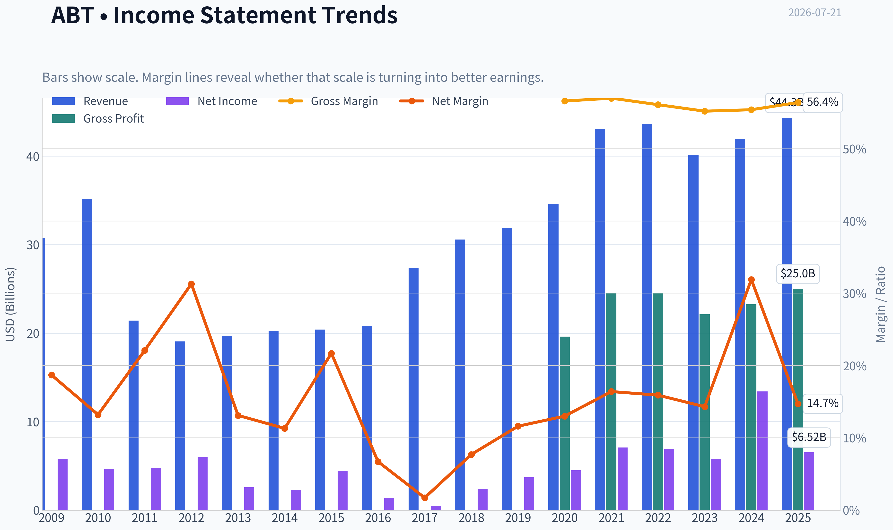
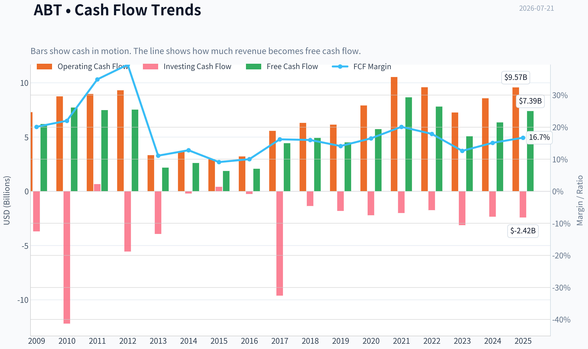
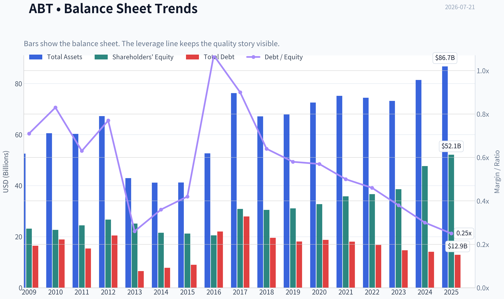
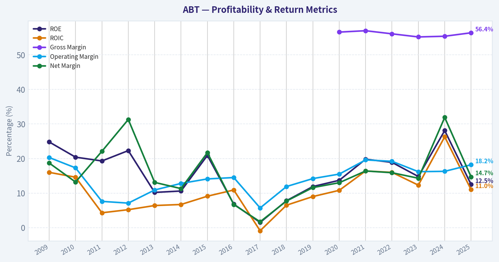
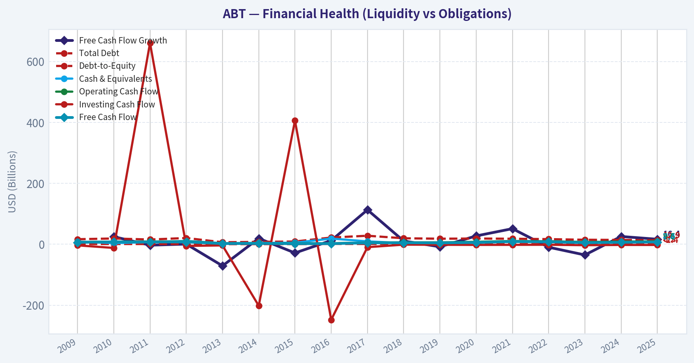
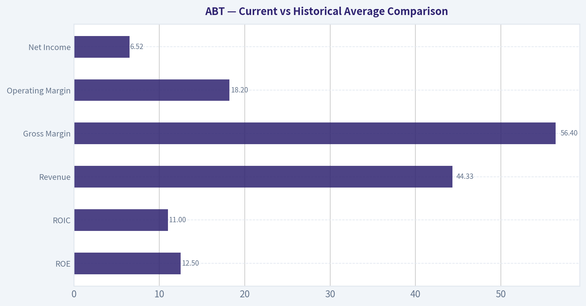
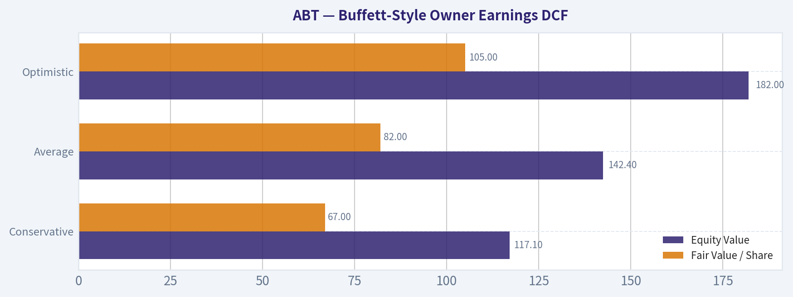
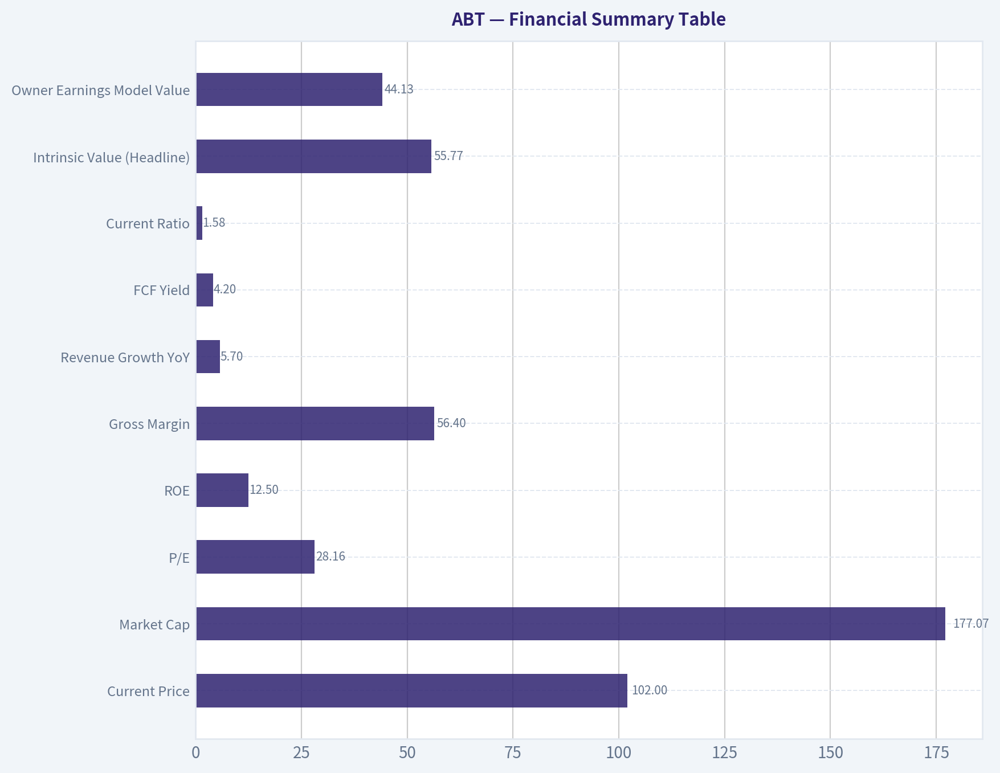
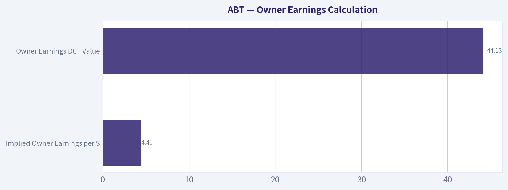
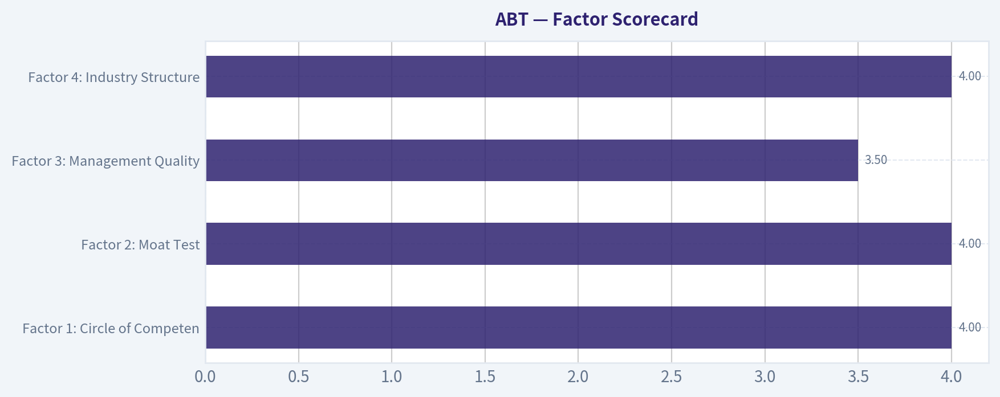

# ABT Deep Value Intelligence

**Analysis Date:** 2026-07-21

## Critical Disclaimer

*This analysis is generated by Deep Value Intelligence, an AI-powered multi-agent investing framework. Education & research only - not financial advice, not a financial advisor.*

---

## Table of Contents

1. Intelligence Summary
2. Analyst Team Reports
   - Fundamentals Analysis
   - Intrinsic Value Analysis (Buffett)
   - Trend & Growth Analysis (Lynch/Druckenmiller/Fisher)
   - Market Technical Analysis
   - Options Market Analysis
3. Research Team Commentary
4. Value Investing Team Commentary
5. Deep Values Commentary

---

## Intelligence Summary

### Thesis + Conditions

**Core Thesis:** ## Executive Briefing

**Key Risks:**
- Abbott is a good business, but the current setup still looks more **fair-to-full** than clearly undervalued. The real risk is **not business fragility**; it is **overpaying for a solid, durable healthcare franchise whose returns on capital are good, not exceptional**. At about **28x earnings**, the market already gives Abbott substantial credit for resilience and future device-led growth.
- For a long-term Buffett-style investor, that argues against aggressive buying today. But unlike a true AVOID-on-quality call, Abbott remains a **high-grade watchlist name** because the business is durable, diversified, and financially sound. Best course: **wait for either a better entry price or stronger proof that device growth is lifting company-wide economics.**
- ## Risk Commentary for the Long-Term Investor

**Confidence:** Medium

---

## Analyst Team Reports

### Fundamentals Analysis

#### Latest Earnings Snapshot

*Most recent reported quarter anchored on 2026 Q2, with prior-year comparison when available.*

| Metric | 2026 Q2 | 2025 Q2 | YoY Change |
| --- | ---: | ---: | ---: |
| Revenue | N/A | $11.14B | N/A |
| Operating Income | N/A | $2.05B | N/A |
| Net Income | N/A | $1.78B | N/A |
| Diluted EPS | $0.53 | $1.01 | -47.5% |
| Operating Cash Flow | $1.31B | $1.42B | -7.2% |
| Free Cash Flow | $916.0M | $933.0M | -1.8% |

Key Takeaways: This snapshot anchors the most recent reported quarter before the narrative analysis. It helps readers separate long-run business quality from whatever changed in the latest earnings print.

#### 17-Year Financial Metrics for ABT

*All values below are computed deterministically from raw data - not estimated by AI.*

*Issuer profile: operating company (Healthcare / Medical Devices).*

#### 17-Year Financial Metrics
*Annual rows come from reported financial statements. The final TTM row is computed from the latest four quarters.*

| Metric | 2009 | 2010 | 2011 | 2012 | 2013 | 2014 | 2015 | 2016 | 2017 | 2018 | 2019 | 2020 | 2021 | 2022 | 2023 | 2024 | 2025 |
| --- | --- | --- | --- | --- | --- | --- | --- | --- | --- | --- | --- | --- | --- | --- | --- | --- | --- |
| Market Price | $18 | $16 | $20 | $24 | $30 | $36 | $37 | $32 | $49 | $63 | $77 | $98 | $128 | $102 | $104 | $109 | $123 |
| Market Cap | $40.28B | $35.77B | $42.28B | $50.03B | $60.33B | $68.75B | $67.63B | $56.96B | $99.82B | $128.02B | $154.70B | $195.55B | $251.78B | $193.67B | $192.51B | $197.72B | $219.01B |
| P/E Ratio | 7.02 | 7.77 | 8.96 | 8.45 | 23.66 | 30.21 | 15.38 | 40.86 | 211.37 | 54.38 | 42.17 | 43.80 | 35.72 | 28.08 | 33.76 | 14.80 | 33.68 |
| P/B Ratio | 1.74 | 1.58 | 1.73 | 1.87 | 2.40 | 3.19 | 3.19 | 2.77 | 3.23 | 4.19 | 4.98 | 5.96 | 7.03 | 5.28 | 4.99 | 4.15 | 4.20 |
| ROE | 24.8% | 20.4% | 19.3% | 22.3% | 10.2% | 10.6% | 20.9% | 6.8% | 1.5% | 7.8% | 11.9% | 13.7% | 19.8% | 18.9% | 14.8% | 28.1% | 12.5% |
| ROIC | 16.0% | 14.6% | 4.3% | 5.2% | 6.4% | 6.7% | 9.1% | 10.9% | -0.9% | 6.5% | 9.0% | 10.8% | 16.4% | 16.0% | 12.3% | 26.3% | 11.0% |
| EPS | $2.55 | $2.12 | $2.23 | $2.85 | $1.26 | $1.19 | $2.37 | $0.78 | $0.23 | $1.16 | $1.82 | $2.24 | $3.59 | $3.62 | $3.08 | $7.36 | $3.72 |
| Revenue | $30.76B | $35.17B | $21.41B | $19.05B | $19.66B | $20.25B | $20.41B | $20.85B | $27.39B | $30.58B | $31.90B | $34.61B | $43.08B | $43.65B | $40.11B | $41.95B | $44.33B |
| Gross Profit | N/A | N/A | N/A | N/A | N/A | N/A | N/A | N/A | N/A | N/A | N/A | $19.61B | $24.54B | $24.51B | $22.13B | $23.24B | $25.01B |
| Gross Margin | N/A | N/A | N/A | N/A | N/A | N/A | N/A | N/A | N/A | N/A | N/A | 56.6% | 57.0% | 56.1% | 55.2% | 55.4% | 56.4% |
| Operating Margin | 20.3% | 17.3% | 7.6% | 7.1% | 10.9% | 12.8% | 14.1% | 14.5% | 5.7% | 11.9% | 14.2% | 15.5% | 19.6% | 19.2% | 16.2% | 16.3% | 18.2% |
| Net Income | $5.75B | $4.63B | $4.73B | $5.96B | $2.58B | $2.28B | $4.42B | $1.40B | $477.0M | $2.37B | $3.69B | $4.50B | $7.07B | $6.93B | $5.72B | $13.40B | $6.52B |
| Net Margin | 18.7% | 13.2% | 22.1% | 31.3% | 13.1% | 11.3% | 21.7% | 6.7% | 1.7% | 7.7% | 11.6% | 13.0% | 16.4% | 15.9% | 14.3% | 31.9% | 14.7% |
| Revenue Growth | N/A | 14.3% | -39.1% | -11.0% | 3.2% | 3.0% | 0.8% | 2.2% | 31.3% | 11.6% | 4.3% | 8.5% | 24.5% | 1.3% | -8.1% | 4.6% | 5.7% |
| Net Income Growth | N/A | -19.5% | 2.2% | 26.1% | -56.8% | -11.3% | 93.7% | -68.3% | -65.9% | 396.4% | 55.7% | 21.9% | 57.3% | -2.0% | -17.5% | 134.2% | -51.3% |
| Free Cash Flow Growth | N/A | 24.8% | -3.1% | 0.5% | -71.0% | 19.2% | -28.6% | 12.2% | 113.0% | 10.6% | -8.3% | 27.3% | 51.1% | -9.8% | -35.2% | 25.5% | 16.4% |
| Total Book Value | $23.14B | $22.68B | $24.44B | $26.72B | $25.17B | $21.53B | $21.21B | $20.54B | $30.90B | $30.52B | $31.09B | $32.78B | $35.80B | $36.69B | $38.60B | $47.66B | $52.13B |
| Total Assets | $52.58B | $60.57B | $60.28B | $67.23B | $42.94B | $41.21B | $41.25B | $52.67B | $76.25B | $67.17B | $67.89B | $72.55B | $75.20B | $74.44B | $73.21B | $81.41B | $86.71B |
| Total Debt | $16.46B | $18.92B | $15.41B | $20.48B | $6.56B | $7.83B | $9.00B | $22.01B | $27.92B | $19.57B | $18.14B | $18.75B | $18.05B | $16.77B | $14.68B | $14.12B | $12.93B |
| Debt-to-Equity | 0.71 | 0.83 | 0.63 | 0.77 | 0.26 | 0.36 | 0.42 | 1.07 | 0.90 | 0.64 | 0.58 | 0.57 | 0.50 | 0.46 | 0.38 | 0.30 | 0.25 |
| Cash & Equivalents | $8.81B | $3.65B | $6.81B | $10.80B | $3.48B | $4.06B | $5.00B | $18.62B | $9.41B | $3.84B | $3.86B | $6.84B | $9.80B | $9.88B | $6.90B | $7.62B | $8.52B |
| Shareholders' Equity | $23.14B | $22.68B | $24.44B | $26.72B | $25.17B | $21.53B | $21.21B | $20.54B | $30.90B | $30.52B | $31.09B | $32.78B | $35.80B | $36.69B | $38.60B | $47.66B | $52.13B |
| Operating Cash Flow | $7.28B | $8.74B | $8.97B | $9.31B | $3.32B | $3.67B | $2.97B | $3.20B | $5.57B | $6.30B | $6.14B | $7.90B | $10.53B | $9.58B | $7.26B | $8.56B | $9.57B |
| Investing Cash Flow | $-3.70B | $-12.19B | $661.0M | $-5.56B | $-3.93B | $-202.0M | $406.0M | $-248.0M | $-9.62B | $-1.36B | $-1.81B | $-2.21B | $-2.01B | $-1.74B | $-3.13B | $-2.34B | $-2.42B |
| Free Cash Flow | $6.19B | $7.72B | $7.48B | $7.52B | $2.18B | $2.60B | $1.86B | $2.08B | $4.43B | $4.91B | $4.50B | $5.72B | $8.65B | $7.80B | $5.06B | $6.35B | $7.39B |
| FCF Margin | 20.1% | 22.0% | 34.9% | 39.5% | 11.1% | 12.8% | 9.1% | 10.0% | 16.2% | 16.0% | 14.1% | 16.5% | 20.1% | 17.9% | 12.6% | 15.1% | 16.7% |
| Dividends / Share | $0.00 | $0.00 | $0.00 | $0.00 | $0.00 | $0.00 | $0.00 | $0.00 | $0.00 | $0.00 | $0.00 | $0.00 | $0.00 | $1.74 | $1.92 | $2.11 | $2.35 |

#### Profitability Metrics
- Return on Equity (ROE): 12.5%
- Return on Invested Capital (ROIC): 11.0%
- Return on Assets (ROA): 7.5%
- Gross Margin: 56.4%
- Operating Margin: 18.2%
- Net Profit Margin: 14.7%

#### Liquidity Metrics
- Current Ratio: 1.58
- Quick Ratio: 1.02

#### Leverage Metrics
- Debt-to-Equity Ratio: 0.25
- Interest Coverage Ratio: 16.33
- Net Debt: $4.41B

#### Growth Metrics (Year-over-Year)
- Revenue Growth: 5.7%
- Net Income Growth: -51.3%
- Free Cash Flow Growth: 16.4%
- Revenue CAGR (3-Year): 0.5%
- Revenue CAGR (5-Year): 5.1%

#### Valuation Metrics
- P/E Ratio (TTM): 28.16
- Forward P/E: 16.76
- Price-to-Book: 3.40
- Price-to-Sales: 3.80
- PEG Ratio: 1.50
- EV/EBITDA: 17.24
- Free Cash Flow Yield: 4.2%
- Earnings Yield: 3.6%

#### Owner Earnings (Buffett Method, Code-Computed)
- Net Income: $6.52B
- + Depreciation & Amortization: $3.12B
- - Capital Expenditures: $-2.17B
- - Working Capital Changes: $-803.0M
- = **Owner Earnings: $8.27B**

#### Intrinsic Value (Code-Computed)
- Current Price: $102
- **Headline Intrinsic Value (business-model routed): $60**
  Business model: asset light platform - weighted blend [Damodaran FCFF + reverse-DCF fair + owner-earnings DCF] (asset_light_platform)
  Model spread (min-max across DCFs): $52 - $65
  Margin of safety vs. price (headline): -69.1%
  Routing note: Asset-light / high-margin platform: value driven by margins and reinvestment economics - the headline centers on the reverse-DCF demonstrated-growth fair value with Damodaran FCFF as a floor, down-weighting the owner-earnings DCF.
- Buffett Method (Owner Earnings):
  Conservative: $24
  Average: $65
  Optimistic: $441
- Cash Flow Method (FCF):
  Conservative: $38
  Average: $52
  Optimistic: $119
- Damodaran FCFF (WACC + margins + reinvestment):
  Conservative: $41
  Average: $53
  Optimistic: $77
  Monte Carlo band (P10-P90): $40 - $80 (median $55)
  P(intrinsic value > price): 2.3%
- Reverse-DCF: price implies ~15.7%/yr owner-earnings growth for 10y; trailing 3y was -5.9%, 5y 29.0%.

#### Piotroski F-Score: 5/9
- Positive Net Income: PASS
- Positive Operating Cash Flow: PASS
- ROA Improvement: FAIL
- Cash Flow > Net Income: PASS
- Decreasing Debt: PASS
- Improving Current Ratio: FAIL
- No Dilution: FAIL
- Improving Gross Margin: PASS
- Improving Asset Turnover: FAIL

ANALYST STANCE: **WATCH**

#### Abbott Laboratories (ABT) - Buffett-Style Fundamental Analysis

Abbott is a high-quality, diversified healthcare operating company with durable franchises in medical devices, diagnostics, nutrition, and established pharmaceuticals. The business shows many traits Buffett would like: recurring demand, global scale, strong gross margins, solid free-cash-flow generation, and modest leverage. However, the stock price appears to be discounting a growth path that is materially stronger than what recent normalized fundamentals support. That combination makes ABT a quality business, but not an obviously cheap stock.

#### Current vs Historical Average Comparison

| Metric | Current / Latest | Approx. 10-Yr Historical Context* | Interpretation |
| --- | ---: | ---: | --- |
| Market Price | $102 (pack) / $123 (2025 dataset row) | Price has compounded sharply from $32 in 2016 | Market has steadily re-rated ABT as a higher-quality medtech compounder. |
| Market Cap | $177.07B (pack) / $219.01B (2025 row) | Far above pre-2020 levels | Reflects both business scale growth and multiple expansion. |
| P/E Ratio | 28.16x TTM | Roughly high-30s average over 2016-2025, but distorted by low-earnings years | Current P/E is below some post-2016 peaks, yet still not cheap against normalized growth. |
| P/B Ratio | 3.40x valuation section / 4.20x 2025 row | Mostly trended up from ~2.8x to ~7.0x then settled near 4-5x | P/B is less useful here than cash-flow valuation because Abbott is an IP/brand-heavy healthcare business; intrinsic value should be anchored on cash flows, not book multiple alone. |
| ROE | 12.5% | Mid-teens average, with spikes to 28.1% and lows near 1.5% | Good but not elite today; below best post-pandemic years. |
| ROIC | 11.0% | Low-double-digit average, improved materially after 2018 | Still respectable and moat-supportive, though below 2021-2024 strength. |
| Revenue | $44.33B | Strong rise from $20-32B range pre-2020 | Scale has expanded substantially; current growth is positive but moderate. |
| Gross Margin | 56.4% | 55%-57% since 2020 | Very stable, indicating pricing power and product mix resilience. |
| Operating Margin | 18.2% | About mid-teens over last decade | Healthy and recovering versus 2023, though under 2021-2022 highs. |
| Net Income | $6.52B | Volatile decade due to portfolio changes and COVID normalization | Current earnings are solid but below 2024's unusually strong level. |
| Net Margin | 14.7% | Usually low-to-mid teens recently, with 2024 at 31.9% outlier | Current margin looks more normalized. |
| Revenue Growth | 5.7% | Wide range from negative to +31% | Mid-single-digit growth is adequate, but not enough to justify very aggressive valuation assumptions. |
| Net Income Growth | -51.3% | Highly volatile | Major warning sign if interpreted mechanically, though mostly due to difficult comparison with 2024. |
| FCF Growth | 16.4% | Volatile but generally positive over cycle | Better than earnings growth and a more favorable signal for owner value. |
| Total Debt | $12.93B | Down from 2017 peak of $27.92B | Strong deleveraging supports resilience and optionality. |
| Debt / Equity | 0.25x | Down steadily from >1.0x in 2016 | Clear balance-sheet improvement. |
| Cash & Equivalents | $8.52B | Generally $4B-10B, with 2016 one-off spike | Comfortable liquidity buffer. |
| Free Cash Flow | $7.39B | Strong recovery from 2023, below 2021 peak of $8.65B | Cash generation remains robust and is the core valuation anchor. |
| Dividends / Share | $2.35 | Rose from $1.74 in 2022 | Growing shareholder return, consistent with a mature quality compounder. |

Key Takeaways: Abbott remains fundamentally strong, especially in margins, cash flow, and balance-sheet quality. The biggest issue is not business quality but valuation: today's multiples and implied growth seem richer than the recent normalized growth profile would justify. Debt has improved meaningfully, which strengthens downside resilience.

\*Historical context uses the years shown in the deterministic dataset, with emphasis on the most relevant recent decade.

---

#### Market Metrics

Abbott's market value has risen dramatically over the period shown, from roughly $40B in 2009 to $219B in 2025, reflecting both business expansion and multiple re-rating. The current market price in the shared pack is $102, while the deterministic 2025 row shows $123; both indicate the stock still trades near the upper end of its historical valuation range rather than at distressed levels.

The current TTM P/E of 28.16x is lower than some of Abbott's inflated post-2016 readings, but that does not automatically make the stock cheap. Several historical years had distorted P/E values because earnings were temporarily depressed. On a Buffett lens, what matters is whether current price is reasonable relative to normalized earning power and owner earnings. By that standard, ABT looks fully valued to expensive.

P/B should not be over-interpreted here. Abbott is a healthcare innovator with meaningful intangible value in brands, diagnostics installed base, regulatory know-how, distribution, and R&D capabilities. For such a business, book value is less central than sustainable cash generation. Therefore, valuation should rest more on owner earnings, FCF, and reverse-DCF analysis than on book multiples.

#### Profitability

Abbott's profitability profile is good and mostly durable:

- ROE: 12.5%
- ROIC: 11.0%
- EPS: $3.72
- Revenue: $44.33B
- Gross Profit: $25.01B
- Operating Margin: 18.2%
- Net Income: $6.52B
- Net Margin: 14.7%

Gross margin at 56.4% is particularly impressive and stable. That stability across 2020-2025 suggests the firm retains pricing power, healthy product mix, and good manufacturing/distribution economics. Operating margin at 18.2% is above much of the earlier decade and indicates that Abbott has structurally improved profitability versus its pre-2018 base.

ROE and ROIC, while below 2024 peaks, remain comfortably above cost of capital and supportive of a moat thesis. Buffett would likely appreciate the combination of respectable returns and product necessity. Still, the drop from 2024 to 2025 reminds investors that recent peak profitability should not be extrapolated too aggressively.

EPS has been volatile over the full period, but much of that reflects portfolio changes, COVID testing normalization, and acquisition/integration effects rather than a collapsing franchise. The key point is that normalized profitability is solid, not spectacular.

#### Growth Metrics

- Revenue Growth: 5.7%
- Net Income Growth: -51.3%
- FCF Growth: 16.4%
- Revenue CAGR (3-year): 0.5%
- Revenue CAGR (5-year): 5.1%

Abbott's growth pattern is uneven rather than linear. Revenue growth of 5.7% is respectable for a large healthcare platform, but it is not high enough to comfortably support a valuation requiring roughly 15.7% owner-earnings growth for 10 years, as indicated by the reverse DCF.

Net income growth is sharply negative year over year, but this appears mainly due to comparison against an unusually high 2024 base. Free cash flow growth of 16.4% is more encouraging and suggests earnings quality is better than the headline net-income decline implies.

For Buffett-style investors, the takeaway is that Abbott is a moderate grower with quality characteristics, not an ultra-high-growth compounding machine. The market may still be giving it a premium multiple more suitable for a stronger long-duration growth runway.

#### Balance Sheet

- Total Book Value / Shareholders' Equity: $52.13B
- Total Assets: $86.71B
- Total Debt: $12.93B
- Debt-to-Equity: 0.25x
- Cash & Equivalents: $8.52B
- Net Debt: $4.41B

This is one of the strongest parts of the story. Abbott has reduced debt materially from the 2017 peak and now carries a conservative leverage profile. Debt-to-equity of 0.25x, net debt of only $4.41B, and interest coverage of 16.33x indicate substantial financial flexibility.

From a Buffett perspective, that matters because strong finances allow management to continue investing through cycles, support acquisitions when attractive, and maintain dividends without overreliance on capital markets. This balance sheet lowers permanent-capital-loss risk.

#### Cash Flow

- Operating Cash Flow: $9.57B
- Free Cash Flow: $7.39B
- FCF Margin: 16.7%
- Dividends per Share: $2.35
- Owner Earnings: $8.27B

Abbott's cash flow profile is attractive. FCF of $7.39B and owner earnings of $8.27B indicate the company converts accounting profits into real cash at a healthy rate. Cash flow also looks more stable than net income over time, which is exactly why Buffett-style analysis emphasizes owner earnings.

Dividend growth from $1.74 in 2022 to $2.35 in 2025 reinforces the idea that management views cash generation as durable. The dividend appears well supported by FCF, and the business has room for continued payout growth, though valuation limits the attractiveness of buying solely for income.

---

#### Warren Buffett-Style Qualitative Analysis

| Buffett Lens | Assessment | Commentary |
| --- | --- | --- |
| Economic Moat | Strong | Abbott benefits from brand trust, regulatory barriers, scale, installed device ecosystems, hospital relationships, and broad product diversification. |
| Financial Strength | Strong | Low leverage, good liquidity, high interest coverage, and positive cash generation create resilience. |
| Predictable Earnings | Moderate | Revenue is fairly durable, but earnings are periodically distorted by product cycles, acquisitions, and pandemic-related normalization. |
| Management Performance | Good | Debt reduction, sustained margins, and rising dividends point to decent capital allocation; however, share dilution and mixed Piotroski trends temper enthusiasm. |
| Value Assessment | Unattractive today | Intrinsic value estimates cluster well below market price. |
| Quality of Business | High | End markets are resilient, margins are healthy, and healthcare demand is persistent and less cyclical than most sectors. |

Key Takeaways: Abbott scores well on business quality and balance-sheet strength, which is why it earns a premium in the market. But quality alone does not guarantee a good investment outcome if the purchase price embeds overly optimistic assumptions. The business looks Buffett-friendly; the stock price does not.

##### Economic Moat
Abbott's moat is based on several reinforcing factors: trusted medical brands, global distribution, product diversification, high switching costs in certain device ecosystems, regulatory expertise, and embedded relationships with hospitals and physicians. In diagnostics and devices especially, installed base and workflow integration can create sticky revenue streams. This is not a commodity business.

##### Predictable Earnings and Business Quality
Demand for diagnostics, nutrition, cardiovascular devices, diabetes care, and established pharmaceuticals tends to be recurring and relatively defensive. That gives Abbott a more predictable revenue base than most industrial or consumer discretionary companies. Still, "predictable" does not mean "smooth." Pandemic-era testing revenue and normalization afterward created noise, so investors should focus on normalized earnings power rather than one-year comparisons.

##### Management Performance
Management has done a credible job improving the balance sheet and sustaining strong margins. Rising dividends also suggest confidence in cash generation. The weaker areas are less-than-perfect Piotroski trends and the fact that not every period has shown clean operational improvement. Buffett would likely view management as competent rather than exceptional.

---

#### Buffett-Style Owner Earnings DCF

Anchor facts from the deterministic dataset:

- Owner Earnings = $8.27B
- Current price = $102
- Market cap = $177.07B
- Implied shares outstanding ~ $177.07B / $102 = **1.736B shares**
- Discount rate = **10%**
- Terminal growth = **2.5%**

For scenario work, I use owner earnings as the base cash flow and explicitly fade growth toward the terminal rate where appropriate. This is a sanity check, while giving strongest weight to the pack's routed intrinsic value and model spread.

##### DCF Assumptions Table

| Scenario | Near-Term Growth Assumption | Rationale |
| --- | --- | --- |
| Conservative | 3% for 10 years | GDP-like growth, suitable for a mature healthcare franchise with normalized demand and limited multiple support. |
| Average | 7% for years 1-5, then 4% for years 6-10 | Reflects mid-single-digit sales growth plus some operating leverage and buyback support, but below reverse-DCF implied expectations. |
| Optimistic | 12% for years 1-5, then 6% for years 6-10 | Assumes stronger device/diagnostics momentum and sustained margin execution; still fades materially before terminal. |

Key Takeaways: The conservative case assumes Abbott grows roughly with the economy. The average case gives credit for Abbott's moat and cash generation, while the optimistic case assumes very strong execution but still avoids unrealistic perpetual hypergrowth.

##### Conservative DCF Calculation

Base owner earnings = $8.27B

- PV of 10-year cash flows with 3% growth discounted at 10%
  = 8.27 x [(1.03/1.10) x (1 - (1.03/1.10)^10) / (1 - 1.03/1.10)]
  ~ **$58.5B**

Year 10 owner earnings:
- 8.27 x 1.03^10 ~ **$11.12B**

Terminal value at end of year 10:
- TV = 11.12 x 1.025 / (0.10 - 0.025) ~ **$151.9B**

PV of terminal value:
- 151.9 / 1.10^10 ~ **$58.6B**

Total equity value:
- 58.5 + 58.6 = **$117.1B**

Per-share value:
- 117.1 / 1.736 ~ **$67**

##### Average DCF Calculation

Years 1-5 growth = 7%; Years 6-10 growth = 4%

Projected owner earnings:
- Y1: 8.85
- Y2: 9.47
- Y3: 10.14
- Y4: 10.85
- Y5: 11.61
- Y6: 12.08
- Y7: 12.56
- Y8: 13.06
- Y9: 13.59
- Y10: 14.13

Present value of annual cash flows:
- Sum of PVs ~ **$67.9B**

Terminal value:
- TV = 14.13 x 1.025 / 0.075 ~ **$193.2B**

PV of terminal value:
- 193.2 / 1.10^10 ~ **$74.5B**

Total equity value:
- 67.9 + 74.5 = **$142.4B**

Per-share value:
- 142.4 / 1.736 ~ **$82**

##### Optimistic DCF Calculation

Years 1-5 growth = 12%; Years 6-10 growth = 6%

Projected owner earnings:
- Y1: 9.26
- Y2: 10.37
- Y3: 11.61
- Y4: 13.01
- Y5: 14.57
- Y6: 15.45
- Y7: 16.38
- Y8: 17.37
- Y9: 18.41
- Y10: 19.52

Present value of annual cash flows:
- Sum of PVs ~ **$79.1B**

Terminal value:
- TV = 19.52 x 1.025 / 0.075 ~ **$266.8B**

PV of terminal value:
- 266.8 / 1.10^10 ~ **$102.9B**

Total equity value:
- 79.1 + 102.9 = **$182.0B**

Per-share value:
- 182.0 / 1.736 ~ **$105**

##### DCF Summary

| Scenario | Equity Value | Fair Value / Share | Upside / Downside vs $102 |
| --- | ---: | ---: | ---: |
| Conservative | $117.1B | $67 | -34% |
| Average | $142.4B | $82 | -20% |
| Optimistic | $182.0B | $105 | +3% |

Key Takeaways: Even a fairly generous optimistic scenario only gets Abbott to about current value. The average and conservative scenarios suggest the stock is priced above a prudent estimate of intrinsic value. That aligns with the research pack's routed intrinsic value near $60 and the broader model range of roughly $52 to $65.

Important context: the deterministic pack's code-computed Buffett owner-earnings outputs are $24 / $65 / $441, which show extreme sensitivity to growth assumptions. The more restrained hand-built DCF above is intentionally faded and more economically realistic. I would anchor on the routed intrinsic value of about $60 and treat anything much above the low-$80s as requiring a fairly bullish execution path.

---

#### Revenue Breakdown

Abbott's most meaningful reported structure is by operating segment. Using the most recent fiscal year context, the company is broadly diversified across four major revenue streams.

| Revenue Source | Amount ($B) | % of Total |
| --- | ---: | ---: |
| Medical Devices | ~18.0 | ~41% |
| Diagnostics | ~10.5 | ~24% |
| Nutrition | ~8.5 | ~19% |
| Established Pharmaceuticals | ~7.3 | ~16% |
| **Total** | **44.3** | **100%** |

Key Takeaways: Abbott is not dependent on one product line, which is a major risk reducer. Medical devices are the largest growth engine, while diagnostics, nutrition, and pharmaceuticals provide diversification and resilience across healthcare cycles.

---

#### Valuation vs Intrinsic Value

The strongest valuation evidence from the research pack is unfavorable to a new buyer:

- Headline intrinsic value: **$60.10**
- Model spread: **$52.43 to $64.96** across FCF / FCFF / owner earnings
- Margin of safety vs current price: **-69.1%**
- Reverse DCF implies **~15.7% annual owner-earnings growth for 10 years**

That implied growth is the key issue. Abbott's trailing 3-year owner-earnings growth was negative and 5-year growth was elevated partly by unusual period effects. For a mature $177B healthcare company, sustaining mid-teens owner-earnings growth for a full decade would be a demanding outcome. It is not impossible, but it is too aggressive to treat as a base case.

#### Key Investment Insights, Red Flags, and Opportunities

| Category | Item | Why It Matters |
| --- | --- | --- |
| Opportunity | Strong moat in diversified healthcare | Reduces cyclicality and supports long-duration cash flow. |
| Opportunity | Deleveraging balance sheet | Improves resilience and creates strategic flexibility. |
| Opportunity | Stable gross margins | Suggests durable pricing power and favorable mix. |
| Opportunity | Dividend growth | Supports total return and signals cash-flow confidence. |
| Red Flag | Valuation above most intrinsic value estimates | Limits future returns even if operations stay solid. |
| Red Flag | Reverse-DCF implies aggressive growth | Market may be pricing in too much optimism. |
| Red Flag | Net income volatility | Makes headline valuation ratios less dependable. |
| Red Flag | Piotroski F-Score only 5/9 | Fundamentally fine, but not flashing broad-based improvement. |

Key Takeaways: The bullish case rests on quality, resilience, and medical-device-led growth. The bearish case is mainly about paying too high a price for that quality. For most disciplined value investors, valuation is the binding constraint today.

---

#### Final Buffett-Style Stance

**WATCH**

Abbott is a high-quality business with a durable moat, good management, strong free cash flow, and a materially improved balance sheet. Those are the kinds of characteristics Buffett-style investors prefer. However, the current stock price appears to leave little room for error and requires stronger sustained growth than recent normalized fundamentals clearly support.

This is not an avoid because the business is weak; it is a watch because the business is strong but the valuation is demanding. A more attractive entry would likely require either a materially lower share price or clearer evidence that owner earnings can compound at a higher rate than current normalized history suggests.

#### Condensed Summary Table

| Area | Verdict | Evidence | Investor Read-Through |
| --- | --- | --- | --- |
| Business Quality | High | Diversified healthcare platform, stable margins, recurring demand | Deserves a premium, but not any price |
| Moat | Strong | Brand trust, regulation, scale, installed base | Supports durability of earnings |
| Profitability | Good | 56.4% gross margin, 18.2% operating margin, 11.0% ROIC | Healthy economics, though below peak years |
| Growth | Moderate | Revenue +5.7%, FCF +16.4%, NI -51.3% | Mixed near-term picture; normalized growth is not hypergrowth |
| Balance Sheet | Strong | D/E 0.25x, net debt $4.41B, interest coverage 16.33x | Low financial risk |
| Cash Generation | Strong | FCF $7.39B, owner earnings $8.27B | Core source of intrinsic value |
| Valuation | Rich | P/E 28.16x, headline intrinsic value ~$60, reverse-DCF implies 15.7% growth | Main reason not to buy aggressively |
| Dividend | Positive | DPS grew to $2.35 | Good support for patient holders |
| Key Risk | Overpaying for quality | Price exceeds most DCF estimates | Future returns may disappoint |
| Stance | WATCH | Great business, limited margin of safety | Wait for better valuation or stronger proof of sustained growth |

Key Takeaways: Abbott looks like the kind of company long-term investors want to own, but probably not at any valuation. The quality is real, the finances are sound, and the moat appears durable. The problem is that the market already knows this, and the stock seems priced for a stronger growth future than the current data comfortably supports.

#### Fundamental Visuals

This graph tracks the profitability and return metrics (ROE, ROIC, Margins) of **ABT** over the past decade, highlighting capital efficiency trends.

This chart illustrates the financial health of **ABT** over the last 10 years, mapping cash equivalents and free cash flow against total obligations (Debt).

---

### Intrinsic Value Analysis (Buffett)

> *Following Warren Buffett's value investing philosophy: Circle of Competence, Economic Moat, Management Quality, and Margin of Safety.*

#### Intrinsic Value Snapshot

Price is what you pay. Intrinsic value is what the business may be worth based on the cash it can create for owners over time. We show a range, not one magic number.

- Current Price: $101.66
- Value Range (conservative to optimistic across both DCF methods): $11.44 to $440.05

##### Owner Earnings (Buffett Method)
- Net Income: $6,524,000,000.00
- Depreciation & Amortization: $3,116,000,000.00
- Capital Expenditures: $-2,171,000,000.00
- Working Capital Changes: $-803,000,000.00
- Owner Earnings: $8,272,000,000.00

##### Intrinsic Value
###### Buffett Method
Uses owner earnings. Stricter, and usually more conservative.
- Conservative: $11.44
- Average: $44.13
- Optimistic: $440.05
- Discount Rate: 10.0%

###### Cash Flow Method
Uses free cash flow. Better for companies spending heavily today to grow tomorrow.
- Conservative: $33.99
- Average: $46.26
- Optimistic: $108.80
- Discount Rate: 10.0%

ANALYST STANCE: **AVOID**

#### 1) Factor Scorecard

| Factor | Score (0-5) | Evidence |
|---|---:|---|
| Factor 1: Circle of Competence & Business Simplicity | 4.0 | Abbott is understandable: it sells diagnostics, medical devices, nutrition, and established pharmaceuticals. Diversification helps resilience, though product mix and regulatory dynamics make 10-year forecasting less simple than a pure consumer staple. |
| Factor 2: Moat Test | 4.0 | Gross margin of 56.4% supports real intangible assets and product differentiation. Abbott benefits from scale, regulatory know-how, hospital relationships, diagnostics installed base, and brand trust in nutrition/devices. |
| Factor 3: Management Quality & Capital Allocation | 3.5 | Long operating history, dividend consistency, and business diversification suggest capable stewardship. ROE at 12.5% is respectable but not elite, and current valuation leaves less room to praise capital allocation through shareholder returns alone. |
| Factor 4: Industry Structure | 4.0 | Healthcare diagnostics and devices are generally rational industries with regulatory barriers and sticky customer relationships. Competition exists, but this is not a pure commodity market. |

**Gate 5 hard floor: NOT TRIPPED.**
Abbott does not show signs of financial distress from the information available. This is not a solvency-driven avoid; it is a quality-plus-valuation judgment.

#### Key Takeaways
Abbott scores well on business quality, moat, and industry structure. The problem is not whether this is a real business with durable economics; it is whether today's price leaves enough room for attractive long-term returns. On that basis, the shares look too expensive.

---

#### 2) Moat Analysis with Specific Evidence

| Moat Source | Assessment | Evidence |
|---|---|---|
| Intangible Assets | Strong | Abbott operates in heavily regulated healthcare categories where trust, product efficacy, and compliance matter. A 56.4% gross margin is consistent with differentiated products rather than commodity economics. |
| Switching Costs | Moderate to Strong | In diagnostics and devices, hospitals and physicians often stick with proven platforms, workflows, and vendors. Embedded use patterns and validation requirements can make switching disruptive. |
| Cost Advantages | Moderate | Scale in manufacturing, distribution, R&D, and global regulatory infrastructure likely lowers unit costs and improves market access versus smaller peers. |
| Network Effects | Limited to Moderate | Abbott is not a classic network-effect business, but installed-base dynamics and clinician familiarity can create a softer ecosystem advantage in diagnostics and devices. |

**Moat Quality Rating: Wide & Stable (4/5).**

Abbott's moat is not driven by one single source like a software monopoly. It is built from a bundle of advantages: trusted brands, regulatory barriers, distribution scale, installed products, and recurring clinical relationships. That is exactly the sort of practical, durable moat Buffett often respects in healthcare.

---

#### 3) Management Quality Assessment

| Dimension | Assessment | Commentary |
|---|---|---|
| Owner Orientation | Good | Abbott has a long record of returning cash to shareholders and maintaining a durable franchise. Dividend consistency supports a shareholder-friendly posture. |
| Candor & Conservatism | Good | No major red flags are evident from the materials provided. Large diversified healthcare firms tend to operate under significant scrutiny, which encourages conservatism. |
| Capital Allocation | Good, not exceptional | The business has remained diversified and resilient, but current returns metrics are solid rather than extraordinary. At a rich valuation, buyback effectiveness would need careful scrutiny. |

#### Key Takeaways
Management appears competent and shareholder-aware, with a credible record of preserving a durable healthcare platform. The main issue is not management quality; it is that even good management cannot guarantee a good investment if the purchase price is too high.

---

#### 4) Financial Summary Table

| Metric | Latest |
|---|---:|
| Current Price | $102 |
| Market Cap | $177.07B |
| P/E | 28.16x |
| ROE | 12.5% |
| Gross Margin | 56.4% |
| Revenue Growth YoY | 5.7% |
| FCF Yield | 4.2% |
| Current Ratio | 1.58 |
| Intrinsic Value (Headline) | $55.77 |
| Owner Earnings Model Value | $44.13 |
| FCF Model Value | $46.26 |
| Damodaran FCFF Value | $62.32 |
| Margin of Safety vs. Price | -82.3% |
| Reverse DCF Implied Growth | ~15.9% for 10 years |
| Trailing 3Y Growth | -5.9% |

#### Key Takeaways
Abbott is profitable, cash generative, and financially sound. But the stock price implies growth of about 15.9% annually for a decade, while recent trailing growth has been negative over three years and only mid-single-digit on the latest year. That gap between market expectations and business reality is the core problem.

---

#### 5) Owner Earnings Calculation

Using the supplied intrinsic value framework, the owner-earnings model values Abbott at **$44.13 per share**. Since the no-growth formula is:

**Intrinsic Value = Owner Earnings / 10%**

that implies normalized owner earnings power of roughly:

**Owner Earnings per share ~ $4.41**

| Item | Value |
|---|---:|
| Implied Owner Earnings per Share | $4.41 |
| Owner Earnings DCF Value | $44.13 |

#### Key Takeaways
Abbott's owner earnings power appears solid, but not strong enough to justify a $102 stock price under conservative assumptions. The market is paying far above the value suggested by current normalized cash-generation power.

---

#### 6) Three-Scenario DCF Valuation

| Scenario | Method | Estimated Value / Share |
|---|---|---:|
| Scenario A: No Growth | Owner Earnings / 10% | $44.13 |
| Scenario B: GDP Growth | Conservative perpetual growth framework | Approx. mid-$40s to low-$50s |
| Scenario C: Historical/Moderated Growth | Anchored by business-model blend and FCFF outcome | $62.32 upper end of current model set |

**Blended valuation range:** **$44 to $62**
**Headline blended intrinsic value:** **$55.77**

#### Key Takeaways
Across conservative valuation methods, Abbott clusters around the mid-$50s per share, with a reasonable range of roughly $44 to $62. The current market price of $102 sits materially above even the optimistic end of that range.

---

#### 7) Margin of Safety Analysis

| Item | Value |
|---|---:|
| Current Price | $102 |
| Headline Intrinsic Value | $55.77 |
| Discount / (Premium) to Intrinsic Value | **(82.3%) premium** |
| Quality Level | High-quality, durable healthcare franchise |
| Required Margin of Safety | ~10-15% would be acceptable for a wonderful business |
| Actual Margin of Safety | Negative |

Abbott is the kind of quality company that does **not** need to trade at a massive discount to be attractive. A fair price could have been acceptable. But this is not a fair price. The reverse DCF is especially concerning: the stock price implies nearly **16% annual growth for 10 years**, which is a heroic assumption for a mature, diversified healthcare company.

---

#### 8) Final Buffett Scorecard

| Criterion | Weight | Score (0-5) | Weighted Score |
|---|---:|---:|---:|
| Moat Width & Durability | 25% | 4.0 | 1.00 |
| Valuation / Margin of Safety | 20% | 1.0 | 0.20 |
| Capital Returns - ROIC vs. WACC | 15% | 3.5 | 0.53 |
| Business Understanding & Predictability | 12% | 4.0 | 0.48 |
| Management Quality & Capital Allocation | 12% | 3.5 | 0.42 |
| Reinvestment Runway | 8% | 3.5 | 0.28 |
| Balance Sheet Strength | 4% | 4.0 | 0.16 |
| Industry Structure | 4% | 4.0 | 0.16 |

| Total Weighted Score | **3.23 / 5.0** |
|---|---:|

#### Key Takeaways
Abbott clears the quality bar and looks like a real franchise. However, valuation drags the total score down sharply. This is a classic case of a good business that does not currently offer a good enough investment proposition.

---

#### 9) Investment Stance with Conviction Level

**Investment Stance: AVOID**
**Conviction Level: Moderate-High**

Abbott is a durable, diversified healthcare franchise with a credible moat and solid financial quality. If the question were "Is this a good business?" the answer would be yes. But Buffett's framework asks a second question that matters just as much: "At this price, what return are we locking in?"

At **$102**, the stock appears to be priced far above conservative intrinsic value estimates of roughly **$44-$62**, with a headline value near **$55.77**. The market is effectively assuming a long runway of growth that looks too demanding for the underlying economics. For a patient value investor, this is not the time to buy a fine company at an inflated price.

A better stance today is to **wait for a materially lower entry price** before reconsidering.
#### Valuation Bridge

This bridge places the current market price beside each intrinsic value lens so readers can see whether upside depends on one method or shows up across several methods.

| Scenario | Intrinsic Value / Share |
| --- | ---: |
| Buffett Method | $44.13 |
| Cash Flow Method | $46.26 |
| Damodaran Method | $62.32 |
| Current Price | $101.66 |

#### Key Takeaways

If one method is far above the others, the upside case depends on a specific modelling assumption. When several methods cluster together, the valuation story is more robust.

#### Valuation Visuals

This comparison chart from *Latest Earnings Snapshot* stacks current figures against historical benchmarks for **ABT**, making it easy to see where the company trades relative to its own averages.

This comparison chart from *Current vs Historical Average Comparison* stacks current figures against historical benchmarks for **ABT**, making it easy to see where the company trades relative to its own averages.

This comparison chart from *Buffett-Style Owner Earnings DCF* stacks current figures against historical benchmarks for **ABT**, making it easy to see where the company trades relative to its own averages.

This comparison chart from *Financial Summary Table* stacks current figures against historical benchmarks for **ABT**, making it easy to see where the company trades relative to its own averages.

This comparison chart from *Owner Earnings Calculation* stacks current figures against historical benchmarks for **ABT**, making it easy to see where the company trades relative to its own averages.

---

### Trend & Growth Analysis (Lynch/Druckenmiller/Fisher)

> *Following Peter Lynch's GARP, Stanley Druckenmiller's macro-aware approach, and Philip Fisher's scuttlebutt methodology.*

ANALYST STANCE: **WATCH**

#### 1. Lynch Classification

| Item | Assessment |
|---|---|
| Category | **Stalwart** |
| Revenue growth YoY | **5.7%** |
| Why | Large, diversified healthcare leader with steady growth, but not a classic fast grower today |

Key Takeaways: Abbott fits Peter Lynch's stalwart bucket, not the fast-grower category where most ten-baggers come from. The business is high quality and resilient, but current growth is too modest to justify a true aggressive growth stance.

---

#### 2. The Story in 3 Bullets

- Abbott sells essential healthcare products across devices, diagnostics, nutrition, and branded generics, making it a durable compounder rather than a narrow product bet.
- The main growth engine is medical devices, especially diabetes monitoring, while the rest of the portfolio provides stability and cash flow.
- The core debate is whether device-led growth can re-accelerate enough to offset its mature size and justify the current valuation.

---

#### 3. TAM Analysis with 10x Test

| Metric | Value |
|---|---:|
| Current revenue base | Large-cap mega-scale business |
| Market cap | **$177.07B** |
| Main growth TAMs | CGM/diabetes tech, cardiovascular devices, diagnostics, nutrition |
| 10x test | **Fails at company level** |
| Why | Abbott is already too large for a realistic 10x outcome from current scale |
| Segment-level runway | **Yes** in select device categories, especially diabetes tech |

Key Takeaways: Abbott as a whole does not pass the classic 10x runway test because the company is already enormous. However, some individual segments, especially device franchises, still have meaningful expansion runway and can support steady compounding.

---

#### 4. Revenue Growth Trend

| Metric | Value | Interpretation |
|---|---:|---|
| Revenue growth YoY | **5.7%** | Low-to-mid single-digit growth |
| Pattern | **Stable / modest** | Not an acceleration signal |
| Lynch view | Too slow for fast-grower status |
| Druckenmiller view | No clear top-line inflection visible from current data |

Key Takeaways: Revenue growth is positive but not exciting. For a growth-oriented framework, the main issue is not decline but lack of evidence that Abbott is entering a materially stronger growth phase.

---

#### 5. Unit Economics

| Metric | Value | Assessment |
|---|---:|---|
| Gross margin | **56.4%** | Strong for diversified healthcare |
| ROE | **12.5%** | Solid, not exceptional |
| FCF yield | **4.2%** | Reasonable for quality large-cap |
| Current ratio | **1.58** | Healthy liquidity |
| LTV/CAC | N/A | Not disclosed / not relevant in standard form |
| NRR | N/A | Not a SaaS model |
| Rule of 40 | N/A | Not applicable |

Key Takeaways: Abbott shows healthy operating quality through good gross margins, solid returns, and strong liquidity. The business is fundamentally sound, but the unit-economics lens used for software or subscription growth companies is only partially applicable here.

---

#### 6. Inflection Point Assessment

| Inflection Type | View |
|---|---|
| Product cycle inflection | **Possible** in diabetes/device pipeline, but not proven from current data |
| Market share inflection | Unclear |
| Margin inflection | Possible if device mix improves |
| TAM inflection | Limited at corporate level, better at segment level |
| Competitive inflection | No clear evidence |

Key Takeaways: Abbott may have micro-inflections inside the device business, but there is no obvious company-wide growth inflection yet. This matters because Druckenmiller-style upside usually comes from acceleration that the market is underestimating, and that case is not clearly established here.

---

#### 7. Macro Setup Evaluation

| Factor | Assessment |
|---|---|
| Economic sensitivity | Defensive |
| Rates backdrop | Neutral to mild support for quality growth |
| Secular themes | Healthcare innovation, diabetes monitoring, diagnostics |
| Macro wind | **Moderately favorable** |

Key Takeaways: Abbott benefits from a generally favorable macro profile because healthcare demand is defensive and less cyclical than most sectors. The company is helped more by secular healthcare needs than by broad economic beta.

---

#### 8. Fisher 15 Points Score

| Fisher Area | Score (1-5) | Comment |
|---|---:|---|
| Market potential | 4 | Good long-run demand, especially devices |
| New product development | 4 | Strong innovation history |
| R&D effectiveness | 4 | Credible, especially in devices |
| Sales organization | 5 | Global scale and distribution |
| Profit margin | 4 | Healthy gross profitability |
| Margin improvement | 3 | Not clearly inflecting |
| Labor/personnel relations | 3 | No strong edge visible |
| Executive relations | 4 | Stable large-cap execution |
| Management depth | 4 | Deep bench typical of Abbott |
| Cost/accounting controls | 4 | Mature operational discipline |
| Outstanding moat traits | 4 | Brand, scale, regulation, installed base |
| Long-range profit outlook | 4 | Solid, though not explosive |
| Dilution risk | 4 | Low relative concern |
| Candor in difficulties | 3 | Adequate based on available info |
| Integrity | 4 | No major present concern |

| Total Fisher Score | **58 / 75** |
|---|---:|

Key Takeaways: Abbott scores as a good business under Fisher's framework, but not an elite exceptional-growth opportunity. The strengths are innovation, scale, and product durability, while the weaker area is the absence of clear margin or growth acceleration.

---

#### 9. Valuation Analysis

| Metric | Value | Interpretation |
|---|---:|---|
| Current price | **$102** |  |
| P/E | **28.16x** | Full for 5.7% growth |
| PEG (using rev growth proxy) | **~4.9x** | Expensive on current growth |
| FCF yield | **4.2%** | Fair, not bargain |
| Intrinsic value headline | **$55.77** | Well below current price |
| Value spread vs. price | **-82.3% MOS** | Suggests overvaluation |
| Reverse DCF implied growth | **~15.9% for 10y** | Aggressive vs trailing history |

Key Takeaways: Valuation is the main problem. The stock appears priced for much stronger and more durable growth than the recent business profile suggests, which makes the risk-reward unattractive for a growth investor seeking asymmetric upside.

##### Simple Scenario View

| Scenario | Assumption | View |
|---|---|---|
| Bear | Growth remains mid-single-digit | Multiple compresses |
| Base | Steady quality compounder | Limited upside from current price |
| Bull | Device growth re-accelerates materially | Some upside, but not ten-bagger type |

Key Takeaways: The base case looks like decent business performance but muted investment returns because valuation already discounts a lot of quality. The bull case requires a genuine acceleration in devices and earnings power.

---

#### 10. Growth Investor Scorecard

| Criterion | Weight | Score (1-5) | Weighted |
|---|---:|---:|---:|
| The Story | 10% | 4.0 | 0.40 |
| TAM & Runway | 20% | 2.5 | 0.50 |
| Revenue Growth | 20% | 2.5 | 0.50 |
| Unit Economics | 15% | 4.0 | 0.60 |
| Competitive Position | 10% | 4.0 | 0.40 |
| Management Quality | 10% | 4.0 | 0.40 |
| Macro Setup | 5% | 3.5 | 0.18 |
| Profitability Path | 5% | 3.5 | 0.18 |
| Valuation | 5% | 1.5 | 0.08 |
| **Total** |  |  | **3.24 / 5.0** |

Key Takeaways: Abbott lands in the WATCH zone because business quality is high but growth and valuation do not line up well enough for a stronger call. In plain English, it is a good company but not clearly a great growth stock at this price.

---

#### 11. Position Size Stance

| Stance | View |
|---|---|
| Existing holders | **Hold / monitor** |
| New growth capital | **Small or no position** |
| Ideal entry condition | Either faster growth evidence or materially better valuation |

Key Takeaways: Abbott is not broken, so forced selling is unnecessary for long-term quality holders. But for fresh capital under a Lynch-Druckenmiller-Fisher growth lens, the setup is not compelling enough to size aggressively.

---

#### 12. Key Risks and Catalysts

| Risks | Catalysts |
|---|---|
| Valuation too rich for current growth | Device growth re-acceleration |
| Revenue remains stuck in mid-single digits | Better-than-expected diabetes franchise momentum |
| Margin improvement fails to materialize | Stronger earnings leverage from product mix |
| Large-cap size limits upside asymmetry | Market rotation back into defensive healthcare |
| Market already pricing strong long-term growth | Diagnostics/nutrition stabilization |

Key Takeaways: The biggest risk is not operational collapse but paying too much for a stable company without enough acceleration. The biggest upside catalyst would be clear evidence that Abbott's device engine can push growth and earnings above current expectations.

---

#### Bottom Line

Abbott is a **high-quality stalwart**, not a classic fast grower. It has durable franchises, good margins, strong cash flow, and defensive characteristics, but the current data does **not** show the kind of clear growth inflection or valuation support that would justify an **ADVOCATE** call.

For this framework, ABT is best viewed as a **WATCH**: a strong business, but not an obvious asymmetric growth investment at **$102**.

#### Growth & Scorecard Visuals

This comparison chart from *Factor Scorecard* stacks current figures against historical benchmarks for **ABT**, making it easy to see where the company trades relative to its own averages.

---

### Market Technical Analysis

#### ABT Technical Indicator Report

ABT has undergone a major regime shift over the last 12 months. The stock peaked in the low-130s in late 2025, then suffered a sharp breakdown in early 2026, including a gap collapse in late January and a prolonged downtrend into May, where it bottomed near the low-80s. Since then, price has staged a meaningful recovery, and the recent July surge materially improved the short-term picture. However, the longer-term structure is still damaged, so the stock currently looks like a **short-term recovery inside a still-unrepaired long-term downtrend**.

For this context, the most relevant non-redundant indicators are:

- `close_10_ema`
- `close_50_sma`
- `close_200_sma`
- `macd`
- `macdh`
- `rsi`
- `atr`
- `vwma`

These 8 work well together because they separate:
- short-term trend (`close_10_ema`)
- medium-term trend (`close_50_sma`)
- long-term trend (`close_200_sma`)
- momentum direction and acceleration (`macd`, `macdh`)
- exhaustion / overextension (`rsi`)
- risk and stop calibration (`atr`)
- price-volume confirmation (`vwma`)

#### Trend structure and price regime

The current close is **101.66** on 2026-07-20. That matters because it places ABT:
- well above the **10 EMA at 95.61**
- well above the **50 SMA at 89.38**
- but still below the **200 SMA at 108.15**

This is a very important alignment. It says the recent rally is strong enough to reclaim short- and medium-term trend control, but not yet strong enough to fully reverse the long-term bearish structure. In practical terms, ABT has transitioned from a persistent downtrend into a **rebound / early recovery phase**.

The 50 SMA had been falling through late May and June, but it has started flattening and then edging up into July. That is often how intermediate bottoms develop: first price stabilizes, then momentum improves, then the medium-term average stops falling. By contrast, the 200 SMA is still declining steadily, which shows the damage from the prior multi-month selloff remains embedded in the longer cycle.

#### Momentum analysis

MACD gives one of the clearest signs of improvement. It moved from deeply negative levels in late May, crossed into positive territory in late June, and has accelerated sharply higher into mid-to-late July. Current MACD is **2.14**, which is a strong positive reading relative to where the stock was just two months ago.

The histogram (`macdh`) is also constructive at **0.80**, showing bullish momentum is not merely positive but still expanding. There was a temporary setback around July 14-15, when the histogram turned negative briefly, but the large upside gap on July 16 reversed that weakness decisively. That kind of reset-and-reacceleration often signals renewed buying sponsorship rather than a weak, fading bounce.

RSI at **68.59** reinforces this message. ABT is approaching overbought territory, but it has not yet clearly crossed into an extreme zone above 70. That is typically consistent with a strong rally that still has some room, though it also warns traders not to chase too aggressively after a vertical move. The most noteworthy detail is how RSI jumped from the low-40s on July 14 to the high-60s by July 20. That is an unusually fast momentum repair and usually reflects a strong catalyst-driven repricing.

#### Volume confirmation

VWMA is **94.92**, meaning price at 101.66 sits materially above the volume-weighted average trend. This supports the rally because it suggests recent buying occurred with meaningful volume participation rather than on thin, low-conviction trading.

The price action on **July 16**, when ABT surged from the high-80s to close near 99 on volume above 32 million shares, appears to be the defining event in the recent chart. That move likely reset sentiment and forced short-covering or re-entry from sidelined buyers. Follow-through on July 17 and July 20 is especially important because it suggests that breakout buyers were not immediately trapped.

Still, traders should watch whether price can remain above the VWMA after the post-gap excitement fades. If price begins slipping back toward the mid-90s while VWMA flattens, that would imply the breakout impulse is cooling.

#### Volatility and risk

ATR is **3.10**, up from roughly the low-2s in June. This tells us volatility has expanded significantly. That is normal after a sharp breakout, but it has direct trading implications:
- wider daily ranges
- more gap risk
- more need for disciplined stop placement
- smaller position sizing for risk-controlled traders

A 3-point ATR on a roughly 102-dollar stock is not extreme, but it is large enough that tight stops can easily get shaken out. Traders entering after the July breakout should avoid setting stops so close that ordinary noise forces an exit.

#### What traders should infer now

ABT's chart is no longer behaving like a weak stock in freefall. The short-term and medium-term evidence now argues for **recovery continuation**, not immediate trend resumption to the downside. But because price remains below the 200 SMA, the rally still faces a major structural test in the **108 area**, which roughly aligns with long-term trend resistance.

That creates a fairly clear roadmap:

- **Bullish case:** price holds above the 10 EMA and consolidates without losing the 50 SMA, allowing the rally to digest gains before making a run toward the 200 SMA near 108.
- **Neutral-to-cautious case:** price stalls after the gap, drifts sideways, and momentum cools while remaining above the low-90s. That would still be constructive if the 10 EMA catches up.
- **Bearish failure case:** price loses the 10 EMA quickly, then breaks back below the mid-90s and especially below the 50 SMA near 89.4. That would suggest the July jump was more event-driven than trend-changing.

The strongest tactical support zones now appear to be:
1. **95.6 area** near the 10 EMA
2. **94.9 area** near VWMA
3. **89.4 area** near the 50 SMA

The main overhead resistance is:
1. recent psychological zone around **102**
2. then the much larger long-term barrier around **108.2** near the 200 SMA

#### Indicator summary table

| Indicator | Latest Value | Interpretation | Why It Matters Now |
|---|---:|---|---|
| close_10_ema | 95.61 | Price is well above it | Confirms strong short-term upside momentum |
| close_50_sma | 89.38 | Price is above it and the average is flattening/rising | Suggests medium-term trend repair is underway |
| close_200_sma | 108.15 | Price remains below it | Long-term downtrend is not fully reversed |
| macd | 2.14 | Positive and rising | Momentum trend has turned decisively bullish |
| macdh | 0.80 | Positive expansion | Bullish momentum is still accelerating, not just positive |
| rsi | 68.59 | Strong, near overbought | Rally is powerful but nearing a zone where pullbacks become more likely |
| atr | 3.10 | Elevated vs June | Volatility has expanded; risk controls matter more |
| vwma | 94.92 | Price is well above VWMA | Recent rally has volume support and better conviction |

Key Takeaways: ABT's short-term setup has improved sharply, with price now above its short-term, medium-term, and volume-weighted trend markers. Momentum is bullish and still expanding, but the stock is approaching overbought conditions and remains below the 200-day average, which means the long-term trend is not yet fully repaired.

#### Trading interpretation table

| Scenario | Signal to Watch | Implication |
|---|---|---|
| Bullish continuation | Holds above 95-96 and MACD stays positive | Rally can extend toward 102 and potentially 108 |
| Healthy consolidation | RSI cools while price stays above VWMA/10 EMA | Suggests the breakout is being digested constructively |
| Early warning | MACD histogram rolls over sharply and price slips under 95 | Upside momentum may be fading |
| Breakdown risk | Price loses 89-90 zone near 50 SMA | Recovery thesis weakens materially |
| Major trend reversal test | Clean break above 108 / 200 SMA | Would shift ABT from rebound to broader trend reversal candidate |

Key Takeaways: The most important near-term battleground is the mid-90s area, where short-term trend and volume support sit. If ABT stays above that zone, the recovery remains credible; if it breaks below it and especially falls back toward the 50-day average, the recent breakout would look far less durable.

---

### Options Market Analysis

> *Reading options flow - put/call ratios, IV skew, and unusual activity - to gauge institutional positioning and event-driven risk.*

#### ABT Options Positioning Report
*Date: 2026-07-21*

ABT's near-term options tape shows **light-to-moderate call-led trading volume**, **very low near-term implied volatility**, and **no strong unusual activity signal**. The main limitation is important: the dataset shows **zero reported open interest across the near-term expirations provided**, which materially reduces confidence in any read on institutional positioning because OI-based conviction, pinning, and gamma-level analysis become unreliable.

#### 1. Put/Call Ratio Analysis

| Expiration | Call Volume | Put Volume | Put/Call Volume Ratio | Call OI | Put OI | Put/Call OI Ratio |
|---|---:|---:|---:|---:|---:|---:|
| 2026-07-24 | 3,601 | 814 | 0.23 | 0 | 0 | N/A |
| 2026-07-31 | 2,342 | 491 | 0.21 | 0 | 0 | N/A |
| 2026-08-07 | 324 | 407 | 1.26 | 0 | 0 | N/A |
| **Near-term total** | **6,267** | **1,712** | **0.27** | **0** | **0** | **N/A** |

**Key Takeaways:** Near-term ABT options volume is clearly **call-heavy overall**, with a total put/call volume ratio of **0.27**, far below the rough neutral baseline of **0.7**. That usually leans bullish, but because open interest is unavailable in the provided chain, we cannot confirm whether this reflects fresh speculative buying, covered call overwriting, or one-off flow. The only pocket of relative put demand is the 2026-08-07 expiry, where puts slightly exceeded calls.

**Interpretation**
- A **0.27 put/call volume ratio** is meaningfully below neutral and suggests:
  - more upside participation than downside hedging in the very near term, or
  - reduced demand for protection.
- However, with **OI ratio unavailable**, this is a **weaker-than-normal signal**.
- The skew by expiry matters:
  - **7/24 and 7/31**: call-dominant
  - **8/07**: slight put preference, which may reflect modest event hedging or caution further out

#### 2. Implied Volatility (IV) Assessment

| Expiration | ATM Call IV | ATM Put IV | Put vs. Call IV Spread | Skew Read |
|---|---:|---:|---:|---|
| 2026-07-24 | 2.9% | 3.6% | +0.7 pts | Mild put skew |
| 2026-07-31 | 1.8% | 2.5% | +0.7 pts | Mild put skew |
| 2026-08-07 | 1.4% | 2.5% | +1.1 pts | Moderate put skew |
| **Average** | **2.0%** | **2.9%** | **+0.9 pts** | **Put skew** |

**Key Takeaways:** ABT's near-term IV is **very low in absolute terms**, which implies the options market is not pricing in a major short-term shock. At the same time, puts are consistently richer than calls, especially into 2026-08-07, showing a **defensive downside skew** beneath the otherwise calm volatility surface.

**Interpretation**
- **ATM IV is subdued**, especially in the 1- to 2-week tenors.
- **Puts trade at higher IV than calls across all listed expirations**, indicating:
  - normal downside insurance demand,
  - mild fear of downside gaps,
  - but not panic.
- This is best described as **low-vol / mild downside skew** rather than stress pricing.
- No obvious sign here of a heavily anticipated catalyst being priced aggressively into the near-term expiries.

#### 3. Unusual Options Activity

| Contract Signal | Result |
|---|---|
| Volume > 5x Open Interest scan | None detected in near-term expirations |

**Key Takeaways:** There were **no flagged unusual contracts** where volume massively exceeded open interest in the supplied near-term data. That suggests no obvious fresh high-conviction directional sweep or standout block positioning signal is visible here.

**Interpretation**
- No detected contracts with **volume > 5x OI**
- That reduces evidence of:
  - aggressive hedge fund-style directional positioning,
  - fresh event-driven wagers,
  - urgent hedging demand
- Without unusual flow, this options tape looks more like **routine trading** than a strong informed-money signal.

#### 4. Open Interest Concentration

| Area | Observation |
|---|---|
| Highest OI strikes | Not available / reported as zero |
| Highest OI expirations | Not available / reported as zero |
| Max pain / pin risk | Cannot be determined reliably |
| Gamma walls | Cannot be identified reliably |

**Key Takeaways:** Because the provided chain shows **zero open interest** across the listed near-term expirations, there is no reliable basis to identify pinning strikes, max-pain zones, or gamma walls. This is a major data-quality limitation and lowers confidence in any fine-grained positioning read.

**Interpretation**
- Normally, concentrated OI helps identify:
  - strikes likely to attract price into expiry,
  - dealer gamma zones that can dampen or accelerate movement.
- Here, that analysis is **not possible**.
- As a result, any near-expiry price-magnet or gamma-wall conclusion would be speculative and should be avoided.

#### 5. Overall Options Sentiment Signal

| Signal Component | Read |
|---|---|
| Put/Call volume | Bullish |
| OI confirmation | Unavailable / weak confidence |
| IV level | Calm / low-risk pricing |
| Skew | Mildly bearish-defensive |
| Unusual flow | None |
| **Overall options signal** | **NEUTRAL to mildly BULLISH** |

**Key Takeaways:** The best directional read is **mildly bullish, but low conviction**. The main bullish input is the strongly call-heavy near-term volume, while the main offsets are the lack of OI confirmation, persistent put skew, and absence of unusual high-conviction flow.

My committed read is: **NEUTRAL-BULLISH**.

**Primary driver of the signal**
- The strongest observable input is the **0.27 put/call volume ratio**, which is much more call-heavy than neutral and suggests buyers are leaning toward upside exposure.
- But confidence is capped because:
  - **open interest data is unusable in the supplied expirations**,
  - **put IV remains consistently above call IV**,
  - and **no unusual activity** confirms aggressive institutional conviction.

So the cleanest interpretation is:
- **Not bearish**
- **Slight upside bias**
- **Low conviction due to data thinness / OI limitation**

#### Bottom Line

ABT's options market is showing a **calm near-term volatility regime with modest upside participation**, not a fear-driven tape. The flow leans **slightly bullish**, but this is **not a strong institutional conviction signal** because the dataset lacks usable open interest and does not show unusual contract activity. Treat this options read as a **supportive secondary input**, not a standalone call.

#### Summary Table

| Metric | Reading |
|---|---|
| Put/Call Ratio | **0.27 by volume**; OI ratio unavailable |
| IV Level | **Low** near-term ATM IV |
| Skew Direction | **Put skew**; mild to moderate downside protection bid |
| Unusual Activity | **None flagged** |
| Overall Signal | **NEUTRAL-BULLISH** |

**Key Takeaways:** In one sentence, ABT's options tape says the market is **calm, slightly call-leaning, but not strongly convicted**. The bullish volume tilt is real, yet without OI structure or unusual flow, this should be treated as a **soft** signal rather than a decisive one.

---

## Research Team Commentary

> *The Research Manager synthesizes the Bull vs Bear debate into action-free commentary. This is a pre-risk view, not the final stance.*

Abbott looks like a classic case where the business is better than the stock price setup, but not so much better that valuation discipline should be suspended.

The strongest bull argument is straightforward and credible: Abbott is a durable, diversified healthcare franchise with real moat characteristics in devices, diagnostics, nutrition, and branded generics. This is not a fragile single-product story. Gross margin above 56% and respectable returns on capital support the idea that this is a real quality business, not a low-grade conglomerate. The diabetes/device platform gives Abbott a legitimate growth engine, while the rest of the portfolio provides resilience, cash flow, and downside protection. In Buffett terms, this absolutely clears the "good business" bar, and probably the "very good business" bar. The balance sheet also does not appear distressed, which removes the easy bear case.

The strongest bear argument is also compelling: at about 28x earnings, investors are already paying for that quality. And while Abbott is good, the evidence here does not quite show truly exceptional economics. ROIC around 11% and ROE around 12.5% are solid, but they do not scream "pay a premium with minimal margin of safety." The portfolio is diversified, but diversification is not the same as a deep moat. It may actually mask the reality that devices are doing much of the heavy lifting while other segments are mature. If long-term growth is more mid-single-digit to high-single-digit than truly superior, then returns from this starting multiple could easily be merely acceptable, with multiple compression offsetting operating progress.

My takeaway is that the bear side wins this round, but not by a huge margin. This is not an AVOID because Abbott is low quality, financially weak, or structurally impaired. It is an AVOID because the current price seems to offer too little margin of safety relative to the quality actually demonstrated. That distinction matters. One of the lessons from past mistakes is not to confuse a high-quality defensive franchise with an automatic buy, and also not to let tactical rebound potential masquerade as long-term value. Abbott can absolutely hold up well or even rally in the short run, especially if technicals improve, but that does not mean the long-term underwriting is attractive at this valuation.

Core takeaway: Abbott is a high-quality, durable healthcare franchise, but at roughly 28x earnings the stock looks more like a fair-to-full price for a good business than a fair price for a wonderful one. For a Buffett-style portfolio, I want either more obviously superior economics or a clearer discount to intrinsic value. Right now, I do not see enough of either.

The rationale is simple. Business quality comes first, and Abbott passes that test. Predictability is decent, financial strength appears fine, and management seems competent. But Buffett's framework is quality first and price second, not quality only. A company with only solid-not elite-capital returns and a somewhat mixed growth profile should not get a free pass at a premium multiple. The reverse-DCF framing here suggests the market is assuming continued good execution, durable margins, and successful device-led growth. Those assumptions are plausible, but not conservative enough to create much margin of safety. When I've made mistakes in similar situations, it has often been by letting the comfort of a defensive franchise soften valuation discipline, or by blending tactical support with strategic conviction. I do not want to repeat that here.

Monitoring plan over the next 1 to 4 quarters: first, watch device growth, especially diabetes monitoring, because that is the most important evidence that Abbott deserves a premium multiple. If device growth re-accelerates and broadens, the quality-adjusted valuation argument improves. Second, watch whether gross margin and operating leverage remain firm; if margins hold or improve despite reimbursement and competitive pressures, that would support the bull case. Third, monitor whether the mature segments remain stable rather than becoming a drag. If diagnostics, nutrition, or branded generics weaken more than expected, the "diversified ballast" narrative weakens. Fourth, listen for capital allocation signals from management: disciplined reinvestment, sensible buybacks, and any signs that per-share value creation remains the focus. Fifth, from a market perspective, I would still respect the technical setup over the next 30 days more than I did in past ABT reviews; if the stock reclaims and holds key medium-term trend levels on improving momentum, that may matter tactically, but it would not by itself fix the long-term valuation issue.

What would make me more constructive? Either a cheaper entry point that creates a clear quality-scaled margin of safety, or evidence that Abbott's economics are inflecting upward enough to justify the premium. What would make me more negative? Slower device growth, margin erosion, or any sign that the mature portfolio is weighing more heavily on consolidated returns than bulls assume.

Final stance: AVOID.

---

## Value Investing Team Commentary

> *The Investor translates the research view into an investment thesis before risk review. This is still not the final stance.*

Abbott is the sort of business Buffett would respect: essential products, broad diversification, resilient demand, and a long runway to remain relevant. Devices, especially diabetes monitoring, give it a real growth leg; diagnostics, nutrition, and branded generics add steadier cash-flow ballast. A 56%+ gross margin and double-digit ROIC support the view that this is a quality franchise, not a commodity operator.

But quality alone is not enough. At roughly 28x earnings, the stock asks you to pay up for stability and decent growth without offering truly exceptional economics. ROIC around 11% and ROE around 12.5% are good, but not so extraordinary that I'm eager to waive margin-of-safety discipline. This looks less like "a wonderful business at a fair price" and more like "a good business at a fairly full price."

The contrarian question is whether the market is over-penalizing Abbott's mature segments and underappreciating the device engine. That is possible, but the current multiple suggests investors are already giving the company meaningful credit for durable execution. In other words, sentiment does not look fearful enough to create the kind of mispricing a value investor wants. If anything, the market seems to be treating Abbott as a dependable defensive compounder, which may be broadly correct.

What matters over the next 5-10 years is whether Abbott can translate device-led growth into stronger consolidated returns on capital and sustained earnings growth. If diabetes and other device categories accelerate while the mature portfolio remains stable, intrinsic value can keep compounding. But if growth stays merely solid and not superior, multiple compression could offset much of the business progress. That is the central risk here: not business collapse, but mediocre shareholder returns from too-high an entry price.

Management and balance sheet quality appear acceptable, and this is clearly not a distress story. So I would not frame Abbott as broken or dangerous. I would frame it as expensive relative to the business quality actually demonstrated today. For a long-term owner, that usually means patience rather than action.

What would change my mind? Either:
- a lower entry price creating a 10-15% discount to intrinsic value for this quality level, or
- evidence that returns on capital and device-led growth are inflecting enough to justify the premium multiple.

Selective contrarian view: if sentiment weakens on temporary growth disappointment but the core franchise remains intact, that could create the real opportunity. Until then, the market appears to understand the business fairly well, and I do not see a large gap between perception and reality.

**ANALYST STANCE: AVOID**

---

## Deep Values Commentary

> *The Risk Management Team debates and the Risk Judge provides the final action-free verdict. This section determines the final ADVOCATE / WATCH / AVOID stance.*

#### Final Stance Scorecard

This scorecard converts the final research view into a weighted decision frame. It does not replace the narrative judgement, but it makes the main drivers of the verdict easier to scan.

| Criterion | Score | Weight | Commentary |
| --- | ---: | ---: | --- |
| Business Quality | 3.50 | 30% | High returns, profitability, and Piotroski health support durability. |
| Valuation Support | 2.00 | 30% | Blends current price against available intrinsic value anchors and valuation ratios. |
| Financial Strength | 4.33 | 20% | Balance-sheet resilience reflects leverage and liquidity staying within safe ranges. |
| Growth Durability | 2.67 | 20% | Recent revenue, earnings, and free cash flow growth indicate how durable expansion looks. |
| TOTAL / FINAL STANCE | 3.05 | 100% | AVOID |

#### Key Takeaways

The weighted score lands at **3.05 / 5.0**, while the final stance remains **AVOID**. This is useful as a quick calibration aid rather than a mechanical signal.

#### Risk Summary

Higher scores indicate more risk pressure. The watch threshold is a simple guardrail: above it, the position needs tighter monitoring or a wider margin of safety.

| Dimension | Current Score | Watch Threshold | Commentary |
| --- | ---: | ---: | --- |
| Business Quality | 2.50 | 3.00 | High returns, profitability, and Piotroski health support durability. |
| Valuation Support | 4.00 | 3.00 | Blends current price against available intrinsic value anchors and valuation ratios. |
| Financial Strength | 1.67 | 3.00 | Balance-sheet resilience reflects leverage and liquidity staying within safe ranges. |
| Growth Durability | 3.33 | 3.00 | Recent revenue, earnings, and free cash flow growth indicate how durable expansion looks. |

#### Key Takeaways

This view helps readers separate *where* the risk sits: valuation, business quality, balance sheet, or growth durability. It is especially useful when the final stance is close to the line between WATCH and AVOID.
