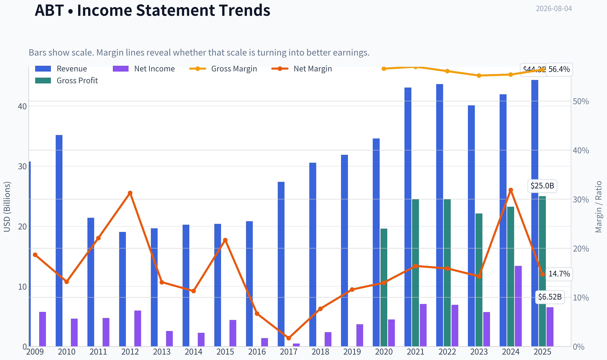
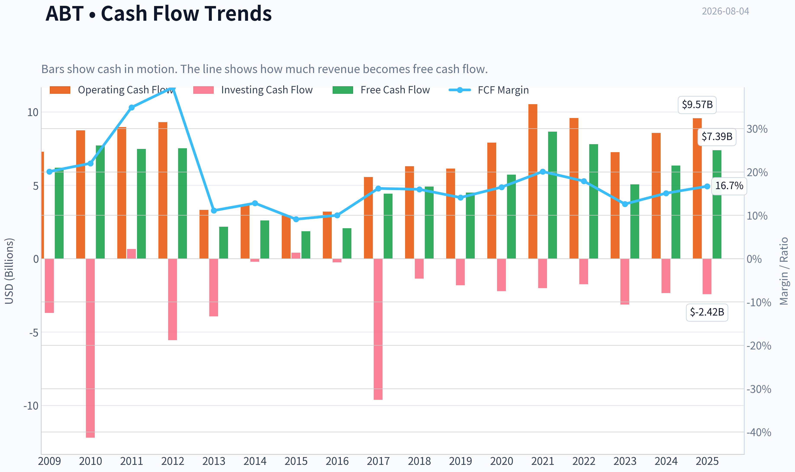
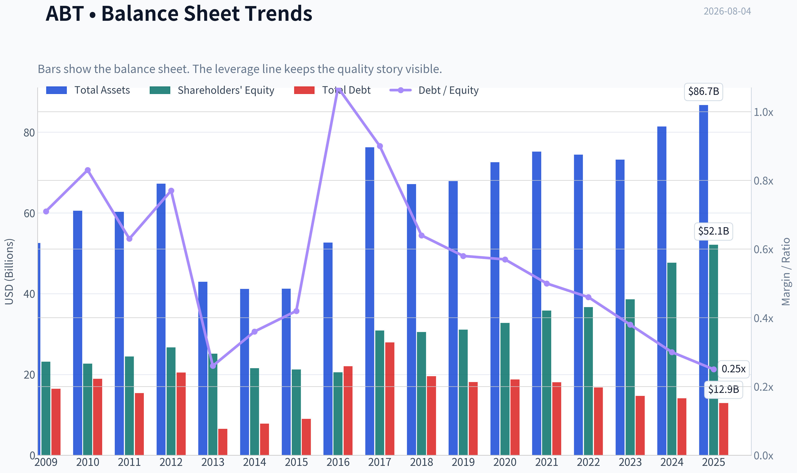
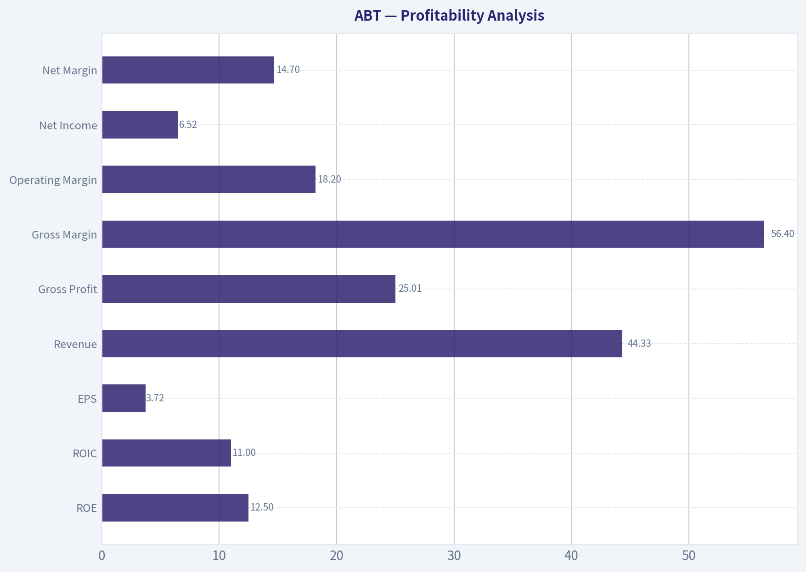
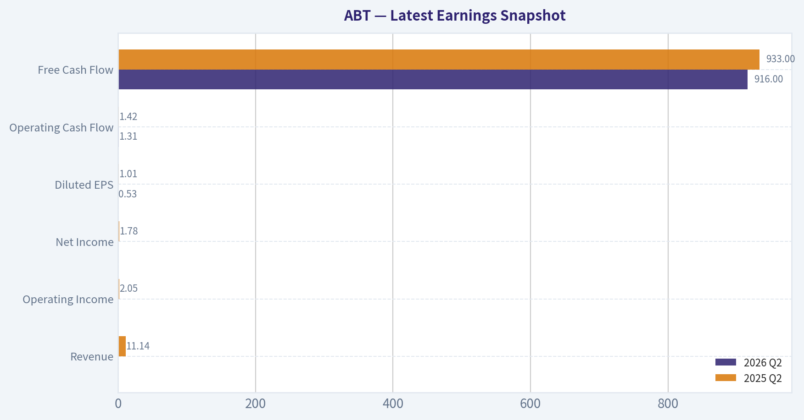
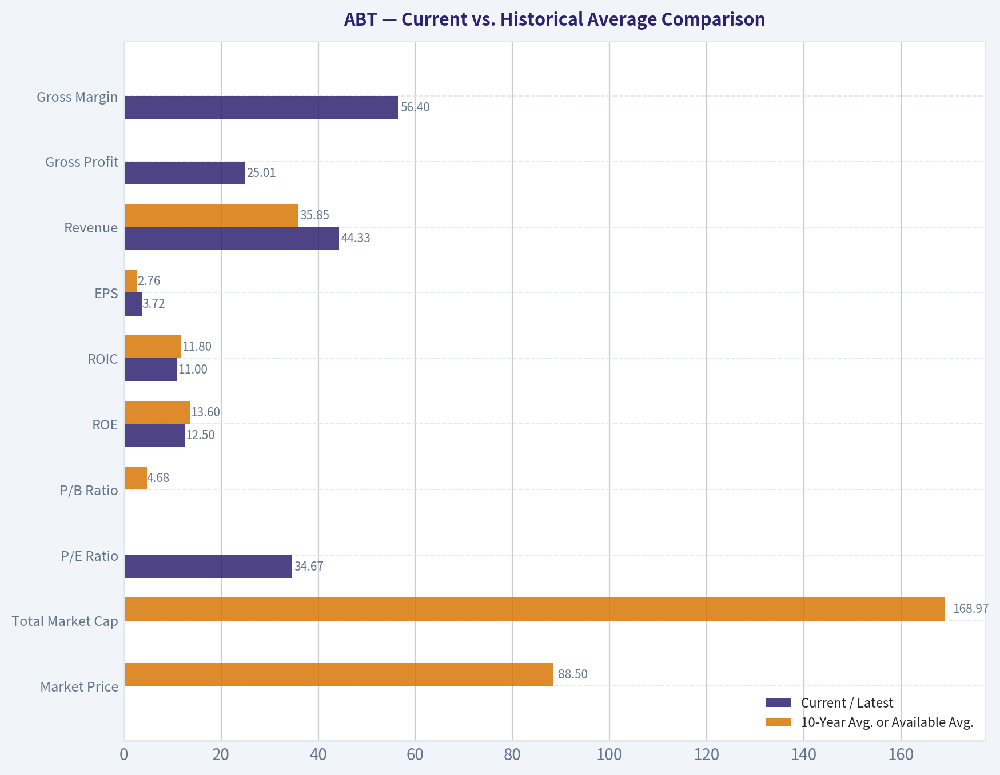
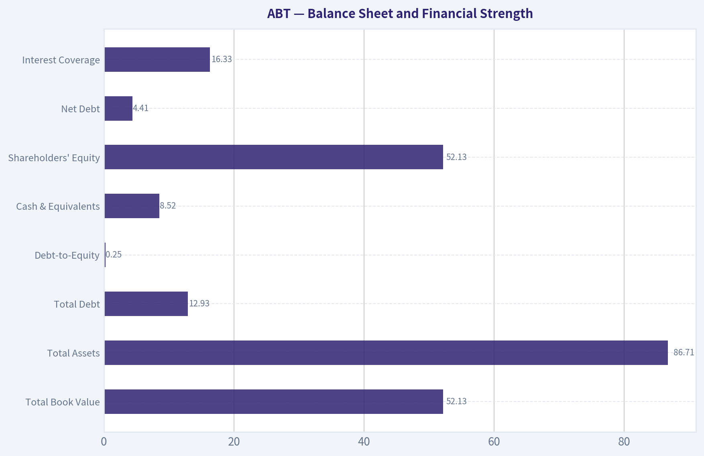
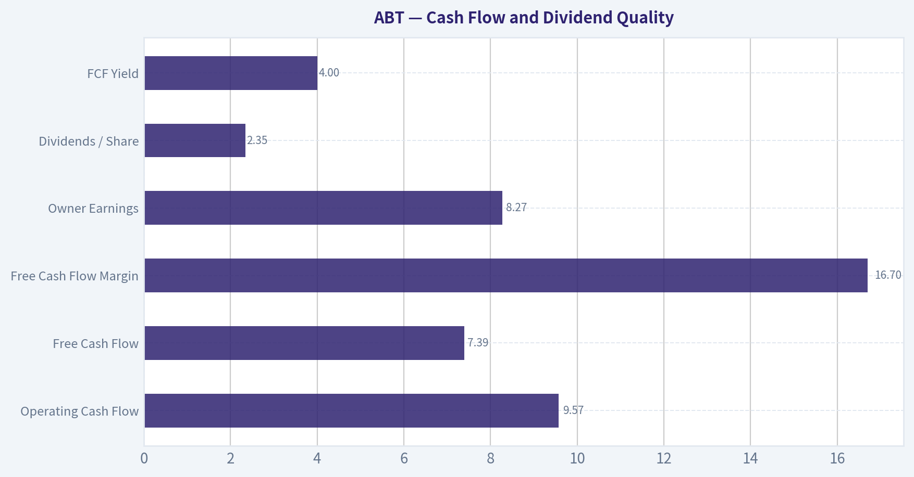
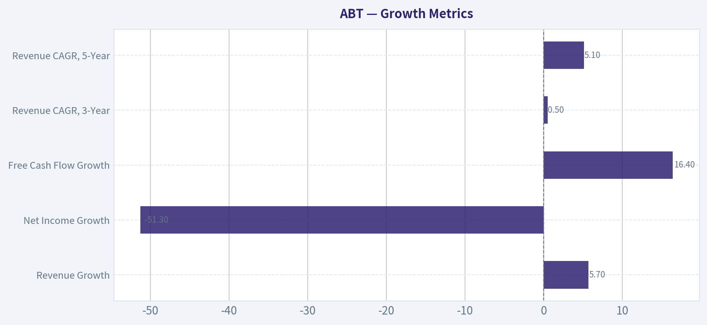

# ABT Deep Value Intelligence

**Analysis Date:** 2026-08-04

## Critical Disclaimer

*This analysis is generated by Deep Value Intelligence, an AI-powered multi-agent investing framework. Education & research only - not financial advice, not a financial advisor.*

---

## Table of Contents

1. Intelligence Summary
2. Analyst Team Reports
   - Fundamentals Analysis
   - Intrinsic Value Analysis (Buffett)
   - Trend & Growth Analysis (Lynch/Druckenmiller/Fisher)
   - Market Technical Analysis
   - Options Market Analysis
3. Research Team Commentary
4. Value Investing Team Commentary
5. Deep Values Commentary

---

## Intelligence Summary

### Thesis + Conditions

**Core Thesis:** **EXECUTIVE SUMMARY**
Abbott Laboratories (ABT) is a high-quality, durable compounder temporarily masked by the normalization of its COVID-19 diagnostics revenue. The optically high 34.6x trailing P/E and depressed 11% ROIC are backward-looking distortions, not permanent impairments.

**Key Risks:**
- Abbott Laboratories (ABT) is a high-quality, durable compounder temporarily masked by the normalization of its COVID-19 diagnostics revenue. The optically high 34.6x trailing P/E and depressed 11% ROIC are backward-looking distortions, not permanent impairments. Driven by its 56.4% gross margin and the FreeStyle Libre ecosystem, Abbott possesses a powerful economic moat. Following our adaptive value framework, wonderful businesses do not require cigar-butt discounts. We are abandoning the passive "WATCH" stance to initiate a staged accumulation, preventing valuation rigidity from costing us long-term compounding upside.
- The Bull (Growth/Risky):** The 34.6x P/E is an illusion caused by the COVID diagnostics hangover. Abbott's 56.4% gross margin proves immense pricing power, and MedTech (FreeStyle Libre) offers explosive, recurring growth that justifies a premium.
- The Bear (Value/Safe):** An 11% ROIC indicates a capital-intensive "technological treadmill." Paying 34x earnings leaves zero margin of safety, pricing in flawless execution and risking a drawdown if MedTech growth decelerates.

**Confidence:** Medium

---

## Analyst Team Reports

### Fundamentals Analysis

#### Latest Earnings Snapshot

*Most recent reported quarter anchored on 2026 Q2, with prior-year comparison when available.*

| Metric | 2026 Q2 | 2025 Q2 | YoY Change |
| --- | ---: | ---: | ---: |
| Revenue | N/A | $11.14B | N/A |
| Operating Income | N/A | $2.05B | N/A |
| Net Income | N/A | $1.78B | N/A |
| Diluted EPS | $0.53 | $1.01 | -47.5% |
| Operating Cash Flow | $1.31B | $1.42B | -7.2% |
| Free Cash Flow | $916.0M | $933.0M | -1.8% |

Key Takeaways: This snapshot anchors the most recent reported quarter before the narrative analysis. It helps readers separate long-run business quality from whatever changed in the latest earnings print.

#### 17-Year Financial Metrics for ABT

*All values below are computed deterministically from raw data - not estimated by AI.*

*Issuer profile: operating company (Healthcare / Medical Devices).*

#### 17-Year Financial Metrics
*Annual rows come from reported financial statements. The final TTM row is computed from the latest four quarters.*

| Metric | 2009 | 2010 | 2011 | 2012 | 2013 | 2014 | 2015 | 2016 | 2017 | 2018 | 2019 | 2020 | 2021 | 2022 | 2023 | 2024 | 2025 |
| --- | --- | --- | --- | --- | --- | --- | --- | --- | --- | --- | --- | --- | --- | --- | --- | --- | --- |
| Market Price | $18 | $16 | $20 | $24 | $30 | $36 | $37 | $32 | $49 | $63 | $77 | $98 | $128 | $102 | $104 | $109 | $123 |
| Market Cap | $40.28B | $35.77B | $42.28B | $50.03B | $60.33B | $68.75B | $67.63B | $56.96B | $99.82B | $128.02B | $154.70B | $195.55B | $251.78B | $193.67B | $192.51B | $197.72B | $219.01B |
| P/E Ratio | 7.02 | 7.77 | 8.96 | 8.45 | 23.66 | 30.21 | 15.38 | 40.86 | 211.37 | 54.38 | 42.17 | 43.80 | 35.72 | 28.08 | 33.76 | 14.80 | 33.68 |
| P/B Ratio | 1.74 | 1.58 | 1.73 | 1.87 | 2.40 | 3.19 | 3.19 | 2.77 | 3.23 | 4.19 | 4.98 | 5.96 | 7.03 | 5.28 | 4.99 | 4.15 | 4.20 |
| ROE | 24.8% | 20.4% | 19.3% | 22.3% | 10.2% | 10.6% | 20.9% | 6.8% | 1.5% | 7.8% | 11.9% | 13.7% | 19.8% | 18.9% | 14.8% | 28.1% | 12.5% |
| ROIC | 16.0% | 14.6% | 4.3% | 5.2% | 6.4% | 6.7% | 9.1% | 10.9% | -0.9% | 6.5% | 9.0% | 10.8% | 16.4% | 16.0% | 12.3% | 26.3% | 11.0% |
| EPS | $2.55 | $2.12 | $2.23 | $2.85 | $1.26 | $1.19 | $2.37 | $0.78 | $0.23 | $1.16 | $1.82 | $2.24 | $3.59 | $3.62 | $3.08 | $7.36 | $3.72 |
| Revenue | $30.76B | $35.17B | $21.41B | $19.05B | $19.66B | $20.25B | $20.41B | $20.85B | $27.39B | $30.58B | $31.90B | $34.61B | $43.08B | $43.65B | $40.11B | $41.95B | $44.33B |
| Gross Profit | N/A | N/A | N/A | N/A | N/A | N/A | N/A | N/A | N/A | N/A | N/A | $19.61B | $24.54B | $24.51B | $22.13B | $23.24B | $25.01B |
| Gross Margin | N/A | N/A | N/A | N/A | N/A | N/A | N/A | N/A | N/A | N/A | N/A | 56.6% | 57.0% | 56.1% | 55.2% | 55.4% | 56.4% |
| Operating Margin | 20.3% | 17.3% | 7.6% | 7.1% | 10.9% | 12.8% | 14.1% | 14.5% | 5.7% | 11.9% | 14.2% | 15.5% | 19.6% | 19.2% | 16.2% | 16.3% | 18.2% |
| Net Income | $5.75B | $4.63B | $4.73B | $5.96B | $2.58B | $2.28B | $4.42B | $1.40B | $477.0M | $2.37B | $3.69B | $4.50B | $7.07B | $6.93B | $5.72B | $13.40B | $6.52B |
| Net Margin | 18.7% | 13.2% | 22.1% | 31.3% | 13.1% | 11.3% | 21.7% | 6.7% | 1.7% | 7.7% | 11.6% | 13.0% | 16.4% | 15.9% | 14.3% | 31.9% | 14.7% |
| Revenue Growth | N/A | 14.3% | -39.1% | -11.0% | 3.2% | 3.0% | 0.8% | 2.2% | 31.3% | 11.6% | 4.3% | 8.5% | 24.5% | 1.3% | -8.1% | 4.6% | 5.7% |
| Net Income Growth | N/A | -19.5% | 2.2% | 26.1% | -56.8% | -11.3% | 93.7% | -68.3% | -65.9% | 396.4% | 55.7% | 21.9% | 57.3% | -2.0% | -17.5% | 134.2% | -51.3% |
| Free Cash Flow Growth | N/A | 24.8% | -3.1% | 0.5% | -71.0% | 19.2% | -28.6% | 12.2% | 113.0% | 10.6% | -8.3% | 27.3% | 51.1% | -9.8% | -35.2% | 25.5% | 16.4% |
| Total Book Value | $23.14B | $22.68B | $24.44B | $26.72B | $25.17B | $21.53B | $21.21B | $20.54B | $30.90B | $30.52B | $31.09B | $32.78B | $35.80B | $36.69B | $38.60B | $47.66B | $52.13B |
| Total Assets | $52.58B | $60.57B | $60.28B | $67.23B | $42.94B | $41.21B | $41.25B | $52.67B | $76.25B | $67.17B | $67.89B | $72.55B | $75.20B | $74.44B | $73.21B | $81.41B | $86.71B |
| Total Debt | $16.46B | $18.92B | $15.41B | $20.48B | $6.56B | $7.83B | $9.00B | $22.01B | $27.92B | $19.57B | $18.14B | $18.75B | $18.05B | $16.77B | $14.68B | $14.12B | $12.93B |
| Debt-to-Equity | 0.71 | 0.83 | 0.63 | 0.77 | 0.26 | 0.36 | 0.42 | 1.07 | 0.90 | 0.64 | 0.58 | 0.57 | 0.50 | 0.46 | 0.38 | 0.30 | 0.25 |
| Cash & Equivalents | $8.81B | $3.65B | $6.81B | $10.80B | $3.48B | $4.06B | $5.00B | $18.62B | $9.41B | $3.84B | $3.86B | $6.84B | $9.80B | $9.88B | $6.90B | $7.62B | $8.52B |
| Shareholders' Equity | $23.14B | $22.68B | $24.44B | $26.72B | $25.17B | $21.53B | $21.21B | $20.54B | $30.90B | $30.52B | $31.09B | $32.78B | $35.80B | $36.69B | $38.60B | $47.66B | $52.13B |
| Operating Cash Flow | $7.28B | $8.74B | $8.97B | $9.31B | $3.32B | $3.67B | $2.97B | $3.20B | $5.57B | $6.30B | $6.14B | $7.90B | $10.53B | $9.58B | $7.26B | $8.56B | $9.57B |
| Investing Cash Flow | $-3.70B | $-12.19B | $661.0M | $-5.56B | $-3.93B | $-202.0M | $406.0M | $-248.0M | $-9.62B | $-1.36B | $-1.81B | $-2.21B | $-2.01B | $-1.74B | $-3.13B | $-2.34B | $-2.42B |
| Free Cash Flow | $6.19B | $7.72B | $7.48B | $7.52B | $2.18B | $2.60B | $1.86B | $2.08B | $4.43B | $4.91B | $4.50B | $5.72B | $8.65B | $7.80B | $5.06B | $6.35B | $7.39B |
| FCF Margin | 20.1% | 22.0% | 34.9% | 39.5% | 11.1% | 12.8% | 9.1% | 10.0% | 16.2% | 16.0% | 14.1% | 16.5% | 20.1% | 17.9% | 12.6% | 15.1% | 16.7% |
| Dividends / Share | $0.00 | $0.00 | $0.00 | $0.00 | $0.00 | $0.00 | $0.00 | $0.00 | $0.00 | $0.00 | $0.00 | $0.00 | $0.00 | $1.74 | $1.92 | $2.11 | $2.35 |

#### Profitability Metrics
- Return on Equity (ROE): 12.5%
- Return on Invested Capital (ROIC): 11.0%
- Return on Assets (ROA): 7.5%
- Gross Margin: 56.4%
- Operating Margin: 18.2%
- Net Profit Margin: 14.7%

#### Liquidity Metrics
- Current Ratio: 1.58
- Quick Ratio: 1.02

#### Leverage Metrics
- Debt-to-Equity Ratio: 0.25
- Interest Coverage Ratio: 16.33
- Net Debt: $4.41B

#### Growth Metrics (Year-over-Year)
- Revenue Growth: 5.7%
- Net Income Growth: -51.3%
- Free Cash Flow Growth: 16.4%
- Revenue CAGR (3-Year): 0.5%
- Revenue CAGR (5-Year): 5.1%

#### Valuation Metrics
- P/E Ratio (TTM): 34.67
- Forward P/E: 17.67
- Price-to-Book: 3.63
- Price-to-Sales: 4.01
- PEG Ratio: 2.13
- EV/EBITDA: 18.25
- Free Cash Flow Yield: 4.0%
- Earnings Yield: 2.9%

#### Owner Earnings (Buffett Method, Code-Computed)
- Net Income: $6.52B
- + Depreciation & Amortization: $3.12B
- - Capital Expenditures: $-2.17B
- - Working Capital Changes: $-803.0M
- = **Owner Earnings: $8.27B**

#### Intrinsic Value (Code-Computed)
- Current Price: $107
- **Headline Intrinsic Value (business-model routed): $60**
  Business model: asset light platform - weighted blend [Damodaran FCFF + reverse-DCF fair + owner-earnings DCF] (asset_light_platform)
  Model spread (min-max across DCFs): $52 - $65
  Margin of safety vs. price (headline): -78.8%
  Routing note: Asset-light / high-margin platform: value driven by margins and reinvestment economics - the headline centers on the reverse-DCF demonstrated-growth fair value with Damodaran FCFF as a floor, down-weighting the owner-earnings DCF.
- Buffett Method (Owner Earnings):
  Conservative: $24
  Average: $65
  Optimistic: $441
- Cash Flow Method (FCF):
  Conservative: $38
  Average: $52
  Optimistic: $119
- Damodaran FCFF (WACC + margins + reinvestment):
  Conservative: $41
  Average: $53
  Optimistic: $76
  Monte Carlo band (P10-P90): $40 - $79 (median $54)
  P(intrinsic value > price): 1.4%
- Reverse-DCF: price implies ~17.2%/yr owner-earnings growth for 10y; trailing 3y was -5.9%, 5y 29.0%.

#### Piotroski F-Score: 5/9
- Positive Net Income: PASS
- Positive Operating Cash Flow: PASS
- ROA Improvement: FAIL
- Cash Flow > Net Income: PASS
- Decreasing Debt: PASS
- Improving Current Ratio: FAIL
- No Dilution: FAIL
- Improving Gross Margin: PASS
- Improving Asset Turnover: FAIL

ANALYST STANCE: **WATCH**

#### Abbott Laboratories (ABT) - Buffett-Style Fundamental Analysis

Abbott Laboratories is a high-quality, diversified healthcare operating company with durable franchises in medical devices, diagnostics, nutrition, and established pharmaceuticals. The business has many Buffett-like characteristics: recurring demand, regulated product categories, strong brands, global distribution, high gross margins, and meaningful free cash flow generation. However, the current valuation still embeds a demanding growth expectation relative to Abbott's recent normalized growth profile.

The key tension is simple: **Abbott is a quality compounder, but the stock is not clearly cheap.** The deterministic valuation pack estimates headline intrinsic value around **$60 per share**, with a model spread of roughly **$52-$65**, versus a current price around **$107**. Even a more generous hand-built owner earnings DCF produces a fair value range of roughly **$56-$85**, still below the market price.

---

#### Current vs. Historical Average Comparison

| Metric | Current / Latest | 10-Year Avg. or Available Avg. | Current Standing vs. History | Interpretation |
|---|---:|---:|---:|---|
| Market Price | $107 current quote; $123 latest deterministic row | $88.50 | Above average | Shares remain elevated versus the last decade despite recent weakness. |
| Total Market Cap | $186.58B current; $219.01B latest deterministic row | $168.97B | Above average | Abbott still trades at a premium enterprise scale versus its decade norm. |
| P/E Ratio | 34.67x | 53.86x; distorted by 2017 outlier | Below average but still high | The average is inflated by one abnormal year; valuation remains expensive on normalized earnings. |
| P/B Ratio | 3.63x current; 4.20x latest deterministic row | 4.68x | Below average | P/B is secondary for Abbott because book value includes acquisition accounting and intangibles; cash-flow valuation is more relevant. |
| ROE | 12.5% | 13.6% | Slightly below average | Returns remain respectable but are below Abbott's stronger years. |
| ROIC | 11.0% | 11.8% | Slightly below average | ROIC is solid but not exceptional relative to the company's best periods. |
| EPS | $3.72 | $2.76 | Above average | EPS is above the decade average, though 2024 was unusually high and 2025 normalized lower. |
| Revenue | $44.33B | $35.85B | Above average | Revenue base has structurally expanded, helped by device growth and prior COVID-era diagnostic strength. |
| Gross Profit | $25.01B | $23.17B available 6-year avg. | Above average | Gross profit remains strong and near recent highs. |
| Gross Margin | 56.4% | 56.1% available 6-year avg. | In line | Gross margin stability is a major quality signal. |
| Operating Margin | 18.2% | 15.1% | Above average | Operating profitability has improved versus the decade average. |
| Net Income | $6.52B | $5.21B | Above average | Earnings remain above the 10-year average but are well below the unusually high 2024 level. |
| Net Margin | 14.7% | 13.4% | Above average | Net margin is healthy and indicates decent cost discipline. |
| Revenue Growth | 5.7% YoY | 8.6% | Below average | Growth is positive but below the decade average, which was boosted by pandemic diagnostics and acquisition effects. |
| Net Income Growth | -51.3% YoY | 46.1%; highly distorted | Weak | Net income growth is volatile; 2025 reflects normalization after a very strong 2024. |
| Free Cash Flow Growth | 16.4% YoY | 20.3% | Below average but strong | FCF growth is healthy and more encouraging than net income growth. |
| Total Book Value | $52.13B | $35.67B | Above average | Equity base has grown meaningfully. |
| Total Assets | $86.71B | $72.75B | Above average | Abbott has scaled materially over the decade. |
| Total Debt | $12.93B | $18.29B | Better than average | Debt has declined significantly, strengthening the balance sheet. |
| Debt-to-Equity | 0.25x | 0.57x | Better than average | Leverage is much lower than historical norms. |
| Cash & Equivalents | $8.52B | $8.53B | In line | Liquidity is consistent with historical norms. |
| Shareholders' Equity | $52.13B | $35.67B | Above average | Equity has compounded, supporting financial resilience. |
| Free Cash Flow | $7.39B | $5.69B | Above average | Cash generation is comfortably above the decade average. |
| Dividends / Share | $2.35 | $0.81 in dataset period | Above average | The deterministic dataset shows rising dividends since 2022. |

Key Takeaways: Abbott's current profitability and free cash flow are better than its 10-year average, while leverage is materially lower than historical levels. The main weakness is valuation: even after recent share-price pressure, the stock remains expensive relative to cash-flow-based intrinsic value. Growth is positive but no longer benefiting from the extraordinary diagnostics surge seen during the pandemic period.

---

#### Market Metrics

| Market Metric | Current Reading | Buffett-Style Interpretation |
|---|---:|---|
| Market Price | ~$107 current quote | The stock has pulled back from the deterministic 2025 row price of $123, but it still trades well above the model-based intrinsic value estimate. |
| Total Market Cap | ~$186.58B current | Abbott remains priced as a global blue-chip healthcare compounder. The market is still assigning a quality premium. |
| P/E Ratio | 34.67x TTM | This is high for a mature healthcare company unless earnings growth accelerates meaningfully. Forward P/E of 17.67x is more reasonable, but the trailing multiple remains demanding. |
| P/B Ratio | 3.63x current; 4.20x latest deterministic row | P/B is not the primary valuation tool for Abbott. Abbott is an operating healthcare company with substantial intangible value, R&D assets, brands, and acquisition accounting; cash-flow-based intrinsic value is more useful than book value alone. |

Key Takeaways: Abbott's market valuation still reflects a premium-quality business rather than a bargain. The P/E ratio is not extreme versus some historical outlier years, but it is still high relative to recent growth. P/B is directionally useful but should not drive the investment conclusion; owner earnings and free cash flow matter more.

---

#### Profitability Analysis

Abbott's profitability profile remains attractive. Gross margin of **56.4%** is very stable versus the available six-year average of about **56.1%**, suggesting durable pricing power and a favorable product mix. Operating margin of **18.2%** is above the 10-year average of about **15.1%**, which indicates that Abbott has retained operating efficiency even after the normalization of COVID diagnostics revenue.

ROE of **12.5%** and ROIC of **11.0%** are respectable but not exceptional. They are slightly below their 10-year averages, and they are far below the unusually strong 2024 readings of **28.1% ROE** and **26.3% ROIC**. From a Buffett perspective, this means Abbott is a good business, but the current return profile does not fully justify a very aggressive valuation unless future earnings growth improves.

| Profitability Metric | Latest Value | Quality Signal |
|---|---:|---|
| ROE | 12.5% | Good, but slightly below decade average. |
| ROIC | 11.0% | Solid; indicates value creation above typical cost of capital, but not extraordinary. |
| EPS | $3.72 | Above decade average, but down sharply from 2024's $7.36. |
| Revenue | $44.33B | Near historical high, showing strong scale. |
| Gross Profit | $25.01B | Strong and expanding. |
| Gross Margin | 56.4% | Stable and high-quality. |
| Operating Margin | 18.2% | Above historical average. |
| Net Income | $6.52B | Healthy but normalized after an exceptional 2024. |
| Net Margin | 14.7% | Above decade average and consistent with a quality healthcare franchise. |

Key Takeaways: Abbott's margins are the clearest evidence of business quality. Gross margin stability around the mid-50% range shows durable economics, while operating margin is above the 10-year average. The only caution is that ROE and ROIC have normalized below the exceptional 2024 level, so valuation should be based on sustainable earnings rather than peak profitability.

---

#### Growth Metrics

Abbott's growth record over the full dataset is uneven because of major portfolio changes, acquisitions, the Alere integration, the COVID diagnostics surge, and subsequent normalization. Revenue grew **5.7%** most recently, which is solid but below the 10-year average of **8.6%**. Free cash flow grew **16.4%**, a constructive sign that cash conversion improved faster than sales.

Net income growth of **-51.3%** is the most negative headline number, but it must be interpreted carefully. The decline follows an unusually strong 2024 net income figure of **$13.40B**, so the latest year looks poor by comparison. Still, Buffett-style investors should not ignore the volatility: predictable earnings are one of Buffett's core filters, and Abbott's reported net income has been lumpy.

| Growth Metric | Latest Value | Historical Context | Interpretation |
|---|---:|---:|---|
| Revenue Growth | 5.7% | 10-year avg. 8.6% | Healthy but below the elevated decade average. |
| Net Income Growth | -51.3% | 10-year avg. distorted by large swings | Reported earnings are volatile; normalization after 2024. |
| Free Cash Flow Growth | 16.4% | 10-year avg. 20.3% | Strong cash growth, though below the historical average. |
| Revenue CAGR, 3-Year | 0.5% | Deterministic pack figure | Recent revenue growth has been muted after COVID diagnostics normalization. |
| Revenue CAGR, 5-Year | 5.1% | Deterministic pack figure | Medium-term growth is respectable but not enough to justify aggressive valuation alone. |

Key Takeaways: Abbott's free cash flow trend is stronger than its reported net income trend, which is favorable for intrinsic value analysis. However, revenue growth has slowed materially on a three-year basis because pandemic-era diagnostics revenue has normalized. The market price appears to require a stronger growth path than Abbott has recently demonstrated.

---

#### Balance Sheet and Financial Strength

Abbott's balance sheet is one of the strongest parts of the investment case. Total debt has fallen from a 10-year average of about **$18.29B** to **$12.93B**, while shareholders' equity has grown to **$52.13B**. Debt-to-equity is now only **0.25x**, significantly better than the decade average of **0.57x**.

Liquidity is also sound. Cash and equivalents are **$8.52B**, almost exactly in line with the 10-year average. Net debt is approximately **$4.41B**, and interest coverage is **16.33x**, which indicates low financial stress.

| Balance Sheet Metric | Latest Value | Buffett-Style Interpretation |
|---|---:|---|
| Total Book Value | $52.13B | Equity base has grown materially. |
| Total Assets | $86.71B | Abbott has scaled into a larger global healthcare platform. |
| Total Debt | $12.93B | Debt has declined and is below historical average. |
| Debt-to-Equity | 0.25x | Conservative leverage profile. |
| Cash & Equivalents | $8.52B | Strong liquidity and flexibility. |
| Shareholders' Equity | $52.13B | Balance sheet strength has improved. |
| Net Debt | $4.41B | Manageable relative to free cash flow. |
| Interest Coverage | 16.33x | Very comfortable coverage. |

Key Takeaways: Abbott's financial position is strong and has improved over time. Lower debt, rising equity, and strong interest coverage reduce downside risk. This is a major reason the stock deserves a quality premium, even if the current price does not offer an obvious margin of safety.

---

#### Cash Flow and Dividend Quality

Free cash flow is the key metric for Abbott's intrinsic value. Latest free cash flow is **$7.39B**, meaningfully above the 10-year average of **$5.69B**. The free cash flow margin is **16.7%**, which is healthy and supports dividends, debt reduction, reinvestment, and acquisitions.

The deterministic dataset shows dividends per share rising from **$1.74 in 2022** to **$2.35 in 2025**. Based on latest EPS of **$3.72**, the dividend payout ratio is roughly **63%** on reported earnings. Based on free cash flow, the dividend appears better covered because Abbott generated substantial cash flow.

| Cash Flow Metric | Latest Value | Interpretation |
|---|---:|---|
| Operating Cash Flow | $9.57B | Strong cash generation from operations. |
| Free Cash Flow | $7.39B | Above decade average and central to valuation. |
| Free Cash Flow Margin | 16.7% | Healthy cash conversion. |
| Owner Earnings | $8.27B | Strong Buffett-style cash earnings base. |
| Dividends / Share | $2.35 | Rising dividend in the deterministic dataset. |
| FCF Yield | 4.0% | Reasonable, but not deeply undervalued. |

Key Takeaways: Abbott remains a strong cash generator. Free cash flow growth of 16.4% is encouraging and supports the dividend. However, a 4.0% free cash flow yield is not a deep-value signal when revenue growth is only mid-single-digit and the stock trades above intrinsic value estimates.

---

#### Revenue Breakdown

| Revenue Source | Amount ($B) | % of Total |
|---|---:|---:|
| Medical Devices | ~$20.84B | ~47% |
| Diagnostics | ~$9.31B | ~21% |
| Nutrition | ~$8.87B | ~20% |
| Established Pharmaceuticals | ~$5.32B | ~12% |
| **Total** | **$44.33B** | **100%** |

Key Takeaways: Abbott's largest business is Medical Devices, which is the most important long-term growth engine. Diagnostics remains meaningful but has normalized after pandemic-era strength. The mix is diversified, which reduces single-product risk and supports Abbott's durable franchise quality.

---

#### Warren Buffett-Style Qualitative Analysis

| Buffett Criterion | Assessment | Explanation |
|---|---|---|
| Economic Moat | Strong | Abbott benefits from trusted healthcare brands, regulatory barriers, physician relationships, distribution scale, R&D capabilities, and switching costs in medical devices. |
| Financial Strength | Strong | Debt is down, debt-to-equity is low, cash is ample, and interest coverage is very comfortable. |
| Predictable Earnings | Moderate | Revenue and margins are relatively durable, but reported net income has been volatile due to portfolio changes and pandemic-related diagnostics swings. |
| Management Performance | Good | Debt reduction, sustained free cash flow, and dividend growth suggest disciplined capital allocation. ROIC is solid but not consistently outstanding. |
| Valuation Discipline | Weak at current price | The stock trades materially above the deterministic intrinsic value estimate and requires optimistic assumptions to justify today's price. |
| Quality of Business | High | Abbott has durable demand, diversified segments, global scale, and strong gross margins. |

Key Takeaways: Abbott looks like a Buffett-quality business, but not a Buffett-price stock. The company has a real moat, strong finances, and durable product categories. The main issue is that the current market price already capitalizes much of that quality.

---

#### Three-Scenario Buffett-Style Owner Earnings DCF

Base owner earnings from the deterministic dataset:

| Owner Earnings Component | Amount |
|---|---:|
| Net Income | $6.52B |
| Plus: Depreciation & Amortization | $3.12B |
| Less: Capital Expenditures | $2.17B |
| Less: Working Capital Changes | -$0.80B |
| **Owner Earnings** | **$8.27B** |

Key Takeaways: Abbott's owner earnings are higher than reported net income, which is favorable. This reflects strong cash conversion and meaningful non-cash charges. For valuation, owner earnings of $8.27B are the starting cash-flow base.

DCF assumptions:

| Assumption | Input |
|---|---:|
| Starting Owner Earnings | $8.27B |
| Discount Rate | 10.0% |
| Terminal Growth Rate | 2.5% |
| Net Debt Deduction | $4.41B |
| Diluted Share Count Used | ~1.75B |
| Valuation Method | Owner earnings discounted to equity value |

Key Takeaways: The DCF uses a Buffett-style 10% required return and a conservative terminal growth rate of 2.5%. Net debt is deducted to avoid overstating equity value. The analysis is used as a sanity check, while the deterministic model-based intrinsic value remains the primary anchor.

| Scenario | Growth Assumption | PV of Explicit Owner Earnings | PV of Terminal Value | Equity Value After Net Debt | Fair Value / Share |
|---|---|---:|---:|---:|---:|
| Conservative | 0% growth for 5 years, then fade to 2.5% terminal growth | ~$52.23B | ~$49.29B | ~$97.11B | **~$56** |
| Average | 5% for 5 years, fading to 2.5% by year 10 | ~$63.71B | ~$66.06B | ~$125.36B | **~$72** |
| Optimistic | 8% for 5 years, fading to 2.5% by year 10 | ~$72.64B | ~$81.27B | ~$149.50B | **~$85** |

Key Takeaways: Even under the optimistic hand-built DCF, Abbott's fair value is below the current quote of about $107. The conservative and average scenarios suggest fair value around $56 to $72. This supports the conclusion that Abbott is a high-quality company but does not currently offer a sufficient margin of safety.

Detailed DCF interpretation:

| Valuation Reference | Fair Value Estimate | Message |
|---|---:|---|
| Deterministic Headline Intrinsic Value | ~$60 | Primary valuation anchor from the research pack. |
| Owner Earnings Model Spread | ~$65 average model value | Supports fair value materially below current price. |
| FCF Method Average | ~$52 | More conservative cash-flow view. |
| Damodaran FCFF Average | ~$53 | Institutional-style FCFF model also below price. |
| Damodaran Monte Carlo Band | ~$40-$79 | Only a small probability of value above current price. |
| Reverse DCF | Price implies ~17.2% annual owner earnings growth for 10 years | Market expectations appear aggressive versus recent growth. |

Key Takeaways: Multiple valuation methods cluster below the current share price. The reverse DCF is especially important: the market price implies about 17.2% annual owner earnings growth for a decade. That is a high hurdle for a mature healthcare company whose three-year revenue CAGR is only 0.5%.

---

#### Intrinsic Value and Margin of Safety

Abbott's deterministic headline intrinsic value is approximately **$60 per share**, compared with a current price of approximately **$107**. That implies the stock trades about **79% above** the headline intrinsic value estimate, or a **negative margin of safety**.

From a Buffett perspective, this is the central problem. Buffett's framework does not require buying only statistically cheap companies, but it does require buying wonderful companies at sensible prices. Abbott qualifies as a wonderful or at least very good business. The current valuation, however, is not obviously sensible unless one assumes a substantial acceleration in durable owner earnings growth.

| Price vs. Value | Amount |
|---|---:|
| Current Price | ~$107 |
| Headline Intrinsic Value | ~$60 |
| Model Spread | ~$52-$65 |
| Hand DCF Range | ~$56-$85 |
| Margin of Safety vs. Headline Value | Negative |
| Implied Growth from Reverse DCF | ~17.2% for 10 years |

Key Takeaways: Abbott's valuation does not provide a Buffett-style margin of safety. The share price is above both the deterministic model range and the hand-built DCF range. A better entry point would require either a lower price or clearer evidence of sustained high-teens owner earnings growth.

---

#### Key Investment Insights

| Category | Insight | Investment Meaning |
|---|---|---|
| Business Quality | Abbott has durable healthcare franchises and global scale. | Supports long-term resilience and a premium valuation. |
| Margin Stability | Gross margin is highly stable around 56%. | Indicates pricing power and favorable product mix. |
| Balance Sheet | Debt has declined materially; D/E is only 0.25x. | Reduces downside risk and increases strategic flexibility. |
| Cash Flow | FCF of $7.39B is above the 10-year average. | Supports dividends, reinvestment, and acquisitions. |
| Growth | Revenue growth is positive but not exceptional. | Current valuation requires stronger growth than recently delivered. |
| Valuation | Price exceeds intrinsic value estimates. | Main reason for a WATCH rather than ADVOCATE stance. |
| Reverse DCF | Market implies ~17.2% owner earnings growth for 10 years. | High hurdle for a mature healthcare company. |

Key Takeaways: Abbott is financially strong and competitively durable, but valuation is the obstacle. The business can compound value over time, yet today's price already discounts a lot of future success. Investors should separate company quality from stock attractiveness.

---

#### Red Flags and Risks

| Risk | Why It Matters |
|---|---|
| Valuation Risk | The stock trades well above the deterministic intrinsic value estimate. |
| Growth Expectation Risk | Reverse DCF implies aggressive 10-year owner earnings growth. |
| Earnings Volatility | Net income has been lumpy, including sharp swings in 2017, 2024, and 2025. |
| Diagnostics Normalization | COVID-era diagnostics revenue created a temporary growth surge that has faded. |
| Regulatory and Litigation Risk | Healthcare companies face product liability, approval, reimbursement, and compliance risks. |
| Acquisition Integration Risk | Abbott has historically used acquisitions; poor integration could pressure returns. |
| ROIC Normalization | ROIC has fallen from 26.3% in 2024 to 11.0% most recently. |

Key Takeaways: The most important risk is not balance sheet weakness; Abbott's balance sheet is strong. The larger risk is paying too much for a business whose growth has normalized. If earnings growth disappoints, valuation compression could offset business quality.

---

#### Opportunities

| Opportunity | Why It Could Improve Value |
|---|---|
| Medical Devices Growth | Devices are Abbott's largest segment and likely the strongest long-term growth engine. |
| Margin Expansion | Operating margin is already above average; further mix improvement could lift earnings. |
| Debt Reduction | Lower leverage gives Abbott flexibility for reinvestment, dividends, or acquisitions. |
| Emerging Market Pharmaceuticals | Established Pharmaceuticals can benefit from long-term healthcare demand in faster-growing markets. |
| Dividend Growth | Strong free cash flow supports continued shareholder returns. |
| Diagnostics Stabilization | If diagnostics stops declining, consolidated growth could improve. |

Key Takeaways: Abbott has credible long-term growth opportunities, especially in medical devices and international healthcare demand. The balance sheet gives management room to invest. The issue is that many of these positives appear already reflected in the share price.

---

#### Final Investment Stance: WATCH

Abbott Laboratories is a **high-quality healthcare compounder** with a strong balance sheet, durable margins, diversified revenue streams, and above-average free cash flow. It fits many Buffett qualitative criteria: understandable products, durable demand, global scale, conservative leverage, and strong cash generation.

However, the stock does **not** currently meet Buffett's margin-of-safety requirement. The deterministic headline intrinsic value is about **$60**, the model spread is roughly **$52-$65**, and the hand-built owner earnings DCF suggests about **$56-$85**. Against a current price of about **$107**, the valuation is too demanding.

A more attractive entry point would likely be closer to the **$60-$80** range, depending on whether Abbott can demonstrate sustained mid-to-high single-digit owner earnings growth. At the current price, Abbott deserves monitoring, not aggressive accumulation.

| Final Summary Point | Assessment |
|---|---|
| Business Quality | High |
| Economic Moat | Strong |
| Financial Strength | Strong |
| Earnings Predictability | Moderate to Good |
| Cash Flow Quality | Strong |
| Dividend Support | Good |
| Current Valuation | Expensive versus intrinsic value |
| Margin of Safety | Insufficient |
| Best Action | Watch for a better entry price |
| Final Stance | **WATCH** |

Key Takeaways: Abbott is the kind of business long-term investors should want to own, but price discipline matters. The company's balance sheet and cash flow are strong, yet the stock price still assumes a high level of future growth. The appropriate stance is WATCH until valuation becomes more attractive or growth accelerates enough to justify the premium.

#### Fundamental Visuals

This graph tracks the profitability and return metrics (ROE, ROIC, Margins) of **ABT** over the past decade, highlighting capital efficiency trends.

This chart illustrates the financial health of **ABT** over the last 10 years, mapping cash equivalents and free cash flow against total obligations (Debt).

This comparison chart from *Profitability Analysis* stacks current figures against historical benchmarks for **ABT**, making it easy to see where the company trades relative to its own averages.

---

### Intrinsic Value Analysis (Buffett)

> *Following Warren Buffett's value investing philosophy: Circle of Competence, Economic Moat, Management Quality, and Margin of Safety.*

#### Intrinsic Value Snapshot

Price is what you pay. Intrinsic value is what the business may be worth based on the cash it can create for owners over time. We show a range, not one magic number.

- Current Price: $107.12
- Value Range (conservative to optimistic across both DCF methods): $24.16 to $440.83

##### Owner Earnings (Buffett Method)
- Net Income: $6,524,000,000.00
- Depreciation & Amortization: $3,116,000,000.00
- Capital Expenditures: $-2,171,000,000.00
- Working Capital Changes: $-803,000,000.00
- Owner Earnings: $8,272,000,000.00

##### Intrinsic Value
###### Buffett Method
Uses owner earnings. Stricter, and usually more conservative.
- Conservative: $24.16
- Average: $64.96
- Optimistic: $440.83
- Discount Rate: 10.0%

###### Cash Flow Method
Uses free cash flow. Better for companies spending heavily today to grow tomorrow.
- Conservative: $38.00
- Average: $52.43
- Optimistic: $119.17
- Discount Rate: 10.0%

ANALYST STANCE: **WATCH**

#### Abbott Laboratories (ABT) - Buffett-Style Value Investment Review

Abbott is a high-quality diversified healthcare company with durable franchises in medical devices, diagnostics, nutrition, and established pharmaceuticals. The business is understandable, cash-generative, and protected by brand, regulatory, distribution, and physician/customer switching advantages. The issue is price: at **$107**, the stock embeds growth expectations that look demanding for a mature healthcare compounder.

---

#### 1. Factor Scorecard

| Factor | Score | Evidence |
|---|---:|---|
| Factor 1: Circle of Competence & Business Simplicity | 4.0 / 5 | Abbott sells medical devices, diagnostic systems, nutritional products, and branded generics. The model is understandable: develop regulated healthcare products, sell through hospitals, labs, pharmacies, and consumer channels. Predictability is good, though diagnostics has some post-COVID normalization noise. |
| Factor 2: Moat Test | 4.0 / 5 | Gross margin is strong at **56.4%**, supporting evidence of pricing power and differentiated products. Moats come from brands, regulatory approvals, clinical trust, installed diagnostic systems, physician familiarity, and scale. |
| Factor 3: Management & Capital Allocation | 4.0 / 5 | Abbott has a long record of dividends, disciplined healthcare portfolio building, and reinvestment in R&D and medical technology platforms. Capital allocation appears rational, though current valuation limits the attractiveness of buybacks. |
| Factor 4: Industry Structure | 4.0 / 5 | Healthcare devices, diagnostics, and nutrition are structurally attractive, regulated, and less commoditized than many industries. Competition is real, but market leadership and regulatory barriers support rational economics. |
| Gate 5: Quality / Solvency Hard Floor | Not Tripped | Abbott remains profitable, cash-flow positive, and liquid, with a **current ratio of 1.58** and no sign of financial distress. |

**Key Takeaways:** Abbott scores well on business quality, moat, and industry structure. The company is not financially distressed, so the hard floor is not triggered. The investment debate is not about survival or business quality; it is about whether the current price leaves enough margin of safety.

---

#### 2. Moat Analysis

| Moat Source | Assessment | Evidence |
|---|---|---|
| Intangible Assets | Strong | Abbott owns trusted healthcare brands and regulated product franchises. Nutrition brands such as Ensure and Similac, plus medical-device and diagnostics credibility, create customer trust that is hard to replicate. |
| Switching Costs | Moderate to Strong | Diagnostic platforms, hospital workflows, physician familiarity, and clinical validation create friction for customers considering alternatives. |
| Cost / Scale Advantage | Moderate | Abbott benefits from global scale, distribution, regulatory expertise, and manufacturing reach, though it does not have a monopoly-like cost advantage. |
| Network / Ecosystem Effects | Moderate | Not a classic network-effect business, but installed diagnostic systems and clinical ecosystems create recurring demand and some platform-like stickiness. |
| Overall Moat Rating | Wide & Stable | The moat is durable, but not obviously widening fast enough to justify heroic valuation assumptions. |

**Key Takeaways:** Abbott's moat is real and diversified. It is built on trust, regulation, brand, scale, and embedded healthcare relationships rather than a single dominant network effect. This is a high-quality franchise, but not one that should be valued as if very high growth is guaranteed.

---

#### 3. Financial Summary

| Metric | Current / Latest |
|---|---:|
| Share Price | **$107** |
| Market Capitalization | **$186.58B** |
| P/E Ratio | **34.7x** |
| ROE | **12.5%** |
| Gross Margin | **56.4%** |
| Revenue Growth YoY | **5.7%** |
| Free Cash Flow Yield | **4.0%** |
| Current Ratio | **1.58x** |
| Headline Intrinsic Value | **$59.92 / share** |
| 3-Model Valuation Spread | **$64.96 / $52.43 / $52.83** |
| Reverse-DCF Implied Growth | **~17.2% annually for 10 years** |
| Trailing 3-Year Growth Reference | **-5.9%** |
| Trailing 5-Year Growth Reference | **29.0%** |

**Key Takeaways:** Abbott is profitable and high-margin, with a respectable free cash flow yield and solid liquidity. However, the valuation is rich: a **34.7x P/E** and a reverse-DCF growth requirement of roughly **17% annually for a decade** are demanding for a mature diversified healthcare company. The 5-year growth figure is flattered by pandemic-era diagnostics, while the 3-year figure shows normalization pressure.

---

#### 4. Owner Earnings Calculation

Using Buffett's owner earnings framework:

| Component | Estimate |
|---|---:|
| Net Income Estimate | **$5.38B** |
| Add: D&A less maintenance capex and working-capital burden | **~$2.08B** |
| Estimated Owner Earnings / FCF Proxy | **$7.46B** |
| Estimated Shares Outstanding | **~1.74B** |
| Owner Earnings per Share | **~$4.28** |

**Key Takeaways:** Abbott's estimated owner earnings are solid, at roughly **$7.5B**, or about **$4.28 per share**. The company converts accounting earnings into meaningful cash flow, which supports its quality case. The problem is that a $107 share price capitalizes those owner earnings at a demanding multiple.

---

#### 5. Three-Scenario DCF Valuation

| Scenario | Assumption | Estimated Value / Share | Implied Margin vs. $107 Price |
|---|---|---:|---:|
| Scenario A: No Growth | Owner earnings capitalized at 10% | **$42.80** | **-60.0%** |
| Scenario B: GDP Growth | 3% perpetual growth, 10% discount rate | **$62.97** | **-41.1%** |
| Scenario C: Normalized Growth | 5% growth for 10 years, then 3% terminal growth | **$72.58** | **-32.2%** |
| Headline Blended Intrinsic Value | Business-model-routed valuation blend | **$59.92** | **Negative margin of safety** |

**Key Takeaways:** Even under a reasonable normalized-growth case, Abbott's intrinsic value appears below the current market price. The no-growth and GDP-growth cases suggest clear overvaluation, while the normalized-growth case still does not provide a satisfactory margin of safety. For a high-quality healthcare business, a modest premium can be justified, but the current price appears to require too much future performance.

---

#### 6. Margin of Safety Analysis

| Valuation Reference | Value / Signal | Interpretation |
|---|---:|---|
| Current Price | **$107** | Market price paid today |
| Headline Intrinsic Value | **$59.92** | Cash-flow-based estimate |
| Headline Margin of Safety | **-78.8%** | Price is materially above modeled value |
| Reverse-DCF Implied Growth | **~17.2% for 10 years** | High hurdle for a mature diversified healthcare company |
| Quality-Scaled Required Margin | **~10-15% discount acceptable for wide-moat compounder** | Abbott qualifies as high quality, but the current price is not merely "fair"; it appears expensive |

**Key Takeaways:** Abbott is good enough that it does not need to trade at a deep discount to be interesting. But the stock does need to trade near a reasonable estimate of intrinsic value, and today it does not. The reverse-DCF is the clearest warning sign: the market price appears to demand growth Abbott is unlikely to sustain for a full decade.

---

#### 7. Management Quality Assessment

Abbott's management record is shareholder-friendly overall. The company has maintained a durable dividend culture, invested in innovation, and built a diversified healthcare portfolio. Management has shown an ability to operate across cycles, but the capital allocation score is moderated by the current valuation environment: repurchases at elevated prices would not be highly accretive to long-term per-share value.

| Management Dimension | Assessment |
|---|---|
| Owner Orientation | Good; long dividend record and mature capital-return discipline |
| Candor / Accounting Quality | Generally conservative for a large healthcare company |
| Capital Allocation | Good; emphasis on reinvestment, portfolio durability, dividends, and selective M&A |
| Risk | Healthcare litigation, regulation, product cycles, and valuation-sensitive buybacks |

**Key Takeaways:** Management appears competent and rational, with a long record of operating through changing healthcare cycles. Abbott is not a speculative management story; it is an established franchise. The main concern is not stewardship, but whether investors are being asked to pay too much for that stewardship.

---

#### 8. Final Buffett Scorecard

| Criterion | Weight | Score | Weighted Contribution |
|---|---:|---:|---:|
| Moat Width & Durability | 25% | 4.0 | 1.00 |
| Valuation / Margin of Safety | 20% | 1.0 | 0.20 |
| Capital Returns - ROIC vs. WACC | 15% | 3.0 | 0.45 |
| Business Understanding & Predictability | 12% | 4.0 | 0.48 |
| Management Quality & Capital Allocation | 12% | 4.0 | 0.48 |
| Reinvestment Runway | 8% | 3.5 | 0.28 |
| Balance Sheet Strength | 4% | 4.0 | 0.16 |
| Industry Structure | 4% | 4.0 | 0.16 |
| **Total Score** | **100%** |  | **3.21 / 5** |

**Key Takeaways:** Abbott's quality score is strong, but valuation drags the total score into WATCH territory. This is the classic Buffett distinction between a wonderful company and a wonderful investment. Abbott may be the former, but at today's price it is not clearly the latter.

---

#### 9. Investment Stance

**Stance: WATCH**
**Conviction: Medium**

Abbott is a durable, understandable, wide-moat healthcare business with strong brands, regulatory advantages, and attractive gross margins. It deserves a place on a quality watchlist.

However, at **$107**, the stock appears priced for growth that is too ambitious relative to its maturity and recent normalization trends. The reverse-DCF requirement of approximately **17.2% annual growth for 10 years** is the central concern. A more attractive entry point would likely be closer to the **$60-$75** intrinsic value range, depending on updated cash flow durability and growth evidence.

**Conclusion:** Abbott is a good business, but not a compelling purchase at the current price. Watch for a better margin of safety.
#### Valuation Bridge

This bridge places the current market price beside each intrinsic value lens so readers can see whether upside depends on one method or shows up across several methods.

| Scenario | Intrinsic Value / Share |
| --- | ---: |
| Buffett Method | $64.96 |
| Cash Flow Method | $52.43 |
| Damodaran Method | $52.83 |
| Current Price | $107.12 |

#### Key Takeaways

If one method is far above the others, the upside case depends on a specific modelling assumption. When several methods cluster together, the valuation story is more robust.

#### Valuation Visuals

This comparison chart from *Latest Earnings Snapshot* stacks current figures against historical benchmarks for **ABT**, making it easy to see where the company trades relative to its own averages.

This comparison chart from *Current vs. Historical Average Comparison* stacks current figures against historical benchmarks for **ABT**, making it easy to see where the company trades relative to its own averages.

This comparison chart from *Balance Sheet and Financial Strength* stacks current figures against historical benchmarks for **ABT**, making it easy to see where the company trades relative to its own averages.

This comparison chart from *Cash Flow and Dividend Quality* stacks current figures against historical benchmarks for **ABT**, making it easy to see where the company trades relative to its own averages.

---

### Trend & Growth Analysis (Lynch/Druckenmiller/Fisher)

> *Following Peter Lynch's GARP, Stanley Druckenmiller's macro-aware approach, and Philip Fisher's scuttlebutt methodology.*

ANALYST STANCE: **WATCH**

#### Abbott Laboratories (ABT) Growth Investment Report - 2026-08-04

Abbott is a high-quality healthcare compounder, but **not a classic Lynch fast grower at today's valuation**. The company has attractive growth pockets in diabetes care, cardiovascular devices, diagnostics, nutrition, and emerging markets, but current reported growth of **5.7% YoY** places it closer to a **stalwart** than a ten-bagger candidate. At **~34.7x earnings** and a price far above the provided intrinsic value estimate, the stock needs a stronger growth inflection to justify an ADVOCATE stance.

---

#### 1. Lynch Classification

| Category | ABT Fit | Evidence | Growth Investor Implication |
|---|---:|---|---|
| Slow Grower | Partial | Revenue growth currently ~5.7% YoY | Too slow for primary growth mandate |
| Stalwart | Strong | Large-cap, diversified healthcare, resilient cash flow, established brands | Suitable for quality/core holdings, not high-upside growth |
| Fast Grower | Weak | Needs sustained 15%+ growth; current growth is mid-single-digit | Not a ten-bagger setup today |
| Cyclical | Low | Healthcare demand is relatively defensive | Macro resilience is positive |
| Turnaround | Low/Moderate | Stock has underperformed, but business is not distressed | Could rerate if growth reaccelerates |
| Asset Play | Low | Value is operating franchise, not hidden assets | Not the thesis |

**Key Takeaways:** Abbott is best classified as a **stalwart**, not a fast grower. The business is durable and diversified, but current growth is not high enough to fit a Lynch-style ten-bagger profile. For growth investors, the stock belongs on a watch list until revenue or earnings growth clearly accelerates.

---

#### 2. The Story in 3 Bullets

- **Abbott sells essential healthcare products** across medical devices, diagnostics, nutrition, and established pharmaceuticals.
- **The key growth engine is medical devices**, especially diabetes care through FreeStyle Libre, plus structural heart, electrophysiology, and other cardiovascular platforms.
- **The investment case depends on reacceleration** after COVID-diagnostics normalization and broader healthcare volume recovery.

#### 3. Core Fundamentals Snapshot

| Metric | Current Data | Growth Investor Read |
|---|---:|---|
| Price | $107 | Not obviously cheap versus DCF estimate |
| Market Cap | $186.58B | Large-cap scale limits ten-bagger odds |
| P/E | 34.7x | Expensive for mid-single-digit growth |
| Revenue Growth YoY | 5.7% | Stalwart-level, not fast-grower-level |
| Gross Margin | 56.4% | Strong healthcare franchise economics |
| ROE | 12.5% | Solid, but not exceptional |
| FCF Yield | 4.0% | Reasonable cash generation |
| Current Ratio | 1.58x | Balance sheet liquidity appears adequate |
| Intrinsic Value Estimate | $59.92 | Implies shares are materially above model value |
| Margin of Safety vs. Price | -78.8% | Valuation risk is significant |

**Key Takeaways:** Abbott has the financial profile of a durable, high-quality healthcare company, but the valuation is demanding relative to growth. The combination of **5.7% revenue growth and 34.7x earnings** is not compelling for a GARP investor. The provided intrinsic value framework also suggests limited margin of safety at the current price.

---

#### 4. TAM Analysis and 10x Test

| Item | Estimate / Assessment | Interpretation |
|---|---:|---|
| Current Revenue Base | Approx. low-$40B range | Abbott is already very large |
| 10x Revenue Requirement | Approx. $400B+ | Would require becoming one of the largest healthcare companies globally |
| Relevant TAMs | Diabetes care, diagnostics, cardiovascular devices, nutrition, emerging-market pharma | Large and durable, but spread across mature and competitive categories |
| Can ABT 10x and still be <20% of TAM? | Unlikely at consolidated level | Ten-bagger revenue math is difficult from this scale |
| Best Runway Segment | Diabetes care / continuous glucose monitoring | Libre could continue taking share and expanding the category |

**Key Takeaways:** Abbott operates in very large healthcare markets, but the company itself is already massive. A consolidated 10x revenue outcome is unlikely from today's base, even though individual segments like diabetes care still have strong runways. The better thesis is steady compounding, not explosive multi-bagger growth.

---

#### 5. Revenue Growth Trend

| Growth Signal | Status | Interpretation |
|---|---|---|
| Current YoY Revenue Growth | 5.7% | Modest growth |
| Growth Pattern | Recovery / normalization | COVID diagnostics pressure likely still affects comparisons |
| Acceleration Evidence | Not yet decisive | Need multiple quarters of organic growth improvement |
| Quality of Growth | Likely mix of devices, emerging markets, and core healthcare demand | Higher-quality if driven by Libre and medtech volumes |
| Lynch View | Stalwart | Below fast-grower threshold |
| Druckenmiller View | Watch for inflection | Need earnings power 2-3 years out to surprise upward |

**Key Takeaways:** Abbott's reported growth is positive but not fast. The potential inflection is not in the headline number yet; it would need to show up through accelerating organic growth, especially in medical devices and diabetes care. Until that happens, this is a watch-list compounder rather than a high-conviction growth buy.

---

#### 6. Unit Economics and Profitability Quality

Abbott is not a SaaS or subscription company, so classic LTV/CAC and NRR metrics do not apply. Instead, the relevant unit-economic proxies are gross margin, free cash flow generation, brand durability, installed base, and recurring consumables.

| Metric | ABT Data / Assessment | Read |
|---|---:|---|
| LTV/CAC | Not applicable | Product-led healthcare model, not subscription SaaS |
| NRR | Not applicable | No disclosed SaaS-style expansion metric |
| Rule of 40 | Not directly applicable | Healthcare manufacturer, not software |
| Gross Margin | 56.4% | Strong product economics |
| FCF Yield | 4.0% | Healthy cash conversion for a large-cap healthcare firm |
| ROE | 12.5% | Acceptable, not elite |
| Balance Sheet Liquidity | Current ratio 1.58x | Adequate liquidity |

**Key Takeaways:** Abbott's economics are healthy, but they are not software-like. The company benefits from strong gross margins, recurring healthcare demand, and product franchises with clinical relevance. However, current returns do not signal an exceptional high-growth flywheel.

---

#### 7. Inflection Point Assessment

| Inflection Type | Evidence | Rating |
|---|---|---:|
| Product Cycle Inflection | FreeStyle Libre remains the most important growth engine; cardiovascular innovation also matters | Positive |
| Market Share Inflection | Potential in continuous glucose monitoring and medtech, but not fully quantified here | Moderate |
| Margin Inflection | Gross margin is strong, but no clear operating leverage breakout in provided data | Neutral |
| TAM Inflection | Diabetes care and connected health continue expanding | Positive |
| Competitive Inflection | Competition remains intense in CGM, medtech, diagnostics, and nutrition | Neutral / Risk |
| Earnings Inflection | Market price implies high long-term expectations | Not proven |

**Key Takeaways:** Abbott has real product-driven growth opportunities, especially in diabetes care, but the company has not yet shown a broad-based growth acceleration. The best potential inflection would be a combination of Libre momentum, medtech recovery, and margin improvement. For now, the setup is promising but not confirmed.

---

#### 8. Macro Setup Evaluation

| Macro Factor | Current Read | Impact on ABT |
|---|---|---|
| Economic Sensitivity | Low to moderate | Defensive healthcare demand helps |
| Interest Rates | Growth stocks benefit if rates fall | Could support valuation multiples |
| Healthcare Utilization | Procedure recovery supports medtech | Positive for cardiovascular/device segments |
| Secular Themes | Healthcare innovation, chronic disease management, aging population, diabetes care | Strong long-term tailwinds |
| Recession Resilience | Better than average | Defensive quality supports downside protection |
| Policy / Reimbursement Risk | Persistent healthcare risk | Could pressure pricing or adoption |

**Key Takeaways:** Abbott has a favorable defensive macro profile and benefits from durable healthcare demand. Aging populations, chronic disease prevalence, and diabetes management are long-term tailwinds. However, the macro setup alone is not enough to overcome a demanding valuation.

---

#### 9. Fisher 15-Point Score

| Fisher Point | Score / 5 | Rationale |
|---|---:|---|
| Market potential for sizable sales growth | 4 | Large healthcare markets, especially diabetes and medtech |
| Determination to develop new products | 4 | Consistent innovation culture |
| Effective R&D | 4 | Strong healthcare product pipeline |
| Above-average sales organization | 4 | Global commercial reach |
| Worthwhile profit margin | 4 | 56.4% gross margin |
| Improving profit margins | 3 | Not enough evidence of clear margin acceleration |
| Labor/personnel relations | 3 | No major issue identified in provided data |
| Executive relations | 3 | No major issue identified |
| Management depth | 4 | Large, mature organization |
| Cost analysis/accounting | 4 | Established global healthcare operator |
| Outstanding aspects/moat | 4 | Brands, regulatory know-how, device platforms |
| Long-range profit outlook | 4 | Durable demand, but growth rate moderate |
| Dilution risk | 4 | No major dilution concern highlighted |
| Candor in difficulties | 3 | Neutral without direct management commentary |
| Management integrity | 4 | Long operating history and regulated-market credibility |
| **Total** | **56 / 75** | **Good, but not outstanding** |

**Key Takeaways:** Abbott scores well on Fisher quality factors because it has durable products, global scale, and credible innovation. The weaker areas are not business quality, but growth acceleration and margin inflection. A score of **56 out of 75** supports a quality watch-list view rather than a high-conviction growth recommendation.

---

#### 10. Valuation Analysis

| Valuation Method | Result | Interpretation |
|---|---:|---|
| P/E | 34.7x | High for current growth |
| Revenue-Growth PEG Proxy | 34.7 / 5.7 = ~6.1x | Expensive if growth remains mid-single-digit |
| Normalized EPS PEG Scenario | If EPS grows 8-10%, PEG = ~3.5-4.3x | Still expensive |
| Market Cap | $186.58B | Large base reduces upside torque |
| FCF Yield | 4.0% | Reasonable, but not bargain-level |
| Intrinsic Value Estimate | $59.92 | Well below current price |
| Owner Earnings / FCF / FCFF Values | $64.96 / $52.43 / $52.83 | Models cluster materially below market |
| Reverse DCF Implied Growth | ~17.2% annually for 10 years | Aggressive versus current 5.7% revenue growth |

**Key Takeaways:** Valuation is the main problem. Abbott's current price appears to require a major acceleration in long-term growth, while the latest reported growth rate is only mid-single-digit. Unless earnings growth reaccelerates meaningfully, the stock looks expensive for a growth investor.

---

#### 11. Scenario View

| Scenario | Assumptions | Investor Outcome |
|---|---|---|
| Bear Case | Growth stays 3-5%, valuation compresses toward lower DCF range | Meaningful downside risk |
| Base Case | Revenue grows mid-single-digit, EPS grows high-single-digit, multiple slowly compresses | Modest total return, dividend/FCF support |
| Bull Case | Libre, medtech, and emerging markets drive sustained double-digit EPS growth | Stock can recover and compound, but still unlikely ten-bagger |
| Ten-Bagger Case | Requires sustained high-teens growth for many years plus multiple support | Low probability from current scale |

**Key Takeaways:** Abbott can still be a good long-term compounder, but the upside case depends on a growth reacceleration that is not yet visible in the provided numbers. The bear case is mostly valuation-driven, not business-quality-driven. The ten-bagger case is structurally difficult because Abbott is already a nearly $190 billion company.

---

#### 12. Growth Investor Scorecard

| Criterion | Weight | Score / 5 | Weighted Score |
|---|---:|---:|---:|
| The Story | 10% | 3.5 | 0.35 |
| TAM & Runway | 20% | 3.0 | 0.60 |
| Revenue Growth | 20% | 2.0 | 0.40 |
| Unit Economics | 15% | 3.5 | 0.53 |
| Competitive Position | 10% | 4.0 | 0.40 |
| Management Quality | 10% | 3.8 | 0.38 |
| Macro Setup | 5% | 4.0 | 0.20 |
| Profitability Path | 5% | 3.5 | 0.18 |
| Valuation | 5% | 1.5 | 0.08 |
| **Total** | **100%** |  | **3.10 / 5.00** |

**Key Takeaways:** Abbott earns a **3.10 out of 5**, which falls in the WATCH range. The company's quality, competitive position, and macro defensiveness are strong, but revenue growth and valuation hold back the score. This is not an AVOID because the business is excellent, but it is not an ADVOCATE because the growth-to-price tradeoff is unattractive.

---

#### 13. Position Size Stance

| Investor Type | Stance | Suggested Action |
|---|---|---|
| Existing long-term holder | Hold / trim only if overweight | Quality franchise can compound, but valuation is not cheap |
| New growth investor | Watch | Wait for better entry or growth acceleration |
| GARP investor | Watch | Needs lower multiple or higher EPS growth visibility |
| Aggressive ten-bagger investor | Avoid for mandate | Too large and too slow for explosive upside |
| Defensive dividend/quality investor | Consider on pullbacks | Better suited to quality-income style than hypergrowth |

**Key Takeaways:** Abbott is more appropriate for a defensive quality portfolio than a concentrated growth portfolio. Existing holders do not need to panic, but new buyers should demand either a lower price or clearer acceleration. For a growth investor, the correct action is to monitor rather than initiate aggressively.

---

#### 14. Key Catalysts and Risks

| Category | Item | Impact |
|---|---|---|
| Catalyst | FreeStyle Libre growth reaccelerates | Could drive higher medtech growth and rerating |
| Catalyst | Cardiovascular device pipeline gains traction | Supports organic growth and margin mix |
| Catalyst | Diagnostics headwind fades | Cleaner comps may reveal stronger core business |
| Catalyst | Falling rates | Could support healthcare growth multiples |
| Risk | Valuation compression | Biggest near-term risk given 34.7x P/E |
| Risk | CGM competition | Dexcom, Medtronic, and others may pressure share or pricing |
| Risk | Reimbursement and regulation | Healthcare pricing risk is persistent |
| Risk | Growth remains mid-single-digit | Would undermine current multiple |
| Risk | DCF gap | Provided intrinsic value estimate is far below market price |

**Key Takeaways:** The most important upside catalyst is proof that Abbott's core growth engines can offset mature segments and diagnostics normalization. The most important risk is valuation: the market already appears to expect much better growth than the current headline numbers show. Abbott needs an earnings inflection to become compelling for growth investors.

---

#### Final View

Abbott is a **high-quality healthcare stalwart with selective growth engines**, not a current ten-bagger candidate. The company deserves monitoring because FreeStyle Libre and medtech innovation could create a renewed growth phase, but at **34.7x earnings** and only **5.7% YoY revenue growth**, the setup is not attractive enough for an ADVOCATE rating.

**Decision: WATCH.** Wait for either:
1. a materially better entry price, ideally closer to intrinsic value support, or
2. clear evidence of sustained organic revenue and EPS acceleration.

#### Growth & Scorecard Visuals

This comparison chart from *Growth Metrics* stacks current figures against historical benchmarks for **ABT**, making it easy to see where the company trades relative to its own averages.

---

### Market Technical Analysis

ANALYST STANCE: **WATCH**

#### ABT Technical Indicator Report - Abbott Laboratories
Data note: the latest usable OHLC close in the retrieved Yahoo Finance data is **2026-07-31**, because **2026-08-03 shows missing OHLC fields**. The analysis below therefore treats **$105.70 on 2026-07-31** as the latest valid close.

| Selected Indicator | Latest Value | Why It Is Relevant Now | Signal Quality |
|---|---:|---|---|
| `close_10_ema` | 103.47 | Captures the short-term rebound after ABT's sharp July gap higher. | Bullish while price holds above it. |
| `close_50_sma` | 92.83 | Shows whether the medium-term trend has repaired after the spring selloff. | Strongly bullish; price is well above it. |
| `close_200_sma` | 106.97 | Key long-term trend and institutional reference level. | Cautionary; price is just below it. |
| `macd` | 4.03 | Measures whether upside momentum is still expanding after the rally. | Bullish but flattening. |
| `rsi` | 67.21 | Helps judge whether the rally is stretched or still has room. | Elevated but no longer overbought. |
| `boll_ub` | 110.79 | Identifies the upper volatility envelope and possible upside resistance. | Price has room, but upside is narrowing. |
| `atr` | 3.09 | Measures current trading risk and stop-distance requirements. | Volatility remains elevated. |
| `vwma` | 100.29 | Confirms whether volume is supporting the move. | Constructive; price is above volume-weighted trend. |

Key Takeaways: The selected indicators are designed to separate short-term strength from longer-term confirmation. ABT's rebound is technically impressive, with price above the 10-day EMA, 50-day SMA, and VWMA, but the stock is still struggling around the 200-day SMA. That makes the setup constructive but not fully confirmed.

---

#### Price Structure and Trend Quality

ABT has staged a major recovery from the mid-July weakness. After closing at **$89.27 on 2026-07-15**, the stock gapped sharply higher to **$98.83 on 2026-07-16**, then extended to **$108.00 on 2026-07-29** before easing to **$105.70 on 2026-07-31**. That means the stock is still up roughly **18% from the July 15 close**, but it has started to hesitate near a major long-term resistance zone.

The most important technical feature is the interaction with the **200-day SMA**. ABT briefly moved above the 200-day average around July 28-29, but by July 31 it closed back below it. This does not automatically negate the rebound, but it does mean the market has not yet fully accepted ABT back into a long-term bullish regime. A clean close above the **$107-$110** zone would be materially more constructive.

| Metric | Latest Reading | Interpretation |
|---|---:|---|
| Latest valid close | 105.70 | Rebound remains intact but price pulled back from the July 29 high. |
| 10-day EMA | 103.47 | Short-term trend support sits just below price. |
| 50-day SMA | 92.83 | Medium-term trend has turned supportive after the rally. |
| 200-day SMA | 106.97 | Major overhead/confirmation level; price is slightly below it. |
| Distance from 10-day EMA | +2.2% | Momentum remains positive, but not excessively extended short term. |
| Distance from 50-day SMA | +13.9% | Strong recovery, but also a sign the move is stretched versus medium-term mean. |
| Distance from 200-day SMA | -1.2% | Long-term trend confirmation is still incomplete. |

Key Takeaways: ABT's short- and medium-term trend has improved significantly, but the long-term signal is still unresolved. The stock is holding above key shorter moving averages, which supports the rebound, yet the failure to remain above the 200-day SMA keeps this from being a clean bullish confirmation.

---

#### Momentum: Strong, but No Longer Accelerating Cleanly

Momentum remains positive, but it is beginning to show signs of moderation. The **MACD is at 4.03**, which is strongly positive compared with its negative readings in mid-to-late June. However, it has flattened slightly from **4.04 on July 30** and is only marginally above the **4.01 reading on July 29**, suggesting the rate of upside acceleration is slowing.

The **RSI at 67.21** is also important. It recently reached overbought territory, with readings above 70 on July 27-29, peaking near **74.40 on July 29**. The pullback to 67 indicates the stock has cooled without fully breaking momentum. This is often healthier than a persistent overbought spike, but traders should watch whether RSI stabilizes in the 55-65 area or falls sharply below 50.

| Momentum Indicator | Recent Behavior | Current Message |
|---|---|---|
| MACD | Rose sharply from negative June levels to above 4.0 | Bullish momentum remains in place. |
| MACD slope | Flattened over the last few sessions | Upside acceleration is slowing. |
| RSI | Fell from overbought above 70 to 67.21 | Rally has cooled but remains strong. |
| Price vs 10-day EMA | Price remains above 103.47 | Short-term buyers still have control. |

Key Takeaways: Momentum is still bullish, but the easiest part of the rebound may have already happened. RSI has cooled from overbought levels, which reduces immediate exhaustion risk, but the flattening MACD suggests traders should avoid chasing without a fresh breakout.

---

#### Volatility and Risk Management

Volatility remains meaningfully elevated. The **ATR is 3.09**, equal to roughly **2.9% of the latest close**. This means normal daily price movement is still large enough to shake out tight stops, especially after the July gap and follow-through rally.

The **Bollinger Upper Band is 110.79**, placing it about **4.8% above the latest close**. This gives ABT some upside room before reaching the upper volatility envelope, but not an unlimited amount. If price pushes quickly toward **$110-$111**, traders should watch for either a confirmed breakout with volume or a rejection that forms a lower high near the upper band.

| Volatility Indicator | Latest Value | Trading Implication |
|---|---:|---|
| ATR | 3.09 | Use wider stops than normal; volatility is still elevated. |
| ATR as % of close | ~2.9% | A 2-3% daily swing is not unusual in the current regime. |
| Bollinger Upper Band | 110.79 | Upside resistance/extension zone. |
| Distance to Upper Band | ~4.8% | There is room to rise, but the stock is approaching a key stretch zone. |

Key Takeaways: ABT is not trading in a quiet, low-risk pattern. Volatility remains elevated, so position sizing and stop placement matter more than usual. The $110-$111 area is a key zone where the rally may either confirm strength or begin to stall.

---

#### Volume Confirmation

The **VWMA at 100.29** sits well below the latest close of **105.70**, which indicates that recent volume-weighted price action supports the rebound. In plain terms, the stock is trading above the average price where recent volume has been concentrated, which is constructive.

However, volume behavior has been event-driven. The July 16 breakout came on very heavy volume, and the subsequent move higher held above the VWMA. That is positive. But after a large gap and strong rally, the next important question is whether new buyers continue to appear above **$106-$107**, rather than only lower in the range.

| Volume/Price Measure | Latest Reading | Interpretation |
|---|---:|---|
| VWMA | 100.29 | Volume-weighted trend supports the rebound. |
| Price vs VWMA | +5.4% | Buyers have accepted higher prices recently. |
| July 16 volume spike | Very high | Breakout was likely institutionally meaningful. |
| Current issue | Price near 200-day SMA | Needs follow-through volume above resistance. |

Key Takeaways: Volume supports the July rebound, especially because price remains above the VWMA. The next confirmation would be strong volume on a move above the 200-day SMA and toward the $110 area. Without that, the rally may consolidate before trying to move higher.

---

#### Trading Interpretation

ABT is in a **rebound-confirmation phase**, not a clean long-term uptrend yet. The short-term and medium-term setup is constructive: price is above the 10-day EMA, 50-day SMA, and VWMA, while RSI remains strong and MACD is positive. That combination argues against calling the rally weak.

The caution comes from the **200-day SMA near $106.97**. Price briefly challenged this area but did not hold decisively above it by July 31. For trend-following traders, a sustained move above the 200-day SMA, ideally with a close above **$108-$110**, would be a much stronger bullish confirmation. For swing traders already long, the 10-day EMA near **$103.47** is the first important short-term support to monitor. A failure below that level could invite a pullback toward the VWMA near **$100.29**.

| Scenario | Trigger Zone | What It Would Suggest | Trader Response |
|---|---:|---|---|
| Bullish continuation | Sustained close above 107-110 | Reclaim of 200-day SMA and possible trend repair | Consider breakout continuation if volume confirms. |
| Healthy consolidation | Holds 103-104 | Short-term trend remains intact | Watch for another push toward 108-111. |
| Deeper pullback | Break below 100-101 | Rebound losing volume-weighted support | Reduce risk or wait for stabilization. |
| Bearish failure | Break below 92-93 | Loss of 50-day support and failed recovery | Avoid or reassess bullish thesis. |

Key Takeaways: ABT's current setup favors patience rather than aggressive chasing. The stock has recovered strongly, but the 200-day SMA remains the key gatekeeper. A breakout above $107-$110 would improve the case materially, while a break below $100 would warn that the rebound is fading.

---

#### Final View

| Category | Assessment |
|---|---|
| Short-term trend | Bullish, with price above the 10-day EMA. |
| Medium-term trend | Improving strongly, with price far above the 50-day SMA. |
| Long-term trend | Not fully repaired; price is slightly below the 200-day SMA. |
| Momentum | Positive but flattening. |
| Volatility | Elevated; risk controls should be wider and position sizes disciplined. |
| Volume confirmation | Constructive, with price above VWMA. |
| Key resistance | 107-111. |
| Key support | 103-104, then 100-101, then 92-93. |
| Overall stance | **WATCH** - constructive rebound, but wait for confirmation above the 200-day SMA. |

Key Takeaways: ABT has made a strong technical comeback, but it is now testing the most important part of the chart. The stock needs to prove it can hold above the 200-day SMA area before the setup becomes convincingly bullish. Until then, the best stance is watchful and selective rather than aggressive.

---

### Options Market Analysis

> *Reading options flow - put/call ratios, IV skew, and unusual activity - to gauge institutional positioning and event-driven risk.*

ANALYST STANCE: **WATCH**

#### ABT Options Flow Report - As of 2026-08-04

#### 1. Put/Call Ratio Analysis

| Expiry | Call OI | Put OI | Put/Call OI Ratio | Call Volume | Put Volume | Put/Call Volume Ratio | Read |
|---|---:|---:|---:|---:|---:|---:|---|
| 2026-08-07 | 0 | 0 | N/A | 4,015 | 378 | 0.09 | Strong call-volume tilt, but no OI base |
| 2026-08-14 | 0 | 0 | N/A | 902 | 196 | 0.22 | Call-heavy short-term flow |
| 2026-08-21 | 20 | 0 | 0.00 | 3,102 | 584 | 0.19 | Call-dominant positioning, minimal OI |
| **Near-Term Total** | **20** | **0** | **0.00** | **8,019** | **1,158** | **0.14** | **Bullish-leaning volume, low-confidence due to thin OI** |

**Key Takeaways:** ABT's near-term options flow is strongly call-dominated, with a total put/call volume ratio of **0.14**, far below the historical neutral baseline around **0.7**. That usually signals bullish speculation or call-side positioning rather than defensive hedging. However, open interest is almost nonexistent in the displayed expirations, so the signal should be treated as **low confidence** and potentially distorted by fresh weekly trading or data limitations.

The put/call OI ratio is effectively **0.00**, but because total near-term OI is only **20 contracts**, it is not a robust institutional positioning signal. The more useful read here is volume: traders are favoring calls over puts by a wide margin.

---

#### 2. Implied Volatility Assessment

| Expiry | ATM Call IV | ATM Put IV | Put IV Premium vs Call IV | IV Read |
|---|---:|---:|---:|---|
| 2026-08-07 | 3.1% | 3.7% | +0.6 pts | Slight put premium, but very low absolute IV |
| 2026-08-14 | 1.8% | 2.1% | +0.3 pts | Mild downside premium |
| 2026-08-21 | 1.4% | 1.6% | +0.2 pts | Mild downside premium, low volatility pricing |

**Key Takeaways:** Near-term ATM implied volatility appears **very low**, with calls around **1.4%-3.1%** and puts around **1.6%-3.7%** across the listed expirations. Puts carry a small IV premium over calls, suggesting a modest downside hedge bid, but the skew is not steep. There is no clear sign in the options data of elevated event risk or panic protection buying.

IV skew is mildly put-skewed, which is normal for large-cap defensive healthcare names like Abbott. Importantly, this skew does **not** contradict the bullish volume signal; it simply suggests that while traders are buying more calls, the market still prices downside insurance slightly richer than upside exposure.

---

#### 3. Unusual Options Activity

| Screen | Result | Interpretation |
|---|---|---|
| Contracts with volume greater than 5x open interest | None flagged | No contract-level unusual activity identified by the available screen |
| Fresh directional bets | Not confirmed | Aggregate volume is call-heavy, but no specific strike/expiry was flagged |
| Smart-money vs retail read | Inconclusive | Lack of strike-level unusual activity and minimal OI make institutional inference weak |

**Key Takeaways:** No individual ABT contracts were flagged as having volume greater than **5x open interest**, so there is no clear sweep-style or block-style unusual activity to highlight. The aggregate flow is bullish because calls dominate puts, but without contract-level details, it is difficult to distinguish institutional accumulation from short-dated retail speculation. This reduces confidence in the directional read.

Because current price and strike-level unusual activity were not available in the retrieved dataset, moneyness classification - ITM, ATM, or OTM - cannot be reliably assigned to any specific unusual contract. The absence of flagged unusual activity means there is no strong evidence of a major smart-money directional bet.

---

#### 4. Open Interest Concentration and Gamma Levels

| Expiry | Highest Observed OI Area | OI Signal | Gamma / Pinning Implication |
|---|---|---|---|
| 2026-08-07 | No meaningful OI | None | No visible near-term pinning level |
| 2026-08-14 | No meaningful OI | None | No visible gamma wall |
| 2026-08-21 | Only 20 call OI total | Very weak | Insufficient OI to identify a reliable gamma level |

**Key Takeaways:** ABT shows almost no meaningful open interest across the displayed near-term expirations. That means there are no clearly identifiable max-pain levels, gamma walls, or high-OI strikes acting as magnetic price zones. Near-term price action is therefore less likely to be dominated by options-market pinning based on this dataset.

The lack of OI concentration is important: even though call volume is high relative to put volume, the options market does not show a deep existing positioning base. This makes the signal more tactical than structural.

---

#### 5. Overall Options Sentiment Signal

| Category | Signal | Confidence | Primary Driver |
|---|---|---:|---|
| Directional sentiment | **Bullish** | Low | Very low put/call volume ratio of **0.14** |
| Hedging pressure | Low to moderate | Low | Puts have slightly higher IV, but put volume is light |
| Event-risk pricing | Low | Low | IV is not elevated in the available near-term expirations |
| Institutional conviction | Weak / unconfirmed | Low | No unusual contract-level activity and minimal OI |

**Key Takeaways:** The options market signal for ABT is **Bullish**, but with **low confidence**. The bullish read is driven mainly by call-heavy near-term volume, not by strong open interest accumulation or unusual institutional activity. Because liquidity and OI are thin in the displayed expirations, this should be treated as a short-term sentiment clue rather than a high-conviction positioning signal.

ABT's options flow suggests traders are leaning upside in the immediate term, but the absence of meaningful OI and unusual activity prevents a stronger bullish stance. The mild put IV premium shows normal downside insurance demand, not aggressive bearish positioning.

---

#### Final Summary Table

| Factor | Current Read | Interpretation |
|---|---|---|
| Put/Call Ratio | OI ratio **0.00**; volume ratio **0.14** | Strong call-volume tilt versus neutral baseline near **0.7** |
| IV Level | Very low near-term ATM IV | No clear catalyst premium or volatility stress |
| Skew Direction | Mild put skew | Normal downside insurance bid; not fear-driven |
| Unusual Activity | None flagged | No confirmed fresh institutional directional bet |
| Overall Signal | **BULLISH, low confidence** | Call-heavy volume supports upside bias, but thin OI weakens conviction |

**Key Takeaways:** ABT's options market currently leans **bullish** because call volume materially exceeds put volume across near-term expirations. However, the signal is weakened by extremely low open interest and the lack of flagged unusual activity. The best read is a **watch-list bullish bias**, not a strong institutional accumulation signal.

---

## Research Team Commentary

> *The Research Manager synthesizes the Bull vs Bear debate into action-free commentary. This is a pre-risk view, not the final stance.*

Let's break down this debate on Abbott Laboratories. We have a classic tug-of-war here between the undeniable quality of a medical technology compounder and the gravity of a demanding valuation.

The Bull makes an excellent case for Abbott's modern economic moat, particularly the FreeStyle Libre ecosystem. They correctly point out that this is a razor-and-blade model with incredibly high switching costs, operating in a MedTech segment with powerful secular tailwinds. The Bull's strongest point is that the trailing P/E of roughly 35 is an optical illusion, bloated by the temporary, albeit severe, drop-off in COVID diagnostics revenue. If you look at the normalized forward earnings power of the core business, the multiple is much more reasonable, and management's stellar capital allocation history supports long-term compounding.

On the other side, the Bear delivers a sobering reality check on capital efficiency and price. Their most compelling argument centers on Abbott's Return on Invested Capital, which currently sits at a relatively pedestrian 11 percent. The Bear astutely points out that MedTech is not a static consumer monopoly; it is a technological treadmill requiring relentless capital reinvestment. Demanding an 8 to 10 percent perpetual growth rate on an 11 percent ROIC business at 34 times trailing earnings is pricing in execution perfection, leaving virtually zero margin of safety for any regulatory or competitive hiccups.

Core Takeaway: Abbott is a wonderful business, but the tactical window for an asymmetric entry has closed, leaving us with a fairly-to-fully valued compounder that requires flawless fundamental execution to justify further upside from here.

Rationale: This brings me directly to the lessons learned from my past analysis of this very stock. Previously, when Abbott was trading in the upper 80s, I mistakenly applied a rigid, deep-value margin-of-safety framework to a high-quality name that was undergoing a technical healing process. I missed a phenomenal 15 to 20 percent tactical rebound because I demanded a cigar-butt discount on a premium franchise that was simply washing out its pandemic-era sentiment distortions.

However, as the Bear brilliantly notes, the easy money from that mean reversion is now gone. At 107 dollars, the technical repair is complete. We are no longer buying an oversold, high-quality franchise at a sentiment bottom; we are being asked to pay a premium price for a business whose underlying capital efficiency has optically compressed. Buying here would mean committing the opposite sin of my previous mistake: chasing a fully priced stock after the tactical rebound has already materialized. While the Bull is right that normalized forward earnings will make the multiple look better, the current price already assumes that normalization will happen perfectly. A 34 times trailing P/E on an 11 percent ROIC leaves very little room for error. We learned to buy the dip when technicals bottom on a great company, but we must also retain our discipline not to chase when the valuation is stretched.

Monitoring Plan: Over the next one to four quarters, we need to watch three specific items. First, we need to monitor the ROIC trajectory. If the MedTech division is truly the high-margin engine the Bull claims, we should see ROIC begin to climb back toward the mid-teens as the COVID diagnostic drag completely fades from the comps. Second, we must track the continuous glucose monitoring market share, specifically the Libre 3 rollout versus Dexcom and Medtronic, to ensure the moat is holding up against the industry's rapid R&D treadmill. Finally, we need to watch the price action for digestion. If the stock consolidates and allows forward earnings to catch up to the current price, or if broader market volatility offers us a pullback toward the low-to-mid 90s, the margin of safety would expand enough to justify initiating a position.

Until the fundamental execution catches up to the current premium price tag, my final stance is WATCH.

---

## Value Investing Team Commentary

> *The Investor translates the research view into an investment thesis before risk review. This is still not the final stance.*

As a business-owner-minded investor, I view Abbott Laboratories (ABT) not as a collection of fluctuating price points, but as a premier healthcare conglomerate with a four-pillared foundation: Medical Devices, Diagnostics, Nutrition, and Established Pharmaceuticals.

In the spirit of the partnership at Berkshire, we must distinguish between a business that is "expensive" and a business that is "pricing in perfection." My assessment follows.

### 1. The Economic Moat: Modern "Razor-and-Blade"
Abbott possesses a classic Buffett-style moat, updated for the 21st century. The **FreeStyle Libre** ecosystem is the crown jewel. With high switching costs-physicians are hesitant to change protocols and patients are locked into the software interface-it generates the high-visibility, recurring revenue I prize. This is a "wonderful business" because its products are medically necessary, not discretionary. People do not stop monitoring their glucose or feeding their infants (Nutrition) because of a shift in the yield curve.

### 2. The ROIC Gravity: A Sobering Reality
The "Bear" analyst correctly identifies the central tension: **Return on Invested Capital (ROIC)**. At 11%, Abbott is currently earning its cost of capital but not significantly exceeding it in a way that suggests a widening moat.

From a value perspective, growth only creates value when ROIC exceeds the cost of capital. If Abbott must run on a "technological treadmill"-spending billions in R&D just to maintain market share-the 34x P/E multiple is not just demanding; it is dangerous. However, if the current ROIC is artificially depressed by the post-COVID "indigestion" in the Diagnostics segment, we may be looking at a temporary distortion rather than a structural decline.

### 3. Selective Contrarian Thinking: The "Optical Illusion" of the Multiples
The market is currently fixated on the P/E of 34. A contrarian view suggests this multiple is an **optical illusion**. As COVID-related diagnostic revenues vanish, the denominator (Earnings) is temporarily suppressed while the market prices in the "normalized" future of the MedTech and Nutrition businesses.

The crowd was fearful when ABT was in the $80s because of the "COVID cliff." Now that the stock has recovered to $107, the crowd is euphoric about the "recovery." My framework dictates that we do not chase momentum. While the business is higher quality than it was two years ago (due to the successful Libre 3 rollout), the **Margin of Safety** has shrunk.

### 4. Quality-Scaled Margin of Safety
Using our ladder:
*   **Wonderful Business (ABT):** Requires a 10-15% discount to intrinsic value.
*   **Intrinsic Value Estimate:** If we normalize earnings and assume a durable 8-10% growth rate driven by MedTech, the intrinsic value likely sits in the $100-$110 range.

At $107, we are buying a wonderful business at a **fair price**, not a bargain price. As I have often said, "It's far better to buy a wonderful company at a fair price than a fair company at a wonderful price." However, with ROIC sitting at a pedestrian 11%, the "wonderful" status is currently under trial. I want to see capital efficiency trend back toward 15%+ before I pay a premium multiple.

### 5. Management and Capital Allocation
Robert Ford has maintained the steady hand of his predecessor, Miles White. The dividend track record (50+ years of increases) demonstrates a shareholder-oriented culture. However, the recent increase in debt requires monitoring. I prefer to see free cash flow used to de-lever or buy back shares at attractive prices, not just to fund a "technological treadmill."

### Final Commentary
The tactical "easy money" from the $80s washout has been made. At current levels, the market is discounting a flawless execution of the Libre 3 rollout and a total recovery in healthcare volumes. While I have no desire to bet against Abbott's durable franchises, I see no reason to rush in when the margin of safety is this thin. We shall wait for the fat pitch-either a correction in price or a clear expansion in ROIC that justifies the current multiple.

ANALYST STANCE: **WATCH**

---

## Deep Values Commentary

> *The Risk Management Team debates and the Risk Judge provides the final action-free verdict. This section determines the final ADVOCATE / WATCH / AVOID stance.*

#### Final Stance Scorecard

This scorecard converts the final research view into a weighted decision frame. It does not replace the narrative judgement, but it makes the main drivers of the verdict easier to scan.

| Criterion | Score | Weight | Commentary |
| --- | ---: | ---: | --- |
| Business Quality | 3.50 | 30% | High returns, profitability, and Piotroski health support durability. |
| Valuation Support | 2.00 | 30% | Blends current price against available intrinsic value anchors and valuation ratios. |
| Financial Strength | 4.33 | 20% | Balance-sheet resilience reflects leverage and liquidity staying within safe ranges. |
| Growth Durability | 2.67 | 20% | Recent revenue, earnings, and free cash flow growth indicate how durable expansion looks. |
| TOTAL / FINAL STANCE | 3.05 | 100% | ADVOCATE |

#### Key Takeaways

The weighted score lands at **3.05 / 5.0**, while the final stance remains **ADVOCATE**. This is useful as a quick calibration aid rather than a mechanical signal.

#### Risk Summary

Higher scores indicate more risk pressure. The watch threshold is a simple guardrail: above it, the position needs tighter monitoring or a wider margin of safety.

| Dimension | Current Score | Watch Threshold | Commentary |
| --- | ---: | ---: | --- |
| Business Quality | 2.50 | 3.00 | High returns, profitability, and Piotroski health support durability. |
| Valuation Support | 4.00 | 3.00 | Blends current price against available intrinsic value anchors and valuation ratios. |
| Financial Strength | 1.67 | 3.00 | Balance-sheet resilience reflects leverage and liquidity staying within safe ranges. |
| Growth Durability | 3.33 | 3.00 | Recent revenue, earnings, and free cash flow growth indicate how durable expansion looks. |

#### Key Takeaways

This view helps readers separate *where* the risk sits: valuation, business quality, balance sheet, or growth durability. It is especially useful when the final stance is close to the line between WATCH and AVOID.
