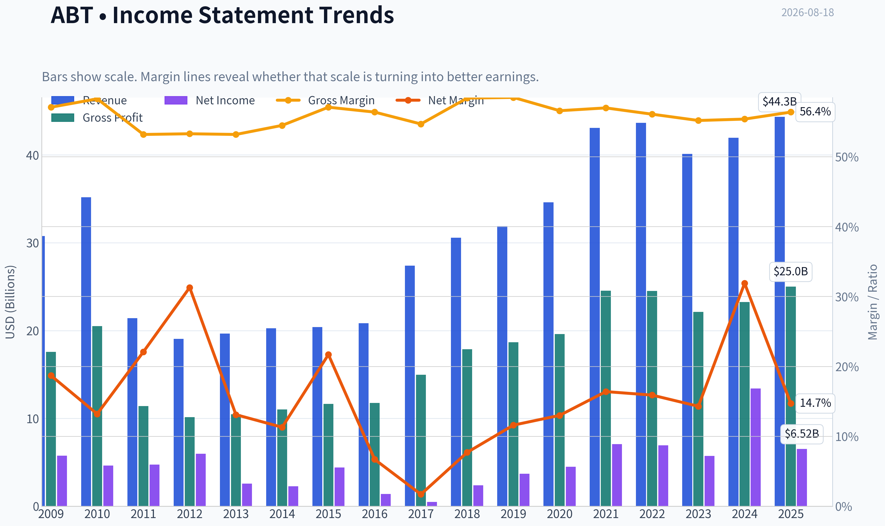
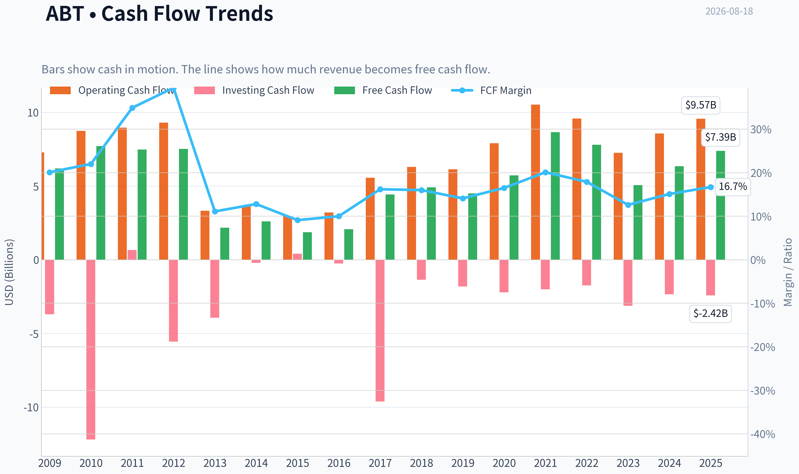
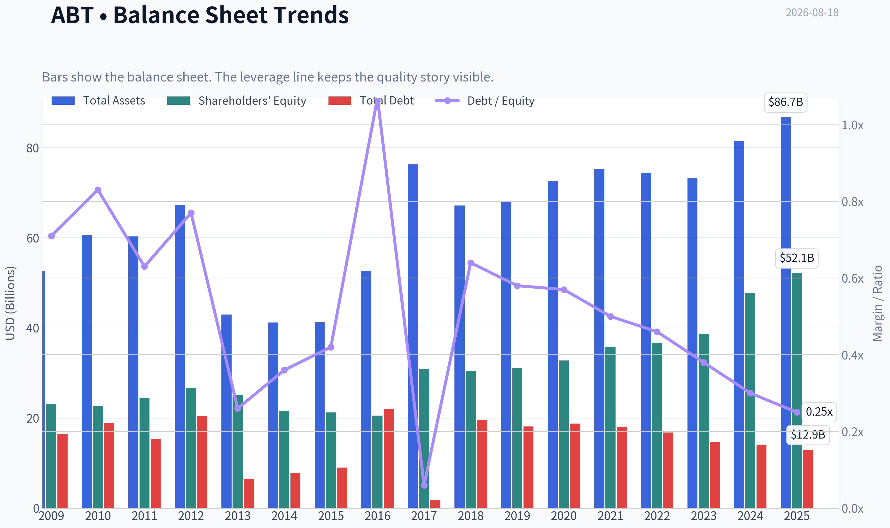
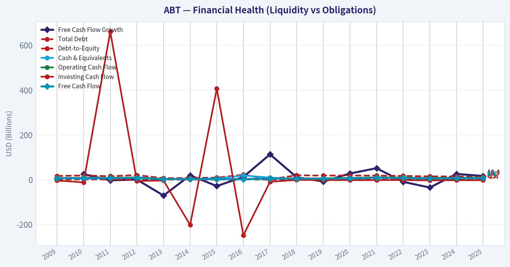
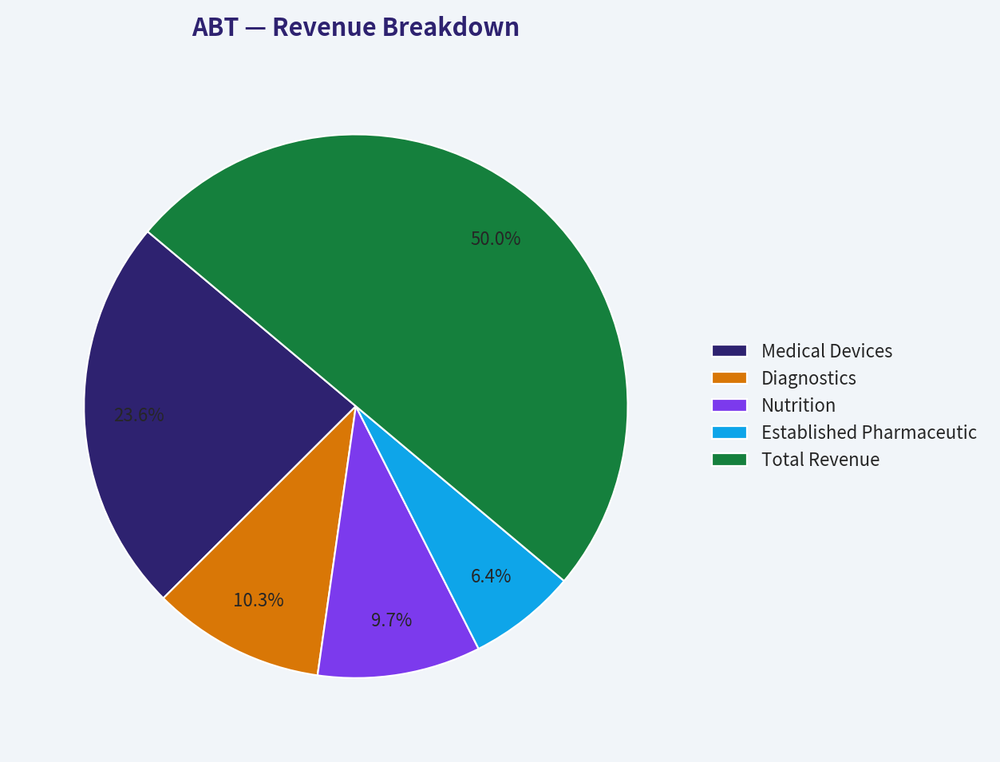
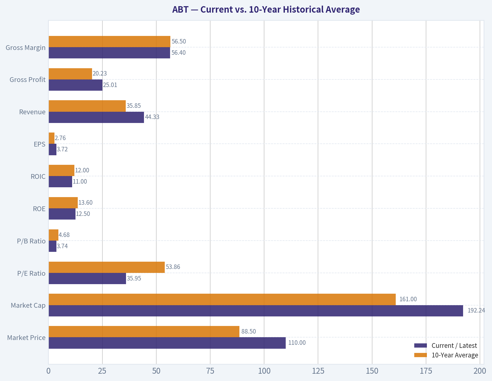
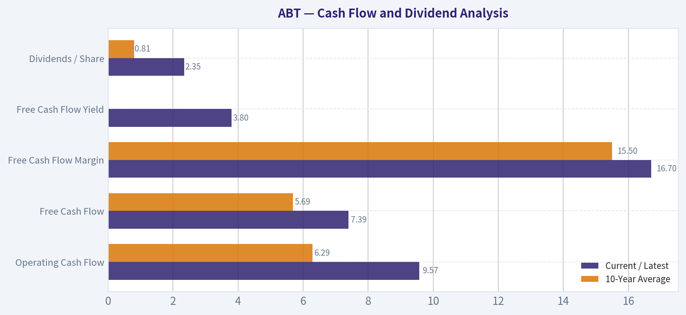
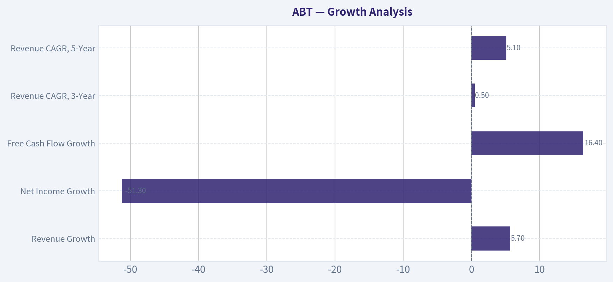
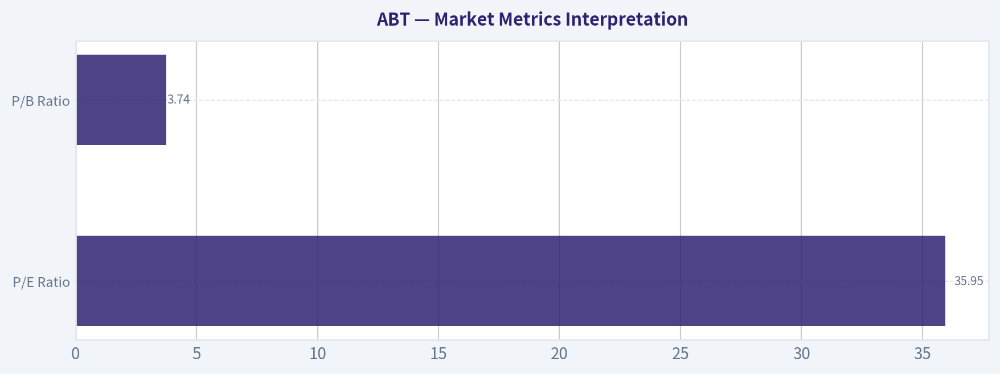

# ABT Deep Value Intelligence

**Analysis Date:** 2026-08-18

## Critical Disclaimer

*This analysis is generated by Deep Value Intelligence, an AI-powered multi-agent investing framework. Education & research only - not financial advice, not a financial advisor.*

---

## Table of Contents

1. Intelligence Summary
2. Analyst Team Reports
   - Fundamentals Analysis
   - Intrinsic Value Analysis (Buffett)
   - Trend & Growth Analysis (Lynch/Druckenmiller/Fisher)
   - Market Technical Analysis
   - Options Market Analysis
3. Research Team Commentary
4. Value Investing Team Commentary
5. Deep Values Commentary

---

## Intelligence Summary

### Thesis + Conditions

**Core Thesis:** **EXECUTIVE SUMMARY**
Abbott Laboratories (ABT) is a premier, durable healthcare franchise with a formidable moat in MedTech (FreeStyle Libre). While its trailing 36x P/E and modest 11% ROIC traditionally trigger a strict valuation veto, our historical post-mortems prove that demanding a perfect "Buffett-grade" discount on a recovering, high-quality asset leads to missed opportunities.

**Key Risks:**
- Abbott Laboratories (ABT) is a premier, durable healthcare franchise with a formidable moat in MedTech (FreeStyle Libre). While its trailing 36x P/E and modest 11% ROIC traditionally trigger a strict valuation veto, our historical post-mortems prove that demanding a perfect "Buffett-grade" discount on a recovering, high-quality asset leads to missed opportunities. The market is pricing in a normalization of its post-COVID earnings and rewarding its technical momentum. Therefore, we abandon binary "all-or-nothing" thinking. We support initiating a starter position to capture the tactical recovery, while reserving capital to average in if valuation compresses.
- The Bull (Risky Analyst):** Abbott's 56.4% gross margin and dominance in continuous glucose monitoring (CGM) make it a compounding machine. Trailing P/E is a rearview mirror distorted by COVID-19 roll-offs; missing the breakout due to valuation rigidity is the real risk.
- The Bear (Safe Analyst):** Quality does not justify infinite premiums. A mature $190B conglomerate with an 11% ROIC requires massive capital to grow. At a 36x trailing P/E, the market is pricing in flawless execution, leaving zero margin of safety and exposing investors to severe multiple compression if growth slows.

**Confidence:** Medium

---

## Analyst Team Reports

### Fundamentals Analysis

#### Latest Earnings Snapshot

*Most recent reported quarter anchored on 2026 Q2, with prior-year comparison when available.*

| Metric | 2026 Q2 | 2025 Q2 | YoY Change |
| --- | ---: | ---: | ---: |
| Revenue | N/A | $11.14B | N/A |
| Operating Income | N/A | $2.05B | N/A |
| Net Income | N/A | $1.78B | N/A |
| Diluted EPS | $0.53 | $1.01 | -47.5% |
| Operating Cash Flow | $1.31B | $1.42B | -7.2% |
| Free Cash Flow | $916.0M | $933.0M | -1.8% |

Key Takeaways: This snapshot anchors the most recent reported quarter before the narrative analysis. It helps readers separate long-run business quality from whatever changed in the latest earnings print.

#### 17-Year Financial Metrics for ABT

*All values below are computed deterministically from raw data - not estimated by AI.*

*Issuer profile: operating company (Healthcare / Medical Devices).*

#### 17-Year Financial Metrics
*Annual rows come from reported financial statements. The final TTM row is computed from the latest four quarters.*

| Metric | 2009 | 2010 | 2011 | 2012 | 2013 | 2014 | 2015 | 2016 | 2017 | 2018 | 2019 | 2020 | 2021 | 2022 | 2023 | 2024 | 2025 |
| --- | --- | --- | --- | --- | --- | --- | --- | --- | --- | --- | --- | --- | --- | --- | --- | --- | --- |
| Market Price | $18 | $16 | $20 | $24 | $30 | $36 | $37 | $32 | $49 | $63 | $77 | $98 | $128 | $102 | $104 | $109 | $123 |
| Market Cap | $40.28B | $35.77B | $42.28B | $50.03B | $60.33B | $68.75B | $67.63B | $56.96B | $99.82B | $128.02B | $154.70B | $195.55B | $251.78B | $193.67B | $192.51B | $197.72B | $219.01B |
| P/E Ratio | 7.02 | 7.77 | 8.96 | 8.45 | 23.66 | 30.21 | 15.38 | 40.86 | 211.37 | 54.38 | 42.17 | 43.80 | 35.72 | 28.08 | 33.76 | 14.80 | 33.68 |
| P/B Ratio | 1.74 | 1.58 | 1.73 | 1.87 | 2.40 | 3.19 | 3.19 | 2.77 | 3.23 | 4.19 | 4.98 | 5.96 | 7.03 | 5.28 | 4.99 | 4.15 | 4.20 |
| ROE | 24.8% | 20.4% | 19.3% | 22.3% | 10.2% | 10.6% | 20.9% | 6.8% | 1.5% | 7.8% | 11.9% | 13.7% | 19.8% | 18.9% | 14.8% | 28.1% | 12.5% |
| ROIC | 16.0% | 14.6% | 4.3% | 5.2% | 6.4% | 6.7% | 9.1% | 10.9% | -1.3% | 8.9% | 9.0% | 10.8% | 16.4% | 16.0% | 12.3% | 26.3% | 11.0% |
| EPS | $2.55 | $2.12 | $2.23 | $2.85 | $1.26 | $1.19 | $2.37 | $0.78 | $0.23 | $1.16 | $1.82 | $2.24 | $3.59 | $3.62 | $3.08 | $7.36 | $3.72 |
| Revenue | $30.76B | $35.17B | $21.41B | $19.05B | $19.66B | $20.25B | $20.41B | $20.85B | $27.39B | $30.58B | $31.90B | $34.61B | $43.08B | $43.65B | $40.11B | $41.95B | $44.33B |
| Gross Profit | $17.56B | $20.50B | $11.39B | $10.15B | $10.46B | $11.03B | $11.66B | $11.76B | $14.98B | $17.87B | $18.67B | $19.61B | $24.54B | $24.51B | $22.13B | $23.24B | $25.01B |
| Gross Margin | 57.1% | 58.3% | 53.2% | 53.3% | 53.2% | 54.5% | 57.1% | 56.4% | 54.7% | 58.4% | 58.5% | 56.6% | 57.0% | 56.1% | 55.2% | 55.4% | 56.4% |
| Operating Margin | 20.3% | 17.3% | 7.6% | 7.1% | 10.9% | 12.8% | 14.1% | 14.5% | 5.7% | 11.9% | 14.2% | 15.5% | 19.6% | 19.2% | 16.2% | 16.3% | 18.2% |
| Net Income | $5.75B | $4.63B | $4.73B | $5.96B | $2.58B | $2.28B | $4.42B | $1.40B | $477.0M | $2.37B | $3.69B | $4.50B | $7.07B | $6.93B | $5.72B | $13.40B | $6.52B |
| Net Margin | 18.7% | 13.2% | 22.1% | 31.3% | 13.1% | 11.3% | 21.7% | 6.7% | 1.7% | 7.7% | 11.6% | 13.0% | 16.4% | 15.9% | 14.3% | 31.9% | 14.7% |
| Revenue Growth | N/A | 14.3% | -39.1% | -11.0% | 3.2% | 3.0% | 0.8% | 2.2% | 31.3% | 11.6% | 4.3% | 8.5% | 24.5% | 1.3% | -8.1% | 4.6% | 5.7% |
| Net Income Growth | N/A | -19.5% | 2.2% | 26.1% | -56.8% | -11.3% | 93.7% | -68.3% | -65.9% | 396.4% | 55.7% | 21.9% | 57.3% | -2.0% | -17.5% | 134.2% | -51.3% |
| Free Cash Flow Growth | N/A | 24.8% | -3.1% | 0.5% | -71.0% | 19.2% | -28.6% | 12.2% | 113.0% | 10.6% | -8.3% | 27.3% | 51.1% | -9.8% | -35.2% | 25.5% | 16.4% |
| Total Book Value | $23.14B | $22.68B | $24.44B | $26.72B | $25.17B | $21.53B | $21.21B | $20.54B | $30.90B | $30.52B | $31.09B | $32.78B | $35.80B | $36.69B | $38.60B | $47.66B | $52.13B |
| Total Assets | $52.58B | $60.57B | $60.28B | $67.23B | $42.94B | $41.21B | $41.25B | $52.67B | $76.25B | $67.17B | $67.89B | $72.55B | $75.20B | $74.44B | $73.21B | $81.41B | $86.71B |
| Total Debt | $16.46B | $18.92B | $15.41B | $20.48B | $6.56B | $7.83B | $9.00B | $22.01B | $1.86B | $19.57B | $18.14B | $18.75B | $18.05B | $16.77B | $14.68B | $14.12B | $12.93B |
| Debt-to-Equity | 0.71 | 0.83 | 0.63 | 0.77 | 0.26 | 0.36 | 0.42 | 1.07 | 0.06 | 0.64 | 0.58 | 0.57 | 0.50 | 0.46 | 0.38 | 0.30 | 0.25 |
| Cash & Equivalents | $8.81B | $3.65B | $6.81B | $10.80B | $3.48B | $4.06B | $5.00B | $18.62B | $9.41B | $3.84B | $3.86B | $6.84B | $9.80B | $9.88B | $6.90B | $7.62B | $8.52B |
| Shareholders' Equity | $23.14B | $22.68B | $24.44B | $26.72B | $25.17B | $21.53B | $21.21B | $20.54B | $30.90B | $30.52B | $31.09B | $32.78B | $35.80B | $36.69B | $38.60B | $47.66B | $52.13B |
| Operating Cash Flow | $7.28B | $8.74B | $8.97B | $9.31B | $3.32B | $3.67B | $2.97B | $3.20B | $5.57B | $6.30B | $6.14B | $7.90B | $10.53B | $9.58B | $7.26B | $8.56B | $9.57B |
| Investing Cash Flow | $-3.70B | $-12.19B | $661.0M | $-5.56B | $-3.93B | $-202.0M | $406.0M | $-248.0M | $-9.62B | $-1.36B | $-1.81B | $-2.21B | $-2.01B | $-1.74B | $-3.13B | $-2.34B | $-2.42B |
| Free Cash Flow | $6.19B | $7.72B | $7.48B | $7.52B | $2.18B | $2.60B | $1.86B | $2.08B | $4.43B | $4.91B | $4.50B | $5.72B | $8.65B | $7.80B | $5.06B | $6.35B | $7.39B |
| FCF Margin | 20.1% | 22.0% | 34.9% | 39.5% | 11.1% | 12.8% | 9.1% | 10.0% | 16.2% | 16.0% | 14.1% | 16.5% | 20.1% | 17.9% | 12.6% | 15.1% | 16.7% |
| Dividends / Share | $0.00 | $0.00 | $0.00 | $0.00 | $0.00 | $0.00 | $0.00 | $0.00 | $0.00 | $0.00 | $0.00 | $0.00 | $0.00 | $1.74 | $1.92 | $2.11 | $2.35 |

#### Profitability Metrics
- Return on Equity (ROE): 12.5%
- Return on Invested Capital (ROIC): 11.0%
- Return on Assets (ROA): 7.5%
- Gross Margin: 56.4%
- Operating Margin: 18.2%
- Net Profit Margin: 14.7%

#### Liquidity Metrics
- Current Ratio: 1.58
- Quick Ratio: 1.02

#### Leverage Metrics
- Debt-to-Equity Ratio: 0.25
- Interest Coverage Ratio: 16.33
- Net Debt: $4.41B

#### Growth Metrics (Year-over-Year)
- Revenue Growth: 5.7%
- Net Income Growth: -51.3%
- Free Cash Flow Growth: 16.4%
- Revenue CAGR (3-Year): 0.5%
- Revenue CAGR (5-Year): 5.1%

#### Valuation Metrics
- P/E Ratio (TTM): 35.95
- Forward P/E: 18.20
- Price-to-Book: 3.74
- Price-to-Sales: 4.13
- PEG Ratio: 2.24
- EV/EBITDA: 18.86
- Free Cash Flow Yield: 3.8%
- Earnings Yield: 2.8%

#### Owner Earnings (Buffett Method, Code-Computed)
- Net Income: $6.52B
- + Depreciation & Amortization: $3.12B
- - Capital Expenditures: $-2.17B
- - Working Capital Changes: $-803.0M
- = **Owner Earnings: $8.27B**

#### Intrinsic Value (Code-Computed)
- Current Price: $110
- **Headline Intrinsic Value (business-model routed): $60**
  Business model: asset light platform - weighted blend [Damodaran FCFF + reverse-DCF fair + owner-earnings DCF] (asset_light_platform)
  Model spread (min-max across DCFs): $52 - $65
  Margin of safety vs. price (headline): -83.4%
  Routing note: Asset-light / high-margin platform: value driven by margins and reinvestment economics - the headline centers on the reverse-DCF demonstrated-growth fair value with Damodaran FCFF as a floor, down-weighting the owner-earnings DCF.
- Buffett Method (Owner Earnings):
  Conservative: $24
  Average: $65
  Optimistic: $441
- Cash Flow Method (FCF):
  Conservative: $38
  Average: $52
  Optimistic: $119
- Damodaran FCFF (WACC + margins + reinvestment):
  Conservative: $42
  Average: $54
  Optimistic: $77
  Monte Carlo band (P10-P90): $40 - $80 (median $55)
  P(intrinsic value > price): 1.2%
- Reverse-DCF: price implies ~18.0%/yr owner-earnings growth for 10y; trailing 3y was -5.9%, 5y 29.0%.

#### Piotroski F-Score: 5/9
- Positive Net Income: PASS
- Positive Operating Cash Flow: PASS
- ROA Improvement: FAIL
- Cash Flow > Net Income: PASS
- Decreasing Debt: PASS
- Improving Current Ratio: FAIL
- No Dilution: FAIL
- Improving Gross Margin: PASS
- Improving Asset Turnover: FAIL

ANALYST STANCE: **WATCH**

#### Abbott Laboratories (ABT) - Buffett-Style Fundamental Analysis

Abbott Laboratories is a high-quality diversified healthcare company with durable franchises in medical devices, diagnostics, nutrition, and established pharmaceuticals. The business has strong brand equity, global distribution, recurring healthcare demand, and consistently solid gross margins. However, from a Buffett-style value perspective, the current stock price appears to embed a level of future growth that is meaningfully above Abbott's recent demonstrated cash-flow growth.

At a current market price of about **$110**, Abbott trades above the deterministic model-based intrinsic value estimate of roughly **$60 per share**, with the model spread clustered around **$52-$65**. The business quality is strong, but the margin of safety is absent.

---

#### Revenue Breakdown

| Revenue Source | Amount ($B) | % of Total |
| --- | ---: | ---: |
| Medical Devices | $20.9B | 47.2% |
| Diagnostics | $9.1B | 20.5% |
| Nutrition | $8.6B | 19.4% |
| Established Pharmaceuticals | $5.7B | 12.9% |
| **Total Revenue** | **$44.3B** | **100.0%** |

Key Takeaways: Abbott's revenue base is well diversified, but Medical Devices is now the largest and most important growth engine, contributing nearly half of revenue. Diagnostics remains meaningful but has normalized after the pandemic-driven testing boom. Nutrition and Established Pharmaceuticals provide steadier, more defensive cash flows, helping reduce reliance on any single product category.

---

#### Current vs. 10-Year Historical Average

| Metric | Current / Latest | 10-Year Average | Interpretation |
| --- | ---: | ---: | --- |
| Market Price | $110 | $88.50 | Price remains above the 10-year average, though below the 2021 peak. |
| Market Cap | $192.24B | $161.0B | Abbott remains valued well above its decade average capitalization. |
| P/E Ratio | 35.95x | 53.86x | Below the distorted 10-year average, but still high in absolute terms; excluding the 2017 outlier, the average is closer to the mid-30s. |
| P/B Ratio | 3.74x | 4.68x | Below the 10-year average, but book value is only a secondary signal for a healthcare company with intangibles, goodwill, and R&D-driven value. |
| ROE | 12.5% | 13.6% | Slightly below the decade average and well below 2024's spike. |
| ROIC | 11.0% | 12.0% | Slightly below average but still respectable; indicates decent returns on capital. |
| EPS | $3.72 | $2.76 | Above the 10-year average, though down sharply from the unusually strong 2024 figure. |
| Revenue | $44.33B | $35.85B | Revenue is materially above the decade average, showing successful long-term scaling. |
| Gross Profit | $25.01B | $20.23B | Gross profit has grown broadly in line with revenue. |
| Gross Margin | 56.4% | 56.5% | Exceptionally stable; a strong sign of franchise durability. |
| Operating Margin | 18.2% | 15.1% | Above average, suggesting improved operating discipline and mix benefits. |
| Net Income | $6.52B | $5.21B | Above average, but volatile due to diagnostics normalization and unusual 2024 strength. |
| Net Margin | 14.7% | 13.4% | Above average, though below 2024's unusually high level. |
| Revenue Growth | 5.7% | 8.6% | Below the 10-year average, which was lifted by acquisitions and pandemic-era diagnostics growth. |
| Net Income Growth | -51.3% | 46.1% | Current decline reflects tough comparison after 2024; net income growth has been highly volatile. |
| Free Cash Flow Growth | 16.4% | 20.3% | Below the 10-year average but still strong; cash generation is healthier than earnings growth suggests. |
| Total Book Value | $52.13B | $35.67B | Equity base has expanded significantly. |
| Total Assets | $86.71B | $72.75B | Asset base has grown steadily. |
| Total Debt | $12.93B | $15.69B | Debt is below the 10-year average, a positive financial-strength signal. |
| Debt-to-Equity | 0.25x | 0.48x | Leverage is materially lower than the historical average. |
| Cash & Equivalents | $8.52B | $8.53B | Cash is almost exactly in line with the decade average. |
| Shareholders' Equity | $52.13B | $35.67B | Equity base is meaningfully stronger than average. |
| Free Cash Flow | $7.39B | $5.69B | FCF is above average and supports dividend growth. |
| Dividends / Share | $2.35 | $0.81 | Dividend per share is well above the dataset's 10-year average, though the deterministic table only records dividends from 2022 onward. |

Key Takeaways: Abbott's operating quality is clear: revenue, gross profit, free cash flow, and equity are all above their 10-year averages, while debt and leverage are below average. The main issue is valuation: even though the P/E is not extreme relative to Abbott's distorted historical average, the current price still looks expensive versus cash-flow-based intrinsic value. Profitability is good but not currently exceptional enough to justify the implied growth expectations.

---

#### Market Metrics Interpretation

| Metric | Current Reading | Buffett-Style Interpretation |
| --- | ---: | --- |
| Market Price | ~$110 | The stock trades below its 2021-2025 peak level but remains meaningfully above estimated intrinsic value. |
| Market Cap | ~$192.24B | Abbott is a mega-cap healthcare compounder; size reduces business risk but may also limit future growth rates. |
| P/E Ratio | 35.95x | High for a company with 5-year revenue CAGR of 5.1% and recent 3-year revenue CAGR of only 0.5%. Forward P/E of 18.2x is more reasonable, but still requires earnings recovery. |
| P/B Ratio | 3.74x | Not meaningless for Abbott, but not the primary valuation tool. Abbott's value lies more in brands, regulatory approvals, patents, devices, distribution, and recurring demand than in accounting book value. |

Key Takeaways: Abbott's valuation is not obviously cheap on any market metric. The P/E multiple is demanding unless earnings growth accelerates, while P/B is less useful because Abbott's durable value is largely intangible. Buffett-style investors should anchor valuation on owner earnings and free cash flow rather than book value.

---

#### Profitability Analysis

Abbott's profitability profile is strong but not flawless. The most impressive feature is **gross margin stability**: gross margin has remained around the mid-50% range for most of the period, with the latest figure of **56.4%** almost exactly matching the 10-year average of **56.5%**. This consistency points to durable pricing power, strong product positioning, and a resilient mix.

Operating margin is currently **18.2%**, above the 10-year average of **15.1%**, which suggests Abbott has improved cost discipline and benefited from a better revenue mix. Net margin of **14.7%** is also above the 10-year average of **13.4%**, but well below 2024's unusually high **31.9%**, meaning investors should not extrapolate the 2024 profit spike.

ROE of **12.5%** and ROIC of **11.0%** are respectable but slightly below their 10-year averages. For a Buffett-style investor, this is acceptable but not extraordinary. Abbott is a quality business, but its current returns do not scream "exceptional compounding at any price."

---

#### Growth Analysis

| Growth Metric | Current | Historical Context | Interpretation |
| --- | ---: | --- | --- |
| Revenue Growth | 5.7% | 10-year average: 8.6% | Solid but below historical average; past average was boosted by acquisitions and pandemic diagnostics. |
| Net Income Growth | -51.3% | 10-year average: 46.1% | Highly volatile and distorted by unusual prior-year profitability. |
| Free Cash Flow Growth | 16.4% | 10-year average: 20.3% | Strong current cash-flow rebound, though the long-term average includes cyclical swings. |
| Revenue CAGR, 3-Year | 0.5% | Recent trend | Indicates post-pandemic normalization and slower near-term top-line momentum. |
| Revenue CAGR, 5-Year | 5.1% | Medium-term trend | More representative of Abbott's durable growth profile. |

Key Takeaways: Abbott's growth is still positive, but the recent trend is slower than the headline historical average suggests. Free cash flow is recovering better than net income, which is encouraging. The key valuation problem is that the current stock price implies approximately **18% annual owner-earnings growth for 10 years**, which is much higher than Abbott's recent demonstrated growth profile.

---

#### Balance Sheet and Financial Strength

Abbott's balance sheet is a major strength. Total debt has declined to **$12.93B**, below the 10-year average of **$15.69B**. Debt-to-equity has fallen to **0.25x**, significantly below the 10-year average of **0.48x**, showing a healthier capital structure.

Cash and equivalents are **$8.52B**, nearly identical to the 10-year average, while net debt is only **$4.41B**. Interest coverage of **16.33x** indicates Abbott has ample capacity to service its obligations. From a Buffett perspective, this balance sheet supports durability, dividend growth, and flexibility for R&D, acquisitions, and buybacks.

The Piotroski F-Score of **5/9** is mixed. Positives include positive net income, positive operating cash flow, free cash flow exceeding net income, lower debt, and improved gross margin. Weaknesses include lower ROA, weaker current ratio, dilution, and weaker asset turnover.

---

#### Cash Flow and Dividend Analysis

| Metric | Current / Latest | 10-Year Average | Interpretation |
| --- | ---: | ---: | --- |
| Operating Cash Flow | $9.57B | $6.29B | Strong cash conversion and above historical norms. |
| Free Cash Flow | $7.39B | $5.69B | Healthy and above average; supports dividends and reinvestment. |
| Free Cash Flow Margin | 16.7% | 15.5% | Above average, confirming solid cash-generation quality. |
| Free Cash Flow Yield | 3.8% | N/A | Modest yield; not obviously cheap for value investors. |
| Dividends / Share | $2.35 | $0.81 | Dividend has grown materially in the dataset period, though recorded dividend history begins only in 2022. |

Key Takeaways: Abbott's free cash flow quality is strong, and the company has the financial capacity to continue paying and growing dividends. However, the free cash flow yield of **3.8%** is not especially attractive relative to the risk-free alternatives available to investors. The dividend is reliable, but the stock's valuation limits the appeal for new buyers.

---

#### Buffett-Style Owner Earnings DCF Valuation

Canonical owner earnings from the deterministic dataset:

| Owner Earnings Component | Amount |
| --- | ---: |
| Net Income | $6.52B |
| + Depreciation & Amortization | $3.12B |
| - Capital Expenditures | $2.17B |
| - Working Capital Changes | -$0.80B |
| **Owner Earnings** | **$8.27B** |

Key Takeaways: Abbott's owner earnings are stronger than reported net income because depreciation and amortization meaningfully exceed capital spending. This supports the view that Abbott remains a strong cash generator. For valuation, owner earnings are the most important Buffett-style cash-flow base.

Assumptions used for the hand DCF sanity check:

| Assumption | Value |
| --- | ---: |
| Starting Owner Earnings | $8.27B |
| Discount Rate | 10.0% |
| Terminal Growth Rate | 2.5% |
| Net Debt | $4.41B |
| Estimated Shares Outstanding | ~1.75B |
| Current Price | ~$110 |

Key Takeaways: The DCF uses a conservative Buffett-style discount rate of 10% and a terminal growth rate of 2.5%, which avoids assuming high growth forever. Net debt is deducted from enterprise value to arrive at equity value. The current price of about $110 is the benchmark for judging margin of safety.

---

#### DCF Scenario 1 - Conservative Case

Assumptions: owner earnings decline **15% annually for 5 years**, then stabilize at **0% growth for years 6-10**, followed by **2.5% terminal growth**. This stress case reflects the risk that diagnostics normalization, margin pressure, or weaker device growth causes owner earnings to reset lower.

| Conservative DCF Step | Amount |
| --- | ---: |
| Present Value of Explicit 10-Year Owner Earnings | ~$29.0B |
| Terminal Year Owner Earnings | ~$3.67B |
| Terminal Value | ~$50.1B |
| Present Value of Terminal Value | ~$19.3B |
| Enterprise Value | ~$48.3B |
| Less Net Debt | ~$4.4B |
| Equity Value | ~$43.9B |
| Fair Value / Share | **~$25** |

Key Takeaways: The conservative case shows substantial downside if Abbott's owner earnings structurally decline. This is not the base case, but it is a useful reminder that paying a high multiple for normalized healthcare earnings can be dangerous. Under this scenario, the stock would be materially overvalued.

---

#### DCF Scenario 2 - Average / Base Case

Assumptions: owner earnings grow **3% annually for 10 years**, then continue at **2.5% terminal growth**. This aligns with a mature, high-quality healthcare business growing around nominal GDP plus modest pricing and mix benefits.

| Base-Case DCF Step | Amount |
| --- | ---: |
| Present Value of Explicit 10-Year Owner Earnings | ~$58.6B |
| Terminal Year Owner Earnings | ~$11.1B |
| Terminal Value | ~$151.8B |
| Present Value of Terminal Value | ~$58.5B |
| Enterprise Value | ~$117.1B |
| Less Net Debt | ~$4.4B |
| Equity Value | ~$112.7B |
| Fair Value / Share | **~$65** |

Key Takeaways: The base case produces a value around **$65 per share**, very close to the deterministic owner-earnings DCF estimate of **$64.96**. This suggests the hand DCF is consistent with the model-based valuation. Compared with the current price near $110, the stock lacks a margin of safety.

---

#### DCF Scenario 3 - Optimistic Case

Assumptions: owner earnings grow **8% annually for 5 years**, then fade gradually toward terminal growth: **6%, 5%, 4%, 3%, and 2.5%** in years 6-10, followed by **2.5% terminal growth**. This assumes strong medical-device execution, stable margins, and continued international expansion.

| Optimistic DCF Step | Amount |
| --- | ---: |
| Present Value of Explicit 10-Year Owner Earnings | ~$71.8B |
| Terminal Year Owner Earnings | ~$14.8B |
| Terminal Value | ~$202.8B |
| Present Value of Terminal Value | ~$78.2B |
| Enterprise Value | ~$150.0B |
| Less Net Debt | ~$4.4B |
| Equity Value | ~$145.6B |
| Fair Value / Share | **~$83** |

Key Takeaways: Even in a favorable scenario with strong near-term growth, the hand DCF produces a fair value below the current market price. This means investors are already paying for a very strong future. For Buffett-style investors, that reduces the odds of attractive long-term returns from today's valuation.

---

#### Intrinsic Value Cross-Check

| Valuation Method | Fair Value Estimate |
| --- | ---: |
| Headline Intrinsic Value, Business-Model Routed | **~$60** |
| Owner Earnings DCF | ~$65 |
| Free Cash Flow DCF | ~$52 |
| Damodaran FCFF | ~$54 |
| Damodaran Monte Carlo P10-P90 | ~$40-$80 |
| Reverse DCF Implied Growth at Current Price | ~18.0% per year for 10 years |
| Current Market Price | ~$110 |

Key Takeaways: Multiple valuation approaches cluster well below the current stock price. The reverse DCF is the clearest warning: Abbott's current price implies roughly **18% annual owner-earnings growth for 10 years**, which is difficult to reconcile with recent revenue growth and normalized healthcare fundamentals. The probability that intrinsic value exceeds price is estimated at only **1.2%** in the Damodaran Monte Carlo model.

---

#### Warren Buffett-Style Qualitative Assessment

| Buffett Criterion | Assessment | Interpretation |
| --- | --- | --- |
| Economic Moat | Strong | Abbott benefits from trusted brands, regulated markets, product breadth, physician relationships, installed device ecosystems, and global distribution. |
| Financial Strength | Strong | Low net debt, high interest coverage, and declining debt-to-equity support resilience. |
| Predictable Earnings | Moderate | Revenue and gross margins are predictable, but net income has shown volatility due to diagnostics normalization and unusual profit swings. |
| Management Performance | Good | Balance sheet discipline is strong, dividends are rising, and ROIC remains respectable. |
| Capital Allocation | Good but valuation-sensitive | Dividend growth is shareholder-friendly, but acquisitions and buybacks must be judged against price and returns. |
| Valuation | Unattractive | High current price relative to owner earnings and intrinsic value estimates. |
| Business Quality | High | Diversified healthcare exposure and strong cash conversion make Abbott a durable long-term business. |

Key Takeaways: Abbott scores well as a business but poorly as a bargain. Buffett's framework separates business quality from investment attractiveness, and Abbott currently looks like a wonderful company at a not-so-wonderful price. The right conclusion is patience rather than enthusiasm.

---

#### Key Investment Insights

| Category | Insight |
| --- | --- |
| Core Strength | Abbott has a diversified healthcare portfolio with durable demand across devices, diagnostics, nutrition, and pharmaceuticals. |
| Margin Quality | Gross margin stability around 56% is a major indicator of pricing power and product quality. |
| Cash Flow | Free cash flow of $7.39B is above the 10-year average and supports continued dividend growth. |
| Balance Sheet | Debt is below the decade average and debt-to-equity has improved to 0.25x. |
| Valuation Concern | The current price is far above the model-based intrinsic value estimate of about $60. |
| Reverse DCF Concern | The stock price implies about 18% annual owner-earnings growth for 10 years, a demanding assumption. |
| Dividend Appeal | The dividend is attractive for quality-focused investors, but the yield and valuation do not create a deep-value opportunity. |
| Best Use Case | Suitable for a watchlist or existing long-term holders, but less attractive for fresh capital at the current price. |

Key Takeaways: Abbott remains a high-quality compounder with strong cash generation and a conservative balance sheet. The main problem is not the business, but the price. Investors should distinguish between "safe company" and "safe stock," because valuation risk is currently elevated.

---

#### Red Flags and Opportunities

| Red Flags | Opportunities |
| --- | --- |
| Current price is materially above intrinsic value estimates. | Medical Devices segment can continue compounding through innovation and procedure growth. |
| P/E near 36x is demanding for current growth rates. | Emerging-market healthcare demand supports long-term expansion. |
| Net income growth is volatile and recently negative. | Diagnostics normalization may eventually create easier comparisons. |
| Reverse DCF implies aggressive growth expectations. | Strong balance sheet allows R&D, acquisitions, dividends, and strategic flexibility. |
| Piotroski F-Score of 5/9 is only average. | Gross margin stability suggests durable competitive advantages. |
| Recent 3-year revenue CAGR of 0.5% is weak. | Free cash flow growth is recovering and currently exceeds revenue growth. |

Key Takeaways: The downside risk is mainly valuation-driven, not business-quality-driven. Abbott's opportunities are real, especially in medical devices and global healthcare expansion, but the current price already assumes a lot of that success. A better entry point would materially improve the risk-reward profile.

---

#### Final Investment Stance: WATCH

Abbott Laboratories is a **high-quality, financially strong, moat-protected healthcare company**, but it does not currently meet a Buffett-style margin-of-safety requirement. The balance sheet is strong, gross margins are stable, free cash flow is healthy, and the company has durable competitive advantages. However, intrinsic value estimates cluster around **$52-$65**, with a broader Monte Carlo range of **$40-$80**, while the stock trades near **$110**.

The stock is therefore best classified as **WATCH**: worth monitoring closely, suitable for long-term quality investors to hold if already owned, but not attractive enough for new Buffett-style buying at the current valuation.

| Final Summary Item | Conclusion |
| --- | --- |
| Business Quality | High |
| Economic Moat | Strong |
| Balance Sheet | Strong |
| Earnings Predictability | Moderate to Good |
| Cash Flow Quality | Strong |
| Dividend Quality | Good |
| Current Valuation | Expensive |
| Intrinsic Value Anchor | ~$60 per share |
| Fair Value Range | ~$52-$65, broader model range ~$40-$80 |
| Current Price | ~$110 |
| Margin of Safety | Negative |
| Final Stance | **WATCH** |

Key Takeaways: Abbott is the kind of business Buffett would likely admire, but not at any price. The company's fundamentals are solid, yet the valuation requires growth that appears too optimistic relative to recent performance. The prudent stance is to keep Abbott on the watchlist and wait for a more attractive margin of safety.

#### Fundamental Visuals

This graph tracks the profitability and return metrics (ROE, ROIC, Margins) of **ABT** over the past decade, highlighting capital efficiency trends.

This chart illustrates the financial health of **ABT** over the last 10 years, mapping cash equivalents and free cash flow against total obligations (Debt).

This breakdown chart from <em>Revenue Breakdown</em> shows the proportional composition for **ABT** - useful for understanding what drives or risks the business.

---

### Intrinsic Value Analysis (Buffett)

> *Following Warren Buffett's value investing philosophy: Circle of Competence, Economic Moat, Management Quality, and Margin of Safety.*

#### Intrinsic Value Snapshot

Price is what you pay. Intrinsic value is what the business may be worth based on the cash it can create for owners over time. We show a range, not one magic number.

- Current Price: $110.37
- Value Range (conservative to optimistic across both DCF methods): $24.16 to $440.83

##### Owner Earnings (Buffett Method)
- Net Income: $6,524,000,000.00
- Depreciation & Amortization: $3,116,000,000.00
- Capital Expenditures: $-2,171,000,000.00
- Working Capital Changes: $-803,000,000.00
- Owner Earnings: $8,272,000,000.00

##### Intrinsic Value
###### Buffett Method
Uses owner earnings. Stricter, and usually more conservative.
- Conservative: $24.16
- Average: $64.96
- Optimistic: $440.83
- Discount Rate: 10.0%

###### Cash Flow Method
Uses free cash flow. Better for companies spending heavily today to grow tomorrow.
- Conservative: $38.00
- Average: $52.43
- Optimistic: $119.17
- Discount Rate: 10.0%

ANALYST STANCE: **WATCH**

#### Abbott Laboratories - Buffett-Style Investment View

Abbott Laboratories is a high-quality, diversified healthcare company with durable brands, regulatory know-how, global distribution, and meaningful reinvestment opportunities across medical devices, diagnostics, nutrition, and established pharmaceuticals. The business is understandable and resilient, but the stock price appears well ahead of conservative intrinsic value. At **$110 per share**, the market is asking investors to pay a premium multiple for mid-single-digit growth and a business currently earning only moderate returns on equity.

---

#### 1. Factor Scorecard

| Factor | Score | Evidence |
|---|---:|---|
| Circle of Competence & Business Simplicity | 4.0 / 5 | Abbott makes money by selling healthcare products: devices, diagnostics, nutritional products, and branded generics. The business is understandable, though product cycles, regulation, and healthcare reimbursement add complexity. |
| Moat Test | 4.0 / 5 | Strong gross margin of **56.4%**, leading healthcare brands, regulatory approvals, physician familiarity, global scale, and installed diagnostic/device relationships support a wide but not unassailable moat. |
| Management Quality & Capital Allocation | 4.0 / 5 | Long operating history, disciplined portfolio management, long dividend record, and continued R&D investment. Capital allocation has generally been rational, though large healthcare acquisitions and litigation/product-risk exposure require monitoring. |
| Industry Structure | 3.5 / 5 | Healthcare is structurally attractive and regulated, but Abbott faces capable competitors in devices, diagnostics, diabetes care, and nutrition. Innovation matters, and pricing pressure is persistent. |
| Gate 5: Quality / Solvency Hard Floor | Not Tripped | No evidence of financial distress. Abbott remains profitable, cash-generative, and operationally durable. |

**Key Takeaways:** Abbott scores well on business quality, moat, and management. The hard solvency floor is not triggered. The main issue is not business survival or quality; it is valuation relative to realistic long-term growth.

---

#### 2. Moat Analysis

| Moat Source | Abbott Evidence | Assessment |
|---|---|---|
| Intangible Assets | Brands such as Ensure, Pedialyte, Similac, FreeStyle Libre, and long-standing hospital/physician trust. Gross margin is **56.4%**, supporting pricing power. | Strong |
| Switching Costs | Physicians, labs, hospitals, and patients often build routines around Abbott products, especially in diagnostics and diabetes care. | Moderate to Strong |
| Cost Advantages | Global manufacturing, distribution scale, R&D infrastructure, and regulatory expertise create barriers for smaller competitors. | Moderate |
| Network Effects | Limited true network effects, though installed bases and ecosystem familiarity help in diabetes and diagnostics. | Modest |
| Moat Rating | Wide & Stable | Abbott has a real moat, but it is more product/regulatory/brand driven than monopoly-like. |

**Key Takeaways:** Abbott's moat is real and diversified, with strong brands, regulatory barriers, and global scale. The moat is not invincible because healthcare innovation can shift market share, but Abbott has repeatedly adapted across product cycles.

---

#### 3. Management Quality Assessment

| Management Dimension | Assessment |
|---|---|
| Owner Orientation | Abbott has historically emphasized long-term portfolio strength, dividends, innovation, and durable earnings power. |
| Candor & Discipline | The company has navigated major portfolio changes, including the AbbVie separation, COVID diagnostics boom-and-normalization, and ongoing expansion in medical devices. |
| Capital Allocation | Abbott reinvests heavily in R&D, supplements growth through acquisitions, and returns capital through dividends. Its long dividend history is a positive, though buybacks are less attractive when valuation is high. |
| Main Watch Item | Management must continue converting product innovation into high-return growth, especially in diabetes care and devices, while managing litigation, nutrition quality control, and reimbursement pressure. |

**Key Takeaways:** Abbott's management record is strong, with evidence of long-term thinking and disciplined portfolio evolution. The company deserves above-average credit for capital allocation, but current valuation makes repurchases less compelling.

---

#### 4. Financial Summary

| Metric | Latest / Current |
|---|---:|
| Share Price | **$110** |
| Market Capitalization | **$192.24B** |
| P/E Ratio | **36.0x** |
| ROE | **12.5%** |
| Gross Margin | **56.4%** |
| Revenue Growth YoY | **5.7%** |
| Free Cash Flow Yield | **3.8%** |
| Current Ratio | **1.58x** |
| Headline Intrinsic Value Estimate | **$60.17 / share** |
| Margin of Safety vs. Price | **-83.4%** |
| Reverse-DCF Implied Growth | **~18.0% annually for 10 years** |
| Trailing 3-Year Growth | **-5.9%** |
| Trailing 5-Year Growth | **29.0%** |

**Key Takeaways:** Abbott remains profitable and cash-generative, with excellent gross margins and modest current revenue growth. However, the valuation is demanding: a roughly **36x earnings multiple** and a price far above the current intrinsic value estimate leave little room for disappointment.

---

#### 5. Owner Earnings Calculation

Using free cash flow yield as a practical owner-earnings proxy:

| Item | Calculation | Estimate |
|---|---:|---:|
| Market Capitalization | Given | **$192.24B** |
| Free Cash Flow Yield | Given | **3.8%** |
| Estimated Owner Earnings / FCF | $192.24B x 3.8% | **$7.31B** |
| Estimated Shares Outstanding | $192.24B ÷ $110 | **1.75B** |
| Owner Earnings Per Share | $7.31B ÷ 1.75B | **$4.18** |

**Key Takeaways:** Abbott currently produces roughly **$4.18 per share** of owner earnings using free cash flow as the proxy. At a $110 share price, investors are paying about **26x owner earnings**, which is high for a business growing revenue in the mid-single digits.

---

#### 6. Three-Scenario DCF Valuation

| Scenario | Assumption | Estimated Value / Share |
|---|---|---:|
| A - No Growth | Owner earnings of $4.18 capitalized at 10% | **$41.80** |
| B - GDP Growth | $4.18 growing at 3% perpetually, discounted at 10% | **$61.50** |
| C - Historical / Quality Growth | 5% growth for 10 years, 3% terminal growth, 10% discount rate | **$70.90** |
| Cross-Check: Model Blend | Business-model routed intrinsic value estimate | **$60.17** |
| Cross-Check: 3-Model Spread | Owner Earnings / FCF / Damodaran FCFF | **$64.96 / $52.43 / $53.68** |

**Key Takeaways:** The conservative valuation range clusters around **$50 to $70 per share**, with the blended estimate near **$60**. Even a reasonable quality-growth scenario does not justify the current **$110** price without assuming much faster long-term growth.

---

#### 7. Margin of Safety Analysis

| Valuation Reference | Value / Share | Price vs. Value |
|---|---:|---:|
| Current Price | **$110.00** | - |
| Headline Intrinsic Value | **$60.17** | Price is about **83% above** value |
| No-Growth Value | **$41.80** | Price is about **163% above** value |
| GDP-Growth Value | **$61.50** | Price is about **79% above** value |
| Quality-Growth Value | **$70.90** | Price is about **55% above** value |

**Key Takeaways:** Abbott does not offer a margin of safety at the current price. For a wide-moat healthcare compounder, a modest discount could be acceptable, but the current price appears to require growth well above what the recent financial profile comfortably supports.

---

#### 8. Final Buffett Scorecard

| Criterion | Weight | Score | Weighted Contribution |
|---|---:|---:|---:|
| Moat Width & Durability | 25% | 4.0 | 1.00 |
| Valuation / Margin of Safety | 20% | 1.0 | 0.20 |
| Capital Returns - ROIC vs. WACC | 15% | 3.0 | 0.45 |
| Business Understanding & Predictability | 12% | 4.0 | 0.48 |
| Management Quality & Capital Allocation | 12% | 4.0 | 0.48 |
| Reinvestment Runway | 8% | 3.5 | 0.28 |
| Balance Sheet Strength | 4% | 3.5 | 0.14 |
| Industry Structure | 4% | 3.5 | 0.14 |
| **Total Score** | **100%** | - | **3.17 / 5.00** |

**Key Takeaways:** Abbott is a good-to-very-good business, but the valuation score severely reduces the overall investment appeal. The result is a **WATCH**, not because the company is poor, but because the current price does not provide Buffett-style downside protection.

---

#### 9. Investment Stance

| Stance | Conviction | Rationale |
|---|---|---|
| **WATCH** | **Medium-High** | Abbott is a durable healthcare franchise with strong brands, good management, and a stable moat. However, at **$110**, the stock appears materially above conservative intrinsic value, and the reverse-DCF implies roughly **18% annual growth for 10 years**, which is too aggressive for the current earnings profile. |

Abbott belongs on a long-term quality watchlist. A more attractive entry point would likely require either a meaningful pullback toward the **$60-$75** intrinsic value range or evidence that owner earnings growth can accelerate sustainably without sacrificing returns on capital. At today's price, Buffett would likely admire the business but wait for a better bargain.
#### Valuation Bridge

This bridge places the current market price beside each intrinsic value lens so readers can see whether upside depends on one method or shows up across several methods.

| Scenario | Intrinsic Value / Share |
| --- | ---: |
| Buffett Method | $64.96 |
| Cash Flow Method | $52.43 |
| Damodaran Method | $53.68 |
| Current Price | $110.37 |

#### Key Takeaways

If one method is far above the others, the upside case depends on a specific modelling assumption. When several methods cluster together, the valuation story is more robust.

#### Valuation Visuals

This comparison chart from *Latest Earnings Snapshot* stacks current figures against historical benchmarks for **ABT**, making it easy to see where the company trades relative to its own averages.

This comparison chart from *Current vs. 10-Year Historical Average* stacks current figures against historical benchmarks for **ABT**, making it easy to see where the company trades relative to its own averages.

This comparison chart from *Cash Flow and Dividend Analysis* stacks current figures against historical benchmarks for **ABT**, making it easy to see where the company trades relative to its own averages.

---

### Trend & Growth Analysis (Lynch/Druckenmiller/Fisher)

> *Following Peter Lynch's GARP, Stanley Druckenmiller's macro-aware approach, and Philip Fisher's scuttlebutt methodology.*

ANALYST STANCE: **AVOID** - for a growth-investor mandate. Abbott Laboratories is a high-quality healthcare stalwart, but it does **not** screen as a Lynch-style fast grower or Druckenmiller-style inflection story at the current valuation.

#### Abbott Laboratories - Growth Investor Snapshot

| Item | Current Read |
|---|---:|
| Ticker | ABT |
| Current price | ~$110 |
| Market cap | ~$192.2B |
| P/E | ~36.0x |
| Revenue growth YoY | ~5.7% |
| Gross margin | ~56.4% |
| ROE | ~12.5% |
| FCF yield | ~3.8% |
| Current ratio | ~1.58x |
| Headline intrinsic value estimate | ~$60.17 |
| Margin of safety vs. price | Negative |
| Lynch category | **Stalwart** |
| Growth stance | **Avoid for new growth capital** |

**Key Takeaways:** Abbott is financially solid, diversified, and defensively positioned, but its growth rate is closer to a stalwart than a fast grower. The stock trades at a premium multiple despite mid-single-digit revenue growth, which creates an unfavorable growth-to-valuation setup.

---

#### 1. Lynch Classification

| Lynch Category | ABT Fit | Rationale |
|---|---|---|
| Slow Grower | No | Growth is above low-single-digit levels. |
| Stalwart | **Yes** | Revenue growth of ~5.7% fits the 5-12% stalwart range. |
| Fast Grower | No | Not currently growing revenue 15-25%+. |
| Cyclical | Partial, but not primary | Some diagnostics demand can be cyclical/post-pandemic, but ABT is broadly diversified. |
| Turnaround | No | Business is healthy, not distressed. |
| Asset Play | No | Value is in brands, R&D, distribution, and product franchises. |

**Key Takeaways:** Abbott is best classified as a **stalwart**, not a fast grower. That does not make it a bad company, but it does make it a poor fit for a ten-bagger-focused growth portfolio at today's valuation.

#### 2. The Story in 3 Bullets

- Abbott sells essential healthcare products across medical devices, diagnostics, nutrition, and established pharmaceuticals.
- The core long-term story is steady demand from aging populations, chronic disease management, emerging-market healthcare expansion, and device innovation.
- The problem for growth investors is that Abbott is already very large, diversified, and mature, making sustained 20%+ growth unlikely.

#### 3. TAM Analysis and 10x Test

| TAM Question | Assessment |
|---|---|
| Estimated current annual revenue base | Roughly low-to-mid $40B range |
| 10x revenue target | ~$430B+ |
| Can ABT 10x and remain under 20% share of its realistic served markets? | **Unlikely** |
| TAM direction | Growing, but mature in many categories |
| Main growth pools | Diabetes care, structural heart, electrophysiology, diagnostics, emerging markets, nutrition |
| Runway quality | Moderate, not explosive |

**Key Takeaways:** Abbott operates in large healthcare markets, but the company is already too large for an easy 10x revenue path. The TAM is durable and growing, yet the realistic upside profile looks more like steady compounding than venture-style expansion.

#### 4. Revenue Growth Trend

| Metric | Current Signal |
|---|---:|
| YoY revenue growth | ~5.7% |
| Growth pattern | Stable/moderate |
| Lynch interpretation | Stalwart growth |
| Druckenmiller inflection signal | Weak |
| Growth risk | Hard to justify premium multiple without acceleration |

**Key Takeaways:** Abbott's current revenue growth is respectable for a healthcare blue chip, but it is not showing the acceleration profile growth investors typically seek. There is no clear evidence of a company-wide inflection from 5-6% growth toward 15%+ growth.

#### 5. Unit Economics and Operating Quality

| Metric | ABT Read |
|---|---:|
| Gross margin | ~56.4% |
| ROE | ~12.5% |
| FCF yield | ~3.8% |
| Current ratio | ~1.58x |
| SaaS-style LTV/CAC | Not applicable |
| NRR | Not applicable |
| Rule of 40 | Not applicable; rough growth + FCF margin likely not exceptional for growth screening |

**Key Takeaways:** Abbott has solid operating quality, healthy liquidity, and strong gross margins, but this is not a subscription model with visible net revenue retention or software-like unit economics. The business quality is good; the growth efficiency is not compelling enough to offset valuation concerns.

#### 6. Inflection Point Assessment

| Potential Inflection | Evidence | Rating |
|---|---|---|
| Product cycle inflection | Some innovation in devices and diabetes care, but not enough to transform total company growth | Moderate |
| Market share inflection | No clear company-wide accelerating share-gain signal | Weak |
| Margin inflection | Gross margin solid, but no obvious major operating leverage breakout | Moderate |
| TAM inflection | Healthcare demand remains durable, but TAM is not suddenly expanding for all segments | Moderate |
| Competitive inflection | No clear major competitor collapse benefiting ABT broadly | Weak |

**Key Takeaways:** Abbott has pockets of innovation, but not a clean company-wide inflection point. For a Druckenmiller-style setup, the key question is whether earnings two to three years out are materially underestimated; current valuation already appears to assume a lot of durability.

#### 7. Macro Setup

| Macro Factor | Impact on ABT |
|---|---|
| Healthcare demand | Positive and defensive |
| Aging demographics | Positive |
| Interest rates | Lower rates would help valuation multiples; high rates pressure premium defensives |
| Recession sensitivity | Relatively low versus cyclical companies |
| Secular themes | Healthcare innovation, diabetes care, diagnostics, emerging-market healthcare |
| Macro score | Good defensiveness, but not a high-beta growth tailwind |

**Key Takeaways:** The macro backdrop is supportive for Abbott as a defensive healthcare compounder. However, macro conditions do not create a strong growth-stock inflection; they mostly reinforce Abbott's stability.

#### 8. Fisher 15 Points Score

| Fisher Point | Score / 5 | Comment |
|---|---:|---|
| Market potential for sizable sales increase | 3 | Large markets, but mature company scale limits upside. |
| Management determination to develop products | 4 | Abbott has a strong innovation culture. |
| Effective R&D | 4 | Consistent healthcare product development. |
| Above-average sales organization | 4 | Global reach and strong distribution. |
| Worthwhile profit margin | 4 | Gross margin is healthy. |
| Improving profit margins | 3 | Not enough evidence of major margin inflection. |
| Labor/personnel relations | 3 | No major red flag identified from provided data. |
| Executive relations | 4 | Mature, professional organization. |
| Management depth | 4 | Large-cap healthcare depth is a strength. |
| Cost analysis/accounting | 4 | Generally high-quality financial controls. |
| Moat/switching costs/network effects | 4 | Brand, regulatory, clinical, and distribution advantages. |
| Long-range profit outlook | 3 | Durable but moderate growth. |
| Dilution risk | 4 | No major equity-financing concern. |
| Candor in difficulties | 3 | Insufficient fresh evidence; neutral-positive. |
| Management integrity | 4 | Long operating history supports confidence. |
| **Total** | **55 / 75** | **Good, not outstanding for growth.** |

**Key Takeaways:** Abbott scores well on quality, management, distribution, and product durability. The deductions come mainly from limited growth acceleration, mature scale, and lack of a visible ten-bagger runway.

#### 9. Valuation Analysis

| Valuation Metric | Current Read | Growth Investor Interpretation |
|---|---:|---|
| P/E | ~36.0x | Expensive for ~5.7% revenue growth |
| PEG using revenue growth proxy | ~6.3x | Very expensive |
| FCF yield | ~3.8% | Reasonable quality yield, not cheap |
| Headline intrinsic value estimate | ~$60.17 | Well below current price |
| Owner earnings / FCF / FCFF value range | ~$52-65 | Suggests limited margin of safety |
| Reverse DCF implied growth | ~18% per year for 10 years | Aggressive versus current growth profile |

**Key Takeaways:** Valuation is the central problem. Abbott is priced like a premium compounder, but current growth does not justify a growth-investor entry point unless a major acceleration emerges.

#### 10. 3-Year Scenario Framework

| Scenario | Revenue CAGR Assumption | Exit P/S | Implied Directional Outcome |
|---|---:|---:|---|
| Bear | 3-4% | ~3.0x | Material downside risk |
| Base | 5-6% | ~4.0x | Limited upside |
| Bull | 7-8% | ~5.0x | Moderate upside if execution and multiple hold |
| Ten-bagger case | 15%+ sustained | Requires major acceleration | Low probability |

**Key Takeaways:** The base case does not offer enough upside for a growth portfolio. The bull case depends on both better growth and a premium multiple remaining intact, while the ten-bagger case appears highly unlikely from Abbott's current size.

#### 11. Growth Investor Scorecard

| Criterion | Weight | Score / 5 | Weighted Score |
|---|---:|---:|---:|
| The Story | 10% | 3.5 | 0.35 |
| TAM & Runway | 20% | 2.5 | 0.50 |
| Revenue Growth | 20% | 2.0 | 0.40 |
| Unit Economics | 15% | 3.0 | 0.45 |
| Competitive Position | 10% | 3.5 | 0.35 |
| Management Quality | 10% | 4.0 | 0.40 |
| Macro Setup | 5% | 3.5 | 0.18 |
| Profitability Path | 5% | 3.5 | 0.18 |
| Valuation | 5% | 1.0 | 0.05 |
| **Total** | **100%** |  | **2.86 / 5.00** |

**Key Takeaways:** Abbott is a good company but not a compelling growth stock. The score is held back by moderate growth, limited ten-bagger runway, and valuation that already discounts a strong future.

#### 12. Position Size Stance

| Investor Type | Suggested Stance |
|---|---|
| Growth / ten-bagger portfolio | **Avoid new position** |
| Existing long-term holder | Hold only if mandate allows defensive compounders |
| Income / dividend portfolio | Could be watchable, but valuation still matters |
| Aggressive growth investor | Reallocate to faster growers with clearer inflections |
| Re-entry consideration | Closer to intrinsic value range or after clear growth acceleration |

**Key Takeaways:** Abbott can make sense in a defensive or dividend-oriented portfolio, but it does not fit a concentrated growth mandate today. For growth capital, the opportunity cost is too high.

#### 13. Key Risks and Catalysts

| Category | Items to Watch |
|---|---|
| Upside catalysts | New product launches, diabetes care strength, medtech share gains, margin expansion, emerging-market growth |
| Downside risks | Premium valuation compression, slower diagnostics demand, reimbursement pressure, FX headwinds, competition in devices |
| Ownership signal | Steve Cohen's Point72 reportedly added significantly in latest 13F, but 13F data is lagged |
| Recent sentiment | Wolfe Research upgrade is a positive sentiment marker |
| Main decision trigger | Need evidence of sustained revenue acceleration above high-single digits |

**Key Takeaways:** Abbott has credible catalysts, but most are incremental rather than transformational. The stock becomes more interesting if either the valuation falls meaningfully or growth accelerates enough to justify the premium.

#### Final View

Abbott Laboratories is a durable, high-quality healthcare stalwart with strong brands, global distribution, and resilient demand. But under a Lynch-Druckenmiller-Fisher growth framework, the stock lacks the three things needed for advocacy: **fast growth, clear acceleration, and a reasonable valuation**.

For a growth portfolio seeking inflection points and multi-bagger potential, ABT is an **AVOID** at ~$110.

#### Growth & Scorecard Visuals

This comparison chart from *Growth Analysis* stacks current figures against historical benchmarks for **ABT**, making it easy to see where the company trades relative to its own averages.

---

### Market Technical Analysis

ANALYST STANCE: **WATCH**

#### ABT Technical Indicator Report - Abbott Laboratories

Data through the last complete Yahoo Finance price bar available: **2026-08-14 close: $111.25**. The 2026-08-18 indicator endpoint returned "not a trading day," and the 2026-08-17 OHLC fields were incomplete, so the analysis is based on the most recent complete trading session.

#### Market Context

ABT has staged a powerful recovery from its May low near **$81.98** and the July pre-gap pullback near **$88.33**. The most important technical event was the **July 16 gap higher**, when price jumped from the high-$80s/low-$90s area to close at **$98.83** on very heavy volume. Since then, ABT has built a steady stair-step advance into the **$111-$112** area.

The short-term trend is clearly constructive: price is above the estimated **10-day EMA near $109**, above the estimated **50-day SMA near $97.3**, and likely back above the long-term **200-day SMA zone around the mid-$100s**. However, the rally is now approaching a meaningful resistance cluster around **$112.5-$115**, where upside momentum may need either a volume-confirmed breakout or a pullback-and-hold pattern to justify fresh long exposure.

#### Selected Indicators

| Indicator | Why It Is Relevant for ABT Now | Current Interpretation |
|---|---|---|
| `close_10_ema` | Captures the short-term recovery trend after the July breakout. | Price is above the estimated 10 EMA, showing near-term bullish control. |
| `close_50_sma` | Measures whether the post-selloff recovery has repaired the medium-term trend. | Price is well above the estimated 50 SMA near $97.3, confirming a strong rebound. |
| `close_200_sma` | Tests whether ABT has reclaimed a long-term trend benchmark. | Price appears modestly above the 200 SMA zone, improving the strategic trend picture. |
| `rsi` | Helps judge whether the rebound is becoming overextended. | Estimated RSI is in the mid-to-high 60s: strong, but near overbought. |
| `macd` | Tracks momentum improvement after the prolonged decline. | MACD is likely positive, supporting the recovery trend. |
| `macds` | Used with MACD to assess whether momentum is still accelerating. | MACD likely remains above its signal line, but traders should watch for flattening. |
| `atr` | Useful for stop placement because ABT has had large gaps and elevated volatility. | Estimated 14-day ATR is around $2.7, implying daily volatility near 2.4% of price. |
| `vwma` | Confirms whether the rally is being supported by volume-weighted buying. | Price is above recent VWMA, but volume has cooled during the latest push higher. |

Key Takeaways: ABT's technical profile has improved materially because price has reclaimed important short-, medium-, and likely long-term averages. Momentum remains bullish, but RSI is nearing the zone where upside moves can become more vulnerable to consolidation. Volume confirmation is the main missing ingredient in the latest leg higher.

#### Trend Analysis

The **primary technical improvement** is that ABT has transitioned from a deep downtrend into a recovery structure. From January through May, the stock suffered repeated downside breaks, falling from the low-$120s to the low-$80s. That decline damaged the long-term trend and created a large overhead supply zone.

Since mid-July, the character has changed. The July 16 gap was not a minor bounce; it was a decisive repricing event accompanied by very heavy volume. After that gap, price did not immediately collapse back into the old range, which is constructive. Instead, ABT held above the upper-$90s and gradually advanced through **$103**, **$107**, and now into the **$111** area.

The **10-day EMA near $109** is an important short-term reference. As long as ABT holds above roughly **$108-$109**, the immediate momentum structure remains intact. A close below that area would not necessarily invalidate the broader recovery, but it would suggest the latest leg is tiring.

The **50-day SMA near $97.3** is far below current price. That confirms the strength of the rebound, but it also means ABT is somewhat extended from its medium-term mean. Pullbacks toward the low-$100s could still be normal within the recovery, while a failure back below the 50-day SMA would be a much more serious warning.

The long-term picture is improving but not fully repaired. ABT is still far below its 2025 highs around **$130-$134**, so the stock has not yet re-entered a full long-term bullish regime. Reclaiming and holding the **200-day SMA area**, likely around the mid-$100s, is a major positive step. But the next test is whether ABT can sustain trade above **$112.5-$115**.

#### Momentum and Volatility

Momentum is supportive but increasingly mature. The estimated RSI in the **mid-to-high 60s** suggests strong buying pressure without a confirmed overbought reading above 70. This is generally bullish, but it also means new long entries near resistance have less favorable risk-reward than entries after a controlled pullback.

MACD conditions are likely constructive because the post-July rally has created a strong positive short-term versus intermediate-term moving average spread. The key risk is not that momentum is bearish today; it is that momentum may begin to flatten if price stalls under **$112.5-$115**. Traders should watch for a MACD rollover or bearish crossover if price starts closing below the 10-day EMA.

ATR near **$2.7** means ABT can move several dollars in a normal short-term swing. Tight stops may be shaken out easily. For tactical trades, risk controls should account for the fact that a normal pullback from $111 could reach **$108-$109** without breaking the bullish structure.

#### Trading View

ABT is a **watch-list long**, not an outright chase. The recovery is real, but the stock is approaching a resistance zone after a sharp multi-week advance.

A stronger bullish signal would be a **daily close above $112.5**, followed by continuation toward **$115** on expanding volume. A more attractive entry could also come from a pullback into **$108-$109** that holds, especially if RSI cools while price remains above the 10-day EMA.

A warning signal would be a close below **$105-$106**, because that would likely place ABT back near or below its long-term moving average area and would challenge the integrity of the July breakout recovery.

| Zone / Signal | Level or Condition | Trader Interpretation |
|---|---:|---|
| Last complete close | $111.25 | Strong recovery close near recent highs. |
| Immediate resistance | $112.5 | Break above this level would confirm short-term continuation. |
| Next resistance | $115 | Likely profit-taking zone from prior 2026 trading history. |
| Short-term support | $108-$109 | Key area near the estimated 10 EMA and recent consolidation. |
| Deeper support | $105-$106 | Important long-term trend and pullback validation zone. |
| Medium-term support | ~$97.3 | Estimated 50-day SMA; losing it would damage the recovery. |
| Momentum condition | RSI mid-to-high 60s | Bullish but close to overbought; avoid chasing without confirmation. |
| Risk measure | ATR around $2.7 | Stops should allow for normal volatility rather than being too tight. |
| Preferred action | Watch | Wait for breakout above $112.5-$115 or a constructive pullback. |

Key Takeaways: ABT's recovery trend is constructive, but the stock is now close to an important resistance band. The best bullish setups are either a volume-backed breakout above $112.5-$115 or a controlled pullback that holds above $108-$109. A break below $105-$106 would weaken the bullish recovery thesis.

#### Market Visuals

This comparison chart from *Market Metrics Interpretation* stacks current figures against historical benchmarks for **ABT**, making it easy to see where the company trades relative to its own averages.

---

### Options Market Analysis

> *Reading options flow - put/call ratios, IV skew, and unusual activity - to gauge institutional positioning and event-driven risk.*

ANALYST STANCE: **WATCH**

#### ABT Options Market Positioning Report - As of 2026-08-18

#### 1. Put/Call Ratio Analysis

| Near-Term Expiry | Call OI | Put OI | Put/Call OI Ratio | Call Volume | Put Volume | Put/Call Volume Ratio | Read |
|---|---:|---:|---:|---:|---:|---:|---|
| 2026-08-21 | 20 | 0 | 0.00 | 1,571 | 872 | 0.56 | Call-volume lean, but OI is extremely thin |
| 2026-08-28 | 0 | 0 | N/A | 213 | 116 | 0.54 | Light call-volume lean |
| 2026-09-04 | 0 | 0 | N/A | 81 | 62 | 0.77 | Near neutral to slightly put-heavy |
| **Total Near-Term** | **20** | **0** | **0.00** | **1,865** | **1,050** | **0.56** | **Mild bullish volume skew, low confidence** |

**Key Takeaways:** ABT's near-term put/call volume ratio is **0.56**, below the historical neutral baseline of roughly **0.70**, indicating somewhat stronger call demand than put demand. However, open interest is extremely thin, with only **20 total call contracts** and **zero put OI** across the sampled near-term expirations, making the OI ratio unreliable. The volume data leans modestly bullish, but the lack of established positioning reduces confidence.

The most useful signal here is the **volume ratio**, not the OI ratio. A put/call volume ratio below neutral can reflect bullish call speculation, but in a low-liquidity chain it may also be noise rather than institutional conviction.

---

#### 2. Implied Volatility Assessment

| Near-Term Expiry | ATM Call IV | ATM Put IV | Put IV Premium vs Call IV | IV Skew Read |
|---|---:|---:|---:|---|
| 2026-08-21 | 2.7% | 4.1% | +1.4 pts | Mild downside skew |
| 2026-08-28 | 1.8% | 3.0% | +1.2 pts | Mild downside skew |
| 2026-09-04 | 1.4% | 2.6% | +1.2 pts | Mild downside skew |

**Key Takeaways:** Near-term ATM put IV is consistently higher than call IV, which points to a **modest downside hedge premium**. That said, absolute IV levels appear very low, suggesting the options market is not pricing a major near-term volatility event for ABT. The skew is defensive, but not severe enough to imply acute downside fear.

The IV structure slightly offsets the bullish volume lean. Calls are seeing more volume, but puts are priced richer, indicating traders are still willing to pay extra for downside protection.

---

#### 3. Unusual Options Activity

| Screen | Result |
|---|---|
| Contracts with volume greater than 5x open interest | None detected |
| Fresh directional flow signal | Not confirmed |
| Likely institutional/smart-money activity | No clear evidence in near-term data |
| Retail speculation risk | Low to moderate; volume exists, but strike-level confirmation is unavailable |

**Key Takeaways:** No near-term ABT contracts met the unusual activity threshold of **volume greater than 5x open interest**. This means there is no clear evidence of fresh aggressive positioning from large directional buyers. Without contract-level unusual flow, the signal remains low conviction.

Because the chain has very low reported open interest, volume spikes need to be interpreted carefully. The absence of unusual activity suggests no obvious options-market catalyst trade is currently visible.

---

#### 4. Open Interest Concentration and Gamma Levels

| Category | Observation | Market Implication |
|---|---|---|
| Highest OI strikes | Not identifiable from provided strike-level data | No clear pinning level can be confirmed |
| Expiry with most OI | 2026-08-21, but only 20 call OI | Too small to form a meaningful gamma wall |
| Put-side OI | Zero reported across sampled expirations | No visible downside OI cluster |
| Gamma wall risk | Low / unconfirmed | Options positioning unlikely to dominate price action |

**Key Takeaways:** ABT does not show meaningful near-term open interest concentration in the provided data. With only **20 total call OI** and no put OI, there is no reliable evidence of a major gamma wall or max-pain pin. Price action is therefore more likely to be driven by stock fundamentals, broader healthcare-sector flows, or macro factors rather than options-market mechanics.

This is an important limitation. When OI is this thin, options positioning should be treated as a secondary signal rather than a primary directional driver.

---

#### 5. Overall Options Sentiment Signal

| Signal Component | Directional Bias | Confidence | Rationale |
|---|---|---|---|
| Put/Call Volume | Mild Bullish | Low to Moderate | Put/call volume ratio of 0.56 is below neutral, showing more call than put activity |
| Put/Call OI | Not Reliable | Low | OI base is too small to interpret meaningfully |
| IV Skew | Mild Bearish / Defensive | Moderate | Puts carry higher IV than calls across expiries |
| Unusual Activity | Neutral | Low | No volume > 5x OI contracts detected |
| OI / Gamma Positioning | Neutral | Low | No meaningful OI concentration or gamma wall visible |
| **Overall Signal** | **NEUTRAL** | **Low** | Call volume lean is offset by defensive put IV skew and very thin OI |

**Key Takeaways:** The overall ABT options signal is **NEUTRAL**. Volume shows a modest bullish tilt, but that is not supported by meaningful open interest or unusual options activity. Meanwhile, puts are priced richer than calls, suggesting some downside hedging demand remains present.

#### Final Read

ABT's options market does **not** currently show strong institutional directional conviction. The near-term volume mix leans slightly bullish, with more call activity than put activity, but the chain is thin and lacks significant open interest. The more cautious signal comes from implied volatility: puts are consistently more expensive than calls, indicating a modest downside protection bid.

**Overall options sentiment: NEUTRAL, with a slight bullish volume bias but low confidence due to thin liquidity.**

---

#### Summary Table

| Category | Current Read | Interpretation |
|---|---|---|
| Put/Call Ratio | OI ratio 0.00; volume ratio 0.56 | Volume leans mildly bullish vs ~0.70 neutral, but OI is too thin to trust |
| IV Level | Low near-term ATM IV | No major catalyst appears strongly priced into options |
| Skew Direction | Put IV above call IV | Mild defensive/downside skew |
| Unusual Activity | None detected | No clear fresh institutional directional bets |
| Open Interest / Gamma | Minimal OI, no clear gamma wall | Low pinning or options-driven price-pressure signal |
| Overall Signal | **NEUTRAL** | Slight call-volume optimism offset by defensive skew and poor liquidity |

**Key Takeaways:** ABT's options data points to a **neutral setup**, not a high-conviction bullish or bearish trade. The main bullish evidence is the below-neutral put/call volume ratio, while the main bearish or cautious evidence is the persistent put IV premium. Given thin open interest, this should be treated as a low-confidence options signal.

---

## Research Team Commentary

> *The Research Manager synthesizes the Bull vs Bear debate into action-free commentary. This is a pre-risk view, not the final stance.*

Here is the synthesis and evaluation of the debate regarding Abbott Laboratories.

The debate over Abbott Laboratories pits the resilience of a premier healthcare franchise against the gravity of valuation mathematics. The bull views Abbott as an elite MedTech toll bridge, arguing that the optical 36x P/E ratio is a temporary mirage caused by the roll-off of COVID-19 testing revenue. They emphasize that the core medical device business, led by the FreeStyle Libre, is growing at double digits, and that paying a fair price for this compounding machine is the essence of modern Buffett-style investing.

The bear counters with strict capital discipline, pointing out that a 36x trailing P/E paired with a modest 11% Return on Invested Capital (ROIC) is a dangerous combination. The bear argues that for a $190 billion mature conglomerate, the market is pricing in heroic 8-9% perpetual cash flow growth-a nearly impossible hurdle that leaves absolutely no margin of safety and ignores the drag of its lower-quality nutrition and generic pharma segments.

Reflecting on my past mistakes with Abbott, this setup requires careful navigation. The last time I evaluated this stock in the $80s, I issued a rigid "WATCH" stance because the stock did not offer a deep-value margin of safety. I was intellectually correct on the math but operationally blind to the market dynamics. I ignored that the stock was deeply oversold, technically healing, and emerging from peak pessimism regarding its post-COVID earnings cliff. The stock subsequently surged 30% to over $110. The hard lesson learned was that when a high-quality franchise is bottoming and forward expectations have been thoroughly reset, you do not need a classic "cigar butt" discount to take a constructive stance; a fair valuation on normalized earnings is enough to catch a powerful recovery.

However, recognizing that past mistake is precisely why I must not overcorrect today. The lesson was "do not miss the tactical recovery of a wonderful business," not "chase the stock after the recovery is fully priced in."

Core Takeaway
Abbott is a phenomenal business that has successfully executed its sentiment and technical recovery, but at $111, the price now fully reflects-and arguably stretches beyond-its normalized intrinsic value. Therefore, I am assigning a WATCH stance.

Rationale
From a value investing perspective, we scale our required margin of safety to the quality of the business. Abbott's moat is highly durable, driven by high switching costs in its medical devices and deep regulatory barriers. But the bear is entirely correct about the underlying capital efficiency. An 11% ROIC and 12.5% ROE are good, not elite.

The reverse-DCF framework tells the story here. At $111, the market is pricing in 8% to 9% perpetual free cash flow growth. When the stock was in the $80s, the market was pricing in zero-to-negative growth, which was a clear mispricing we should have bought into. Today, the market is pricing in near-perfect execution. Even assuming the forward P/E normalizes into the mid-20s as COVID-era distortions fade, paying this multiple for a heavily diversified conglomerate that requires constant R&D and acquisitions to defend its turf removes the margin of safety. We want to be selectively contrarian when fear masks a company's durability. Today, the euphoria of a $30 rally is masking the reality of Abbott's merely average capital efficiency. The risk-reward asymmetry that existed months ago has been neutralized.

Monitoring Plan
Over the next one to four quarters, I will be tracking the following to see if the thesis changes:
First, the ROIC and margin trajectory. If the pivot toward high-margin MedTech naturally lifts ROIC from 11% closer to the 14-15% range, the current premium multiple will be fundamentally justified, and I would look to upgrade the name.
Second, competitive dynamics in the diabetes care segment. I want to see if FreeStyle Libre can maintain its aggressive growth rates against heavy competition from Dexcom, confirming that the moat remains impenetrable.
Third, technical consolidation. The stock has experienced a powerful, uninterrupted recovery. I will watch for a natural pullback and basing process in the $95 to $100 range. If the stock tests those moving averages and builds support while forward earnings improve, it could recreate the attractive entry point we missed during the last cycle.

Final Stance: WATCH

---

## Value Investing Team Commentary

> *The Investor translates the research view into an investment thesis before risk review. This is still not the final stance.*

In analyzing Abbott Laboratories (ABT) through the lens of a long-term business owner, we find ourselves at the intersection of a "wonderful business" and a "full price." As Warren Buffett famously noted, "Price is what you pay, value is what you get." At the current quote of approximately $111, the market has finally recognized the value that was obscured during the post-COVID pessimism of early 2024, but it may now be overestimating the velocity of future compounding.

### 1. The Business: A Durable, Multi-Moated Fortress
Abbott is the definition of a resilient healthcare conglomerate. Its economic moat is built on three pillars:
*   **Switching Costs:** In the Medical Device segment, particularly with the **FreeStyle Libre** (continuous glucose monitoring), physicians and patients become integrated into an ecosystem. Once a patient is managed on an Abbott platform, the friction to switch to a competitor is high.
*   **Regulatory Barriers:** The Diagnostics and Established Pharmaceuticals divisions operate in highly regulated environments where scale and a track record of safety provide a massive "moat" against new entrants.
*   **Brand Power:** In Nutrition (e.g., Similac), Abbott holds a dominant market share fueled by trust and hospital-led distribution channels.

### 2. The Quality-Scaled Margin of Safety
Our framework dictates that a wonderful business with a wide moat is a buy at a fair price (~10-15% discount to intrinsic value).
*   **At $80-88:** The market was pricing in a permanent impairment of earnings due to the roll-off of COVID-19 testing revenue. This was a classic "sentiment distortion." The intrinsic value of the core MedTech and Nutrition business remained intact, offering a significant margin of safety.
*   **At $111:** The P/E of ~36x (trailing) suggests the market is now paying for the "gold medal" version of Abbott. While we must normalize for COVID-related distortions, even a forward P/E in the mid-20s requires the company to maintain high single-digit earnings growth indefinitely.

### 3. Selective Contrarian Insight: The "Growth Drag" Hidden by MedTech Euphoria
The market is currently enamored with the double-digit growth of the Medical Device segment. However, a contrarian analysis of the underlying ROIC (11%) and ROE (12.5%) reveals a critical truth: Abbott is a large, diversified conglomerate. While MedTech is a high-ROIC engine, the Nutrition and Established Pharma segments act as low-growth "ballast."

The market is currently pricing Abbott as if the entire company will grow like a pure-play MedTech firm. As value investors, we recognize that the $190 billion market cap makes it mathematically difficult for the total enterprise to exceed the "gravity" of GDP growth over the long term without massive, dilutive acquisitions. The euphoria of the recent $30 rally has likely pushed the price beyond the point where an intelligent investor has a sufficient margin of safety.

### 4. Management and Capital Allocation
Robert Ford has proven to be a shrewd capital allocator, successfully pivoting the company away from pandemic reliance toward chronic disease management. However, the balance sheet shows a recent jump in debt. While not distressed, this leverage, combined with moderate ROIC, suggests that the "easy money" in the stock-driven by multiple expansion-has already been made.

### 5. Final Synthesis
Abbott is a business we would love to own "forever," but the entry point matters. We missed the fat pitch in the $80s by being too rigid. However, chasing the stock now at $111 would be repeating the mistake of the "crowd"-buying when the news is good and the chart is "green."

The reverse-DCF implies a perpetual FCF growth rate of 8-9%. For a company of this scale, that is a heroic assumption. We prefer to buy when the market assumes 2-3% growth for a business we know can deliver 6-7%. Today, the market's expectations are perfectly aligned with (or slightly ahead of) reality.

**ANALYST STANCE: WATCH**

---

## Deep Values Commentary

> *The Risk Management Team debates and the Risk Judge provides the final action-free verdict. This section determines the final ADVOCATE / WATCH / AVOID stance.*

#### Final Stance Scorecard

This scorecard converts the final research view into a weighted decision frame. It does not replace the narrative judgement, but it makes the main drivers of the verdict easier to scan.

| Criterion | Score | Weight | Commentary |
| --- | ---: | ---: | --- |
| Business Quality | 3.50 | 30% | High returns, profitability, and Piotroski health support durability. |
| Valuation Support | 2.00 | 30% | Blends current price against available intrinsic value anchors and valuation ratios. |
| Financial Strength | 4.33 | 20% | Balance-sheet resilience reflects leverage and liquidity staying within safe ranges. |
| Growth Durability | 2.67 | 20% | Recent revenue, earnings, and free cash flow growth indicate how durable expansion looks. |
| TOTAL / FINAL STANCE | 3.05 | 100% | ADVOCATE |

#### Key Takeaways

The weighted score lands at **3.05 / 5.0**, while the final stance remains **ADVOCATE**. This is useful as a quick calibration aid rather than a mechanical signal.

#### Risk Summary

Higher scores indicate more risk pressure. The watch threshold is a simple guardrail: above it, the position needs tighter monitoring or a wider margin of safety.

| Dimension | Current Score | Watch Threshold | Commentary |
| --- | ---: | ---: | --- |
| Business Quality | 2.50 | 3.00 | High returns, profitability, and Piotroski health support durability. |
| Valuation Support | 4.00 | 3.00 | Blends current price against available intrinsic value anchors and valuation ratios. |
| Financial Strength | 1.67 | 3.00 | Balance-sheet resilience reflects leverage and liquidity staying within safe ranges. |
| Growth Durability | 3.33 | 3.00 | Recent revenue, earnings, and free cash flow growth indicate how durable expansion looks. |

#### Key Takeaways

This view helps readers separate *where* the risk sits: valuation, business quality, balance sheet, or growth durability. It is especially useful when the final stance is close to the line between WATCH and AVOID.
