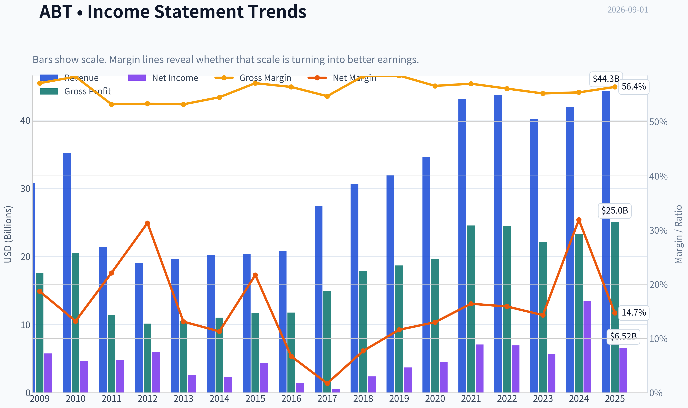
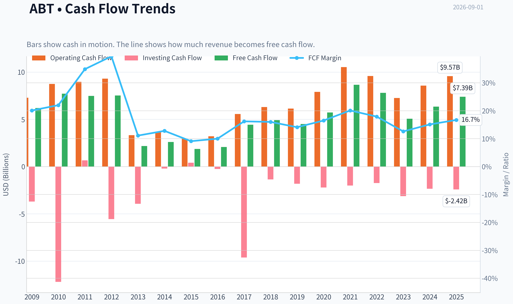
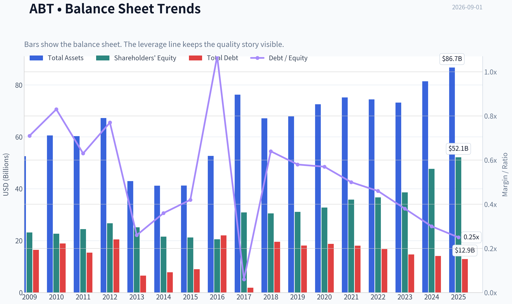
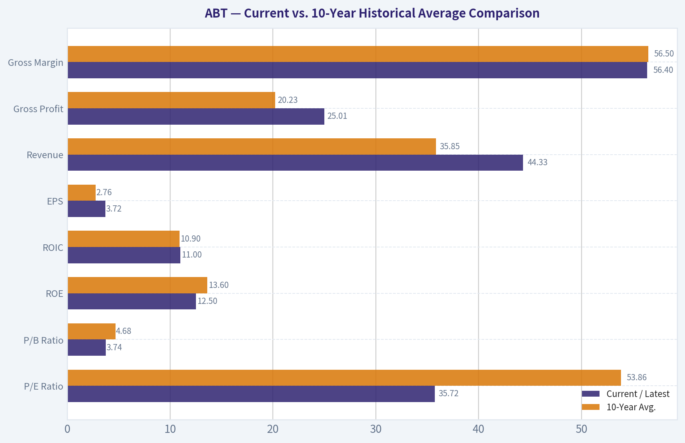
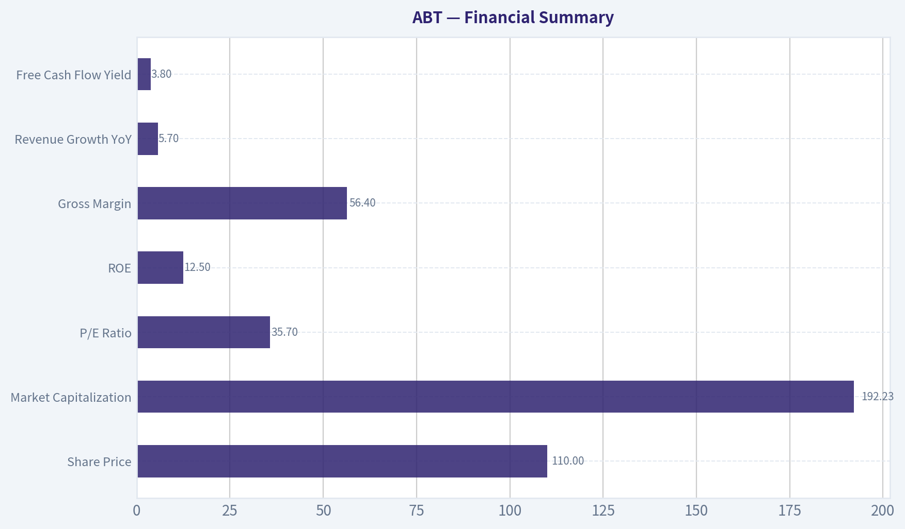
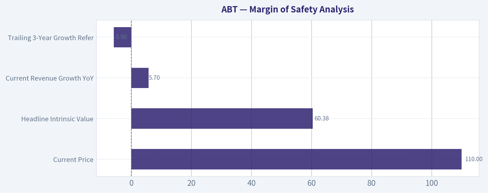
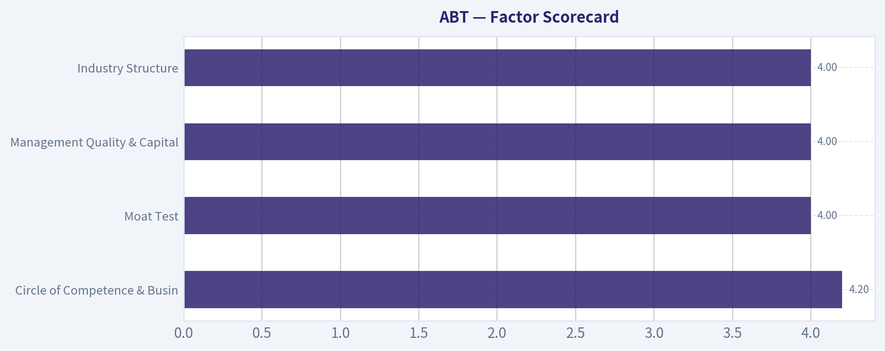
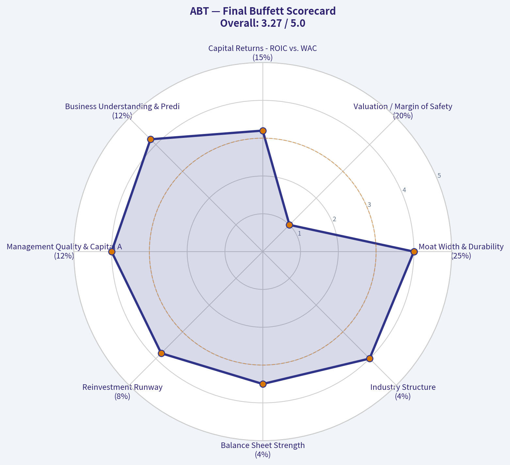

# ABT Deep Value Intelligence

**Analysis Date:** 2026-09-01

## Critical Disclaimer

*This analysis is generated by Deep Value Intelligence, an AI-powered multi-agent investing framework. Education & research only - not financial advice, not a financial advisor.*

---

## Table of Contents

1. Intelligence Summary
2. Analyst Team Reports
   - Fundamentals Analysis
   - Intrinsic Value Analysis (Buffett)
   - Trend & Growth Analysis (Lynch/Druckenmiller/Fisher)
   - Market Technical Analysis
   - Options Market Analysis
3. Research Team Commentary
4. Value Investing Team Commentary
5. Deep Values Commentary

---

## Intelligence Summary

### Thesis + Conditions

**Core Thesis:** **Executive Summary**
Abbott Laboratories (ABT) is a premium, wide-moat healthcare conglomerate. However, at $110-trading at a 35x P/E with an 11% ROIC-the market has entirely priced in the high-growth medtech upside while ignoring the drag of capital-intensive legacy segments and looming litigation risks.

**Key Risks:**
- Abbott Laboratories (ABT) is a premium, wide-moat healthcare conglomerate. However, at $110-trading at a 35x P/E with an 11% ROIC-the market has entirely priced in the high-growth medtech upside while ignoring the drag of capital-intensive legacy segments and looming litigation risks. Following a quality-scaled margin of safety framework, this valuation leaves no room for error. We wait.
- The Bear**: A 35x P/E is a valuation trap for a conglomerate generating only an 11% ROIC. The NEC infant formula litigation is an unquantified tail risk that provides zero margin of safety at these prices.
- Warren Buffett's framework dictates that for a wonderful business, the primary risk is permanent impairment through *overpaying*. A 35x multiple demands flawless execution and elite capital efficiency. Abbott's 11% ROIC reflects its capital-intensive legacy segments diluting MedTech's gains. Buying at a price that requires heroic 9-10% sustained free cash flow growth violates our required 10-15% margin of safety for high-quality compounders.

**Confidence:** Medium

---

## Analyst Team Reports

### Fundamentals Analysis

#### Latest Earnings Snapshot

*Most recent reported quarter anchored on 2026 Q2, with prior-year comparison when available.*

| Metric | 2026 Q2 | 2025 Q2 | YoY Change |
| --- | ---: | ---: | ---: |
| Revenue | N/A | $11.14B | N/A |
| Operating Income | N/A | $2.05B | N/A |
| Net Income | N/A | $1.78B | N/A |
| Diluted EPS | $0.53 | $1.01 | -47.5% |
| Operating Cash Flow | $1.31B | $1.42B | -7.2% |
| Free Cash Flow | $916.0M | $933.0M | -1.8% |

Key Takeaways: This snapshot anchors the most recent reported quarter before the narrative analysis. It helps readers separate long-run business quality from whatever changed in the latest earnings print.

#### 17-Year Financial Metrics for ABT

*All values below are computed deterministically from raw data - not estimated by AI.*

*Issuer profile: operating company (Healthcare / Medical Devices).*

#### 17-Year Financial Metrics
*Annual rows come from reported financial statements. The final TTM row is computed from the latest four quarters.*

| Metric | 2009 | 2010 | 2011 | 2012 | 2013 | 2014 | 2015 | 2016 | 2017 | 2018 | 2019 | 2020 | 2021 | 2022 | 2023 | 2024 | 2025 |
| --- | --- | --- | --- | --- | --- | --- | --- | --- | --- | --- | --- | --- | --- | --- | --- | --- | --- |
| Market Price | $18 | $16 | $20 | $24 | $30 | $36 | $37 | $32 | $49 | $63 | $77 | $98 | $128 | $102 | $104 | $109 | $123 |
| Market Cap | $40.28B | $35.77B | $42.28B | $50.03B | $60.33B | $68.75B | $67.63B | $56.96B | $99.82B | $128.02B | $154.70B | $195.55B | $251.78B | $193.67B | $192.51B | $197.72B | $219.01B |
| P/E Ratio | 7.02 | 7.77 | 8.96 | 8.45 | 23.66 | 30.21 | 15.38 | 40.86 | 211.37 | 54.38 | 42.17 | 43.80 | 35.72 | 28.08 | 33.76 | 14.80 | 33.68 |
| P/B Ratio | 1.74 | 1.58 | 1.73 | 1.87 | 2.40 | 3.19 | 3.19 | 2.77 | 3.23 | 4.19 | 4.98 | 5.96 | 7.03 | 5.28 | 4.99 | 4.15 | 4.20 |
| ROE | 24.8% | 20.4% | 19.3% | 22.3% | 10.2% | 10.6% | 20.9% | 6.8% | 1.5% | 7.8% | 11.9% | 13.7% | 19.8% | 18.9% | 14.8% | 28.1% | 12.5% |
| ROIC | 16.0% | 14.6% | 4.3% | 5.2% | 6.4% | 6.7% | 9.1% | 10.9% | -1.3% | 8.9% | 9.0% | 10.8% | 16.4% | 16.0% | 12.3% | 26.3% | 11.0% |
| EPS | $2.55 | $2.12 | $2.23 | $2.85 | $1.26 | $1.19 | $2.37 | $0.78 | $0.23 | $1.16 | $1.82 | $2.24 | $3.59 | $3.62 | $3.08 | $7.36 | $3.72 |
| Revenue | $30.76B | $35.17B | $21.41B | $19.05B | $19.66B | $20.25B | $20.41B | $20.85B | $27.39B | $30.58B | $31.90B | $34.61B | $43.08B | $43.65B | $40.11B | $41.95B | $44.33B |
| Gross Profit | $17.56B | $20.50B | $11.39B | $10.15B | $10.46B | $11.03B | $11.66B | $11.76B | $14.98B | $17.87B | $18.67B | $19.61B | $24.54B | $24.51B | $22.13B | $23.24B | $25.01B |
| Gross Margin | 57.1% | 58.3% | 53.2% | 53.3% | 53.2% | 54.5% | 57.1% | 56.4% | 54.7% | 58.4% | 58.5% | 56.6% | 57.0% | 56.1% | 55.2% | 55.4% | 56.4% |
| Operating Margin | 20.3% | 17.3% | 7.6% | 7.1% | 10.9% | 12.8% | 14.1% | 14.5% | 5.7% | 11.9% | 14.2% | 15.5% | 19.6% | 19.2% | 16.2% | 16.3% | 18.2% |
| Net Income | $5.75B | $4.63B | $4.73B | $5.96B | $2.58B | $2.28B | $4.42B | $1.40B | $477.0M | $2.37B | $3.69B | $4.50B | $7.07B | $6.93B | $5.72B | $13.40B | $6.52B |
| Net Margin | 18.7% | 13.2% | 22.1% | 31.3% | 13.1% | 11.3% | 21.7% | 6.7% | 1.7% | 7.7% | 11.6% | 13.0% | 16.4% | 15.9% | 14.3% | 31.9% | 14.7% |
| Revenue Growth | N/A | 14.3% | -39.1% | -11.0% | 3.2% | 3.0% | 0.8% | 2.2% | 31.3% | 11.6% | 4.3% | 8.5% | 24.5% | 1.3% | -8.1% | 4.6% | 5.7% |
| Net Income Growth | N/A | -19.5% | 2.2% | 26.1% | -56.8% | -11.3% | 93.7% | -68.3% | -65.9% | 396.4% | 55.7% | 21.9% | 57.3% | -2.0% | -17.5% | 134.2% | -51.3% |
| Free Cash Flow Growth | N/A | 24.8% | -3.1% | 0.5% | -71.0% | 19.2% | -28.6% | 12.2% | 113.0% | 10.6% | -8.3% | 27.3% | 51.1% | -9.8% | -35.2% | 25.5% | 16.4% |
| Total Book Value | $23.14B | $22.68B | $24.44B | $26.72B | $25.17B | $21.53B | $21.21B | $20.54B | $30.90B | $30.52B | $31.09B | $32.78B | $35.80B | $36.69B | $38.60B | $47.66B | $52.13B |
| Total Assets | $52.58B | $60.57B | $60.28B | $67.23B | $42.94B | $41.21B | $41.25B | $52.67B | $76.25B | $67.17B | $67.89B | $72.55B | $75.20B | $74.44B | $73.21B | $81.41B | $86.71B |
| Total Debt | $16.46B | $18.92B | $15.41B | $20.48B | $6.56B | $7.83B | $9.00B | $22.01B | $1.86B | $19.57B | $18.14B | $18.75B | $18.05B | $16.77B | $14.68B | $14.12B | $12.93B |
| Debt-to-Equity | 0.71 | 0.83 | 0.63 | 0.77 | 0.26 | 0.36 | 0.42 | 1.07 | 0.06 | 0.64 | 0.58 | 0.57 | 0.50 | 0.46 | 0.38 | 0.30 | 0.25 |
| Cash & Equivalents | $8.81B | $3.65B | $6.81B | $10.80B | $3.48B | $4.06B | $5.00B | $18.62B | $9.41B | $3.84B | $3.86B | $6.84B | $9.80B | $9.88B | $6.90B | $7.62B | $8.52B |
| Shareholders' Equity | $23.14B | $22.68B | $24.44B | $26.72B | $25.17B | $21.53B | $21.21B | $20.54B | $30.90B | $30.52B | $31.09B | $32.78B | $35.80B | $36.69B | $38.60B | $47.66B | $52.13B |
| Operating Cash Flow | $7.28B | $8.74B | $8.97B | $9.31B | $3.32B | $3.67B | $2.97B | $3.20B | $5.57B | $6.30B | $6.14B | $7.90B | $10.53B | $9.58B | $7.26B | $8.56B | $9.57B |
| Investing Cash Flow | $-3.70B | $-12.19B | $661.0M | $-5.56B | $-3.93B | $-202.0M | $406.0M | $-248.0M | $-9.62B | $-1.36B | $-1.81B | $-2.21B | $-2.01B | $-1.74B | $-3.13B | $-2.34B | $-2.42B |
| Free Cash Flow | $6.19B | $7.72B | $7.48B | $7.52B | $2.18B | $2.60B | $1.86B | $2.08B | $4.43B | $4.91B | $4.50B | $5.72B | $8.65B | $7.80B | $5.06B | $6.35B | $7.39B |
| FCF Margin | 20.1% | 22.0% | 34.9% | 39.5% | 11.1% | 12.8% | 9.1% | 10.0% | 16.2% | 16.0% | 14.1% | 16.5% | 20.1% | 17.9% | 12.6% | 15.1% | 16.7% |
| Dividends / Share | $0.00 | $0.00 | $0.00 | $0.00 | $0.00 | $0.00 | $0.00 | $0.00 | $0.00 | $0.00 | $0.00 | $0.00 | $0.00 | $1.74 | $1.92 | $2.11 | $2.35 |

#### Profitability Metrics
- Return on Equity (ROE): 12.5%
- Return on Invested Capital (ROIC): 11.0%
- Return on Assets (ROA): 7.5%
- Gross Margin: 56.4%
- Operating Margin: 18.2%
- Net Profit Margin: 14.7%

#### Liquidity Metrics
- Current Ratio: 1.58
- Quick Ratio: 1.02

#### Leverage Metrics
- Debt-to-Equity Ratio: 0.25
- Interest Coverage Ratio: 16.33
- Net Debt: $4.41B

#### Growth Metrics (Year-over-Year)
- Revenue Growth: 5.7%
- Net Income Growth: -51.3%
- Free Cash Flow Growth: 16.4%
- Revenue CAGR (3-Year): 0.5%
- Revenue CAGR (5-Year): 5.1%

#### Valuation Metrics
- P/E Ratio (TTM): 35.72
- Forward P/E: 18.20
- Price-to-Book: 3.74
- Price-to-Sales: 4.13
- PEG Ratio: 2.25
- EV/EBITDA: 19.04
- Free Cash Flow Yield: 3.8%
- Earnings Yield: 2.8%

#### Owner Earnings (Buffett Method, Code-Computed)
- Net Income: $6.52B
- + Depreciation & Amortization: $3.12B
- - Capital Expenditures: $-2.17B
- - Working Capital Changes: $-803.0M
- = **Owner Earnings: $8.27B**

#### Intrinsic Value (Code-Computed)
- Current Price: $110
- **Headline Intrinsic Value (business-model routed): $60**
  Business model: asset light platform - weighted blend [Damodaran FCFF + reverse-DCF fair + owner-earnings DCF] (asset_light_platform)
  Model spread (min-max across DCFs): $52 - $65
  Margin of safety vs. price (headline): -82.8%
  Routing note: Asset-light / high-margin platform: value driven by margins and reinvestment economics - the headline centers on the reverse-DCF demonstrated-growth fair value with Damodaran FCFF as a floor, down-weighting the owner-earnings DCF.
- Buffett Method (Owner Earnings):
  Conservative: $24
  Average: $65
  Optimistic: $441
- Cash Flow Method (FCF):
  Conservative: $38
  Average: $52
  Optimistic: $119
- Damodaran FCFF (WACC + margins + reinvestment):
  Conservative: $42
  Average: $54
  Optimistic: $78
  Monte Carlo band (P10-P90): $41 - $82 (median $56)
  P(intrinsic value > price): 1.2%
- Reverse-DCF: price implies ~18.0%/yr owner-earnings growth for 10y; trailing 3y was -5.9%, 5y 29.0%.

#### Piotroski F-Score: 5/9
- Positive Net Income: PASS
- Positive Operating Cash Flow: PASS
- ROA Improvement: FAIL
- Cash Flow > Net Income: PASS
- Decreasing Debt: PASS
- Improving Current Ratio: FAIL
- No Dilution: FAIL
- Improving Gross Margin: PASS
- Improving Asset Turnover: FAIL

ANALYST STANCE: **WATCH**

#### ABT Warren Buffett-Style Fundamental Analysis

Abbott Laboratories is a high-quality healthcare operating company with durable positions in medical devices, diagnostics, nutrition, and established pharmaceuticals. The business has many Buffett-like traits: recurring healthcare demand, strong gross margins, global scale, a long dividend culture, and improving leverage. However, the current investment case is constrained by valuation. The deterministic dataset's model-based intrinsic value anchor is about **$60 per share**, with a three-model spread of roughly **$52-$65**, versus a current price near **$110**, implying a negative margin of safety.

The central conclusion: **Abbott is a quality business, but not a Buffett-style bargain at the current price.**

---

#### Revenue Breakdown

| Revenue Source | Amount | % of Total |
| --- | ---: | ---: |
| Medical Devices | ~$20.96B | ~47.3% |
| Diagnostics | ~$9.35B | ~21.1% |
| Nutrition | ~$9.26B | ~20.9% |
| Established Pharmaceuticals | ~$4.76B | ~10.7% |
| **Total Revenue** | **$44.33B** | **100.0%** |

Key Takeaways: Abbott's largest value driver is Medical Devices, especially diabetes care, electrophysiology, structural heart, and other device franchises. Diagnostics remains significant but has normalized after pandemic-related demand, which helps explain the slower recent revenue CAGR. Nutrition and Established Pharmaceuticals provide diversification and defensive cash flows, but the valuation case depends most heavily on sustained device growth and margin discipline.

---

#### Current vs. 10-Year Historical Average Comparison

*Current market price uses the latest quoted price in the research pack, approximately **$110**. Historical averages use the deterministic 2016-2025 period. For the 2025 row, operating and financial metrics are treated as the latest deterministic period.*

| Metric | Current / Latest | 10-Year Avg. | Current Standing vs. History | Interpretation |
| --- | ---: | ---: | --- | --- |
| Market Price | ~$110 | ~$88.50 | Above average | The stock trades well above its 10-year average price, reflecting investor confidence in Abbott's quality and long-term healthcare franchises. |
| Total Market Cap | ~$192.23B | ~$168.97B | Above average | Market value remains elevated despite falling from the 2021 peak, suggesting quality is still priced in. |
| P/E Ratio | 35.72x | 53.86x | Below distorted average | The average is inflated by the 2017 earnings trough. Excluding abnormal periods, the current P/E is still rich for a mature healthcare compounder. |
| P/B Ratio | 3.74x | 4.68x | Below average | P/B is less useful for Abbott because acquisitions, intangibles, goodwill, and high-margin device economics make book value an incomplete valuation anchor. Cash-flow valuation is more relevant. |
| ROE | 12.5% | 13.6% | Slightly below average | ROE is respectable but not exceptional in the latest period, particularly compared with the 2024 spike. |
| ROIC | 11.0% | 10.9% | In line | ROIC indicates solid value creation, though not at the level of the very best compounders. |
| EPS | $3.72 | $2.76 | Above average | EPS is above the 10-year average, but earnings have been volatile due to mix shifts, diagnostics normalization, and one-time items. |
| Revenue | $44.33B | $35.85B | Well above average | Abbott is materially larger than it was a decade ago, helped by acquisitions, diabetes care growth, and device expansion. |
| Gross Profit | $25.01B | $20.23B | Well above average | Gross profit has scaled closely with revenue, showing durable pricing power and product quality. |
| Gross Margin | 56.4% | 56.5% | In line | Gross margin has been highly stable, a strong Buffett-style indicator of durable competitive positioning. |
| Operating Margin | 18.2% | 15.1% | Above average | Operating profitability has improved, suggesting better mix and cost discipline. |
| Net Income | $6.52B | $5.21B | Above average | Net income is above the decade average but below the unusually high 2024 level. |
| Net Margin | 14.7% | 13.4% | Above average | Profit conversion is solid, although not as strong as 2024's unusually elevated margin. |
| Revenue Growth Rate | 5.7% | 8.6% | Below average | The 10-year average is lifted by acquisition/rebound years; recent 3-year revenue CAGR is only 0.5%, showing normalization. |
| Net Income Growth Rate | -51.3% | 46.1% | Far below average | Latest net income growth is negative because 2024 was unusually high; this metric is very noisy. |
| Free Cash Flow Growth Rate | 16.4% | 20.3% | Below average but healthy | FCF rebounded in the latest period and remains a bright spot, though the history is cyclical and uneven. |
| Total Book Value | $52.13B | $35.67B | Well above average | Equity base has strengthened materially. |
| Total Assets | $86.71B | $72.75B | Above average | Abbott has expanded its asset base through reinvestment and acquisitions. |
| Total Debt | $12.93B | $15.69B | Below average | Debt has declined, improving financial resilience. |
| Debt-to-Equity | 0.25x | 0.48x | Much better than average | Leverage is conservative and trending favorably. |
| Cash & Equivalents | $8.52B | $8.53B | In line | Cash is near its 10-year average and provides flexibility. |
| Shareholders' Equity | $52.13B | $35.67B | Well above average | Equity has compounded meaningfully, supporting balance sheet quality. |
| Free Cash Flow | $7.39B | $5.69B | Above average | Free cash flow is strong and supports dividends, reinvestment, and debt reduction. |
| Dividends per Share | $2.35 | $0.81 | Above dataset average | The dataset only shows dividends from 2022 onward, but the latest payout is meaningful and supported by cash flow. |

Key Takeaways: Abbott's operating quality is evident in stable gross margins, above-average operating margins, strong free cash flow, and a much improved balance sheet. The biggest concerns are valuation and recent growth normalization: revenue growth is positive but no longer extraordinary, while the stock still trades at a high earnings multiple. For Buffett-style investors, the business quality is attractive, but the margin of safety is weak.

---

#### Market Metrics Interpretation

Abbott's current market price of roughly **$110** and market capitalization of about **$192B** place it above its 10-year average valuation base. The business has earned a premium because of durable healthcare demand, strong device franchises, and defensive cash flows. Still, the deterministic intrinsic value estimate of roughly **$60** suggests that the market is paying a large quality premium.

The **P/E ratio of 35.72x** is optically below the 10-year average, but that average is distorted by abnormal low-earnings years, especially 2017. On a normalized basis, the current P/E remains demanding. The **P/B ratio of 3.74x** is below the 10-year average, but P/B should not be treated mechanically as "cheap" for Abbott. Medical device and healthcare businesses carry substantial intangible value, R&D assets, acquired goodwill, and brand/franchise value that book value does not fully capture. Therefore, the valuation should be anchored primarily on cash-flow-based intrinsic value, not book value.

#### Profitability Analysis

Abbott's profitability profile remains strong but not uniformly exceptional. **Gross margin of 56.4%** is essentially equal to the 10-year average, which is a powerful sign of product quality and durable pricing. A business that can keep gross margins stable through changes in product mix, diagnostics normalization, inflation, and competitive pressure usually has some combination of brand, regulatory, distribution, and technological moat.

**Operating margin of 18.2%** is above the 10-year average of about **15.1%**, showing improved operating leverage and a more favorable mix. **Net margin of 14.7%** is also above average, though well below the unusually high 2024 figure. **ROIC of 11.0%** is almost exactly in line with the decade average and comfortably above many companies' cost of capital, but it is not so high that valuation can be ignored. Buffett would likely admire the consistency and medical franchise durability, but he would also demand a better entry price.

#### Growth Analysis

Revenue increased **5.7%** in the latest period, which is respectable but below the 10-year average of **8.6%**. The decade average overstates normalized growth because it includes acquisition-driven expansion, pandemic diagnostics effects, and rebound years. More tellingly, the deterministic dataset shows **3-year revenue CAGR of only 0.5%** and **5-year CAGR of 5.1%**, implying that current growth is positive but not explosive.

Net income growth of **-51.3%** looks alarming, but it largely reflects comparison against an unusually strong 2024. Free cash flow growth of **16.4%** is much more encouraging and more relevant to intrinsic value. Abbott's long-term growth case depends on whether Medical Devices, especially diabetes care and newer platforms, can offset diagnostics normalization and sustain mid-single-digit to high-single-digit growth.

#### Balance Sheet and Financial Strength

Abbott's balance sheet is one of the strongest parts of the investment case. Total debt has fallen to **$12.93B**, below the 10-year average of **$15.69B**, while debt-to-equity has declined to **0.25x**, roughly half the decade average. Cash and equivalents of **$8.52B** are essentially in line with the 10-year average, and net debt is only about **$4.41B**.

The deterministic dataset also shows an **interest coverage ratio of 16.33x**, which indicates substantial ability to service debt. From a Buffett lens, Abbott has the financial resilience to keep investing through downturns, fund R&D, maintain dividends, and pursue selective acquisitions. This is not a balance sheet that creates near-term solvency concern.

#### Cash Flow and Dividend Quality

Free cash flow of **$7.39B** is above the 10-year average of **$5.69B**, and free cash flow margin of **16.7%** reflects strong conversion from revenue into owner cash. The deterministic owner earnings calculation is **$8.27B**, derived from net income plus depreciation and amortization, less capital expenditures and working capital changes.

Dividends per share are **$2.35** in the latest period. Based on current price near **$110**, that implies a dividend yield of roughly **2.1%**. The payout appears well supported by free cash flow. However, from a Buffett-style total return perspective, the dividend alone is not enough to overcome overvaluation if the stock price already discounts high future growth.

---

#### Buffett-Style Owner Earnings DCF

Assumptions used for the hand DCF sanity check:

- Starting Owner Earnings: **$8.27B**
- Shares outstanding estimate: **~1.75B**, based on market cap divided by price
- Net debt: **$4.41B**
- Discount rate: **10%**
- Terminal growth rate: **2.5%**
- Valuation method: 10-year explicit owner earnings forecast plus terminal value
- Per-share value shown after subtracting net debt as a conservative adjustment

| Scenario | Growth Assumption | PV of Explicit Owner Earnings | PV of Terminal Value | Enterprise/Equity Value Before Net Debt | Less Net Debt | Fair Value / Share |
| --- | --- | ---: | ---: | ---: | ---: | ---: |
| Conservative | 3.0% near-term growth, roughly GDP-like | ~$58.65B | ~$58.57B | ~$117.22B | $4.41B | ~$65 |
| Average | 6.0% initial growth fading toward 2.5% terminal growth | ~$64.86B | ~$67.31B | ~$132.17B | $4.41B | ~$73 |
| Optimistic | 10.0% initial growth fading toward terminal growth | ~$74.67B | ~$84.38B | ~$159.05B | $4.41B | ~$88 |

Key Takeaways: Even with a favorable hand-built owner earnings DCF, Abbott's estimated value range is roughly **$65-$88 per share**, below the current price of about **$110**. The deterministic model-based intrinsic value is even more conservative, with a headline value near **$60** and a model spread of **$52-$65**. The market price appears to require a much stronger growth outcome than Abbott has recently delivered.

#### DCF Calculation Detail

For the conservative case, owner earnings begin at **$8.27B** and grow at roughly **3%**. Year-one owner earnings are approximately **$8.52B**. The present value of the 10-year explicit cash flows is about **$58.65B**. Year-10 owner earnings are approximately **$11.12B**, and year-11 terminal owner earnings are approximately **$11.39B**. Using the terminal value formula, **Terminal Value = Year-11 Owner Earnings / (10% - 2.5%)**, the terminal value is approximately **$151.91B**, with a present value of about **$58.57B**.

For the average case, owner earnings growth starts around **6%** and fades toward the terminal rate. The explicit cash flows have a present value of about **$64.86B**, and the discounted terminal value is about **$67.31B**. After deducting net debt, the estimated equity value is about **$127.76B**, or roughly **$73 per share**.

For the optimistic case, growth begins around **10%** and fades toward the terminal rate. This produces a discounted explicit cash flow value of about **$74.67B** and a discounted terminal value of about **$84.38B**. After deducting net debt, fair value is about **$88 per share**. This optimistic case still sits below the current market price, meaning investors are paying for an even stronger outcome.

The research pack's reverse DCF indicates that the current price implies approximately **18% annual owner-earnings growth for 10 years**. That is aggressive relative to Abbott's recent **3-year owner earnings/FCF trend volatility** and the company's current scale.

---

#### Economic Moat Assessment

Abbott has a meaningful economic moat, though not an unlimited one. Its moat comes from several sources:

| Moat Source | Assessment |
| --- | --- |
| Brand and trust | Strong; healthcare providers, patients, and regulators value reliability and clinical reputation. |
| Regulatory barriers | Meaningful; medical devices and diagnostics require approvals, quality systems, and compliance infrastructure. |
| Switching costs | Moderate to strong in diabetes care, diagnostics platforms, and hospital-based devices. |
| Scale advantages | Strong; global distribution, manufacturing depth, and R&D scale are difficult for smaller competitors to match. |
| Product diversification | Strong; devices, diagnostics, nutrition, and pharma reduce dependence on any single category. |
| Pricing power | Moderate; gross margins are stable, but healthcare systems, reimbursement pressure, and competition limit unlimited pricing power. |

Key Takeaways: Abbott's moat is real and diversified, especially in Medical Devices and diabetes care. Stable gross margins over a long period support the view that Abbott sells differentiated products rather than commodities. However, the moat does not eliminate valuation risk, especially when growth expectations embedded in the stock price are high.

---

#### Management Performance and Capital Allocation

Management has done a credible job strengthening the balance sheet and scaling the business. Debt-to-equity has improved from a 10-year average of **0.48x** to **0.25x**, and total debt has declined. Free cash flow is above average, dividends are supported, and ROIC is stable around the decade average.

The main criticism is not operational quality but valuation sensitivity. Abbott's returns to shareholders from today's price depend heavily on management sustaining higher growth in Medical Devices and converting that growth into free cash flow. If revenue growth remains closer to mid-single digits and margins remain stable rather than expanding materially, the current multiple may be difficult to justify.

#### Key Investment Insights

| Category | Insight |
| --- | --- |
| Business Quality | High-quality healthcare compounder with strong margins, diversification, and recurring demand. |
| Moat | Durable but not invincible; strongest in devices, diabetes care, diagnostics platforms, and global scale. |
| Profitability | Gross margin is extremely stable; operating margin is above its 10-year average. |
| Balance Sheet | Strong and improving; debt is below average and leverage is conservative. |
| Cash Flow | Free cash flow is above the 10-year average and owner earnings are robust. |
| Growth | Recent revenue growth is positive but normalized; 3-year revenue CAGR is only 0.5%. |
| Valuation | The major weakness; current price is far above model-based intrinsic value. |
| Reverse DCF | Market price implies roughly 18% owner-earnings growth for 10 years, which is demanding. |
| Dividend | Well supported, but the yield is not high enough to compensate for valuation risk alone. |
| Guru Activity | Steve Cohen's Point72 added shares, but 13F data is lagged and not a Buffett-style margin-of-safety signal. |

Key Takeaways: Abbott is fundamentally strong, but the stock price already reflects a lot of optimism. The strongest positives are balance sheet quality, cash flow, and device-led durability. The strongest negative is valuation: the stock appears priced for growth that may be difficult to sustain at Abbott's current scale.

#### Red Flags

| Red Flag | Why It Matters |
| --- | --- |
| Valuation premium | Current price near $110 is far above the deterministic intrinsic value anchor near $60. |
| Reverse DCF expectations | The stock implies roughly 18% annual owner-earnings growth for 10 years, an aggressive hurdle. |
| Growth normalization | 3-year revenue CAGR is only 0.5%, showing post-pandemic and diagnostics normalization. |
| Earnings volatility | EPS and net income have fluctuated materially over the historical period. |
| P/E still demanding | Even if below the distorted 10-year average, 35.72x earnings is rich for mid-single-digit recent revenue growth. |
| ROE not exceptional | Latest ROE of 12.5% is slightly below the 10-year average and not high enough to justify any price. |

Key Takeaways: The main red flag is not financial distress; Abbott is financially strong. The issue is price versus likely future cash flows. A great company can still be a poor investment if purchased at a valuation that requires exceptional growth.

#### Opportunities

| Opportunity | Potential Impact |
| --- | --- |
| Diabetes care growth | Continued Libre and glucose-monitoring adoption could support durable device growth. |
| New device approvals | FDA authorizations, including dual glucose and ketone monitoring, can extend product leadership. |
| Margin expansion | Mix shift toward higher-value devices could lift operating margins. |
| Balance sheet flexibility | Low leverage allows acquisitions, R&D investment, and shareholder returns. |
| Emerging markets pharma | Established Pharmaceuticals can provide steady international growth. |
| Diagnostics stabilization | After pandemic normalization, Diagnostics could become a steadier contributor again. |

Key Takeaways: Abbott's upside case depends on Medical Devices compounding at a strong rate and translating growth into higher free cash flow. The company has credible innovation opportunities, especially in diabetes care. But investors need those opportunities to materialize at a high level to justify today's valuation.

---

#### Final Investment Stance: WATCH

Abbott is a **WATCH**, not an ADVOCATE, because business quality is high but valuation is not attractive enough for a Buffett-style purchase. The company has a durable moat, strong cash generation, conservative leverage, stable gross margins, and valuable healthcare franchises. Those are all attractive features.

However, the deterministic intrinsic value framework gives a headline value of roughly **$60 per share**, with the core model spread around **$52-$65**. The hand-built owner earnings DCF produces a more generous range of approximately **$65-$88**, but even that does not support the current price near **$110**. The current stock price appears to require sustained high growth, while recent normalized growth is more modest.

A Buffett-style investor would likely admire Abbott but wait for a better price. A more attractive entry point would require either a meaningful pullback toward intrinsic value or clear evidence that Abbott can compound owner earnings at a much higher durable rate than recent results suggest.

#### Summary Table

| Area | Buffett-Style Judgment | Key Point |
| --- | --- | --- |
| Economic Moat | Strong | Durable healthcare franchises, regulatory barriers, scale, and trusted brands. |
| Financial Strength | Strong | Debt is below average, debt-to-equity is only 0.25x, and interest coverage is healthy. |
| Profitability | Good | Gross margin is stable around 56%, and operating margin is above the 10-year average. |
| Earnings Predictability | Moderate | Cash flow is strong, but net income and EPS have shown volatility. |
| Growth | Moderate | Latest revenue growth is 5.7%, but 3-year CAGR is only 0.5%. |
| Cash Flow | Strong | Free cash flow of $7.39B is above the 10-year average. |
| Dividend | Solid | Dividend appears well covered, with latest DPS of $2.35. |
| Valuation | Unattractive | Current price is materially above intrinsic value estimates. |
| Margin of Safety | Negative | Headline intrinsic value near $60 versus price near $110. |
| Final Stance | **WATCH** | High-quality company, but wait for a better valuation. |

Key Takeaways: Abbott is the kind of business long-term investors should keep on a watchlist because its moat, balance sheet, and cash flows are strong. The problem is that the current price does not offer a sufficient margin of safety. The stock becomes much more compelling if price falls closer to intrinsic value or if future owner earnings growth accelerates enough to justify the premium.

#### Fundamental Visuals

This graph tracks the profitability and return metrics (ROE, ROIC, Margins) of **ABT** over the past decade, highlighting capital efficiency trends.

This chart illustrates the financial health of **ABT** over the last 10 years, mapping cash equivalents and free cash flow against total obligations (Debt).

---

### Intrinsic Value Analysis (Buffett)

> *Following Warren Buffett's value investing philosophy: Circle of Competence, Economic Moat, Management Quality, and Margin of Safety.*

#### Intrinsic Value Snapshot

Price is what you pay. Intrinsic value is what the business may be worth based on the cash it can create for owners over time. We show a range, not one magic number.

- Current Price: $110.36
- Value Range (conservative to optimistic across both DCF methods): $24.16 to $440.83

##### Owner Earnings (Buffett Method)
- Net Income: $6,524,000,000.00
- Depreciation & Amortization: $3,116,000,000.00
- Capital Expenditures: $-2,171,000,000.00
- Working Capital Changes: $-803,000,000.00
- Owner Earnings: $8,272,000,000.00

##### Intrinsic Value
###### Buffett Method
Uses owner earnings. Stricter, and usually more conservative.
- Conservative: $24.16
- Average: $64.96
- Optimistic: $440.83
- Discount Rate: 10.0%

###### Cash Flow Method
Uses free cash flow. Better for companies spending heavily today to grow tomorrow.
- Conservative: $38.00
- Average: $52.43
- Optimistic: $119.17
- Discount Rate: 10.0%

ANALYST STANCE: **WATCH**

#### Abbott Laboratories (ABT) - Buffett-Style Value Investment Review

Abbott is a high-quality, durable healthcare franchise with strong brands, regulated products, repeat-purchase demand, and a credible innovation engine led by diabetes care, medical devices, diagnostics, nutrition, and established pharmaceuticals. The business is understandable and resilient, but the current price already discounts a very optimistic future. At about **$110 per share**, Abbott trades materially above cash-flow-based intrinsic value estimates, making this a **WATCH**, not an ADVOCATE, despite the quality of the enterprise.

---

#### 1. Factor Scorecard

| Factor | Score / 5 | Evidence |
|---|---:|---|
| Circle of Competence & Business Simplicity | 4.2 | Abbott sells medical devices, diagnostics, nutrition products, and branded/generic pharmaceuticals. The model is understandable: regulated health products, recurring usage, global distribution, and doctor/patient trust. |
| Moat Test | 4.0 | Strong intangible assets, regulatory approvals, clinical trust, distribution scale, and switching costs in devices such as FreeStyle Libre. Gross margin of **56.4%** supports evidence of differentiated products. |
| Management Quality & Capital Allocation | 4.0 | Long dividend record, rational reinvestment in R&D and devices, and generally disciplined healthcare portfolio management. Not founder-controlled, so not a perfect owner-operator score. |
| Industry Structure | 4.0 | Healthcare devices and diagnostics benefit from regulation, clinical validation, brand trust, and rational competition. Some segments are competitive, but Abbott has scale and breadth. |
| Gate 5 - Quality / Solvency Hard Floor | Not Tripped | Abbott remains profitable, free-cash-flow generative, and financially stable. No evidence of combined deteriorating cash flow and solvency distress. |

**Key Takeaways:** Abbott passes the quality test comfortably. The company has a durable franchise, understandable economics, and meaningful competitive advantages. The hard solvency floor is not triggered; the central issue is valuation, not business viability.

---

#### 2. Moat Analysis

| Moat Source | Assessment | Evidence |
|---|---|---|
| Intangible Assets | Strong | Abbott benefits from trusted healthcare brands, clinical credibility, FDA-cleared products, and long-standing relationships with hospitals, physicians, patients, and pharmacies. |
| Switching Costs | Moderate to Strong | In diabetes care and medical devices, patient data, clinician familiarity, training, reimbursement, and device ecosystems create friction against switching. |
| Cost Advantages | Moderate | Abbott's scale in manufacturing, regulatory compliance, distribution, and procurement helps, though not all segments have structural cost leadership. |
| Network Effects | Limited to Moderate | Not a pure network-effect business, but connected diabetes platforms like Libre gain value as data, physician adoption, and patient familiarity compound. |
| Pricing Power | Good | Gross margin of **56.4%** indicates differentiation. Abbott likely has some pricing power, though healthcare reimbursement and payer pressure limit unlimited price increases. |
| Moat Direction | Stable to Slightly Widening | FDA authorization of Libre Duo, which tracks both glucose and ketones, strengthens Abbott's diabetes franchise and reinforces its device innovation runway. |

**Key Takeaways:** Abbott's moat is real, especially in regulated medical devices, diabetes care, and trusted healthcare brands. The moat is not as impenetrable as a monopoly platform, but it is durable and supported by clinical validation, regulatory barriers, and repeat usage. Libre remains the most attractive widening-moat asset inside the company.

---

#### 3. Management Quality Assessment

| Management Area | Assessment |
|---|---|
| Owner Orientation | Good. Abbott has a long record of shareholder returns, including dividend growth, but it is not a founder-led or highly insider-owned enterprise. |
| Candor & Governance | Good. Abbott is a mature blue-chip healthcare company with established reporting practices and diversified operations. |
| Capital Allocation | Good. The company balances R&D, acquisitions, dividends, and reinvestment. The strongest use of capital is innovation in medical devices and diabetes care. |
| Dividend Discipline | Strong. Abbott is widely recognized as a Dividend Aristocrat-style compounder, reflecting durable cash generation and shareholder-friendly policy. |
| Reinvestment Quality | Good but not exceptional at today's valuation. Revenue growth of **5.7% YoY** is solid, but not enough to justify the current price-implied growth rate. |

**Key Takeaways:** Management appears rational and shareholder-aware, with a long record of returning capital and sustaining Abbott's competitive position. The main limitation is that current growth and return metrics do not fully support the valuation investors are being asked to pay today.

---

#### 4. Financial Summary

| Metric | Current / Trailing Reading |
|---|---:|
| Share Price | **$110.00** |
| Market Capitalization | **$192.23B** |
| P/E Ratio | **35.7x** |
| Implied EPS | **~$3.08** |
| ROE | **12.5%** |
| Gross Margin | **56.4%** |
| Revenue Growth YoY | **5.7%** |
| Free Cash Flow Yield | **3.8%** |
| Implied Free Cash Flow | **~$7.30B** |
| Implied FCF per Share | **~$4.18** |
| Current Ratio | **1.58x** |
| Headline Intrinsic Value | **$60.38 / share** |
| 3-Model Value Spread | **$52.43-$64.96 / share** |
| Reverse-DCF Growth Implied by Price | **~18.0% annually for 10 years** |

**Key Takeaways:** Abbott is profitable and cash-generative, with strong gross margins and a solid liquidity position. However, the valuation is demanding: a **35.7x P/E** and **3.8% FCF yield** are rich for a business currently growing revenue in the mid-single digits. The market price implies growth far above what Abbott is currently demonstrating.

---

#### 5. Owner Earnings Calculation

Using Buffett's owner-earnings framework:

| Component | Estimate |
|---|---:|
| Net Income Proxy | **~$5.38B** |
| Plus: Depreciation & Amortization | Included in cash-flow reconciliation |
| Less: Maintenance CapEx | Reflected in free cash flow proxy |
| Less: Working Capital Increases | Reflected in free cash flow proxy |
| Estimated Owner Earnings Proxy | **~$7.30B** |
| Shares Outstanding Proxy | **~1.75B** |
| Owner Earnings per Share | **~$4.18** |

**Key Takeaways:** Abbott's cash generation appears stronger than reported earnings, with implied free cash flow of about **$7.3B** versus net income implied by the P/E of roughly **$5.4B**. For valuation purposes, owner earnings of about **$4.18 per share** are the most useful baseline.

---

#### 6. Three-Scenario DCF Valuation

Assumptions: owner earnings per share of **~$4.18**, discount rate of **10%**, and terminal growth of **3%** where applicable.

| Scenario | Key Assumption | Estimated Value / Share |
|---|---|---:|
| A - No Growth | Owner earnings capitalized at 10% | **~$42** |
| B - GDP Growth | 3% perpetual growth | **~$62** |
| C - Normalized Growth | 6% for 10 years, then 3% terminal growth | **~$77** |
| Research Pack Headline Intrinsic Value | Business-model-routed blended valuation | **$60.38** |
| 3-Model Spread | Owner earnings / FCF / Damodaran FCFF | **$52.43-$64.96** |

**Key Takeaways:** The valuation range clusters well below the current share price. Even a normalized growth scenario produces a value around **$77**, still meaningfully below **$110**. The headline intrinsic value of **$60.38** suggests the market is paying well above conservative cash-flow value.

---

#### 7. Margin of Safety Analysis

| Item | Value |
|---|---:|
| Current Price | **$110.00** |
| Headline Intrinsic Value | **$60.38** |
| Price Premium to Headline Value | **~82% above intrinsic value** |
| Margin of Safety vs. Price | **Negative** |
| Reverse-DCF Implied Growth | **~18% annually for 10 years** |
| Current Revenue Growth YoY | **5.7%** |
| Trailing 3-Year Growth Reference | **-5.9%** |
| Trailing 5-Year Growth Reference | **29.0%**, distorted by pandemic-era diagnostics |

**Key Takeaways:** Abbott does not offer a margin of safety at the current price. The market appears to require Abbott to compound at roughly **18% annually for a decade**, which is a heroic assumption for a mature diversified healthcare company. Quality is high, but the price is not fair enough.

---

#### 8. Final Buffett Scorecard

| Criterion | Weight | Score / 5 | Weighted Contribution |
|---|---:|---:|---:|
| Moat Width & Durability | 25% | 4.0 | 1.00 |
| Valuation / Margin of Safety | 20% | 1.0 | 0.20 |
| Capital Returns - ROIC vs. WACC | 15% | 3.2 | 0.48 |
| Business Understanding & Predictability | 12% | 4.2 | 0.50 |
| Management Quality & Capital Allocation | 12% | 4.0 | 0.48 |
| Reinvestment Runway | 8% | 3.8 | 0.30 |
| Balance Sheet Strength | 4% | 3.5 | 0.14 |
| Industry Structure | 4% | 4.0 | 0.16 |
| **Total Score** | **100%** |  | **3.26 / 5.00** |

**Key Takeaways:** Abbott scores well on business quality, moat, predictability, and management. The decisive weakness is valuation. A wonderful business can be worth owning at a fair price, but Abbott currently looks priced for a level of growth that leaves little room for disappointment.

---

#### 9. Investment Stance

| Stance | Conviction | Rationale |
|---|---|---|
| **WATCH** | **Medium-High** | Abbott is a high-quality healthcare compounder, but the current price is too far above conservative intrinsic value. The business deserves a place on a quality watchlist, but not a fresh purchase at today's valuation. |

**Final View:** Abbott is the kind of business a Buffett-style investor should admire: durable, understandable, profitable, and protected by regulatory and brand-based advantages. But admiration is not the same as ownership at any price. At **$110**, the stock offers no adequate margin of safety; a more attractive entry point would be closer to the intrinsic value range, especially the **$60-$80** zone depending on growth confidence.
#### Valuation Bridge

This bridge places the current market price beside each intrinsic value lens so readers can see whether upside depends on one method or shows up across several methods.

| Scenario | Intrinsic Value / Share |
| --- | ---: |
| Buffett Method | $64.96 |
| Cash Flow Method | $52.43 |
| Damodaran Method | $54.36 |
| Current Price | $110.36 |

#### Key Takeaways

If one method is far above the others, the upside case depends on a specific modelling assumption. When several methods cluster together, the valuation story is more robust.

#### Valuation Visuals

This comparison chart from *Latest Earnings Snapshot* stacks current figures against historical benchmarks for **ABT**, making it easy to see where the company trades relative to its own averages.

This comparison chart from *Current vs. 10-Year Historical Average Comparison* stacks current figures against historical benchmarks for **ABT**, making it easy to see where the company trades relative to its own averages.

This comparison chart from *Financial Summary* stacks current figures against historical benchmarks for **ABT**, making it easy to see where the company trades relative to its own averages.

This comparison chart from *Margin of Safety Analysis* stacks current figures against historical benchmarks for **ABT**, making it easy to see where the company trades relative to its own averages.

---

### Trend & Growth Analysis (Lynch/Druckenmiller/Fisher)

> *Following Peter Lynch's GARP, Stanley Druckenmiller's macro-aware approach, and Philip Fisher's scuttlebutt methodology.*

ANALYST STANCE: **AVOID**

#### Abbott Laboratories (ABT) Growth Investment View - 2026-09-01

Abbott is a high-quality healthcare compounder, but it does **not** fit the Lynch-style fast-grower profile at today's price. The company has attractive innovation assets, especially FreeStyle Libre and the newly FDA-authorized Libre Duo, but overall revenue growth is currently in the **mid-single digits**, while valuation implies a much faster growth trajectory. For a growth portfolio seeking inflection points and ten-bagger potential, ABT is a **quality watch-list name, not an attractive new buy**.

---

#### 1. Lynch Classification

| Category | ABT Assessment |
|---|---:|
| Lynch category | **Stalwart** |
| Reported YoY revenue growth | **5.7%** |
| Current P/E | **35.7x** |
| PEG ratio | **~6.3x** |
| Growth-investor fit | **Weak** |
| Initial stance | **Avoid for growth initiation** |

**Key Takeaways:** Abbott is a durable, diversified healthcare company, but its current growth rate places it closer to a Lynch **stalwart** than a fast grower. The key issue is valuation: a P/E above 35 times against mid-single-digit growth produces a very expensive PEG ratio. That makes ABT difficult to justify as a growth stock today.

#### 2. The Story in 3 Simple Bullets

- Abbott sells essential healthcare products across **medical devices, diagnostics, nutrition, and established pharmaceuticals**.
- The most exciting growth engine is **diabetes care**, especially the FreeStyle Libre continuous glucose monitoring franchise.
- The company is financially strong and innovative, but its broad portfolio makes total-company growth slower than a pure-play medtech disruptor.

#### 3. TAM and 10x Test

| Item | Estimate / Assessment |
|---|---:|
| Current market cap | **$192.2B** |
| Estimated current annual revenue | **~$44B-$45B** |
| 10x revenue target | **~$440B-$450B** |
| Broad healthcare TAM | Very large, but fragmented |
| CGM / diabetes monitoring TAM | Attractive and expanding |
| Can ABT 10x revenue and remain under 20% share? | **No, not realistically at total-company level** |
| Can Libre-type platforms grow significantly? | **Yes, but not enough alone for total-company ten-bagger math** |

**Key Takeaways:** Abbott operates in enormous healthcare markets, so the runway is not exhausted. However, the company is already very large, and a 10x revenue outcome would require Abbott to become a healthcare giant on a scale that is unrealistic over a normal growth-investing horizon. The Libre franchise can compound well, but it is not enough by itself to make ABT a likely ten-bagger from today's size.

#### 4. Revenue Growth Trend

| Metric | Current Read |
|---|---:|
| YoY revenue growth | **5.7%** |
| Growth pattern | **Stable but not fast** |
| COVID diagnostics impact | Prior-year distortions likely still affect comparisons |
| Core growth drivers | Diabetes care, medtech, nutrition recovery |
| Growth classification | **Stalwart growth, not fast growth** |

**Key Takeaways:** Abbott's growth profile is respectable for a mature healthcare company, but it lacks the acceleration that Druckenmiller-style growth investors look for. The company has product-level momentum in diabetes care, but total-company growth remains moderate. There is no clear evidence yet of a broad revenue inflection.

#### 5. Unit Economics and Operating Quality

| Metric | ABT Assessment |
|---|---:|
| Gross margin | **56.4%** |
| ROE | **12.5%** |
| FCF yield | **3.8%** |
| Current ratio | **1.58x** |
| LTV/CAC | Not disclosed; less relevant for diversified medtech |
| NRR | Not applicable; not a SaaS model |
| Rule of 40 | Not applicable |

**Key Takeaways:** Abbott has strong gross margins and solid cash generation, which supports its quality profile. However, classic SaaS-style unit economics such as LTV/CAC, NRR, and Rule of 40 do not apply cleanly to this business. The company is financially healthy, but the issue is not quality; the issue is whether growth is high enough for the valuation.

#### 6. Inflection Point Assessment

| Potential Inflection | Evidence | Growth Analyst View |
|---|---|---|
| Product cycle | FDA authorization for Libre Duo, dual glucose and ketone tracking | Positive |
| TAM expansion | Diabetes monitoring moving toward broader continuous metabolic tracking | Positive |
| Margin inflection | Gross margin strong, but no clear major operating leverage signal | Neutral |
| Market share inflection | Libre remains a strong CGM competitor | Positive but not enough alone |
| Competitive inflection | Dexcom and others remain formidable | Mixed |

**Key Takeaways:** Abbott has a real product-cycle catalyst in Libre Duo, which strengthens its diabetes care franchise. This is the most important growth story inside the company. However, the inflection is currently segment-level rather than total-company-wide, so it does not yet justify a high-conviction growth stance on the whole stock.

#### 7. Macro Setup

| Macro Factor | Assessment |
|---|---|
| Healthcare demand | Defensive and resilient |
| Interest rates | Lower rates would help valuation multiples; higher rates are a headwind |
| Secular theme exposure | Healthcare innovation, wearable monitoring, chronic disease management |
| Recession sensitivity | Lower than market average |
| Macro score | **Good defensive setup, modest growth setup** |

**Key Takeaways:** Abbott benefits from durable healthcare demand and long-term chronic disease trends. Its products are less cyclical than most consumer or industrial businesses. However, because the stock already trades at a high earnings multiple, the macro setup must support valuation as well as earnings, and that is less certain.

#### 8. Fisher 15-Point Score

| Fisher Category | Score / 5 |
|---|---:|
| Market potential | 4 |
| New product determination | 4 |
| R&D effectiveness | 4 |
| Sales organization | 4 |
| Profit margin | 4 |
| Margin improvement | 3 |
| Labor/personnel relations | 3 |
| Executive relations | 4 |
| Management depth | 4 |
| Cost/accounting discipline | 4 |
| Competitive advantages | 4 |
| Long-range profit outlook | 4 |
| Dilution discipline | 4 |
| Candor | 3 |
| Integrity | 4 |
| **Total** | **57 / 75** |

**Key Takeaways:** Abbott scores well on Fisher's quality framework because it has durable products, innovation capability, global distribution, and credible management. The score is good, but not outstanding, mainly because total-company growth is moderate and the margin improvement story is not dramatic. This is a high-quality business, but not a classic explosive growth company.

#### 9. Valuation Analysis

| Valuation Metric | ABT |
|---|---:|
| Current price | **$110** |
| Market cap | **$192.2B** |
| P/E | **35.7x** |
| PEG | **~6.3x** |
| Estimated P/S | **~4.3x** |
| Headline intrinsic value estimate | **$60.38** |
| Owner earnings DCF | **$64.96** |
| FCF DCF | **$52.43** |
| Damodaran FCFF value | **$54.36** |
| Margin of safety vs. headline IV | **-82.8%** |
| Reverse DCF implied growth | **~18% per year for 10 years** |

**Key Takeaways:** Valuation is the central problem. Abbott is priced as if it can deliver a much higher growth rate than its current revenue profile suggests. The reverse DCF implication of roughly 18% annual growth for a decade looks aggressive for a diversified healthcare stalwart.

#### 10. Scenario View

| Scenario | Assumption | Implied View |
|---|---|---|
| Bear case | Growth remains mid-single-digit; multiple compresses | Meaningful downside risk |
| Base case | Core growth improves modestly; Libre remains strong | Stock may compound slowly, but valuation caps returns |
| Bull case | Libre Duo and diabetes platform materially accelerate growth | Upside possible, but needs proof of total-company acceleration |

**Key Takeaways:** The bull case depends on Abbott's diabetes franchise becoming large enough to change the company-wide growth rate. That is possible, but not yet proven. The base case looks like a quality compounder with limited upside from today's valuation.

#### 11. Growth Investor Scorecard

| Criterion | Weight | Score / 5 | Weighted Score |
|---|---:|---:|---:|
| Story | 10% | 3.5 | 0.35 |
| TAM & runway | 20% | 3.0 | 0.60 |
| Revenue growth | 20% | 2.0 | 0.40 |
| Unit economics / quality | 15% | 3.5 | 0.53 |
| Competitive position | 10% | 4.0 | 0.40 |
| Management quality | 10% | 4.0 | 0.40 |
| Macro setup | 5% | 3.5 | 0.18 |
| Profitability path | 5% | 4.0 | 0.20 |
| Valuation | 5% | 1.5 | 0.08 |
| **Total** | **100%** |  | **3.14 / 5.0** |

**Key Takeaways:** Abbott's quality, management, and competitive position score well. The weak spots are revenue growth and valuation. The total score lands near the watch-zone, but for a growth mandate, the lack of fast growth and stretched PEG push the stance to avoid initiating today.

#### 12. Position Size Stance

| Investor Type | Position View |
|---|---|
| Existing long-term dividend holder | Hold or trim only if position is oversized |
| Growth investor | **Do not initiate at current valuation** |
| GARP investor | Wait for lower multiple or faster growth confirmation |
| Aggressive growth portfolio | Avoid; capital better deployed in faster growers |
| Re-entry / upgrade trigger | Revenue acceleration toward double digits or material valuation reset |

**Key Takeaways:** Abbott may still be appropriate for conservative healthcare or dividend portfolios. But for a Lynch-Druckenmiller-Fisher growth portfolio, the opportunity cost is high. A better setup would require either a cheaper price or visible acceleration in company-wide growth.

#### 13. Key Catalysts and Risks

| Catalysts | Risks |
|---|---|
| Libre Duo adoption and broader CGM penetration | Valuation multiple compression |
| Expansion from glucose monitoring into metabolic health | Total-company growth remains mid-single-digit |
| Recovery in non-COVID diagnostics | Competitive pressure from Dexcom and others |
| Margin improvement from product mix | Regulatory or product quality setbacks |
| Point72 / Steve Cohen increased position by 467% per latest 13F | 13F data is lagged and not a real-time signal |

**Key Takeaways:** The most important catalyst is continued innovation in diabetes care, especially Libre Duo. The biggest risk is that this attractive segment is not large enough to accelerate Abbott's overall growth rate. Guru interest is notable, but it should not override the valuation and growth math.

---

#### Final View

Abbott is a **high-quality healthcare stalwart**, not a fast grower. The company has meaningful innovation assets, especially in continuous glucose and ketone monitoring, but current total-company growth of **5.7%** does not support a **35.7x P/E** or **~6.3x PEG**.

For a growth-investing mandate focused on inflection points and ten-bagger potential, ABT is an **AVOID for new money at $110**. Upgrade to **WATCH** if the stock rerates materially lower or if Libre-driven growth begins to move total-company revenue toward sustained high-single-digit or low-double-digit growth.

#### Growth & Scorecard Visuals

This comparison chart from *Factor Scorecard* stacks current figures against historical benchmarks for **ABT**, making it easy to see where the company trades relative to its own averages.

The radar chart below from *Final Buffett Scorecard* visualises how **ABT** ranks across weighted investment criteria. Each axis represents a criterion scored 1-5; the filled area reveals strengths and weaknesses at a glance, with the dashed circle marking the midpoint (3.0).

---

### Market Technical Analysis

ANALYST STANCE: **WATCH**

#### ABT Technical Market Report - Data Through 2026-08-31

Abbott Laboratories closed at **$110.36** on 2026-08-31. The stock has staged a strong recovery from its May 2026 low near **$81.98**, but the latest price action shows a short-term loss of momentum after an August advance into the **$116-117** area. The broader setup is constructive but not cleanly bullish: price remains above both the **50-day SMA** and **200-day SMA**, yet it has slipped below the **10-day EMA**, **20-day Bollinger middle band**, and **VWMA**, suggesting recent buyers are losing control.

The most appropriate stance is **WATCH** rather than immediate accumulation or avoidance. ABT is no longer in the severe downtrend that dominated the first half of 2026, but the latest pullback needs to stabilize above key support before the recovery trend can be trusted.

#### Selected Indicators and Why They Matter

| Indicator | Latest Reading | Why It Is Relevant Here | Current Interpretation |
|---|---:|---|---|
| `close_10_ema` | **112.65** | Captures short-term momentum and trend shifts. | Price at **110.36** is below the 10 EMA, showing short-term weakness. |
| `close_50_sma` | **102.68** | Tracks the medium-term recovery trend. | Price remains well above the 50 SMA, keeping the intermediate rebound intact. |
| `close_200_sma` | **105.58** | Confirms the long-term trend backdrop. | Price is above the 200 SMA, but the 200 SMA is still gently falling. |
| `macd` | **2.93** | Measures trend momentum after the July-August rally. | MACD remains positive but has rolled over below its signal line. |
| `rsi` | **53.08** | Shows whether the stock is overheated or oversold. | RSI has cooled sharply from overbought levels, now neutral. |
| `boll_ub` / Bollinger context | Upper band **118.06**; middle band **111.41**; lower band **104.77** | Helps define overextension, mean reversion, and volatility range. | Price has fallen below the middle band after failing near the upper band. |
| `atr` | **2.50** | Useful for position sizing and stop placement. | Volatility is moderate and declining from late July levels. |
| `vwma` | **112.89** | Confirms whether price action is supported by volume. | Price below VWMA suggests recent volume-weighted support has weakened. |

Key Takeaways: ABT's medium-term recovery remains alive because price is above the 50-day and 200-day averages. However, short-term momentum has deteriorated, with price below the 10-day EMA, VWMA, and Bollinger middle band. This combination argues for patience until the stock either reclaims the $112-113 zone or confirms support near $105-106.

#### Trend Structure

ABT's one-year chart shows three distinct phases. First, the stock traded in the **$128-134** range in September and early October 2025. Second, it entered a pronounced downtrend from late 2025 into May 2026, accelerating after a January gap lower and then breaking sharply again in April and May. Third, the stock formed a recovery base from May through July and then broke higher in mid-July, rallying from the high **$80s** to the mid **$110s**.

The recovery is meaningful, but the latest price action has shifted from acceleration to consolidation. ABT peaked near **$116.67** on August 24 and then pulled back to **$110.36** by August 31. That decline brought the stock back below several short-term reference points, including the **10-day EMA at $112.65**, the **VWMA at $112.89**, and the **20-day Bollinger middle band at $111.41**. This does not invalidate the broader rebound, but it does show that the rally is no longer in a clean upside impulse.

A constructive sign is that ABT still trades above the **200-day SMA at $105.58** and the **50-day SMA at $102.68**. That matters because the stock spent much of 2026 below long-term trend support. Reclaiming the 200-day average improves the technical profile, but the 200-day SMA itself remains slightly downward sloping, meaning the long-term trend has not fully turned up yet.

#### Momentum and Breadth of the Move

MACD remains positive at **2.93**, which confirms that the broader rally from July is not fully broken. However, the MACD signal line is higher at **3.70**, and the MACD histogram is negative at approximately **-0.78**. This indicates a bearish momentum crossover has already occurred. In practical terms, upside momentum is fading even though the stock has not yet broken down structurally.

RSI tells a similar story. ABT's RSI reached overbought territory above **77** around August 21-24, showing that the rally had become stretched. By August 31, RSI had fallen to **53.08**, which is neutral. This cooling is healthy if price stabilizes above support, but it is cautionary if RSI continues falling below 50 while price loses the 200-day average.

The key nuance is that this is not yet a deeply bearish momentum setup. Momentum has weakened from overbought levels, but RSI is not oversold, MACD is still positive, and price remains above major moving averages. The stock appears to be in a **post-rally digestion phase**, not a confirmed trend reversal.

#### Support, Resistance, and Trading Levels

| Zone | Price Area | Technical Importance | Trader Interpretation |
|---|---:|---|---|
| Immediate resistance | **$111.40-$112.90** | Bollinger middle band, 10 EMA, and VWMA cluster. | Reclaiming this zone would improve short-term tone. |
| Higher resistance | **$116.00-$118.10** | Recent August highs and Bollinger upper band. | A breakout above this area would signal renewed upside momentum. |
| Immediate support | **$109.50-$110.00** | Recent pullback low area. | Failure here could invite a test of the 200-day SMA. |
| Major support | **$104.80-$105.60** | Bollinger lower band and 200-day SMA. | This is the key area for bulls to defend. |
| Deeper trend support | **$102.70** | 50-day SMA. | A break below this would damage the medium-term recovery structure. |

Key Takeaways: The most important short-term test is whether ABT can recover back above roughly $112-113. If it cannot, traders should watch the $105-106 zone closely because it contains both the 200-day moving average and the lower Bollinger area. A break below the 50-day SMA near $102.70 would be a more serious warning that the summer rebound is failing.

#### Volatility and Risk Management

ATR is approximately **$2.50**, down from above **$3.00** in late July and early August. This suggests volatility has compressed as the stock moved from a sharp breakout phase into a more orderly consolidation. For traders, this means stops placed too tightly may still be vulnerable to normal daily noise, but the stock is not currently moving with the extreme instability seen around earlier 2026 breakdowns.

A practical risk framework would treat **$105-106** as the major technical line. If ABT holds above that area and starts to reclaim **$112-113**, the pullback may prove to be a healthy reset. If it loses **$105**, downside risk expands toward the 50-day SMA near **$102.70**, and potentially lower if momentum accelerates.

#### Final View

ABT is in a **recovering but vulnerable technical position**. The stock has repaired much of the damage from its spring selloff and is trading above important medium- and long-term averages. However, the latest decline from the August high, the bearish MACD histogram, the RSI retreat from overbought levels, and the price drop below VWMA all show that near-term momentum has weakened.

For bullish traders, the cleanest confirmation would be a move back above **$112.90**, followed by a push through **$116-118**. For cautious traders, the better entry setup may be a successful retest of **$105-106** with improving RSI and MACD behavior. Until either confirmation occurs, ABT deserves a **WATCH** rating rather than an aggressive bullish or bearish call.

#### Summary Table

| Category | Signal | Assessment |
|---|---|---|
| Short-term trend | Price below 10 EMA, VWMA, and Bollinger middle band | Cautious / weakening |
| Medium-term trend | Price above 50 SMA | Constructive |
| Long-term trend | Price above 200 SMA, but 200 SMA still declining | Improving but not fully confirmed |
| Momentum | MACD positive but below signal; RSI neutral at 53 | Momentum cooling |
| Volatility | ATR near $2.50 and declining | More orderly consolidation |
| Bullish trigger | Reclaim and hold above $112-113 | Would improve setup |
| Bearish trigger | Break below $104.80-$105.60 | Would threaten recovery |
| Overall stance | Recovery intact but pullback unresolved | **WATCH** |

Key Takeaways: ABT's larger recovery is still intact, but the stock has lost short-term momentum after its August rally. The next decisive signal will likely come from either a reclaim of $112-113 or a breakdown below $105-106. Until then, the technical setup is balanced but slightly cautious.

---

### Options Market Analysis

> *Reading options flow - put/call ratios, IV skew, and unusual activity - to gauge institutional positioning and event-driven risk.*

ANALYST STANCE: **WATCH**

#### ABT Options Market Sentiment Report - As of 2026-09-01

#### 1. Put/Call Ratio Analysis

| Expiration | Call OI | Put OI | Put/Call OI Ratio | Call Volume | Put Volume | Put/Call Volume Ratio | Read |
|---|---:|---:|---:|---:|---:|---:|---|
| 2026-09-04 | 0 | 0 | N/A | 1,129 | 587 | 0.52 | Call-volume bias, but no OI confirmation |
| 2026-09-11 | 0 | 0 | N/A | 489 | 105 | 0.21 | Strong call-volume bias, thin data |
| 2026-09-18 | 607 | 85 | 0.14 | 819 | 648 | 0.79 | Call-heavy OI, volume closer to neutral |
| **Near-Term Total** | **607** | **85** | **0.14** | **2,437** | **1,340** | **0.55** | **Bullish tilt, low confidence** |

**Key Takeaways:** ABT's near-term put/call open-interest ratio is **0.14**, far below the historical neutral baseline of roughly **0.7**, indicating call-heavy positioning. The near-term volume ratio of **0.55** is also below neutral, showing more call activity than put activity. However, total open interest is very light, and the first two expirations show no reported OI, so the signal should be treated as **directionally bullish but low conviction**.

The main shift from neutral is toward **calls rather than puts**. That can reflect bullish speculation, overwrite/covered-call activity, or low-liquidity distortion. Given the lack of meaningful OI across the nearest expiries, I would not treat this as a strong institutional bullish signal on its own.

---

#### 2. Implied Volatility Assessment

| Expiration | ATM Call IV | ATM Put IV | ATM IV Relationship | Skew Read |
|---|---:|---:|---|---|
| 2026-09-04 | 2.7% | 3.8% | Puts richer than calls | Mild downside protection premium |
| 2026-09-11 | 1.8% | 2.2% | Puts richer than calls | Mild downside skew |
| 2026-09-18 | 2.3% | 1.9% | Calls richer than puts | Mild upside call demand |
| **Overall** | **Low** | **Low** | **No strong volatility stress** | **Slightly mixed, not fear-driven** |

**Key Takeaways:** Near-term ATM implied volatility is very low across the listed expirations, suggesting the options market is not pricing a major near-term shock. The first two expirations show puts trading at slightly higher IV than calls, which is normal defensive skew, while the September 18 expiry has slightly richer call IV. Overall, there is **no evidence of elevated event-risk pricing** or a steep downside put skew.

The available data does not show a major catalyst premium, such as earnings-style volatility expansion. ABT's options market appears calm, with modest call preference but no aggressive IV bid. This reduces the urgency of the bullish read from put/call ratios.

---

#### 3. Unusual Options Activity

| Screen | Result | Interpretation |
|---|---|---|
| Volume greater than 5x open interest | No qualifying contracts found | No clear evidence of fresh aggressive positioning |
| Fresh call speculation | Not detected | Bullish activity exists in aggregate volume, but not in identifiable unusual contracts |
| Fresh put hedging or bearish bets | Not detected | No large unusual put activity signaling downside fear |
| Smart-money inference | Limited | Lack of contract-level unusual activity reduces confidence |

**Key Takeaways:** There were **no near-term contracts where volume exceeded 5x open interest**, so no clear unusual options trades were flagged. That means the call-heavy ratio is not being reinforced by standout institutional-style sweeps or large fresh directional bets. The absence of unusual put activity also suggests there is no visible urgent hedging demand.

Because unusual activity is absent, this looks less like a high-conviction hedge-fund positioning signal and more like a light, low-liquidity options tape with a modest call bias. Retail speculation cannot be ruled out, especially given the low OI.

---

#### 4. Open Interest Concentration and Gamma Levels

| Expiration | Notable OI Observation | Potential Pinning / Gamma Implication |
|---|---|---|
| 2026-09-04 | Reported OI is 0 for both calls and puts | No identifiable near-term gamma wall |
| 2026-09-11 | Reported OI is 0 for both calls and puts | No identifiable near-term gamma wall |
| 2026-09-18 | 607 call OI vs. 85 put OI | Call-side concentration exists, but strike-level pinning is unavailable |
| **Overall** | **Very light OI** | **Low evidence of strong max-pain or gamma-wall effects** |

**Key Takeaways:** Open interest is too sparse to identify meaningful pinning levels or gamma walls. The only listed expiry with reported OI is September 18, and even there the total size is modest. Without strike-level concentration data, there is no reliable max-pain level to highlight.

This means ABT is unlikely to be heavily controlled by near-term options dealer gamma based on the provided data. Price action should probably be driven more by the underlying equity flow, sector movement, and broader market factors than by options-market pinning.

---

#### 5. Overall Options Sentiment Signal

| Category | Signal | Confidence | Primary Driver |
|---|---|---:|---|
| Put/Call Positioning | Bullish | Low to Moderate | Put/call OI ratio of 0.14 and volume ratio of 0.55 favor calls |
| IV / Skew | Neutral | Moderate | Low IV, no strong downside skew or catalyst premium |
| Unusual Activity | Neutral | Low | No contracts with volume greater than 5x OI |
| OI / Gamma | Neutral | Low | Sparse OI and no visible gamma wall |
| **Overall Options Signal** | **BULLISH** | **Low** | **Call-heavy positioning, but thin options data limits conviction** |

**Key Takeaways:** The overall options signal for ABT is **BULLISH**, but only with **low confidence**. The bullish read is driven mainly by a very low put/call OI ratio and call-favored volume. However, low implied volatility, no unusual activity, and thin open interest argue against treating this as a strong institutional conviction signal.

In practical terms, the options market is leaning bullish rather than bearish, but it is not aggressively bullish. This should be used as a secondary confirmation input, not a standalone trading thesis.

---

#### Final Summary Table

| Factor | Current Reading | Interpretation |
|---|---|---|
| Put/Call Ratio | OI ratio **0.14**; volume ratio **0.55** | Bullish tilt versus neutral baseline near 0.7 |
| IV Level | Very low near-term ATM IV | No major event premium or fear pricing |
| Skew Direction | Mild put skew in first two expiries; mild call skew in Sep. 18 | No strong directional volatility signal |
| Unusual Activity | None detected | No clear fresh institutional-style flow |
| Open Interest / Gamma | Sparse OI; no strike-level gamma wall visible | Limited pinning or max-pain insight |
| **Overall Signal** | **BULLISH, low confidence** | Call-heavy positioning, but thin liquidity reduces reliability |

**Key Takeaways:** ABT's options tape leans **mildly bullish** because calls dominate both open interest and volume across the near-term expirations. Still, the lack of unusual activity and sparse OI make this a weak signal rather than a high-conviction institutional read. The appropriate stance is **WATCH**: bullish bias is present, but confirmation from price action, volume, or broader fundamentals is needed.

---

## Research Team Commentary

> *The Research Manager synthesizes the Bull vs Bear debate into action-free commentary. This is a pre-risk view, not the final stance.*

Looking at this debate between the bull and bear, we have a classic collision between undeniable business quality and restrictive valuation math. Both sides make excellent points, but as a value portfolio manager adapting Warren Buffett's framework for modern markets, I have to balance the durability of the franchise against the price the market is demanding today.

Let's synthesize the strongest arguments. The bull rightly identifies Abbott as a highly durable, wide-moat enterprise. The FreeStyle Libre ecosystem functions essentially as a toll bridge in diabetes care, creating immense switching costs and recurring revenue. Furthermore, Abbott's diversification across devices, diagnostics, nutrition, and pharmaceuticals provides a defensive floor that prevents the kind of structural wipeouts we see in pure-play disruptors. As a Dividend King, the management has proven its capital allocation discipline over decades.

On the other hand, the bear delivers a sobering reality check on the math. The primary red flag is the combination of a 35x P/E multiple with an 11% Return on Invested Capital. For a business to justify a 35x multiple over the long term, it needs to be an incredibly capital-light compounder generating elite returns on capital. An 11% ROIC is respectable, but it suggests that Abbott's slower-growth, capital-intensive segments are dragging down the high-margin MedTech division. Furthermore, the bear correctly points out that a reverse-DCF at $110 implies a sustained 9-10% free cash flow growth rate, which is a heroic assumption for a mature conglomerate that historically grew at mid-single digits prior to the COVID-19 testing windfall.

My core takeaway is that Abbott is a wonderfully resilient business, but the current share price of $110 entirely front-loads the best-case scenario for its MedTech growth while ignoring the anchor of its legacy segments and looming litigation risks. We want to buy wonderful businesses at fair prices, but 35x earnings for 11% ROIC is simply a premium price for a very good-but not elite-conglomerate.

To explain my rationale, I want to explicitly address my past lessons regarding Abbott. Previously, when Abbott was trading in the mid-80s after a severe drawdown, I slapped a WATCH label on it because I rigidly demanded a classic deep-value margin of safety. I completely ignored the objective technical healing, the exhaustion of seller panic, and the market's shift toward a less-bad-than-feared narrative. I missed a 15% upside move because I failed to recognize a tactical recovery setup.

However, learning from that mistake does not mean blindly chasing the stock today. At $87, the stock was technically repairing and the valuation was compressed. Today, at $110, the exact opposite is happening. The technical momentum is stalling-slipping below short-term moving averages-and the valuation has stretched to 35x earnings. If I were to buy here, I would be fighting the last war, letting FOMO from my previous mistake force me into an overpriced entry just as momentum fades. The margin of safety required for an 11% ROIC business is simply not present at this level. The math doesn't work for a long-term hold, and the technicals don't work for a short-term tactical play.

My monitoring plan for the next one to four quarters will focus on three key areas. First, I will closely watch the growth and margin expansion of the FreeStyle Libre and broader MedTech segments to see if they can meaningfully lift total-company ROIC above that 11% threshold. Second, I will monitor the NEC infant formula litigation in the Nutrition segment; while the market seems to be ignoring it, regulatory and legal tail risks can create sudden, violent re-pricings that might offer us a better entry point. Third, I am watching the technical structure. I want to see if the stock finds a higher base at its 50-day or 200-day moving averages, which would allow the valuation multiple to cool off and earnings to catch up to the price.

Ultimately, we are not forced to swing at every pitch. Abbott is a great company, but at this price, it leaves no room for error.

Stance: WATCH

---

## Value Investing Team Commentary

> *The Investor translates the research view into an investment thesis before risk review. This is still not the final stance.*

Abbott Laboratories (ABT) represents a quintessential "wonderful business," yet as value investors, we must remember that price is what you pay, but value is what you get. Analyzing Abbott through a Buffett-style lens requires us to separate the brilliance of its medical device franchise from the reality of its current market valuation.

### 1. The Business Quality and Moat Analysis
Abbott possesses a wide economic moat built on high switching costs and intellectual property. The **FreeStyle Libre** franchise is the crown jewel-a "toll bridge" in diabetes care. Once a patient and their physician integrate a continuous glucose monitor (CGM) into their daily management, the friction of switching to a competitor is significant. This creates a predictable, recurring revenue stream akin to the "razor-blade" model.

Furthermore, Abbott's diversification-spanning nutrition, diagnostics, and established pharmaceuticals-provides a "defensive floor." While pure-play MedTech firms suffer during elective surgery downturns, Abbott's broad base provides the earnings stability that allows for its 50+ year streak of dividend increases.

### 2. The ROIC-Valuation Disconnect (The Value Investor's Dilemma)
The primary concern from a fundamental perspective is the tension between capital efficiency and price.
*   **ROIC vs. P/E:** Abbott currently reports an **11% Return on Invested Capital (ROIC)**. While solid, it is not "elite" in the context of a 35x P/E multiple. For a business to justify such a high multiple, it usually needs to be either extremely capital-light or generating ROIC in the 20-30% range (like Apple or a younger Coca-Cola).
*   **Capital Allocation:** An 11% ROIC suggests that while the MedTech segment is high-performing, the "anchors" of the Nutrition and Diagnostic segments are consuming capital at a rate that dilutes overall returns. At a $110 price point, the market is pricing Abbott as if it were a high-growth, high-efficiency tech firm, rather than a diversified healthcare conglomerate.

### 3. Selective Contrarian Insights
The market sentiment is currently euphoric regarding the "post-COVID normalization" and the growth of CGMs. However, a contrarian analysis reveals two overlooked risks:
*   **The Litigation Anchor:** The market appears to be discounting the **NEC infant formula litigation** risks. In value investing, "tail risks" can destroy intrinsic value far faster than operational excellence can create it. If the crowd is ignoring a legal liability that could cost billions, the current "fair price" is actually a "premium price."
*   **Reverse-DCF Reality Check:** At $110, the stock implies a perpetual free cash flow growth rate of approximately 9-10%. Historically, for a mature $190B market cap company, sustaining double-digit FCF growth is exceptionally difficult without massive, margin-expanding acquisitions. We must ask: *Is the market being too optimistic about the "glamour" segments while ignoring the "commodity" nature of generic pharmaceuticals and nutrition?*

### 4. Management and Long-Term Perspective
Abbott's management is top-tier in terms of operational execution. However, the current valuation leaves no "Margin of Safety." Buffett's philosophy teaches us that we don't have to swing at every pitch. Buying a wonderful business at a fair price is the goal, but $110 represents a **premium price** for a business with respectable but not spectacular capital returns.

We are looking for an entry point where the quality-scaled margin of safety is at least 10-15%. Based on a conservative DCF, the intrinsic value likely sits closer to the $85-$92 range.

### Final Evaluation
Abbott is a franchise we want to own, but not at any price. The current technical stalling near $117 and the slip below short-term moving averages suggest that the "momentum crowd" is starting to exit. We should wait for a period of "pessimistic rationality"-perhaps triggered by litigation headlines or a temporary slowdown in the Nutrition segment-to build a position.

ANALYST STANCE: **WATCH**

---

## Deep Values Commentary

> *The Risk Management Team debates and the Risk Judge provides the final action-free verdict. This section determines the final ADVOCATE / WATCH / AVOID stance.*

#### Final Stance Scorecard

This scorecard converts the final research view into a weighted decision frame. It does not replace the narrative judgement, but it makes the main drivers of the verdict easier to scan.

| Criterion | Score | Weight | Commentary |
| --- | ---: | ---: | --- |
| Business Quality | 3.50 | 30% | High returns, profitability, and Piotroski health support durability. |
| Valuation Support | 2.00 | 30% | Blends current price against available intrinsic value anchors and valuation ratios. |
| Financial Strength | 4.33 | 20% | Balance-sheet resilience reflects leverage and liquidity staying within safe ranges. |
| Growth Durability | 2.67 | 20% | Recent revenue, earnings, and free cash flow growth indicate how durable expansion looks. |
| TOTAL / FINAL STANCE | 3.05 | 100% | WATCH |

#### Key Takeaways

The weighted score lands at **3.05 / 5.0**, while the final stance remains **WATCH**. This is useful as a quick calibration aid rather than a mechanical signal.

#### Risk Summary

Higher scores indicate more risk pressure. The watch threshold is a simple guardrail: above it, the position needs tighter monitoring or a wider margin of safety.

| Dimension | Current Score | Watch Threshold | Commentary |
| --- | ---: | ---: | --- |
| Business Quality | 2.50 | 3.00 | High returns, profitability, and Piotroski health support durability. |
| Valuation Support | 4.00 | 3.00 | Blends current price against available intrinsic value anchors and valuation ratios. |
| Financial Strength | 1.67 | 3.00 | Balance-sheet resilience reflects leverage and liquidity staying within safe ranges. |
| Growth Durability | 3.33 | 3.00 | Recent revenue, earnings, and free cash flow growth indicate how durable expansion looks. |

#### Key Takeaways

This view helps readers separate *where* the risk sits: valuation, business quality, balance sheet, or growth durability. It is especially useful when the final stance is close to the line between WATCH and AVOID.
