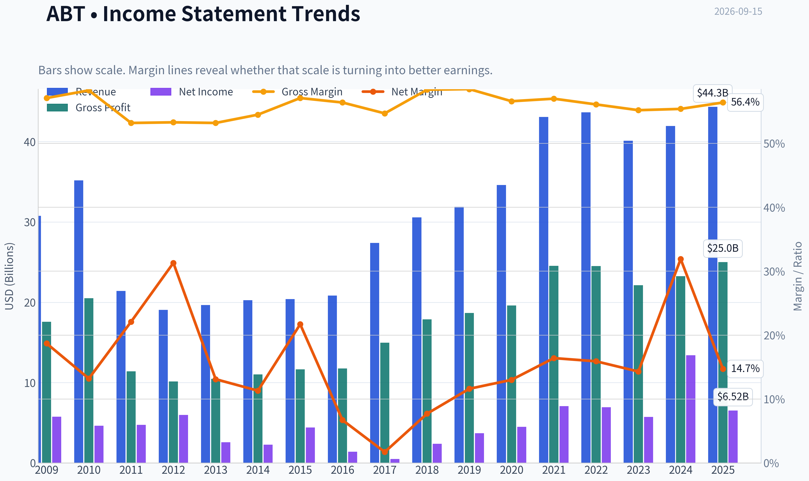
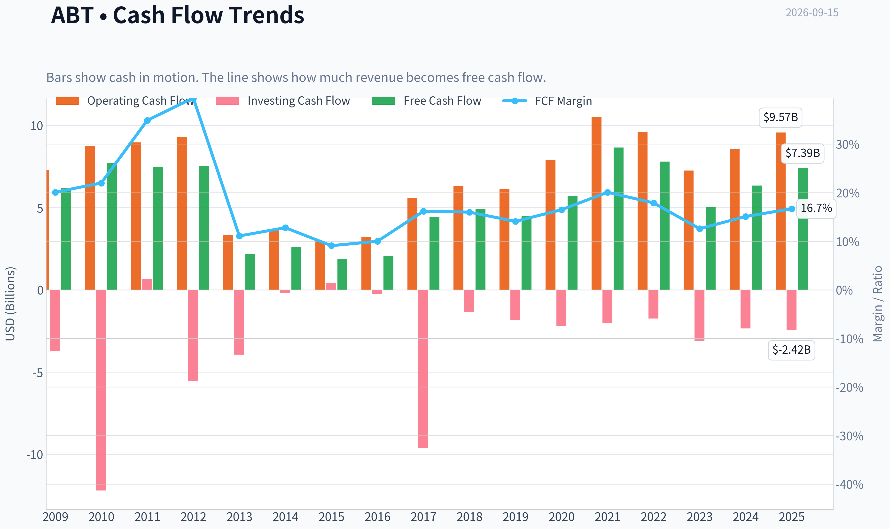
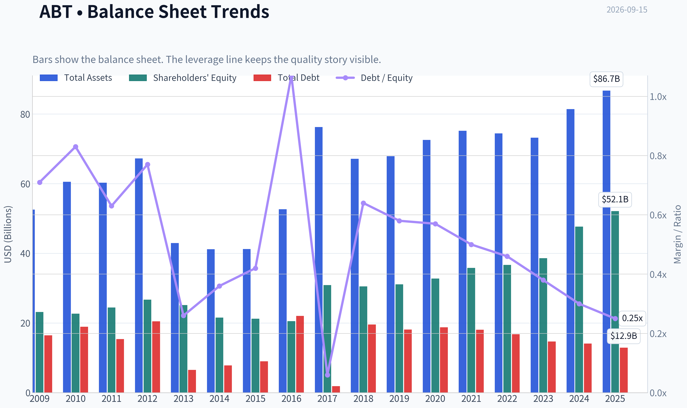
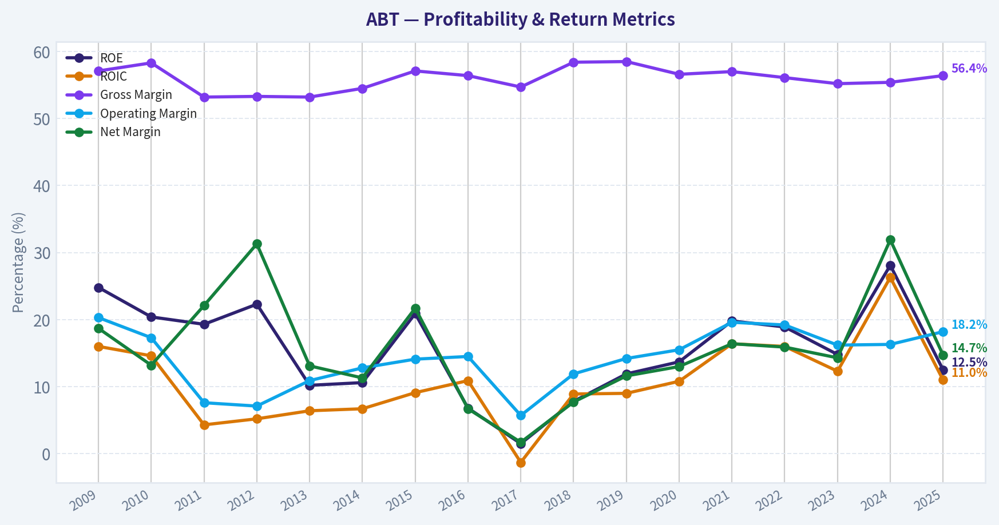
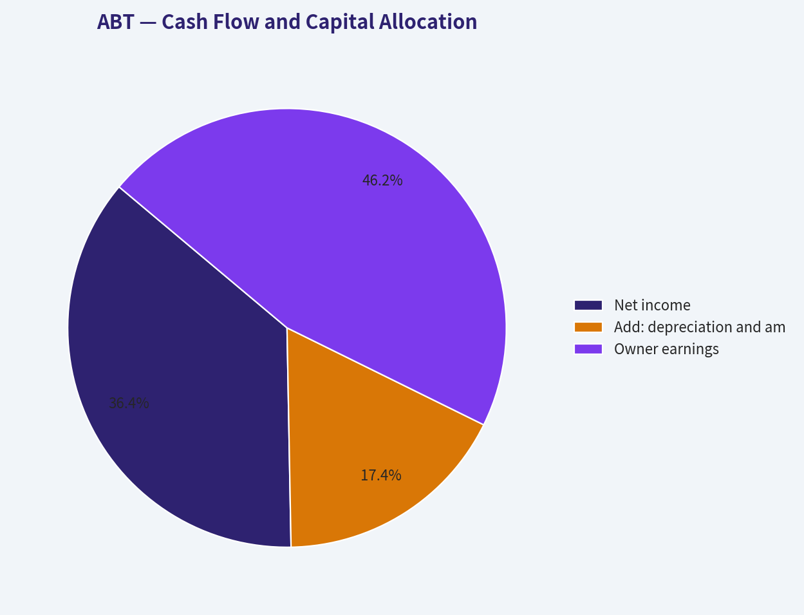
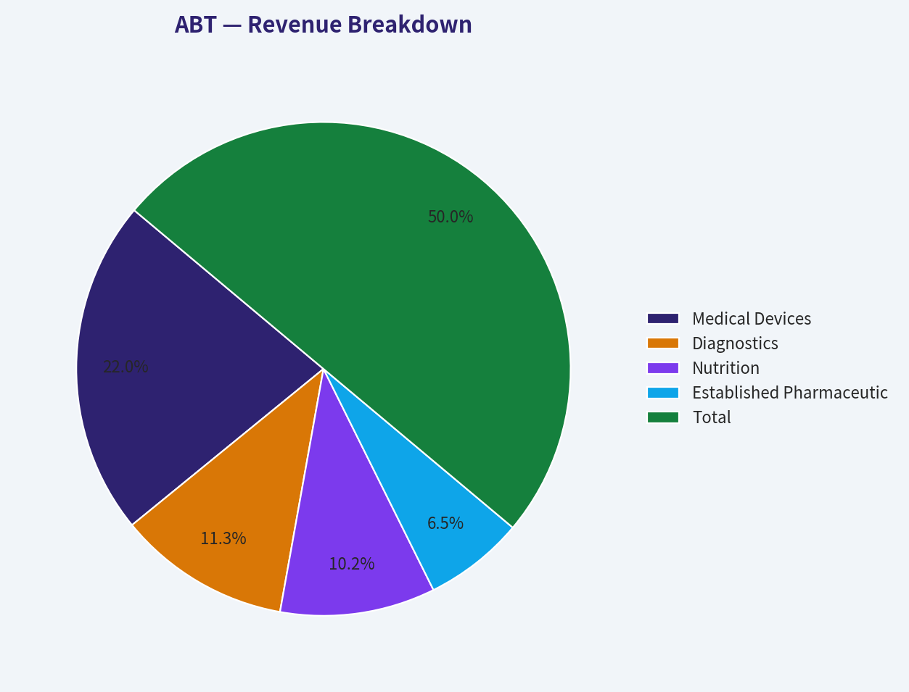
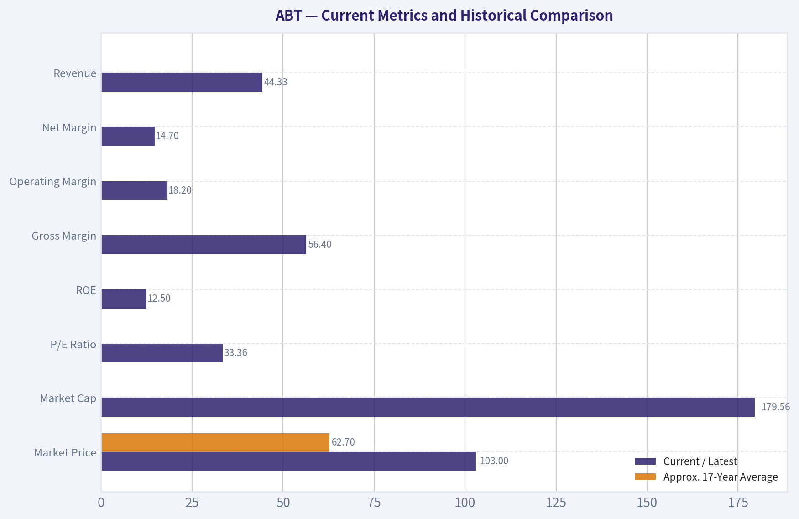
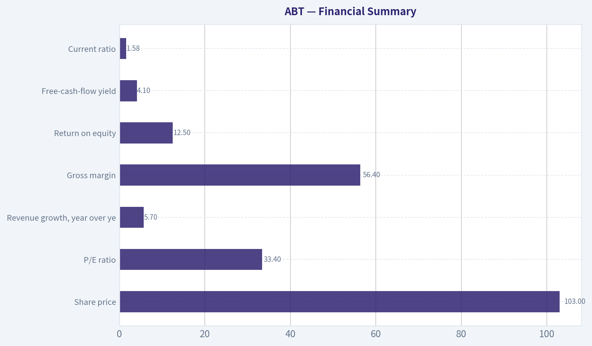
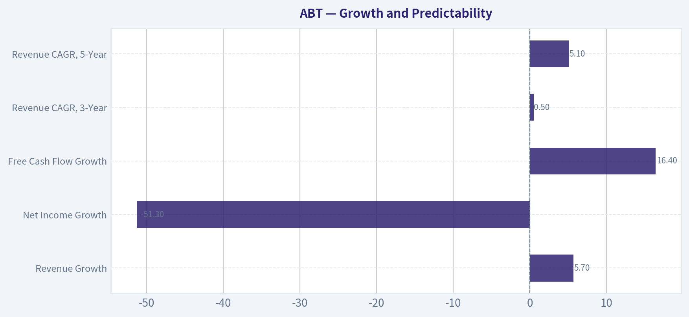

# ABT Deep Value Intelligence

**Analysis Date:** 2026-09-15

## Critical Disclaimer

*This analysis is generated by Deep Value Intelligence, an AI-powered multi-agent investing framework. Education & research only - not financial advice, not a financial advisor.*

---

## Table of Contents

1. Intelligence Summary
2. Analyst Team Reports
   - Fundamentals Analysis
   - Intrinsic Value Analysis (Buffett)
   - Trend & Growth Analysis (Lynch/Druckenmiller/Fisher)
   - Market Technical Analysis
   - Options Market Analysis
3. Research Team Commentary
4. Value Investing Team Commentary
5. Deep Values Commentary

---

## Intelligence Summary

### Thesis + Conditions

**Core Thesis:** ## Executive Briefing

**Key Risks:**
- Durable franchise:** Abbott's brands, regulatory capabilities, clinical relationships, diversification, recurring Libre sensor demand, and **56.4% gross margin** reduce permanent-impairment risk.
- Price is the main risk:** At **$103 and 33.36x trailing earnings**, prospective returns depend heavily on Abbott sustaining roughly **9%-12% owner-earnings growth**. Current **11.1% ROIC** and **12.5% ROE** do not yet provide strong confirmation.
- ## 1. Risk Judgment

**Confidence:** Low

---

## Analyst Team Reports

### Fundamentals Analysis

#### Latest Earnings Snapshot

*Most recent reported quarter anchored on 2026 Q2, with prior-year comparison when available.*

| Metric | 2026 Q2 | 2025 Q2 | YoY Change |
| --- | ---: | ---: | ---: |
| Revenue | N/A | $11.14B | N/A |
| Operating Income | N/A | $2.05B | N/A |
| Net Income | N/A | $1.78B | N/A |
| Diluted EPS | $0.53 | $1.01 | -47.5% |
| Operating Cash Flow | $1.31B | $1.42B | -7.2% |
| Free Cash Flow | $916.0M | $933.0M | -1.8% |

Key Takeaways: This snapshot anchors the most recent reported quarter before the narrative analysis. It helps readers separate long-run business quality from whatever changed in the latest earnings print.

#### 17-Year Financial Metrics for ABT

*All values below are computed deterministically from raw data - not estimated by AI.*

*Issuer profile: operating company (Healthcare / Medical Devices).*

#### 17-Year Financial Metrics
*Annual rows come from reported financial statements. The final TTM row is computed from the latest four quarters.*

| Metric | 2009 | 2010 | 2011 | 2012 | 2013 | 2014 | 2015 | 2016 | 2017 | 2018 | 2019 | 2020 | 2021 | 2022 | 2023 | 2024 | 2025 |
| --- | --- | --- | --- | --- | --- | --- | --- | --- | --- | --- | --- | --- | --- | --- | --- | --- | --- |
| Market Price | $18 | $16 | $20 | $24 | $30 | $36 | $37 | $32 | $49 | $63 | $77 | $98 | $128 | $102 | $104 | $109 | $123 |
| Market Cap | $40.28B | $35.77B | $42.28B | $50.03B | $60.33B | $68.75B | $67.63B | $56.96B | $99.82B | $128.02B | $154.70B | $195.55B | $251.78B | $193.67B | $192.51B | $197.72B | $219.01B |
| P/E Ratio | 7.02 | 7.77 | 8.96 | 8.45 | 23.66 | 30.21 | 15.38 | 40.86 | 211.37 | 54.38 | 42.17 | 43.80 | 35.72 | 28.08 | 33.76 | 14.80 | 33.68 |
| P/B Ratio | 1.74 | 1.58 | 1.73 | 1.87 | 2.40 | 3.19 | 3.19 | 2.77 | 3.23 | 4.19 | 4.98 | 5.96 | 7.03 | 5.28 | 4.99 | 4.15 | 4.20 |
| ROE | 24.8% | 20.4% | 19.3% | 22.3% | 10.2% | 10.6% | 20.9% | 6.8% | 1.5% | 7.8% | 11.9% | 13.7% | 19.8% | 18.9% | 14.8% | 28.1% | 12.5% |
| ROIC | 16.0% | 14.6% | 4.3% | 5.2% | 6.4% | 6.7% | 9.1% | 10.9% | -1.3% | 8.9% | 9.0% | 10.8% | 16.4% | 16.0% | 12.3% | 26.3% | 11.0% |
| EPS | $2.55 | $2.12 | $2.23 | $2.85 | $1.26 | $1.19 | $2.37 | $0.78 | $0.23 | $1.16 | $1.82 | $2.24 | $3.59 | $3.62 | $3.08 | $7.36 | $3.72 |
| Revenue | $30.76B | $35.17B | $21.41B | $19.05B | $19.66B | $20.25B | $20.41B | $20.85B | $27.39B | $30.58B | $31.90B | $34.61B | $43.08B | $43.65B | $40.11B | $41.95B | $44.33B |
| Gross Profit | $17.56B | $20.50B | $11.39B | $10.15B | $10.46B | $11.03B | $11.66B | $11.76B | $14.98B | $17.87B | $18.67B | $19.61B | $24.54B | $24.51B | $22.13B | $23.24B | $25.01B |
| Gross Margin | 57.1% | 58.3% | 53.2% | 53.3% | 53.2% | 54.5% | 57.1% | 56.4% | 54.7% | 58.4% | 58.5% | 56.6% | 57.0% | 56.1% | 55.2% | 55.4% | 56.4% |
| Operating Margin | 20.3% | 17.3% | 7.6% | 7.1% | 10.9% | 12.8% | 14.1% | 14.5% | 5.7% | 11.9% | 14.2% | 15.5% | 19.6% | 19.2% | 16.2% | 16.3% | 18.2% |
| Net Income | $5.75B | $4.63B | $4.73B | $5.96B | $2.58B | $2.28B | $4.42B | $1.40B | $477.0M | $2.37B | $3.69B | $4.50B | $7.07B | $6.93B | $5.72B | $13.40B | $6.52B |
| Net Margin | 18.7% | 13.2% | 22.1% | 31.3% | 13.1% | 11.3% | 21.7% | 6.7% | 1.7% | 7.7% | 11.6% | 13.0% | 16.4% | 15.9% | 14.3% | 31.9% | 14.7% |
| Revenue Growth | N/A | 14.3% | -39.1% | -11.0% | 3.2% | 3.0% | 0.8% | 2.2% | 31.3% | 11.6% | 4.3% | 8.5% | 24.5% | 1.3% | -8.1% | 4.6% | 5.7% |
| Net Income Growth | N/A | -19.5% | 2.2% | 26.1% | -56.8% | -11.3% | 93.7% | -68.3% | -65.9% | 396.4% | 55.7% | 21.9% | 57.3% | -2.0% | -17.5% | 134.2% | -51.3% |
| Free Cash Flow Growth | N/A | 24.8% | -3.1% | 0.5% | -71.0% | 19.2% | -28.6% | 12.2% | 113.0% | 10.6% | -8.3% | 27.3% | 51.1% | -9.8% | -35.2% | 25.5% | 16.4% |
| Total Book Value | $23.14B | $22.68B | $24.44B | $26.72B | $25.17B | $21.53B | $21.21B | $20.54B | $30.90B | $30.52B | $31.09B | $32.78B | $35.80B | $36.69B | $38.60B | $47.66B | $52.13B |
| Total Assets | $52.58B | $60.57B | $60.28B | $67.23B | $42.94B | $41.21B | $41.25B | $52.67B | $76.25B | $67.17B | $67.89B | $72.55B | $75.20B | $74.44B | $73.21B | $81.41B | $86.71B |
| Total Debt | $16.46B | $18.92B | $15.41B | $20.48B | $6.56B | $7.83B | $9.00B | $22.01B | $1.86B | $19.57B | $18.14B | $18.75B | $18.05B | $16.77B | $14.68B | $14.12B | $12.93B |
| Debt-to-Equity | 0.71 | 0.83 | 0.63 | 0.77 | 0.26 | 0.36 | 0.42 | 1.07 | 0.06 | 0.64 | 0.58 | 0.57 | 0.50 | 0.46 | 0.38 | 0.30 | 0.25 |
| Cash & Equivalents | $8.81B | $3.65B | $6.81B | $10.80B | $3.48B | $4.06B | $5.00B | $18.62B | $9.41B | $3.84B | $3.86B | $6.84B | $9.80B | $9.88B | $6.90B | $7.62B | $8.52B |
| Shareholders' Equity | $23.14B | $22.68B | $24.44B | $26.72B | $25.17B | $21.53B | $21.21B | $20.54B | $30.90B | $30.52B | $31.09B | $32.78B | $35.80B | $36.69B | $38.60B | $47.66B | $52.13B |
| Operating Cash Flow | $7.28B | $8.74B | $8.97B | $9.31B | $3.32B | $3.67B | $2.97B | $3.20B | $5.57B | $6.30B | $6.14B | $7.90B | $10.53B | $9.58B | $7.26B | $8.56B | $9.57B |
| Investing Cash Flow | $-3.70B | $-12.19B | $661.0M | $-5.56B | $-3.93B | $-202.0M | $406.0M | $-248.0M | $-9.62B | $-1.36B | $-1.81B | $-2.21B | $-2.01B | $-1.74B | $-3.13B | $-2.34B | $-2.42B |
| Free Cash Flow | $6.19B | $7.72B | $7.48B | $7.52B | $2.18B | $2.60B | $1.86B | $2.08B | $4.43B | $4.91B | $4.50B | $5.72B | $8.65B | $7.80B | $5.06B | $6.35B | $7.39B |
| FCF Margin | 20.1% | 22.0% | 34.9% | 39.5% | 11.1% | 12.8% | 9.1% | 10.0% | 16.2% | 16.0% | 14.1% | 16.5% | 20.1% | 17.9% | 12.6% | 15.1% | 16.7% |
| Dividends / Share | $0.00 | $0.00 | $0.00 | $0.00 | $0.00 | $0.00 | $0.00 | $0.00 | $0.00 | $0.00 | $0.00 | $0.00 | $0.00 | $1.74 | $1.92 | $2.11 | $2.35 |

#### Profitability Metrics
- Return on Equity (ROE): 12.5%
- Return on Invested Capital (ROIC): 11.1%
- Return on Assets (ROA): 7.5%
- Gross Margin: 56.4%
- Operating Margin: 18.2%
- Net Profit Margin: 14.7%

#### Liquidity Metrics
- Current Ratio: 1.58
- Quick Ratio: 1.02

#### Leverage Metrics
- Debt-to-Equity Ratio: 0.25
- Interest Coverage Ratio: 16.33
- Net Debt: $3.99B

#### Growth Metrics (Year-over-Year)
- Revenue Growth: 5.7%
- Net Income Growth: -51.3%
- Free Cash Flow Growth: 16.4%
- Revenue CAGR (3-Year): 0.5%
- Revenue CAGR (5-Year): 5.1%

#### Valuation Metrics
- P/E Ratio (TTM): 33.36
- Forward P/E: 17.00
- Price-to-Book: 3.49
- Price-to-Sales: 3.85
- PEG Ratio: 1.87
- EV/EBITDA: 17.65
- Free Cash Flow Yield: 4.1%
- Earnings Yield: 3.0%

#### Owner Earnings (Buffett Method, Code-Computed)
- Net Income: $6.52B
- + Depreciation & Amortization: $3.12B
- - Capital Expenditures: $-2.17B
- - Working Capital Changes: $-803.0M
- = **Owner Earnings: $8.27B**

#### Intrinsic Value (Code-Computed)
- Current Price: $103
- **Headline Intrinsic Value (business-model routed): $59**
  Business model: asset light platform - weighted blend [Damodaran FCFF + reverse-DCF fair + owner-earnings DCF] (asset_light_platform)
  Model spread (min-max across DCFs): $51 - $65
  Margin of safety vs. price (headline): -73.9%
  Routing note: Asset-light / high-margin platform: value driven by margins and reinvestment economics - the headline centers on the reverse-DCF demonstrated-growth fair value with Damodaran FCFF as a floor, down-weighting the owner-earnings DCF.
- Buffett Method (Owner Earnings):
  Conservative: $24
  Average: $65
  Optimistic: $441
- Cash Flow Method (FCF):
  Conservative: $38
  Average: $52
  Optimistic: $119
- Damodaran FCFF (WACC + margins + reinvestment):
  Conservative: $39
  Average: $51
  Optimistic: $73
  Monte Carlo band (P10-P90): $38 - $75 (median $52)
  P(intrinsic value > price): 1.4%
- Reverse-DCF: price implies ~16.1%/yr owner-earnings growth for 10y; trailing 3y was -5.9%, 5y 29.0%.

#### Piotroski F-Score: 5/9
- Positive Net Income: PASS
- Positive Operating Cash Flow: PASS
- ROA Improvement: FAIL
- Cash Flow > Net Income: PASS
- Decreasing Debt: PASS
- Improving Current Ratio: FAIL
- No Dilution: FAIL
- Improving Gross Margin: PASS
- Improving Asset Turnover: FAIL

ANALYST STANCE: **AVOID**

#### Executive Summary

Abbott Laboratories is a high-quality healthcare and medical-device company with durable brands, diversified revenue, strong cash generation, improving balance-sheet leverage, and a meaningful innovation pipeline. Its latest operating results remain solid: revenue grew 5.7% year over year, free cash flow grew 16.4%, gross margin was 56.4%, operating margin was 18.2%, and net debt was only $3.99 billion.

The principal issue is valuation. At approximately $103 per share and a $179.56 billion market capitalization, ABT trades at 33.4 times trailing earnings and produces only a 4.1% free-cash-flow yield. The deterministic valuation models place intrinsic value between approximately $51 and $65 per share, with a headline blended value of $59.29. The current price also implies approximately 16.1% annual owner-earnings growth for ten years, which is materially above the company's recent three-year trend.

This is an excellent business at a price that appears to discount unusually strong execution. Under a Buffett-style framework, ABT is better classified as **AVOID for new purchases at the current price**, while existing shareholders may reasonably continue holding if they have a low cost basis and a long investment horizon.

#### Current Metrics and Historical Comparison

The table below compares current or latest available values with approximate arithmetic averages of the 17 deterministic annual observations from 2009 through 2025. The historical table itself is not reproduced.

| Metric | Current / Latest | Approx. 17-Year Average | Interpretation |
|---|---:|---:|---|
| Market Price | $103 | $62.7 | Current price is about 64% above the historical average, although the average includes earlier corporate restructuring periods. |
| Market Cap | $179.56B | ~$125.6B | Valuation is substantially larger than the long-term average. |
| P/E Ratio | 33.36x | ~37.7x | Below the arithmetic average because the average is distorted by exceptionally high 2017 earnings multiples; still expensive on normalized earnings. |
| P/B Ratio | 3.49x current metric; 4.20x in 2025 annual row | ~3.6x | Not a decisive signal for ABT; tangible book value is affected by acquisitions, goodwill, and capital allocation. |
| ROE | 12.5% | ~15.5% | Below the long-term average and far below the 2024 peak of 28.1%. |
| ROIC | 11.1% latest metric | ~10.8%-11.0% | Approximately normal for the longer period, but below the 2024 peak of 26.3%. |
| Gross Margin | 56.4% | ~56.0% | Very stable and slightly above the long-term norm. |
| Operating Margin | 18.2% | ~13.9% | Meaningfully above the long-term average, indicating better operating leverage and mix. |
| Net Margin | 14.7% | ~15.1% | Close to the long-term average after the unusually high 2024 result. |
| Revenue | $44.33B | ~$32.4B | The business is materially larger than it was historically. |
| Free Cash Flow | $7.39B | ~$5.32B | Current FCF is substantially above the long-term average. |
| FCF Margin | 16.7% | ~16.5% | Approximately normal and healthy. |
| Debt-to-Equity | 0.25x | ~0.52x | Leverage is among the lowest levels in the dataset. |
| Cash and Equivalents | $8.52B | ~$7.1B | Above the long-term average and adequate relative to debt. |
| Dividends per Share | $2.35 | Meaningful dividends began in 2022 | Dividend payments have increased each year since initiation in the dataset. |

**Key Takeaways:** ABT's operating business is stronger and larger than its historical average, particularly on revenue, operating margin, free cash flow, and leverage. However, the present price reflects a substantial valuation premium, while ROE and ROIC have fallen sharply from 2024 levels. The apparent discount to the average P/E is not reassuring because the historical average is heavily distorted by years with unusually depressed earnings.

#### Market Metrics and Valuation

At a current price of approximately $103, ABT has a market capitalization of $179.56 billion. The trailing P/E ratio is 33.36, while the forward P/E is approximately 17.0. The large difference suggests that analysts expect earnings normalization or substantial near-term earnings growth, but the current valuation still demands strong execution.

The price-to-book ratio is approximately 3.49 in the latest valuation data, versus 4.20 in the 2025 annual row. P/B should not be used mechanically here. Abbott is a branded healthcare, diagnostics, nutrition, and medical-device company whose economic value depends more on intellectual property, regulatory approvals, distribution, installed clinical ecosystems, and recurring demand than on tangible book value. Acquisitions and goodwill also make book value less representative of franchise value.

The more useful valuation indicators are the 4.1% FCF yield, 3.0% earnings yield, 17.65x EV/EBITDA, and the DCF outputs. On those measures, ABT does not provide a conventional Buffett margin of safety.

#### Profitability and Operating Quality

Abbott's latest gross margin is 56.4%, almost exactly in line with the long-term average. This is a positive sign because gross-margin stability implies that pricing power, product mix, and manufacturing economics have remained resilient despite changing healthcare markets.

The 18.2% operating margin is considerably above the approximate 13.9% historical average. Margin improvement has been especially visible since the weak 2017 period, when operating margin fell to 5.7%. The current margin is not as high as the 19%-20% levels recorded in 2021 and 2022, but it remains structurally better than much of the earlier decade.

Net income is $6.52 billion and net margin is 14.7%. The latest net-income growth rate is negative 51.3%, primarily because the 2024 figure was unusually elevated at $13.40 billion. Therefore, the decline should not be interpreted as a comparable collapse in the underlying franchise. Even so, the earnings history is volatile: Abbott experienced major earnings disruptions in 2013, 2016, 2017, and 2025.

ROE of 12.5% is below the long-term average of approximately 15.5%. ROIC of roughly 11.1% is more respectable because it is close to the long-run level, but it is well below the 2024 figure of 26.3%. The recent decline argues against valuing ABT as though its exceptional 2024 profitability were permanent.

#### Growth and Predictability

| Growth Measure | Current / Latest | Historical Pattern | Assessment |
|---|---:|---|---|
| Revenue Growth | 5.7% | Highly variable; includes major declines and acquisition-related increases | Current growth is healthy but not extraordinary. |
| Net Income Growth | -51.3% | Extremely volatile, ranging from significant declines to triple-digit rebounds | Earnings are less predictable than revenue. |
| Free Cash Flow Growth | 16.4% | Volatile but positive over the latest period | Cash conversion is currently improving. |
| Revenue CAGR, 3-Year | 0.5% | Weak recent compounding | Recent top-line momentum has been modest. |
| Revenue CAGR, 5-Year | 5.1% | Better than the three-year trend | Long-term growth is credible but not consistent with a 16% implied growth requirement. |

**Key Takeaways:** Revenue growth is positive but moderate, and the three-year revenue CAGR of only 0.5% shows that recent momentum has been uneven. Free cash flow growth is much stronger than net-income growth, which is favorable for intrinsic value. Nevertheless, the market price appears to require a much more aggressive growth trajectory than the recent operating record supports.

Revenue increased from $30.76 billion in 2009 to $44.33 billion in the latest annual observation, but the path was not smooth. The 2011-2012 revenue decline and the 2023 decline demonstrate that acquisitions, divestitures, recalls, product cycles, and portfolio changes can materially affect reported growth.

#### Balance Sheet and Financial Strength

Abbott's balance sheet is a clear strength. Total debt has declined from $18.75 billion in 2020 to $12.93 billion in the latest annual observation, while debt-to-equity has fallen to 0.25 from 0.57 in 2020 and 1.07 in 2016. Cash and equivalents are $8.52 billion, producing net debt of only $3.99 billion.

Interest coverage is 16.33 times, which provides a substantial cushion against higher financing costs or temporary earnings weakness. The current ratio of 1.58 and quick ratio of 1.02 indicate adequate short-term liquidity.

Total assets are $86.71 billion and shareholders' equity is $52.13 billion. The increase in equity over the period is constructive, although book value remains less useful than cash flow for judging the franchise. The Piotroski F-score of 5 out of 9 is neutral rather than strongly positive: debt reduction and positive cash flow are favorable, but ROA improvement, current-ratio improvement, dilution, and asset turnover remain concerns.

#### Cash Flow and Capital Allocation

Free cash flow is $7.39 billion, with a 16.7% FCF margin. Operating cash flow is $9.57 billion, and owner earnings calculated from the dataset are $8.27 billion:

| Owner-Earnings Calculation | Amount |
|---|---:|
| Net income | $6.52B |
| Add: depreciation and amortization | $3.12B |
| Less: capital expenditures | $(2.17)B |
| Less: working-capital investment | $(0.803)B |
| **Owner earnings** | **$8.27B** |

**Key Takeaways:** Abbott converts profits into substantial cash, and owner earnings exceed reported net income because depreciation is meaningfully larger than capital expenditures. The balance sheet allows management to fund research, acquisitions, dividends, and debt reduction without depending heavily on external capital. Cash generation is strong, but the current share price still capitalizes that cash flow at an aggressive multiple.

Dividends per share increased from $1.74 in 2022 to $2.35 in the latest annual observation. This supports Abbott's income-investor appeal and reflects a shareholder-friendly capital allocation policy. However, dividend yield at the current price is only approximately 2.3%, so the investment case depends primarily on earnings and valuation growth rather than current income.

#### Revenue Breakdown

Abbott reports four major operating segments. Precise latest segment figures were not included in the deterministic dataset, so the following is an approximate allocation of the latest $44.33 billion revenue base using publicly reported segment mix and rounded estimates.

| Revenue Source | Amount ($B, approximate) | % of Total |
|---|---:|---:|
| Medical Devices | $19.5B | 44% |
| Diagnostics | $10.0B | 23% |
| Nutrition | $9.0B | 20% |
| Established Pharmaceutical Products | $5.8B | 13% |
| **Total** | **$44.3B** | **100%** |

**Key Takeaways:** Medical Devices is Abbott's largest and most strategically important segment, providing exposure to structural healthcare growth in areas such as cardiovascular care, diabetes management, and minimally invasive procedures. Diagnostics and Nutrition add diversification, while Established Pharmaceuticals provide broad international scale but generally have lower growth and greater currency and pricing exposure. The four-part portfolio reduces dependence on any single product category.

#### Buffett-Style Qualitative Analysis

**Economic moat:** Abbott has a meaningful, though not unassailable, moat. Its advantages include regulatory barriers, physician and hospital relationships, established distribution, installed equipment ecosystems, brand recognition, specialized manufacturing, and intellectual property. Medical devices can generate recurring demand through replacement cycles, consumables, software, and clinical familiarity. FreeStyle Libre is an important example of a product ecosystem with recurring customer engagement and potential network-like benefits.

The moat is strongest in specialized devices and diagnostics, where clinical validation and regulatory approval make substitution difficult. It is weaker in commoditized nutrition and pharmaceutical categories, where competition, reimbursement pressure, recalls, and patent exposure can reduce returns.

**Financial strength:** Strong. Debt-to-equity of 0.25, net debt of $3.99 billion, cash of $8.52 billion, and interest coverage above 16 times provide considerable resilience. Abbott can continue investing through downturns and absorb isolated litigation or recall costs.

**Predictable earnings:** Moderate rather than exceptional. Revenue is diversified, but the historical record includes substantial swings in both earnings and cash flow. The 2024 net-income spike and subsequent normalization demonstrate that reported earnings can be distorted by nonrecurring items. Revenue is more dependable than net income.

**Management performance:** Management has improved margins and reduced leverage while continuing to invest in growth businesses. Dividend increases show commitment to shareholders. The main concern is capital allocation risk: acquisitions and restructuring can create large accounting fluctuations, and dilution has been marked as a Piotroski weakness.

**Quality of business:** High. Gross margin stability, a broad portfolio, strong cash conversion, and above-average operating margins support a durable franchise. The company is not a pure high-growth compounder, however. Its size, regulatory exposure, litigation risk, and uneven historical growth limit the rate at which it can compound indefinitely.

#### Owner-Earnings DCF

The deterministic pack's model-based intrinsic value should remain the primary valuation anchor:

- Headline blended intrinsic value: **$59.29 per share**
- Owner-earnings model: **$64.96 per share**
- FCF model: **$52.43 per share**
- Damodaran FCFF model: **$50.72 per share**
- Model spread: approximately **$51-$65 per share**
- Damodaran Monte Carlo band: approximately **$38-$75**
- Probability that intrinsic value exceeds the current price: **1.4%**

For a transparent hand calculation, the following uses $8.27 billion of current owner earnings, approximately 1.74 billion shares, a 10% discount rate, a 2.5% terminal growth rate, and a five-year explicit forecast. Growth fades toward the terminal rate rather than continuing permanently at the initial forecast rate.

| Scenario | Explicit Owner-Earnings Assumption | PV of Years 1-5 | PV of Terminal Value | Equity Value | Approx. Value per Share |
|---|---|---:|---:|---:|---:|
| Conservative | 3% annual growth for five years; 2.5% terminal growth | ~$35.8B | ~$81.3B | ~$117.1B | ~$67 |
| Average | 7% annual growth for five years; 2.5% terminal growth | ~$38.1B | ~$98.4B | ~$136.5B | ~$78 |
| Optimistic | Growth begins at 12% and fades toward 2.5% by year five; 2.5% terminal growth | ~$39B | ~$95B | ~$134B | ~$77 |

**Key Takeaways:** The hand DCF produces a broad sensitivity range of approximately $67 to $78 per share, depending on the selected growth path. These values are higher than the deterministic pack's routed intrinsic-value range because the hand model uses a relatively favorable starting owner-earnings base and simplified assumptions. The stronger model-based anchor of $51-$65 should therefore be given greater weight, especially because the current price implies approximately 16.1% annual owner-earnings growth for ten years.

The optimistic hand case is not a permanent 12% growth assumption; it fades rapidly toward the terminal rate. Even with this favorable setup, the modeled value remains below $103. A purchase at the current price would require some combination of unusually strong medical-device growth, sustained margin expansion, successful product launches, and a persistently high valuation multiple.

#### Risks, Opportunities, and Red Flags

| Category | Specific Considerations |
|---|---|
| Opportunities | Continued adoption of connected diabetes products, cardiovascular devices, diagnostics, international nutrition growth, and operating leverage. |
| Competitive advantages | Regulatory approvals, physician relationships, installed clinical systems, brand strength, distribution, and product ecosystems. |
| Valuation risk | 33.4x trailing P/E, 4.1% FCF yield, and a price materially above deterministic intrinsic-value estimates. |
| Earnings risk | Latest net-income growth is negative 51.3% because of a difficult comparison and earnings normalization. |
| Regulatory and litigation risk | The baby-formula plant settlement highlights recall, product-liability, compliance, and reputational risks. |
| Capital-allocation risk | Acquisitions and restructuring may create volatility; Piotroski data also flags dilution. |
| Execution risk | The valuation requires growth well above the recent three-year revenue CAGR of 0.5%. |
| Macro risk | Currency movements, hospital budgets, reimbursement policy, pricing pressure, and healthcare regulation can affect results. |

**Key Takeaways:** The opportunities are genuine and linked to durable healthcare trends, especially medical devices and diabetes management. The red flags are primarily valuation and execution-related rather than balance-sheet-related. Abbott can remain a superior company while still producing poor future returns if investors pay too much for its expected growth.

#### Investment Conclusion

Abbott passes most qualitative quality tests:

- Strong and diversified operating franchise.
- Durable regulatory and distribution advantages.
- Stable gross margins.
- Improving operating margins.
- Robust free cash flow.
- Low leverage and strong interest coverage.
- Consistent dividend growth.

It fails the strict value test at the current price:

- Current price is approximately **$103** versus a headline intrinsic value of **$59.29**.
- The deterministic model range of **$51-$65** implies a material overvaluation.
- The reverse DCF requires approximately **16.1% annual owner-earnings growth for ten years**.
- Recent three-year revenue growth was only **0.5%**, and ROE has fallen to **12.5%** from **28.1%** in 2024.
- The margin of safety is negative; the pack reports approximately **-73.9%** versus headline intrinsic value.

**Final stance: AVOID.** This means avoid initiating or materially increasing a position at approximately $103, not that Abbott is a poor business. A more attractive entry point would be near or below the deterministic valuation range, preferably with a margin of safety around the low-to-mid $50s or below. Existing long-term shareholders may continue holding because of the moat, dividend, and financial strength, but new capital should wait for either a substantially lower price or clear evidence that long-term growth is materially stronger than the historical record.

#### Key Points Summary

| Key Point | Assessment |
|---|---|
| Business quality | High-quality diversified healthcare franchise |
| Economic moat | Meaningful, strongest in medical devices and diagnostics |
| Financial strength | Strong; low leverage, positive net cash-flow profile, high interest coverage |
| Profitability | Healthy margins, but ROE and ROIC below recent peaks |
| Growth | Credible mid-single-digit long-term growth; recent momentum uneven |
| Cash generation | Strong; $7.39B FCF and $8.27B owner earnings |
| Dividend | Growing, but yield is modest at the current price |
| Valuation | Expensive relative to cash flow and model-based intrinsic value |
| Main risk | Paying for growth that may not materialize |
| Preferred action | Wait for a lower entry price or a wider margin of safety |
| Final stance | **AVOID** |

#### Fundamental Visuals

This graph tracks the profitability and return metrics (ROE, ROIC, Margins) of **ABT** over the past decade, highlighting capital efficiency trends.

This chart illustrates the financial health of **ABT** over the last 10 years, mapping cash equivalents and free cash flow against total obligations (Debt).

This breakdown chart from <em>Cash Flow and Capital Allocation</em> shows the proportional composition for **ABT** - useful for understanding what drives or risks the business.

This breakdown chart from <em>Revenue Breakdown</em> shows the proportional composition for **ABT** - useful for understanding what drives or risks the business.

---

### Intrinsic Value Analysis (Buffett)

> *Following Warren Buffett's value investing philosophy: Circle of Competence, Economic Moat, Management Quality, and Margin of Safety.*

#### Intrinsic Value Snapshot

Price is what you pay. Intrinsic value is what the business may be worth based on the cash it can create for owners over time. We show a range, not one magic number.

- Current Price: $103.09
- Value Range (conservative to optimistic across both DCF methods): $24.16 to $440.83

##### Owner Earnings (Buffett Method)
- Net Income: $6,524,000,000.00
- Depreciation & Amortization: $3,116,000,000.00
- Capital Expenditures: $-2,171,000,000.00
- Working Capital Changes: $-803,000,000.00
- Owner Earnings: $8,272,000,000.00

##### Intrinsic Value
###### Buffett Method
Uses owner earnings. Stricter, and usually more conservative.
- Conservative: $24.16
- Average: $64.96
- Optimistic: $440.83
- Discount Rate: 10.0%

###### Cash Flow Method
Uses free cash flow. Better for companies spending heavily today to grow tomorrow.
- Conservative: $38.00
- Average: $52.43
- Optimistic: $119.17
- Discount Rate: 10.0%

ANALYST STANCE: **WATCH**

#### Executive Conclusion

Abbott Laboratories is a high-quality, diversified healthcare company with strong brands, regulatory expertise, scale advantages, and attractive long-term demographics. Its gross margin of 56.4% and broad portfolio across medical devices, diagnostics, nutrition, and established pharmaceuticals support a durable moat.

However, at approximately **$103 per share**, ABT appears materially above conservative intrinsic-value estimates. The current valuation implies roughly **16.1% annual growth for the next decade**, which is substantially more demanding than its recent one-year revenue growth of 5.7% and its trailing three-year growth trend of negative 5.9%. Abbott is a business worth owning, but the present price does not provide an adequate margin of safety.

#### 1. Factor Scorecard

| Factor | Score | Assessment |
|---|---:|---|
| Circle of competence and simplicity | 4.0 / 5 | Diversified healthcare products are understandable, though the business has several segments and meaningful regulatory complexity. |
| Durable competitive advantage | 4.5 / 5 | Strong brands, clinical data, regulatory know-how, scale, distribution, and switching costs in devices and diagnostics. |
| Management and capital allocation | 3.5 / 5 | Long operating history and diversified reinvestment platform; recent formula-plant settlement highlights execution and compliance risks. |
| Industry structure | 4.0 / 5 | Healthcare devices and diagnostics benefit from regulation, scale, and high customer qualification costs, although competition and reimbursement pressure remain. |

**Key Takeaways:** Abbott scores strongly on business quality, particularly its moat and industry position. The primary weaknesses are complexity, regulatory exposure, and recent operational controversy rather than financial distress.

#### Gate 5: Quality and Solvency

**The hard floor is not tripped.** The available evidence does not indicate both a clearly worsening earnings and cash-flow trajectory and a solvency red line such as interest coverage below 1x or distress-zone financial condition. Valuation is a serious concern, but overvaluation alone does not trigger the hard floor.

#### 2. Moat Analysis

| Moat Source | Evidence | Rating |
|---|---|---:|
| Intangible assets | Recognized healthcare brands, regulatory approvals, clinical evidence, patents, and physician familiarity | 4 / 5 |
| Switching costs | Hospitals and clinicians face training, workflow, validation, and reliability costs when replacing diagnostic and medical-device systems | 4 / 5 |
| Cost advantages | Global scale in manufacturing, research, sales, procurement, and distribution | 4 / 5 |
| Network effects | Limited traditional network effects, but installed-base and ecosystem benefits exist in certain device and diagnostics categories | 2.5 / 5 |
| Overall moat quality | Broad, durable, and reasonably stable competitive advantages | **Wide and stable: 4 / 5** |

Abbott's strongest moat is not a single consumer brand or software network. It is the accumulated combination of regulatory approvals, clinical trust, physician habits, distribution scale, manufacturing expertise, and a large installed base.

The company's **56.4% gross margin** supports the presence of valuable intellectual property and differentiated products. Medical devices and diagnostics also tend to be "mission-critical" purchases, making customers less likely to switch based solely on small price differences.

The moat is wide but not necessarily widening rapidly. Competitors such as Medtronic, Roche, Siemens Healthineers, Boston Scientific, Dexcom, and Novo Nordisk remain formidable in individual categories.

#### 3. Management Quality and Capital Allocation

| Consideration | Assessment | Score |
|---|---|---:|
| Owner orientation | Long-term public-company orientation and broad reinvestment across healthcare franchises; direct insider ownership evidence is not decisive | 3.5 / 5 |
| Candor and accounting quality | Large, established issuer with substantial disclosure obligations; regulatory and product issues require close monitoring | 3.5 / 5 |
| Reinvestment discipline | Strong opportunity set in medical devices, diagnostics, nutrition, and connected health | 4.0 / 5 |
| Acquisition discipline | Diversification can create value, but healthcare acquisitions must be judged carefully against purchase prices and integration risk | 3.0 / 5 |
| Overall management assessment | Competent long-term operator, with execution and compliance risk deserving attention | **3.5 / 5** |

Abbott has attractive reinvestment opportunities because healthcare demand is supported by aging populations, chronic disease, increasing diagnostics, and technological improvement. The main management risk is not obviously reckless capital allocation; it is the possibility that operational complexity leads to quality-control, regulatory, or integration problems.

The reported **$385 million settlement related to the Sturgis, Michigan infant-formula plant** is financially manageable for Abbott but is a reminder that quality systems and regulatory execution are central to the investment thesis.

#### 4. Financial Summary

| Metric | Latest Value |
|---|---:|
| Share price | $103 |
| Market capitalization | $179.56 billion |
| P/E ratio | 33.4x |
| Revenue growth, year over year | 5.7% |
| Gross margin | 56.4% |
| Return on equity | 12.5% |
| Free-cash-flow yield | 4.1% |
| Implied annual free cash flow | Approximately $7.36 billion |
| Current ratio | 1.58x |

**Key Takeaways:** Abbott generates substantial cash and maintains an attractive gross margin, but the 33.4-times earnings multiple is demanding relative to current growth. Its 12.5% ROE is respectable but below the level normally associated with a truly exceptional compounder, and the 4.1% free-cash-flow yield offers limited valuation protection.

#### 5. Owner Earnings Calculation

Because maintenance capital expenditure and working-capital requirements are not separately provided in the research figures, free cash flow is used as the practical owner-earnings proxy.

| Owner Earnings Component | Approximate Amount |
|---|---:|
| Net income implied by current P/E and market capitalization | $5.38 billion |
| Add: depreciation and amortization | Not separately available |
| Less: maintenance capital expenditure | Reflected within FCF proxy |
| Less: working-capital investment | Reflected within FCF proxy |
| Normalized owner earnings proxy | **Approximately $7.36 billion** |
| Shares implied by market capitalization and price | Approximately 1.74 billion |
| Owner earnings per share proxy | **Approximately $4.22** |

**Key Takeaways:** Abbott's normalized owner earnings are estimated at roughly $7.36 billion, or $4.22 per share. That produces a current owner-earnings yield of approximately 4.1%, which is reasonable for a high-quality healthcare franchise but not compelling enough to offset the valuation risk.

#### 6. Three-Scenario DCF Valuation

The calculations use approximately **$4.22 per share of normalized owner earnings** and a 10% discount rate.

| Scenario | Key Assumption | Estimated Value per Share |
|---|---|---:|
| A. No growth | Owner earnings divided by 10% | **$42** |
| B. GDP growth | 3% perpetual growth | **$62** |
| C. Historical-growth framework | Normalized 8% growth assumption, below the observed five-year rate and avoiding an unrealistic 10% terminal-growth/discount-rate structure | **Approximately $87** |
| Research-pack blended intrinsic value | Weighted blend of FCFF, reverse DCF, and owner-earnings models | **$59.29** |
| Three-model range | Owner earnings / FCF / Damodaran FCFF | **$64.96 / $52.43 / $50.72** |

**Key Takeaways:** Conservative valuation methods place Abbott's value substantially below the current $103 share price. Even the more optimistic growth case produces a value below the market price, while the blended estimate of $59.29 implies that investors are paying a large premium for future growth.

#### 7. Margin of Safety Analysis

| Measure | Result |
|---|---:|
| Current price | $103 |
| Blended intrinsic value | $59.29 |
| Premium to blended intrinsic value | Approximately 74% |
| Owner-earnings DCF value | $64.96 |
| FCF-based value | $52.43 |
| Damodaran FCFF value | $50.72 |
| Price-implied 10-year growth | Approximately 16.1% annually |
| Five-year historical growth reference | 29.0% |
| Three-year historical growth reference | -5.9% |

**Key Takeaways:** The market price does not offer a margin of safety against the blended intrinsic-value estimate; it represents a substantial premium. The reverse DCF is especially important: ABT would need to sustain roughly 16.1% annual growth for ten years, a demanding assumption for a mature healthcare conglomerate.

For a wide-moat, predictable compounder, a 10% to 15% discount could be acceptable. Abbott is not close to that threshold under the supplied valuation estimates. A more attractive entry point would be near the **$60 to $75 range**, depending on confidence in normalized growth and execution.

#### 8. Final Buffett Scorecard

| Criterion | Weight | Score | Weighted Contribution |
|---|---:|---:|---:|
| Moat width and durability | 25% | 4.5 | 1.13 |
| Valuation and margin of safety | 20% | 1.5 | 0.30 |
| Capital returns versus WACC | 15% | 3.5 | 0.53 |
| Business understanding and predictability | 12% | 4.0 | 0.48 |
| Management quality and capital allocation | 12% | 3.5 | 0.42 |
| Reinvestment runway | 8% | 4.0 | 0.32 |
| Balance-sheet strength | 4% | 3.5 | 0.14 |
| Industry structure | 4% | 4.0 | 0.16 |
| **Total** | **100%** |  | **3.48 / 5.00** |

**Key Takeaways:** Abbott is close to the threshold for an attractive long-term compounder, but valuation reduces the overall score materially. Its business quality supports patient ownership, yet the current price assumes unusually strong growth and leaves little room for regulatory setbacks, slower device adoption, or margin pressure.

#### 9. Investment Stance

**WATCH - Moderate conviction.**

Abbott is the kind of business a Buffett-style investor can reasonably study and eventually own: understandable products, durable competitive advantages, recurring healthcare demand, strong gross margins, and multiple avenues for reinvestment. But at $103, the stock appears priced for excellent execution and sustained high growth.

The appropriate action is to **wait for a more favorable entry price**, ideally near the $60-to-$75 valuation range or until earnings growth catches up with the share price. The thesis would improve if Abbott demonstrates sustained double-digit earnings and free-cash-flow growth without further quality or regulatory problems.
#### Valuation Bridge

This bridge places the current market price beside each intrinsic value lens so readers can see whether upside depends on one method or shows up across several methods.

| Scenario | Intrinsic Value / Share |
| --- | ---: |
| Buffett Method | $64.96 |
| Cash Flow Method | $52.43 |
| Damodaran Method | $50.72 |
| Current Price | $103.09 |

#### Key Takeaways

If one method is far above the others, the upside case depends on a specific modelling assumption. When several methods cluster together, the valuation story is more robust.

#### Valuation Visuals

This comparison chart from *Latest Earnings Snapshot* stacks current figures against historical benchmarks for **ABT**, making it easy to see where the company trades relative to its own averages.

This comparison chart from *Current Metrics and Historical Comparison* stacks current figures against historical benchmarks for **ABT**, making it easy to see where the company trades relative to its own averages.

This comparison chart from *Financial Summary* stacks current figures against historical benchmarks for **ABT**, making it easy to see where the company trades relative to its own averages.

---

### Trend & Growth Analysis (Lynch/Druckenmiller/Fisher)

> *Following Peter Lynch's GARP, Stanley Druckenmiller's macro-aware approach, and Philip Fisher's scuttlebutt methodology.*

ANALYST STANCE: **AVOID**

#### 1. Lynch Classification

**Abbott Laboratories is a stalwart, not a fast grower.** Revenue growth is approximately 5.7% year over year, below the 15-25% threshold generally required for primary growth-investing opportunities.

| Metric | ABT |
|---|---:|
| Current price | $103 |
| Market capitalization | $179.6 billion |
| Revenue growth | 5.7% YoY |
| P/E ratio | 33.4x |
| Gross margin | 56.4% |
| ROE | 12.5% |
| FCF yield | 4.1% |
| Current ratio | 1.58x |

**Key Takeaways:** Abbott is financially solid, diversified, and profitable, but its growth profile is that of a quality healthcare stalwart rather than a fast grower. The main concern is paying a high-growth valuation for mid-single-digit revenue growth.

#### 2. The Story in Three Bullets

- Abbott sells essential healthcare products across medical devices, diagnostics, nutrition, and branded pharmaceuticals.
- Its strongest secular opportunities include diabetes care, cardiovascular devices, diagnostics, and broader healthcare innovation.
- The business has durable demand and diversification, but the current valuation appears to discount substantially faster earnings growth than the recent revenue trend supports.

#### 3. TAM and Runway

Abbott participates in very large healthcare markets, including continuous glucose monitoring, cardiovascular devices, diagnostics, and nutrition. However, the relevant question is not whether global healthcare is large; it is whether Abbott can grow rapidly enough within its specific markets.

| Measure | Estimate / Assessment |
|---|---|
| Approximate current annual revenue | Roughly $40-45 billion |
| 10x revenue objective | Roughly $400-450 billion |
| Broad healthcare TAM | Easily larger than the 10x revenue objective |
| Practical 10x test | Technically passes on broad TAM, but difficult on realistic addressable segments |
| TAM growth | Favorable in diabetes technology and medical devices; mixed across mature businesses |
| Runway quality | Good for durability; weaker for 20%+ sustained growth |

**Key Takeaways:** Abbott has a large and expanding opportunity set, particularly in diabetes management and medical devices. Nevertheless, a broad TAM does not automatically translate into a ten-bagger, because Abbott is already a very large company and operates in several mature categories.

#### 4. Revenue Growth Trend

| Indicator | Assessment |
|---|---|
| Latest reported revenue growth | 5.7% YoY |
| Historical trend signal | Mixed; recent growth is not clearly accelerating |
| Organic growth quality | Likely supported by product innovation and healthcare demand, but not enough data here to separate price, volume, and acquisitions |
| Inflection status | No confirmed company-wide acceleration |
| Lynch category implication | Stalwart rather than fast grower |

**Key Takeaways:** The available data does not show the accelerating pattern required for a Druckenmiller-style inflection investment. Abbott may have attractive individual product cycles, but the consolidated company is currently growing too slowly to justify a high-conviction growth stance.

#### 5. Unit Economics and Efficiency

| Metric | Result |
|---|---:|
| LTV/CAC | Not applicable / not disclosed for this diversified healthcare manufacturer |
| Net revenue retention | Not applicable |
| Rule of 40 | Not applicable |
| FCF yield | 4.1% |
| Gross margin | 56.4% |
| Current ratio | 1.58x |

**Key Takeaways:** SaaS-style metrics such as LTV/CAC and NRR are not meaningful for Abbott. Its 56.4% gross margin and positive free cash flow indicate a healthy operating model, but the 4.1% FCF yield is not especially compelling relative to the valuation and growth rate.

#### 6. Inflection Point Assessment

| Potential inflection | Evidence | Assessment |
|---|---|---|
| Product cycle | Diabetes care and medical devices provide innovation opportunities | Positive, but not yet proven at company level |
| Market share | Abbott has strong positions in several healthcare categories | Positive |
| Margin expansion | Healthy gross margin; operating leverage data unavailable | Unconfirmed |
| TAM expansion | Diabetes technology and advanced diagnostics are expanding | Positive |
| Competitive disruption | No clear major competitor failure identified | Neutral |
| Earnings revision potential | Current price implies approximately 16.1% annual growth for 10 years in the reverse-DCF analysis | Negative unless growth materially accelerates |

**Key Takeaways:** Abbott has credible product and market-share advantages, but there is no clear evidence of a near-term acceleration large enough to support the current price. The valuation appears to require a substantial improvement from the recent 5.7% revenue-growth rate.

#### 7. Macro Setup

Healthcare is generally defensive and less economically sensitive than technology or discretionary sectors. That supports earnings resilience, but it can also limit upside during a risk-on growth cycle.

| Macro factor | Impact on ABT |
|---|---|
| Healthcare demand | Structural positive |
| Interest rates | Lower rates would support valuation; higher rates pressure long-duration valuations |
| Economic cycle | Defensive and relatively resilient |
| Healthcare regulation | Ongoing reimbursement, pricing, and litigation risk |
| Secular trends | Positive exposure to diabetes care, diagnostics, and medical devices |
| Macro verdict | Stable, but not a powerful growth-stock tailwind |

**Key Takeaways:** Abbott benefits from defensive healthcare demand and several long-term innovation trends. The macro backdrop is supportive for stability rather than explosive upside, and regulation or litigation can create episodic setbacks.

#### 8. Fisher's 15-Point Score

This is an approximate score based on the available data rather than a full management scuttlebutt review.

| Fisher criterion | Score / 5 |
|---|---:|
| Market potential | 4 |
| New-product development | 4 |
| R&D effectiveness | 4 |
| Sales organization | 4 |
| Profit margins | 4 |
| Margin improvement | 3 |
| Labor relations | 3 |
| Executive relations | 3 |
| Management depth | 4 |
| Cost analysis/accounting | 4 |
| Outstanding competitive aspects | 4 |
| Long-range profit outlook | 4 |
| Dilution risk | 4 |
| Management candor | 3 |
| Management integrity | 4 |
| **Total** | **56 / 75** |

**Key Takeaways:** Abbott appears to be a good-quality, diversified healthcare company with strong product breadth and management depth. The score is consistent with a good business, but not necessarily an exceptional high-growth investment at today's price.

#### 9. Valuation Analysis

| Valuation method | Result | Interpretation |
|---|---:|---|
| P/E | 33.4x | High for 5.7% revenue growth |
| Proxy PEG using revenue growth | Approximately 5.9x | Very expensive; not a true earnings-based PEG |
| FCF yield | 4.1% | Moderate, not clearly attractive |
| Headline intrinsic value | $59.29 | Materially below market price |
| Owner earnings / FCF / FCFF values | $64.96 / $52.43 / $50.72 | All below the current price |
| Reverse-DCF implied growth | Approximately 16.1% annually for 10 years | Aggressive assumption |
| Margin of safety | Approximately -73.9% versus headline intrinsic value | No margin of safety |

**Key Takeaways:** Valuation is the decisive weakness. At approximately 33 times earnings, Abbott is priced far above what its recent growth rate and available intrinsic-value estimates support. The market price appears to require a sustained growth acceleration that has not yet been demonstrated.

#### 10. Growth Investor Scorecard

| Criterion | Weight | Score / 5 |
|---|---:|---:|
| The Story | 10% | 3.5 |
| TAM and runway | 20% | 3.5 |
| Revenue growth | 20% | 2.5 |
| Unit economics | 15% | 3.5 |
| Competitive position | 10% | 4.0 |
| Management quality | 10% | 3.5 |
| Macro setup | 5% | 3.5 |
| Profitability path | 5% | 4.0 |
| Valuation | 5% | 1.5 |
| **Weighted score** | **100%** | **3.0 / 5.0** |

**Key Takeaways:** Abbott scores well on quality, diversification, competitive position, and profitability. Weak revenue acceleration and expensive valuation reduce the overall result to the WATCH/AVOID boundary; for a new growth-oriented position, the valuation makes AVOID the more appropriate stance.

#### 11. Position Size Stance

- **New position:** 0% presently.
- **Existing shareholder:** Hold only if the objective is defensive healthcare exposure, dividend reliability, and long-term stability.
- **Growth portfolio:** Do not allocate meaningful capital until valuation improves or revenue and earnings growth clearly reaccelerate.
- **Potential entry framework:** A substantially lower valuation, ideally closer to intrinsic-value estimates or accompanied by clear evidence of sustained double-digit growth.

#### 12. Key Risks and Catalysts

| Catalysts | Risks |
|---|---|
| Faster adoption of diabetes-care products | Valuation compression |
| Strong cardiovascular-device growth | Revenue growth remaining near mid-single digits |
| New diagnostic platforms | Infant-formula litigation and regulatory costs |
| Margin expansion from operating leverage | Reimbursement and healthcare-pricing pressure |
| Lower interest rates | Product recalls, quality issues, or execution failures |
| Successful new-product launches | Large-company scale limiting growth acceleration |

**Key Takeaways:** The main bullish catalyst is a genuine product-led acceleration in diabetes care, diagnostics, or medical devices. The main risk is that Abbott remains a 5-8% grower while the market continues valuing it as a much faster-growing healthcare innovator.

#### Final View

Abbott is a **good business but currently an unattractive growth investment**. It has durable healthcare exposure, a strong competitive position, and a credible long-term innovation pipeline, but the available evidence does not show the accelerating growth or valuation margin of safety required for a ten-bagger candidate.

#### Growth & Scorecard Visuals

This comparison chart from *Growth and Predictability* stacks current figures against historical benchmarks for **ABT**, making it easy to see where the company trades relative to its own averages.

---

### Market Technical Analysis

ANALYST STANCE: **AVOID**

#### ABT Technical Analysis - As of September 14, 2026

The latest available ABT close is **$103.09 on September 14, 2026**; September 15 is not shown as a trading day in the retrieved data. The technical picture has deteriorated materially since ABT's August peak near **$116.67**. Price has fallen approximately **11.7%** from that high and is now below both its short-term and long-term trend references.

#### Trend Structure

ABT is trading below the **10-day EMA at $106.14**, the **50-day SMA at $105.36**, and the **200-day SMA at $104.69**. This alignment indicates that short-term selling pressure is currently overwhelming the medium-term trend, while the stock is also marginally below its long-term benchmark.

The 50-day SMA remains just above the 200-day SMA, at roughly **$0.67 higher**, so a formal death cross has not yet occurred. However, the 200-day SMA has declined from approximately **$106.03 in mid-August to $104.69**, suggesting that the longer-term trend is weakening. A sustained move below the 200-day SMA would make the technical deterioration more significant, particularly if the 50-day average also turns down and crosses beneath it.

The immediate trend is characterized by lower highs and lower lows. After reaching the mid-$116 area in late August, ABT declined through $112, $109, and then $105. The recent low near **$101.49** is the first important nearby support zone. A decisive break below approximately **$101 to $102** would expose the stock to another leg lower.

#### Momentum and MACD

MACD has reversed sharply from **positive 4.34 on August 24** to **negative 0.88 on September 14**. This is a substantial loss of momentum rather than a minor oscillation around zero. The transition through zero confirms that the prior August advance has lost its internal momentum and that downside pressure is now dominant.

The recent MACD sequence is also unfavorable: approximately **+0.86 on September 8, +0.42 on September 9, -0.08 on September 10, -0.58 on September 11, and -0.88 on September 14**. Momentum has continued to worsen even after the initial bearish crossover. Traders should be cautious about treating a single oversold bounce as a trend reversal unless MACD begins to flatten and then turns upward.

RSI is **37.6**, having improved from **33.7 on September 11**. This indicates that downside momentum may be moderating slightly, but RSI is not yet below the conventional 30 oversold threshold. Therefore, ABT may have room for additional weakness before reaching a statistically more compelling oversold condition. The RSI recovery is a tentative stabilization signal, not a confirmed reversal.

#### Bollinger Bands and Volatility

ABT is trading below the estimated Bollinger middle level, which can be inferred at approximately **$110.26** from the reported upper and lower bands. The close of $103.09 is therefore much closer to the lower band at **$101.09** than to the middle band.

This positioning has two interpretations. It reflects meaningful downside pressure, because price is operating in the lower portion of its recent volatility range. At the same time, it creates the possibility of a short-term technical bounce if the $101 to $102 area holds. However, price is not yet clearly outside the lower Bollinger Band, and RSI is not deeply oversold, so there is insufficient evidence to classify the stock as an attractive reversal setup.

The Bollinger range is wide: approximately **$101.09 to $119.43**, or an $18.34 span. That wide range confirms elevated price dispersion and increases the risk of false breakouts and sharp countertrend rallies. The **ATR of $2.71** represents about **2.6% of the share price per session**, implying that stops placed too tightly could be triggered by ordinary daily fluctuations.

#### Trading Implications

The most defensible posture is to avoid initiating a new long position while ABT remains below the 10-day EMA, 50-day SMA, and 200-day SMA. A more constructive setup would require several confirmations: stabilization above the $101 to $102 support area, a close back above the 200-day SMA near $104.70, recovery through the 50-day SMA near $105.36, and improvement in both MACD and RSI.

For existing holders, the $101 to $102 region is the key near-term risk area. A break beneath it would invalidate the most obvious short-term support and could accelerate selling. Conversely, a rebound above approximately $106 would improve the short-term picture, but a stronger trend reversal would likely require a move back toward the $110 Bollinger midpoint and the formation of higher lows.

Because ATR is elevated, risk controls should account for approximately **$2.70 of average daily movement**. Position sizing should therefore be smaller than usual, and traders should avoid interpreting one strong up day as confirmation while the broader moving-average and MACD structure remains bearish.

#### Selected Indicators

The selected set contains eight complementary indicators:

- **10-day EMA:** Short-term price direction and early momentum shifts.
- **50-day SMA:** Medium-term trend and dynamic resistance.
- **200-day SMA:** Long-term trend confirmation.
- **MACD:** Direction and persistence of momentum reversal.
- **RSI:** Momentum condition and potential oversold behavior.
- **Bollinger Upper Band:** Upper volatility boundary and rebound reference.
- **Bollinger Lower Band:** Downside volatility boundary and support-risk reference.
- **ATR:** Volatility-adjusted stop placement and position sizing.

| Indicator | Latest reported value | Recent direction | Interpretation for ABT |
|---|---:|---|---|
| Closing price | $103.09 | Falling | Below all key moving averages; immediate trend remains weak |
| 10-day EMA | $106.14 | Declining | Short-term resistance is overhead |
| 50-day SMA | $105.36 | Rising but vulnerable | Price has fallen below it; medium-term support has become resistance |
| 200-day SMA | $104.69 | Gradually declining | ABT is marginally below its long-term trend benchmark |
| MACD | -0.88 | Strongly deteriorating | Momentum shifted from positive to negative during late August and September |
| RSI | 37.6 | Rebounded from 33.7 | Weak momentum, but not deeply oversold |
| Bollinger upper band | $119.43 | Elevated range | Significant distance from the upper volatility boundary |
| Bollinger lower band | $101.09 | Moving lower | Close is near the lower band; bounce potential exists, but breakdown risk remains |
| ATR | $2.71 | Elevated | Daily volatility is roughly 2.6%; use wider stops or smaller positions |
| Key levels | Support: $101-$102; resistance: $104.70-$106.15 | Bearish bias | A break below support is negative; reclaiming the moving-average cluster is necessary for improvement |

**Key Takeaways:** ABT remains technically weak because its price is below the 10-day EMA, 50-day SMA, and 200-day SMA, while MACD has turned decisively negative. RSI has recovered modestly but is not yet oversold, so it does not provide a strong reversal signal. The $101 to $102 area is the critical support zone; until ABT reclaims at least the $104.70 to $106.15 moving-average cluster, the risk-reward profile favors caution rather than fresh buying.

---

### Options Market Analysis

> *Reading options flow - put/call ratios, IV skew, and unusual activity - to gauge institutional positioning and event-driven risk.*

ANALYST STANCE: **WATCH**

#### ABT Options Market Overview

As of September 15, 2026, ABT's near-term options positioning is modestly call-oriented, but the data set is relatively thin. Total put/call open interest is below the historical neutral baseline of roughly 0.70, while the volume ratio is close to neutral but still slightly call-favorable.

| Expiration | Call OI | Put OI | Call Volume | Put Volume | Put/Call OI | Put/Call Volume |
|---|---:|---:|---:|---:|---:|---:|
| Sep. 18, 2026 | 192 | 85 | 1,388 | 1,489 | 0.44 | 1.07 |
| Sep. 25, 2026 | 0 | 0 | 421 | 81 | N/A | 0.19 |
| Oct. 2, 2026 | 0 | 0 | 594 | 160 | N/A | 0.27 |
| **Total / Overall** | **192** | **85** | **2,403** | **1,730** | **0.44** | **0.72** |

**Key Takeaways:** Aggregate put/call open interest of 0.44 is materially below the approximately 0.70 neutral baseline, indicating more call positioning than put protection. Aggregate volume is also call-favorable at 0.72, although the nearest expiration itself had slightly more put volume than call volume. The bullish interpretation is therefore driven more by open interest and activity in later expirations than by aggressive same-week put-versus-call flow.

#### Implied Volatility Assessment

| Expiration | Call ATM IV | Put ATM IV | Relative IV Signal |
|---|---:|---:|---|
| Sep. 18, 2026 | 4.1% | 2.9% | Call IV premium |
| Sep. 25, 2026 | 1.8% | 2.1% | Slight put IV premium |
| Oct. 2, 2026 | 1.7% | 1.9% | Slight put IV premium |

**Key Takeaways:** Reported near-term ATM implied volatility is extremely low, suggesting limited expectation of a major immediate price move or possible data-scaling limitations. The front expiration shows a notable call IV premium, while the later expirations show only a mild put premium. A full OTM skew comparison was not provided, so a definitive downside-fear or upside-chase skew cannot be confirmed.

The available data does **not** identify a known catalyst such as earnings, a product event, or a macro release. Accordingly, there is no clear evidence that IV is elevated ahead of a catalyst; in fact, the displayed IV levels appear unusually subdued.

#### Unusual Options Activity

No contracts met the tool's unusual-activity threshold of volume greater than five times open interest.

| Finding | Interpretation |
|---|---|
| No qualifying unusual contracts | No clearly identifiable fresh sweep, block, or high-volume directional bet |
| No strike-level contract details supplied | ITM, ATM, or OTM classification cannot be performed |
| No unusual put activity | No specific hedge-fund-style downside protection signal |
| No unusual call activity | No specific speculative upside chase signal |

**Key Takeaways:** There is no contract-level evidence of unusually aggressive institutional positioning. The absence of volume greater than five times open interest reduces conviction in the directional read and prevents a reliable distinction between opening trades and closing activity.

#### Open Interest Concentration and Gamma Levels

| Expiration | Total OI | Concentration Assessment |
|---|---:|---|
| Sep. 18, 2026 | 277 contracts | Only meaningful reported OI concentration |
| Sep. 25, 2026 | 0 contracts | No reported OI concentration |
| Oct. 2, 2026 | 0 contracts | No reported OI concentration |

**Key Takeaways:** Nearly all reported open interest is concentrated in the September 18 expiration, but strike-level open interest was not supplied. Therefore, specific max-pain levels, gamma walls, and likely pinning strikes cannot be identified. The small total OI also suggests that any inferred support or resistance from the options chain should be treated cautiously.

#### Overall Options Sentiment

**Overall signal: BULLISH, with low confidence.**

The primary bullish indicators are:

- Put/call open interest ratio of **0.44**, substantially below the approximately 0.70 neutral baseline.
- Aggregate put/call volume ratio of **0.72**, showing a modest call-volume bias.
- Stronger call activity in the September 25 and October 2 expirations, where call volume was approximately five times and nearly four times put volume, respectively.

The main caveats are:

- No unusual options contracts were detected.
- Total reported open interest is very small.
- The nearest expiration had slightly greater put volume than call volume.
- Strike-level data and full OTM IV skew were unavailable.
- The extremely low displayed IV suggests low expected movement, but may also reflect data limitations or unusual quote conditions.

Thus, the options market leans bullish on ABT, but it does **not** show strong conviction or a clear institutional directional bet. The appropriate interpretation is a mild bullish bias rather than an aggressive buy signal.

#### Summary

| Category | Assessment |
|---|---|
| Put/Call Ratio | Bullish-leaning: OI ratio 0.44 versus approximately 0.70 neutral; volume ratio 0.72 |
| IV Level | Very low reported near-term IV; no clear catalyst premium |
| Skew Direction | Inconclusive; front expiry favors calls, later expiries show slight put premium; OTM skew unavailable |
| Unusual Activity | None detected; no volume greater than five times open interest |
| Overall Signal | **BULLISH, low confidence** |

**Key Takeaways:** ABT's options positioning is modestly bullish because call open interest and aggregate call volume exceed put positioning. However, low liquidity, minimal open interest, no unusual contracts, and incomplete skew data significantly reduce confidence. The chain supports a cautious bullish bias, not a high-conviction directional trade.

---

## Research Team Commentary

> *The Research Manager synthesizes the Bull vs Bear debate into action-free commentary. This is a pre-risk view, not the final stance.*

Core takeaway: Abbott is a durable healthcare franchise, but at $103 the stock offers too little valuation protection to justify fresh, full-sized buying. The business deserves a premium, yet the current price appears to require roughly 9%-12% annual owner-earnings growth for a decade. That outcome is plausible, especially if Libre and cardiovascular devices continue gaining share, but it is not conservative enough to constitute a clear margin of safety. I would retain or selectively accumulate only on weakness, not chase the recent rerating.

The strongest bull argument is business quality. Abbott benefits from regulatory barriers, clinical trust, global distribution, established brands, and products embedded in physician and patient routines. Continuous glucose monitoring is particularly attractive because recurring sensor demand, data integration, and customer familiarity can create durable economics. Aging populations, chronic disease, and expanding healthcare access provide a runway extending well beyond the next few quarters. The 56.4% gross margin supports the presence of differentiation and pricing power, while portfolio diversification makes cash flows more resilient than those of a single-product medical technology company.

The bull is also right that a 33.36 times trailing P/E should not be rejected mechanically. Trailing earnings may not perfectly represent normalized cash earning power, and faster-growing device businesses could drive favorable mix, operating leverage, and per-share growth above consolidated revenue growth. For an exceptionally predictable compounder, a 10%-15% discount to reasonable intrinsic value can be sufficient.

The problem is that Abbott has not yet demonstrated economics strong enough to make the current price comfortably attractive. ROIC of 11.1% and ROE of 12.5% are respectable, but not elite. The stock's roughly 3% trailing earnings yield leaves most prospective returns dependent on future growth. Using the debate's simplified DCF, 7% owner-earnings growth produces an estimated value near $79, while 11% growth produces only about $108 and 12% produces approximately $116. Thus, the apparent 10%-15% margin of safety emerges only under an optimistic growth case, not under a conservative base case.

There is also a modeling weakness on both sides: the reverse DCF uses $3.09 of EPS as a proxy for owner earnings without a complete free-cash-flow bridge. That may understate or overstate normalized cash generation. Before assigning conviction, I would want to see maintenance capital requirements, working-capital needs, acquisition and restructuring cash costs, stock compensation, and debt service. Precision around a $108-$116 valuation range is not warranted with those inputs missing.

The bear case is therefore strongest as a valuation and execution argument, not as an indictment of the company. Abbott must translate Libre adoption and cardiovascular innovation into consolidated free-cash-flow growth and improving incremental returns. Diversification protects the downside, but it also means slower diagnostics, nutrition, or pharmaceutical operations can dilute growth from the best device franchises. Competitive innovation, reimbursement pressure, product quality issues, and regulatory setbacks matter more when the valuation has little tolerance for disappointment.

I am incorporating the lesson from the earlier Abbott calls without overcorrecting. The prior mistake was underweighting a recovery setup when a high-quality company was depressed and its technical condition was healing. That justified a more constructive posture in the high $80s. It does not follow that the shares should be chased at $103 after the rerating. The low 0.44 put/call open-interest ratio and call-volume bias may support near-term momentum, but they indicate optimism rather than undervaluation. The supplied market data also lacks enough concrete trend levels to make a fresh technical breakout case.

Over the next one to four quarters, I would monitor Libre revenue growth, market share, pricing, and retention; organic medical-device growth, particularly cardiovascular and structural-heart products; consolidated gross and operating margins; and whether free cash flow per share grows faster than revenue. A sustained move toward double-digit free-cash-flow growth, accompanied by incremental ROIC rising meaningfully above the current 11.1%, would strengthen the thesis. I would also track net debt, interest coverage, acquisition spending, and free-cash-flow conversion, since the current bundle is insufficient to judge financial flexibility fully.

The thesis would weaken if Libre loses share, device growth slows materially, gross margins contract, regulatory or product-quality problems emerge, or management increases investment and leverage without lifting per-share cash generation. Flat ROIC despite strong headline device growth would suggest that the best franchises are not improving consolidated economics enough to support the premium.

At the right price, Abbott would be an attractive long-term holding. Around the low $90s, or after earnings growth catches up with the share price, the implied growth hurdle and downside asymmetry would become more reasonable. At $103, however, the company is good enough to avoid a categorical rejection but not cheap enough to advocate aggressively.

Final stance: WATCH.

---

## Value Investing Team Commentary

> *The Investor translates the research view into an investment thesis before risk review. This is still not the final stance.*

### Investment Commentary

### Business quality: durable, diversified, and understandable

Abbott Laboratories is a high-quality healthcare franchise rather than a statistically cheap stock. Its diversification across medical devices, diagnostics, nutrition, and established pharmaceuticals reduces dependence on any single product cycle. Regulatory expertise, clinician trust, global distribution, installed workflows, and brand recognition form meaningful barriers to entry.

The most compelling asset is continuous glucose monitoring, particularly Libre. Recurring sensor purchases, integration into patient routines, accumulated data, reimbursement relationships, and physician familiarity can generate switching costs and durable growth. Cardiovascular and structural-heart products also benefit from aging populations, greater chronic-disease prevalence, and expanding treatment access.

Abbott's 56.4% gross margin supports the presence of differentiated products and pricing power. However, gross margin alone does not establish an exceptional business: the relevant test is whether that differentiation ultimately produces growing free cash flow per share and high incremental returns on capital.

### Returns on capital are good, but not exceptional

ROIC of 11.1%, ROE of 12.5%, and ROA of 7.5% are respectable. They do not, however, place Abbott among the rare businesses that can reinvest large amounts of capital at exceptionally high rates.

That distinction matters at 33.36 times trailing earnings. At that valuation, investors are paying in advance for stronger future economics, including:

- Sustained double-digit growth from Libre and other devices
- Favorable portfolio mix
- Operating leverage
- Consistent free-cash-flow conversion
- Incremental ROIC above the current consolidated level

Abbott may deliver these outcomes, but the current metrics do not yet make them conservative assumptions. Diversification makes the company more resilient, but slower diagnostics, nutrition, or pharmaceutical operations can dilute growth from the best device franchises.

### Valuation: quality is already reflected in the price

At approximately $103, the trailing earnings yield is only about 3%. Consequently, most of the prospective shareholder return must come from earnings growth rather than current earning power.

The supplied valuation scenarios illustrate the problem:

| Owner-earnings growth assumption | Estimated value | Discount/(premium) at $103 |
|---|---:|---:|
| 7% | ~$79 | Approximately 30% premium |
| 11% | ~$108 | Approximately 5% discount |
| 12% | ~$116 | Approximately 11% discount |

A wonderful business can merit purchase with only a 10%-15% discount to reasonable intrinsic value. But Abbott reaches that threshold only near the optimistic end of the supplied assumptions. The conservative case offers no protection, while the 11% case provides too little room for forecasting error.

There is also an important measurement limitation: the analysis uses approximately $3.09 of EPS as a proxy for owner earnings. That is not sufficient for a high-conviction valuation. GAAP EPS should be reconciled to normalized free cash flow after considering:

- Maintenance versus growth capital expenditure
- Working-capital requirements
- Acquisition and restructuring costs
- Stock-based compensation
- Intangible-asset amortization
- Cash taxes and interest expense
- Changes in net debt
- Other recurring adjustments excluded from adjusted earnings

Until that bridge is available, neither the bearish $79 estimate nor the bullish $108-$116 range should be treated as precise. Nevertheless, the broad conclusion is robust: the current price requires substantial execution rather than offering an obvious valuation mismatch.

### Reverse-DCF perspective

The more useful question is not whether 33 times earnings looks high in isolation, but what Abbott must accomplish to justify $103. The supplied reverse-DCF analysis indicates roughly 9%-12% annual owner-earnings growth for a decade.

That hurdle is plausible, but demanding for a diversified company whose consolidated returns on capital are currently around 11%. Libre and cardiovascular devices could grow fast enough to support the valuation, but they must also become large enough to overcome slower divisions and produce per-share cash growth-not merely attractive segment revenue growth.

The market is therefore not pricing Abbott for perfection, but it is pricing in a successful and durable growth transition. Modest execution disappointments could produce weak returns through valuation compression even if the underlying business continues growing.

### Selective contrarian interpretation

The contrarian opportunity was stronger when Abbott traded in the high $80s and investors were focused on technical damage, post-pandemic normalization, and near-term operating concerns. At that point, a durable company was being offered with both recovering business sentiment and improving price behavior.

At $103, the contrarian setup has changed. The market has already recognized much of the recovery. The put/call open-interest ratio of 0.44, modest call-volume bias, and unusually strong call activity in selected expirations indicate optimism and potentially crowded near-term positioning. Options activity does not determine intrinsic value, but it suggests that investors are no longer broadly fearful.

This does not create an automatic bearish signal. The optimistic crowd may be right if Libre adoption and cardiovascular innovation are entering a stronger compounding phase. Still, positive sentiment reduces the likelihood that temporary fear is providing a bargain. It also raises the risk that merely "good" results will not be enough if expectations have moved ahead of reported cash generation.

The contrarian action today is therefore patience, not opposition for its own sake. Refusing to chase a good business after a sharp rerating is different from betting against it.

### What would improve the investment case?

The thesis would strengthen if Abbott demonstrates:

1. Sustained double-digit Libre growth with healthy retention and pricing
2. Continued share gains in cardiovascular and structural-heart products
3. Operating-margin expansion, not merely gross-margin stability
4. Free-cash-flow-per-share growth at or above the implied valuation hurdle
5. Incremental ROIC rising meaningfully above 11.1%
6. Disciplined acquisition spending and a stable or improving balance sheet
7. Per-share value creation after stock compensation and dilution

If these developments occur while the share price remains near $103, intrinsic value could grow into the quotation. Alternatively, a price decline into the low $90s without deterioration in the business would create a more credible quality-scaled margin of safety. A deeper decline into the mid-to-high $80s would be more attractive, assuming no product, regulatory, or competitive impairment.

### Principal risks

The most important risks are not near-term market fluctuations but developments that could weaken long-term earning power:

- Libre market-share losses or reimbursement pressure
- Faster competitive innovation in glucose monitoring
- Product-quality, recall, or regulatory problems
- Slower cardiovascular-device adoption
- Persistent weakness in lower-growth divisions
- Margin compression despite favorable device mix
- Acquisitions or elevated investment that fail to improve per-share cash flow
- ROIC remaining near current levels while the valuation assumes superior growth
- Multiple compression if earnings growth is merely adequate

For an existing long-term owner, these risks do not presently justify selling a durable franchise solely because it is no longer inexpensive. For a new investor, however, the expected return does not appear attractive enough to warrant a full position.

### Practical investment plan

- **Existing shareholders:** Hold while monitoring free cash flow, Libre growth, margins, and incremental ROIC. Avoid adding merely because price momentum is positive.
- **New investors:** Keep Abbott on a focused watchlist rather than initiating a full-sized position at $103.
- **Selective accumulation:** Consider a starter position around the low $90s if fundamentals remain intact and normalized owner earnings support the valuation.
- **More aggressive accumulation:** Reserve larger purchases for the mid-to-high $80s or for clear evidence that normalized free-cash-flow growth is sustainably exceeding the market's current hurdle.
- **Reassessment trigger:** Become more constructive at the current price only if earnings and cash-flow growth materially raise intrinsic value, rather than relying on further multiple expansion.

### ANALYST STANCE: **WATCH**

Abbott is a durable healthcare compounder with attractive device franchises and a credible long-term runway, but $103 already discounts a substantial portion of that quality. The implied growth is plausible rather than conservative, the current returns on capital are good rather than elite, and bullish options sentiment suggests that fear is no longer creating an obvious opportunity. Existing owners can continue holding, but fresh capital should wait for either a price in the low $90s or clearer evidence of sustained double-digit free-cash-flow growth and improving incremental ROIC.

---

## Deep Values Commentary

> *The Risk Management Team debates and the Risk Judge provides the final action-free verdict. This section determines the final ADVOCATE / WATCH / AVOID stance.*

#### Final Stance Scorecard

This scorecard converts the final research view into a weighted decision frame. It does not replace the narrative judgement, but it makes the main drivers of the verdict easier to scan.

| Criterion | Score | Weight | Commentary |
| --- | ---: | ---: | --- |
| Business Quality | 3.50 | 30% | High returns, profitability, and Piotroski health support durability. |
| Valuation Support | 2.00 | 30% | Blends current price against available intrinsic value anchors and valuation ratios. |
| Financial Strength | 4.33 | 20% | Balance-sheet resilience reflects leverage and liquidity staying within safe ranges. |
| Growth Durability | 2.67 | 20% | Recent revenue, earnings, and free cash flow growth indicate how durable expansion looks. |
| TOTAL / FINAL STANCE | 3.05 | 100% | WATCH |

#### Key Takeaways

The weighted score lands at **3.05 / 5.0**, while the final stance remains **WATCH**. This is useful as a quick calibration aid rather than a mechanical signal.

#### Risk Summary

Higher scores indicate more risk pressure. The watch threshold is a simple guardrail: above it, the position needs tighter monitoring or a wider margin of safety.

| Dimension | Current Score | Watch Threshold | Commentary |
| --- | ---: | ---: | --- |
| Business Quality | 2.50 | 3.00 | High returns, profitability, and Piotroski health support durability. |
| Valuation Support | 4.00 | 3.00 | Blends current price against available intrinsic value anchors and valuation ratios. |
| Financial Strength | 1.67 | 3.00 | Balance-sheet resilience reflects leverage and liquidity staying within safe ranges. |
| Growth Durability | 3.33 | 3.00 | Recent revenue, earnings, and free cash flow growth indicate how durable expansion looks. |

#### Key Takeaways

This view helps readers separate *where* the risk sits: valuation, business quality, balance sheet, or growth durability. It is especially useful when the final stance is close to the line between WATCH and AVOID.
