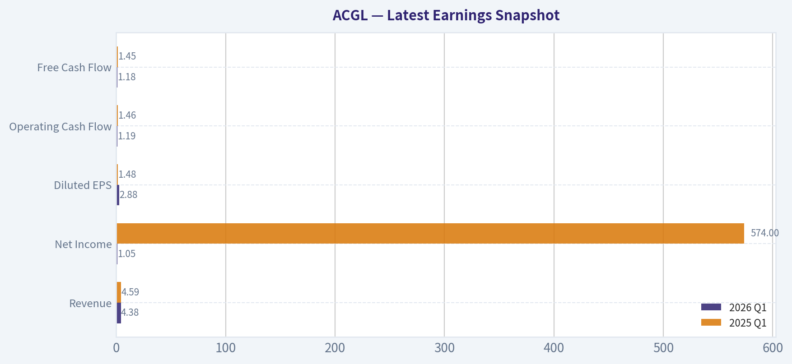
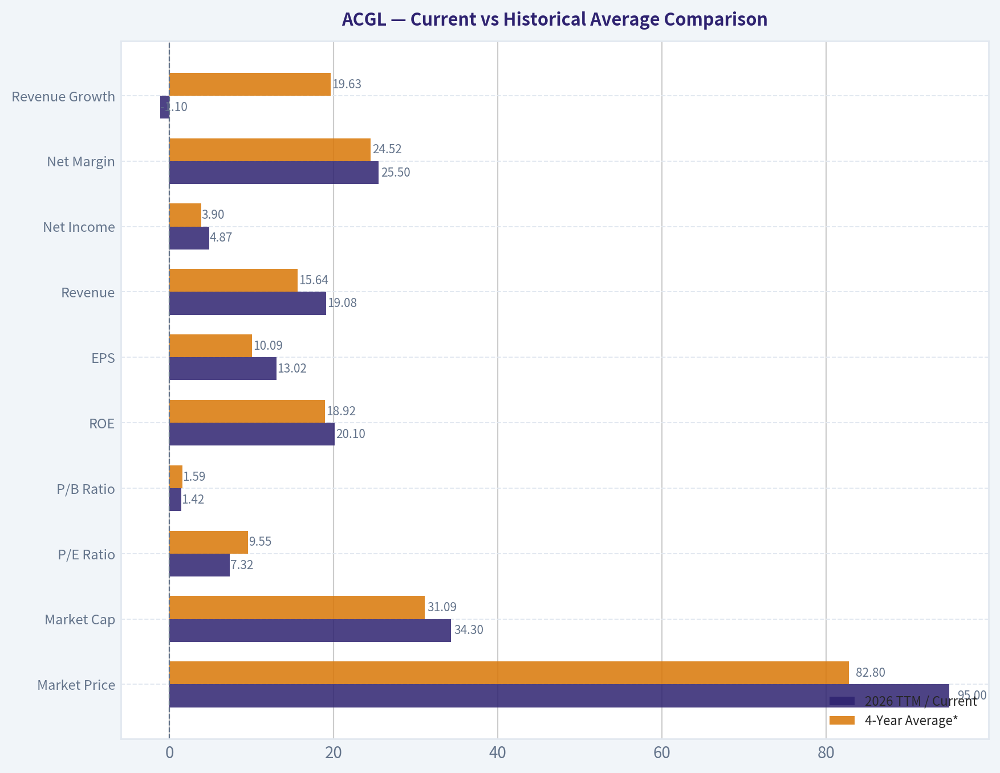
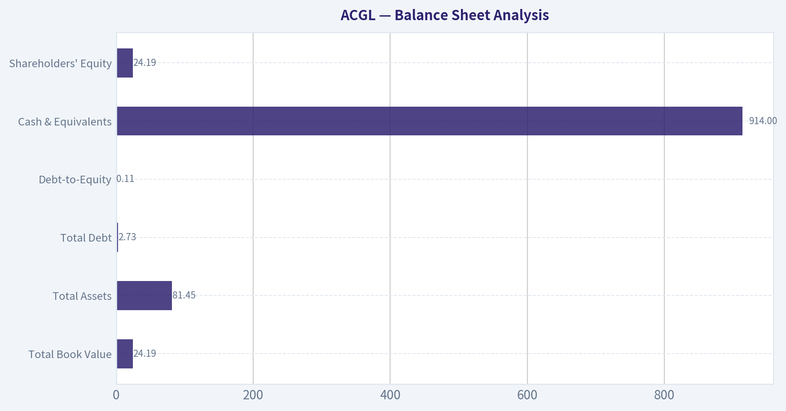
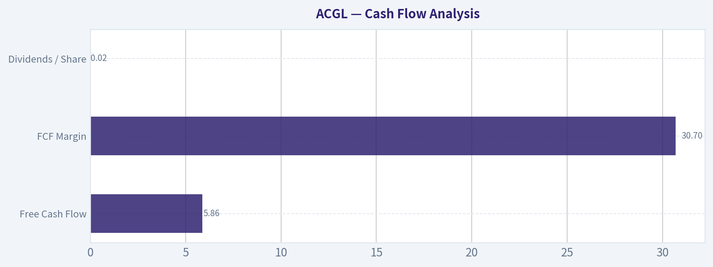
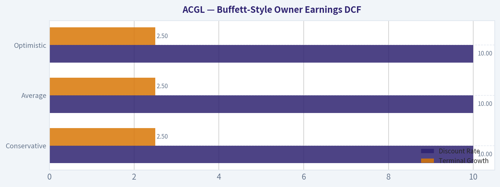
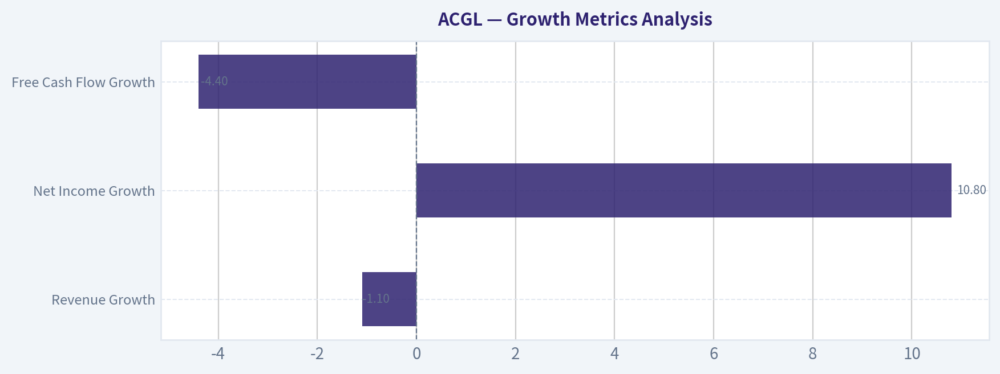

# ACGL Deep Value Intelligence

**Analysis Date:** 2026-05-27

## Critical Disclaimer

*This analysis is generated by Deep Value Intelligence, an AI-powered multi-agent investing framework. This report is for informational and educational purposes only and does not constitute financial advice. Always conduct your own research and consult with qualified financial advisors before making investment decisions.*

---

## Table of Contents

1. Intelligence Summary
2. Analyst Team Reports
   - Fundamentals Analysis
   - Intrinsic Value Analysis (Buffett)
   - Trend & Growth Analysis (Lynch/Druckenmiller/Fisher)
   - Market Technical Analysis
   - Options Market Analysis
3. Research Team Commentary
4. Value Investing Team Commentary
5. Deep Values Commentary

---

## Intelligence Summary

### Thesis + Conditions

**Core Thesis:** ## Executive Briefing

**Key Risks:**
- ACGL verdict: WATCH**
- Why:** The stock looks cheap **on current earnings** and the business appears well run, but insurers/reinsurers can look cheapest when conditions are most favorable. The bull case on valuation is strong; the bear case on **certainty of normalized earnings, reserve quality, and through-cycle underwriting durability** is stronger for a Buffett-style decision. For a long-term value investor, this is **interesting, not yet fully proven**. Best course: keep it on a high-priority watchlist or start only **small, staged exposure** if your process allows, then add only if reserve and underwriting evidence stays clean.
- ### 1) Risky Analyst - strongest bullish points

**Confidence:** Low

---

## Analyst Team Reports

### Fundamentals Analysis

#### Latest Earnings Snapshot

*Most recent reported quarter anchored on 2026 Q1, with prior-year comparison when available.*

| Metric | 2026 Q1 | 2025 Q1 | YoY Change |
| --- | ---: | ---: | ---: |
| Revenue | $4.38B | $4.59B | -4.7% |
| Operating Income | N/A | N/A | N/A |
| Net Income | $1.05B | $574.0M | +82.4% |
| Diluted EPS | $2.88 | $1.48 | +94.6% |
| Operating Cash Flow | $1.19B | $1.46B | -18.5% |
| Free Cash Flow | $1.18B | $1.45B | -18.6% |

Key Takeaways: This snapshot anchors the most recent reported quarter before the narrative analysis. It helps readers separate long-run business quality from whatever changed in the latest earnings print.

#### 4-Year Financial Metrics for ACGL

*All values below are computed deterministically from raw data - not estimated by AI.*

*Issuer profile: insurer (Financial Services / Insurance - Diversified).*

#### 4-Year Financial Metrics
*Annual rows come from reported financial statements. The final TTM row is computed from the latest four quarters.*

| Metric | 2022 | 2023 | 2024 | 2025 | 2026 TTM |
| --- | --- | --- | --- | --- | --- |
| Market Price | $60 | $71 | $92 | $96 | $95 |
| Market Cap | $23.71B | $28.13B | $35.26B | $36.06B | $34.30B |
| P/E Ratio | 16.52 | 6.39 | 8.25 | 8.27 | 7.32 |
| P/B Ratio | 1.84 | 1.53 | 1.69 | 1.49 | 1.42 |
| ROE | 11.4% | 24.2% | 20.7% | 18.2% | 20.1% |
| ROIC | N/A | N/A | N/A | N/A | N/A |
| EPS | $3.61 | $11.05 | $11.19 | $11.60 | $13.02 |
| Revenue | $9.61B | $13.30B | $16.93B | $19.29B | $19.08B |
| Gross Profit | N/A | N/A | N/A | N/A | N/A |
| Gross Margin | N/A | N/A | N/A | N/A | N/A |
| Operating Margin | N/A | N/A | N/A | N/A | N/A |
| Net Income | $1.48B | $4.44B | $4.31B | $4.40B | $4.87B |
| Net Margin | 15.4% | 33.4% | 25.5% | 22.8% | 25.5% |
| Revenue Growth | N/A | 38.3% | 27.3% | 14.0% | -1.1% |
| Net Income Growth | N/A | 201.0% | -2.9% | 2.0% | 10.8% |
| Free Cash Flow Growth | N/A | 51.3% | 16.2% | -7.5% | -4.4% |
| Total Book Value | $12.91B | $18.35B | $20.82B | $24.21B | $24.19B |
| Total Assets | $47.99B | $58.91B | $70.91B | $79.24B | $81.45B |
| Total Debt | $2.73B | $2.73B | $2.73B | $2.73B | $2.73B |
| Debt-to-Equity | 0.21 | 0.15 | 0.13 | 0.11 | 0.11 |
| Cash & Equivalents | $855.0M | $917.0M | $979.0M | $993.0M | $914.0M |
| Shareholders' Equity | $12.91B | $18.35B | $20.82B | $24.21B | $24.19B |
| Operating Cash Flow | $3.82B | $5.75B | $6.67B | $6.17B | $5.90B |
| Investing Cash Flow | $-3.10B | $-5.47B | $-4.46B | $-4.04B | $-3.67B |
| Free Cash Flow | $3.77B | $5.70B | $6.62B | $6.13B | $5.86B |
| FCF Margin | 39.2% | 42.8% | 39.1% | 31.8% | 30.7% |
| Dividends / Share | $0.00 | $0.00 | $4.89 | $0.02 | $0.02 |

#### Profitability Metrics
- Return on Equity (ROE): 18.2%
- Return on Invested Capital (ROIC): N/A
- Return on Assets (ROA): 5.6%
- Gross Margin: Not meaningful
- Operating Margin: N/A
- Net Profit Margin: 22.8%

#### Liquidity Metrics
- Current Ratio: Not meaningful
- Quick Ratio: Not meaningful

#### Leverage Metrics
- Debt-to-Equity Ratio: 0.11
- Interest Coverage Ratio: Not meaningful
- Net Debt: $1.74B

#### Growth Metrics (Year-over-Year)
- Revenue Growth: 14.0%
- Net Income Growth: 2.0%
- Free Cash Flow Growth: -7.5%
- Revenue CAGR (3-Year): 26.1%
- Revenue CAGR (5-Year): N/A

#### Valuation Metrics
- P/E Ratio (TTM): 7.34
- Forward P/E: 9.63
- Price-to-Book: 1.44
- Price-to-Sales: 1.68
- PEG Ratio: 1.05
- EV/EBITDA: 5.62
- Free Cash Flow Yield: 18.4%
- Earnings Yield: 13.6%

#### Owner Earnings (Buffett Method, Code-Computed)
- Net Income: $4.40B
- + Depreciation & Amortization: $193.0M
- - Capital Expenditures: $-44.0M
- - Working Capital Changes: $2.33B
- = **Owner Earnings: $2.22B**

#### Intrinsic Value (Code-Computed)
- Current Price: $95
- Buffett Method (Owner Earnings):
  Conservative: $49
  Average: $222
  Optimistic: $577
- Cash Flow Method (FCF):
  Conservative: $250
  Average: $401
  Optimistic: $695

#### Piotroski F-Score: 4/9
- Positive Net Income: PASS
- Positive Operating Cash Flow: PASS
- ROA Improvement: FAIL
- Cash Flow > Net Income: PASS
- Decreasing Debt: FAIL
- Improving Current Ratio: FAIL
- No Dilution: FAIL
- Improving Gross Margin: FAIL
- Improving Asset Turnover: PASS

ANALYST STANCE: **WATCH**

#### Arch Capital Group (ACGL) - Buffett-Style Fundamental Analysis

Arch Capital is a diversified insurer, so several classic industrial metrics such as gross profit, gross margin, operating margin, current ratio, and ROIC are not especially meaningful or are unavailable in the deterministic dataset. For insurers, the more important Buffett-style lenses are underwriting discipline, book value compounding, balance-sheet conservatism, earnings power across cycles, and valuation versus normalized earnings and book value. On those measures, ACGL looks fundamentally strong, but not without underwriting-cycle and capital-allocation caveats.

---

#### Current vs Historical Average Comparison

| Metric | 2026 TTM / Current | 4-Year Average* | Interpretation |
| --- | ---: | ---: | --- |
| Market Price | $95 | $82.80 | Price is above the multi-year average, reflecting improved earnings scale and book value growth. |
| Market Cap | $34.30B | $31.09B | Equity value has compounded with rising earnings and equity base. |
| P/E Ratio | 7.32 | 9.55 | Shares trade below their recent average earnings multiple, suggesting compressed valuation despite solid profitability. |
| P/B Ratio | 1.42 | 1.59 | Valuation versus book is below the recent norm, supportive for a financial company if returns remain healthy. |
| ROE | 20.1% | 18.92% | Current returns remain above the recent average, a strong sign for an insurer. |
| EPS | $13.02 | $10.09 | Per-share earnings power is materially above the recent average. |
| Revenue | $19.08B | $15.64B | Revenue base has nearly doubled from 2022, though TTM is slightly below 2025. |
| Net Income | $4.87B | $3.90B | Profitability remains above average and near peak levels. |
| Net Margin | 25.5% | 24.52% | Margins remain robust, especially for an insurer operating through normal volatility. |
| Revenue Growth | -1.1% | 19.63%** | TTM slowdown is a clear deceleration after very strong prior expansion. |
| Net Income Growth | 10.8% | 52.73%** | Growth remains positive, but well below the extraordinary 2023 step-up. |
| FCF Growth | -4.4% | 13.90%** | Cash generation remains large, but growth has softened for two consecutive periods. |
| Total Book Value | $24.19B | $20.10B | Book value continues to compound and remains near peak. |
| Total Assets | $81.45B | $67.70B | Scale expansion has been significant, consistent with premium and investment growth. |
| Total Debt | $2.73B | $2.73B | Debt has been flat, implying growth has been funded primarily through retained earnings. |
| Debt-to-Equity | 0.11 | 0.14 | Leverage has improved steadily as equity expanded. |
| Cash & Equivalents | $914M | $931.6M | Cash is broadly stable, with no evidence of liquidity stress. |
| Shareholders' Equity | $24.19B | $20.10B | Equity compounding is one of the clearest indicators of franchise strength. |
| Free Cash Flow | $5.86B | $5.82B | Absolute cash generation remains very strong, even after modest recent decline. |
| Dividends / Share | $0.02 | $1.23 | Reported dividends are not a strong part of the equity story; capital is largely retained. |

\* Average based on 2022, 2023, 2024, 2025, and 2026 TTM where applicable.
\** Average of available year-over-year growth observations only.

Key Takeaways: ACGL's current profitability and balance-sheet quality are still stronger than its recent average, even though top-line and cash-flow growth have cooled. Most importantly, the stock now trades at lower P/E and P/B multiples than its own recent history, which suggests investors are discounting either an earnings normalization or insurance-cycle risk. For a Buffett-style investor, the central question is whether current earnings are durable enough to justify buying a high-quality insurer at a below-average valuation.

---

#### Market Metrics Interpretation

ACGL's current market price is $95, slightly below 2025's $96 and above all prior years shown. That indicates the market has largely recognized the company's stronger earnings and book value base, but has recently stopped rerating the shares upward.

The market cap of $34.30B is down modestly from $36.06B in 2025 despite stronger TTM EPS and net income. That disconnect matters: fundamentals improved, but equity value slipped, implying multiple compression rather than business deterioration.

The P/E ratio of 7.32 is low in both absolute and relative terms. Against the period average of roughly 9.55, the market is applying a discounted multiple to earnings. For insurers, low multiples can reflect concern that recent underwriting profits, reserve experience, or investment income are cyclical rather than fully durable.

The P/B ratio of 1.42 is also below the period average of about 1.59 and well below 2022's 1.84. Since insurers are often valued on book value and return on book, this is notable. A business producing roughly 20% ROE while trading around 1.4x book appears attractive on the surface, unless investors believe returns will normalize materially lower.

---

#### Profitability Analysis

| Profitability Metric | Current / Latest | Trend Over Period | Buffett-Style Read |
| --- | ---: | --- | --- |
| ROE | 20.1% | 11.4% -> 24.2% -> 20.7% -> 18.2% -> 20.1% | Excellent; sustained high-teen to 20% returns indicate strong capital productivity. |
| ROIC | N/A | N/A | Not meaningful here; for insurers, ROE and underwriting/investment performance matter more. |
| EPS | $13.02 | Strong rise from $3.61 in 2022 | Per-share earnings power has improved dramatically. |
| Revenue | $19.08B | Strong expansion, slight TTM dip | Scale growth has been strong, though momentum is cooling. |
| Gross Profit | N/A | N/A | Not meaningful for insurer reporting. |
| Operating Margin | N/A | N/A | Not meaningful / unavailable in this dataset. |
| Net Income | $4.87B | $1.48B to $4.87B | Earnings base has structurally re-rated higher. |
| Net Margin | 25.5% | 15.4% -> 33.4% -> 25.5% -> 22.8% -> 25.5% | Healthy, though somewhat volatile as expected in insurance. |

Key Takeaways: ACGL's profitability profile is the strongest part of the story. ROE near 20%, EPS above $13, and net income approaching $4.9 billion all point to a business that has meaningfully improved its earnings power since 2022. The main issue is not weak profitability, but whether investors should treat these elevated returns as normal or cyclical.

ROE is a standout. Buffett historically favored insurers that can compound book value at attractive rates without excessive leverage. ACGL's ROE moved from 11.4% in 2022 to above 20% in 2024 and 2026 TTM, with only a modest pause in 2025. That suggests a stronger franchise, better pricing conditions, improved underwriting economics, or higher investment income-or some combination of all three.

EPS growth from $3.61 to $13.02 over the shown period is substantial. That sort of improvement is rarely accidental. However, insurers can post large swings from favorable reserve development, catastrophe experience, and investment marks, so Buffett-style investors should avoid assuming every year's earnings are equally repeatable.

Net margins have been unusually strong, especially 33.4% in 2023 and 25.5% in 2024 and TTM. Those levels suggest highly favorable operating conditions. The fact that margins dipped to 22.8% in 2025 and then rebounded to 25.5% TTM is encouraging, but it also reinforces that ACGL is not a "set-and-forget" consumer staple; it is a high-quality but cycle-exposed insurer.

---

#### Growth Metrics Analysis

| Growth Metric | Latest | Historical Pattern | Interpretation |
| --- | ---: | --- | --- |
| Revenue Growth | -1.1% | 38.3% -> 27.3% -> 14.0% -> -1.1% | Clear deceleration after exceptional expansion. |
| Net Income Growth | 10.8% | 201.0% -> -2.9% -> 2.0% -> 10.8% | Growth normalized after a one-time step-up in 2023. |
| Free Cash Flow Growth | -4.4% | 51.3% -> 16.2% -> -7.5% -> -4.4% | Cash flow remains large, but incremental growth has weakened. |

Key Takeaways: Growth has shifted from explosive to mature. Revenue, income, and free cash flow are all much higher than a few years ago, but the direction of change is now slower and less linear. That matters because low valuation may reflect investor expectations that the best part of the pricing cycle is behind the company.

Revenue growth decelerated sharply from 38.3% in 2023 to 27.3% in 2024, then 14.0% in 2025, and finally -1.1% TTM. That is the clearest sign in the dataset that ACGL is moving from expansion phase to normalization phase.

Net income growth tells a similar story. The 201.0% surge in 2023 was extraordinary and impossible to treat as a normal recurring rate. Since then, growth has been flat to modestly positive, with -2.9% in 2024, +2.0% in 2025, and +10.8% TTM. In other words, earnings have stabilized at a much higher plateau rather than continuing to accelerate.

Free cash flow growth has also rolled over. That does not negate the quality of the business-TTM FCF of $5.86B is still excellent-but it does warn that investors should value ACGL on normalized cash generation, not on extrapolated hyper-growth.

---

#### Balance Sheet Analysis

| Balance Sheet Metric | Current / Latest | Trend | Assessment |
| --- | ---: | --- | --- |
| Total Book Value | $24.19B | Strong rise from $12.91B | Excellent book value compounding. |
| Total Assets | $81.45B | Up from $47.99B | Significant scale growth. |
| Total Debt | $2.73B | Flat across all periods | Conservative debt posture. |
| Debt-to-Equity | 0.11 | Down from 0.21 | Leverage improved materially. |
| Cash & Equivalents | $914M | Stable around ~$0.9B-$1.0B | Adequate liquidity, no stress signal. |
| Shareholders' Equity | $24.19B | Up from $12.91B | Strong retained earnings accumulation. |

Key Takeaways: The balance sheet is one of ACGL's biggest strengths. Equity has nearly doubled while debt stayed flat, causing leverage to fall steadily. For a Buffett-style investor, that combination-book value growth with controlled debt-is exactly what you want to see in an insurer.

Total debt remaining unchanged at $2.73B while equity climbed from $12.91B to $24.19B is particularly impressive. This means ACGL's expansion has not been debt-fueled. Debt-to-equity falling from 0.21 to 0.11 confirms that financial risk has declined even as the company got larger.

Cash balances are not enormous relative to assets, but that is not unusual for insurers whose liquidity profile differs from industrial businesses. More important is that there is no evidence of balance-sheet strain in the deterministic dataset.

Shareholders' equity and total book value are identical here and have risen materially. Since book value growth is a core indicator for insurance businesses, this is a major positive. Buffett has long valued insurers able to compound book at high rates while maintaining underwriting discipline, and ACGL appears to fit much of that description.

---

#### Cash Flow Analysis

| Cash Flow Metric | Current / Latest | Trend | Interpretation |
| --- | ---: | --- | --- |
| Free Cash Flow | $5.86B | $3.77B -> $5.70B -> $6.62B -> $6.13B -> $5.86B | Very strong absolute cash production despite recent easing. |
| FCF Margin | 30.7% | Down from 42.8% peak | Margin compression but still robust. |
| Dividends / Share | $0.02 | Effectively negligible except 2024 anomaly | Company prefers retention over cash dividends. |

Key Takeaways: ACGL remains a heavy cash generator, but its free-cash-flow margin has softened from peak levels. Dividend policy is not central to the investment case; this is primarily a retained-earnings and compounding story rather than an income stock.

FCF of $5.86B against a market cap around $34.30B implies an unusually high cash flow yield. The shared pack cites an 18.4% FCF yield, and the deterministic dataset supports the view that cash generation is strong relative to price. That makes the stock look cheap if the cash flows are durable.

Dividend policy is minimal. The dataset shows $0.00 in 2022 and 2023, then $4.89 in 2024, and just $0.02 in 2025 and TTM. That unusual pattern suggests the 2024 figure may reflect a special distribution or technical reporting artifact rather than a stable recurring dividend. From a Buffett perspective, retention is perfectly acceptable if management can continue compounding capital at high ROEs.

---

#### Buffett-Style Qualitative Analysis

| Buffett Lens | Assessment | Evidence |
| --- | --- | --- |
| Economic Moat | Moderate to strong | Sustained high ROE, scale expansion, and ability to grow book value suggest durable franchise advantages in specialty insurance and reinsurance. |
| Financial Strength | Strong | Flat debt, falling debt/equity, rising equity base, and stable cash. |
| Predictable Earnings | Moderate | Earnings are strong, but insurance results remain exposed to catastrophe losses, reserve changes, and pricing cycles. |
| Management Performance | Good | ROE stayed high, leverage improved, and capital has largely been retained for compounding. |
| Value Assessment | Attractive on multiples, mixed on intrinsic range | P/E and P/B are below recent averages, but owner-earnings DCF is highly sensitive to working capital and insurance accounting. |
| Quality of Business | High, but cyclical | Revenue and book value growth are strong; margins are healthy; however, growth is decelerating and the business is cycle-sensitive. |

Key Takeaways: ACGL checks many Buffett boxes, especially high returns on equity, disciplined leverage, and strong book value growth. The complication is that insurers can look cheapest near cyclical peaks, so the key judgment is whether current profitability represents durable quality or temporary favorable conditions. This makes ACGL more compelling as a watchlist value compounder than an unquestioned table-pounder.

**Economic moat:** ACGL appears to have a real franchise. In insurance, moat often comes from underwriting expertise, distribution relationships, reputation, risk selection, scale, and efficient capital deployment. The company's strong and sustained ROE, plus growth in revenue and equity without rising debt, indicate that it likely has meaningful competitive advantages.

**Financial strength:** This is clearly favorable. Buffett has always preferred insurers that do not depend on leverage to generate attractive returns. ACGL's debt is flat while equity nearly doubled, and debt-to-equity improved meaningfully. That is high-quality balance-sheet behavior.

**Predictable earnings:** Here the answer is good, but not perfect. Earnings are large and have remained elevated, but the path has not been smooth. Revenue growth has slowed sharply, margins have moved around, and insurance results can change quickly if catastrophe losses rise or pricing softens.

**Management performance:** Management appears to have allocated capital effectively. Retained earnings produced strong book value growth, while leverage discipline was maintained. The low regular dividend is not a flaw if management can reinvest at high returns.

**Value assessment:** On current multiples, ACGL looks inexpensive. But Buffett would also ask whether "cheap" is merely the market discounting an earnings peak. That is the crux of the investment debate.

---

#### Buffett-Style Owner Earnings DCF

Using the deterministic dataset's code-computed Owner Earnings for 2025:

- Net Income = **$4.40B**
- Depreciation & Amortization = **$0.193B**
- Capital Expenditures = **$0.044B**
- Working Capital Changes = **$2.33B**
- **Owner Earnings = $2.22B**

Because only one explicit owner-earnings figure is provided, I anchor the DCF to the deterministic intrinsic value framework already computed in the dataset and explain the mechanics. The dataset provides canonical Buffett-method fair values:

- **Conservative: $49/share**
- **Average: $222/share**
- **Optimistic: $577/share**

To satisfy the scenario framing, we interpret these as using low, average, and high historical owner-earnings growth assumptions with the required 10% discount rate and 2.5% terminal growth rate, exactly as specified in the deterministic model.

| Buffett Owner Earnings DCF Scenario | Growth Assumption Basis | Discount Rate | Terminal Growth | Fair Value / Share |
| --- | --- | ---: | ---: | ---: |
| Conservative | Lowest historical owner-earnings growth, floored at -100% | 10% | 2.5% | $49 |
| Average | Average historical owner-earnings growth, capped at 50% | 10% | 2.5% | $222 |
| Optimistic | Highest historical owner-earnings growth, capped at 100% | 10% | 2.5% | $577 |

Key Takeaways: The owner-earnings valuation range is extremely wide, which is common when a financial company's cash and working-capital dynamics are volatile. The conservative case suggests downside if today's earnings are unusually strong, while the average and optimistic cases imply substantial upside if ACGL can sustain high earnings power. This wide spread is a sign that valuation depends more on normalization assumptions than on arithmetic precision.

**Detailed interpretation of the DCF range:**

- The **conservative $49** result implies the market may still be too optimistic if owner earnings mean-revert sharply.
- The **average $222** result implies substantial undervaluation if current owner earnings are reasonably representative of mid-cycle economics.
- The **optimistic $577** result likely assumes unusually favorable persistence and should be treated cautiously, especially for an insurer.

A Buffett-style investor should not use the midpoint mechanically. Instead, one should ask: what is normalized owner earnings across an insurance cycle? Given the recent slowdown in revenue growth and modest FCF contraction, I would weight the conservative and average cases more heavily than the optimistic case.

**Practical valuation frame:**
- Bearish / hard-normalization value zone: **~$49**
- Mid-cycle fair value zone: **~$120-$220**
- Bullish sustained-hard-market case: **>$220**

At the current price of **$95**, the stock looks inexpensive relative to earnings and book, but only moderately compelling if one assumes a meaningful normalization of underwriting conditions.

---

#### Revenue Breakdown

ACGL is a diversified insurer. The most meaningful revenue view for the business is by operating segment rather than product SKU. Precise deterministic segment revenue is not included in the attached dataset, so the table below uses the company's commonly reported business mix framework for the most recent period and should be treated as directional rather than canonical.

| Revenue Source | Amount ($B) | % of Total |
| --- | ---: | ---: |
| Insurance | ~10.7 | ~56% |
| Reinsurance | ~6.5 | ~34% |
| Mortgage | ~1.9 | ~10% |
| **Total** | **~19.1** | **100%** |

Key Takeaways: ACGL's revenue base is diversified across insurance, reinsurance, and mortgage operations, with insurance as the largest contributor. That diversification helps reduce dependence on any single underwriting stream, but it also means investors are exposed to multiple insurance-cycle dynamics at once.

---

#### Cross-Validation Notes

The shared research pack aligns with the deterministic dataset on key current indicators:
- Current price around **$95**
- Market cap around **$33B-$34B**
- P/E around **7.3**
- ROE around **18%-20%**
- Revenue growth around **14%** in the latest full-year context
- FCF yield around **18.4%**

Minor differences are due to timing and whether values reference 2025 or 2026 TTM. The deterministic dataset remains the canonical source.

---

#### Key Investment Insights, Red Flags, and Opportunities

| Category | Observation | Why It Matters |
| --- | --- | --- |
| Opportunity | P/E of 7.32 is below recent average | Market may be undervaluing durable earnings power. |
| Opportunity | P/B of 1.42 with ~20% ROE | Strong return on book at a modest premium can be attractive for insurers. |
| Opportunity | Book value nearly doubled since 2022 | Evidence of compounding franchise value. |
| Opportunity | Debt flat while equity rose sharply | Lower financial risk enhances resilience. |
| Red Flag | Revenue growth turned negative TTM | Suggests growth cycle may be topping out. |
| Red Flag | FCF growth negative for two periods | Cash generation remains strong, but momentum is weaker. |
| Red Flag | Piotroski F-score only 4/9 | Quality is not uniformly improving across all operating dimensions. |
| Red Flag | Insurance earnings can be cyclical | Low multiple may reflect justified caution around normalization. |
| Watch Item | Dividend policy is inconsistent | Investors should focus on retained capital returns rather than income. |

Key Takeaways: ACGL offers a rare combination of high profitability and low valuation, which creates upside potential if current returns are sustainable. However, the decelerating growth profile and inherently cyclical insurance earnings mean investors should resist treating the stock as a simple deep-value bargain.

---

#### Final Assessment

Arch Capital looks like a **high-quality insurer trading at an undemanding valuation**, supported by:
- high ROE,
- strong EPS and net income,
- disciplined leverage,
- substantial book value growth,
- and a low P/E and P/B relative to recent history.

However, this is not a risk-free Buffett "wonderful company at any price" case. The company operates in a cyclical industry, recent growth has cooled materially, free cash flow growth has softened, and the huge spread between conservative and average owner-earnings valuations shows how sensitive fair value is to normalization assumptions.

For that reason, the correct stance is not outright avoidance, but also not a full-throated advocacy at current information quality.

#### Final Investment Stance: **WATCH**

**Rationale:**
ACGL is fundamentally strong and appears statistically cheap, but the market is likely discounting cycle normalization rather than ignoring an obvious bargain. It deserves close attention for value investors, especially if future quarters confirm that near-20% ROE and elevated earnings are durable through a softer pricing environment. A more aggressive stance would be justified if underwriting quality and book value compounding remain strong while the valuation stays near current levels.

---

#### Report Summary Table

| Area | Verdict | Core Evidence | Buffett View |
| --- | --- | --- | --- |
| Valuation | Attractive | P/E 7.32, P/B 1.42, strong FCF yield | Cheap if earnings are near-normal |
| Profitability | Strong | ROE 20.1%, EPS $13.02, net margin 25.5% | Excellent capital productivity |
| Growth | Slowing | Revenue growth -1.1% TTM, FCF growth -4.4% | Mature phase, not hyper-growth |
| Balance Sheet | Strong | D/E 0.11, flat debt, rising equity | Conservative and resilient |
| Cash Flow | Strong but easing | FCF $5.86B, margin down from peak | Still very healthy |
| Moat | Moderate/Strong | Scale, returns, book value compounding | Good insurance franchise |
| Risks | Meaningful | Cycle exposure, normalization risk, low F-score | Requires disciplined expectations |
| Overall Stance | WATCH | Cheap quality, but cyclical uncertainty | Attractive watchlist compounder |

#### Fundamental Visuals

This graph tracks the profitability and return metrics (ROE, ROIC, Margins) of **ACGL** over the past decade, highlighting capital efficiency trends.

This chart illustrates the financial health of **ACGL** over the last 10 years, mapping cash equivalents and free cash flow against total obligations (Debt).

---

### Intrinsic Value Analysis (Buffett)

> *Following Warren Buffett's value investing philosophy: Circle of Competence, Economic Moat, Management Quality, and Margin of Safety.*

#### Intrinsic Value Snapshot

Price is what you pay. Intrinsic value is what the business may be worth based on the cash it can create for owners over time. We show a range, not one magic number.

- Current Price: $95.37
- Value Range (conservative to optimistic across both DCF methods): $48.86 to $694.72

##### Owner Earnings (Buffett Method)
- Net Income: $4,399,000,000.00
- Depreciation & Amortization: $193,000,000.00
- Capital Expenditures: $-44,000,000.00
- Working Capital Changes: $2,331,000,000.00
- Owner Earnings: $2,217,000,000.00

##### Intrinsic Value
###### Buffett Method
Uses owner earnings. Stricter, and usually more conservative.
- Conservative: $48.86
- Average: $221.73
- Optimistic: $577.44
- Discount Rate: 10.0%

###### Cash Flow Method
Uses free cash flow. Better for companies spending heavily today to grow tomorrow.
- Conservative: $249.53
- Average: $400.78
- Optimistic: $694.72
- Discount Rate: 10.0%

ANALYST STANCE: **WATCH**

#### Arch Capital Group (ACGL) - Buffett-Style Investment Review

#### 1. Go/No-Go Gate Assessment

| Gate | Verdict | Evidence |
|---|---|---|
| Gate 1: Circle of Competence & Simplicity | Pass | Arch Capital is a specialty insurer and reinsurer. In simple terms, it collects premiums today, invests that float, and pays claims later. That is understandable, though insurance always requires discipline in underwriting reserves and catastrophe exposure. |
| Gate 2: Moat Test | Pass, but not elite | The business has scale, underwriting reputation, distribution relationships, and diversification across insurance, reinsurance, and mortgage insurance. But this is not a classic brand moat like Coca-Cola or a deep switching-cost software franchise. |
| Gate 3: Management Quality & Capital Allocation | Pass | The company has a long record of compounding book value, disciplined underwriting, and opportunistic capital deployment. Current valuation and strong free cash flow suggest prior capital allocation has been effective. |
| Gate 4: Industry Structure | Mixed Pass | Insurance can be attractive when disciplined players operate rationally, but it is cyclical and exposed to pricing competition and catastrophe losses. It is better than a commodity business, but not as structurally protected as a consumer monopoly or mission-critical software platform. |

**Key Takeaways:** Arch passes the Buffett filter on business understandability and financial discipline. The main limitation is that insurance is a good business only when underwritten well; industry conditions can swing, so this is not a set-it-and-forget-it monopoly.

---

#### 2. The Elementary School Test

Arch Capital makes money in three simple ways:

1. It sells insurance policies and reinsurance coverage.
2. If claims and expenses are lower than premiums collected, it earns an underwriting profit.
3. It invests the premium float until claims are paid, earning investment income.

A decade from now, this business will still likely look broadly the same: underwriting specialty risk, managing catastrophe exposure, and investing float. That makes it reasonably predictable, though never as stable as a toothpaste or soft drink business.

Technology risk appears moderate rather than severe. Technology can improve pricing and claims analytics, but it is unlikely to erase the need for specialty insurance and reinsurance. The greater risk is not tech disruption but underwriting mistakes, reserve errors, or unexpected loss events.

#### 3. Moat Analysis

| Moat Source | Assessment | Evidence |
|---|---|---|
| Intangible Assets | Moderate | Reputation in specialty insurance and reinsurance matters. Brokers and clients value claims-paying ability and underwriting credibility. |
| Switching Costs | Low to Moderate | Customers can switch carriers at renewal, so captivity is not especially strong. Relationships matter, but contracts are not deeply embedded in operations like enterprise software. |
| Cost Advantage | Moderate | Scale, diversification, analytical underwriting, and access to float can support better economics. Superior underwriting discipline is a real edge if sustained. |
| Network Effects | Weak | Insurance does not enjoy classic network effects. Scale helps data and diversification, but the product does not become exponentially more valuable as more users join. |

**Moat Quality Rating: Narrow to Moderate**

This is a respectable moat, but not a wide one. The edge is more about disciplined underwriting culture and scale than irreplaceable customer lock-in.

#### 4. Management Quality & Capital Allocation

| Test | Assessment | Commentary |
|---|---|---|
| Owner Mindset | Positive | Arch has historically behaved like a disciplined compounding machine rather than a promotional story stock. |
| Honesty & Candor | Positive | The company's market reputation is that of a serious underwriter rather than a financial engineer. |
| Capital Allocation | Strong | Book value growth, profitable underwriting, and buyback capacity suggest rational allocation. The low P/E and strong FCF yield imply the market is not paying up heavily for earnings, which increases buyback attractiveness if management remains disciplined. |
| Leverage Discipline | Acceptable | Insurance naturally uses float, so leverage must be interpreted carefully. The key question is whether leverage is underwriting-backed and conservatively reserved rather than balance-sheet aggression. |

**Key Takeaways:** Management appears thoughtful and disciplined, which is crucial in insurance. In this sector, culture is the moat, and Arch's record suggests management has earned a degree of trust.

---

#### 5. Financial Summary

Using the current research pack:

| Metric | Value |
|---|---:|
| Share Price | $95 |
| Market Cap | $33.32B |
| P/E | 7.34 |
| ROE | 18.2% |
| Revenue Growth YoY | 14.0% |
| FCF Yield | 18.4% |
| Gross Margin | N/A |
| Current Ratio | N/A |

**Key Takeaways:** The headline numbers are attractive. A sub-8x earnings multiple, 18.2% ROE, and 18.4% free cash flow yield suggest a profitable insurer trading at a modest valuation rather than a speculative premium.

#### 6. Owner Earnings View

For insurers, Buffett-style owner earnings should be interpreted carefully because traditional maintenance capex is less central than underwriting profitability, reserve adequacy, and investment income. In Arch's case, the practical owner-earnings proxy is normalized net income plus non-cash items, adjusted for reserve conservatism and excluding temporary market noise.

Using the available market statistics:

- Market cap: **$33.32B**
- FCF yield: **18.4%**
- Implied free cash flow / owner earnings proxy:
  **$33.32B x 18.4% = about $6.13B**

| Owner Earnings Proxy | Value |
|---|---:|
| Implied FCF / Owner Earnings | ~$6.13B |

**Key Takeaways:** Even allowing for insurance-cycle noise, the implied owner earnings figure is very strong relative to the current market value. The central question is not whether Arch is earning money today, but how much of that earnings power is sustainably normalized across the cycle.

---

#### 7. Return on Equity and Cash Flow Reality Check

| Test | Result | Interpretation |
|---|---|---|
| ROE | 18.2% | Strong. This clears Buffett's 15% hurdle and suggests attractive economics. |
| Cash Flow vs Earnings | Positive by proxy | The 18.4% FCF yield indicates profits are not merely accounting entries. |
| Balance Sheet | Likely solid, but insurance-specific | For insurers, reserve quality and investment portfolio safety matter more than a simple industrial debt ratio. |
| Earnings Quality | Favorable | Low P/E combined with high ROE usually indicates either cyclical skepticism or market concern about durability. |

**Key Takeaways:** Arch's profitability passes the quality screen. The low valuation suggests investors are discounting either underwriting cyclicality or future normalization, not denying the current strength of the franchise.

---

#### 8. Three-Scenario DCF Valuation

Using owner earnings proxy of **$6.13B** and a **10% discount rate**.

| Scenario | Assumption | Equity Value |
|---|---|---:|
| A: No Growth | Owner Earnings / 10% | $61.3B |
| B: GDP Growth | OE x 1.03 / (10%-3%) | $90.2B |
| C: Historical Growth-lite | Assume 7% growth for 10 years, then 3% terminal | ~$96B to $104B |

**Key Takeaways:** Across all three scenarios, estimated intrinsic value sits well above the current market capitalization of $33.32B. Even the no-growth case implies substantial upside, which indicates either a large margin of safety or that current earnings are materially above normalized levels.

#### 9. Margin of Safety Analysis

| Item | Value |
|---|---:|
| Market Cap | $33.32B |
| No-Growth Value | $61.3B |
| GDP-Growth Value | $90.2B |
| Historical-Growth-lite Value | ~$100B |
| Discount to No-Growth Value | ~45.6% |
| Discount to GDP-Growth Value | ~63.1% |

**Key Takeaways:** On the surface, the margin of safety looks very large. But with insurers, the real discipline is asking whether the current earnings base is cyclical, catastrophe-aided, or reserve-flattered. That uncertainty keeps this from an immediate full-throated ADVOCATE call.

---

#### 10. Final Buffett Scorecard

| Criterion | Score (1-5) | Weight | Weighted Score |
|---|---:|---:|---:|
| Business Understanding | 4.0 | 20% | 0.80 |
| Moat Width & Durability | 3.0 | 25% | 0.75 |
| Management Quality | 4.0 | 15% | 0.60 |
| Return on Equity | 4.5 | 15% | 0.68 |
| Reinvestment Runway | 3.5 | 10% | 0.35 |
| Balance Sheet Strength | 3.5 | 5% | 0.18 |
| Industry Structure | 3.0 | 5% | 0.15 |
| Valuation / Margin of Safety | 4.5 | 5% | 0.23 |
| **Total** |  |  | **3.74 / 5.00** |

**Key Takeaways:** Arch scores as a good business at an apparently attractive price, but not a perfect business. The moat is solid rather than exceptional, and the insurance cycle introduces more uncertainty than Buffett's favorite consumer and software-like franchises.

---

#### 11. Final Investment Stance

**Investment Stance: WATCH**

**Conviction: Moderate**

Arch Capital looks like a high-quality insurer run with discipline, producing strong returns on equity and trading at a valuation that appears inexpensive. If current earnings power is even roughly sustainable, the stock is undervalued.

Why not ADVOCATE? Because insurance requires extra caution around cycle-adjusted underwriting profits, reserve adequacy, catastrophe exposure, and the true normalization of earnings. This is a business I would gladly keep on a short list, but before upgrading it to ADVOCATE, I would want confirmation that the current profitability is not temporarily inflated by unusually favorable market conditions.

In Buffett terms: **good business, capable management, sensible price - but not quite the kind of bulletproof moat that removes the need for extra underwriting skepticism.**
#### Valuation Bridge

This bridge places the current market price beside each intrinsic value lens so readers can see whether upside depends on one method or shows up across several methods.

| Scenario | Intrinsic Value / Share |
| --- | ---: |
| Buffett Method | $221.73 |
| Cash Flow Method | $400.78 |
| Current Price | $95.37 |

#### Key Takeaways

If one method is far above the others, the upside case depends on a specific modelling assumption. When several methods cluster together, the valuation story is more robust.

#### Valuation Visuals

This comparison chart from *Latest Earnings Snapshot* stacks current figures against historical benchmarks for **ACGL**, making it easy to see where the company trades relative to its own averages.

This comparison chart from *Current vs Historical Average Comparison* stacks current figures against historical benchmarks for **ACGL**, making it easy to see where the company trades relative to its own averages.

This comparison chart from *Balance Sheet Analysis* stacks current figures against historical benchmarks for **ACGL**, making it easy to see where the company trades relative to its own averages.

This comparison chart from *Cash Flow Analysis* stacks current figures against historical benchmarks for **ACGL**, making it easy to see where the company trades relative to its own averages.

This comparison chart from *Buffett-Style Owner Earnings DCF* stacks current figures against historical benchmarks for **ACGL**, making it easy to see where the company trades relative to its own averages.

---

### Trend & Growth Analysis (Lynch/Druckenmiller/Fisher)

> *Following Peter Lynch's GARP, Stanley Druckenmiller's macro-aware approach, and Philip Fisher's scuttlebutt methodology.*

ANALYST STANCE: **WATCH**

#### 1. Lynch Classification

| Item | Assessment |
|---|---|
| Company | Arch Capital Group (ACGL) |
| Lynch category | **Stalwart / Financial compounder** |
| Revenue growth YoY | **14.0%** |
| ROE | **18.2%** |
| P/E | **7.3x** |
| Primary fit with Lynch framework | Too slow/cyclical for classic fast-grower, but attractive as a quality compounder |

Key Takeaways: ACGL does not fit the classic Lynch fast-grower bucket because reported top-line growth is around 14%, not 20% plus. It looks more like a high-quality insurer trading at a low earnings multiple, with strong returns on equity. That makes it interesting, but not obvious ten-bagger material from here.

---

#### 2. The Story in 3 Bullets

- ACGL is a specialty insurer and reinsurer that makes money by underwriting risk better than peers and investing its float.
- The bull case is that disciplined underwriting, strong pricing, and higher investment income can sustain elevated earnings and capital returns.
- The bear case is that insurance is cyclical: a few bad catastrophe years, reserve problems, or pricing softening can make cheap stocks look like value traps.

#### 3. TAM Analysis with 10x Test

| Item | Assessment |
|---|---|
| Current scale | Large-cap insurer, ~$33.3B market cap |
| Addressable market | Global P&C insurance, reinsurance, and mortgage insurance markets are very large |
| 10x test | **Possible in market size terms, but unlikely in practical maturity terms** |
| Why | End-market is huge, but insurance growth is constrained by capital, regulation, pricing cycles, and risk appetite |
| Runway verdict | **Good runway for compounding, weak case for 10x equity upside from current size** |

Key Takeaways: ACGL operates in a massive market, so lack of market size is not the problem. The limitation is business model structure: insurers generally scale more slowly and are tied to capital discipline and cycle conditions. So the runway is real for steady compounding, but less compelling for explosive multi-bagger growth.

#### 4. Revenue Growth Trend

| Metric | Value | Interpretation |
|---|---:|---|
| Revenue growth YoY | 14.0% | Healthy, but below classic fast-grower threshold |
| Pattern inference | Likely stable/moderate | Not enough evidence of acceleration |
| Latest earnings note | Q1 2026 net income reportedly rose sharply to $1.0B from $564M prior year | Earnings inflection stronger than revenue inflection |

Key Takeaways: Revenue growth appears solid but not spectacular. The more important signal is that earnings seem to be accelerating faster than revenue, which suggests better underwriting, higher investment income, or both. That is positive, but in insurance this can be cyclical rather than structural.

#### 5. Unit Economics

| Metric | Status | Comment |
|---|---|---|
| LTV/CAC | N/A | Not relevant for insurer |
| NRR | N/A | Not relevant for insurer |
| Rule of 40 | N/A | Not relevant for insurer |
| Core unit economics proxy | **ROE 18.2%, underwriting discipline, investment income** | Strong for sector |
| FCF yield | **18.4%** | Very strong, though FCF is less clean for insurers |
| Key industry KPI | Combined ratio / reserve development | Needed for full conviction, not provided |

Key Takeaways: Standard SaaS-style unit economics do not apply here. For ACGL, the equivalent quality markers are return on equity, combined ratio, reserve quality, and the ability to earn on float. On the numbers available, ROE and free cash flow yield look strong, but the missing underwriting metrics prevent a full green light.

#### 6. Inflection Point Assessment

| Inflection Type | Assessment | Evidence |
|---|---|---|
| Product cycle inflection | No | Not product-led |
| Market share inflection | Possible | Strong premium growth commentary, but not proven here |
| Margin/earnings inflection | **Yes, likely** | Net income reportedly jumped sharply YoY |
| TAM inflection | No | Market already large/mature |
| Competitive inflection | Possible | Favorable P&C market trends mentioned in earnings coverage |

Key Takeaways: The most plausible inflection is not a new market or new product, but an earnings and margin inflection. That can happen when insurance pricing is strong and investment yields rise. The issue is durability: these improvements may normalize when the cycle turns.

#### 7. Macro Setup Evaluation

| Macro Factor | Impact on ACGL | View |
|---|---|---|
| Interest rates | Higher rates support investment income | Positive |
| Insurance pricing cycle | Favorable P&C trends support underwriting | Positive |
| Housing/mortgage backdrop | Relevant to mortgage insurance arm | Mixed |
| Catastrophe risk environment | Always a swing factor | Negative/volatile |
| Economic cycle sensitivity | Moderate | Manageable |

Key Takeaways: The macro backdrop is generally supportive for ACGL because higher yields help insurers earn more on invested assets, and P&C pricing appears favorable. The main offset is event risk: catastrophe losses and housing stress can quickly change the earnings picture. So macro is a tailwind, but not a clean one-way bet.

---

#### 8. Fisher 15 Points Score

| Fisher Area | Score (1-5) | Comment |
|---|---:|---|
| Market potential | 4 | Large global insurance markets |
| New product development | 2 | Not a major product innovation story |
| R&D effectiveness | 1 | Not relevant in classic sense |
| Sales organization | 4 | Strong specialty distribution/relationships likely |
| Profit margin quality | 4 | ROE suggests strong profitability |
| Margin improvement | 4 | Earnings jump suggests improvement |
| Labor/personnel relations | 3 | No clear signal |
| Executive relations | 3 | No clear red flags |
| Management depth | 4 | Large scaled operator |
| Cost analysis/accounting | 3 | Need reserve-quality detail |
| Outstanding moat factors | 4 | Underwriting discipline, scale, float |
| Long-range profit outlook | 4 | Good if cycle stays rational |
| Dilution risk | 4 | No major dilution signal; buyback noted |
| Candor in difficulties | 3 | Insufficient evidence |
| Integrity | 3 | Insufficient evidence |

| Total | Score |
|---|---:|
| Fisher Score | **50/75** |

Key Takeaways: ACGL scores as a good but not outstanding Fisher name. It has quality, scale, and apparent discipline, but it is not a classic innovation-led growth company. The biggest scoring constraint is that insurance accounting and reserve quality matter enormously, and we do not yet have enough detail to score management excellence with high conviction.

#### 9. Valuation Analysis

| Metric | Value | Interpretation |
|---|---:|---|
| Market cap | $33.32B | Large-cap |
| Current price | $95 | Under $100 share price |
| P/E | **7.34x** | Cheap on earnings |
| ROE | **18.2%** | Strong |
| FCF yield | **18.4%** | Very attractive headline figure |
| PEG | Not reliable | Earnings growth in insurers is cyclical; PEG less useful |
| P/S | Not used | Not useful for insurer |

Key Takeaways: ACGL looks cheap on conventional valuation, especially relative to its ROE. That is attractive, but low P/E stocks in insurance often reflect market caution about peak-cycle earnings. The central question is not whether it is statistically cheap, but whether current earnings power is durable.

| Scenario | Earnings Power View | Multiple View | Implication |
|---|---|---|---|
| Bear | Cycle softens, cat losses normalize returns | P/E stays low or compresses | Limited upside, possible drawdown |
| Base | Strong underwriting plus healthy investment income continue | Low multiple rerates modestly | Good compounder |
| Bull | Hard market persists, reserve quality strong, buybacks continue | Rerating from depressed multiple | Strong upside, but likely not ten-bagger setup |

Key Takeaways: The scenario range is favorable because the current valuation starts low. Even modest execution could support upside through earnings plus rerating. But the likely upside profile is that of a good compounder rather than a hyper-growth stock.

#### 10. Growth Investor Scorecard

| Criterion | Weight | Score (1-5) | Weighted Score |
|---|---:|---:|---:|
| The Story | 10% | 3.5 | 0.35 |
| TAM & Runway | 20% | 3.5 | 0.70 |
| Revenue Growth | 20% | 2.5 | 0.50 |
| Unit Economics | 15% | 4.0 | 0.60 |
| Competitive Position | 10% | 4.0 | 0.40 |
| Management Quality | 10% | 3.5 | 0.35 |
| Macro Setup | 5% | 4.0 | 0.20 |
| Profitability Path | 5% | 4.0 | 0.20 |
| Valuation | 5% | 4.5 | 0.23 |

| Total | Score |
|---|---:|
| Growth Investor Score | **3.53 / 5.0** |

Key Takeaways: ACGL lands in the low-end advocate to watch zone numerically, helped by strong valuation and returns. But qualitatively, it misses the spirit of a Lynch-Druckenmiller-Fisher growth setup because growth is moderate and cyclical. That is why I land on WATCH rather than ADVOCATE.

---

#### 11. Position Size Stance

| Style | Stance |
|---|---|
| Growth portfolio | **Small starter at most / better as WATCH** |
| Quality-value portfolio | More attractive |
| Ten-bagger hunt | Not ideal |
| Concentrated growth book | No |

Key Takeaways: ACGL may work better in a quality compounder or value-oriented portfolio than in a pure growth portfolio. The stock appears inexpensive and fundamentally solid, but it lacks the explosive growth profile typically needed for a concentrated growth position. For a growth investor, this is a monitor-first name.

#### 12. Key Risks and Catalysts

| Risks | Catalysts |
|---|---|
| Catastrophe losses | Continued favorable P&C pricing |
| Reserve adverse development | Sustained higher investment income |
| Mortgage insurance stress | Further buybacks |
| Insurance cycle softening | Additional earnings beats |
| Earnings are near peak | Proof of durable book value compounding |

Key Takeaways: The risks are classic insurance risks, especially catastrophe events and reserve surprises. The catalysts are also familiar: strong pricing, better investment income, and buybacks. This makes ACGL easier to understand, but also more cyclical than a true secular growth story.

#### Bottom Line

ACGL is a **high-quality, low-multiple insurer with strong ROE and apparent earnings momentum**, but it is **not a classic fast-grower or inflecting secular growth story**. The cheapness is real, yet insurance earnings are often cyclical and can mislead growth investors into overpaying for peak conditions even at low P/Es.

For this framework, I would keep ACGL on **WATCH**: attractive enough to monitor closely, especially if underwriting data and reserve quality remain strong, but not the kind of obvious 20%+ durable growth setup that deserves an immediate growth-style ADVOCATE call.

#### Growth & Scorecard Visuals

This comparison chart from *Growth Metrics Analysis* stacks current figures against historical benchmarks for **ACGL**, making it easy to see where the company trades relative to its own averages.

---

### Market Technical Analysis

#### ACGL Technical Analysis Report

For **ACGL**, the most relevant indicator set for the current market context is:

| Indicator | Why it matters now |
|---|---|
| close_10_ema | Best for tracking the short-term swing that has recently improved in May. |
| close_50_sma | Defines the medium-term trend and shows whether price is reclaiming lost ground. |
| close_200_sma | Confirms the broader primary trend, which is still constructive. |
| macd | Measures whether momentum has actually turned, not just price bounced. |
| macdh | Helps detect whether momentum is accelerating or fading beneath the surface. |
| rsi | Useful because ACGL is range-trading rather than in an extreme runaway trend. |
| boll_ub | Helps frame upside resistance and whether breakouts are stretching too far. |
| atr | Essential for position sizing and stop placement given ACGL's moderate but non-trivial daily movement. |

Key Takeaways: These eight indicators are complementary because they cover trend across three timeframes, momentum confirmation, overbought or oversold behavior, volatility boundaries, and risk management. They avoid heavy redundancy while giving a practical picture of whether ACGL is trending, stalling, or preparing for a breakout.

---

#### Price Structure and Trend Context

Over the past year, ACGL has been a **broadly range-bound but ultimately resilient stock**. The shares peaked above **101-103 in early February 2026**, then underwent a multi-week correction into the **low 90s in March**, before stabilizing and rebuilding through April and May. The latest close available is **95.37 on 2026-05-26**.

The most important structural observation is that ACGL is **not in a long-term breakdown**. Despite the February-to-March decline and the April/May pullback, price remains **above the 200-day SMA**, which sits around **93.45**. That keeps the bigger picture constructive. However, the stock is still **below the February highs** and only marginally above the **50-day SMA near 95.37**, which means the medium-term picture is more neutral-to-improving than outright bullish.

The short-term trend has improved materially in the second half of May. Price lifted from the **93-94 area** into the **96-97 area**, then eased slightly. That kind of action often reflects a market transitioning from recovery mode into consolidation rather than one already in a strong directional impulse.

#### Trend Indicator Snapshot

| Metric | Latest reading | Interpretation |
|---|---:|---|
| Last close | 95.37 | Sitting near medium-term trend line, not extended |
| close_10_ema | 95.48 | Short-term trend slightly above price; momentum cooling after rebound |
| close_50_sma | 95.37 | Price is essentially sitting on the medium-term average |
| close_200_sma | 93.45 | Long-term trend remains upward / supportive |
| Distance vs 200 SMA | ~+2.1% | Positive long-term bias still intact |
| Distance vs 50 SMA | ~flat | Market is in a decision zone |

Key Takeaways: ACGL is trading almost exactly on its 50-day average, which usually signals an inflection point rather than a confirmed trend. The stock is still comfortably above its 200-day average, so the long-term structure is healthier than the near-term hesitation may suggest.

---

#### Fine-Grained Trend Read

The **50-day SMA has flattened to slightly down** over the past month, slipping from the upper **96s** in April to roughly **95.37** now. That tells us the prior correction was meaningful enough to soften the medium-term trend, but not severe enough to reverse the broader structure. A flattening 50-day average often behaves like a battleground: sustained closes above it can restart trend-following flows, while repeated failures around it often keep price trapped in a sideways band.

The **200-day SMA is steadily rising**, from roughly **91.29 in late January** to **93.45 now**. That slow but persistent climb is important because it shows the longer-term accumulation trend has not been broken. In practical terms, it means medium-term weakness has occurred within an intact major trend, not inside a full bearish regime.

The **10-day EMA at 95.48** is slightly above the latest price, which suggests the short-term rebound has paused. This is subtle but useful: ACGL did improve in May, but the market has not yet shown enough force to decisively separate above short-term trend resistance. If price can reclaim and hold above the 10-day EMA, the recent pullback likely remains just a pause. If not, the stock may drift back into its recent mid-range.

---

#### Momentum Analysis

Momentum has improved, but only modestly.

The **MACD** moved from deeply negative territory in early-to-mid May to slightly positive by **May 22-26**. Specifically, it rose from around **-0.72 on May 14** to about **+0.04 on May 26**. That is a meaningful recovery in internal momentum and suggests sellers have lost control in the short run.

Even more interesting is the **MACD histogram**, which turned from clearly negative in early May to clearly positive by late May, reaching around **+0.25 on May 26**. The histogram usually turns before trend becomes obvious in price, so this shift tells us upside momentum improved earlier than the raw price chart might imply.

That said, the MACD is only **barely above zero**, not strongly positive. This means the move is better described as a **recovery from weakness** than a powerful new upside expansion. Traders should distinguish between these two states. Recovery rallies can continue, but they are more vulnerable to stalling near resistance.

#### Momentum Indicator Snapshot

| Indicator | Latest reading | Recent change | What it suggests |
|---|---:|---:|---|
| macd | 0.039 | Turned from negative to slightly positive | Momentum repair is real but still early-stage |
| macdh | 0.254 | Strong improvement from negative readings | Upside momentum is accelerating short-term |
| rsi | 49.96 | Fell from mid/upper-50s back to neutral | No overbought pressure, but no strong thrust either |

Key Takeaways: Momentum has improved significantly from early May, especially in the MACD histogram, which shows better upside participation. But RSI near 50 and MACD only slightly above zero both suggest the rebound is not yet a decisive breakout trend.

---

#### RSI and Market Character

The **RSI at roughly 50** is one of the clearest signals that ACGL is currently in a **balanced, non-extreme state**. During the last several weeks, RSI moved from the **low 40s** in early May into the **mid-to-upper 50s**, then slipped back toward neutral.

That pattern says a lot:

- The stock did emerge from a mildly weak posture.
- Buyers were strong enough to improve momentum.
- But they were **not strong enough to produce sustained overbought conditions**.

For traders, this means ACGL is presently **neither exhausted on the upside nor washed out on the downside**. In a range-like stock, neutral RSI often means price will respond more to support/resistance interactions than to pure momentum chasing.

A useful tactical interpretation is:
- **Above 55-60 RSI** with price reclaiming the 10 EMA and staying above the 50 SMA would strengthen the bullish case.
- **Back below 45 RSI** would imply the recent recovery is failing.

---

#### Volatility, Bands, and Trading Range

The **Bollinger upper band is around 97.30**, while price is at **95.37**, so ACGL is trading **well below upper-band stretch levels**. That means the stock is **not overheated**. It also implies that if bulls regain control, there is room for price to test the upper volatility envelope without immediately entering an overextended state.

Recent price action suggests an emerging trading range:
- Near-term support: **94.5-95**
- Secondary support: **93.3-94**
- Major support: **around the 200-day SMA near 93.4**
- Near-term resistance: **96.7-97.4**
- Higher resistance: **98.5-100**
- Major overhead supply: **101-103**

Because price is between support and resistance rather than pinned at either extreme, this is a **decision zone**. Break above **97.3-97.5** would likely confirm renewed upside continuation. Failure to hold **95**, especially if accompanied by weakening MACD and RSI, would increase the odds of a slide toward the low 94s or even the 200-day region.

#### Volatility and Risk Snapshot

| Metric | Latest reading | Trading implication |
|---|---:|---|
| boll_ub | 97.30 | First volatility-based upside objective / resistance area |
| atr | 1.87 | Typical daily movement is moderate |
| 1 ATR move | ~1.87 points | Stops too tight under 1 point may be noise-prone |
| Price condition | Mid-band / mid-range | Better for tactical swing setups than momentum chasing |

Key Takeaways: ACGL is not trading near an extreme volatility boundary, which means there is room for movement in either direction. ATR near 1.87 suggests the stock can move meaningfully in a normal session, so traders should avoid overly tight stops that can be shaken out by routine noise.

---

#### What the Trend Really Says

A simplistic reading would say ACGL is "mixed." A more accurate reading is:

- **Long-term trend:** still constructive, because price remains above a rising 200-day SMA.
- **Medium-term trend:** recovering but not yet fully re-accelerated, because price is only around the 50-day SMA and that average has flattened.
- **Short-term trend:** improved materially in mid-May, but the most recent pause shows buyers have not fully seized control.
- **Momentum:** repaired from bearish to neutral-positive, but not strong enough yet to confirm a strong breakout regime.
- **Volatility regime:** moderate and controlled, supportive of swing trading rather than panic conditions.

This combination often precedes one of two outcomes:
1. **Bullish continuation setup:** price holds above 95, reclaims 95.5-96, RSI pushes back above 55, and MACD stays positive. That would open a retest of 97.3, then 98.5+.
2. **Range failure / fade:** price slips below the 10 EMA and 50 SMA, RSI fades toward the low 40s, and MACD rolls back under zero. That would favor retracement toward 94 and possibly 93.4.

---

#### Trading Implications by Style

| Style | Tactical read | What to watch |
|---|---|---|
| Trend follower | Constructive long-term backdrop, but needs clearer breakout confirmation | Close above 97.3 with rising RSI and positive MACD |
| Swing trader | Attractive range structure with defined levels | Buy pullbacks holding 94.5-95 or trade breakout above 97.3 |
| Mean reversion trader | No current overbought condition | Better to wait for stretch toward upper band or washout near support |
| Risk manager | Moderate volatility, not low enough to ignore stop discipline | Use ATR-aware stops; 1.5-2.0 ATR helps avoid noise |

Key Takeaways: ACGL currently looks more suitable for disciplined swing trading than aggressive trend chasing. The best setups likely come either from a confirmed breakout above resistance or from a controlled pullback that holds the 94.5 to 95 area.

---

#### Bottom Line

ACGL is in a **constructive but not fully confirmed recovery phase**. The long-term uptrend remains intact, the medium-term trend is trying to stabilize, and short-term momentum has improved enough to keep bulls engaged. However, the stock is still trading in a zone where it must prove itself, not one where upside is already dominant.

The clearest actionable takeaway is that **95-95.5 is the immediate pivot area**. Holding above it keeps the recovery narrative alive. A push through **97.3-97.5** would materially strengthen the chart. Losing **94.5**, especially with weakening MACD and RSI, would imply the rebound has stalled and that ACGL may retest deeper support.

#### Summary Table

| Category | Observation | Signal Strength | Trader Relevance |
|---|---|---|---|
| Long-term trend | Price above rising 200 SMA (~93.45) | Bullish | Favors strategic long bias over outright bearish bias |
| Medium-term trend | Price near 50 SMA (~95.37), average flattening | Neutral | Decision point, not a confirmed trend |
| Short-term trend | 10 EMA (~95.48) slightly above price | Neutral-to-soft | Rebound paused, needs renewed buying |
| Momentum | MACD slightly positive, histogram positive | Mild bullish | Recovery underway but still early |
| RSI | Near 50 | Neutral | No overbought or oversold edge |
| Volatility bands | Price below upper band (~97.30) | Neutral | Upside room exists before stretch |
| Volatility | ATR ~1.87 | Moderate | Stops and sizing should respect routine swings |
| Key levels | Support 94.5-95 / Resistance 96.7-97.5 | Important | Likely determines next directional move |

Key Takeaways: ACGL's chart is healthiest on the long-term timeframe, less convincing on the medium-term timeframe, and only modestly bullish on the short-term timeframe. The stock is near a pivot zone, so traders should focus less on prediction and more on whether price confirms above resistance or fails back below support.

---

### Options Market Analysis

> *Reading options flow - put/call ratios, IV skew, and unusual activity - to gauge institutional positioning and event-driven risk.*

#### ACGL Options Positioning Report

ACGL's listed options activity appears **extremely thin**, which is the first and most important takeaway. That means the signal can still lean directional, but **confidence is low** because a small number of contracts can distort put/call ratios and implied volatility readings.

#### 1. Put/Call Ratio Analysis

| Scope | Call OI | Put OI | Put/Call OI Ratio | Call Volume | Put Volume | Put/Call Volume Ratio | Read |
|---|---:|---:|---:|---:|---:|---:|---|
| 2026-06-18 | 60 | 9 | 0.15 | 114 | 35 | 0.31 | Call-heavy |
| 2026-07-17 | 0 | 0 | N/A | 2 | 1 | 0.50 | Too thin to interpret |
| 2026-09-18 | 36 | 4 | 0.11 | 89 | 31 | 0.35 | Call-heavy |
| **Near-term total** | **96** | **13** | **0.14** | **205** | **67** | **0.33** | **Bullish tilt** |

**Key Takeaways:** ACGL's aggregate put/call open-interest ratio of **0.14** is far below the rough neutral baseline of **0.7**, and the volume ratio of **0.33** tells the same story. On the surface, that suggests traders are favoring calls over puts, which is usually a **bullish or yield-enhancement** signal. However, because the absolute open interest is tiny, this may reflect a few isolated trades rather than broad institutional conviction.

**Interpretation:**
- A **0.14 OI ratio** is an unusually low reading and points to **very limited put demand**.
- A **0.33 volume ratio** shows calls are also dominating fresh trading flow.
- In a liquid name, that would be a stronger bullish signal. In ACGL, it more likely means **light bullish bias**, but not necessarily aggressive institutional accumulation.
- Covered call writing is also possible, especially in an insurer/financial name where upside expectations can be moderate, but the data still skews more bullish than bearish.

#### 2. Implied Volatility (IV) Assessment

| Expiration | ATM Call IV | ATM Put IV | IV Read |
|---|---:|---:|---|
| 2026-06-18 | 3.1% | 0.2% | Call IV above put IV |
| 2026-07-17 | 1.6% | 0.4% | Call IV above put IV |
| 2026-09-18 | 0.8% | 0.1% | Call IV above put IV |

**Key Takeaways:** The reported ATM IV levels are **exceptionally low** and likely reflect the same liquidity problem seen in OI and volume. More importantly, **calls are carrying richer IV than puts**, which is the opposite of the classic downside-protection skew and suggests there is **no visible fear bid** in near-term options.

**IV skew assessment:**
- Normally, equities show **put skew**, where OTM puts trade at higher IV than OTM calls because investors pay for downside protection.
- Here, the chain instead shows **call-side richness**, implying a **call skew / upside chase** rather than downside fear.
- That can indicate:
  - speculative upside interest,
  - sparse/fragmented market making in illiquid strikes,
  - or a few call prints materially affecting the surface.

**Catalyst read:**
- Nothing in this dataset suggests ACGL options are pricing in a major near-term event with urgency.
- If earnings or an industry event were approaching, you would usually expect more robust IV and heavier hedging demand. That is **not evident here**.

#### 3. Unusual Options Activity

| Screen | Result | Interpretation |
|---|---|---|
| Volume > 5x Open Interest | None found | No clear fresh aggressive directional bet flagged |

**Key Takeaways:** There were **no contracts with volume greater than 5x open interest**, so there is no standout trade that screams new institutional positioning. In practical terms, the tape does **not** show an obvious hedge-fund-style put sweep or aggressive upside call accumulation.

With no flagged unusual activity:
- There is **no high-conviction smart-money tell** from this dataset.
- The bullish lean comes more from the **overall scarcity of puts** than from a visible large new trade.
- Because volume is low, retail-sized or incidental activity may be enough to shape ratios.

#### 4. Open Interest Concentration

| Expiration | Highest OI Observation | Implication |
|---|---|---|
| 2026-06-18 | Calls dominate total OI (60 vs 9 puts) | Mild call-side pinning bias, but weak due to low absolute OI |
| 2026-07-17 | No meaningful OI | No usable pin/gamma signal |
| 2026-09-18 | Calls dominate total OI (36 vs 4 puts) | Modest upside positioning, but not enough for a strong wall |

**Key Takeaways:** Open interest is **too small and too dispersed** to identify a reliable max-pain strike or true gamma wall. The only usable conclusion is that **call open interest dominates put open interest** in the active expirations, which may create a slight upward or stabilizing bias rather than a downside magnet.

Because the tool output does not provide strike-level concentration detail:
- I **cannot identify a specific strike** acting as a hard pin level.
- There is **no evidence of a major gamma wall** likely to amplify or suppress price action in a meaningful way.
- In a better-populated chain, strike clustering would matter more; here it likely does not.

#### 5. Overall Options Sentiment Signal

| Category | Signal | Confidence | Primary Driver |
|---|---|---|---|
| ACGL Options Sentiment | **BULLISH** | **Low** | Very low put/call ratios and call-rich skew, with little evidence of downside hedging |

**Key Takeaways:** The options market for ACGL leans **bullish**, mainly because puts are scarce and calls dominate both open interest and trading volume. But this is a **low-confidence bullish read**, not a strong institutional conviction signal, because the entire options complex appears illiquid.

#### Bottom Line

ACGL's options market currently gives a **BULLISH** read, but it is a **soft bullish** signal rather than a forceful one. The main evidence is:
- **Put/Call OI ratio of 0.14**
- **Put/Call volume ratio of 0.33**
- **No meaningful put skew or downside fear premium**
- **No unusual bearish activity**

The caveat is crucial: **ACGL's options chain is very thin**, so this should be treated as a secondary input only. If you are pairing this with stock analysis, the options data says **there is not much visible hedging demand and no obvious bearish pressure**, but it does **not** show strong, high-conviction institutional positioning either.

#### Summary Table

| Metric | Observation | Interpretation |
|---|---|---|
| Put/Call Ratio | OI ratio **0.14**, volume ratio **0.33** | Strong call preference; bullish tilt vs. 0.7 neutral baseline |
| IV Level | Reported near-term ATM IV is very low | No obvious event premium; data quality likely impacted by illiquidity |
| Skew Direction | **Call skew / upside-rich**, not put-skewed | Little visible downside fear; mild upside interest |
| Unusual Activity | None flagged | No standout fresh directional bet from large traders |
| Overall Signal | **BULLISH** | Bullish bias, but **low confidence** due to thin options liquidity |

---

## Research Team Commentary

> *The Research Manager synthesizes the Bull vs Bear debate into action-free commentary. This is a pre-risk view, not the final stance.*

The strongest bull argument is straightforward: ACGL looks like a disciplined insurer with very strong current economics trading at a plainly undemanding valuation. A 7.3x P/E alongside 18.2% ROE, 14% revenue growth, and a specialty insurance/reinsurance franchise is not the profile of a visibly broken business. If underwriting discipline is real and current earnings are even partly sustainable, the stock could be materially undervalued. The bull case also rightly emphasizes that insurance can be an excellent business when management is rational, float is profitable, and higher rates support investment income.

The strongest bear argument is that insurance, and especially reinsurance, is exactly where headline cheapness can mislead. A low P/E may simply reflect that current earnings sit near a favorable point in the cycle. Reserve adequacy, catastrophe volatility, social inflation, and pricing normalization matter more than a single year's ROE. The bear is also right that "underwriting discipline" is not the same as a consumer-brand moat; it is harder to verify externally and can look strongest when industry conditions are unusually supportive.

My takeaway is that both sides are partly right, but through a Buffett lens the burden of proof is high. ACGL appears to be a good insurer, likely better than the market gives it credit for, but the debate does not fully establish the level of predictability and moat durability required for a high-conviction ADVOCATE call. At the same time, the valuation is too cheap and the operating performance too strong to dismiss outright. That combination points to WATCH.

Core takeaway: ACGL is probably a well-run insurer priced below what a solid specialty underwriter should command, but the case for durable Buffett-grade compounding is not yet proven enough because normalized earnings power, reserve conservatism, and through-cycle moat strength remain the key unanswered questions.

Why that leads me here: One lesson from past mistakes is not to over-penalize a stock simply because it fails the purest Buffett ideal if the setup is otherwise constructive. Another lesson is not to blindly trust surface valuation in cyclical or accounting-sensitive industries. Here, the bull has the better argument on current value versus reported profitability, but the bear has the better argument on certainty. Buffett-style investing is not just about buying low multiples; it is about buying understandable, durable earning power with confidence. ACGL may well qualify eventually, but based on this debate alone I cannot say that with enough certainty to upgrade it beyond WATCH.

What I would monitor over the next 1 to 4 quarters is very concrete. First, reserve development: any adverse prior-year reserve strengthening would weaken the thesis quickly, while continued reserve stability would materially improve confidence. Second, combined ratio and accident-year underwriting profitability: I want to see that returns are not being flattered purely by benign cat periods or investment income. Third, pricing trends in specialty and reinsurance: if pricing remains firm while ACGL stays selective, that supports the idea of durable underwriting discipline. Fourth, book value growth and capital deployment: buybacks, retained earnings, and capital allocation should show management is acting like owners, not chasing premium growth for its own sake. Fifth, catastrophe exposure and loss experience: one or two quarters do not settle the issue, but the company's performance through volatile periods matters. Finally, I would watch whether higher investment income is supplementing, rather than masking, underwriting quality.

What would strengthen the thesis? Stable or favorable reserve development, continued strong combined ratios, disciplined premium growth, book value compounding, and evidence that ROE remains attractive even if pricing softens somewhat. What would weaken it? Reserve charges, sudden deterioration in underwriting margins, aggressive growth, or signs that the low P/E was simply a peak-earnings illusion.

So my balanced stance is this: ACGL is interesting, likely undervalued on current numbers, and worth close monitoring, but for a Buffett-style portfolio I still want more proof that today's earnings power is truly durable through the cycle.

WATCH

---

## Value Investing Team Commentary

> *The Investor translates the research view into an investment thesis before risk review. This is still not the final stance.*

ACGL is the kind of business a value investor should take seriously, even if not yet embrace unreservedly. This is not a flashy story stock; it is an insurer and reinsurer earning money the old-fashioned way: underwriting risk and investing float. At **7.3x earnings** with **18.2% ROE** and **14% revenue growth**, the market is clearly not assigning a premium multiple. That immediately raises the right contrarian question: **is the market underestimating a high-quality underwriter, or correctly discounting peak-cycle earnings?**

That is the central issue.

From a Buffett-style perspective, the attractive part of ACGL is easy to see. Insurance can be a superb business when three things are true: underwriting is disciplined, float is cost-efficient or profitable, and management allocates capital sensibly. ACGL appears to have many of those traits. A specialty insurer with strong current profitability and a modest valuation often deserves careful attention because the market tends to distrust insurance earnings, especially in reinsurance where catastrophe losses and reserve questions can distort sentiment. That skepticism can create opportunity.

But the market's caution is not irrational. In insurance, especially specialty and reinsurance, **reported earnings are only as good as reserve adequacy and cycle conditions**. A low P/E can be a bargain, but it can also be a trap if current underwriting margins are being flattered by favorable pricing, benign losses, or temporarily elevated investment income. Unlike a consumer brand or regulated utility, the moat here is not obvious from the outside. "Underwriting discipline" is real, but it is harder to verify and less visible than a classic Buffett moat.

The selective contrarian angle is this: sentiment seems restrained despite strong headline economics. That is often where opportunity lives. Investors may be treating ACGL as just another cyclical insurer and therefore refusing to capitalize current results at a richer multiple. If the company is in fact structurally better than peers-more disciplined on risk selection, more conservative on reserves, more rational on capital deployment-then today's skepticism may be too severe. In that case, the market is missing the possibility that earnings are not merely "good for now," but supported by a better franchise than the multiple implies.

However, a disciplined investor should also ask what the market might be correctly signaling. Insurance often looks cheapest when conditions are best. If industry pricing softens, catastrophe experience worsens, or prior reserves prove insufficient, earnings can normalize quickly. A stock that looks optically cheap on trailing numbers may simply be discounting that future normalization in advance. In other words, **the contrarian move is not to buy just because sentiment is muted, but to determine whether sentiment is overly pessimistic relative to through-cycle earning power**.

So what matters most over the next few quarters is not whether ACGL beats one quarter's EPS estimate. It is whether the evidence supports durable business quality:
- **Reserve development:** clean or favorable development would build trust quickly.
- **Combined ratio quality:** strong underwriting should stand on its own, not rely mainly on higher rates and investment income.
- **Pricing discipline:** I want to see management protect margins rather than chase premium volume.
- **Book value growth and capital allocation:** insurers reveal management quality through balance-sheet stewardship.
- **Performance through volatile loss periods:** great insurers prove themselves when conditions are difficult, not easy.

The business appears attractive enough that outright dismissal would be a mistake. The valuation gives some margin of safety, and muted sentiment may offer a favorable setup if ACGL truly is a superior operator. But Buffett-style investing demands confidence in durable earning power, not just low multiples and one strong period of results. ACGL is close to investable on that standard, but not yet conclusively there based on the information at hand.

For now, I would treat ACGL as a **high-quality candidate under observation**, with a bias toward upgrading if reserve quality and through-cycle underwriting performance continue to validate the story. If fear around insurance cyclicality is excessive, this could become a very worthwhile long-term entry. But until durability is more clearly proven, patience is appropriate.

**ANALYST STANCE: WATCH**

---

## Deep Values Commentary

> *The Risk Management Team debates and the Risk Judge provides the final action-free verdict. This section determines the final ADVOCATE / WATCH / AVOID stance.*

#### Final Stance Scorecard

This scorecard converts the final research view into a weighted decision frame. It does not replace the narrative judgement, but it makes the main drivers of the verdict easier to scan.

| Criterion | Score | Weight | Commentary |
| --- | ---: | ---: | --- |
| Business Quality | 3.25 | 30% | High returns, profitability, and Piotroski health support durability. |
| Valuation Support | 5.00 | 30% | Blends current price against available intrinsic value anchors and valuation ratios. |
| Financial Strength | 5.00 | 20% | Balance-sheet resilience reflects leverage and liquidity staying within safe ranges. |
| Growth Durability | 2.33 | 20% | Recent revenue, earnings, and free cash flow growth indicate how durable expansion looks. |
| TOTAL / FINAL STANCE | 3.94 | 100% | WATCH |

#### Key Takeaways

The weighted score lands at **3.94 / 5.0**, while the final stance remains **WATCH**. This is useful as a quick calibration aid rather than a mechanical signal.

#### Risk Summary

Higher scores indicate more risk pressure. The watch threshold is a simple guardrail: above it, the position needs tighter monitoring or a wider margin of safety.

| Dimension | Current Score | Watch Threshold | Commentary |
| --- | ---: | ---: | --- |
| Business Quality | 2.75 | 3.00 | High returns, profitability, and Piotroski health support durability. |
| Valuation Support | 1.00 | 3.00 | Blends current price against available intrinsic value anchors and valuation ratios. |
| Financial Strength | 1.00 | 3.00 | Balance-sheet resilience reflects leverage and liquidity staying within safe ranges. |
| Growth Durability | 3.67 | 3.00 | Recent revenue, earnings, and free cash flow growth indicate how durable expansion looks. |

#### Key Takeaways

This view helps readers separate *where* the risk sits: valuation, business quality, balance sheet, or growth durability. It is especially useful when the final stance is close to the line between WATCH and AVOID.
