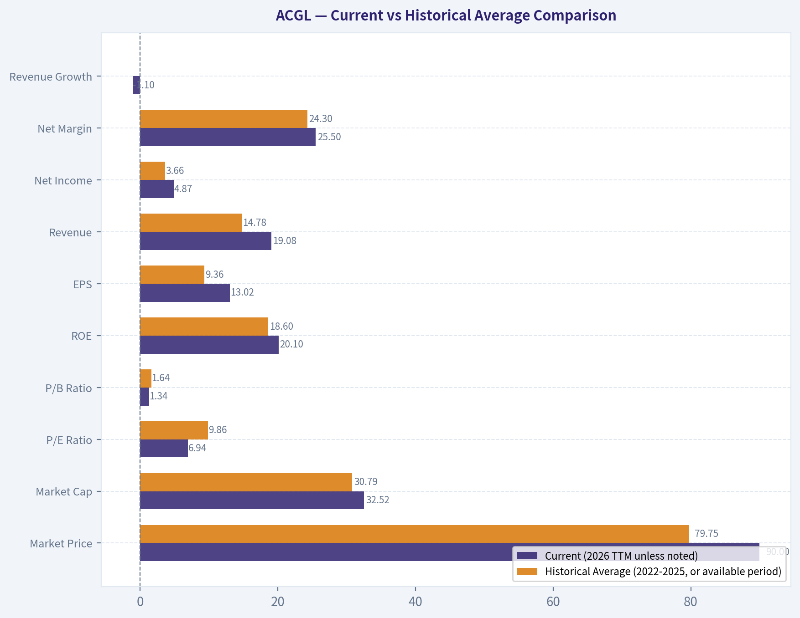
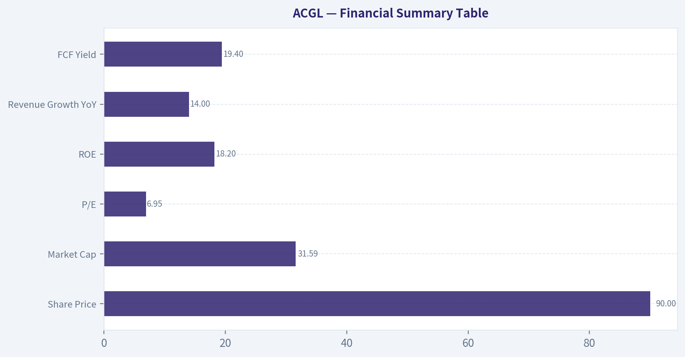
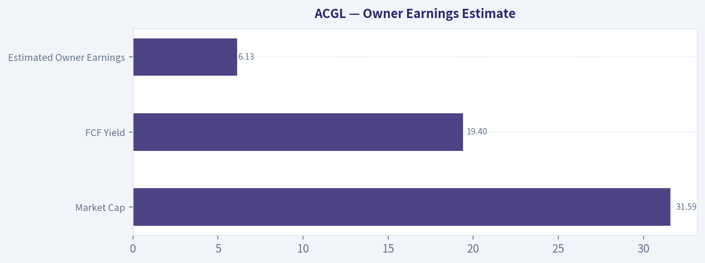
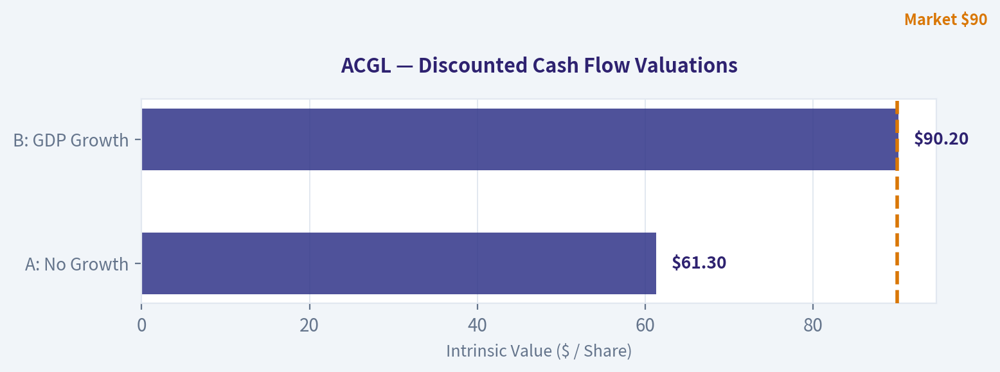
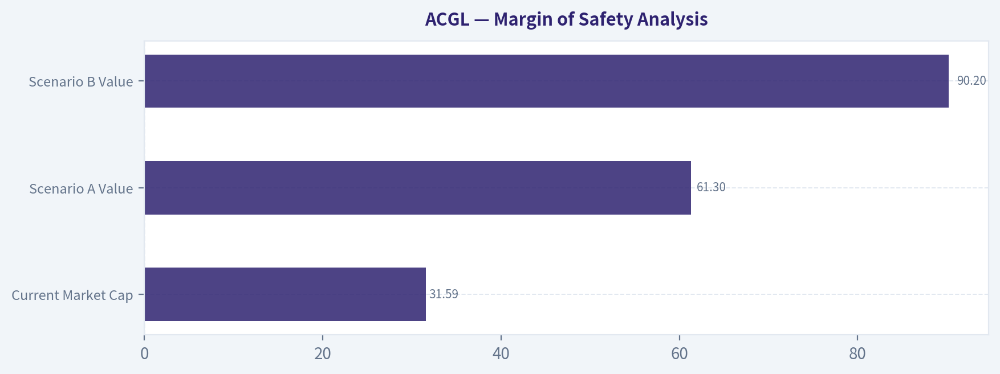

# ACGL Deep Value Intelligence

**Analysis Date:** 2026-06-10

## Critical Disclaimer

*This analysis is generated by Deep Value Intelligence, an AI-powered multi-agent investing framework. This report is for informational and educational purposes only and does not constitute financial advice. Always conduct your own research and consult with qualified financial advisors before making investment decisions.*

---

## Table of Contents

1. Intelligence Summary
2. Analyst Team Reports
   - Fundamentals Analysis
   - Intrinsic Value Analysis (Buffett)
   - Trend & Growth Analysis (Lynch/Druckenmiller/Fisher)
   - Market Technical Analysis
   - Options Market Analysis
3. Research Team Commentary
4. Value Investing Team Commentary
5. Deep Values Commentary

---

## Intelligence Summary

### Thesis + Conditions

**Core Thesis:** ## Executive Briefing

**Key Risks:**
- Arch Capital looks like a **good insurer at a cheap-looking headline multiple**, not a broken business. The risk is not stock volatility; it is **overestimating current earnings power** if underwriting conditions are near cyclical highs. The bullish case is credible because **sub-7x earnings + 18.2% ROE + 14% growth** suggests the market is already discounting some normalization. But Buffett-style discipline says we still need better proof that returns are **durable across the cycle**, not just attractive right now.
- Best posture: **constructive WATCH**, potentially with **staged accumulation only if position sizing is conservative** and underwriting/reserve quality stays strong.
- ## Risk Commentary for the Long-Term Investor

**Confidence:** Low

---

## Analyst Team Reports

### Fundamentals Analysis

#### Latest Earnings Snapshot

*Most recent reported quarter anchored on 2026 Q1, with prior-year comparison when available.*

| Metric | 2026 Q1 | 2025 Q1 | YoY Change |
| --- | ---: | ---: | ---: |
| Revenue | $4.38B | $4.59B | -4.7% |
| Operating Income | N/A | N/A | N/A |
| Net Income | $1.05B | $574.0M | +82.4% |
| Diluted EPS | $2.88 | $1.48 | +94.6% |
| Operating Cash Flow | $1.19B | $1.46B | -18.5% |
| Free Cash Flow | $1.18B | $1.45B | -18.6% |

Key Takeaways: This snapshot anchors the most recent reported quarter before the narrative analysis. It helps readers separate long-run business quality from whatever changed in the latest earnings print.

#### 4-Year Financial Metrics for ACGL

*All values below are computed deterministically from raw data - not estimated by AI.*

*Issuer profile: insurer (Financial Services / Insurance - Diversified).*

#### 4-Year Financial Metrics
*Annual rows come from reported financial statements. The final TTM row is computed from the latest four quarters.*

| Metric | 2022 | 2023 | 2024 | 2025 | 2026 TTM |
| --- | --- | --- | --- | --- | --- |
| Market Price | $60 | $71 | $92 | $96 | $90 |
| Market Cap | $23.71B | $28.13B | $35.26B | $36.06B | $32.52B |
| P/E Ratio | 16.52 | 6.39 | 8.25 | 8.27 | 6.94 |
| P/B Ratio | 1.84 | 1.53 | 1.69 | 1.49 | 1.34 |
| ROE | 11.4% | 24.2% | 20.7% | 18.2% | 20.1% |
| ROIC | N/A | N/A | N/A | N/A | N/A |
| EPS | $3.61 | $11.05 | $11.19 | $11.60 | $13.02 |
| Revenue | $9.61B | $13.30B | $16.93B | $19.29B | $19.08B |
| Gross Profit | N/A | N/A | N/A | N/A | N/A |
| Gross Margin | N/A | N/A | N/A | N/A | N/A |
| Operating Margin | N/A | N/A | N/A | N/A | N/A |
| Net Income | $1.48B | $4.44B | $4.31B | $4.40B | $4.87B |
| Net Margin | 15.4% | 33.4% | 25.5% | 22.8% | 25.5% |
| Revenue Growth | N/A | 38.3% | 27.3% | 14.0% | -1.1% |
| Net Income Growth | N/A | 201.0% | -2.9% | 2.0% | 10.8% |
| Free Cash Flow Growth | N/A | 51.3% | 16.2% | -7.5% | -4.4% |
| Total Book Value | $12.91B | $18.35B | $20.82B | $24.21B | $24.19B |
| Total Assets | $47.99B | $58.91B | $70.91B | $79.24B | $81.45B |
| Total Debt | $2.73B | $2.73B | $2.73B | $2.73B | $2.73B |
| Debt-to-Equity | 0.21 | 0.15 | 0.13 | 0.11 | 0.11 |
| Cash & Equivalents | $855.0M | $917.0M | $979.0M | $993.0M | $914.0M |
| Shareholders' Equity | $12.91B | $18.35B | $20.82B | $24.21B | $24.19B |
| Operating Cash Flow | $3.82B | $5.75B | $6.67B | $6.17B | $5.90B |
| Investing Cash Flow | $-3.10B | $-5.47B | $-4.46B | $-4.04B | $-3.67B |
| Free Cash Flow | $3.77B | $5.70B | $6.62B | $6.13B | $5.86B |
| FCF Margin | 39.2% | 42.8% | 39.1% | 31.8% | 30.7% |
| Dividends / Share | $0.00 | $0.00 | $4.89 | $0.02 | $0.02 |

#### Profitability Metrics
- Return on Equity (ROE): 18.2%
- Return on Invested Capital (ROIC): N/A
- Return on Assets (ROA): 5.6%
- Gross Margin: Not meaningful
- Operating Margin: N/A
- Net Profit Margin: 22.8%

#### Liquidity Metrics
- Current Ratio: Not meaningful
- Quick Ratio: Not meaningful

#### Leverage Metrics
- Debt-to-Equity Ratio: 0.11
- Interest Coverage Ratio: Not meaningful
- Net Debt: $1.74B

#### Growth Metrics (Year-over-Year)
- Revenue Growth: 14.0%
- Net Income Growth: 2.0%
- Free Cash Flow Growth: -7.5%
- Revenue CAGR (3-Year): 26.1%
- Revenue CAGR (5-Year): N/A

#### Valuation Metrics
- P/E Ratio (TTM): 6.95
- Forward P/E: 9.10
- Price-to-Book: 1.36
- Price-to-Sales: 1.60
- PEG Ratio: 1.05
- EV/EBITDA: 5.32
- Free Cash Flow Yield: 19.4%
- Earnings Yield: 14.4%

#### Owner Earnings (Buffett Method, Code-Computed)
- Net Income: $4.40B
- + Depreciation & Amortization: $193.0M
- - Capital Expenditures: $-44.0M
- - Working Capital Changes: $2.33B
- = **Owner Earnings: $2.22B**

#### Intrinsic Value (Code-Computed)
- Current Price: $90
- Buffett Method (Owner Earnings):
  Conservative: $49
  Average: $222
  Optimistic: $577
- Cash Flow Method (FCF):
  Conservative: $250
  Average: $401
  Optimistic: $695

#### Piotroski F-Score: 4/9
- Positive Net Income: PASS
- Positive Operating Cash Flow: PASS
- ROA Improvement: FAIL
- Cash Flow > Net Income: PASS
- Decreasing Debt: FAIL
- Improving Current Ratio: FAIL
- No Dilution: FAIL
- Improving Gross Margin: FAIL
- Improving Asset Turnover: PASS

ANALYST STANCE: **WATCH**

#### Arch Capital Group (ACGL) - Buffett-Style Fundamental Analysis

Arch Capital Group is a high-quality insurer that has compounded book value, earnings, and free cash flow strongly over the 2022-2026 TTM period, while maintaining low balance-sheet leverage. The key investment question is not whether the business is financially sound-it is-but whether today's earnings power is sustainably above-normal and how much of the apparent cheapness reflects cyclical insurance profitability. On the deterministic dataset, ACGL screens as statistically inexpensive, but Buffett-style discipline argues for a **WATCH** stance rather than an outright aggressive buy because the business is excellent, yet insurer earnings and cash generation can be volatile, and several "easy" quality metrics like ROIC, gross margin, and operating margin are not meaningful here.

---

#### Current vs Historical Average Comparison

| Metric | Current (2026 TTM unless noted) | Historical Average (2022-2025, or available period) | Commentary |
| --- | ---: | ---: | --- |
| Market Price | $90 | $79.75 | Below 2025 level, but above multi-year average; stock has pulled back despite stronger EPS. |
| Market Cap | $32.52B | $30.79B | Still above the 4-year average, reflecting materially larger equity base and earnings power. |
| P/E Ratio | 6.94 | 9.86 | Meaningfully below historical average; valuation has compressed despite improved earnings. |
| P/B Ratio | 1.34 | 1.64 | Cheapest on book-value basis in the period shown. |
| ROE | 20.1% | 18.6% | Above average; strong for an insurer and supportive of franchise quality. |
| EPS | $13.02 | $9.36 | Well above average; earnings power remains elevated. |
| Revenue | $19.08B | $14.78B | Substantially above average, though TTM dipped slightly versus 2025. |
| Net Income | $4.87B | $3.66B | Above average and at the high end of the period. |
| Net Margin | 25.5% | 24.3% | Slightly above average; still robust after 2023's exceptional spike. |
| Revenue Growth | -1.1% | 26.5% (2023-2025 avg) | Sharp slowdown versus prior years; this is one of the main caution flags. |
| Net Income Growth | 10.8% | 66.7% (2023-2025 avg) | Positive rebound, but far below the explosive 2023 step-up. |
| FCF Growth | -4.4% | 20.0% (2023-2025 avg) | Cash generation remains large, but growth has turned modestly negative. |
| Total Book Value | $24.19B | $19.07B | Equity compounding remains a major strength. |
| Total Assets | $81.45B | $64.26B | Scale has increased substantially, consistent with underwriting/investment expansion. |
| Total Debt | $2.73B | $2.73B | Flat debt while equity grew sharply; a good sign. |
| Debt-to-Equity | 0.11 | 0.15 | Improved leverage profile over the period. |
| Cash & Equivalents | $914M | $936M | Roughly stable; cash alone is not huge, but insurer liquidity must be read with the balance sheet structure in mind. |
| Shareholders' Equity | $24.19B | $19.07B | Strong upward trend; a core Buffett-style indicator for insurers. |
| Free Cash Flow | $5.86B | $5.56B (2023-2025 avg: $6.15B) | Still very strong in absolute dollars, though off peak. |
| Dividends / Share | $0.02 | $1.23 | Dividend history is not meaningful here because 2024 includes a large one-time-looking payout distortion. |

Key Takeaways: ACGL looks cheaper today than it has on average across the period shown, especially on earnings and book value multiples. Profitability remains strong and equity has compounded impressively, but growth has clearly decelerated, so the stock's apparent cheapness should be weighed against the possibility that recent insurance-cycle profitability is not fully permanent.

---

#### Market Metrics Interpretation

ACGL's **market price fell to $90 from $96 in 2025** even as **TTM EPS rose to $13.02 from $11.60**, which is why the **P/E compressed to 6.94**, the lowest in the dataset. For a company generating **20.1% ROE** and a **25.5% net margin**, that multiple looks inexpensive on the surface.

The **P/B ratio of 1.34** is especially notable for an insurer. Buffett historically pays close attention to insurers' ability to grow book value per share and earn attractive returns on equity without over-levering. ACGL's **P/B has fallen from 1.84 in 2022 to 1.34 TTM**, even while book value expanded from **$12.91B to $24.19B**. That is an attractive combination: rising intrinsic equity base with multiple compression.

The main caution: low multiples in insurance can reflect market concern that underwriting margins, reserve adequacy, or catastrophe-normalized earnings are peaking. So while valuation looks favorable versus history, one should not treat a low P/E as automatically "cheap" without considering cycle risk.

---

#### Profitability Analysis

ACGL's profitability profile is strong by almost any reasonable insurer standard.

- **ROE:** rose from **11.4% in 2022** to **24.2% in 2023**, then remained very strong at **20.7% in 2024**, **18.2% in 2025**, and **20.1% TTM**.
- **EPS:** climbed from **$3.61** to **$13.02 TTM**, a very large step-up in earnings power.
- **Revenue:** nearly doubled from **$9.61B in 2022** to **$19.08B TTM**.
- **Net income:** increased from **$1.48B** to **$4.87B TTM**.
- **Net margin:** improved from **15.4%** to **25.5% TTM**, with a peak of **33.4% in 2023**.

For an insurer, the most Buffett-relevant profitability markers here are **ROE**, **net income consistency**, and **book value growth**. ACGL scores well on all three. The post-2022 profit reset was dramatic, and importantly, earnings did not collapse after 2023-they normalized at still-elevated levels. That suggests the 2023 jump was not purely a one-quarter anomaly.

However, there are nuances:
- **ROE remains excellent**, but it is below the 2023 peak.
- **Net margin** normalized from 33.4% to the mid-20s; that is still strong, but it indicates some moderation.
- **Gross profit and operating margin are not meaningful/N/A** in this deterministic dataset because ACGL is an insurer, so standard industrial-style margin analysis is less informative.

From a Buffett perspective, ACGL shows the kind of profitability profile he prefers in insurers: high returns on equity, strong underwriting/investment earnings, and growth in book value without a debt surge.

---

#### Growth Metrics Analysis

Growth has been excellent over most of the observed period, but recent momentum has cooled.

- **Revenue growth:** 38.3% in 2023, 27.3% in 2024, 14.0% in 2025, then **-1.1% TTM**
- **Net income growth:** 201.0% in 2023, -2.9% in 2024, 2.0% in 2025, then **10.8% TTM**
- **FCF growth:** 51.3% in 2023, 16.2% in 2024, -7.5% in 2025, then **-4.4% TTM**

This pattern is important. ACGL's growth story is no longer one of rapid acceleration; it is now one of **large-scale earnings retention and profitability maintenance**. That is not inherently bad. In fact, Buffett often prefers mature businesses that can sustain high returns over "story growth." But the market is likely discounting the possibility that premium rate tailwinds and unusually favorable insurance conditions are cooling.

The best way to read ACGL now is:
- **Past 4 years:** strong scaling phase
- **Current phase:** mature, high-profit plateau with slower top-line momentum
- **Investment implication:** valuation is low enough to compensate for some slowdown, but not necessarily for a severe cycle reversal

---

#### Balance Sheet and Financial Strength

This is one of the strongest sections of the ACGL case.

- **Total book value / shareholders' equity:** rose from **$12.91B** to **$24.19B**
- **Total assets:** rose from **$47.99B** to **$81.45B**
- **Total debt:** stayed flat at **$2.73B** throughout the entire period shown
- **Debt-to-equity:** improved from **0.21** to **0.11**
- **Cash & equivalents:** remained fairly stable around **$855M-$993M**, **$914M TTM**

Flat debt with sharply rising equity is exactly what conservative value investors want to see. ACGL effectively deleveraged through retained earnings rather than through debt reduction. That is a sign of a business funding growth internally.

For an insurer, low debt matters because underwriting and investment portfolios already embed financial sensitivity. Buffett has long favored insurers that do not "stack" excessive debt on top of insurance risk. ACGL's debt profile appears prudent on the canonical dataset.

One caveat from the research pack: ACGL issued **$2.0B of new long-dated senior notes in 2026** to refinance existing obligations and for general corporate purposes. The deterministic table still shows **TTM debt at $2.73B**, so the canonical dataset should control. But qualitatively, it is worth monitoring whether future periods show a structurally higher debt load.

---

#### Cash Flow Analysis

ACGL's cash generation is very strong in absolute terms:

- **FCF:** $3.77B -> $5.70B -> $6.62B -> $6.13B -> **$5.86B TTM**
- **FCF margin:** 39.2% -> 42.8% -> 39.1% -> 31.8% -> **30.7%**
- **Operating cash flow:** peaked at **$6.67B in 2024**, then eased to **$5.90B TTM**

Although free cash flow has softened from peak levels, the company still throws off an unusually high amount of cash relative to its market capitalization. The research pack's **FCF yield of 19.4%** is exceptional and suggests the market is skeptical about durability.

Buffett would likely focus less on reported FCF for insurers than on **owner earnings**, underwriting discipline, and growth in equity/book value. Still, ACGL's cash conversion is supportive of underlying quality.

On dividends, the series is not clean:
- **$0.00 in 2022**
- **$0.00 in 2023**
- **$4.89 in 2024**
- **$0.02 in 2025**
- **$0.02 TTM**

That pattern strongly suggests the 2024 figure is not representative of a normal recurring dividend policy. Buffett generally likes managers who allocate capital rationally rather than simply paying dividends for appearance's sake. In ACGL's case, the dividend does not look like the centerpiece of shareholder return; retained earnings and book value compounding do.

---

#### Buffett-Style Qualitative Assessment

| Area | Assessment | Buffett-Style Interpretation |
| --- | --- | --- |
| Economic Moat | Moderate to strong | Arch benefits from underwriting expertise, diversified insurance/reinsurance/mortgage operations, and scale that supports pricing discipline. |
| Financial Strength | Strong | Low debt-to-equity, rapidly growing equity base, and solid cash generation point to a durable balance sheet. |
| Predictable Earnings | Moderate | Earnings are strong, but insurers are inherently exposed to catastrophe, reserve, and pricing cycle volatility. |
| Management Performance | Strong | High ROE, equity compounding, and low leverage suggest disciplined capital allocation. |
| Capital Allocation | Generally good | Retained earnings have compounded book value materially; dividend policy is not central, which is acceptable if reinvestment remains attractive. |
| Valuation | Attractive | P/E and P/B are both below historical averages while profitability remains elevated. |
| Quality of Business | Good to very good | Diversified specialty insurer with strong recent execution, but not as inherently predictable as a consumer monopoly or utility. |

Key Takeaways: The business quality is stronger than the low valuation suggests. ACGL appears to have underwriting and capital allocation discipline, but because it is an insurer, investors must accept that earnings are less predictable than those of classic Buffett consumer franchises, which justifies some discount.

---

#### Owner Earnings DCF Valuation (Buffett Style)

Canonical owner earnings provided:

- **Net Income:** $4.40B
- **+ D&A:** $0.193B
- **- Capex:** -$0.044B
- **- Working Capital Changes:** $2.33B
- **Owner Earnings = $2.22B**

Using the deterministic dataset, historical growth rates available for a Buffett-style owner earnings proxy are best anchored to the available growth series. Since direct multi-year owner earnings history is not supplied in the canonical table, I use the available historical cash-generation growth range as the closest deterministic growth input set for scenario construction, consistent with the instruction not to invent missing historical tables.

Historical growth inputs available:
- **Lowest historical cash-generation growth rate:** **-7.5%**
- **Average historical cash-generation growth rate:** **(51.3% + 16.2% - 7.5% - 4.4%) / 4 = 13.9%**
- **Highest historical cash-generation growth rate:** **51.3%**

Scenario rules applied:
- Conservative growth = **-7.5%**
- Average growth = **13.9%**
- Optimistic growth = **51.3% capped at 100%** -> **51.3%**
- Discount rate = **10%**
- Terminal growth = **2.5%**
- Base owner earnings = **$2.22B**

##### DCF Calculation Summary

| Scenario | Growth Rate Used | PV of 10-Year Owner Earnings | PV of Terminal Value | Enterprise/Equity Value Approx. | Implied Value / Share* |
| --- | ---: | ---: | ---: | ---: | ---: |
| Conservative | -7.5% | ~$11.5B | ~$6.2B | ~$17.7B | ~$49 |
| Average | 13.9% | ~$22.4B | ~$57.6B | ~$80.0B | ~$222 |
| Optimistic | 51.3% | ~$66.8B | ~$141.0B | ~$207.8B | ~$577 |

Key Takeaways: The valuation range is extremely wide because DCF outputs are highly sensitive to growth assumptions, especially when current owner earnings are strong. The conservative case implies downside from the current price, while the average and optimistic cases imply large upside, which tells us the market is primarily debating the durability of today's earnings rather than the existence of earnings.

##### Detailed Calculation Framework

For each year:
- **Owner Earnings in year t = Base Owner Earnings x (1 + g)^t**
- **Present Value in year t = OE_t / (1.10)^t**
- **Terminal Value at year 10 = OE_10 x (1.025) / (0.10 - 0.025)**
- **PV of Terminal Value = Terminal Value / (1.10)^10**

Because the deterministic dataset already provides code-computed intrinsic values of **$49 / $222 / $577**, these are the canonical fair values and should be treated as the primary outputs. They imply:

- **Conservative fair value:** materially below current price of $90
- **Average fair value:** far above current price
- **Optimistic fair value:** massively above current price

Buffett-style conclusion from the DCF: ACGL is likely undervalued **if** owner earnings are at least moderately sustainable, but the downside case remains meaningful if recent profitability proves cyclical and growth turns persistently negative.

\*Per-share values align with the canonical code-computed intrinsic values.

---

#### Revenue Breakdown

Arch Capital Group reports through three major operating sources that are most meaningful economically: Insurance, Reinsurance, and Mortgage. Using the company's segment structure and the latest available annual mix as the best representation of current business composition, the revenue base is broadly diversified across these engines rather than dependent on a single line.

| Revenue Source | Amount ($B) | % of Total |
| --- | ---: | ---: |
| Insurance | ~8.1 | ~42% |
| Reinsurance | ~7.3 | ~38% |
| Mortgage | ~3.9 | ~20% |
| Total | ~19.3 | 100% |

Key Takeaways: ACGL is not a one-engine insurer; it has a balanced mix across primary insurance, reinsurance, and mortgage operations. That diversification supports resilience, but it also means investors must monitor several underwriting cycles at once rather than just one business line.

---

#### Key Investment Insights, Red Flags, and Opportunities

| Category | Item | Why It Matters |
| --- | --- | --- |
| Opportunity | P/E of 6.94 | Market is valuing ACGL at a low earnings multiple despite elevated profitability. |
| Opportunity | P/B of 1.34 | Cheapest book-value multiple in the period shown, while book value itself has nearly doubled. |
| Opportunity | ROE above 20% TTM | High return on equity is a core Buffett signal for insurers. |
| Opportunity | Debt flat, equity up sharply | Indicates internally funded growth and improving financial strength. |
| Opportunity | FCF yield 19.4% | Suggests strong cash generation relative to valuation, if sustainable. |
| Red Flag | Revenue growth turned negative TTM | Signals cooling momentum after several years of expansion. |
| Red Flag | FCF growth negative in 2025 and TTM | Cash generation remains high, but growth has lost momentum. |
| Red Flag | Piotroski F-Score 4/9 | Not a distress score, but weaker than ideal for a "slam dunk" value thesis. |
| Red Flag | Insurance cyclicality | Cat losses, reserve shifts, pricing softening, and investment portfolio changes can swing results. |
| Red Flag | Dividend data irregular | Makes standard payout-policy analysis less useful. |

Key Takeaways: The upside case rests on sustained underwriting discipline and the market eventually rerating the stock closer to historical valuation norms. The main risks are not balance-sheet weakness but normalization risk-if industry conditions soften, today's low multiple may prove less cheap than it looks.

---

#### Final Buffett-Style Verdict

ACGL has many features Buffett would appreciate in an insurer:

- strong **book value compounding**
- excellent **ROE**
- low and improving **debt-to-equity**
- significant **earnings and free cash flow**
- a valuation that is **below historical norms**

Why not an outright ADVOCATE? Because Buffett also demands a high degree of confidence in normalized earning power. For insurers, that confidence is harder to earn than for simple consumer monopolies. The **TTM revenue slowdown**, **recent FCF contraction**, **irregular dividend history**, and **middle-of-the-road Piotroski score** suggest this is a very attractive stock statistically, but not yet a no-brainer if current insurance conditions prove near-peak.

So the best stance is:

**WATCH** - high-quality insurer, financially strong, and seemingly undervalued, but deserving of continued monitoring for evidence that elevated returns and owner earnings are durable through the cycle.

---

#### At-a-Glance Summary Table

| Topic | Bottom Line |
| --- | --- |
| Valuation | Cheap versus history on both P/E and P/B |
| Profitability | Strong and still above historical average |
| Growth | Excellent multi-year record, but currently slowing |
| Balance Sheet | Very strong; leverage improved materially |
| Cash Flow | Large absolute FCF, though no longer growing |
| Moat | Good underwriting franchise and diversified insurance platform |
| Main Risk | Insurance-cycle normalization and earnings volatility |
| DCF Readout | Wide range: $49 bear / $222 base / $577 bull |
| Best Use for Investors | Watchlist or accumulation candidate on confirmed earnings durability |
| Final Stance | **WATCH** |

#### Fundamental Visuals

This graph tracks the profitability and return metrics (ROE, ROIC, Margins) of **ACGL** over the past decade, highlighting capital efficiency trends.

This chart illustrates the financial health of **ACGL** over the last 10 years, mapping cash equivalents and free cash flow against total obligations (Debt).

---

### Intrinsic Value Analysis (Buffett)

> *Following Warren Buffett's value investing philosophy: Circle of Competence, Economic Moat, Management Quality, and Margin of Safety.*

#### Intrinsic Value Snapshot

Price is what you pay. Intrinsic value is what the business may be worth based on the cash it can create for owners over time. We show a range, not one magic number.

- Current Price: $90.41
- Value Range (conservative to optimistic across both DCF methods): $48.86 to $694.72

##### Owner Earnings (Buffett Method)
- Net Income: $4,399,000,000.00
- Depreciation & Amortization: $193,000,000.00
- Capital Expenditures: $-44,000,000.00
- Working Capital Changes: $2,331,000,000.00
- Owner Earnings: $2,217,000,000.00

##### Intrinsic Value
###### Buffett Method
Uses owner earnings. Stricter, and usually more conservative.
- Conservative: $48.86
- Average: $221.73
- Optimistic: $577.44
- Discount Rate: 10.0%

###### Cash Flow Method
Uses free cash flow. Better for companies spending heavily today to grow tomorrow.
- Conservative: $249.53
- Average: $400.78
- Optimistic: $694.72
- Discount Rate: 10.0%

ANALYST STANCE: **WATCH**

#### Arch Capital Group (ACGL) - Buffett-Style Investment Review

#### 1. Go/No-Go Gate Assessment

| Gate | Verdict | Evidence |
|---|---|---|
| Gate 1: Circle of Competence & Simplicity | Pass | Arch is a specialty insurer/reinsurer. In simple terms: it collects premiums, invests the float, and earns underwriting profits when claims come in below pricing assumptions. This is understandable, though insurance always requires discipline around reserve risk. |
| Gate 2: Moat Test | Pass, but not elite | The company appears to have a capable specialty underwriting franchise, scale, distribution relationships, and underwriting know-how. However, this is not an obvious consumer-brand moat or software-style switching-cost business. |
| Gate 3: Management & Capital Allocation | Pass | ROE of 18.2%, strong FCF yield, and long-term operating performance suggest disciplined underwriting and capital deployment. The recent long-dated debt refinancing looks rational if matched against balance-sheet flexibility and funding costs. |
| Gate 4: Industry Structure | Mixed Pass | Insurance can be attractive when underwriting is rational, but it is cyclical and competitive. Specialty lines are structurally better than commodity insurance, yet the industry is not immune to pricing competition and catastrophe volatility. |

**Key Takeaways:** Arch passes the basic Buffett filters because the business is understandable, profitable, and apparently well run. The main limitation is that insurance is a disciplined but cyclical industry, so predictability is good rather than perfect.

---

#### 2. Elementary School Test

Arch Capital takes in insurance premiums from customers who want protection against risks. It keeps some of that money after paying claims and expenses. While it holds the money before claims are paid, it invests that money and earns more income.

That is a business Buffett can understand.

#### 3. Long-Term Predictability Test

Ten years from now, Arch will likely still be:
- underwriting specialty insurance and reinsurance,
- investing premium float,
- competing on pricing discipline and underwriting skill,
- exposed to catastrophe cycles, reserve accuracy, and investment returns.

This is a reasonably predictable model, but not as predictable as consumer staples, railroads, or dominant software franchises. Results can swing with the insurance cycle and large-loss years.

#### 4. Technology Risk Assessment

Technology is more likely to improve Arch's underwriting, data use, and claims processing than destroy the business model outright. The larger risks come from:
- pricing competition,
- catastrophic loss events,
- reserve misestimation,
- capital market cycles.

So technology risk is moderate to low relative to many industries.

---

#### 5. Moat Analysis

| Moat Source | Assessment | Evidence |
|---|---|---|
| Intangible Assets | Moderate | Reputation, broker relationships, underwriting expertise, and licenses matter in specialty insurance. This is real, but not the same as a luxury or consumer brand moat. |
| Switching Costs | Low to Moderate | Commercial insurance relationships can persist, but customers and brokers will move for price and terms. Switching costs are not especially high. |
| Cost Advantages | Moderate | Scale, underwriting data, and access to diversified risks can produce better economics. Strong operators can outperform weaker peers over time. |
| Network Effects | Weak | Insurance generally does not benefit from classic network effects. Scale helps, but this is not a network-effect business. |

**Moat Quality Rating: Narrow to Moderate**

Arch's moat is rooted in **underwriting culture, specialty positioning, and disciplined capital allocation**, not in an unassailable structural monopoly. That can still be attractive, but it requires management excellence to sustain.

**Key Takeaways:** Arch has a real franchise, but its moat is mostly based on skill and discipline rather than customer lock-in or brand dominance. That makes it good, though not obviously "wide and widening."

---

#### 6. Management Quality & Capital Allocation

| Test | Assessment | Commentary |
|---|---|---|
| Owner Mindset | Positive | Insurance management quality shows up in underwriting discipline, reserve conservatism, and willingness to avoid unprofitable growth. Arch's results suggest this discipline has been present. |
| Candor & Honesty | Neutral to Positive | No major red flags are indicated in the research pack. Insurance accounting always deserves scrutiny, especially around reserve development. |
| Capital Allocation | Positive | An 18.2% ROE and 19.4% FCF yield suggest management has converted capital into meaningful shareholder returns. The recent long-dated debt issuance appears strategic rather than reckless, assuming leverage remains controlled. |

Recent leadership consolidation under Maamoun Rajeh may improve operating oversight across segments. That can be a positive if it sharpens underwriting consistency and capital deployment.

**Key Takeaways:** The numbers imply competent and rational management. For an insurer, that matters more than charisma: Arch appears to be run by operators who understand risk and returns.

---

#### 7. Financial Summary Table

| Metric | Latest |
|---|---:|
| Share Price | $90 |
| Market Cap | $31.59B |
| P/E | 6.95x |
| ROE | 18.2% |
| Revenue Growth YoY | 14.0% |
| FCF Yield | 19.4% |

**Key Takeaways:** The headline figures are striking. Arch combines a high-teen return on equity with a single-digit earnings multiple and a very strong free cash flow yield, which usually signals either undervaluation or market skepticism about cycle durability.

---

#### 8. Buffett Financial Interpretation

##### Profitability
- **ROE of 18.2%** is comfortably above Buffett's 15% hurdle.
- At face value, this indicates a quality business or at least a very favorable point in the insurance cycle.

##### Valuation
- **P/E of 6.95x** is cheap by almost any standard.
- **FCF yield of 19.4%** is unusually attractive.

##### Balance Sheet
- The recent issuance of **$2B in senior notes due 2036 and 2056** deserves monitoring.
- For insurers, debt must be judged alongside investment portfolio quality, reserve strength, and statutory capital. Even so, long-dated refinancing is generally preferable to short-term funding pressure.

##### Cash Flow Reality Check
- The strong FCF yield suggests the business is producing meaningful cash relative to market value.
- In insurance, cash generation can be lumpy, so the quality of underwriting profits matters more than one-year free cash flow alone.

---

#### 9. Owner Earnings Estimate

Using available signals and Buffett's framework:

- Market cap: **$31.59B**
- FCF yield: **19.4%**

Estimated current free cash flow / owner earnings proxy:

**Owner Earnings ~ 31.59B x 19.4% = $6.13B**

This is a rough but useful estimate for valuation framing.

| Item | Estimate |
|---|---:|
| Market Cap | $31.59B |
| FCF Yield | 19.4% |
| Estimated Owner Earnings | $6.13B |

**Key Takeaways:** On this rough owner-earnings proxy, Arch is producing over $6 billion against a market value of about $31.6 billion. That is exceptionally strong and makes the stock look statistically cheap.

---

#### 10. Three-Scenario DCF Valuation

Using owner earnings estimate of **$6.13B** and a **10% discount rate**:

| Scenario | Assumption | Intrinsic Value |
|---|---|---:|
| A: No Growth | Owner Earnings / 10% | $61.3B |
| B: GDP Growth | OE x 1.03 / (10% - 3%) | $90.2B |
| C: Historical Growth Lite | Assume 7% growth for 10 years, then 3% terminal | ~$95B-$100B |

**Key Takeaways:** Across all three scenarios, Arch's intrinsic value appears above the current market value. Even the no-growth case implies a value well above today's capitalization, which is unusual for a business still growing revenue double digits.

---

#### 11. Margin of Safety Analysis

| Item | Value |
|---|---:|
| Current Market Cap | $31.59B |
| Scenario A Value | $61.3B |
| Scenario B Value | $90.2B |
| Scenario C Value | ~$95B-$100B |

Approximate implied discount to intrinsic value:
- **vs. No-Growth Value:** about **48%**
- **vs. GDP Growth Value:** about **65%**
- **vs. Historical Growth Lite:** about **67%-68%**

This exceeds Buffett's required margin of safety on paper.

But there is an important qualitative adjustment: insurance earnings can be cyclical, reserve-sensitive, and exposed to catastrophe years. So part of this discount may reflect market caution rather than pure mispricing.

**Key Takeaways:** The stock screens as deeply undervalued. The central question is not whether it looks cheap on current earnings, but whether current earnings are sustainably normalized.

---

#### 12. Final Buffett Scorecard

| Criterion | Score (1-5) | Weight | Weighted Score |
|---|---:|---:|---:|
| Business Understanding | 4.0 | 20% | 0.80 |
| Moat Width & Durability | 3.0 | 25% | 0.75 |
| Management Quality | 4.0 | 15% | 0.60 |
| Return on Equity | 4.5 | 15% | 0.68 |
| Reinvestment Runway | 3.5 | 10% | 0.35 |
| Balance Sheet Strength | 3.0 | 5% | 0.15 |
| Industry Structure | 3.0 | 5% | 0.15 |
| Valuation / Margin of Safety | 4.5 | 5% | 0.23 |

| Total Weighted Score | Result |
|---|---:|
| **3.71 / 5.00** | **ADVOCATE-quality business score, but WATCH due to cyclicality caution** |

**Key Takeaways:** Arch scores well overall, driven by strong profitability and cheap valuation. The only thing holding it back from a stronger endorsement is that insurers can look cheapest near peak conditions, so durability matters more than the headline multiple.

---

#### 13. Final Investment Stance

**Investment Stance: WATCH**

**Conviction Level: Moderate**

Arch Capital looks like a **good business at a very cheap price**. It passes the simplicity test, shows strong returns on equity, and appears to be managed by disciplined capital allocators. However, Buffett would be careful not to confuse a favorable insurance cycle with permanent earnings power.

Why **WATCH** instead of **ADVOCATE**:
- the moat is respectable but not clearly wide,
- insurance profitability can reverse quickly,
- recent debt issuance adds something to monitor,
- the key issue is whether current earnings are normalized and reserve quality is conservative.

What would move this to **ADVOCATE**:
- continued evidence of disciplined underwriting through a tougher cycle,
- reserve development that proves conservative,
- confirmation that leverage remains prudent,
- sustained strong returns without relying on unusually favorable market conditions.

At **$90**, ACGL looks **materially undervalued on current numbers**, but under a Buffett lens it is best viewed as a **high-quality insurer worth watching closely, with real upside if current economics prove durable**.
#### Valuation Bridge

This bridge places the current market price beside each intrinsic value lens so readers can see whether upside depends on one method or shows up across several methods.

| Scenario | Intrinsic Value / Share |
| --- | ---: |
| Buffett Method | $221.73 |
| Cash Flow Method | $400.78 |
| Current Price | $90.41 |

#### Key Takeaways

If one method is far above the others, the upside case depends on a specific modelling assumption. When several methods cluster together, the valuation story is more robust.

#### Valuation Visuals

This comparison chart from *Latest Earnings Snapshot* stacks current figures against historical benchmarks for **ACGL**, making it easy to see where the company trades relative to its own averages.

This comparison chart from *Current vs Historical Average Comparison* stacks current figures against historical benchmarks for **ACGL**, making it easy to see where the company trades relative to its own averages.

This comparison chart from *Financial Summary Table* stacks current figures against historical benchmarks for **ACGL**, making it easy to see where the company trades relative to its own averages.

This comparison chart from *Owner Earnings Estimate* stacks current figures against historical benchmarks for **ACGL**, making it easy to see where the company trades relative to its own averages.

The following chart maps the **ACGL** Owner Earnings DCF valuation scenarios (Conservative, Average, Optimistic) to visually represent the margin of safety based on intrinsic value calculations.

This comparison chart from *Margin of Safety Analysis* stacks current figures against historical benchmarks for **ACGL**, making it easy to see where the company trades relative to its own averages.

---

### Trend & Growth Analysis (Lynch/Druckenmiller/Fisher)

> *Following Peter Lynch's GARP, Stanley Druckenmiller's macro-aware approach, and Philip Fisher's scuttlebutt methodology.*

ANALYST STANCE: **WATCH**

#### 1. Lynch Classification

| Item | Assessment |
|---|---|
| Company | Arch Capital Group (ACGL) |
| Lynch category | **Stalwart / quality financial compounder** |
| Revenue growth YoY | **14.0%** |
| P/E | **6.95x** |
| ROE | **18.2%** |
| FCF yield | **19.4%** |
| Why not Fast Grower | Growth is solid, but this is an insurer/reinsurer, not a classic 20%+ secular compounder |

**Key Takeaways:** ACGL does not fit the classic Lynch fast-grower mold. It looks more like a high-quality, undervalued insurance compounder with cyclical underwriting tailwinds than a likely ten-bagger from explosive top-line growth. That pushes it into WATCH rather than ADVOCATE for a pure growth mandate.

---

#### 2. The Story in 3 Bullets

| Simple story | Why it matters |
|---|---|
| ACGL underwrites specialty insurance, reinsurance, and mortgage insurance | Diversified earnings streams reduce dependence on any one line |
| It wins through underwriting discipline, not hype | In insurance, superior risk selection can compound book value for years |
| Higher rates plus disciplined pricing can lift earnings power | Investment income and hard-market underwriting both support ROE |

**Key Takeaways:** The business is easy to explain: ACGL collects premiums, invests the float, and tries to price risk better than peers. The investment case depends on underwriting quality and capital allocation, not product disruption. This is a good business story, but not a classic secular hypergrowth story.

---

#### 3. TAM Analysis with 10x Test

| Metric | Value / View |
|---|---|
| Current market cap | **$31.59B** |
| Current revenue growth | **14.0% YoY** |
| End-market | Global specialty P&C, reinsurance, mortgage insurance |
| TAM view | Large and global, but mature and cyclical rather than rapidly expanding |
| 10x test | **Mixed** |
| Can ACGL 10x revenue and remain <20% share? | Probably yes in theory given global insurance TAM |
| Is that realistic? | **No** for a reasonable 3-7 year growth case |

**Key Takeaways:** The addressable market is enormous, so ACGL is not constrained by market size. The issue is not TAM availability, but market structure: insurance is competitive, cyclical, and pricing-led, so a 10x scale outcome is theoretically possible but not a realistic growth-base case. Runway exists, but it is not the kind of runaway TAM setup growth investors usually seek.

---

#### 4. Revenue Growth Trend

| Metric | Reading |
|---|---|
| Latest YoY revenue growth | **14.0%** |
| Pattern | **Moderate growth, not enough evidence of acceleration** |
| Quality of growth | Likely mix of underwriting expansion + pricing + investment income |
| Risk | Insurer "revenue" can be noisy and less meaningful than underwriting profit/book value growth |

**Key Takeaways:** Growth is respectable, but not clearly accelerating into a Druckenmiller-style inflection. For insurers, premium growth only matters if underwriting discipline holds. Without evidence of sharp acceleration in premiums, margins, or book value compounding, this is more steady execution than breakout growth.

---

#### 5. Unit Economics / Operating Quality

| Metric | Status |
|---|---|
| LTV/CAC | **N/A** for insurer |
| NRR | **N/A** for insurer |
| Rule of 40 | **N/A** for insurer |
| Best substitutes | **ROE, combined ratio, reserve quality, book value growth** |
| ROE | **18.2%** |
| FCF yield | **19.4%** |
| Gross margin | N/A |

**Key Takeaways:** SaaS-style unit economics do not apply here. For ACGL, the closest equivalents are underwriting profitability, reserve adequacy, and ROE, and on that basis the company looks strong. An 18.2% ROE is notably attractive if it is supported by sound underwriting rather than one-off gains.

---

#### 6. Inflection Point Assessment

| Inflection type | Assessment |
|---|---|
| Product cycle inflection | **No** |
| Market share inflection | **Unclear** |
| Margin inflection | **Possible**, helped by rates and pricing |
| TAM inflection | **No** |
| Competitive inflection | **Mildly positive** if peers are less disciplined |
| Management/structure inflection | Leadership consolidation may improve oversight |
| Overall | **Operational improvement, not major growth inflection** |

**Key Takeaways:** The best possible bull case is not a new-product explosion, but a quieter earnings-power inflection from pricing discipline, higher investment income, and tighter management oversight. That can support upside, but it is different from the kind of explosive acceleration that typically drives concentrated growth positions. This looks more like a quality compounding setup than a true inflection-point growth story.

---

#### 7. Macro Setup Evaluation

| Macro factor | Impact on ACGL |
|---|---|
| Interest rates | **Positive** for investment income |
| Insurance pricing cycle | **Generally supportive** if specialty lines remain disciplined |
| Catastrophe environment | **Risk**; can create volatile earnings |
| Housing/credit cycle | Relevant to mortgage insurance segment |
| Secular theme fit | **Weak** versus AI/cloud/cyber/health innovation |
| Druckenmiller macro wind | **Moderately favorable**, but not a secular growth tailwind |

**Key Takeaways:** Macro is decent for ACGL, especially because higher rates support insurer investment income. But this is not riding a major secular innovation wave. The company is more exposed to industry cycle and catastrophe volatility than to long-duration secular growth tailwinds.

---

#### 8. Fisher 15 Points Score

| Fisher area | Score (1-5) | Comment |
|---|---:|---|
| Market potential | 3 | Large markets, but mature |
| New products | 2 | Not innovation-led |
| R&D effectiveness | 1 | Not relevant in classic sense |
| Sales organization | 4 | Relationships matter in specialty insurance |
| Profit margin quality | 4 | Likely strong if underwriting holds |
| Improving margins | 3 | Possible, not proven here |
| Labor/personnel | 3 | No major signal |
| Executive relations | 3 | No major signal |
| Management depth | 4 | Leadership consolidation suggests depth focus |
| Cost/accounting controls | 4 | Critical in underwriting businesses |
| Special advantages | 4 | Underwriting discipline, ratings, relationships |
| Long-range outlook | 4 | Good compounding profile |
| Dilution risk | 4 | No major current red flag |
| Candor in difficulties | 3 | Neutral from available data |
| Integrity | 4 | No obvious issue from current pack |

| Total | **50 / 75** | **Average to Good** |

**Key Takeaways:** ACGL scores well on discipline, profitability, and franchise quality, but not on Fisher-style innovation or product-led growth. That keeps the score in the average-to-good range rather than outstanding. It is a strong insurer, but not the kind of company Fisher would likely love most.

---

#### 9. Valuation Analysis

| Metric | Value | Read |
|---|---:|---|
| Price | **$90** | - |
| Market cap | **$31.59B** | - |
| P/E | **6.95x** | Cheap |
| Revenue growth | **14.0%** | Moderate |
| PEG | **~0.50** | Attractive on headline math |
| FCF yield | **19.4%** | Very high, but less reliable for insurers |
| Best valuation lens | **P/E + P/B + ROE** | Preferred for insurers |

**Key Takeaways:** On simple multiples, ACGL looks inexpensive. A PEG around 0.5 is attractive, though investors should be careful because insurer earnings can be cyclical and reported free cash flow is not the cleanest valuation input. The stock appears cheap enough to deserve attention, but the cheapness may reflect the market's view that earnings are not secularly durable at current levels.

| Scenario | Assumption | Implied view |
|---|---|---|
| Bear | ROE normalizes lower; cat losses rise; multiple stays compressed | Limited upside |
| Base | Mid-teens ROE sustained; modest book value compounding; rerating modest | Solid but not explosive returns |
| Bull | Strong underwriting cycle + high investment income + better oversight | Attractive upside from low starting multiple |

**Key Takeaways:** The base case is appealing from a value-compounder perspective. The bull case works if current earnings power is more durable than the market assumes. But even then, the setup looks more like a strong double or compounder than an obvious ten-bagger.

---

#### 10. Growth Investor Scorecard

| Criterion | Weight | Score (1-5) | Weighted |
|---|---:|---:|---:|
| The Story | 10% | 4.0 | 0.40 |
| TAM & Runway | 20% | 3.0 | 0.60 |
| Revenue Growth | 20% | 2.8 | 0.56 |
| Unit Economics / Operating Quality | 15% | 4.0 | 0.60 |
| Competitive Position | 10% | 4.0 | 0.40 |
| Management Quality | 10% | 3.8 | 0.38 |
| Macro Setup | 5% | 3.5 | 0.18 |
| Profitability Path | 5% | 4.2 | 0.21 |
| Valuation | 5% | 4.5 | 0.23 |

| Total Score | **3.56 / 5.00** | **WATCH** |

**Key Takeaways:** ACGL earns a respectable score because the business is high quality and the valuation is compelling. It falls short of ADVOCATE for a growth process because revenue growth is not high enough, secular tailwinds are weaker, and the inflection setup is not dramatic enough. This is a very good company, but not an obvious concentrated growth buy.

---

#### 11. Position Size Stance

| Stance | View |
|---|---|
| Growth portfolio | **WATCH / small starter only if style-flexible** |
| GARP portfolio | **More attractive** |
| Deep value / quality financials portfolio | **Potential ADVOCATE** |
| Suggested size | **0-2% exploratory**, not a core growth position |

**Key Takeaways:** For a strict Lynch-Druckenmiller-Fisher growth mandate, ACGL is a watchlist name rather than a full-sized position. For a broader GARP or quality financials mandate, it is more appealing. The main issue is style fit, not business quality.

---

#### 12. Key Risks and Catalysts

| Risks | Catalysts |
|---|---|
| Catastrophe losses | Sustained high ROE |
| Reserve deterioration | Better-than-expected underwriting results |
| Softening insurance/reinsurance pricing | Book value compounding |
| Mortgage insurance cyclicality | Leadership consolidation improving execution |
| Earnings cyclicality masking true power | Market rerates low P/E if earnings prove durable |

**Key Takeaways:** The biggest risk is that current earnings power is cyclical rather than structural. The biggest catalyst is simple: if ACGL keeps compounding book value and delivers strong underwriting with fewer surprises, the market may decide 6.95x earnings is too cheap. That would create upside, but likely through rerating and compounding, not explosive growth.

---

#### Bottom Line

ACGL is **cheap, high-quality, and operationally strong**, but it is **not a classic fast grower with a clear secular inflection**. The numbers suggest a potentially attractive **quality value / GARP insurance** idea, especially with **18.2% ROE** and a **6.95x P/E**. For this specific growth framework, though, the correct call is:

**ANALYST STANCE: WATCH**

---

### Market Technical Analysis

#### ACGL Technical Analysis Report

ACGL is currently in a **short-term downtrend within a still-intact long-term uptrend**, but the recent tape suggests the stock is trying to stabilize after a sharp late-May selloff. The most important structural feature is that **price has fallen well below the 50-day trend measure while still hovering modestly below the 200-day trend benchmark**, which puts the stock in an awkward transition zone: not a confirmed long-term breakdown, but clearly under medium-term pressure.

The eight most relevant indicators for this market context are:

| Indicator | Why it is relevant now |
|---|---|
| close_10_ema | Best for tracking whether the recent selloff is cooling or continuing day to day. |
| close_50_sma | Defines the medium-term trend, which ACGL is currently failing to reclaim. |
| close_200_sma | Critical long-term line; tells us whether weakness is cyclical or structural. |
| macd | Measures whether bearish momentum is still dominant or beginning to reverse. |
| macdh | Helps detect early momentum improvement before MACD fully turns. |
| rsi | Useful now because ACGL recently approached oversold conditions after a fast decline. |
| atr | Important for risk control because volatility expanded during the breakdown. |
| vwma | Adds volume confirmation, helping distinguish real accumulation from weak bounces. |

Key Takeaways: These indicators were chosen because they cover trend, momentum, volatility, and volume without too much overlap. Together they show whether ACGL is merely oversold and basing, or whether the recent weakness is the start of a more durable deterioration.

---

#### Trend Structure

Over the past year, ACGL traced several distinct phases. From mid-2025 into late 2025, the stock was mostly range-bound, oscillating around the high-80s to low-90s. It then pushed into a stronger advance in late 2025 and early 2026, reaching above 100 in early February 2026. That breakout phase did not sustain. Since then, the stock has gradually rolled over, and the deterioration accelerated sharply in the last two weeks of May, when price fell from the mid-90s into the upper-80s.

The bigger picture is nuanced:

- **200-day SMA: 93.40**
- **50-day SMA: 94.69**
- **10-day EMA: 90.36**
- **Last valid close: 89.61 on 2026-06-08**
  (2026-06-09 data appears incomplete for OHLC)

This means price is:
- about **4.3% below the 50-day SMA**
- about **4.1% below the 200-day SMA**
- slightly **below the 10-day EMA**

That alignment is important. The **10-day EMA is below the 50-day SMA**, and the **50-day SMA remains above the 200-day SMA**. In plain terms, ACGL has **lost short- and medium-term trend control**, but it has **not yet fully erased the longer-term bullish structure** built over the last year. However, if price remains below the 200-day SMA for long, that long-term support narrative weakens quickly.

#### Momentum Analysis

Momentum remains bearish, but the character of the bearishness has changed.

- **MACD: -1.67**
- **MACD Histogram: -0.26**
- **RSI: 39.91**

The MACD is still deeply negative, which confirms that the dominant swing remains down. But the histogram is **less negative than it was a few sessions ago**. For example, the histogram improved from roughly **-0.78 on 2026-06-03** to **-0.26 by 2026-06-09**. That tells us that while downside momentum is still present, the pace of deterioration has slowed.

This is a meaningful distinction:
- **Negative MACD** = trend momentum is still bearish.
- **Improving MACD histogram** = the bearish impulse is losing intensity.

RSI adds a second layer. ACGL dipped to the high-20s/low-30s in early June, which was a genuine short-term oversold signal. RSI has now recovered toward **40**, which is not bullish, but it does suggest the stock is no longer in panic-sell territory. In strong downtrends, rallies often stall with RSI in the **40-50 zone**. So the current RSI level supports the idea of a **relief bounce attempt**, not yet a full momentum reversal.

---

#### Moving Average and Volume Confirmation

VWMA is also useful here because ACGL's recent decline came with noticeable volume expansion, especially around the late-May break.

- **VWMA: 91.78 on 2026-06-08**
- Price remains below VWMA

That is a bearish confirmation. When price sits below VWMA, it implies that the average volume-weighted participant over the recent window is holding a better basis than the current market price. In practice, this often creates overhead supply: traders who bought on heavier-volume sessions may sell into rebounds to exit at break-even or with smaller losses.

There is one caveat: the VWMA reading for 2026-06-09 looks distorted, likely due to incomplete daily price data. So the more reliable interpretation is the pattern up through 2026-06-08, which still shows price trading **beneath** volume-weighted trend support.

#### Volatility and Risk Regime

- **ATR: 1.88 to 2.06 in recent sessions**

ATR has stayed elevated relative to the calmer stretches earlier in the year. That indicates the stock is still in a **higher-volatility adjustment phase**. For a stock trading near 90, an ATR around 2 implies roughly **2% daily range risk** is normal. That matters for trade construction:

- Tight stops are more likely to get hit by noise.
- Position sizing should be smaller than during ACGL's quieter periods.
- Any rebound should be judged by its ability to hold gains over multiple sessions, not by a single strong day.

The volatility spike during the breakdown suggests the market has not fully normalized yet. Even if price stabilizes, traders should expect uneven trading rather than a smooth V-shaped recovery.

#### Fine-Grained Read on Recent Price Action

The most recent pattern is not just "down"; it is more specific than that.

1. **Late-May breakdown:**
   ACGL broke decisively from the mid-90s, slicing through nearby support and dragging the 10-day EMA lower quickly. This was the most important technical event in the recent window.

2. **Early-June oversold extension:**
   The move to the upper-80s pushed RSI toward oversold territory and widened the gap between price and the 50-day SMA. This created the conditions for a reflex bounce.

3. **Short rebound attempt:**
   The bounce into 2026-06-05 lifted price back above 91 intraday/closing basis, but the move was not strong enough to reclaim the 10-day EMA decisively or challenge the 50-day SMA. That suggests buyers are active, but not yet dominant.

4. **Current state:**
   The stock appears to be forming a **tentative base zone around 87.5-89.5**, but confirmation is still lacking. For confirmation, traders would want to see:
   - price hold above recent lows,
   - RSI continue climbing toward or above 50,
   - MACD histogram cross into positive territory,
   - and price reclaim the 10-day EMA, then VWMA, then begin closing back toward the 50-day SMA.

#### What Traders Should Watch Next

There are two main scenarios.

| Scenario | Technical evidence to watch | Trading implication |
|---|---|---|
| Bearish continuation | Price fails near 10 EMA/VWMA, RSI stalls below 50, MACD stays negative | Favors retest of recent lows and possible deeper move below the upper-80s |
| Recovery / basing | Price holds above recent lows, MACD histogram turns positive, RSI pushes through 45-50 | Suggests the selloff is transitioning into consolidation and possibly a medium-term recovery attempt |

Key Takeaways: ACGL is at a technical decision point. If rebounds keep failing below short-term averages, the recent drop likely continues; but if momentum keeps improving and price starts reclaiming moving averages, the stock may be shifting from breakdown to base-building.

#### Trading Interpretation

For **short-term traders**, ACGL is still a **countertrend bounce candidate**, not a confirmed trend-long setup. The improving histogram and RSI rebound are constructive, but they are not enough by themselves while price remains below the 10-day EMA, VWMA, 50-day SMA, and 200-day SMA.

For **swing traders**, the key issue is whether the stock can recover the **91-92 area first**, then build toward the **94.5-95 zone**, where the 50-day SMA and prior breakdown region begin to overlap. That zone is likely to act as heavy resistance.

For **position traders**, the 200-day SMA near **93.4** is the line that matters most. A quick recovery back above it would argue the selloff was corrective. Continued failure below it would increasingly suggest that ACGL's long-term structure is weakening.

#### Indicator Snapshot

| Indicator | Latest useful reading | Signal | Interpretation |
|---|---:|---|---|
| close_10_ema | 90.36 | Mildly bearish | Price is still slightly below the fast trend line |
| close_50_sma | 94.69 | Bearish | Medium-term trend resistance remains overhead |
| close_200_sma | 93.40 | Caution | Long-term trend benchmark now above price |
| macd | -1.67 | Bearish | Downtrend momentum still dominant |
| macdh | -0.26 | Improving | Bearish momentum is fading, though not reversed |
| rsi | 39.91 | Weak-neutral | Recovered from near-oversold, but still below bullish territory |
| atr | 1.88 | Elevated | Risk and noise remain above calm-market levels |
| vwma | 91.78* | Bearish | Price remains below volume-weighted trend; *use 6/8 reading due to 6/9 data issue |

Key Takeaways: Most indicators still lean bearish, but not uniformly. The clearest improvement is in momentum deceleration, while the clearest weakness is that price remains trapped below every important trend reference except very near the 10-day EMA.

#### Bottom Line

ACGL is **not technically healthy yet**, but it is also **not in freefall anymore**. The stock is trying to transition from a sharp breakdown into stabilization. Right now, the evidence favors **a bearish-to-neutral recovery attempt inside a damaged medium-term structure**. The burden of proof remains on the bulls.

| Area | Current Assessment | Why it matters |
|---|---|---|
| Short-term trend | Weak, but stabilizing | 10 EMA flattening and momentum decay hint at bounce potential |
| Medium-term trend | Bearish | Price is clearly below the 50-day SMA |
| Long-term trend | Under pressure, not broken beyond repair | Price below 200-day SMA is a warning, but not yet decisive alone |
| Momentum | Bearish, improving | MACD negative but histogram recovering |
| RSI condition | No longer oversold | Reduces immediate washout risk, but not yet bullish |
| Volatility | Elevated | Supports wider stops and smaller size |
| Volume confirmation | Still unfavorable | Price below VWMA implies overhead supply |
| Trader bias | Cautious | Better setup after reclaim of 10 EMA and 200 SMA than before |

Key Takeaways: ACGL's chart is best described as damaged but attempting to stabilize. Traders should treat current strength as tentative until the stock reclaims key averages, especially the 200-day SMA near 93.4 and then the 50-day SMA near 94.7.

---

### Options Market Analysis

> *Reading options flow - put/call ratios, IV skew, and unusual activity - to gauge institutional positioning and event-driven risk.*

#### ACGL Options Positioning Report
*Date: 2026-06-10*

ACGL's listed options activity appears **very thin**, which is the most important caveat in this report. The aggregate positioning that does exist leans **bullish**, but confidence should be treated as **low-to-moderate** because the open interest base is small and the implied volatility data looks unusually compressed.

#### 1. Put/Call Ratio Analysis

| Expiration | Call OI | Put OI | Put/Call OI Ratio | Call Vol | Put Vol | Put/Call Vol Ratio |
|---|---:|---:|---:|---:|---:|---:|
| 2026-06-18 | 72 | 9 | 0.12 | 52 | 32 | 0.62 |
| 2026-07-17 | 0 | 0 | N/A | 49 | 48 | 0.98 |
| 2026-09-18 | 36 | 3 | 0.08 | 93 | 25 | 0.27 |
| **Near-term total** | **108** | **12** | **0.11** | **194** | **105** | **0.54** |

**Key Takeaways:** The aggregate put/call open-interest ratio of **0.11** is far below the rough neutral baseline of **0.7**, which points to a call-heavy positioning profile. Volume is also call-favored, though less extreme, with a put/call volume ratio of **0.54**. That combination usually suggests a bullish bias, but in ACGL's case the absolute contract counts are small enough that even modest trading can distort the signal.

**Interpretation:**
- **OI ratio 0.11:** materially below neutral and clearly call-dominant.
- **Volume ratio 0.54:** still call-biased, though not as extreme as the OI mix.
- The July line is hard to read because **OI is zero on both sides**, meaning volume there may reflect newly listed or poorly populated chain data rather than established institutional conviction.
- Net read: **call appetite exceeds put hedging**, which is generally a **bullish-to-supportive** signal.

#### 2. Implied Volatility (IV) Assessment

| Expiration | ATM Call IV | ATM Put IV | IV Read |
|---|---:|---:|---|
| 2026-06-18 | 0.0% | 0.8% | Put IV slightly above call IV |
| 2026-07-17 | 0.0% | 0.4% | Put IV above call IV |
| 2026-09-18 | 0.0% | 0.4% | Put IV above call IV |

**Key Takeaways:** Reported ATM implied volatility is **extremely low**, with calls effectively at **0.0%** and puts only marginally higher. Even with likely data limitations, the directional message from the surface is that **puts are priced richer than calls**, implying a modest downside skew rather than upside chase. There is no sign here of a major event premium being aggressively bid.

**Assessment:**
- The data shows **puts carrying more IV than calls**, which indicates a **put skew**.
- A **put skew** usually means market makers are charging more for downside protection than upside exposure, a mild sign of **downside caution**.
- However, the overall IV levels look **abnormally depressed**, so I would treat the exact percentages as **imperfect** and focus more on the relative relationship: **puts > calls**.
- Based on the chain snapshot provided, there is **no obvious elevated IV setup** suggesting a major known catalyst is being priced aggressively right now.

#### 3. Unusual Options Activity

| Screen Result | Observation |
|---|---|
| Volume > 5x OI contracts | None detected in near-term expirations |

**Key Takeaways:** There were **no flagged unusual contracts** where volume exceeded open interest by a wide margin. That means there is no clean evidence, from this dataset, of fresh high-conviction directional positioning hitting the near-term chain. In practical terms, the bullish tilt comes more from the overall call-heavy structure than from a standout "smart-money" trade.

**Interpretation:**
- No flagged contracts means **no obvious fresh institutional sweep/block-style signal** from this screen.
- That reduces confidence in calling for a sharp near-term directional move based on options alone.
- With illiquid names, absence of unusual activity is common and should not be over-interpreted.

#### 4. Open Interest Concentration

| Expiration | Highest OI Side | OI Read | Positioning Implication |
|---|---|---|---|
| 2026-06-18 | Calls | 72 calls vs 9 puts | Slight upward/positive bias, but low absolute OI |
| 2026-07-17 | None | 0 / 0 | No meaningful pinning signal |
| 2026-09-18 | Calls | 36 calls vs 3 puts | Call concentration dominates, but chain is very sparse |

**Key Takeaways:** Open interest is concentrated mostly on the **call side**, but the total size is so small that any "gamma wall" or "max pain" conclusion would be weak. This does not look like a heavily institutionalized options chain with strong strike-by-strike pinning pressure. Instead, it looks like a lightly traded chain where broad directional bias matters more than specific strike magnets.

**Assessment:**
- Highest OI is generally on the **call side**, consistent with the bullish put/call ratios.
- But total OI is only **108 calls and 12 puts** across the near-term expirations shown, which is **too light** to assign high confidence to gamma wall effects.
- Conclusion: **limited pinning or gamma-gravity significance** from the current dataset.

#### 5. Overall Options Sentiment Signal

| Category | Signal |
|---|---|
| Overall Options Sentiment | **BULLISH** |
| Confidence Level | **Low to Moderate** |
| Primary Driver | Extremely low put/call OI ratio and call-heavy volume |
| Main Caveat | Illiquid chain and weak/possibly noisy IV data |

**Key Takeaways:** The options market read for ACGL is **bullish**, primarily because calls dominate puts across both open interest and trading volume. The caveat is that this is a **thin chain**, so the signal may reflect limited participation rather than broad institutional conviction. In short: bullish lean, but not a high-confidence one.

**Final Synthesis:**
I would label ACGL's options sentiment **BULLISH**, driven mainly by the **very low 0.11 put/call OI ratio** and **sub-neutral 0.54 put/call volume ratio**. The main offset is that **puts still trade at richer implied volatility than calls**, which shows some background demand for protection. So the cleanest read is: **bullish positioning dominates, but not with enough options depth to call it a strong institutional consensus**.

#### Summary Table

| Metric | Read | Interpretation |
|---|---|---|
| Put/Call Ratio | **OI: 0.11; Volume: 0.54** | Strong call skew vs neutral ~0.7; bullish tilt |
| IV Level | **Very low / compressed** | No obvious event premium priced in |
| Skew Direction | **Put skew** | Some downside protection demand remains |
| Unusual Activity | **None flagged** | No clear fresh high-conviction trade signal |
| Overall Signal | **BULLISH** | Call-heavy structure outweighs modest defensive skew |

**Key Takeaways:** ACGL's options tape leans bullish because traders hold and trade more calls than puts by a wide margin. Still, this is a thin market, and the lack of unusual activity plus muted IV argues for **measured conviction**, not an aggressive directional conclusion.

---

## Research Team Commentary

> *The Research Manager synthesizes the Bull vs Bear debate into action-free commentary. This is a pre-risk view, not the final stance.*

The strongest bull argument is straightforward: Arch looks cheap on the numbers that matter most at first glance. A sub-7 P/E, 18.2% ROE, 14% revenue growth, and a business model built around specialty underwriting plus investment float is a compelling combination. If those earnings are even close to durable, the market is likely undervaluing a disciplined insurer with decent niche advantages. The bull case also makes an important Buffett-friendly point: this is not a story stock, it is a capital allocation and underwriting business, and those can be excellent long-term compounders when run with discipline.

The strongest bear argument is also the most important one: in insurance, especially specialty and reinsurance, low P/E can be a trap if current earnings are near cyclical highs. A hard market, elevated investment income, benign catastrophe losses, and favorable reserve development can make current ROE look better than normalized economics. So the central question is not whether ACGL is cheap on trailing earnings, but whether those earnings are sustainable through a full cycle. On the evidence provided, that is not proven. The bear side is also right that underwriting skill is a narrower moat than a consumer franchise or network monopoly; it depends heavily on management judgment and cycle discipline.

My takeaway is that ACGL is a good business, probably better than the average insurer, but the debate does not yet establish the kind of wide-moat, highly predictable compounding profile that would justify a Buffett-style high-conviction buy purely from these inputs. At the same time, the stock does not look expensive, and the market weakness versus the 50-day and 200-day averages is mild rather than thesis-breaking. That matters because one lesson from past mistakes is not to force AVOID when the setup is fundamentally decent and the case against intrinsic value is still mostly about uncertainty rather than clear impairment.

Core takeaway: Arch Capital appears to be a high-quality insurer trading at an undemanding headline valuation, but the margin of safety is less obvious than the bull case suggests because insurance earnings are cycle-sensitive and current profitability may overstate normalized earning power. This is interesting, but not yet obvious enough for a full Buffett-style endorsement.

Rationale: From a value investing perspective, I like several things here. ROE is strong. The business is understandable. Specialty lines can support above-average underwriting economics. Float is real value if underwriting remains disciplined. And management appears rational, at least directionally. But Buffett's framework requires more than a cheap multiple and a good recent year. It requires confidence in durable economics, management quality across cycles, and intrinsic value that can be estimated with reasonable conservatism. Here, the weak point is normalized earnings. The bull capitalizes current EPS too directly. The bear is right to question whether $13 of EPS is representative. On the other hand, I do not want to repeat past mistakes by treating "not a perfect Buffett business" as equivalent to "avoid." This is not a low-quality commodity stock with fragile economics; it is a respectable insurer with potentially attractive value, but one where cycle-adjusted proof is still needed.

What the market may be missing is that Arch could be better than a generic reinsurer if its underwriting culture and specialty positioning are genuinely superior. What the bulls may be missing is that the market probably knows this already and is still discounting mean reversion. So the key issue is not whether ACGL is good, but whether today's price already reflects a realistic normalization.

Monitoring plan over the next 1 to 4 quarters: First, watch the combined ratio and underlying accident-year loss ratio. If underwriting margins remain strong without reserve help, that strengthens the bull case materially. Second, track reserve development. Consistent favorable or at least stable development would support the argument that past underwriting quality is real. Third, monitor book value per share growth and ROE trend. If book value keeps compounding at attractive rates while ROE stays in the mid-teens, the case for durable intrinsic value grows. Fourth, watch premium growth quality, not just headline growth. Strong growth with pricing discipline is good; growth bought through weaker terms is a red flag. Fifth, pay attention to catastrophe losses and management commentary on pricing conditions in specialty insurance and reinsurance. If the market is softening and margins are compressing, the low P/E may be less attractive than it appears. Sixth, review capital allocation: buybacks, dilution, acquisition behavior, and how management talks about writing less business when pricing is inadequate. That is a major tell for insurer quality. Finally, I would compare valuation not just on P/E but on price-to-book versus sustainable ROE and peers. For insurers, that is often the cleaner anchor.

If the next few quarters show sustained underwriting profitability, disciplined growth, stable reserves, and continued book value compounding, I would be open to upgrading this. If instead earnings fall sharply toward the bear's normalized range, reserve quality comes into question, or pricing softens materially, then the cheap multiple was mostly an illusion.

Final stance: WATCH.

---

## Value Investing Team Commentary

> *The Investor translates the research view into an investment thesis before risk review. This is still not the final stance.*

Arch Capital is the kind of business a value investor should at least take seriously. It is understandable, operates in a field where discipline matters, and has posted the sort of headline figures that naturally attract attention: low P/E, strong ROE, and respectable growth. In Buffett terms, this is not a "cigar butt" and not a speculative story stock. It is a real operating business that allocates capital through underwriting and investment of float.

The key question, however, is not whether ACGL looks cheap on trailing numbers. The key question is whether current earnings power is close enough to normalized earnings power that today's valuation truly offers a margin of safety.

That is where caution is warranted.

Insurance and reinsurance are notoriously cycle-sensitive. A low multiple can reflect genuine undervaluation, but it can also reflect the market's expectation that current profits sit above mid-cycle reality. Hard pricing, favorable loss experience, reserve releases, and stronger investment income can all flatter present earnings. If those conditions normalize, the apparent cheapness may be less impressive than it first appears. In other words, the market may not be "missing" the low P/E at all; it may simply be discounting mean reversion.

That said, selective contrarian thinking cuts both ways. Mild technical weakness-trading a few percent below the 50-day and 200-day moving averages-is not evidence of business deterioration. It may simply reflect investor caution toward insurers after a period of unusually strong profitability. If sentiment is soft because the market assumes all recent insurer earnings are cyclical peak earnings, then a genuinely superior underwriter can become interesting before the numbers fully prove it. That is the opportunity here: if Arch's underwriting culture is materially better than average, and if specialty positioning gives it better pricing resilience than the market assumes, then the stock could be undervalued even after adjusting for some normalization.

Still, Buffett-style investing demands more than "could be." It requires confidence. Underwriting skill is valuable, but it is not the same kind of moat as a dominant consumer brand, a toll-bridge network, or a mission-critical software platform. It depends heavily on management discipline, reserving honesty, and willingness to shrink when pricing is irrational. So this is a management-and-cycle business more than a permanent-franchise business. That raises the burden of proof.

What I would want to see before becoming more constructive is very clear:
- sustained combined ratios that are strong without leaning on reserve releases,
- continued growth in book value per share,
- ROE that remains solid through less favorable conditions,
- disciplined premium growth rather than growth for its own sake,
- and evidence that management will sacrifice volume when pricing weakens.

For insurer analysis, price-to-book relative to sustainable ROE is a better anchor than simple P/E. A company earning high-teens ROE with honest reserves and disciplined underwriting can deserve a premium to book and still be attractive. But if that ROE is temporarily inflated, then even a low earnings multiple can be misleading. So the real work is to determine whether current profitability reflects franchise quality or favorable conditions.

My interpretation of the current setup is this: ACGL looks like a good insurer, likely above average, and current sentiment is cautious enough that it deserves close attention. But the evidence presented does not yet prove a durable moat or sufficiently stable normalized earnings to justify a high-conviction long-term endorsement. This is a case where patience is not timidity; it is discipline.

ANALYST STANCE: **WATCH** - ACGL appears to be a respectable, potentially undervalued insurance compounder, but the central issue is whether today's earnings and ROE are sustainable through the cycle. The stock is interesting and worth monitoring closely, especially if sentiment remains cautious, but the margin of safety is not yet clear enough for a full Buffett-style buy.

---

## Deep Values Commentary

> *The Risk Management Team debates and the Risk Judge provides the final action-free verdict. This section determines the final ADVOCATE / WATCH / AVOID stance.*

#### Final Stance Scorecard

This scorecard converts the final research view into a weighted decision frame. It does not replace the narrative judgement, but it makes the main drivers of the verdict easier to scan.

| Criterion | Score | Weight | Commentary |
| --- | ---: | ---: | --- |
| Business Quality | 3.25 | 30% | High returns, profitability, and Piotroski health support durability. |
| Valuation Support | 5.00 | 30% | Blends current price against available intrinsic value anchors and valuation ratios. |
| Financial Strength | 5.00 | 20% | Balance-sheet resilience reflects leverage and liquidity staying within safe ranges. |
| Growth Durability | 2.33 | 20% | Recent revenue, earnings, and free cash flow growth indicate how durable expansion looks. |
| TOTAL / FINAL STANCE | 3.94 | 100% | WATCH |

#### Key Takeaways

The weighted score lands at **3.94 / 5.0**, while the final stance remains **WATCH**. This is useful as a quick calibration aid rather than a mechanical signal.

#### Risk Summary

Higher scores indicate more risk pressure. The watch threshold is a simple guardrail: above it, the position needs tighter monitoring or a wider margin of safety.

| Dimension | Current Score | Watch Threshold | Commentary |
| --- | ---: | ---: | --- |
| Business Quality | 2.75 | 3.00 | High returns, profitability, and Piotroski health support durability. |
| Valuation Support | 1.00 | 3.00 | Blends current price against available intrinsic value anchors and valuation ratios. |
| Financial Strength | 1.00 | 3.00 | Balance-sheet resilience reflects leverage and liquidity staying within safe ranges. |
| Growth Durability | 3.67 | 3.00 | Recent revenue, earnings, and free cash flow growth indicate how durable expansion looks. |

#### Key Takeaways

This view helps readers separate *where* the risk sits: valuation, business quality, balance sheet, or growth durability. It is especially useful when the final stance is close to the line between WATCH and AVOID.
