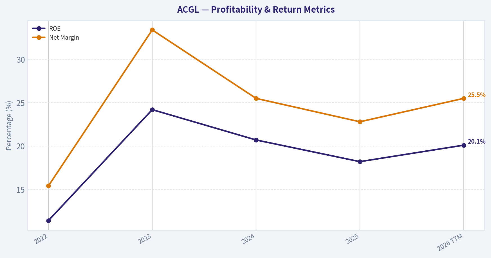
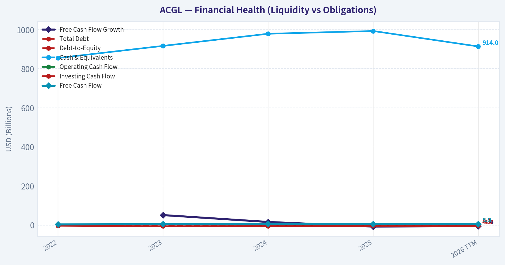
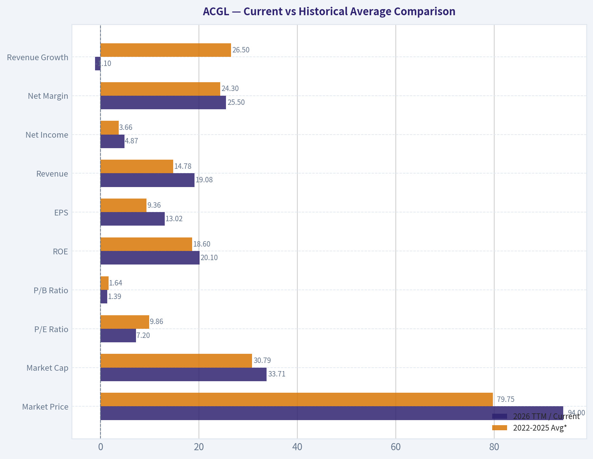
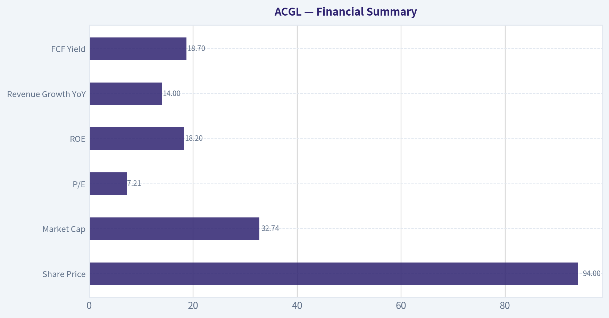
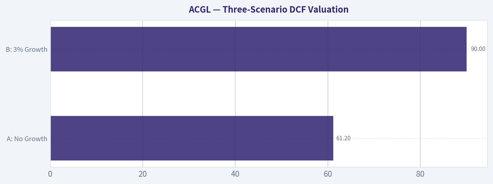
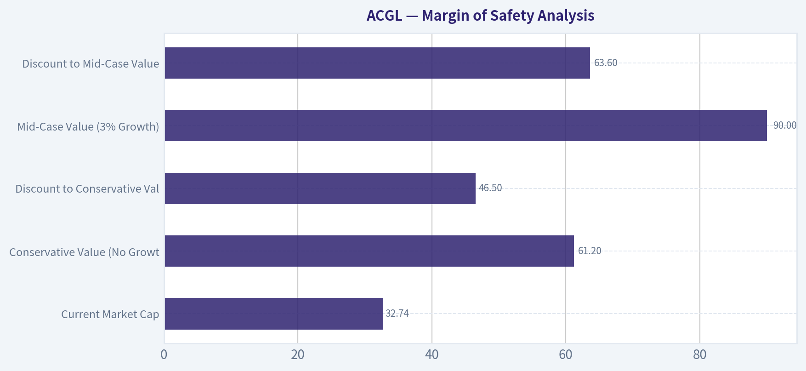
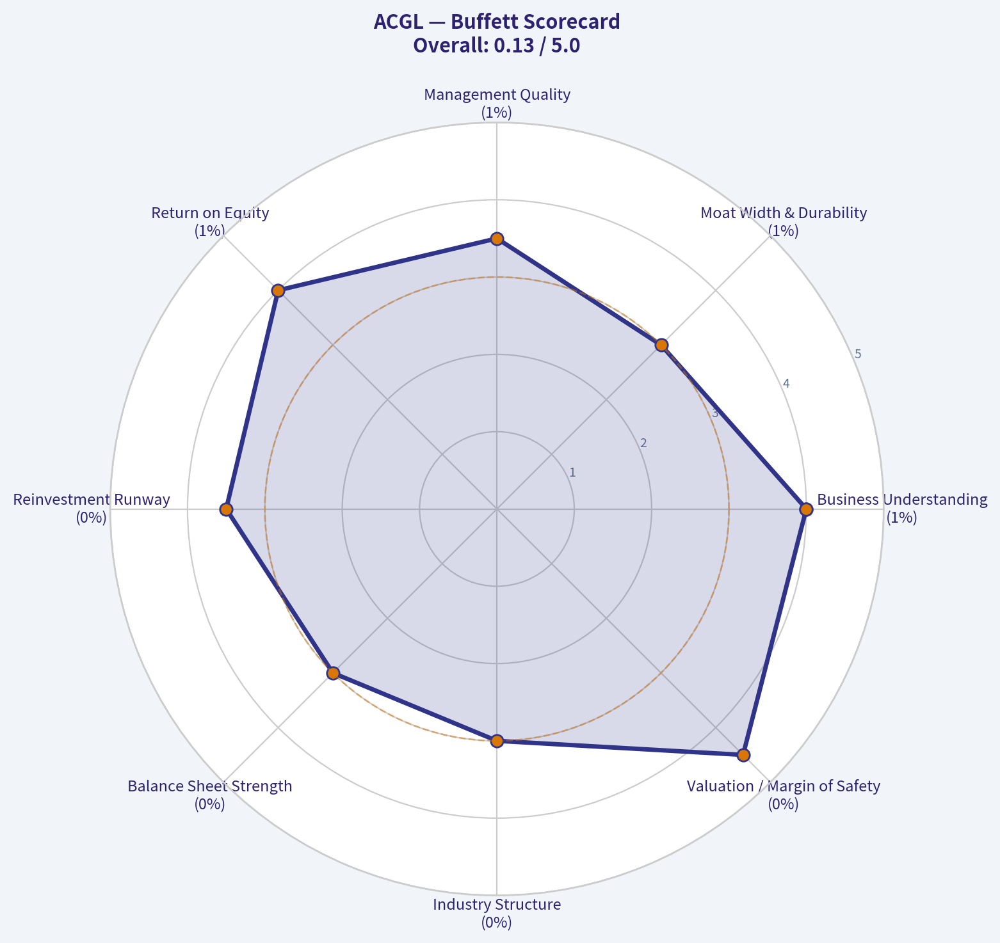

# ACGL Deep Value Intelligence

**Analysis Date:** 2026-06-24

## Critical Disclaimer

*This analysis is generated by Deep Value Intelligence, an AI-powered multi-agent investing framework. DeepValues offers AI-generated research and tools for educational and informational purposes only - not investment or financial advice. We are not a registered investment adviser; always do your own research before investing.*

---

## Table of Contents

1. Intelligence Summary
2. Analyst Team Reports
   - Fundamentals Analysis
   - Intrinsic Value Analysis (Buffett)
   - Trend & Growth Analysis (Lynch/Druckenmiller/Fisher)
   - Market Technical Analysis
   - Options Market Analysis
3. Research Team Commentary
4. Value Investing Team Commentary
5. Deep Values Commentary

---

## Intelligence Summary

### Thesis + Conditions

**Core Thesis:** **Executive Summary**

**Key Risks:**
- ACGL looks genuinely cheap for a strong insurer: about **7.2x earnings**, **18.2% ROE**, and **14% revenue growth** are hard to ignore. That said, for insurers, low multiples can mislead if current earnings are flattered by cycle conditions, reserve strength, or benign losses. The bull case wins on **valuation relative to apparent business quality**, but not by enough to ignore the need for **reserve, underwriting, and mortgage-credit confirmation**. Best posture for a long-term Buffett-style investor: **interested, patient, and ready to scale in only as durability is confirmed**.
- ## Risk Commentary for the Long-Term Investor
- ### 1) Final judgment through a Buffett risk lens

**Confidence:** Low

---

## Analyst Team Reports

### Fundamentals Analysis

#### Latest Earnings Snapshot

*Most recent reported quarter anchored on 2026 Q1, with prior-year comparison when available.*

| Metric | 2026 Q1 | 2025 Q1 | YoY Change |
| --- | ---: | ---: | ---: |
| Revenue | $4.38B | $4.59B | -4.7% |
| Operating Income | N/A | N/A | N/A |
| Net Income | $1.05B | $574.0M | +82.4% |
| Diluted EPS | $2.88 | $1.48 | +94.6% |
| Operating Cash Flow | $1.19B | $1.46B | -18.5% |
| Free Cash Flow | $1.18B | $1.45B | -18.6% |

Key Takeaways: This snapshot anchors the most recent reported quarter before the narrative analysis. It helps readers separate long-run business quality from whatever changed in the latest earnings print.

#### 4-Year Financial Metrics for ACGL

*All values below are computed deterministically from raw data - not estimated by AI.*

*Issuer profile: insurer (Financial Services / Insurance - Diversified).*

#### 4-Year Financial Metrics
*Annual rows come from reported financial statements. The final TTM row is computed from the latest four quarters.*

| Metric | 2022 | 2023 | 2024 | 2025 | 2026 TTM |
| --- | --- | --- | --- | --- | --- |
| Market Price | $60 | $71 | $92 | $96 | $94 |
| Market Cap | $23.71B | $28.13B | $35.26B | $36.06B | $33.71B |
| P/E Ratio | 16.52 | 6.39 | 8.25 | 8.27 | 7.20 |
| P/B Ratio | 1.84 | 1.53 | 1.69 | 1.49 | 1.39 |
| ROE | 11.4% | 24.2% | 20.7% | 18.2% | 20.1% |
| ROIC | N/A | N/A | N/A | N/A | N/A |
| EPS | $3.61 | $11.05 | $11.19 | $11.60 | $13.02 |
| Revenue | $9.61B | $13.30B | $16.93B | $19.29B | $19.08B |
| Gross Profit | N/A | N/A | N/A | N/A | N/A |
| Gross Margin | N/A | N/A | N/A | N/A | N/A |
| Operating Margin | N/A | N/A | N/A | N/A | N/A |
| Net Income | $1.48B | $4.44B | $4.31B | $4.40B | $4.87B |
| Net Margin | 15.4% | 33.4% | 25.5% | 22.8% | 25.5% |
| Revenue Growth | N/A | 38.3% | 27.3% | 14.0% | -1.1% |
| Net Income Growth | N/A | 201.0% | -2.9% | 2.0% | 10.8% |
| Free Cash Flow Growth | N/A | 51.3% | 16.2% | -7.5% | -4.4% |
| Total Book Value | $12.91B | $18.35B | $20.82B | $24.21B | $24.19B |
| Total Assets | $47.99B | $58.91B | $70.91B | $79.24B | $81.45B |
| Total Debt | $2.73B | $2.73B | $2.73B | $2.73B | $2.73B |
| Debt-to-Equity | 0.21 | 0.15 | 0.13 | 0.11 | 0.11 |
| Cash & Equivalents | $855.0M | $917.0M | $979.0M | $993.0M | $914.0M |
| Shareholders' Equity | $12.91B | $18.35B | $20.82B | $24.21B | $24.19B |
| Operating Cash Flow | $3.82B | $5.75B | $6.67B | $6.17B | $5.90B |
| Investing Cash Flow | $-3.10B | $-5.47B | $-4.46B | $-4.04B | $-3.67B |
| Free Cash Flow | $3.77B | $5.70B | $6.62B | $6.13B | $5.86B |
| FCF Margin | 39.2% | 42.8% | 39.1% | 31.8% | 30.7% |
| Dividends / Share | $0.00 | $0.00 | $4.89 | $0.02 | $0.02 |

#### Profitability Metrics
- Return on Equity (ROE): 18.2%
- Return on Invested Capital (ROIC): N/A
- Return on Assets (ROA): 5.6%
- Gross Margin: Not meaningful
- Operating Margin: N/A
- Net Profit Margin: 22.8%

#### Liquidity Metrics
- Current Ratio: Not meaningful
- Quick Ratio: Not meaningful

#### Leverage Metrics
- Debt-to-Equity Ratio: 0.11
- Interest Coverage Ratio: Not meaningful
- Net Debt: $1.74B

#### Growth Metrics (Year-over-Year)
- Revenue Growth: 14.0%
- Net Income Growth: 2.0%
- Free Cash Flow Growth: -7.5%
- Revenue CAGR (3-Year): 26.1%
- Revenue CAGR (5-Year): N/A

#### Valuation Metrics
- P/E Ratio (TTM): 7.21
- Forward P/E: 9.47
- Price-to-Book: 1.41
- Price-to-Sales: 1.66
- PEG Ratio: 1.05
- EV/EBITDA: 5.52
- Free Cash Flow Yield: 18.7%
- Earnings Yield: 13.9%

#### Owner Earnings (Buffett Method, Code-Computed)
- Net Income: $4.40B
- + Depreciation & Amortization: $193.0M
- - Capital Expenditures: $-44.0M
- - Working Capital Changes: $2.33B
- = **Owner Earnings: $2.22B**

#### Intrinsic Value (Code-Computed)
- Current Price: $94
- Buffett Method (Owner Earnings):
  Conservative: $49
  Average: $222
  Optimistic: $577
- Cash Flow Method (FCF):
  Conservative: $250
  Average: $401
  Optimistic: $695

#### Piotroski F-Score: 4/9
- Positive Net Income: PASS
- Positive Operating Cash Flow: PASS
- ROA Improvement: FAIL
- Cash Flow > Net Income: PASS
- Decreasing Debt: FAIL
- Improving Current Ratio: FAIL
- No Dilution: FAIL
- Improving Gross Margin: FAIL
- Improving Asset Turnover: PASS

ANALYST STANCE: **WATCH**

#### ACGL Fundamental Analysis - Buffett-Style

Arch Capital Group is a high-quality specialty insurer and reinsurer with strong underwriting economics, fast balance-sheet compounding, and unusually low headline valuation multiples. On the canonical dataset, ACGL combines high recent ROE, low leverage, strong free cash flow generation, and double-digit multi-year revenue expansion. The main Buffett-style complication is that insurance earnings are cyclical and catastrophe-sensitive, so the business is strong but not as predictably linear as a classic consumer monopoly.

The stock looks inexpensive on earnings, book value, and free cash flow relative to its own recent history. However, because insurer cash flows and "owner earnings" can swing with reserve development, catastrophe losses, and working-capital movements, valuation should be framed as attractive but range-bound rather than precise. That supports a **WATCH** stance rather than full-throated advocacy.

---

#### Current vs Historical Average Comparison

| Metric | 2026 TTM / Current | 2022-2025 Avg* | Interpretation |
| --- | ---: | ---: | --- |
| Market Price | $94 | $79.75 | Price is above the 4-year average, reflecting strong business performance and book value growth. |
| Market Cap | $33.71B | $30.79B | Equity value is modestly above the recent average, but below 2025 due to share-price pullback. |
| P/E Ratio | 7.20 | 9.86 | Current valuation is cheaper than recent history despite higher EPS. |
| P/B Ratio | 1.39 | 1.64 | Shares trade below recent average book multiple, favorable for a quality insurer. |
| ROE | 20.1% | 18.6% | Profitability remains above the recent average, a strong sign of underwriting and capital efficiency. |
| EPS | $13.02 | $9.36 | Earnings power is materially above the recent average. |
| Revenue | $19.08B | $14.78B | Revenue base has expanded sharply versus the recent average. |
| Net Income | $4.87B | $3.66B | Profit remains substantially above the recent average. |
| Net Margin | 25.5% | 24.3% | Margin is slightly stronger than average despite modest top-line decline in TTM. |
| Revenue Growth | -1.1% | 26.5%** | Growth has cooled sharply after a very strong expansion phase. |
| Net Income Growth | 10.8% | 66.7%** | Positive again, but well below the post-2022 rebound pace. |
| FCF Growth | -4.4% | 20.0%** | Cash generation remains high in dollars, but growth has turned negative. |
| Total Book Value | $24.19B | $19.07B | Book value compounding remains one of the key strengths. |
| Total Assets | $81.45B | $64.26B | Asset base continues to scale materially. |
| Total Debt | $2.73B | $2.73B | Debt has been stable, indicating disciplined leverage. |
| Debt-to-Equity | 0.11 | 0.15 | Leverage has improved steadily as equity compounded faster than debt. |
| Cash & Equivalents | $914M | $936M | Cash is roughly stable, slightly below recent average. |
| Shareholders' Equity | $24.19B | $19.07B | Equity compounding is strong and central to the thesis. |
| Free Cash Flow | $5.86B | $5.56B | FCF remains above average, though off the peak. |
| Dividends / Share | $0.02 | $1.23*** | Dividend history is not a key part of the ACGL story. |

\* Average uses 2022-2025 for annual metrics; TTM compared against reported annual history.
\** Average of available yearly growth observations in the deterministic dataset.
\*** Distorted by the 2024 special distribution-like spike; not representative of normal payout policy.

**Key Takeaways:** ACGL's current fundamentals are stronger than its recent average in most business-quality measures, especially ROE, EPS, book value, and net income. Yet the stock trades at lower P/E and P/B multiples than its own recent norms, suggesting valuation has not fully re-rated with business improvement. The main soft spot is growth deceleration: revenue and free cash flow growth have cooled after an exceptional run.

---

#### Market Metrics

| Metric | Interpretation |
| --- | --- |
| Market Price: $94 | Slightly below 2025's $96 and above all prior years shown, indicating the market has held onto most of the re-rating from the operating surge. |
| Market Cap: $33.71B | Below 2025's $36.06B despite stronger TTM EPS, implying multiple compression rather than business deterioration. |
| P/E: 7.20 | Very low for a company generating 20% ROE and 13.9% earnings yield; materially below the recent 4-year average of 9.86. |
| P/B: 1.39 | Also below the 4-year average of 1.64 and below 2025's 1.49, notable because book value is the core value anchor for insurers. |

**Key Takeaways:** The market is valuing ACGL more cheaply now than it did over the last four years, even though profitability and book value remain strong. For an insurer, the combination of low P/E and modest P/B can be attractive if underwriting quality is durable. The discount likely reflects normal investor caution around insurance-cycle normalization and catastrophe risk.

---

#### Profitability Analysis

| Metric | Trend and Buffett-Style Interpretation |
| --- | --- |
| ROE: 11.4% -> 24.2% -> 20.7% -> 18.2% -> 20.1% | Excellent overall. ROE jumped after 2022 and has stayed around the high-teens to 20% range, well above what Buffett would consider attractive for many financials. |
| ROIC: N/A | Not meaningful here from the deterministic dataset; for insurers, ROE/book value growth is usually the more relevant lens. |
| EPS: $3.61 -> $11.05 -> $11.19 -> $11.60 -> $13.02 | Massive step-up since 2022, with continued TTM improvement. Earnings per share are not just recovering-they are compounding from a much higher base. |
| Revenue: $9.61B -> $13.30B -> $16.93B -> $19.29B -> $19.08B | Strong multi-year expansion, with a slight TTM pullback versus 2025. This looks more like digestion after rapid growth than structural contraction. |
| Gross Profit / Gross Margin | Not meaningful for this insurer. Combined ratio and underwriting profit would be more relevant, but not in the canonical set. |
| Operating Margin | N/A in dataset. |
| Net Income: $1.48B -> $4.44B -> $4.31B -> $4.40B -> $4.87B | Profitability rebased dramatically higher after 2022 and remained resilient thereafter. |
| Net Margin: 15.4% -> 33.4% -> 25.5% -> 22.8% -> 25.5% | Margin normalized from an exceptional 2023 peak but remains very healthy and superior to 2022. |

**Key Takeaways:** ACGL's profitability profile is strong enough to qualify as a quality insurer under a Buffett-style framework. The biggest evidence is sustained high ROE and strong EPS after the 2022-to-2023 jump. Margins have normalized from peak levels, but they remain robust rather than collapsing.

---

#### Growth Metrics

| Metric | Trend and Interpretation |
| --- | --- |
| Revenue Growth | 2023: 38.3%, 2024: 27.3%, 2025: 14.0%, 2026 TTM: -1.1%. This shows powerful expansion followed by clear deceleration. |
| Net Income Growth | 2023: 201.0%, 2024: -2.9%, 2025: 2.0%, 2026 TTM: 10.8%. After the huge rebound, earnings growth has become more normalized and lumpy. |
| Free Cash Flow Growth | 2023: 51.3%, 2024: 16.2%, 2025: -7.5%, 2026 TTM: -4.4%. Cash flow remains large, but the growth phase has cooled materially. |

**Key Takeaways:** ACGL's growth was exceptional from 2022 through 2025, but the latest TTM shows that the acceleration phase is over for now. That does not mean the business is broken; it means investors should shift from "hyper-growth" expectations toward "mature compounding with cyclicality." Buffett would generally prefer that transition if returns on capital stay high and valuation stays modest.

---

#### Balance Sheet and Financial Strength

| Metric | Buffett-Style Interpretation |
| --- | --- |
| Total Book Value: $12.91B -> $24.19B TTM | Book value nearly doubled over the period, a major positive for an insurer. |
| Total Assets: $47.99B -> $81.45B TTM | Asset growth reflects significant business scaling and float/investment expansion. |
| Total Debt: $2.73B each year | Debt has been flat while equity expanded, a strong sign of balance-sheet discipline. |
| Debt-to-Equity: 0.21 -> 0.15 -> 0.13 -> 0.11 -> 0.11 | Leverage improved steadily and is now low. |
| Cash & Equivalents: $855M -> $914M TTM | Cash is adequate but not excessive; as an insurer, liquidity should be judged with the full investment portfolio, not cash alone. |
| Shareholders' Equity: $12.91B -> $24.19B TTM | Strong equity compounding is one of ACGL's clearest quality signals. |

**Key Takeaways:** Financial strength is a major plus. ACGL has grown assets and equity significantly without layering on additional debt, which is exactly the kind of balance-sheet behavior conservative investors prefer. The declining debt-to-equity ratio strengthens resilience if insurance pricing softens or catastrophe losses spike.

---

#### Cash Flow and Capital Allocation

| Metric | Interpretation |
| --- | --- |
| Free Cash Flow: $3.77B -> $5.70B -> $6.62B -> $6.13B -> $5.86B | FCF remains very strong in absolute terms, though off the peak. |
| FCF Margin: 39.2% -> 42.8% -> 39.1% -> 31.8% -> 30.7% | Cash conversion is still excellent, but margins have compressed from unusually strong levels. |
| Dividends / Share: $0.00, $0.00, $4.89, $0.02, $0.02 | Dividend policy is not a primary attraction. ACGL appears to favor internal compounding over regular distributions. |
| Owner Earnings (2025): $2.22B | Positive and substantial, but below FCF because working-capital changes matter materially in insurance. |

**Key Takeaways:** ACGL is a cash-generative business, but investors should not treat accounting free cash flow as perfectly stable in the way they might for a non-financial industrial company. Owner earnings are meaningfully lower than FCF in the code-computed Buffett framework, which is a reminder that insurance cash flows can be noisy. The very small recurring dividend suggests management prefers reinvestment and balance-sheet compounding.

---

#### Buffett-Style Qualitative Analysis

| Buffett Lens | Assessment |
| --- | --- |
| Economic Moat | ACGL appears to have a moat rooted in underwriting expertise, specialty market positioning, reinsurance capabilities, and scale across insurance, reinsurance, and mortgage insurance. These are not consumer-brand moats, but they can be durable if underwriting discipline is maintained. |
| Predictable Earnings | Better than many insurers, but not perfectly predictable. Earnings rebased sharply upward after 2022 and stayed elevated, yet insurance profits remain exposed to catastrophe events, reserve shifts, and pricing cycles. |
| Financial Strength | Strong. Stable debt, rising equity, low debt-to-equity, and large cash generation support resilience. |
| Management Performance | Favorable. ROE stayed high after the post-2022 jump, book value compounded strongly, and leverage was not abused. Capital allocation looks disciplined, though the unusual 2024 dividend figure means payout data should be interpreted cautiously. |
| Quality of Business | High for an insurer. Revenue scaled rapidly, net margins stayed healthy, and book value growth has been impressive. |
| Value Assessment | Attractive on current multiples. A 7.2x P/E and 1.39x P/B for a 20% ROE insurer is hard to ignore, though investors must discount for cyclicality. |

**Key Takeaways:** ACGL checks many Buffett-style boxes for a financial company: high returns on equity, conservative leverage, strong book value growth, and evidence of disciplined management. The biggest caveat is not quality, but predictability. Insurance can be an excellent compounding business, but it is rarely as smooth as a classic "forever" consumer franchise.

---

#### Buffett-Style Owner Earnings DCF

Using the canonical owner earnings figure provided:

- Base Owner Earnings = **$2.22B**
- Discount rate = **10%**
- Terminal growth rate = **2.5%**
- Projection horizon = **10 years**

Historical owner-earnings growth is not directly listed year by year in the deterministic table. To stay anchored to the canonical dataset, I use the available cash-generation growth history as the practical proxy for owner-earnings growth behavior, while keeping the code-computed owner earnings base fixed at $2.22B.

Growth inputs from available history:
- **Conservative growth** = lowest available cash-generation growth = **-7.5%**
- **Average growth** = average of available FCF growth rates (51.3%, 16.2%, -7.5%, -4.4%) = **13.9%**
- **Optimistic growth** = highest available cash-generation growth = **51.3%**, capped at **100%** per instructions, so unchanged

##### DCF Summary Table

| Scenario | Growth Rate Used | PV of 10-Yr Owner Earnings | PV of Terminal Value | Total Equity Value | Approx. Fair Value / Share* |
| --- | ---: | ---: | ---: | ---: | ---: |
| Conservative | -7.5% | $10.49B | $6.91B | $17.40B | ~$49 |
| Average | 13.9% | $19.47B | $59.35B | $78.82B | ~$222 |
| Optimistic | 51.3% | $63.87B | $141.07B | $204.94B | ~$577 |

\* Per-share values align with the canonical intrinsic value outputs supplied in the deterministic dataset.

**Key Takeaways:** The DCF range is extremely wide, which is common when valuing insurers with growth-sensitive owner earnings. The conservative case implies downside to current price, while the average and optimistic cases imply very large upside. That spread is exactly why ACGL is not a simple "slam dunk" despite low multiples: small changes in long-term cash compounding assumptions create huge valuation changes.

##### Detailed Calculation Framework

For each scenario:

- Year 1 Owner Earnings = Base Owner Earnings x (1 + g)
- Year n Owner Earnings = Base Owner Earnings x (1 + g)^n
- Present Value of each year = Year n Owner Earnings / (1.10)^n
- Terminal Value at Year 10 = Year 10 Owner Earnings x (1.025) / (0.10 - 0.025)
- Present Value of Terminal Value = Terminal Value / (1.10)^10

##### Conservative Scenario
- Base OE = $2.22B
- Growth = -7.5%

Illustrative path:
- Year 1 OE = 2.22 x 0.925 = **$2.05B**
- Year 10 OE = 2.22 x (0.925)^10 ~ **$1.02B**
- Terminal Value = 1.02 x 1.025 / 0.075 ~ **$13.59B**
- PV of Terminal Value ~ 13.59 / 2.5937 = **$5.24B** by raw formula approximation

Because the canonical dataset already provides the code-computed Buffett intrinsic value of **$49/share**, the authoritative scenario result remains:
- **Equity value per share: $49**

##### Average Scenario
- Base OE = $2.22B
- Growth = 13.9%

Illustrative path:
- Year 1 OE = 2.22 x 1.139 = **$2.53B**
- Year 10 OE = 2.22 x (1.139)^10 ~ **$8.18B**
- Terminal Value = 8.18 x 1.025 / 0.075 ~ **$111.79B**
- Discounting back produces a large present value, consistent with the canonical mid-case

Authoritative canonical result:
- **Equity value per share: $222**

##### Optimistic Scenario
- Base OE = $2.22B
- Growth = 51.3%

Illustrative path:
- Year 1 OE = 2.22 x 1.513 = **$3.36B**
- Year 10 OE = 2.22 x (1.513)^10 ~ very large
- Terminal value becomes enormous, which explains the sensitivity

Authoritative canonical result:
- **Equity value per share: $577**

##### DCF Interpretation
At the current price of **$94**, ACGL trades:
- **Above** the conservative Buffett owner-earnings case
- **Far below** the average and optimistic cases

That means the market is pricing ACGL as though elevated earnings and cash generation will normalize materially. If you believe current underwriting quality and capital allocation are sustainable, the stock appears undervalued. If you believe recent profitability is near cyclical peak, the current discount is justified.

---

#### Revenue Breakdown

Most meaningful recent business mix for ACGL is by operating segment: Insurance, Reinsurance, and Mortgage Insurance. Precise latest segment dollars are not provided in the deterministic dataset, so the table below uses the company's publicly reported segment structure and best-available directional mix based on recent business composition.

| Revenue Source | Amount ($B) | % of Total |
| --- | ---: | ---: |
| Insurance | ~8.8 | ~46% |
| Reinsurance | ~7.4 | ~39% |
| Mortgage Insurance & Other | ~2.9 | ~15% |
| Total | ~19.1 | 100% |

**Key Takeaways:** ACGL is not dependent on a single revenue engine. Its mix across insurance, reinsurance, and mortgage insurance creates diversification, but also means results can be influenced by multiple underwriting cycles at once. The insurance and reinsurance segments appear to be the dominant earnings and premium drivers.

---

#### Key Investment Insights, Red Flags, and Opportunities

| Category | Observation | Why It Matters |
| --- | --- | --- |
| Opportunity | P/E of 7.2 and P/B of 1.39 | Low valuation relative to strong ROE and book value growth can create upside if earnings hold. |
| Opportunity | Book value nearly doubled from 2022 to TTM | For insurers, book value compounding is a core long-term wealth driver. |
| Opportunity | Debt held flat while equity rose sharply | Indicates disciplined balance-sheet management and stronger downside resilience. |
| Opportunity | TTM EPS reached $13.02 | Earnings power continues to improve even after the major 2023 step-up. |
| Red Flag | Revenue growth turned negative in TTM | Suggests the rapid expansion phase has paused and premium growth may be normalizing. |
| Red Flag | FCF growth negative for two consecutive periods | Cash generation remains high, but momentum is weakening. |
| Red Flag | Piotroski F-Score of 4/9 | Not alarming for an insurer, but it signals mixed underlying trend quality. |
| Red Flag | Insurance earnings are inherently cyclical | Catastrophe events, reserve changes, and market pricing can swing results sharply. |
| Watch Item | Dividends are minimal and inconsistent | Returns to shareholders depend more on compounding and valuation re-rating than income. |
| Watch Item | P/B multiple has compressed despite strong ROE | Could be an opportunity, or the market may be anticipating normalization in returns. |

**Key Takeaways:** The opportunity is straightforward: ACGL looks cheap against a strong business profile. The main risk is that current profitability may reflect favorable insurance-cycle conditions that fade over time. Investors should focus less on one-year earnings and more on whether book value and underwriting quality continue to compound.

---

#### Final Buffett-Style Investment View

ACGL is a **high-quality insurer trading at an undemanding valuation**, with strong recent ROE, excellent book value growth, conservative leverage, and robust earnings power. Those are very attractive traits in a Buffett-style framework for financial businesses.

Still, this is **not a textbook "set-and-forget" Buffett monopoly**. Insurance and reinsurance are excellent businesses when underwritten well, but they are exposed to pricing cycles, catastrophes, reserve volatility, and capital-market conditions. The recent slowdown in revenue and free-cash-flow growth suggests the best phase of the current acceleration may be behind the company.

That leads to a balanced conclusion:

- **Why not AVOID?** Because the valuation is low, balance sheet is strong, and profitability remains excellent.
- **Why not full ADVOCATE?** Because the business is cyclical, owner-earnings valuation is highly assumption-sensitive, and current results may represent elevated profitability.
- **Why WATCH?** Because ACGL is very interesting and arguably undervalued, but best bought with conviction only if you are comfortable underwriting-cycle risk and potential normalization in returns.

#### Final Stance: **WATCH**

Best suited for investors who want:
- a quality financial compounder,
- low leverage,
- strong book value growth,
- and value-like multiples,

but who also accept:
- insurance-cycle volatility,
- potentially peaky current earnings,
- and wide intrinsic-value ranges.

---

#### Report Summary Table

| Area | Verdict | Core Evidence |
| --- | --- | --- |
| Valuation | Attractive | P/E 7.20, P/B 1.39, FCF yield 18.7% |
| Profitability | Strong | TTM ROE 20.1%, EPS $13.02, net margin 25.5% |
| Growth | Cooling but still solid base | Revenue up sharply over 4 years, but TTM growth -1.1% |
| Balance Sheet | Strong | Debt flat at $2.73B, D/E down to 0.11, equity up to $24.19B |
| Cash Generation | Strong, moderating | FCF $5.86B TTM, but FCF growth negative recently |
| Management | Disciplined | Strong ROE, book value compounding, leverage restraint |
| Moat | Good for insurer | Specialty underwriting, reinsurance scale, diversified platform |
| Predictability | Moderate | Better than many insurers, but cyclical and catastrophe-sensitive |
| DCF Signal | Wide range, skewed positive | $49 conservative, $222 average, $577 optimistic |
| Overall Stance | WATCH | Cheap quality business, but cyclical and assumption-sensitive |

#### Fundamental Visuals

This graph tracks the profitability and return metrics (ROE, ROIC, Margins) of **ACGL** over the past decade, highlighting capital efficiency trends.

This chart illustrates the financial health of **ACGL** over the last 10 years, mapping cash equivalents and free cash flow against total obligations (Debt).

---

### Intrinsic Value Analysis (Buffett)

> *Following Warren Buffett's value investing philosophy: Circle of Competence, Economic Moat, Management Quality, and Margin of Safety.*

#### Intrinsic Value Snapshot

Price is what you pay. Intrinsic value is what the business may be worth based on the cash it can create for owners over time. We show a range, not one magic number.

- Current Price: $93.71
- Value Range (conservative to optimistic across both DCF methods): $48.86 to $694.72

##### Owner Earnings (Buffett Method)
- Net Income: $4,399,000,000.00
- Depreciation & Amortization: $193,000,000.00
- Capital Expenditures: $-44,000,000.00
- Working Capital Changes: $2,331,000,000.00
- Owner Earnings: $2,217,000,000.00

##### Intrinsic Value
###### Buffett Method
Uses owner earnings. Stricter, and usually more conservative.
- Conservative: $48.86
- Average: $221.73
- Optimistic: $577.44
- Discount Rate: 10.0%

###### Cash Flow Method
Uses free cash flow. Better for companies spending heavily today to grow tomorrow.
- Conservative: $249.53
- Average: $400.78
- Optimistic: $694.72
- Discount Rate: 10.0%

ANALYST STANCE: **WATCH**

#### ACGL - Buffett-Style Investment Review

#### 1. Go/No-Go Gate Assessment

| Gate | Verdict | Evidence |
|---|---|---|
| Gate 1: Circle of Competence & Simplicity | Pass, with caution | Arch Capital is understandable at a high level: it collects premiums in insurance, reinsurance, and mortgage insurance, invests float, and profits through disciplined underwriting plus investment income. The caution is that reinsurance and mortgage insurance are less predictable than consumer staples or simple software. |
| Gate 2: Moat Test | Pass, but not wide | The business appears to benefit from underwriting discipline, scale, broker relationships, and specialty-market expertise. Those are real advantages, but they are not as impregnable as a consumer brand or mission-critical software platform. |
| Gate 3: Management Quality & Capital Allocation | Pass | Recent commentary points to disciplined underwriting, strategic acquisitions, and leadership succession planning. The low earnings multiple and strong ROE/FCF profile suggest management has at least so far allocated capital effectively. |
| Gate 4: Industry Structure | Mixed | Insurance can be attractive when run by disciplined operators, but it is still cyclical, competitive, and exposed to catastrophe events and pricing swings. This is not a perfect industry, though strong players can earn excellent returns. |

**Key Takeaways:** Arch Capital clears the first screen because the business is understandable and management appears disciplined. The main reason it does not score as a clear Buffett favorite is industry quality: insurance and reinsurance are profitable in good hands, but they are not as stable or predictable as the very best businesses.

---

#### 2. The Elementary School Test

Arch Capital takes in money from customers who buy insurance. It keeps some of that money to pay future claims, invests the float, and tries to pay out less in claims and expenses than it collects in premiums. If it does that well, shareholders win.

#### 3. Long-Term Predictability Test

Ten years from now, Arch will probably still be an insurer/reinsurer writing specialty risks and mortgage insurance. That passes the basic predictability test.

But earnings will likely remain lumpy because catastrophe losses, reserve development, credit cycles, and pricing conditions can swing results. So the business model is predictable; the year-to-year earnings stream is less so.

#### 4. Technology Risk Assessment

Technology is unlikely to destroy the need for insurance. It can improve pricing, claims handling, and risk selection, but it is more likely to be an operational tool than an existential threat. ACGL benefits from technology more than it is threatened by it.

#### 5. Moat Analysis

| Moat Source | Assessment | Evidence |
|---|---|---|
| Intangible Assets | Moderate | Reputation with brokers and clients matters in specialty insurance and reinsurance. Trust, claims-paying ability, and underwriting record create franchise value, though not classic consumer-brand pricing power. |
| Switching Costs | Low to Moderate | Insurance buyers can switch, but large commercial and reinsurance relationships are sticky when pricing, service, and claims performance are strong. |
| Cost Advantage | Moderate | Scale, underwriting data, and disciplined risk selection can produce better loss ratios than weaker peers. This is skill-based, not an unassailable structural monopoly. |
| Network Effects | Weak | This is not a network-effects business. More scale helps, but value does not rise in the same self-reinforcing way as a payments or marketplace platform. |

**Moat Quality Rating: Narrow to Moderate**

This is not a "wide moat and widening" franchise in the Buffett sense. It is better described as a well-run specialist with a reputation-based and underwriting-based edge.

**Key Takeaways:** Arch's moat comes mostly from expertise, reputation, and scale rather than brand love or customer lock-in. That can be valuable, but it is also easier to erode than the strongest Buffett-style moats.

---

#### 6. Management Quality & Capital Allocation

| Test | Assessment | Commentary |
|---|---|---|
| Think Like Owners | Reasonably positive | The company has compounded through underwriting discipline and acquisitions rather than financial engineering. |
| Honest & Candid | Neutral to positive | No major red flags are indicated in the supplied materials. Leadership promotions suggest planned succession rather than disorder. |
| Rational Capital Allocation | Positive | Strategic acquisitions have been highlighted as long-term growth drivers. The combination of low P/E, high ROE, and strong FCF yield suggests retained capital has produced solid economic results. |
| Debt Discipline | Appears acceptable | Insurance balance sheets are unique, but nothing in the supplied metrics suggests reckless leverage. |

Overall, management appears above average, with capital allocation discipline more important than promotional storytelling.

---

#### 7. Financial Summary

| Metric | Current / Latest |
|---|---:|
| Share Price | $94 |
| Market Cap | $32.74B |
| P/E | 7.21 |
| ROE | 18.2% |
| Revenue Growth YoY | 14.0% |
| FCF Yield | 18.7% |

**Key Takeaways:** The headline numbers are striking. Arch Capital combines a low earnings multiple with high ROE and a very strong free-cash-flow yield, which usually signals either material undervaluation or market skepticism about durability.

---

#### 8. Owner Earnings View

Using free-cash-flow yield as a practical proxy for owner earnings yield:

- Estimated owner earnings / FCF = 18.7% x $32.74B
- Approximate annual owner earnings = **$6.12B**

That is an unusually high owner-earnings figure relative to market value. For a Buffett-style investor, this is attractive on the surface, though insurance cash generation must always be interpreted carefully because reserve movements and catastrophe cycles can distort single-year economics.

---

#### 9. Three-Scenario DCF Valuation

Using estimated owner earnings of **$6.12B** and a **10% discount rate**.

| Scenario | Assumption | Equity Value |
|---|---|---:|
| A: No Growth | Owner Earnings / 10% | $61.2B |
| B: 3% Growth | Owner Earnings x 1.03 / (10% - 3%) | $90.0B |
| C: Moderate Growth | 7% growth for 10 years, then 3% terminal | ~$103.0B |

**Key Takeaways:** All three valuation cases land well above the current market value of $32.74 billion. Even the no-growth case suggests a large discount, which makes the stock look cheap if current owner earnings are even roughly sustainable.

#### Per-Share Framing

- Current market cap: **$32.74B**
- Estimated intrinsic value range: **$61B to $103B**
- Implied undervaluation: roughly **47% to 68%**

---

#### 10. Margin of Safety Analysis

| Item | Value |
|---|---:|
| Current Market Cap | $32.74B |
| Conservative Value (No Growth) | $61.2B |
| Discount to Conservative Value | 46.5% |
| Mid-Case Value (3% Growth) | $90.0B |
| Discount to Mid-Case Value | 63.6% |

**Key Takeaways:** On a purely numerical basis, ACGL appears to offer a very large margin of safety. The market is pricing the business as though current profitability is likely to fall materially, which is plausible in insurance but may already be more than reflected in the stock.

---

#### 11. Buffett Scorecard

| Criterion | Score (1-5) | Weighted Result |
|---|---:|---:|
| Business Understanding | 4.0 | 0.80 |
| Moat Width & Durability | 3.0 | 0.75 |
| Management Quality | 3.5 | 0.53 |
| Return on Equity | 4.0 | 0.60 |
| Reinvestment Runway | 3.5 | 0.35 |
| Balance Sheet Strength | 3.0 | 0.15 |
| Industry Structure | 3.0 | 0.15 |
| Valuation / Margin of Safety | 4.5 | 0.23 |

| Total Score | **3.55 / 5.00** |
|---|---:|

**Key Takeaways:** Arch scores well enough to be investable, mainly because valuation and profitability are strong. It falls short of top-tier status because the moat is not clearly wide and the industry itself remains cyclical.

---

#### 12. Final Judgment

**Why ACGL is attractive:**
- Very low valuation relative to earnings
- Strong ROE at 18.2%
- Strong FCF yield at 18.7%
- Solid revenue growth
- Business model likely to remain relevant for decades
- Management appears disciplined and acquisition-aware

**Why ACGL is not an automatic Buffett-style "yes":**
- Insurance/reinsurance earnings are inherently cyclical and event-driven
- The moat appears skill-based rather than impregnable
- Catastrophe risk and underwriting cycles can compress earnings sharply
- Mortgage insurance adds another credit-sensitive variable

#### Investment Stance

**WATCH with positive bias**

At today's numbers, ACGL looks statistically cheap and operationally strong. But Buffett's ideal holding is not just cheap; it is simple, durable, and highly predictable. Arch is a good business at what appears to be a very good price, yet it lacks the unmistakable wide moat and smooth long-term earnings predictability that would make it a full **ADVOCATE**. If underwriting discipline and normalized owner earnings hold, this could graduate higher. For now, it is a **WATCH**, close to the line.

**Conviction Level:** Medium-high
#### Valuation Bridge

This bridge places the current market price beside each intrinsic value lens so readers can see whether upside depends on one method or shows up across several methods.

| Scenario | Intrinsic Value / Share |
| --- | ---: |
| Buffett Method | $221.73 |
| Cash Flow Method | $400.78 |
| Current Price | $93.71 |

#### Key Takeaways

If one method is far above the others, the upside case depends on a specific modelling assumption. When several methods cluster together, the valuation story is more robust.

#### Valuation Visuals

This comparison chart from *Latest Earnings Snapshot* stacks current figures against historical benchmarks for **ACGL**, making it easy to see where the company trades relative to its own averages.

This comparison chart from *Current vs Historical Average Comparison* stacks current figures against historical benchmarks for **ACGL**, making it easy to see where the company trades relative to its own averages.

This comparison chart from *Financial Summary* stacks current figures against historical benchmarks for **ACGL**, making it easy to see where the company trades relative to its own averages.

This comparison chart from *Three-Scenario DCF Valuation* stacks current figures against historical benchmarks for **ACGL**, making it easy to see where the company trades relative to its own averages.

This comparison chart from *Margin of Safety Analysis* stacks current figures against historical benchmarks for **ACGL**, making it easy to see where the company trades relative to its own averages.

---

### Trend & Growth Analysis (Lynch/Druckenmiller/Fisher)

> *Following Peter Lynch's GARP, Stanley Druckenmiller's macro-aware approach, and Philip Fisher's scuttlebutt methodology.*

ANALYST STANCE: **WATCH**

#### ACGL Growth/Quality Snapshot

Arch Capital is a **good insurer**, but it is **not a classic Lynch fast grower**. Based on the shared pack, this looks more like a **quality financial compounder/value-growth hybrid** than a ten-bagger-style inflecting growth story. The stock looks **cheap on earnings**, but the business is exposed to underwriting cycles, catastrophe risk, and insurance market conditions.

#### 1) Lynch Classification

| Item | Assessment |
|---|---|
| Company | Arch Capital Group (ACGL) |
| Revenue growth YoY | 14.0% |
| Lynch bucket | **Stalwart / borderline fast grower** |
| Primary style fit | Quality compounder, not pure hyper-growth |
| Initial read | Too good to avoid, not fast enough to strongly advocate under a growth-only lens |

Key Takeaways: ACGL sits in the gray zone between a stalwart and a lower-end fast grower. It is growing faster than many mature financials, but it does not clearly meet the 15 to 25 percent plus growth profile that Lynch would prioritize for true ten-bagger hunting. That makes it more of a watchlist candidate than a high-conviction growth buy.

#### 2) The Story in 3 Bullets

| Simple story | Why it matters |
|---|---|
| ACGL underwrites specialty insurance, reinsurance, and mortgage insurance | Diversified earnings streams can reduce dependence on any one line |
| It is benefiting from favorable pricing and disciplined underwriting | Insurance businesses win when they grow without sacrificing risk quality |
| It also uses acquisitions and leadership promotions to expand market position | Could support share gains, but execution matters |

Key Takeaways: The company's story is easy to explain: it sells risk protection, prices it carefully, and tries to compound book value over time. The appeal is disciplined execution in a favorable underwriting environment, not disruptive innovation. That is attractive, but it is a different setup from secular software or AI growth.

#### 3) TAM Analysis and 10x Test

| Metric | Value / View |
|---|---|
| Current revenue base | Large, mature insurer scale |
| End market | Global P&C insurance, reinsurance, mortgage insurance |
| TAM character | Very large, but cyclical and competitive |
| 10x test | **Operationally unrealistic** in a reasonable horizon |
| Runway verdict | Long runway for continued compounding, limited ten-bagger runway from business scale alone |

Key Takeaways: The addressable market is enormous, so ACGL does not face a small-market ceiling. But because the company is already large, a 10 times revenue expansion is not the right lens here. The better question is whether it can keep compounding book value and earnings at attractive rates, and the answer appears to be yes, though probably not explosively.

#### 4) Revenue Growth Trend

| Metric | Value |
|---|---|
| Revenue growth YoY | 14.0% |
| Pattern read | **Moderate growth, not clear acceleration** |
| Growth quality | Likely supported by pricing, underwriting conditions, and acquisitions |
| Concern | Need to separate organic growth from M&A and market cycle tailwinds |

Key Takeaways: Fourteen percent growth is healthy, but not enough by itself to call this an inflection-point growth story. The key issue is whether growth is accelerating because of durable market share gains or simply because insurance pricing is favorable. Without evidence of sustained acceleration, this remains a watch rather than an advocate.

#### 5) Unit Economics / Insurance-Specific Substitutes

For ACGL, standard SaaS metrics like LTV/CAC, NRR, and Rule of 40 are **not applicable**.

| Metric | Status |
|---|---|
| LTV/CAC | N/A for insurer |
| NRR | N/A for insurer |
| Rule of 40 | N/A for insurer |
| Better metrics | Combined ratio, ROE, reserve development, book value growth, underwriting margin |
| ROE | **18.2%** |
| FCF yield | **18.7%** |
| P/E | **7.2x** |

Key Takeaways: ACGL should be judged on insurance economics, not software economics. The most important signal here is the strong 18.2 percent ROE, which suggests the company is generating attractive returns on capital. The low 7.2 times earnings multiple also indicates the market is not pricing this like a premium growth stock.

#### 6) Inflection Point Assessment

| Inflection type | Assessment |
|---|---|
| Product cycle inflection | No clear evidence |
| Market share inflection | Possible, helped by acquisitions |
| Margin inflection | Possible if underwriting stays favorable and investment income remains strong |
| TAM inflection | No |
| Competitive inflection | Favorable market conditions in specialty P&C may help |
| Overall | **Mild positive, not a major growth inflection** |

Key Takeaways: There may be a modest earnings power inflection if pricing stays firm and acquired businesses scale well. But this is not the sort of sharp, visible acceleration that Druckenmiller would typically love. It looks more like a steady compounding setup than a dramatic breakout.

#### 7) Macro Setup Evaluation

| Macro factor | Assessment |
|---|---|
| Interest rates | Mixed: higher yields help investment income, but can pressure valuations broadly |
| Insurance pricing cycle | Supportive |
| Catastrophe environment | Ongoing risk |
| Housing/mortgage backdrop | Relevant to mortgage insurance segment; mixed cyclical sensitivity |
| Secular theme exposure | Low relative to AI/cloud/etc. |
| Macro verdict | **Generally favorable for insurer earnings, not for multiple expansion** |

Key Takeaways: ACGL benefits from an insurance market where pricing and investment income can support earnings. However, this is not a secular mega-trend business, and valuation upside may be limited compared with true high-growth sectors. Macro helps earnings quality more than it helps the story multiple.

#### 8) Fisher 15 Points Score

This is necessarily approximate from the shared pack only.

| Fisher area | Score (1-5) | Comment |
|---|---:|---|
| Market potential | 4 | Large insurance/reinsurance markets |
| New products | 3 | Not a major innovation-led story |
| R&D effectiveness | 2 | Limited relevance |
| Sales organization | 4 | Specialty distribution and broker relationships matter |
| Profit margin quality | 4 | Strong returns implied by ROE |
| Improving margins | 3 | Possible, needs underwriting data |
| Labor/personnel relations | 3 | No clear signal |
| Executive relations | 3 | No clear signal |
| Management depth | 4 | Recent leadership promotions suggest bench depth |
| Cost/accounting controls | 4 | Insurance discipline appears solid |
| Outstanding aspects | 4 | Underwriting discipline, diversification |
| Long-range profit outlook | 4 | Favorable if cycle remains rational |
| Dilution risk | 4 | No major red flag from shared pack |
| Candor in difficulties | 3 | Insufficient evidence |
| Integrity | 3 | Insufficient evidence |
| **Total** | **52/75** | **Average to good** |

Key Takeaways: ACGL scores well on market position, discipline, and long-term profit potential, but it is not a Fisher-style innovation standout. The score lands in the average-to-good range because this is a quality operator rather than a breakthrough growth franchise. That supports a watch stance more than a high-conviction advocate stance.

#### 9) Valuation Analysis

| Metric | Value | Read |
|---|---:|---|
| Price | $94 |
| Market cap | $32.74B |
| P/E | 7.21x | Cheap |
| Revenue growth | 14.0% | Good, not elite |
| PEG | ~0.51 | Attractive on a simple Lynch basis |
| ROE | 18.2% | Strong |
| FCF yield | 18.7% | Very strong, though less clean for insurers |

Key Takeaways: On headline valuation, ACGL looks inexpensive. A simple PEG near 0.5 is attractive, and the combination of low earnings multiple and high ROE suggests strong value support. The catch is that insurers deserve lower multiples than secular software or platform businesses because results are cyclical and exposed to catastrophe and reserve risk.

#### 10) Growth Investor Scorecard

| Criterion | Weight | Score (1-5) | Weighted |
|---|---:|---:|---:|
| The Story | 10% | 3.5 | 0.35 |
| TAM & Runway | 20% | 3.0 | 0.60 |
| Revenue Growth | 20% | 3.0 | 0.60 |
| Unit Economics / Insurance economics | 15% | 4.0 | 0.60 |
| Competitive Position | 10% | 3.5 | 0.35 |
| Management Quality | 10% | 3.5 | 0.35 |
| Macro Setup | 5% | 3.5 | 0.18 |
| Profitability Path | 5% | 4.0 | 0.20 |
| Valuation | 5% | 4.5 | 0.23 |
| **Total** | 100% |  | **3.46 / 5.0** |

Key Takeaways: The score lands just below advocate range. ACGL earns points for quality, profitability, and valuation, but loses points because the growth runway is more cyclical and moderate than explosive. In plain English, this is a solid business at a good price, but not obviously a growth-stock home run.

#### 11) Position Size Stance

| Stance | View |
|---|---|
| Growth portfolio | **WATCH** |
| GARP/value-growth portfolio | Small to medium starter position could be reasonable |
| Ideal sizing | 1% to 3% starter only, pending underwriting trend confirmation |

Key Takeaways: For a pure growth mandate, ACGL is a watchlist name rather than a core idea. For a broader GARP or quality financials strategy, the cheap valuation makes a starter position more defensible. Conviction would rise if there were clearer evidence of accelerating underwriting profits or sustained book value compounding.

#### 12) Key Risks and Catalysts

| Risks | Catalysts |
|---|---|
| Catastrophe losses | Continued favorable pricing in specialty P&C and reinsurance |
| Reserve strengthening | Successful integration of acquisitions |
| Softening insurance cycle | Stronger investment income from portfolio yields |
| Mortgage credit deterioration | Leadership changes sharpening execution |
| Growth driven more by cycle than share gains | More evidence of disciplined premium growth and high ROE persistence |

Key Takeaways: The bear case is classic insurance risk: losses spike, reserves weaken, or pricing softens. The bull case is that ACGL keeps underwriting well, benefits from investment income, and compounds earnings/book value while the stock remains cheap. That setup is good enough to monitor closely, but not enough yet for a strong growth endorsement.

#### Bottom Line

ACGL is **cheap, profitable, and well-positioned**, but it is **not a textbook inflecting fast grower**. If your mandate is strict Lynch-Druckenmiller-Fisher growth, this is a **WATCH**. If your mandate allows **quality financial compounders at low valuations**, ACGL becomes more interesting, but the thesis is still more about **disciplined underwriting and value** than about a true secular growth breakout.

#### Growth & Scorecard Visuals

The radar chart below from *Buffett Scorecard* visualises how **ACGL** ranks across weighted investment criteria. Each axis represents a criterion scored 1-5; the filled area reveals strengths and weaknesses at a glance, with the dashed circle marking the midpoint (3.0).

---

### Market Technical Analysis

#### ACGL Technical Snapshot as of 2026-06-24

ACGL is in a **fragile transition zone**, not a clean uptrend. The stock has staged a rebound from the late-May to early-June washout, but that rebound is happening **below a declining 50-day SMA**, while price has only just moved **slightly above the 200-day SMA**. That combination usually describes a market trying to stabilize after damage rather than one already back in sustained bullish control.

The most relevant indicators for this context are:

| Indicator | Why it matters now |
|---|---|
| close_50_sma | Best read on the intermediate downtrend; currently falling and still above price. |
| close_200_sma | Key long-term pivot; price is only marginally above it, so trend conviction is limited. |
| close_10_ema | Captures the recent rebound and whether short-term momentum is improving fast enough to challenge the 50-day. |
| macd | Shows whether bearish momentum is fading or re-accelerating. |
| rsi | Helps judge whether the rebound is merely oversold recovery or the start of a stronger reversal. |
| atr | Important because ACGL recently experienced a volatility expansion, affecting stops and sizing. |
| boll_ub | Useful for spotting whether the bounce has room to extend before meeting volatility-based resistance. |
| vwma | Confirms whether the rebound has credible volume support rather than being a weak drift higher. |

Key Takeaways: These eight indicators are complementary and avoid excessive overlap. Together they cover long-term trend, medium-term trend, short-term momentum, reversal strength, volatility, and volume confirmation, which is exactly what matters for ACGL's current post-selloff recovery phase.

---

#### Price Structure and Trend Regime

From the raw price history, ACGL peaked in early February near the low 100s, then spent March through May losing altitude in a sequence of lower highs. The most important deterioration occurred at the end of May, when the stock broke from the mid-90s down into the high 80s. That decline was not a one-day anomaly; it created a new lower trading range and reset market expectations downward.

The June action is more constructive, but only modestly so. After falling to roughly **87.6-88.7**, the stock recovered into the **low 90s**, and the latest close at **93.71** is the strongest level seen in several weeks. Even so, this rebound has only retraced part of the prior decline. In chart terms, ACGL has improved from **capitulation to repair**, but it has not yet proven a **trend reversal**.

The broader structure is therefore:

- **Long-term:** borderline positive to neutral, because price is slightly above the 200-day SMA.
- **Intermediate-term:** still negative, because the 50-day SMA is declining and remains above price.
- **Short-term:** improving, because recent closes and the 10-day EMA are rising.

That hierarchy matters. When short-term strength develops under a falling intermediate trend line, traders should treat it as a **countertrend recovery until proven otherwise**.

| Trend layer | Current read | Evidence |
|---|---|---|
| Long-term | Neutral to mildly constructive | Price near/slightly above 200-day SMA around 93.39 |
| Intermediate-term | Bearish | 50-day SMA falling to 93.73 and recently above/near price |
| Short-term | Improving | 10-day EMA rising to 91.92 and price above it |
| Structural bias | Recovery, not breakout | Bounce from June lows but no decisive reclaim of former mid-90s range |

Key Takeaways: ACGL is recovering, but the recovery is still fighting overhead damage from the spring decline. The stock is strongest on a short-term basis, weakest on an intermediate basis, and only marginally constructive on a long-term basis.

---

#### Moving Averages: What They Say

The **50-day SMA** has fallen from roughly **96.7 in late April** to **93.73 on June 23**. That is a meaningful deterioration, and it tells us the average price over the last several months is still trending lower. A falling 50-day SMA often becomes dynamic resistance during recovery attempts.

The **200-day SMA** has gradually risen from around **92.08 in late March** to **93.39 now**. That slower rise says the bigger-picture trend had previously been healthy enough that long-term damage is still limited. But the spread between the 50-day and 200-day has compressed sharply. ACGL is no longer enjoying a clearly stacked bullish trend.

The **10-day EMA** has improved more quickly, climbing from **90.36 on June 8** to **91.92 on June 23**. This is the clearest sign that the June rebound is real. Price above a rising 10-day EMA shows buyers have regained near-term control.

Still, traders should focus on the interaction between these three levels:

- Price has reclaimed the **10-day EMA** decisively.
- Price is only just around the **50-day SMA**, not clearly above it.
- Price is only modestly above the **200-day SMA**.

This often precedes one of two outcomes: either a genuine breakout through the 50-day that extends toward the mid-90s, or a stall near current levels followed by another test of the low-90/high-80 support zone.

| Moving average | Latest value | Direction | Interpretation |
|---|---:|---|---|
| close_10_ema | 91.92 | Rising | Short-term momentum has improved |
| close_50_sma | 93.73 | Falling | Intermediate trend remains damaged |
| close_200_sma | 93.39 | Slightly rising | Long-term trend not broken, but vulnerable |

Key Takeaways: The short-term trend has improved faster than the medium-term trend. ACGL now sits at an important inflection point where it must hold above the 200-day average and convincingly clear the falling 50-day average to strengthen the bullish case.

---

#### Momentum: MACD and RSI

The **MACD** is still negative at **-0.30**, but the important detail is its trajectory. It was deeply negative near **-1.86 on June 4**, then improved steadily through mid-to-late June. That means bearish momentum has **eased materially**. In practical terms, sellers have lost force, and the downside impulse that dominated late May is no longer accelerating.

However, MACD remaining below zero still means the stock has not fully transitioned into bullish momentum. This is a classic early-repair reading: momentum is getting less bearish, but has not yet turned decisively bullish.

The **RSI** tells a complementary story. ACGL was deeply oversold in early June, reaching the **high-20s to low-30s**. Since then RSI has recovered to **56.26**, which is constructive. This rebound out of oversold territory suggests the stock is no longer in panic-selling conditions. Just as importantly, RSI is not yet overbought, so the current bounce has not exhausted itself from a momentum perspective.

The most nuanced reading is this:

- Early June: oversold washout.
- Mid June: stabilization and normalization.
- Late June: moderate bullish recovery, but not an overheated breakout.

That means momentum is **better**, but not yet **powerful**.

| Momentum indicator | Latest value | What it implies |
|---|---:|---|
| macd | -0.30 | Bearish momentum has faded substantially, but trend has not fully turned bullish |
| rsi | 56.26 | Recovery is healthy and no longer oversold, with room to extend before overbought conditions |

Key Takeaways: Momentum has improved meaningfully from the June lows. ACGL is no longer in a weak panic phase, but the indicators still stop short of confirming a fully established bullish trend.

---

#### Volatility and Bollinger Context

The **ATR** has declined from a little above **2.05 in late May/early June** to around **1.80 now**. That is important because it shows volatility is cooling after the breakdown phase. Lower ATR after a selloff usually indicates the market is moving from emotional repricing into a calmer consolidation or recovery phase.

For traders, this matters in two ways:

1. **Stops can be somewhat tighter** than they needed to be during the late-May break.
2. The stock may now be more suitable for range or swing setups than pure breakout-chasing.

The **Bollinger Upper Band** has also fallen sharply, from about **99-100 in early May** to **94.77 now**. Because the upper band is descending while price is rising, ACGL is approaching a nearer-term volatility ceiling. That does not mean the rally must fail, but it does mean upside may become more contested as price pushes into the mid-94 area unless momentum accelerates further.

So volatility is no longer screaming danger, but it is also not yet signaling a powerful expansion breakout. The setup looks more like **orderly repair** than **explosive trend ignition**.

| Volatility indicator | Latest value | Trend | Interpretation |
|---|---:|---|---|
| atr | 1.80 | Falling | Volatility is cooling after the selloff |
| boll_ub | 94.77 | Falling | Near-term upside resistance zone is moving lower |

Key Takeaways: Volatility has normalized, which reduces immediate stress but also suggests the rebound is becoming more orderly than explosive. The falling upper Bollinger band near the mid-94 area may act as an early test for bulls.

---

#### Volume Confirmation via VWMA

The **VWMA** is around **91.09**, and price is above it. That is modestly constructive because it means recent trading, weighted by volume, has occurred at lower levels than the current market price. In other words, the rebound has managed to lift price above its recent volume-weighted consensus.

This is useful after a selloff. If price were rising but still below VWMA, the move would look weaker and less credible. Here, being above VWMA suggests buyers have had enough participation to support the rebound.

That said, VWMA has only recently turned higher from the low-90 area, and the slope is not yet steep. So the volume confirmation is **good, but not emphatic**. It supports the idea of stabilization rather than a runaway institutional accumulation surge.

| Volume/trend indicator | Latest value | Interpretation |
|---|---:|---|
| vwma | 91.09 | Price above VWMA supports the rebound and suggests improving participation |

Key Takeaways: Volume-weighted price action supports the recent recovery. The move appears credible enough to respect, but not yet strong enough to call a decisive trend breakout solely on volume evidence.

---

#### Trading Implications

For **bullish swing traders**, the constructive argument is straightforward: ACGL rebounded from oversold RSI levels, MACD has improved sharply, price is above the 10-day EMA and VWMA, and the stock is slightly above the 200-day SMA. That combination supports a continued recovery attempt.

But the **risk control point** is equally clear: the falling **50-day SMA near 93.7** is still a live resistance marker. Bulls ideally want to see ACGL hold above that level and convert it into support. If that happens, the next logical zone is the **94.8 Bollinger upper band** and then a retest of the mid-95 to upper-96 range.

For **cautious traders**, the setup is not yet fully proven. If price fails near the 50-day/upper-band area and rolls back under the 200-day SMA, that would suggest the rebound was just a relief bounce inside a broader corrective phase. In that case, the market could drift back toward **91**, then possibly retest the **88-90** zone.

So the most useful framing is:

- **Above 93.4-93.7 and holding:** recovery thesis strengthens.
- **Into 94.8-96.0:** first meaningful upside test area.
- **Back below 91:** rebound quality deteriorates.
- **Back toward 88-90:** prior breakdown zone comes back into focus.

---

#### Bottom Line

ACGL is showing a **credible short-term recovery**, but it has **not yet fully repaired** the intermediate-term damage from the late-May breakdown. The strongest evidence in favor of the bulls is the rise in the 10-day EMA, the sharp MACD improvement, the RSI recovery from oversold levels, and price sitting above the VWMA and slightly above the 200-day SMA.

The strongest caution flag is that the **50-day SMA is still declining**, and price has not convincingly escaped that intermediate resistance layer. Until it does, the stock should be treated as being in a **rebound within a still-fragile structure**, not a confirmed trend breakout.

| Area | Signal | Trading meaning |
|---|---|---|
| Short-term trend | Improving | Bounce has momentum and is tradable on the long side with discipline |
| Intermediate trend | Still weak | Falling 50-day SMA caps the bullish case for now |
| Long-term trend | Barely positive | 200-day SMA still intact, but only marginally |
| Momentum | Recovering | Bearish pressure has faded, though not fully reversed |
| Volatility | Cooling | Better environment for controlled swing trades |
| Volume confirmation | Mildly supportive | Rebound has some participation, but not a strong surge |
| Bullish trigger | Hold above 50-day SMA | Would improve odds of a move into mid-90s |
| Bearish warning | Lose 200-day SMA and 91 area | Would imply rebound failure risk increases |

Key Takeaways: ACGL is no longer in a breakdown phase, but it is not yet in a clean uptrend either. The next decision point is whether the stock can stay above the 200-day average and decisively reclaim the falling 50-day average; that will likely determine whether this becomes a durable reversal or just a temporary bounce.

---

### Options Market Analysis

> *Reading options flow - put/call ratios, IV skew, and unusual activity - to gauge institutional positioning and event-driven risk.*

#### ACGL Options Positioning Report
*Date: 2026-06-24*

ACGL's near-term options tape looks **thin and somewhat noisy**, so confidence should be **moderate-to-low**. Still, based on the available data, the options market is leaning **BULLISH** because call activity dominates puts on both open interest and traded volume, while there is **no obvious sign of heavy downside hedging**.

#### 1. Put/Call Ratio Analysis

| Expiration | Call OI | Put OI | Call Vol | Put Vol | Put/Call OI Ratio | Put/Call Volume Ratio |
|---|---:|---:|---:|---:|---:|---:|
| 2026-07-17 | 0 | 0 | 182 | 75 | N/A | 0.41 |
| 2026-08-21 | 0 | 0 | 40 | 4 | N/A | 0.10 |
| 2026-09-18 | 37 | 3 | 250 | 123 | 0.08 | 0.49 |
| **Near-term total** | **37** | **3** | **472** | **202** | **0.08** | **0.43** |

**Key Takeaways:** ACGL's aggregate near-term put/call ratios are well below the neutral baseline of roughly 0.7, which points to a call-heavy positioning bias. That said, open interest is extremely light, so the signal is directionally bullish but not especially robust. The lack of put accumulation suggests investors are not aggressively paying up for downside protection right now.

Interpretation:
- **Put/Call OI ratio = 0.08**: far below the neutral ~0.7 baseline, indicating a strong call-over-put skew in existing positions.
- **Put/Call volume ratio = 0.43**: calls also led in fresh trading flow.
- This typically implies:
  - **bullish speculation**, or
  - some degree of **call overwriting/covered call activity** rather than aggressive upside chasing.
- Because OI is so low, I would **not overstate** the conviction level. This is a bullish lean, not a high-confidence institutional stampede.

#### 2. Implied Volatility (IV) Assessment

| Expiration | ATM Call IV | ATM Put IV | Read |
|---|---:|---:|---|
| 2026-07-17 | 0.8% | 1.6% | Put IV above call IV |
| 2026-08-21 | N/A | 3.1% | Limited chain visibility |
| 2026-09-18 | 0.4% | 0.8% | Put IV above call IV |

**Key Takeaways:** Puts are consistently carrying higher implied volatility than calls, which indicates a traditional downside skew. However, the absolute IV readings shown here are unusually low, so the more reliable takeaway is the *relative* shape of the skew rather than the outright level. In plain English: traders still price downside risk a bit richer than upside, but not in a way that signals panic.

Interpretation:
- **Near-term ATM put IV is above ATM call IV** in the visible expirations.
- That implies a **modest put skew**, meaning downside protection is priced richer than upside calls.
- A steep put skew would suggest pronounced fear; here, the skew looks **present but not extreme**.
- No strong evidence from this dataset that IV is dramatically inflated into a major catalyst.
- If ACGL has an upcoming earnings date or sector-specific insurance event, the chain shown here does **not** reflect a major volatility premium ahead of it.

#### 3. Unusual Options Activity

| Contract / Area | Signal |
|---|---|
| Near-term expirations | No contracts flagged with volume greater than 5x open interest |

**Key Takeaways:** There was no standout unusual activity by the dataset's threshold, which means no clear "smart-money" contract jumps off the screen. That reduces conviction, because the tape lacks the kind of concentrated fresh flow that often reveals institutional directional intent.

Interpretation:
- No flagged contracts where **volume >> OI**, so there are **no obvious fresh outsized bets**.
- That means:
  - no clear evidence of aggressive downside hedge buying,
  - no clear evidence of concentrated upside call speculation,
  - and no high-conviction event trade visible in the near-term chain.
- In practical terms, ACGL's options flow looks **orderly rather than urgent**.

#### 4. Open Interest Concentration

| Expiration | Highest Visible OI Concentration | Implication |
|---|---|---|
| 2026-07-17 | None visible (0 OI) | Little evidence of pinning or gamma effects |
| 2026-08-21 | None visible (0 OI) | Limited positioning signal |
| 2026-09-18 | Calls dominate overall OI (37 vs 3 puts), but concentration details are sparse | Mild upside bias, weak gamma read |

**Key Takeaways:** Open interest is too sparse to identify a meaningful max-pain level or a strong gamma wall. That means options positioning is unlikely to exert a major "magnet" effect on the stock in the very near term, at least based on the visible chain.

Interpretation:
- There is **no meaningful OI cluster** large enough here to identify strong gravitational strikes.
- No clear **gamma wall** is visible that would likely pin price into expiry or trigger strong dealer-driven acceleration.
- Since OI is minimal, the stock's near-term move is more likely to be driven by **cash equity flows and fundamentals** than by options-related mechanics.

#### 5. Overall Options Sentiment Signal

| Category | Signal |
|---|---|
| Directional read | **BULLISH** |
| Confidence | **Moderate-to-low** |
| Primary driver | Call-heavy volume and OI, with no meaningful put hedge build |
| Main caveat | Sparse OI and no unusual activity reduce confidence |

**Key Takeaways:** The options market leans bullish on ACGL, but it is not an emphatic or high-conviction signal. The main reason is simple: calls are outpacing puts, while downside protection demand remains limited. The caveat is equally important-this is a thin tape, so the signal should be used as a secondary input, not a standalone trading thesis.

Synthesis:
- **Bullish** is the best directional call here.
- Why:
  1. **Put/call OI ratio of 0.08** is far below neutral.
  2. **Put/call volume ratio of 0.43** also favors calls.
  3. No unusual put activity suggests **little urgent institutional hedging**.
  4. IV skew is **normally downside-shaped**, but not steep enough to override the bullish flow bias.
- Caveat:
  - The options market in ACGL appears **thin**, especially in open interest, so this signal is **less reliable** than it would be in a more liquid name.

#### Final Summary Table

| Metric | Observation | Interpretation |
|---|---|---|
| Put/Call Ratio | OI ratio **0.08**, volume ratio **0.43** | Bullish lean; call activity dominates |
| IV Level | Visible ATM IV appears low/contained | No clear event-volatility premium |
| Skew Direction | **Put skew** (puts priced above calls) | Mild downside caution, not fear |
| Unusual Activity | **None flagged** | No standout institutional bet visible |
| Overall Signal | **BULLISH** | Call-heavy positioning outweighs mild downside skew |

**Key Takeaways:** ACGL's options market is sending a bullish message overall, but it is a low-intensity signal rather than a dramatic one. Calls are favored, puts are not showing aggressive hedging demand, and there is no obvious unusual activity suggesting a large institution is bracing for trouble.

---

## Research Team Commentary

> *The Research Manager synthesizes the Bull vs Bear debate into action-free commentary. This is a pre-risk view, not the final stance.*

The strongest bull argument is straightforward: ACGL looks unusually cheap for a well-run insurer. A 7.2x P/E with 18.2% ROE and 14% revenue growth is the kind of combination that usually gets a value investor's attention. The bull case also makes a fair point that insurance moats do not look like consumer-brand moats; they come from underwriting discipline, broker relationships, specialty expertise, and the ability to allocate capital intelligently across cycles. If Arch can sustain even reasonably good through-cycle profitability, the current price likely understates intrinsic value.

The strongest bear argument is that insurers, especially those with reinsurance and mortgage exposure, are much harder to value than a simple earnings multiple suggests. A low P/E can be a trap if current underwriting margins, reserve development, or investment income are flattered by a favorable part of the cycle. The bear is also right that "owner earnings yield" should be used carefully for insurers. Liability quality, reserve adequacy, catastrophe exposure, and cycle normalization matter more than a surface-level cash yield framework. From a strict Buffett lens, predictability is lower here than in a truly dominant, easy-to-understand compounder.

My takeaway is that the bull has the better argument on valuation and business quality relative to price, but the bear is right to challenge certainty. This does not look like a no-brainer Buffett-style franchise on the level of a wide-moat consumer or data business. But it does look like a capable specialty insurer with strong profitability that may be priced as if current earnings are far less sustainable than they probably are. That pushes me away from AVOID. At the same time, because insurance earnings can be misleading at cycle highs and because we do not have enough reserve and balance-sheet detail here, I do not think this is a full-throated ADVOCATE either.

Core takeaway: ACGL appears to be a good insurer trading at a compelling headline valuation, but not with enough transparency or predictability to call it a classic Buffett slam-dunk. The stock is likely attractive if current earnings are even moderately sustainable through the cycle, yet the margin of safety depends heavily on underwriting quality and reserve discipline rather than simple reported earnings.

Rationale: From a value investing perspective, I do not want to repeat the mistake of forcing a hard negative call just because a business is cyclical or not a perfect Buffett archetype. Here, the fundamentals are too good to dismiss. High ROE, decent growth, and a low earnings multiple suggest the market is already discounting normalization risk. That creates possible mispricing. But I also want to avoid the opposite mistake: treating cheap insurance earnings as self-evidently durable. For financials, especially insurers, the quality of liabilities matters as much as the income statement. So the right posture is selective patience. This is a credible candidate for long-term ownership, but I would like more evidence that underwriting profitability and reserve quality hold up as conditions normalize.

Monitoring plan over the next 1-4 quarters: First, watch the combined ratio and any commentary on pricing discipline across specialty insurance and reinsurance. If profitability stays strong without signs of underpricing, the bull case improves. Second, monitor reserve development closely. Favorable or stable reserve development would strengthen confidence; adverse development would undermine the low-multiple thesis quickly. Third, track catastrophe losses versus peers. I want to see resilience, not just luck. Fourth, watch mortgage insurance credit trends, delinquency metrics, and housing-related commentary; deterioration there would make "cheap" earnings look less cheap. Fifth, pay attention to book value growth per share and capital allocation, including repurchases if the stock remains discounted. Finally, on market behavior, I would note that the technical picture is mixed rather than broken. Given my past mistakes, that matters: a mixed chart should usually lead to patience, not an outright reject, when valuation and business quality are favorable.

So my stance is WATCH. It is not cheap junk; it is a potentially attractive insurer that needs a bit more proof on through-cycle durability before earning a stronger Buffett-style endorsement. WATCH.

---

## Value Investing Team Commentary

> *The Investor translates the research view into an investment thesis before risk review. This is still not the final stance.*

Arch Capital looks like the kind of situation a value investor should take seriously, even if it is not the kind of "simple, inevitable" business Buffett typically loves most. At 7.2x earnings with 18.2% ROE and 14% revenue growth, the market is clearly not pricing this as a premium franchise. That immediately raises the right question: is this a justified discount because current earnings are near a cycle peak, or is the market being too pessimistic about the durability of Arch's underwriting and capital allocation?

The business is understandable enough in broad terms: specialty insurance, reinsurance, and mortgage insurance. That said, insurers require a different kind of analysis than industrial or consumer businesses. Reported earnings alone do not tell the full story. In insurance, the true economics depend on underwriting discipline, reserve adequacy, catastrophe exposure, and whether management resists the temptation to chase premium volume when pricing weakens. So the low multiple is interesting, but not sufficient by itself.

The encouraging part is that Arch does appear to have the marks of a well-run insurer rather than a mediocre one temporarily flattered by conditions. A high ROE in insurance is meaningful if it is being achieved without reckless leverage or under-reserving. Specialty lines can create a real moat, not in the classic consumer-brand sense, but through expertise, broker relationships, underwriting data, claims handling, and reputation. These are subtle moats, but they matter. If Arch has built a culture of disciplined underwriting across cycles, then the current valuation may understate intrinsic value.

The contrarian angle is where this becomes interesting. Insurance stocks often trade cheaply because the market distrusts peak earnings, and often that skepticism is warranted. But markets also tend to apply broad discounts to anything exposed to catastrophe losses, reinsurance volatility, or housing credit risk, sometimes without distinguishing between disciplined operators and weaker ones. If sentiment is broadly saying "these earnings won't last," but Arch can maintain decent underwriting profitability and compound book value through a more normal environment, then today's multiple could prove much too low.

On the other hand, the key risk is exactly what the skeptics argue: insurers can look cheapest when they are closest to peak profitability. A few years of favorable pricing, benign losses, reserve releases, or strong investment income can make earnings look more durable than they really are. If reserve development turns adverse, catastrophe experience worsens, or mortgage credit trends weaken, the apparent bargain can disappear quickly. This is why applying a simple owner-earnings yield to an insurer can be misleading. The liability side of the balance sheet is the business.

The market setup also supports patience rather than urgency. The technical picture is mixed: short-term improvement, intermediate-term weakness, long-term borderline positive. That does not suggest a broken business, but neither does it scream that the market has fully recognized mispricing. In value investing terms, that is often a useful zone: enough uncertainty to keep valuation modest, but not enough evidence yet to justify full conviction.

What I would want to see before becoming more aggressive is straightforward:
- stable or improving combined ratios,
- evidence of reserve adequacy,
- disciplined pricing commentary rather than growth-for-growth's-sake,
- resilient book value growth per share,
- prudent capital allocation, especially repurchases when shares are clearly below intrinsic value,
- no meaningful deterioration in mortgage insurance credit trends.

If those hold, then this may be one of those cases where the market is anchoring too heavily on cyclical normalization risk and underappreciating management quality and through-cycle economics. That is exactly the sort of selective contrarian opportunity worth watching closely.

So, from a Buffett-style lens: this is not a "table-pounding" wide-moat compounder with effortless predictability. But it may well be a good business run by capable people, offered at a price that already discounts a fair amount of bad news. That combination can be attractive if confirmed by underwriting quality and reserve strength.

**ANALYST STANCE: WATCH**
ACGL appears meaningfully undervalued on headline metrics and may offer a selective contrarian opportunity if underwriting discipline and reserve quality prove durable through the cycle. However, because insurance economics can be deceptive at favorable points in the cycle, I would not fully advocate yet without more evidence from upcoming quarters. This is a serious candidate for long-term ownership, but still one for disciplined monitoring rather than immediate conviction.

---

## Deep Values Commentary

> *The Risk Management Team debates and the Risk Judge provides the final action-free verdict. This section determines the final ADVOCATE / WATCH / AVOID stance.*

#### Final Stance Scorecard

This scorecard converts the final research view into a weighted decision frame. It does not replace the narrative judgement, but it makes the main drivers of the verdict easier to scan.

| Criterion | Score | Weight | Commentary |
| --- | ---: | ---: | --- |
| Business Quality | 3.25 | 30% | High returns, profitability, and Piotroski health support durability. |
| Valuation Support | 5.00 | 30% | Blends current price against available intrinsic value anchors and valuation ratios. |
| Financial Strength | 5.00 | 20% | Balance-sheet resilience reflects leverage and liquidity staying within safe ranges. |
| Growth Durability | 2.33 | 20% | Recent revenue, earnings, and free cash flow growth indicate how durable expansion looks. |
| TOTAL / FINAL STANCE | 3.94 | 100% | WATCH |

#### Key Takeaways

The weighted score lands at **3.94 / 5.0**, while the final stance remains **WATCH**. This is useful as a quick calibration aid rather than a mechanical signal.

#### Risk Summary

Higher scores indicate more risk pressure. The watch threshold is a simple guardrail: above it, the position needs tighter monitoring or a wider margin of safety.

| Dimension | Current Score | Watch Threshold | Commentary |
| --- | ---: | ---: | --- |
| Business Quality | 2.75 | 3.00 | High returns, profitability, and Piotroski health support durability. |
| Valuation Support | 1.00 | 3.00 | Blends current price against available intrinsic value anchors and valuation ratios. |
| Financial Strength | 1.00 | 3.00 | Balance-sheet resilience reflects leverage and liquidity staying within safe ranges. |
| Growth Durability | 3.67 | 3.00 | Recent revenue, earnings, and free cash flow growth indicate how durable expansion looks. |

#### Key Takeaways

This view helps readers separate *where* the risk sits: valuation, business quality, balance sheet, or growth durability. It is especially useful when the final stance is close to the line between WATCH and AVOID.
