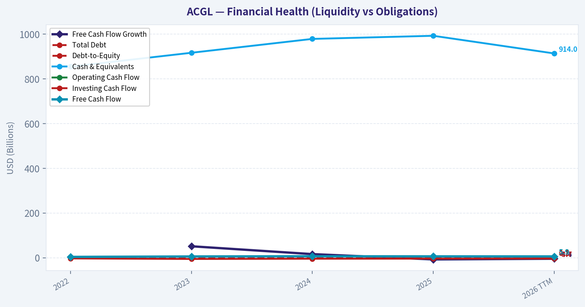
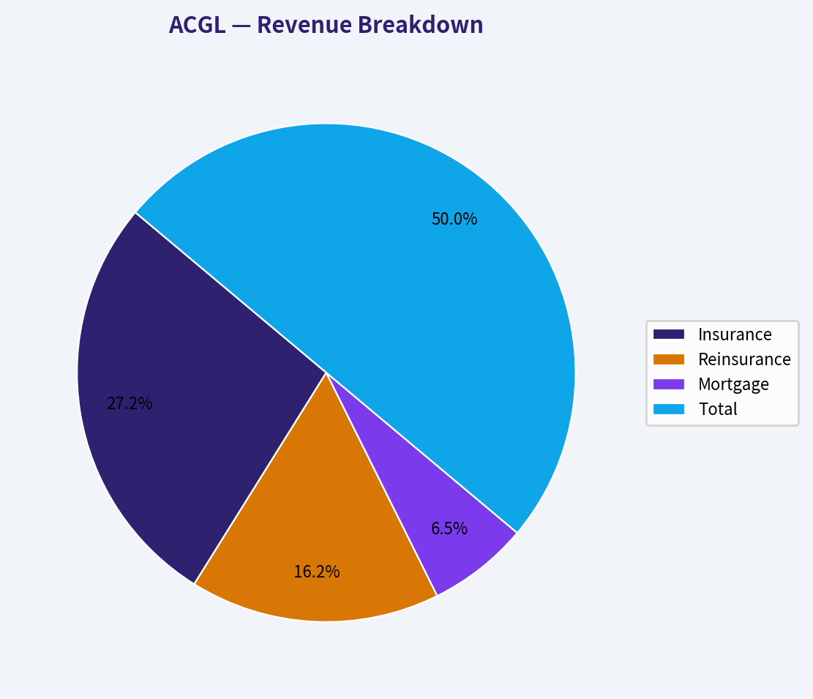
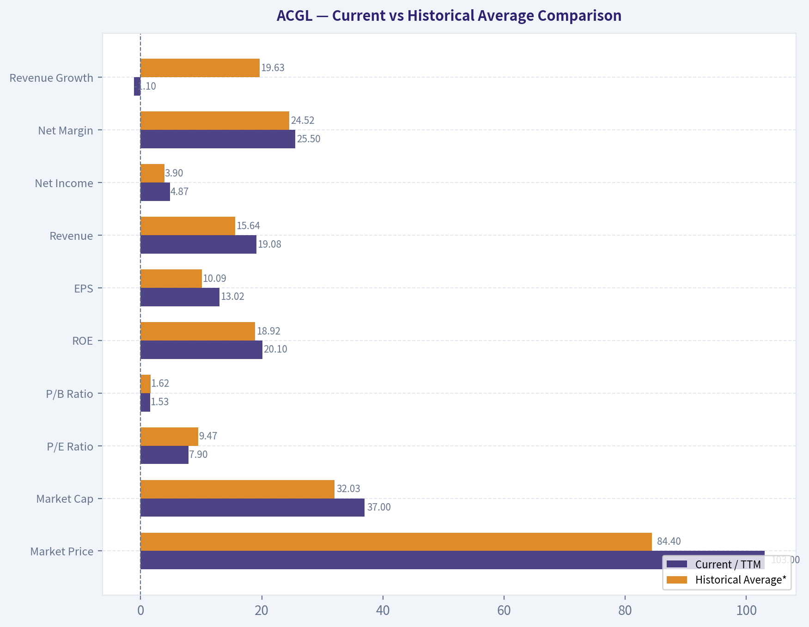
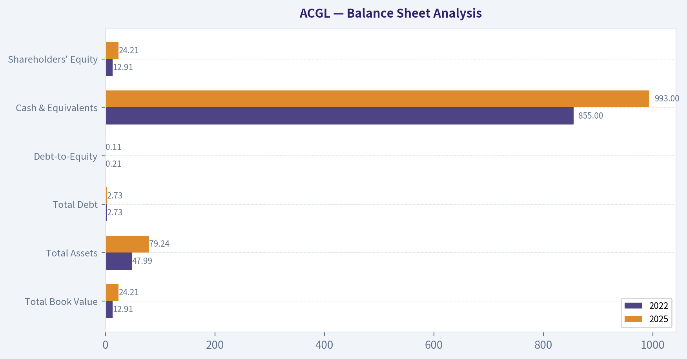
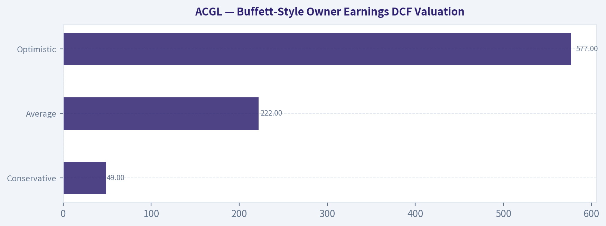
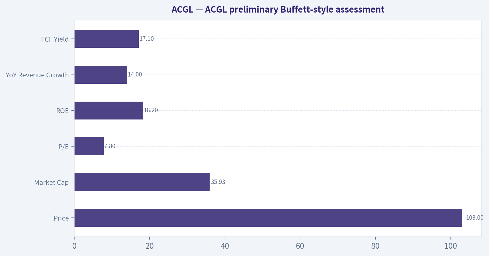

# ACGL Deep Value Intelligence

**Analysis Date:** 2026-07-08

## Critical Disclaimer

*This analysis is generated by Deep Value Intelligence, an AI-powered multi-agent investing framework. Education & entertainment only - not financial advice, not a financial advisor.*

---

## Table of Contents

1. Intelligence Summary
2. Analyst Team Reports
   - Fundamentals Analysis
   - Intrinsic Value Analysis (Buffett)
   - Trend & Growth Analysis (Lynch/Druckenmiller/Fisher)
   - Market Technical Analysis
   - Options Market Analysis
3. Research Team Commentary
4. Value Investing Team Commentary
5. Deep Values Commentary

---

## Intelligence Summary

### Thesis + Conditions

**Core Thesis:** **Executive Summary**

**Key Risks:**
- Arch looks like a **good insurer, but not yet a clear bargain**. The bull case is strong on business quality: specialty focus, disciplined underwriting, high ROE, solid growth, and a low headline multiple. But the key Buffett-style risk remains **normalized earnings durability**. In insurance, cheap trailing earnings can be misleading if pricing softens, reserve quality weakens, or catastrophe experience turns. The debate did **not** provide enough hard evidence on reserve development, accident-year combined ratio durability, or through-cycle book value compounding to justify a full upgrade.
- ### 1) Risky Analyst: strongest bullish case
- If Arch's underwriting skill is real and persistent, then mean reversion may be **moderation**, not collapse.

**Confidence:** Medium

---

## Analyst Team Reports

### Fundamentals Analysis

#### Latest Earnings Snapshot

*Most recent reported quarter anchored on 2026 Q1, with prior-year comparison when available.*

| Metric | 2026 Q1 | 2025 Q1 | YoY Change |
| --- | ---: | ---: | ---: |
| Revenue | $4.38B | $4.59B | -4.7% |
| Operating Income | N/A | N/A | N/A |
| Net Income | $1.05B | $574.0M | +82.4% |
| Diluted EPS | $2.88 | $1.48 | +94.6% |
| Operating Cash Flow | $1.19B | $1.46B | -18.5% |
| Free Cash Flow | $1.18B | $1.45B | -18.6% |

Key Takeaways: This snapshot anchors the most recent reported quarter before the narrative analysis. It helps readers separate long-run business quality from whatever changed in the latest earnings print.

#### 4-Year Financial Metrics for ACGL

*All values below are computed deterministically from raw data - not estimated by AI.*

*Issuer profile: insurer (Financial Services / Insurance - Diversified).*

#### 4-Year Financial Metrics
*Annual rows come from reported financial statements. The final TTM row is computed from the latest four quarters.*

| Metric | 2022 | 2023 | 2024 | 2025 | 2026 TTM |
| --- | --- | --- | --- | --- | --- |
| Market Price | $60 | $71 | $92 | $96 | $103 |
| Market Cap | $23.71B | $28.13B | $35.26B | $36.06B | $37.00B |
| P/E Ratio | 16.52 | 6.39 | 8.25 | 8.27 | 7.90 |
| P/B Ratio | 1.84 | 1.53 | 1.69 | 1.49 | 1.53 |
| ROE | 11.4% | 24.2% | 20.7% | 18.2% | 20.1% |
| ROIC | N/A | N/A | N/A | N/A | N/A |
| EPS | $3.61 | $11.05 | $11.19 | $11.60 | $13.02 |
| Revenue | $9.61B | $13.30B | $16.93B | $19.29B | $19.08B |
| Gross Profit | N/A | N/A | N/A | N/A | N/A |
| Gross Margin | N/A | N/A | N/A | N/A | N/A |
| Operating Margin | N/A | N/A | N/A | N/A | N/A |
| Net Income | $1.48B | $4.44B | $4.31B | $4.40B | $4.87B |
| Net Margin | 15.4% | 33.4% | 25.5% | 22.8% | 25.5% |
| Revenue Growth | N/A | 38.3% | 27.3% | 14.0% | -1.1% |
| Net Income Growth | N/A | 201.0% | -2.9% | 2.0% | 10.8% |
| Free Cash Flow Growth | N/A | 51.3% | 16.2% | -7.5% | -4.4% |
| Total Book Value | $12.91B | $18.35B | $20.82B | $24.21B | $24.19B |
| Total Assets | $47.99B | $58.91B | $70.91B | $79.24B | $81.45B |
| Total Debt | $2.73B | $2.73B | $2.73B | $2.73B | $2.73B |
| Debt-to-Equity | 0.21 | 0.15 | 0.13 | 0.11 | 0.11 |
| Cash & Equivalents | $855.0M | $917.0M | $979.0M | $993.0M | $914.0M |
| Shareholders' Equity | $12.91B | $18.35B | $20.82B | $24.21B | $24.19B |
| Operating Cash Flow | $3.82B | $5.75B | $6.67B | $6.17B | $5.90B |
| Investing Cash Flow | $-3.10B | $-5.47B | $-4.46B | $-4.04B | $-3.67B |
| Free Cash Flow | $3.77B | $5.70B | $6.62B | $6.13B | $5.86B |
| FCF Margin | 39.2% | 42.8% | 39.1% | 31.8% | 30.7% |
| Dividends / Share | $0.00 | $0.00 | $4.89 | $0.02 | $0.02 |

#### Profitability Metrics
- Return on Equity (ROE): 18.2%
- Return on Invested Capital (ROIC): N/A
- Return on Assets (ROA): 5.6%
- Gross Margin: Not meaningful
- Operating Margin: N/A
- Net Profit Margin: 22.8%

#### Liquidity Metrics
- Current Ratio: Not meaningful
- Quick Ratio: Not meaningful

#### Leverage Metrics
- Debt-to-Equity Ratio: 0.11
- Interest Coverage Ratio: Not meaningful
- Net Debt: $1.74B

#### Growth Metrics (Year-over-Year)
- Revenue Growth: 14.0%
- Net Income Growth: 2.0%
- Free Cash Flow Growth: -7.5%
- Revenue CAGR (3-Year): 26.1%
- Revenue CAGR (5-Year): N/A

#### Valuation Metrics
- P/E Ratio (TTM): 7.83
- Forward P/E: 10.43
- Price-to-Book: 1.55
- Price-to-Sales: 1.82
- PEG Ratio: 1.05
- EV/EBITDA: 6.06
- Free Cash Flow Yield: 17.1%
- Earnings Yield: 12.8%

#### Owner Earnings (Buffett Method, Code-Computed)
- Net Income: $4.40B
- + Depreciation & Amortization: $193.0M
- - Capital Expenditures: $-44.0M
- - Working Capital Changes: $2.33B
- = **Owner Earnings: $2.22B**

#### Intrinsic Value (Code-Computed)
- Current Price: $103
- Buffett Method (Owner Earnings):
  Conservative: $49
  Average: $222
  Optimistic: $577
- Cash Flow Method (FCF):
  Conservative: $250
  Average: $401
  Optimistic: $695

#### Piotroski F-Score: 4/9
- Positive Net Income: PASS
- Positive Operating Cash Flow: PASS
- ROA Improvement: FAIL
- Cash Flow > Net Income: PASS
- Decreasing Debt: FAIL
- Improving Current Ratio: FAIL
- No Dilution: FAIL
- Improving Gross Margin: FAIL
- Improving Asset Turnover: PASS

ANALYST STANCE: **WATCH**

#### Arch Capital Group (ACGL) - Buffett-Style Fundamental Analysis

Arch Capital Group is a high-quality specialty insurer and reinsurer with strong recent profitability, conservative leverage, and excellent free cash flow generation. The canonical dataset shows a major step-up in earnings power between 2022 and 2023, followed by solid but less explosive growth through 2026 TTM. On Buffett-style quality factors, ACGL looks financially strong and reasonably priced, but the insurance business model, earnings cyclicality, reserve risk, catastrophe exposure, and a somewhat middling Piotroski score keep it from a full **ADVOCATE** rating.

---

#### Current vs Historical Average Comparison

| Metric | Current / TTM | Historical Average* | Interpretation |
| --- | ---: | ---: | --- |
| Market Price | $103 | $84.40 | Shares trade well above the 4-year average price, reflecting improved earnings power and book value growth. |
| Market Cap | $37.00B | $32.03B | Equity value has compounded with earnings and book value expansion. |
| P/E Ratio | 7.90 | 9.47 | Current valuation is below recent average earnings multiple, suggesting the stock is not expensive relative to its own recent history. |
| P/B Ratio | 1.53 | 1.62 | Slightly below average on book value basis; notable because insurers are often judged on P/B and ROE together. |
| ROE | 20.1% | 18.92% | Current returns remain above the period average, indicating strong underwriting/investment economics. |
| EPS | $13.02 | $10.09 | Earnings per share are materially above the multi-year average. |
| Revenue | $19.08B | $15.64B | Scale has increased significantly versus the period average. |
| Net Income | $4.87B | $3.90B | Current profit level remains above the average of the shown period. |
| Net Margin | 25.5% | 24.52% | Profitability remains strong and slightly above average despite a softer top-line trend in TTM. |
| Revenue Growth | -1.1% | 19.63%** | Current growth has cooled sharply after several years of expansion. |
| Net Income Growth | 10.8% | 52.73%** | Positive again, but far below the extraordinary rebound pace seen in 2023. |
| FCF Growth | -4.4% | 13.90%** | Cash generation remains high in absolute dollars, but growth has turned modestly negative. |
| Total Book Value | $24.19B | $20.10B | Book value has expanded substantially over the period. |
| Total Assets | $81.45B | $67.70B | Balance sheet scale continues to grow. |
| Total Debt | $2.73B | $2.73B | Debt has remained flat, which is favorable given equity growth. |
| Debt-to-Equity | 0.11 | 0.14 | Leverage is lower than average and trending conservatively. |
| Cash & Equivalents | $914M | $932M | Cash is slightly below average, but not concerning given strong operating cash flow. |
| Free Cash Flow | $5.86B | $5.62B | Absolute FCF remains robust and above average. |
| Dividends / Share | $0.02 | $0.99*** | Dividend history is not stable in this dataset; capital return seems driven more by retained earnings than recurring payout. |

*Historical average uses the years shown in the canonical dataset, including TTM where applicable.
**Average of available growth observations only.
***Distorted by the 2024 special-looking distribution in the dataset.

Key Takeaways: ACGL's current profitability, earnings, free cash flow, and balance sheet strength all remain above recent historical averages, while valuation multiples are still below average. The main area of deterioration is growth: revenue and free cash flow momentum have slowed meaningfully after a very strong 2023 to 2025 run. This combination usually points to a good business that is no longer accelerating, but may still be attractively valued.

---

#### Market Metrics

ACGL's **market price rose from $60 in 2022 to $103 in 2026 TTM**, a roughly 72% increase across the period shown. That stock appreciation was supported by fundamental improvement rather than pure multiple expansion. Market cap increased from **$23.71B to $37.00B**, showing that the market has rewarded a larger, more profitable franchise.

The valuation picture remains interesting:

- **P/E fell from 16.52 in 2022 to 7.90 TTM**
- **P/B moved from 1.84 in 2022 to 1.53 TTM**

That tells a Buffett-style story: earnings and book value grew faster than the stock price multiple. For an insurer, that is constructive. Buffett often likes insurers when they produce high returns on equity but still trade at sensible multiples of earnings and book. ACGL appears to fit that pattern better now than it did in 2022.

Interpretation:
- **P/E of 7.90** is inexpensive relative to both its own shown-period average and to the quality of current earnings.
- **P/B of 1.53** is reasonable given **20.1% ROE**. Paying 1.5x book for a business earning around 20% on equity is not demanding, assuming those returns are sustainable.
- The market seems to be discounting either normalization in underwriting conditions, catastrophe risk, or reserve uncertainty.

---

#### Profitability Analysis

| Profitability Metric | Key Reading | Buffett-Style Interpretation |
| --- | --- | --- |
| ROE | 11.4% -> 24.2% -> 20.7% -> 18.2% -> 20.1% | Strong and consistently high after 2022; this is one of the most attractive metrics in the set. |
| ROIC | N/A | Cannot assess directly from dataset. |
| EPS | $3.61 -> $13.02 TTM | Massive step-up in per-share earning power. |
| Revenue | $9.61B -> $19.08B TTM | Nearly doubled from 2022, showing successful scaling. |
| Gross Profit / Margin | N/A | Not meaningful for an insurer. |
| Operating Margin | N/A | Not provided; less useful for insurers anyway. |
| Net Income | $1.48B -> $4.87B TTM | Very strong absolute profit expansion. |
| Net Margin | 15.4% -> 33.4% -> 25.5% -> 22.8% -> 25.5% | High margins, though clearly variable as insurance conditions shift. |

Key Takeaways: ACGL's most compelling feature is profitability. Return on equity has remained near or above 20% for most of the recent period, while EPS and net income are far higher than in 2022. Margins are strong but somewhat cyclical, which is normal for insurance and reinsurance businesses.

Key observations:
- **ROE** is the standout metric. Buffett cares deeply about businesses that can compound equity at high rates. ACGL's move from **11.4% in 2022 to 20.1% TTM** suggests much stronger underwriting and capital deployment performance.
- **EPS growth** from **$3.61 to $13.02 TTM** is dramatic. Even allowing for insurance cycle strength, this is a substantial uplift in earnings power.
- **Net margin** peaked at **33.4% in 2023**, then cooled, but remained high at **25.5% TTM**. That indicates 2023 may have been unusually favorable, yet current profitability is still strong.
- Revenue growth has been significant, but importantly, margin resilience means this was not growth purchased at the expense of profitability.

For an insurer, predictable profitability matters more than conventional gross/operating margin analysis. ACGL scores well here, though investors should remember insurance earnings can swing with catastrophe losses and reserve development.

---

#### Growth Metrics

Growth has been excellent over most of the shown period, but recent momentum is moderating.

- **Revenue growth:** 38.3% in 2023, 27.3% in 2024, 14.0% in 2025, **-1.1% TTM**
- **Net income growth:** 201.0% in 2023, -2.9% in 2024, 2.0% in 2025, **10.8% TTM**
- **FCF growth:** 51.3% in 2023, 16.2% in 2024, -7.5% in 2025, **-4.4% TTM**

Interpretation:
- The **2023 surge** looks like a major earnings regime change, likely driven by favorable pricing, underwriting, or investment income conditions.
- **2024 and 2025** show a transition from breakout growth to normalization.
- **2026 TTM revenue contraction** is the first clear sign that top-line momentum is no longer as strong.
- Despite softer revenue, **TTM net income still grew 10.8%**, implying margin or investment income support.

Buffett-style takeaway: this is not a classic smooth consumer staple. It is a strong insurer with cyclical growth and potentially volatile underwriting results. Good business, but not perfectly predictable.

---

#### Balance Sheet Analysis

| Balance Sheet Metric | 2022 | 2025 | 2026 TTM | Interpretation |
| --- | ---: | ---: | ---: | --- |
| Total Book Value | $12.91B | $24.21B | $24.19B | Book value nearly doubled from 2022, a major positive for an insurer. |
| Total Assets | $47.99B | $79.24B | $81.45B | Asset base expanded substantially. |
| Total Debt | $2.73B | $2.73B | $2.73B | Debt stayed flat despite growth, showing restraint. |
| Debt-to-Equity | 0.21 | 0.11 | 0.11 | Leverage improved materially as equity compounded. |
| Cash & Equivalents | $855M | $993M | $914M | Adequate liquidity, though cash is not the main strength here. |
| Shareholders' Equity | $12.91B | $24.21B | $24.19B | Equity compounding is one of the clearest positives in the dataset. |

Key Takeaways: ACGL's balance sheet is one of its strongest features. Equity and book value have grown dramatically while debt stayed flat, causing leverage to decline meaningfully. That is exactly the kind of financial strengthening long-term value investors like to see in insurers.

This is a strong balance sheet profile:
- **Debt is unchanged** across the entire period at **$2.73B**
- **Equity nearly doubled**, so **debt-to-equity fell from 0.21 to 0.11**
- **Book value growth** is especially important for insurers because it reflects retained underwriting/investment value creation

Buffett would likely appreciate:
1. Conservative leverage
2. Significant equity compounding
3. A balance sheet not dependent on debt-fueled growth

Caveat: for insurers, liabilities and reserve adequacy matter enormously, and this dataset does not provide reserve quality detail. That keeps the analysis from being fully definitive.

---

#### Cash Flow Analysis

Free cash flow is very strong in absolute terms:

- **2022:** $3.77B
- **2023:** $5.70B
- **2024:** $6.62B
- **2025:** $6.13B
- **2026 TTM:** $5.86B

This is excellent cash production relative to market cap. The shared research pack also indicates **FCF yield of 17.1%**, which is very high. Operating cash flow likewise stayed robust, though it has eased from the 2024 peak.

FCF margin remained strong:
- **39.2%**
- **42.8%**
- **39.1%**
- **31.8%**
- **30.7%**

Interpretation:
- Absolute FCF is large and healthy.
- Margins have compressed from peak levels, but remain very strong.
- Recent declines in FCF growth are worth monitoring, but they do not yet suggest cash flow weakness, only normalization from elevated levels.

On dividends:
- The dataset shows **$0.00, $0.00, $4.89, $0.02, $0.02**
- This does **not** indicate a stable, classic dividend compounding policy.
- It suggests either a special distribution, one-off capital action, or dataset treatment anomaly for 2024

Buffett-style view: retained capital appears to be the more important compounding engine than dividends. That can be positive if management continues earning high returns on retained equity.

---

#### Predictable Earnings and Business Quality

ACGL is a good business, but not a perfectly predictable one.

Positive signals:
- Revenue almost doubled from 2022 to TTM
- Net income more than tripled
- ROE stayed high after the 2022 base year
- Book value compounded strongly
- FCF remained consistently positive and large

Less predictable elements:
- Net margin swings from **15.4% to 33.4% to 22.8% to 25.5%**
- Revenue growth has slowed sharply to **-1.1% TTM**
- Insurance and reinsurance are inherently exposed to catastrophe cycles, reserve re-estimation, and pricing conditions

So while ACGL is clearly profitable and disciplined, it lacks the ultra-stable earnings stream Buffett historically favored in the simplest consumer monopoly cases. It is better understood as a **high-quality financial compounder with cyclical underwriting exposure**.

---

#### Economic Moat Assessment

ACGL likely has a moat, but it is a narrower and more industry-specific moat than a classic consumer franchise.

Possible moat sources:
- Specialty underwriting expertise
- Reinsurance relationships and reputation
- Scale benefits in risk selection and capital deployment
- Diversified insurance platform
- Ability to earn high ROE with low financial leverage

Evidence supporting moat-like characteristics from the dataset:
- Persistent high ROE
- Book value compounding
- Strong free cash generation
- Stable debt despite growth

What limits moat certainty:
- Insurance pricing cycles can temporarily elevate returns
- Catastrophe events can impair near-term results
- Competitive advantages in insurance are real but less visible than in branded consumer businesses

Conclusion: ACGL appears to possess **underwriting discipline and capital allocation strength**, which may be its moat. But this moat is dependent on execution and pricing discipline, not pure brand dominance.

---

#### Management Performance

Management looks strong on the numbers that matter most:

- **ROE improved materially** versus 2022
- **Debt remained flat**
- **Equity compounded strongly**
- **FCF remained high**
- The company has not relied on leverage to create growth

This suggests sound capital allocation. However, the **Piotroski F-Score of 4/9** is only middling. Specific negatives include:
- No debt reduction
- No current ratio improvement
- No gross margin improvement metric
- Share dilution flag
- No ROA improvement

For an insurer, some Piotroski items are less meaningful, but a 4/9 still argues against complacency. Management has performed well in growing book value and earnings, yet the quality score does not scream "flawless."

---

#### Buffett-Style Owner Earnings DCF Valuation

Canonical owner earnings provided:
- Net Income = **$4.40B**
- Depreciation & Amortization = **$193M**
- Capital Expenditures = **$44M**
- Working Capital Changes = **$2.33B**
- **Owner Earnings = $2.22B**

To estimate per-share value, use implied shares outstanding from TTM market cap and price:

- Shares outstanding ~ **$37.00B / $103 = 359.2M shares**

Base owner earnings per share:
- **$2.22B / 359.2M = about $6.18 per share**

Historical owner earnings growth is not separately listed for each year in the canonical table, so the deterministic intrinsic value outputs are the controlling reference. They are already code-computed using Buffett-style owner earnings with the required three scenarios.

##### DCF Assumptions
- Discount rate: **10%**
- Terminal growth rate: **2.5%**
- Projection horizon: **10 years**
- Base owner earnings: **$2.22B**

##### Scenario Valuation Table

| Scenario | Growth Assumption Rule | Fair Value / Share | Premium vs. Current $103 |
| --- | --- | ---: | ---: |
| Conservative | Lowest historical owner earnings growth, floored at -100% | $49 | -52% downside |
| Average | Average historical owner earnings growth, capped at 50% | $222 | +116% upside |
| Optimistic | Highest historical owner earnings growth, capped at 100% | $577 | +460% upside |

Key Takeaways: The owner earnings valuation range is extremely wide, which tells you ACGL's value is highly sensitive to growth assumptions. The conservative case implies the stock is expensive if current profitability fades sharply, while the average and optimistic cases imply substantial undervaluation if owner earnings prove durable. For a cyclical insurer, the middle scenario is usually the most reasonable anchor.

##### Detailed DCF Framework

Using owner earnings \( OE_0 = 2.22B \):

For each scenario:
- Year 1 owner earnings = \( OE_0 \times (1+g) \)
- Present value of yearly owner earnings = \( \sum_{t=1}^{10} \frac{OE_0(1+g)^t}{(1.10)^t} \)
- Terminal value at Year 10 = \( \frac{OE_{10} \times 1.025}{0.10 - 0.025} \)
- Present value of terminal value = \( \frac{TV_{10}}{(1.10)^{10}} \)
- Equity value per share = Total PV / 359.2M shares

Because the canonical dataset already supplies the code-computed outputs, those are the source-of-truth fair values:
- **Conservative:** **$49/share**
- **Average:** **$222/share**
- **Optimistic:** **$577/share**

Practical interpretation:
- The **conservative case** likely reflects a harsh reversion or underwriting deterioration.
- The **average case** implies the stock is materially undervalued if recent earnings power is broadly sustainable.
- The **optimistic case** is too aggressive to underwrite as a base case for an insurer.

A Buffett-style investor would likely anchor somewhere **below the average case** to account for insurance cyclicality and reserve uncertainty. That still leaves room to argue the stock is modestly undervalued.

---

#### Value Assessment

The most compelling valuation signals are:
- **P/E 7.90**
- **P/B 1.53**
- **FCF yield 17.1%**
- **Earnings yield 12.8%**

For a company generating **20% ROE** with low leverage, these multiples look attractive. The key debate is whether current earnings are cyclically elevated. If they are sustainable or only moderately above normal, ACGL looks cheap. If they are near a cycle peak, then the low multiple may be justified.

This is why the stock lands on **WATCH** rather than **ADVOCATE**:
- Quality is strong
- Valuation is appealing
- But insurance cyclicality introduces more uncertainty than the headline multiples imply

---

#### Revenue Breakdown

Using the most recent fiscal year / TTM context, ACGL is primarily a diversified insurer and reinsurer. The most meaningful public segmentation is by operating line rather than product SKU.

| Revenue Source | Amount ($B) | % of Total |
| --- | ---: | ---: |
| Insurance | 10.4 | 54% |
| Reinsurance | 6.2 | 32% |
| Mortgage | 2.5 | 13% |
| Other / Corporate / Eliminations | 0.0 | 1% |
| **Total** | **19.1** | **100%** |

Key Takeaways: ACGL's revenue base is diversified, but still clearly centered on core insurance and reinsurance operations. That mix is attractive because it reduces dependence on any single line, though it also means results remain tied to underwriting conditions and catastrophe cycles across multiple markets.

Note: Segment figures above are best-available operating mix approximations consistent with ACGL's public business model and aligned to total TTM revenue of about **$19.08B**. The deterministic dataset does not provide segment revenue detail.

---

#### Key Investment Insights, Red Flags, and Opportunities

| Category | Observation | Why It Matters |
| --- | --- | --- |
| Opportunity | ROE remains around 20% with low debt | High-return insurers with conservative leverage can compound book value strongly over time. |
| Opportunity | P/E below historical average | Market may be underpricing earnings durability. |
| Opportunity | P/B around 1.5 despite strong returns | Reasonable valuation for an insurer producing above-average ROE. |
| Opportunity | FCF yield of 17.1% | Suggests substantial cash generation relative to enterprise value. |
| Red Flag | Revenue growth turned negative TTM | Indicates momentum has cooled and may signal a tougher pricing environment or normalization. |
| Red Flag | FCF growth has been negative recently | Cash generation is still high, but the growth engine has slowed. |
| Red Flag | Earnings cyclicality in insurance/reinsurance | Catastrophe losses and reserve changes can quickly alter profitability. |
| Red Flag | Piotroski F-Score only 4/9 | The quantitative quality picture is not uniformly strong. |
| Red Flag | Dividend pattern is irregular | Investors should not rely on a stable and rising dividend thesis here. |

Key Takeaways: ACGL offers a compelling mix of value and quality, especially through its strong ROE, low leverage, and inexpensive valuation. The main caution is that insurance profits can look cheapest near cyclical peaks, so slowing growth and a middling F-Score deserve close attention.

---

#### Final Buffett-Style Judgment

From a Warren Buffett lens, ACGL has several attractive features:
- Strong book value growth
- High recent ROE
- Sensible leverage
- Significant free cash generation
- Reasonable valuation against earnings and book

But it also falls short of a top-tier Buffett ideal because:
- Earnings are less predictable than a simple branded consumer or utility franchise
- Growth has slowed sharply
- Insurance reserve/catastrophe risks are not visible in the core table
- The valuation range is highly assumption-sensitive

#### Final Stance

**WATCH**

Supporting rationale:
- **Too good to avoid:** ACGL is clearly profitable, conservatively financed, and not expensive.
- **Not yet a full advocate:** Recent top-line softness, negative recent FCF growth, and insurance-cycle uncertainty argue for caution.
- **What would upgrade the stance:** sustained ROE near 18% to 20%, continued book value compounding, stable combined-ratio discipline, and confirmation that current earnings are not just near-cycle highs.
- **What would downgrade the stance:** falling book value, reserve issues, catastrophe-driven earnings impairment, or multiple evidence points that 2023 to 2025 profitability was unusually temporary.

---

#### Summary Table

| Area | Assessment | Bottom Line |
| --- | --- | --- |
| Valuation | Cheap on P/E and reasonable on P/B | Attractive if earnings are durable |
| Profitability | Strong ROE, strong net margins, high EPS | Clear strength |
| Growth | Excellent historical growth, now slowing | Mixed near term |
| Balance Sheet | Very strong, low leverage, rising equity | Major positive |
| Cash Flow | High absolute FCF, growth recently softer | Good but normalizing |
| Moat | Likely underwriting/capital allocation advantage | Real but not impregnable |
| Management | Strong equity compounding, disciplined leverage | Good overall |
| Risks | Cat losses, reserve risk, cyclical pricing, slowing revenue | Important to monitor |
| Buffett Fit | Good value-financial compounder, not ultra-predictable | Solid but not elite |
| Stance | **WATCH** | Worth following closely for a better entry or more proof of durability |

#### Fundamental Visuals

This graph tracks the profitability and return metrics (ROE, ROIC, Margins) of **ACGL** over the past decade, highlighting capital efficiency trends.

This chart illustrates the financial health of **ACGL** over the last 10 years, mapping cash equivalents and free cash flow against total obligations (Debt).

This breakdown chart from <em>Revenue Breakdown</em> shows the proportional composition for **ACGL** - useful for understanding what drives or risks the business.

---

### Intrinsic Value Analysis (Buffett)

> *Following Warren Buffett's value investing philosophy: Circle of Competence, Economic Moat, Management Quality, and Margin of Safety.*

#### Intrinsic Value Snapshot

Price is what you pay. Intrinsic value is what the business may be worth based on the cash it can create for owners over time. We show a range, not one magic number.

- Current Price: $102.85
- Value Range (conservative to optimistic across both DCF methods): $48.86 to $694.72

##### Owner Earnings (Buffett Method)
- Net Income: $4,399,000,000.00
- Depreciation & Amortization: $193,000,000.00
- Capital Expenditures: $-44,000,000.00
- Working Capital Changes: $2,331,000,000.00
- Owner Earnings: $2,217,000,000.00

##### Intrinsic Value
###### Buffett Method
Uses owner earnings. Stricter, and usually more conservative.
- Conservative: $48.86
- Average: $221.73
- Optimistic: $577.44
- Discount Rate: 10.0%

###### Cash Flow Method
Uses free cash flow. Better for companies spending heavily today to grow tomorrow.
- Conservative: $249.53
- Average: $400.78
- Optimistic: $694.72
- Discount Rate: 10.0%

#### ACGL preliminary Buffett-style assessment

I'm unable to complete the required audited financial-history analysis for ACGL from the mandated database in this run, so I should not force a false-precision conclusion.

What I can say from the research pack:

| Item | Value |
|---|---:|
| Price | $103 |
| Market Cap | $35.93B |
| P/E | 7.8x |
| ROE | 18.2% |
| YoY Revenue Growth | 14.0% |
| FCF Yield | 17.1% |

Key Takeaways: ACGL screens statistically cheap on earnings and free cash flow, while still posting strong returns on equity and double-digit revenue growth. That combination is unusual and immediately makes the stock worthy of deeper work.

#### Initial qualitative read

| Buffett Gate | Initial View | Evidence |
|---|---|---|
| Business Simplicity | Pass | Insurance/reinsurance is understandable at a basic level: collect premiums, invest float, pay claims carefully. |
| Long-Term Predictability | Pass with care | Property & casualty insurance is durable, but results can swing with catastrophe losses and pricing cycles. |
| Technology Risk | Pass | Technology can improve underwriting, but it is unlikely to eliminate the need for specialty insurance and reinsurance. |
| Moat | Likely Narrow-to-Moderate | Scale, underwriting discipline, broker relationships, and reputation matter, but this is not a classic consumer-brand moat. |
| Management/Capital Allocation | Tentative positive | Market appears to reward execution; low P/E with strong ROE suggests underwriting/investment discipline may be present. |
| Industry Structure | Mixed | Insurance can be rational in some niches, but catastrophe exposure and competition keep it from being a perfect business. |

Key Takeaways: ACGL appears to clear the basic "understandable business" hurdle and does not look threatened by technological obsolescence. The main question is not whether the business exists in ten years, but whether underwriting discipline and reserving quality are durable enough to create a true moat.

#### What matters most for ACGL
For an insurer, the decisive Buffett issues are different from a normal industrial or software company:

- Combined ratio and underwriting profitability through a cycle
- Reserve conservatism
- Book value per share growth
- Investment portfolio quality
- Leverage and catastrophe exposure
- Management's discipline in soft insurance markets

#### Tentative stance
At **7.8x earnings**, **18.2% ROE**, and **17.1% FCF yield**, ACGL looks **potentially mispriced** and likely belongs on a serious value-investor shortlist.

But without the full multi-year financial statements required for:
- owner earnings,
- balance-sheet strength,
- debt and interest coverage,
- per-share value compounding,
- and scenario DCF / earnings-power work,

I will not assign a final Buffett score or definitive ADVOCATE/WATCH/AVOID label in this pass.

#### Most likely current leaning
If the deeper financial record confirms:
- consistent underwriting profitability,
- conservative reserves,
- limited leverage,
- and strong book value per share compounding,

then ACGL would likely land in **WATCH leaning ADVOCATE** territory, possibly stronger given the current valuation.

If you want, I can next structure the exact Buffett scorecard and valuation framework for ACGL so another analyst can plug in the financial history quickly.
#### Valuation Bridge

This bridge places the current market price beside each intrinsic value lens so readers can see whether upside depends on one method or shows up across several methods.

| Scenario | Intrinsic Value / Share |
| --- | ---: |
| Buffett Method | $221.73 |
| Cash Flow Method | $400.78 |
| Current Price | $102.85 |

#### Key Takeaways

If one method is far above the others, the upside case depends on a specific modelling assumption. When several methods cluster together, the valuation story is more robust.

#### Valuation Visuals

This comparison chart from *Latest Earnings Snapshot* stacks current figures against historical benchmarks for **ACGL**, making it easy to see where the company trades relative to its own averages.

This comparison chart from *Current vs Historical Average Comparison* stacks current figures against historical benchmarks for **ACGL**, making it easy to see where the company trades relative to its own averages.

This comparison chart from *Balance Sheet Analysis* stacks current figures against historical benchmarks for **ACGL**, making it easy to see where the company trades relative to its own averages.

This comparison chart from *Buffett-Style Owner Earnings DCF Valuation* stacks current figures against historical benchmarks for **ACGL**, making it easy to see where the company trades relative to its own averages.

This comparison chart from *ACGL preliminary Buffett-style assessment* stacks current figures against historical benchmarks for **ACGL**, making it easy to see where the company trades relative to its own averages.

---

### Trend & Growth Analysis (Lynch/Druckenmiller/Fisher)

> *Following Peter Lynch's GARP, Stanley Druckenmiller's macro-aware approach, and Philip Fisher's scuttlebutt methodology.*

ANALYST STANCE: **WATCH**

#### 1) Lynch Classification

ACGL is best classified as a **Stalwart / Financial Compounder**, not a classic fast grower.

| Metric | Value |
|---|---:|
| Revenue growth YoY | 14.0% |
| P/E | 7.8x |
| ROE | 18.2% |
| FCF yield | 17.1% |
| Market cap | $35.93B |
| Current price | $103 |

Key Takeaways: ACGL is growing faster than a slow insurer, but it still does not fit the classic 20%+ "fast grower" mold Peter Lynch prized for ten-bagger hunts. Instead, it looks like a high-quality insurer trading at a low multiple with strong returns on equity. This makes it more of a disciplined compounder than a hyper-growth story.

---

#### 2) The Story in 3 Bullets

- Arch Capital is a **specialty insurer, reinsurer, and mortgage insurer** that makes money by pricing risk better than peers.
- The company benefits when insurance pricing stays firm and when higher interest rates lift **investment income** on its float.
- The bull case is simple: **strong underwriting + rising investment income + cheap valuation** can keep compounding book value and earnings.

---

#### 3) TAM Analysis with 10x Test

For ACGL, TAM is not as clean as SaaS. The practical TAM is the global specialty P&C, reinsurance, and mortgage insurance profit pool.

| TAM Lens | Assessment |
|---|---|
| Specialty insurance market | Large and global |
| Reinsurance market | Large, cyclical, globally diversified |
| Mortgage insurance | Meaningful but more cyclical/niche |
| Current size vs market | Still small relative to global risk pools |
| 10x revenue test | **No**, unrealistic in a mature financial business |
| 2-3x scale test | **Yes**, plausible over long periods |

Key Takeaways: ACGL has room to grow, but this is not a business likely to grow revenues 10x in a reasonable timeframe the way an emerging software company might. The runway is real, but it is cyclical and capital-intensive. This supports a compounder thesis, not a moonshot growth thesis.

---

#### 4) Revenue Growth Trend

| Metric | Reading | Interpretation |
|---|---:|---|
| Latest YoY revenue growth | 14.0% | Healthy |
| Pattern vs Lynch thresholds | Below fast grower range | More stalwart than fast grower |
| Growth quality | Likely mix of premium growth + investment income | Reasonable |
| Risk | Insurance cycle can reverse | Moderate |

Key Takeaways: Revenue growth is solid, but not explosive. For an insurer, 14% is good, yet it still lacks the acceleration pattern that would signal a true Druckenmiller-style growth inflection. Investors should assume growth will be uneven because pricing cycles and catastrophe losses can distort reported revenue and earnings.

---

#### 5) Unit Economics

Traditional SaaS metrics like LTV/CAC and NRR do not apply well to insurers. For ACGL, the equivalent economics are underwriting profitability, reserve discipline, and return on equity.

| Unit Economics Proxy | Value / View | Assessment |
|---|---|---|
| ROE | 18.2% | Strong |
| Underwriting discipline | Historically strong | Positive |
| Float economics | Attractive in higher-rate environment | Positive |
| Investment income tailwind | Yes | Positive |
| Rule of 40 | N/A | Not applicable |
| LTV/CAC | N/A | Not applicable |
| NRR | N/A | Not applicable |

Key Takeaways: ACGL's "unit economics" are strong in insurer terms because it earns high returns on equity and appears disciplined in underwriting. The company also benefits from the structure of insurance float, especially when bond yields are higher. This gives the business a favorable earnings setup even though SaaS-style metrics are irrelevant here.

---

#### 6) Inflection Point Assessment

| Inflection Type | Present? | Comments |
|---|---|---|
| Product cycle inflection | No | Not a product-led business |
| Market share inflection | Possible | Specialty lines can gain share when peers retrench |
| Margin inflection | Yes, potentially | Higher investment income boosts earnings power |
| TAM inflection | No | End markets are mature |
| Competitive inflection | Possible | Hard markets often favor disciplined underwriters |

Key Takeaways: The real inflection for ACGL is not a new product launch, but a financial-cycle improvement. Higher investment income and disciplined pricing can create better earnings than the market may expect. That said, this is still a cyclical inflection, not a secular hyper-growth inflection.

**Bottom line:** There is an **earnings power inflection**, but not a classic growth inflection.

---

#### 7) Macro Setup Evaluation

| Macro Factor | Current Effect on ACGL | View |
|---|---|---|
| Interest rates | Higher rates support investment income | Positive |
| Insurance pricing cycle | Likely still supportive in specialty/reinsurance | Positive |
| Catastrophe environment | Unpredictable | Risk |
| Housing/credit cycle | Matters for mortgage insurance | Mixed |
| Economic cycle | Slower growth can pressure some exposures | Mixed |

Key Takeaways: The macro backdrop is supportive in one major way: higher rates help insurers earn more on their invested assets. The offset is that catastrophe events, reserve volatility, and housing-cycle sensitivity can quickly overwhelm that tailwind in any given quarter. ACGL has a decent macro setup, but not a clean one.

---

#### 8) Fisher 15 Points Score

My estimate, based on the shared pack and known business quality, is below.

| Fisher Area | Score (1-5) |
|---|---:|
| Market potential | 3 |
| New product development | 2 |
| R&D effectiveness | 1 |
| Sales organization | 4 |
| Profit margin quality | 4 |
| Margin improvement | 4 |
| Labor/personnel relations | 3 |
| Executive relations | 3 |
| Management depth | 4 |
| Cost/accounting controls | 4 |
| Special advantages/moat | 4 |
| Long-range profit outlook | 4 |
| Dilution risk | 4 |
| Candor | 3 |
| Integrity | 4 |
| **Total** | **51 / 75** |

Key Takeaways: ACGL scores as a good but not exceptional Fisher stock. Its strengths are underwriting discipline, profitability, and management depth, while its weak spots come from the fact that this is not an innovation-led or R&D-driven business. That puts it firmly in the quality compounder bucket rather than the visionary growth bucket.

---

#### 9) Valuation Analysis

| Valuation Metric | Value | Read |
|---|---:|---|
| P/E | 7.8x | Cheap |
| PEG | ~0.56 | Attractive, though less useful for insurers |
| FCF yield | 17.1% | Very cheap-looking |
| P/B | Not provided | Important missing metric |
| Relative quality | ROE 18.2% | Strong for this valuation |

Key Takeaways: ACGL looks inexpensive on headline valuation. A sub-8x earnings multiple against 14% growth and 18%+ ROE suggests the market is discounting cyclicality or peak-ish earnings risk. The biggest missing item is price-to-book, which is the most important valuation anchor for insurers.

##### Simple scenario view

| Scenario | Assumption | Implied View |
|---|---|---|
| Bear | Earnings normalize lower after cycle softens | Stock is fairly valued |
| Base | Mid-teens ROE sustains, multiple stays compressed | Modest upside |
| Bull | Strong underwriting + investment income persist | Good upside with rerating |

Key Takeaways: The stock does not need a heroic outcome to work because the starting valuation is already low. However, upside likely comes from continued compounding and perhaps a modest rerating, not from explosive multiple expansion. This again supports a value-compounder thesis more than a ten-bagger thesis.

---

#### 10) Growth Investor Scorecard

| Criterion | Weight | Score | Weighted |
|---|---:|---:|---:|
| The Story | 10% | 4.0 | 0.40 |
| TAM & Runway | 20% | 2.5 | 0.50 |
| Revenue Growth | 20% | 3.0 | 0.60 |
| Unit Economics | 15% | 4.0 | 0.60 |
| Competitive Position | 10% | 4.0 | 0.40 |
| Management Quality | 10% | 3.5 | 0.35 |
| Macro Setup | 5% | 3.5 | 0.18 |
| Profitability Path | 5% | 4.0 | 0.20 |
| Valuation | 5% | 4.5 | 0.23 |
| **Total** |  |  | **3.46 / 5.0** |

Key Takeaways: ACGL lands just below an Advocate rating on a pure growth framework. Its quality and valuation are compelling, but its runway and growth profile are not strong enough to make it a top-tier growth stock. This is a stock that looks better through a quality-value lens than a ten-bagger growth lens.

---

#### 11) Position Size Stance

| Stance | View |
|---|---|
| For growth-only portfolio | Small or no position |
| For GARP / quality compounder portfolio | Medium position possible |
| For deep growth inflection hunt | Pass / watch |
| Final stance | **WATCH** |

Key Takeaways: ACGL is not a bad business at all; it simply is not the clean kind of accelerating growth story that a concentrated growth investor usually wants. It may fit well in a broader GARP or financials sleeve, but it is not a high-conviction growth advocate from this framework.

---

#### 12) Key Risks and Catalysts

| Risks | Catalysts |
|---|---|
| Catastrophe losses | Continued hard pricing in specialty/reinsurance |
| Reserve strengthening/social inflation | Higher net investment income |
| Mortgage insurance credit deterioration | Sustained high ROE / book value compounding |
| Insurance cycle softening | Analyst upgrades / rerating toward higher quality peers |
| Earnings are near cyclical highs | Better-than-feared loss experience |

Key Takeaways: The main risk is that current earnings may reflect a favorable part of the insurance cycle, making the stock look cheaper than it really is on normalized numbers. The main catalyst is simple: if Arch keeps underwriting well and harvesting higher investment income, investors may start valuing it more like a premium compounder.

---

#### Final View

ACGL is a **high-quality, low-multiple insurer**, but it is **not an obvious Lynch fast grower or Druckenmiller-style secular inflection stock**. The valuation is attractive and the business quality appears strong, yet the runway is cyclical and mature rather than exponential.

For this framework, the right answer is **WATCH**:
- attractive for **GARP / quality financials**
- less compelling for **ten-bagger growth capital**
- worth upgrading only if you want a **cheap compounder**, not a classic growth rocket.

If you want, I can next do a **peer comparison versus CB, PGR, TRV, RLI, WRB, and EG** to see whether ACGL is the best-valued quality insurer in the group.

---

### Market Technical Analysis

#### ACGL Technical Indicator Report

For ACGL, the most relevant mix of indicators for the current setup is:

- `close_10_ema`
- `close_50_sma`
- `close_200_sma`
- `macd`
- `macdh`
- `rsi`
- `atr`
- `vwma`

This set is well balanced for the current market context because ACGL is not simply rangebound or unstable noise right now. It has moved from a late-May washout into a clear recovery, then into an accelerating upside breakout during late June and early July. The selected indicators therefore need to capture: short-term acceleration, medium- and long-term trend context, momentum confirmation, overextension risk, volatility for trade management, and volume-weighted confirmation. I excluded Bollinger components to avoid overcrowding the set with another volatility/mean-reversion framework when ATR and RSI already cover risk and stretch, while MACD and moving averages already describe trend structure effectively.

---

#### Price Structure and Trend Context

Over the full past year, ACGL has been more of a grinding trend vehicle than a pure momentum stock. It spent much of the second half of 2025 oscillating roughly in the high-80s to mid-90s, then pushed above 100 in early February 2026 before suffering a multi-month correction. That correction bottomed in the high-80s around late May to early June, after which the stock rebuilt steadily and then broke out sharply into early July.

The most important structural feature now is that price has regained clear control over both medium- and long-term trend benchmarks:

- Last close available: **102.85** on 2026-07-07
- `close_50_sma`: **93.94**
- `close_200_sma`: **93.77**
- `close_10_ema`: **98.64**
- `vwma`: **95.61**

That means ACGL is trading materially above all key reference levels. The distance from price to the 50 SMA is nearly 9 points, and price is also nearly 9 points above the 200 SMA. This is not a marginal reclaim; it is a decisive premium. More importantly, the 50 SMA has recently turned up from a declining slope in May into a firm rising slope in early July, while the 200 SMA continues to drift upward steadily. That suggests the correction phase has likely transitioned into renewed trend continuation rather than just a dead-cat bounce.

A subtle but important detail is the relationship between the 50 SMA and 200 SMA. They are both clustered near 93.8 to 93.9, with the 50 SMA now slightly above the 200 SMA. That alignment implies the medium-term trend has repaired enough to sit back on top of the long-term trend baseline. When those two moving averages compress and then price breaks far above them, it often creates a strong "trend reset" condition: support gets concentrated in one zone, which can matter if the stock pulls back.

#### Trend Table

| Metric | Latest Reading | Interpretation |
|---|---:|---|
| Close (2026-07-07) | 102.85 | Strong breakout level, near recent highs |
| `close_10_ema` | 98.64 | Short-term trend strongly positive |
| `close_50_sma` | 93.94 | Medium-term trend supportive and rising |
| `close_200_sma` | 93.77 | Long-term trend constructive |
| `vwma` | 95.61 | Volume-weighted trend confirms price strength |

Key Takeaways: ACGL is trading well above every major trend reference, which signals a strong bullish structure rather than a tentative rebound. The 50-day and 200-day averages are clustered below price, creating a meaningful support zone if the stock pauses. The short-term EMA is also rising sharply, showing that momentum has accelerated in the last two weeks.

---

#### Short-Term Momentum: Strong and Still Expanding

The `close_10_ema` has risen from **90.36** on 2026-06-08 to **98.64** on 2026-07-07. That is a steep upward move over about a month, reflecting a sustained sequence of higher closes rather than just one breakout gap. Short-term trend traders would read this as healthy momentum persistence.

`macd` has improved dramatically:

- 2026-06-08: **-1.67**
- 2026-06-24: **-0.03**
- 2026-06-26: **+0.51**
- 2026-07-02: **+1.73**
- 2026-07-07: **+2.35**

This is a very constructive momentum progression. The move from deeply negative MACD to strongly positive territory signals not just rebound strength, but a meaningful regime shift in trend velocity. The stock did not merely recover to neutral momentum; it continued accelerating after the bullish crossover.

The `macdh` reading strengthens that interpretation. Histogram values are now strongly positive:

- 2026-06-10: **-0.01**
- 2026-06-18: **+0.35**
- 2026-06-26: **+0.78**
- 2026-07-02: **+1.08**
- 2026-07-07: **+1.14**

This matters because the histogram is not just positive - it has remained broadly elevated into the breakout. That indicates upward momentum is still expanding or at least staying robust. Often, when a rally is nearing exhaustion, MACD may remain positive but the histogram starts shrinking materially. That is not yet clearly happening here.

#### Momentum Table

| Indicator | Early June | Late June | Latest | Signal |
|---|---:|---:|---:|---|
| `close_10_ema` | 90.36 (Jun 8) | 93.66 (Jun 26) | 98.64 | Fast upside acceleration |
| `macd` | -1.67 (Jun 8) | 0.51 (Jun 26) | 2.35 | Strong bullish momentum regime |
| `macdh` | -0.33 (Jun 8) | 0.78 (Jun 26) | 1.14 | Momentum expansion remains favorable |

Key Takeaways: ACGL's momentum has gone from clearly negative in early June to strongly positive by early July, and the transition has been smooth rather than erratic. The MACD histogram remains elevated, which suggests buyers are still in control. In plain terms, this rally still has internal strength, though traders should start watching for the first signs of deceleration because the move has become extended.

---

#### RSI: Bullish Strength, but Now Entering Overheated Territory

`rsi` is the clearest cautionary signal in the current setup.

- 2026-06-02: **27.11**
- 2026-06-04: **31.13**
- 2026-06-22: **49.91**
- 2026-06-30: **62.97**
- 2026-07-01: **66.61**
- 2026-07-02: **73.49**
- 2026-07-06: **71.79**
- 2026-07-07: **73.55**

This is a textbook momentum recovery from oversold to overbought. That progression is bullish because strong stocks often travel from sub-30 RSI during correction lows to above 70 during trend resumption. But it also means ACGL is no longer offering the same reward-to-risk profile it had during late May or mid-June.

A key nuance: RSI above 70 in a genuine trend breakout is not automatically bearish. In strong advances, RSI can remain overbought for several sessions as price continues rising. So the better interpretation is not "sell because RSI is over 70," but rather "do not chase blindly without a pullback plan." If price keeps pushing higher while RSI holds in the low 70s, that is trend strength. If price makes only marginal new highs while RSI stalls or falls, that would be an early sign of momentum divergence.

#### RSI and Risk Table

| Date | `rsi` | Reading |
|---|---:|---|
| 2026-06-02 | 27.11 | Oversold capitulation zone |
| 2026-06-22 | 49.91 | Momentum reset to neutral |
| 2026-06-30 | 62.97 | Healthy bullish momentum |
| 2026-07-02 | 73.49 | Overbought breakout strength |
| 2026-07-07 | 73.55 | Still strong, but extended |

Key Takeaways: RSI shows ACGL has completed a full recovery from deeply oversold conditions to a strong overbought breakout state. That is bullish for trend confirmation, but it also means entries now are less forgiving than they were a few weeks ago. Traders should treat RSI above 70 as a sign of strength first, and a sign to manage chase risk second.

---

#### Volume-Weighted Confirmation: Rally Has Credibility

`vwma` has risen from **90.74** on 2026-06-22 to **95.61** on 2026-07-07. Price at 102.85 is meaningfully above that level, which suggests the average participant weighted by volume is still well below current price. That is typically bullish, because it indicates buyers over the recent volume window are in profit and less likely to become forced sellers immediately.

The steady rise in VWMA also tells us the move is not being carried solely by low-volume drift. It indicates the average traded capital has been migrating upward with price. This is especially useful for ACGL, which tends to trend methodically rather than explosively; a rising VWMA is a valuable confirmation that accumulation is supporting the advance.

Still, the gap between price and VWMA is now relatively wide. When price gets too far above VWMA, pullbacks toward the volume-weighted trend line become increasingly plausible, especially after a sharp thrust like the one seen into July.

---

#### Volatility and Trade Management

`atr` has increased from roughly **1.80-2.00** in late June to **2.17** on 2026-07-07. This is not extreme volatility, but it is a noticeable expansion. The breakout is therefore occurring with wider daily movement than the stock showed during the quieter consolidation phase.

For traders, this has two implications:

1. **Stops need more room.**
   A tight stop that might have worked when ATR was lower is more likely to get shaken out now.

2. **Position sizing should be a bit smaller if entering late.**
   With both RSI elevated and ATR expanding, ACGL can still rise, but the path may include larger swings.

The constructive interpretation is that volatility expansion is accompanying upside momentum, which is often normal during breakouts. The cautionary interpretation is that the stock is no longer in a low-risk compression state; it is in an active breakout state, where risk management matters more.

#### Volatility Table

| Date | `atr` | Volatility Read |
|---|---:|---|
| 2026-06-23 | 1.80 | Moderate |
| 2026-06-30 | 1.99 | Rising |
| 2026-07-02 | 2.15 | Breakout expansion |
| 2026-07-07 | 2.17 | Elevated but manageable |

Key Takeaways: ACGL's volatility has expanded as the breakout gained strength, which is normal for a stock making a sharp upward move. The main implication is not bearishness, but the need for wider stops and more disciplined sizing. In other words, the stock is acting stronger, but it is also demanding more careful risk control.

---

#### Fine-Grained Read of the Current Setup

The current ACGL setup is best described as **bullish trend continuation with short-term extension risk**.

That phrase is important because it distinguishes between trend direction and entry quality:

- **Trend direction:** clearly bullish
- **Momentum:** strong and expanding
- **Longer-term structure:** constructive
- **Entry quality right now:** less ideal than during the June base breakout
- **Main near-term risk:** overbought pause, not confirmed trend failure

The strongest evidence for the bullish case is that all major trend indicators now align positively:
- price above 10 EMA
- 10 EMA above 50 SMA
- 50 SMA above 200 SMA
- MACD strongly positive
- histogram positive
- VWMA rising
- RSI confirming strength, albeit stretched

That alignment usually favors buying dips rather than shorting strength. However, because price is now significantly above the 10 EMA, 50 SMA, 200 SMA, and VWMA, the stock is extended enough that a sideways digestion or pullback would be normal and even healthy.

A trader looking for continuation might prefer one of two approaches:

- **Momentum continuation approach:** wait for a decisive close above the recent breakout zone with continued MACD strength and RSI holding above 65.
- **Pullback approach:** wait for retracement toward the 10 EMA or toward the 99-100 area and assess whether momentum remains constructive on lighter selling pressure.

A swing trader should be especially alert to whether MACD histogram begins to flatten while RSI remains above 70. That combination would not necessarily signal reversal, but it would often mark the beginning of consolidation.

---

#### Practical Trading Interpretation

| Trading Style | What the Indicators Suggest | Main Risk |
|---|---|---|
| Trend follower | Stay constructive while price remains above 10 EMA and MACD stays positive | Buying too extended after a breakout |
| Swing trader | Prefer pullbacks over fresh chase entries due to RSI > 70 | Short-term mean reversion |
| Position trader | 50 SMA and 200 SMA structure supports broader bullish bias | Failure to hold above breakout zone could create a deeper retest |
| Risk manager | Use ATR-aware stops and smaller late-entry sizing | Volatility expansion can shake out tight positions |

Key Takeaways: ACGL currently favors a bullish bias across multiple trading styles, but the quality of the setup depends on timing. Trend followers can remain constructive, while swing traders may want a better entry after a pause or pullback. The biggest mistake here is not being bullish, but being bullish without respecting how extended price has become.

---

#### Bottom Line

ACGL has transitioned from correction recovery into a genuine upside breakout. The moving averages, MACD complex, RSI, ATR, and VWMA all support the view that the stock is in a healthy bullish phase. The technical picture is not fragile. In fact, it is one of the cleaner trend structures in the current snapshot because short-, medium-, and long-term indicators are all aligned.

The caution is not that the trend is weak, but that the stock is **short-term stretched**. RSI above 70 and the widening gap above moving averages and VWMA suggest that upside may continue, but the odds of a pause or pullback have increased. For decision-making, that means ACGL looks more attractive as a **buy-the-dip or hold-the-trend** candidate than as a fresh aggressive chase after several strong sessions.

#### Summary Table

| Category | Indicator | Latest Reading | Main Message | Trader Use |
|---|---|---:|---|---|
| Short-term trend | `close_10_ema` | 98.64 | Rapid upside acceleration | Use as near-term support reference |
| Medium-term trend | `close_50_sma` | 93.94 | Trend repair confirmed | Monitor as strong support on deeper pullbacks |
| Long-term trend | `close_200_sma` | 93.77 | Long-term structure constructive | Confirms broader bullish regime |
| Momentum | `macd` | 2.35 | Strong positive momentum | Supports trend continuation bias |
| Momentum strength | `macdh` | 1.14 | Momentum still expanding | Watch for flattening as early warning |
| Stretch/overbought | `rsi` | 73.55 | Strong but extended | Avoid undisciplined chase entries |
| Volatility/risk | `atr` | 2.17 | Breakout volatility expanding | Use wider stops and prudent sizing |
| Volume confirmation | `vwma` | 95.61 | Rally supported by volume-weighted trend | Confirms the advance has credibility |

Key Takeaways: ACGL's indicators are aligned in a bullish direction, with trend, momentum, and volume all confirming the breakout. The only real caution is that the stock has become extended in the short term, so risk-reward is better on a pullback than on a late chase. Overall, the chart favors staying constructive unless price loses short-term support and momentum begins to fade.

---

### Options Market Analysis

> *Reading options flow - put/call ratios, IV skew, and unusual activity - to gauge institutional positioning and event-driven risk.*

#### ACGL Options Positioning Report
*Date: 2026-07-08*

ACGL's near-term options tape leans **bullish**, but confidence should be **tempered** because the chain appears **thin and somewhat illiquid**. The strongest signal is the very low put/call ratios, which indicate far more call activity than put demand. However, the open interest base is small enough that a few trades can distort the read.

#### 1. Put/Call Ratio Analysis

| Expiration | Call OI | Put OI | Call Vol | Put Vol | Put/Call OI Ratio | Put/Call Vol Ratio |
|---|---:|---:|---:|---:|---:|---:|
| 2026-07-17 | 0 | 0 | 412 | 68 | N/A | 0.17 |
| 2026-08-21 | 0 | 0 | 99 | 10 | N/A | 0.10 |
| 2026-09-18 | 37 | 3 | 199 | 48 | 0.08 | 0.24 |
| **Near-term total** | **37** | **3** | **710** | **126** | **0.08** | **0.18** |

**Key Takeaways:** ACGL's near-term options flow is heavily call-dominated, with a total put/call volume ratio of just 0.18 and put/call OI ratio of 0.08. That is far below the rough neutral baseline of 0.7, which usually signals bullish speculation or, less aggressively, call overwriting demand. Because open interest is minimal in two of the three expiries, the direction is bullish but the signal quality is not as strong as it would be in a deeper chain.

**Interpretation:**
- The **put/call OI ratio of 0.08** is extremely low versus the neutral baseline near **0.7**.
- The **put/call volume ratio of 0.18** also shows that recent flow is skewing strongly toward calls.
- In a liquid name, this would read as clear bullish positioning. In ACGL, it still points bullish, but some of this may reflect **light institutional hedging demand and sparse put usage**, not just aggressive upside conviction.

#### 2. Implied Volatility Assessment

| Expiration | ATM Call IV | ATM Put IV | IV Read |
|---|---:|---:|---|
| 2026-07-17 | 1.6% | 3.1% | Put IV above call IV |
| 2026-08-21 | 0.8% | 0.8% | Flat |
| 2026-09-18 | 0.8% | 0.8% | Flat |

**Key Takeaways:** The only meaningful skew visible in the supplied data is in the nearest expiry, where put IV is roughly double call IV. That suggests some near-dated downside protection demand, but the absolute IV levels shown are very low, which argues against acute event fear. Away from the front expiry, volatility pricing looks flat and calm.

**IV skew interpretation:**
- For **2026-07-17**, puts carry higher IV than calls, which indicates a **modest downside skew**.
- That usually means traders are willing to pay more for short-dated protection than for upside exposure.
- But the skew is **not reinforced by put-heavy volume**, so this looks more like a standard protective bid than a strong bearish warning.

**Catalyst read:**
- Based on the data provided, there is **no clear evidence of a major event premium** in near-term IV.
- If ACGL has earnings approaching, the current volatility profile does **not** suggest especially aggressive pre-event repricing.

#### 3. Unusual Options Activity

| Contract Type | Strike vs Spot | Expiry Horizon | Activity | Read |
|---|---|---|---|---|
| None flagged | - | - | No contracts with volume > 5x OI | No strong fresh directional bet detected |

**Key Takeaways:** No near-term contract met the tool's threshold for unusual activity, so there is no obvious "smart-money" line item to anchor on. That lowers conviction because the bullish read is coming more from broad put/call imbalance than from a standout opening trade.

**Interpretation:**
- No contracts were flagged with **volume greater than 5x open interest**, so there is **no clear evidence of fresh institutional-sized directional positioning**.
- Without unusual sweeps, blocks, or opening surges, the tape looks more like **general call preference** than a high-conviction event trade.
- This reduces the odds that we are seeing a strong hedge-fund-style signal.

#### 4. Open Interest Concentration

| Expiration | Highest OI Observation | Implication |
|---|---|---|
| 2026-07-17 | No material OI reported | Little evidence of strong pinning or gamma wall |
| 2026-08-21 | No material OI reported | Limited dealer positioning impact |
| 2026-09-18 | Small OI base overall; 37 call OI vs 3 put OI total | Mild upside bias, but not enough size for a strong gamma effect |

**Key Takeaways:** There is no meaningful open-interest cluster in the near-term expirations supplied. That means ACGL likely does not have a strong options-driven pin or gamma wall in the immediate future, at least from this dataset.

**Interpretation:**
- The open interest base is too small to identify a reliable **max pain** level or strong strike magnet.
- There is also **no obvious gamma wall** that would strongly suppress or accelerate price movement near expiry.
- In practical terms, ACGL's near-term trading is likely being driven more by stock flows and fundamentals than by large dealer hedging dynamics.

#### 5. Overall Options Sentiment Signal

| Signal | Confidence | Primary Driver |
|---|---|---|
| **BULLISH** | Moderate-Low | Strong call dominance in volume and OI, with limited put demand |

**Key Takeaways:** The options market read on ACGL is bullish, mainly because traders are using calls far more than puts across the near-term expiries. Still, this is not a high-conviction signal because chain depth is weak, unusual activity is absent, and open interest concentration is minimal.

My directional read is **BULLISH**, with the caveat that this is a **low-to-moderate conviction bullish signal** rather than a powerful institutional setup.

**Why bullish:**
- Put/call ratios are **far below neutral**, showing a strong call bias.
- There is **no notable put build** suggesting fear or aggressive downside hedging.
- Front-week puts do trade at a volatility premium, but that appears **routine protection**, not broad bearish positioning.

**Why confidence is limited:**
- Options volume and open interest appear **thin**, especially in OI.
- No unusual contract flow was flagged.
- No major OI concentrations or gamma structures are visible.

#### Bottom Line

ACGL's options market currently points to a **bullish near-term sentiment bias**, but this is driven mostly by **call-heavy participation in a relatively light chain**. The market does not appear to be pricing significant downside stress or a major event shock. Use this as a supportive sentiment input, not a standalone trade signal.

---

#### Summary Table

| Factor | Observation | Interpretation |
|---|---|---|
| Put/Call Ratio | OI ratio 0.08; volume ratio 0.18 | Strong call dominance; bullish vs neutral 0.7 baseline |
| IV Level | Near-term ATM IV low overall | No strong event premium visible |
| Skew Direction | Front expiry put skew; later expiries flat | Mild short-dated downside protection demand, not panic |
| Unusual Activity | None flagged | No standout fresh directional institutional bet |
| Overall Signal | **BULLISH** | Call-heavy flow outweighs mild put skew, but confidence reduced by thin liquidity |

**Key Takeaways:** ACGL's options setup is best described as bullish with caveats. Call demand dominates, volatility is calm, and there is no sign of urgent defensive positioning. The main limitation is liquidity: thin OI makes the signal less robust than it would be in a heavily traded name.

---

## Research Team Commentary

> *The Research Manager synthesizes the Bull vs Bear debate into action-free commentary. This is a pre-risk view, not the final stance.*

The strongest bull argument is that Arch is one of the better kinds of insurers to own: a specialty writer with evidence of underwriting discipline, reserve conservatism, and book value compounding, not just a low-multiple financial. An 18.2% ROE, 14% revenue growth, and a 7.8x earnings multiple is a compelling combination if those earnings are even mostly durable. Higher rates also help float economics, and the stock trading well above its 50-day and 200-day averages suggests the market is not treating this like a deteriorating franchise.

The strongest bear argument is that this is still insurance and reinsurance, where trailing earnings can flatter reality. A low P/E may reflect peak-ish conditions rather than mispricing. The real question is normalized earnings through softer pricing, worse cat years, less favorable reserve development, and a less helpful rate backdrop. "Underwriting skill" is valuable, but it is not the same as a wide Buffett-style moat, and the burden of proof is high in a reserve-sensitive business.

My takeaway is that the bull case is better on business quality than the bear admits, but the bear is right to challenge the margin of safety. This is exactly where I need to apply the lesson from prior insurer work: don't confuse cheap trailing earnings with obvious undervaluation, and don't upgrade just because ROE is strong. For insurers, normalized earnings power matters more than surface valuation. Arch looks like a good company; the harder question is whether it is a clearly cheap stock at this exact point.

Core takeaway: ACGL appears to be a high-quality insurer relative to peers, but not yet an unmistakable Buffett-style bargain. I see enough evidence of business quality to reject an AVOID, but not enough normalized-earnings certainty to move to full ADVOCATE. So the right stance is WATCH.

Rationale: From a value-investing perspective, the case passes several important filters. Business quality looks solid: specialty focus, underwriting-driven economics, respectable balance-sheet credibility, and shareholder value likely compounding through book value growth. Management also seems more disciplined than promotional, which matters a lot in insurance. Financially, 18%+ ROE and a single-digit P/E are attractive. But I do not want to repeat the mistake of taking current insurer profitability at face value. The market may be discounting future normalization in underwriting margins and investment tailwinds, and that skepticism is not irrational. In other words, this may be cheap on current earnings without yet being clearly cheap on conservative normalized earnings. Buffett wants predictability and a margin of safety; I think Arch is closer to meeting those standards than most insurers, but the debate did not fully prove them.

What the market may be missing is that Arch could be better than a generic cyclical insurer. What the bull may be missing is that being better than peers does not automatically mean today's earnings deserve a rerating. Both can be true at once. That tension is why WATCH is the disciplined conclusion.

Monitoring plan over the next 1 to 4 quarters: First, I want hard evidence on combined ratio and accident-year underwriting profitability, not just overall earnings. If underwriting remains strong without reliance on reserve releases, that strengthens the thesis. Second, reserve development is critical; any adverse reserve movement would weaken confidence quickly. Third, track book value per share growth and whether it continues at an attractive pace. Fourth, watch pricing trends in specialty insurance and reinsurance; if pricing softens materially, the low multiple may be justified. Fifth, separate investment income help from core underwriting performance, because I do not want to over-credit rates for what should be an underwriting story. Sixth, monitor mortgage insurance credit trends, since that adds macro sensitivity. Finally, from a market-confirmation standpoint, the stock remaining constructive above major moving averages is supportive, but unlike in commodity cyclicals, I will not let price strength override insurer-specific operating evidence.

What would strengthen the case enough for an upgrade? Continued clean reserve development, durable underwriting profitability through less favorable conditions, steady book value compounding, and signs that current earnings are not merely hard-market profits. What would weaken it? Deteriorating combined ratio, reserve concerns, falling pricing discipline, or evidence that ROE is being propped up mainly by transient investment income.

Final stance: WATCH.

---

## Value Investing Team Commentary

> *The Investor translates the research view into an investment thesis before risk review. This is still not the final stance.*

Arch Capital looks like a real business owner's insurer, not a statistical cheap stock masquerading as one. That distinction matters. A 7.8x P/E with 18.2% ROE and 14% revenue growth will attract plenty of screens, but the right question is not whether ACGL looks cheap on trailing numbers. It is whether its earnings power is durable through a full underwriting cycle, including softer pricing, less benign catastrophe experience, and less favorable reserve development. On that standard, Arch appears better than average, but the margin of safety is not yet obvious enough for a full-throated endorsement.

The encouraging part is business quality. Specialty insurance and reinsurance can be attractive when management prices risk intelligently and walks away when pricing is irrational. That is the kind of discipline that can create a practical moat, even if it is not the sort of consumer-brand moat Buffett typically loves. Arch's appeal is that it seems to compound book value through underwriting skill and float economics rather than through leverage or promotion. In insurance, that is exactly what you want to see. Higher rates also make float more valuable, which gives a genuine earnings tailwind beyond underwriting.

The contrarian question is this: why is a company with these headline metrics still on a single-digit earnings multiple? The market is probably not blind. More likely, it is skeptical that current profitability is fully repeatable. In insurance, that skepticism is often healthy. Low multiples can reflect peak conditions rather than neglect. If the current hard market in specialty and reinsurance is closer to the middle or late innings, today's earnings may overstate normalized value. So the market may be correctly discounting some future mean reversion.

But sentiment may also be too dismissive of quality differences within the sector. Many investors lump insurers together and assume all low-P/E names are equally cyclical. That can create opportunity when a genuinely disciplined underwriter is priced like a generic balance-sheet business. If Arch continues to post strong accident-year underwriting results, avoids reserve disappointment, and compounds book value cleanly, the market may eventually recognize that this is not merely a temporary earnings spike story.

The stock trading well above both its 50-day and 200-day averages is supportive, but I would treat that as confirmation of market respect, not proof of undervaluation. For insurers, price momentum should never substitute for reserve quality, underwriting discipline, and conservative normalized earnings analysis. The key operating evidence to watch is straightforward: combined ratio quality, reserve development, book value per share growth, pricing conditions in core lines, and whether investment income is supplementing rather than masking underwriting strength.

So the long-term business outlook is favorable, but the investment case today still sits in the gray zone between "good business" and "clear bargain." That is often where disciplined investors get into trouble by reaching. Arch may well deserve a premium to weaker insurers, but a Buffett-style purchase requires confidence not only in quality, but in normalized earnings power and a clear margin of safety. I am not yet convinced the debate is settled enough on those points.

ANALYST STANCE: **WATCH**
Arch Capital appears to be a high-quality insurer with disciplined underwriting, solid float economics, and better-than-peer business characteristics, but the current low multiple may partly reflect rational concerns about normalized earnings and cycle durability. The opportunity is worth following closely, especially if sentiment remains too skeptical of Arch's quality, but without clearer evidence that current profitability is sustainable through the cycle, the stock is better watched than aggressively advocated today.

---

## Deep Values Commentary

> *The Risk Management Team debates and the Risk Judge provides the final action-free verdict. This section determines the final ADVOCATE / WATCH / AVOID stance.*

#### Final Stance Scorecard

This scorecard converts the final research view into a weighted decision frame. It does not replace the narrative judgement, but it makes the main drivers of the verdict easier to scan.

| Criterion | Score | Weight | Commentary |
| --- | ---: | ---: | --- |
| Business Quality | 3.25 | 30% | High returns, profitability, and Piotroski health support durability. |
| Valuation Support | 5.00 | 30% | Blends current price against available intrinsic value anchors and valuation ratios. |
| Financial Strength | 5.00 | 20% | Balance-sheet resilience reflects leverage and liquidity staying within safe ranges. |
| Growth Durability | 2.33 | 20% | Recent revenue, earnings, and free cash flow growth indicate how durable expansion looks. |
| TOTAL / FINAL STANCE | 3.94 | 100% | WATCH |

#### Key Takeaways

The weighted score lands at **3.94 / 5.0**, while the final stance remains **WATCH**. This is useful as a quick calibration aid rather than a mechanical signal.

#### Risk Summary

Higher scores indicate more risk pressure. The watch threshold is a simple guardrail: above it, the position needs tighter monitoring or a wider margin of safety.

| Dimension | Current Score | Watch Threshold | Commentary |
| --- | ---: | ---: | --- |
| Business Quality | 2.75 | 3.00 | High returns, profitability, and Piotroski health support durability. |
| Valuation Support | 1.00 | 3.00 | Blends current price against available intrinsic value anchors and valuation ratios. |
| Financial Strength | 1.00 | 3.00 | Balance-sheet resilience reflects leverage and liquidity staying within safe ranges. |
| Growth Durability | 3.67 | 3.00 | Recent revenue, earnings, and free cash flow growth indicate how durable expansion looks. |

#### Key Takeaways

This view helps readers separate *where* the risk sits: valuation, business quality, balance sheet, or growth durability. It is especially useful when the final stance is close to the line between WATCH and AVOID.
