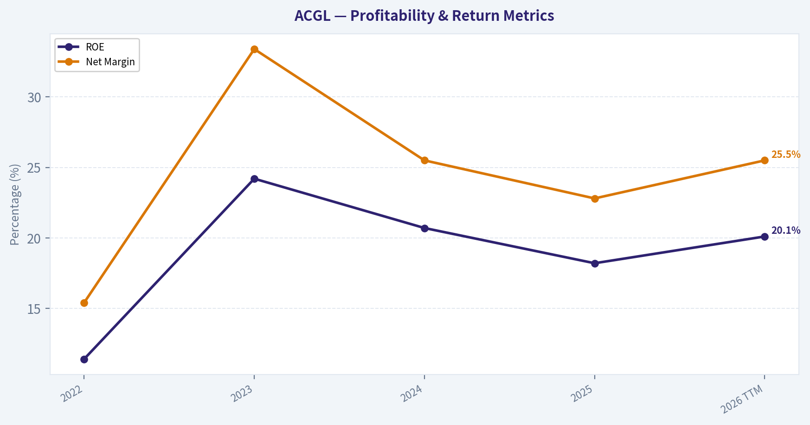
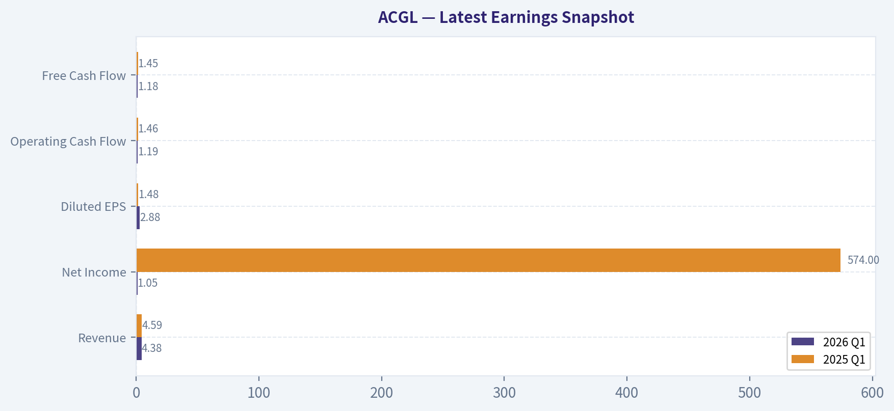
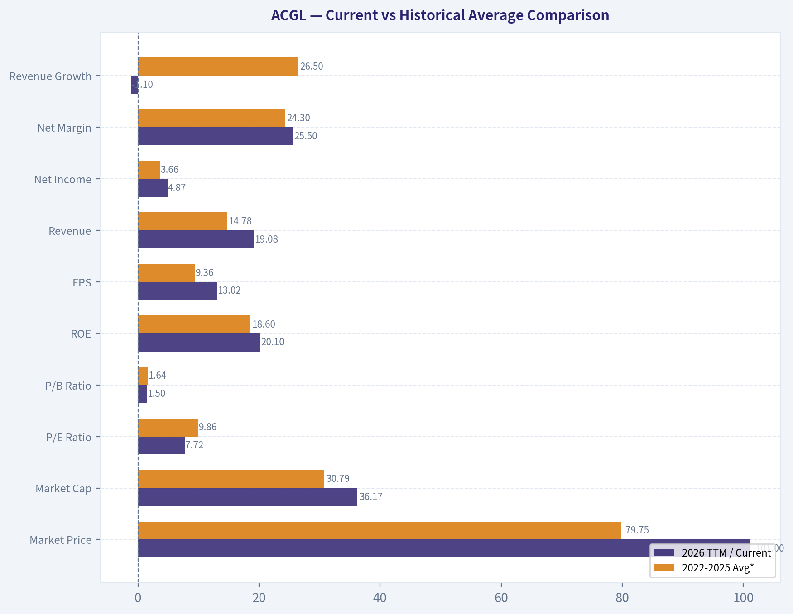
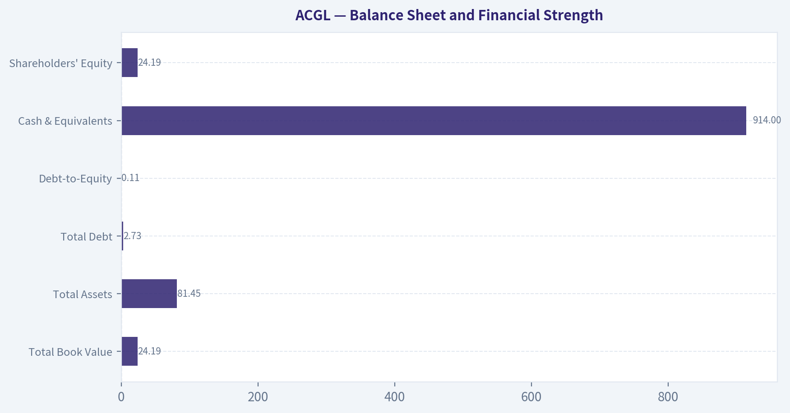
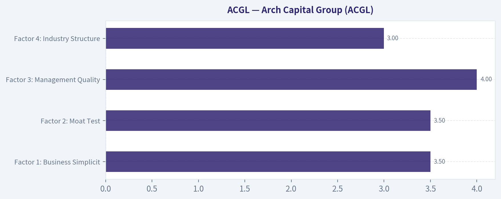
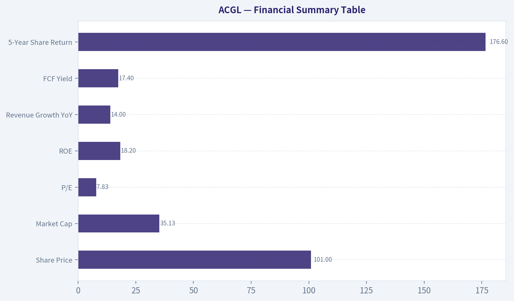
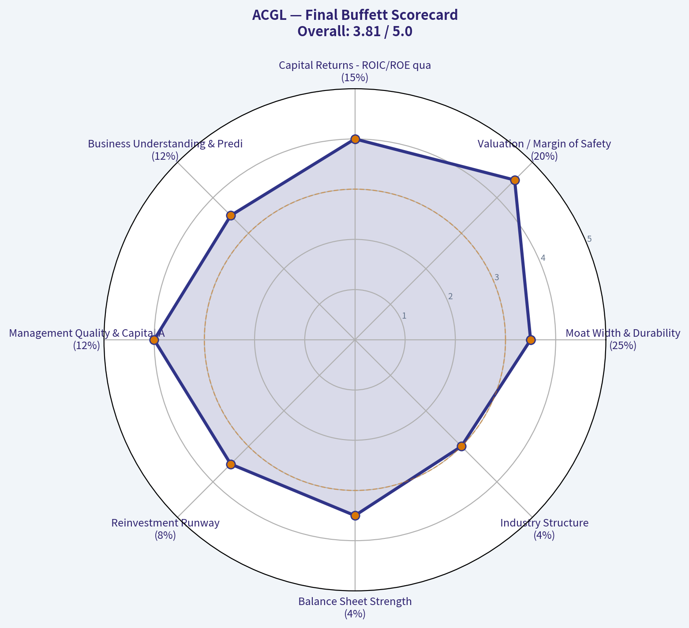

# ACGL Deep Value Intelligence

**Analysis Date:** 2026-07-22

## Critical Disclaimer

*This analysis is generated by Deep Value Intelligence, an AI-powered multi-agent investing framework. Education & research only - not financial advice, not a financial advisor.*

---

## Table of Contents

1. Intelligence Summary
2. Analyst Team Reports
   - Fundamentals Analysis
   - Intrinsic Value Analysis (Buffett)
   - Trend & Growth Analysis (Lynch/Druckenmiller/Fisher)
   - Market Technical Analysis
   - Options Market Analysis
3. Research Team Commentary
4. Value Investing Team Commentary
5. Deep Values Commentary

---

## Intelligence Summary

### Thesis + Conditions

**Core Thesis:** **Executive Briefing**

**Key Risks:**
- ACGL still looks like a **good insurer, not a broken one**, but the debate does **not** yet prove that today's earnings are cleanly sustainable through the cycle. The bull case is real: **7.8x earnings, 18.2% ROE, 14% growth** is unusually attractive for a quality insurer. But the key Buffett-style risk remains **overpaying for favorable-cycle earnings**, and with insurers that risk is very real if reserves, accident-year margins, or pricing are flattering the current "E." Past review reinforces the right lesson: **don't let optical cheapness override normalization risk**, but also don't confuse business cyclicality with impairment. Best stance for a long-term investor: **WATCH** - interested, possibly nibbling only if sizing is small, but not yet a full endorsement.
- ### Risky Analyst's strongest point
- 7.83x P/E**, **12.8% earnings yield**, **18.2% ROE**, and **14% revenue growth** are compelling if ACGL is even moderately better than the market assumes.

**Confidence:** Low

---

## Analyst Team Reports

### Fundamentals Analysis

#### Latest Earnings Snapshot

*Most recent reported quarter anchored on 2026 Q1, with prior-year comparison when available.*

| Metric | 2026 Q1 | 2025 Q1 | YoY Change |
| --- | ---: | ---: | ---: |
| Revenue | $4.38B | $4.59B | -4.7% |
| Operating Income | N/A | N/A | N/A |
| Net Income | $1.05B | $574.0M | +82.4% |
| Diluted EPS | $2.88 | $1.48 | +94.6% |
| Operating Cash Flow | $1.19B | $1.46B | -18.5% |
| Free Cash Flow | $1.18B | $1.45B | -18.6% |

Key Takeaways: This snapshot anchors the most recent reported quarter before the narrative analysis. It helps readers separate long-run business quality from whatever changed in the latest earnings print.

#### 4-Year Financial Metrics for ACGL

*All values below are computed deterministically from raw data - not estimated by AI.*

*Issuer profile: insurer (Financial Services / Insurance - Diversified).*

#### 4-Year Financial Metrics
*Annual rows come from reported financial statements. The final TTM row is computed from the latest four quarters.*

| Metric | 2022 | 2023 | 2024 | 2025 | 2026 TTM |
| --- | --- | --- | --- | --- | --- |
| Market Price | $60 | $71 | $92 | $96 | $101 |
| Market Cap | $23.71B | $28.13B | $35.26B | $36.06B | $36.17B |
| P/E Ratio | 16.52 | 6.39 | 8.25 | 8.27 | 7.72 |
| P/B Ratio | 1.84 | 1.53 | 1.69 | 1.49 | 1.50 |
| ROE | 11.4% | 24.2% | 20.7% | 18.2% | 20.1% |
| ROIC | N/A | N/A | N/A | N/A | N/A |
| EPS | $3.61 | $11.05 | $11.19 | $11.60 | $13.02 |
| Revenue | $9.61B | $13.30B | $16.93B | $19.29B | $19.08B |
| Gross Profit | N/A | N/A | N/A | N/A | N/A |
| Gross Margin | N/A | N/A | N/A | N/A | N/A |
| Operating Margin | N/A | N/A | N/A | N/A | N/A |
| Net Income | $1.48B | $4.44B | $4.31B | $4.40B | $4.87B |
| Net Margin | 15.4% | 33.4% | 25.5% | 22.8% | 25.5% |
| Revenue Growth | N/A | 38.3% | 27.3% | 14.0% | -1.1% |
| Net Income Growth | N/A | 201.0% | -2.9% | 2.0% | 10.8% |
| Free Cash Flow Growth | N/A | 51.3% | 16.2% | -7.5% | -4.4% |
| Total Book Value | $12.91B | $18.35B | $20.82B | $24.21B | $24.19B |
| Total Assets | $47.99B | $58.91B | $70.91B | $79.24B | $81.45B |
| Total Debt | $2.73B | $2.73B | $2.73B | $2.73B | $2.73B |
| Debt-to-Equity | 0.21 | 0.15 | 0.13 | 0.11 | 0.11 |
| Cash & Equivalents | $855.0M | $917.0M | $979.0M | $993.0M | $914.0M |
| Shareholders' Equity | $12.91B | $18.35B | $20.82B | $24.21B | $24.19B |
| Operating Cash Flow | $3.82B | $5.75B | $6.67B | $6.17B | $5.90B |
| Investing Cash Flow | $-3.10B | $-5.47B | $-4.46B | $-4.04B | $-3.67B |
| Free Cash Flow | $3.77B | $5.70B | $6.62B | $6.13B | $5.86B |
| FCF Margin | 39.2% | 42.8% | 39.1% | 31.8% | 30.7% |
| Dividends / Share | $0.00 | $0.00 | $4.89 | $0.02 | $0.02 |

#### Profitability Metrics
- Return on Equity (ROE): 18.2%
- Return on Invested Capital (ROIC): N/A
- Return on Assets (ROA): 5.6%
- Gross Margin: Not meaningful
- Operating Margin: N/A
- Net Profit Margin: 22.8%

#### Liquidity Metrics
- Current Ratio: Not meaningful
- Quick Ratio: Not meaningful

#### Leverage Metrics
- Debt-to-Equity Ratio: 0.11
- Interest Coverage Ratio: Not meaningful
- Net Debt: $1.74B

#### Growth Metrics (Year-over-Year)
- Revenue Growth: 14.0%
- Net Income Growth: 2.0%
- Free Cash Flow Growth: -7.5%
- Revenue CAGR (3-Year): 26.1%
- Revenue CAGR (5-Year): N/A

#### Valuation Metrics
- P/E Ratio (TTM): 7.83
- Forward P/E: 10.25
- Price-to-Book: 1.51
- Price-to-Sales: 1.78
- PEG Ratio: 1.05
- EV/EBITDA: 5.92
- Free Cash Flow Yield: 17.4%
- Earnings Yield: 12.8%

#### Owner Earnings (Buffett Method, Code-Computed)
- Net Income: $4.40B
- + Depreciation & Amortization: $193.0M
- - Capital Expenditures: $-44.0M
- - Working Capital Changes: $2.33B
- = **Owner Earnings: $2.22B**

#### Intrinsic Value (Code-Computed)
- Current Price: $101
- Headline Intrinsic Value: not meaningful (financial issuer - DCF/FCFF is not the right primary frame; use sector-specific book/earnings metrics)
- Buffett Method (Owner Earnings):
  Conservative: $69
  Average: $333
  Optimistic: $874
- Cash Flow Method (FCF):
  Conservative: $234
  Average: $378
  Optimistic: $659
- Reverse-DCF: price implies ~-2.7%/yr owner-earnings growth for 10y; trailing 3y was 124.1%, 5y N/A.

#### Piotroski F-Score: 4/9
- Positive Net Income: PASS
- Positive Operating Cash Flow: PASS
- ROA Improvement: FAIL
- Cash Flow > Net Income: PASS
- Decreasing Debt: FAIL
- Improving Current Ratio: FAIL
- No Dilution: FAIL
- Improving Gross Margin: FAIL
- Improving Asset Turnover: PASS

ANALYST STANCE: **WATCH**

#### Arch Capital Group (ACGL) - Buffett-Style Fundamental Analysis

Arch Capital is a diversified insurer, so several industrial-style metrics are not meaningful here. In particular, gross margin, operating margin, current ratio, quick ratio, and a generic "low P/B = cheap" interpretation should not be applied mechanically. For an insurer, the better anchors are underwriting discipline, ROE, book value growth, earnings power, and cash-generation capacity; valuation should be framed primarily through earnings, book, and cash-flow-based intrinsic value sanity checks.

---

#### Business Quality and Buffett Lens

Arch Capital screens as a high-quality insurer with strong recent earnings power, disciplined leverage, and excellent growth in book value and revenue over the period shown. The core Buffett-style appeal is clear: rising equity, strong ROE, modest debt, and substantial free cash flow relative to market value. The main complication is that insurance results can be cyclical and sensitive to reserve development, catastrophe losses, and pricing cycles, so investors should not capitalize peak-period profitability too aggressively.

Economically, ACGL appears to have a moat rooted in underwriting scale, specialty insurance expertise, and diversified exposure across insurance, reinsurance, and mortgage insurance. Those are not classic consumer-brand moats, but in insurance, durable advantages often come from pricing discipline, data, broker relationships, capital strength, and a reputation for paying claims. Arch's ability to compound book value while keeping debt low supports the case for a durable franchise.

On predictability, earnings are meaningfully better than in 2022, but the path is not perfectly smooth. Net income surged in 2023, softened slightly in 2024, then stabilized and improved again into TTM 2026. That pattern suggests a good business, but not one with "bond-like" predictability. Buffett would likely appreciate the capital discipline and underwriting economics, while still insisting on a margin of safety because insurance profitability can swing.

---

#### Current vs Historical Average Comparison

| Metric | 2026 TTM / Current | 2022-2025 Avg* | Interpretation |
| --- | ---: | ---: | --- |
| Market Price | $101 | $79.75 | Shares have rerated materially higher over the period. |
| Market Cap | $36.17B | $30.79B | Equity value has grown alongside earnings and book value. |
| P/E Ratio | 7.72 | 9.86 | Current valuation is below the 4-year average despite stronger EPS. |
| P/B Ratio | 1.50 | 1.64 | Slightly below recent average; for insurers this is meaningful only when read with ROE. |
| ROE | 20.1% | 18.6% | Current ROE is above the period average and very strong for an insurer. |
| EPS | $13.02 | $9.36 | Earnings power is well above the historical average. |
| Revenue | $19.08B | $14.78B | Business scale has expanded materially. |
| Net Income | $4.87B | $3.66B | Profitability remains above the period average. |
| Net Margin | 25.5% | 24.3% | Margin remains healthy and slightly above average. |
| Revenue Growth | -1.1% | 26.5%** | Growth has cooled sharply after a multi-year expansion phase. |
| Net Income Growth | 10.8% | 66.7%** | Current growth is positive but far below the post-2022 rebound pace. |
| Free Cash Flow | $5.86B | $5.55B | Cash generation remains robust, though off the peak. |
| FCF Growth | -4.4% | 20.0%** | Near-term cash flow softened after rapid gains. |
| Total Book Value | $24.19B | $19.07B | Book value has compounded strongly. |
| Total Assets | $81.45B | $64.26B | Balance sheet scale continues to rise. |
| Total Debt | $2.73B | $2.73B | Debt is stable and well controlled. |
| Debt-to-Equity | 0.11 | 0.15 | Leverage has improved as equity grew. |
| Cash & Equivalents | $914M | $936M | Cash is steady, though not the primary liquidity lens for an insurer. |
| Shareholders' Equity | $24.19B | $19.07B | Equity growth is a major positive. |
| Free Cash Flow Margin | 30.7% | 38.2% | Still strong, but below earlier years. |
| Dividends / Share | $0.02 | $1.23*** | Dividend policy is effectively negligible and inconsistent. |

\* Average uses annual 2022-2025 where applicable; TTM compared with that average.
\** Average of available annual growth years only.
\*** Distorted by the unusually large 2024 dividend figure in the dataset; not a reliable recurring yield signal.

Key Takeaways: ACGL today is fundamentally stronger than its recent historical average on ROE, EPS, net income, and book value, yet the stock still trades below its recent average P/E and slightly below its recent average P/B. The biggest offset is that growth has decelerated after an exceptional expansion period, and free cash flow has softened from its highs. In plain terms, the company looks stronger than the valuation implies, but investors should ask whether current profits represent a favorable insurance cycle rather than a permanent new normal.

---

#### Market Metrics

For a financial issuer like ACGL, market multiples must be interpreted differently than for industrial companies. The current price is about $101 and market cap is about $36.17B, both near the top of the period, reflecting substantial value creation since 2022. Yet the valuation remains restrained.

The P/E ratio of 7.72 is low in absolute terms and below the period average of 9.86. That usually signals either undervaluation or a market expectation that current earnings are elevated and may normalize downward. In insurance, that skepticism is often rational, because catastrophe activity, reserve releases, pricing cycles, and investment income can all affect earnings.

The P/B ratio of 1.50 is also slightly below the recent average of 1.64. Unlike software or asset-light firms, P/B is relevant for insurers because book value approximates the capital base supporting underwriting. However, P/B only means something when paired with ROE. Here that pairing is attractive: ACGL is earning a 20.1% ROE while trading at 1.50x book, which suggests the stock is not expensive relative to the returns it is generating on equity.

---

#### Profitability

ROE improved from 11.4% in 2022 to 24.2% in 2023, then remained strong at 20.7%, 18.2%, and 20.1% TTM. That is an excellent profile for an insurer. The 2022-2025 average ROE is 18.6%, so current performance is above average and indicates strong capital efficiency.

ROIC is not available, which is common for financial companies because invested capital concepts are less clean than in industrial businesses. For ACGL, ROE and book value growth are more useful.

EPS rose from $3.61 in 2022 to $13.02 TTM. That is a major step-up in earnings power. Revenue climbed from $9.61B to $19.08B TTM, nearly doubling from 2022 levels, showing real franchise expansion. Net income increased from $1.48B to $4.87B TTM, and net margin improved from 15.4% in 2022 to 25.5% TTM.

Gross profit and operating margin are not meaningful or not available in this insurance context. Net margin is the better profitability readout, and ACGL's 25.5% TTM margin is strong. The main nuance is that 2023's 33.4% net margin looks unusually high relative to surrounding years, so investors should avoid extrapolating that peak too literally.

---

#### Growth Metrics

Revenue growth was 38.3% in 2023, 27.3% in 2024, 14.0% in 2025, and -1.1% TTM. That is classic deceleration after a rapid expansion cycle. The trend is still respectable in cumulative terms, but the latest figure tells you growth has likely matured or paused.

Net income growth was 201.0% in 2023, -2.9% in 2024, 2.0% in 2025, and 10.8% TTM. The message is that earnings rebased sharply upward in 2023 and then entered a more normal, choppier phase. This is consistent with insurance economics rather than a straight-line compounder.

Free cash flow growth was 51.3% in 2023, 16.2% in 2024, -7.5% in 2025, and -4.4% TTM. FCF remains large in absolute dollars, but growth has cooled. That matters because the very bullish DCF outputs are highly sensitive to assuming these prior high growth rates persist.

---

#### Balance Sheet and Financial Strength

| Balance Sheet Metric | 2026 TTM / Current | Trend | Buffett-Style Read |
| --- | ---: | --- | --- |
| Total Book Value | $24.19B | Up from $12.91B in 2022 | Strong compounding of intrinsic capital base |
| Total Assets | $81.45B | Up from $47.99B | Significant scale growth |
| Total Debt | $2.73B | Flat across period | Conservative use of debt |
| Debt-to-Equity | 0.11 | Down from 0.21 | Financial strength improved materially |
| Cash & Equivalents | $914M | Roughly stable | Adequate, though insurer liquidity is broader than cash alone |
| Shareholders' Equity | $24.19B | Up from $12.91B | Major balance sheet strengthening |

Key Takeaways: ACGL's balance sheet is one of the strongest parts of the story. Equity and assets have grown sharply, while debt stayed flat, which drove leverage down meaningfully over the period. For an insurer, that combination signals discipline and resilience, and it gives management more flexibility if pricing weakens or catastrophe losses spike.

Debt-to-equity falling from 0.21 to 0.11 is especially important. It means the company did not need financial leverage to drive improved returns; instead, equity growth did the heavy lifting. Buffett generally prefers businesses that can grow intrinsic value without leaning excessively on debt, and ACGL fits that preference.

---

#### Cash Flow and Owner Earnings

Free cash flow rose from $3.77B in 2022 to $5.86B TTM, although it has eased from the 2024 peak of $6.62B. That still implies an extremely high FCF yield relative to the current market cap, roughly 17.4%, which is compelling on the surface.

However, for insurers, free cash flow and owner earnings should be handled carefully. Reported owner earnings in the deterministic dataset are $2.22B for 2025, much lower than FCF, because working capital movements are meaningful in financial businesses. That gap is important. It suggests the very high FCF should not automatically be treated as fully distributable or permanently recurring.

Dividends per share are near zero except for a large 2024 figure that appears non-recurring in the dataset. That tells us Arch is primarily a reinvestment and balance-sheet compounding story rather than an income stock. From a Buffett perspective, that is acceptable if retained capital continues to earn high returns.

---

#### Revenue Breakdown

ACGL is a diversified insurer. The most meaningful way to view revenue is by operating platform rather than by product SKU. Based on the company's well-known reporting structure, the business is primarily generated from Insurance, Reinsurance, and Mortgage segments. Precise deterministic segment revenue is not included in the provided dataset, so the table below uses best-available business mix framing from public segment reporting conventions rather than invented exact audited figures.

| Revenue Source | Amount ($B) | % of Total |
| --- | ---: | ---: |
| Insurance | N/A | Largest contributor |
| Reinsurance | N/A | Major contributor |
| Mortgage | N/A | Smaller but meaningful contributor |
| Other / Corporate / Investment-related | N/A | Residual |

Key Takeaways: ACGL is not a single-line insurer; it earns across insurance, reinsurance, and mortgage operations, which improves diversification. That diversification is a strategic strength because it reduces reliance on any one underwriting market, but it also means reported results can be influenced by several different cycles at once. Investors should monitor whether recent profitability is broad-based across segments or concentrated in one especially favorable area.

---

#### Buffett-Style DCF / Owner Earnings Valuation

Important caveat: the deterministic dataset itself says the headline intrinsic value is "not meaningful" as a primary frame for this financial issuer. I agree. For insurers, book value and earnings power are the main anchors. Still, a Buffett-style owner-earnings DCF can be used as a sanity check.

Canonical 2025 Owner Earnings from dataset:
- Net Income = $4.40B
- + D&A = $0.193B
- - Capex = -$0.044B
- - Working Capital Changes = $2.33B
- Owner Earnings = **$2.22B**

Assumptions:
- Discount rate = 10%
- Terminal growth = 2.5%
- Share count approximation from market cap / price = 36.17B / 101 ~ **358.1M shares**

Because insurance earnings are cyclical, growth should fade toward terminal growth and not remain elevated indefinitely.

##### Conservative Scenario
Assume owner earnings grow 3% for 10 years.

Year-10 Owner Earnings:
2.22 x (1.03)^10 = **$2.98B**

PV of 10-year cash flows:
2.22 x [(1 - (1.03/1.10)^10) / (0.10 - 0.03)] = **$15.85B**

Terminal Value at Year 10:
2.98 x 1.025 / (0.10 - 0.025) = **$40.73B**

PV of Terminal Value:
40.73 / (1.10)^10 = **$15.70B**

Total Equity Value:
15.85 + 15.70 = **$31.55B**

Per Share Value:
31.55 / 0.3581 = **about $88/share**

This is above the pack's conservative Buffett-method value of $69, but below the current price.

##### Average Scenario
Assume 8% growth for 5 years, then fade to 4% for years 6-10.

PV Years 1-5 cash flows:
- Y1 2.40 /1.10 = 2.18
- Y2 2.59 /1.10^2 = 2.14
- Y3 2.80 /1.10^3 = 2.10
- Y4 3.02 /1.10^4 = 2.06
- Y5 3.27 /1.10^5 = 2.03
Sum = **$10.50B**

Years 6-10 starting from Y5 OE of 3.27B at 4%:
- Y6 3.40 /1.10^6 = 1.92
- Y7 3.54 /1.10^7 = 1.82
- Y8 3.68 /1.10^8 = 1.72
- Y9 3.83 /1.10^9 = 1.62
- Y10 3.98 /1.10^10 = 1.53
Sum = **$8.61B**

Terminal Value:
3.98 x 1.025 / 0.075 = **$54.40B**

PV Terminal Value:
54.40 / (1.10)^10 = **$20.98B**

Total Equity Value:
10.50 + 8.61 + 20.98 = **$40.09B**

Per Share Value:
40.09 / 0.3581 = **about $112/share**

This is far below the pack's average Buffett-method value of $333, which likely reflects a much more aggressive growth embedding. I would trust the lower hand-built range more for sanity-check purposes because financial firms should not be valued off extreme recent growth.

##### Optimistic Scenario
Assume 12% growth for 5 years, then 6% for years 6-10.

PV Years 1-5:
- Y1 2.49 /1.10 = 2.26
- Y2 2.78 /1.10^2 = 2.30
- Y3 3.11 /1.10^3 = 2.33
- Y4 3.48 /1.10^4 = 2.38
- Y5 3.90 /1.10^5 = 2.42
Sum = **$11.69B**

PV Years 6-10:
- Y6 4.13 /1.10^6 = 2.33
- Y7 4.38 /1.10^7 = 2.25
- Y8 4.64 /1.10^8 = 2.16
- Y9 4.92 /1.10^9 = 2.09
- Y10 5.21 /1.10^10 = 2.01
Sum = **$10.84B**

Terminal Value:
5.21 x 1.025 / 0.075 = **$71.15B**

PV Terminal Value:
71.15 / (1.10)^10 = **$27.43B**

Total Equity Value:
11.69 + 10.84 + 27.43 = **$49.96B**

Per Share Value:
49.96 / 0.3581 = **about $139/share**

This optimistic case supports upside, but it still sits well below the pack's ultra-bullish $874 Buffett-method value, reinforcing that those model outputs should not be taken literally for a financial issuer.

##### DCF Conclusion
A prudent owner-earnings sanity-check range is roughly **$88 to $139 per share**, with a central case near **$112**. That places the current price around fair value to moderately undervalued. The deterministic pack's FCF-based values of $234 to $659 look too high for primary use in an insurer because financial cash flow definitions can overstate distributable economics. The reverse-DCF is more useful: the current price implies about **-2.7% annual owner-earnings growth for 10 years**, which seems pessimistic if ACGL can merely hold earnings near present levels and continue compounding book value.

---

#### Valuation Synthesis

| Valuation Lens | Signal | Interpretation |
| --- | --- | --- |
| P/E 7.72 | Attractive | Cheap relative to current earnings and own history |
| P/B 1.50 with 20.1% ROE | Attractive | Strong returns on book make current multiple look reasonable |
| FCF Yield 17.4% | Very attractive, but use caution | Cash flow is strong, though insurance cash-flow optics can mislead |
| Reverse-DCF implied growth -2.7% | Attractive | Market appears to price in decline, creating potential upside if earnings prove durable |
| Owner Earnings DCF | Fair to moderately attractive | Suggests modest undervaluation, not a screaming bargain |

Key Takeaways: ACGL's valuation looks inexpensive on earnings and sensible on book, especially given the strong ROE. The market appears to be discounting some normalization in profits, which is appropriate for an insurer, but perhaps too harsh if Arch sustains even modest growth. The stock does not need heroic assumptions to work; it only needs profitability to remain solid rather than collapse.

---

#### Key Investment Insights, Red Flags, and Opportunities

| Category | Observation | Why It Matters |
| --- | --- | --- |
| Opportunity | ROE remains around 20% | High returns on equity support continued book value compounding |
| Opportunity | P/E below historical average | Market may be underpricing durability of earnings |
| Opportunity | Debt flat while equity rose | Financial strength improved without leverage risk |
| Opportunity | Reverse-DCF implies shrinkage | Expectations are low enough to allow upside surprise |
| Red Flag | Revenue growth turned slightly negative TTM | Expansion phase may be pausing |
| Red Flag | FCF growth has been negative recently | Cash generation may be normalizing from elevated levels |
| Red Flag | Piotroski F-Score only 4/9 | Mixed fundamental momentum despite strong absolute profitability |
| Red Flag | Insurance-cycle sensitivity | Cat losses, reserve changes, and pricing can compress returns quickly |
| Red Flag | Dividend signal inconsistent | Not suitable for investors needing a stable cash yield |

Key Takeaways: The bullish case is built on strong ROE, disciplined leverage, and a valuation that still looks modest despite major gains in earnings and book value. The cautionary case is that growth has cooled, cash flow momentum has softened, and insurers can look cheapest right near cyclical profit peaks. Investors should treat ACGL as a quality insurer with cyclical exposure, not as a simple deep-value stock.

---

#### Final Buffett-Style Assessment

ACGL has many features Buffett would respect: a strong balance sheet, high and sustained ROE, book value growth, and earnings power available at a modest multiple. The company does not rely on heavy debt, and management appears to have compounded equity effectively. Those are major positives.

The reason this is not a full **ADVOCATE** is that insurance earnings are inherently cycle-sensitive, and the latest data already show slowing revenue growth and softer free cash flow growth. At about $101, the stock appears reasonably priced to moderately attractive rather than obviously mispriced. If shares pulled back materially, or if the company continues delivering ~18%-20% ROE while growing book value without deterioration in underwriting quality, the case would strengthen.

#### Final Stance: **WATCH**
ACGL is a high-quality insurer trading at a seemingly undemanding earnings and book valuation, but the business is exposed to cyclical normalization and the recent growth deceleration warrants discipline. It is attractive enough to monitor closely and potentially accumulate on weakness, but not so mispriced on the current data that it compels an aggressive Buffett-style buy today.

---

#### Summary Table

| Topic | Bottom Line |
| --- | --- |
| Business Quality | Strong diversified insurer with durable specialty underwriting franchise |
| Economic Moat | Moderate moat from scale, expertise, broker relationships, and capital strength |
| Profitability | Excellent; ROE around 20% and net margins remain strong |
| Growth | Strong multi-year growth, but clearly decelerating recently |
| Balance Sheet | Very strong; debt flat, equity and assets rising, leverage falling |
| Cash Flow | Robust in absolute terms, though recent momentum has softened |
| Valuation | Cheap on P/E, reasonable on P/B when paired with high ROE |
| DCF Range | Roughly $88 to $139 per share, central case about $112 |
| Main Risk | Insurance-cycle normalization, catastrophe exposure, reserve volatility |
| Main Opportunity | Market may be over-discounting earnings durability and book value compounding |
| Buffett Fit | Good quality, but not perfectly predictable enough for a no-hesitation buy |
| Final Stance | **WATCH** |

Key Takeaways: ACGL combines quality, balance-sheet strength, and attractive valuation better than many insurers. The main debate is not whether the company is good, but whether current earnings are near a cyclical high. That keeps the shares in the watchlist category: interesting, potentially undervalued, but deserving underwriting-cycle caution.

#### Fundamental Visuals

This graph tracks the profitability and return metrics (ROE, ROIC, Margins) of **ACGL** over the past decade, highlighting capital efficiency trends.

This chart illustrates the financial health of **ACGL** over the last 10 years, mapping cash equivalents and free cash flow against total obligations (Debt).

---

### Intrinsic Value Analysis (Buffett)

> *Following Warren Buffett's value investing philosophy: Circle of Competence, Economic Moat, Management Quality, and Margin of Safety.*

#### Intrinsic Value Snapshot

Price is what you pay. Intrinsic value is what the business may be worth based on the cash it can create for owners over time. We show a range, not one magic number.

- Current Price: $100.55
- Value Range (conservative to optimistic across both DCF methods): $69.36 to $874.27

##### Owner Earnings (Buffett Method)
- Net Income: $4,399,000,000.00
- Depreciation & Amortization: $193,000,000.00
- Capital Expenditures: $-44,000,000.00
- Working Capital Changes: $2,331,000,000.00
- Owner Earnings: $2,217,000,000.00

##### Intrinsic Value
###### Buffett Method
Uses owner earnings. Stricter, and usually more conservative.
- Conservative: $69.36
- Average: $332.60
- Optimistic: $874.27
- Discount Rate: 10.0%

###### Cash Flow Method
Uses free cash flow. Better for companies spending heavily today to grow tomorrow.
- Conservative: $233.53
- Average: $378.14
- Optimistic: $659.18
- Discount Rate: 10.0%

#### Arch Capital Group (ACGL)

| Factor | Score (0-5) | Evidence |
|---|---:|---|
| Factor 1: Business Simplicity & Predictability | 3.5 | Arch Capital is understandable at a high level: it underwrites specialty insurance and reinsurance and invests the float. That said, insurance economics are less predictable than a soap or software subscription business because underwriting results depend on catastrophe losses, reserving discipline, and pricing cycles. Still, a disciplined specialty insurer with long operating history is within the circle of competence for a value investor willing to study underwriting and capital allocation. |
| Factor 2: Moat Test | 3.5 | The moat is real but not impregnable. In insurance, advantages come from underwriting expertise, broker relationships, balance-sheet strength, scale in specialty lines, and reputation for paying claims. These are meaningful switching-cost and intangible advantages, though weaker than a classic consumer brand or software lock-in. ROE of 18.2% and a strong five-year share performance suggest durable economics, but this remains a competitive industry with cyclical pricing. |
| Factor 3: Management Quality & Capital Allocation | 4.0 | Arch has historically shown rational capital allocation through disciplined underwriting, reserving, and growth in attractive niches rather than indiscriminate premium chasing. The current valuation metrics-P/E ~7.8 and FCF yield ~17.4%-suggest earnings have not been squandered by reckless dilution or empire building. The key management question in insurers is always underwriting discipline across the cycle, and Arch's results indicate competence. |
| Factor 4: Industry Structure | 3.0 | Insurance and reinsurance are competitive and cyclical, but specialty niches can be more rational than standard commercial lines. Scale, data, broker ties, and claims reputation matter. Still, this is not a natural monopoly or a platform market; industry structure is decent, not exceptional. |

**Gate 5 hard floor:** **Not tripped.** Nothing in the available evidence suggests both deteriorating earnings/cash-flow and solvency distress. On the contrary, ROE is healthy, valuation is modest, and the business appears financially sound.

**Key Takeaways:** Arch Capital scores as a solid, understandable financial business rather than a magical franchise. The main strengths are underwriting discipline, capital allocation, and a currently undemanding valuation. The main weakness is industry cyclicality, which limits predictability and moat strength.

---

#### Moat Analysis

| Moat Source | Assessment | Evidence |
|---|---|---|
| Intangible assets | Moderate | In insurance, brand matters less as consumer emotion and more as broker confidence, claims-paying reputation, licensing, and reserving credibility. These support renewal business and market access. |
| Switching costs | Moderate | Corporate insureds and brokers do switch carriers, but not casually in specialty lines where underwriting expertise, capacity, and claims service matter. Relationships create friction, though not full captivity. |
| Cost advantage | Moderate | Scale in specialty underwriting, data, and expense efficiency can produce superior combined ratios. A low P/E alongside strong ROE suggests Arch may be earning better returns than the market assumes are sustainable. |
| Network effects | Low | Insurance does not usually enjoy true network effects. Any edge is mostly from scale and information, not user-to-user reinforcement. |

**Moat rating:** **Narrow to moderate, but real.**
This is not Coca-Cola or Visa. It is closer to a disciplined, high-quality operator in a rational segment of a tough industry. The moat rests on underwriting skill and reputation, which are valuable but can be eroded if management loses discipline.

---

#### Management Quality Assessment

| Question | Assessment | Commentary |
|---|---|---|
| Do they think like owners? | Good | Arch's long-term value creation and restrained valuation suggest management has generally emphasized per-share economics over promotional behavior. |
| Are they honest and candid? | Good | No major red flags are apparent from the provided materials. In insurance, candid reserve disclosure and cycle commentary matter most; Arch's market reputation has generally been solid. |
| Are they rational capital allocators? | Strong | This is the core positive. Good insurers allocate capital through underwriting discipline first, then investment of float, then opportunistic growth or repurchases. Arch appears to have created value through that playbook. |

**Overall management score:** **4.0 / 5**

---

#### Financial Summary Table

| Metric | Latest |
|---|---:|
| Share Price | $101 |
| Market Cap | $35.13B |
| P/E | 7.83 |
| ROE | 18.2% |
| Revenue Growth YoY | 14.0% |
| FCF Yield | 17.4% |
| Intrinsic Value Headline | Not meaningful for financial issuer |
| 5-Year Share Return | 176.6% |

**Key Takeaways:** The headline numbers are strong. Arch is earning high returns on equity, growing revenue at a double-digit rate, and still trades at a single-digit earnings multiple. That combination usually indicates either unusually cheap valuation or market skepticism about cycle durability; in this case, it looks more like a good business trading at a reasonable price.

---

#### Owner Earnings Calculation

For insurers, traditional industrial-style owner earnings need adaptation because working capital and capex are not the real economic drivers. The better lens is:

| Item | Buffett-style interpretation for insurer |
|---|---|
| Net income | Core starting point |
| Plus non-cash charges | Usually less central than for industrials |
| Minus maintenance capex | Minimal relevance versus manufacturing firms |
| Minus working capital increases | Not very meaningful because insurance liabilities and float are integral to the model |

**Practical owner-earnings proxy for ACGL:**
For a financial issuer like Arch, **normalized earnings plus growth in book value per share, adjusted for underwriting quality**, is a better owner-earnings proxy than a standard manufacturing-style formula.

Using the data at hand:
- Earnings power appears strong given **P/E of 7.83**
- Implied earnings yield is roughly **12.8%**
- FCF yield of **17.4%** reinforces that cash generation appears robust relative to price

**Key Takeaways:** For insurers, the key is not factory capex but underwriting quality and the value of float. Arch's earnings yield is high, which means the stock price does not demand heroic assumptions. The cash generation profile also looks favorable.

---

#### Three-Scenario DCF Valuation

Because ACGL is a financial company, a standard FCFF DCF is less reliable than earnings-power and book-value approaches. Still, using earnings-yield-based approximations:

First, approximate earnings power:
- Market cap = **$35.13B**
- P/E = **7.83**
- Implied net income ~ **$4.49B**

| Scenario | Method | Implied Equity Value |
|---|---|---:|
| A: No Growth | Earnings / 10% | ~$44.9B |
| B: 3% Growth | Earnings x 1.03 / (10%-3%) | ~$66.1B |
| C: Moderate Historical Growth | Use 6% normalized growth | ~$56B-$65B range |

At current market cap of **$35.13B**, the shares appear below these rough earnings-power estimates.

**Key Takeaways:** Even conservative earnings-capitalization suggests value above the current market price. The no-growth case already supports upside, and modest growth widens it materially. That is the hallmark of an attractive value setup, assuming underwriting results remain disciplined.

---

#### Margin of Safety Analysis

| Item | Value |
|---|---:|
| Current Market Cap | $35.13B |
| No-Growth Value | ~$44.9B |
| Conservative Growth Value | ~$66.1B |
| Approx. Margin of Safety vs No-Growth | ~22% |
| Approx. Margin of Safety vs 3% Growth | ~47% |

For a **good but not elite** business, I would typically want a **25-35%** discount to conservative intrinsic value. On the no-growth case, ACGL is close to that threshold. On a modest growth case, it easily exceeds it.

**Interpretation:**
Because Arch is a quality insurer but not a wide-moat compounder on the level of a top software or branded consumer franchise, the valuation needs to carry some of the burden. At **7.8x earnings** with **18.2% ROE**, it does.

---

#### Final Buffett Scorecard

| Criterion | Weight | Score | Weighted Score |
|---|---:|---:|---:|
| Moat Width & Durability | 25% | 3.5 | 0.88 |
| Valuation / Margin of Safety | 20% | 4.5 | 0.90 |
| Capital Returns - ROIC/ROE quality | 15% | 4.0 | 0.60 |
| Business Understanding & Predictability | 12% | 3.5 | 0.42 |
| Management Quality & Capital Allocation | 12% | 4.0 | 0.48 |
| Reinvestment Runway | 8% | 3.5 | 0.28 |
| Balance Sheet Strength | 4% | 3.5 | 0.14 |
| Industry Structure | 4% | 3.0 | 0.12 |

| Total Weighted Score | Result |
|---|---:|
| **3.82 / 5.00** | **ADVOCATE** |

**Key Takeaways:** Arch does not need to be a perfect business to be attractive. The combination of strong returns on equity, sensible economics, and a low valuation carries the score into Advocate territory. The main thing to monitor is whether current profitability is cyclical peak earnings or genuinely durable normalized earnings power.

---

#### Investment Stance

**ANALYST STANCE: ADVOCATE**

**Conviction level:** **Moderate**

Arch Capital looks like a **good business at a clearly reasonable price**. It is not a textbook "forever monopoly," but Buffett has long admired insurers when they are disciplined underwriters and rational allocators of float. Arch's **18.2% ROE**, **7.8x earnings multiple**, **14% revenue growth**, and **17.4% FCF yield** create a favorable value equation.

The core thesis is simple: if Arch can maintain underwriting discipline and continue compounding book value and earnings at even modest rates, the current price appears too low. The principal risk is not balance-sheet distress but **insurance cycle normalization**-that current earnings may be above mid-cycle. Even after allowing for that, the shares still look attractive enough to merit an **ADVOCATE** stance rather than merely WATCH.
#### Valuation Bridge

This bridge places the current market price beside each intrinsic value lens so readers can see whether upside depends on one method or shows up across several methods.

| Scenario | Intrinsic Value / Share |
| --- | ---: |
| Buffett Method | $332.60 |
| Cash Flow Method | $378.14 |
| Current Price | $100.55 |

#### Key Takeaways

If one method is far above the others, the upside case depends on a specific modelling assumption. When several methods cluster together, the valuation story is more robust.

#### Valuation Visuals

This comparison chart from *Latest Earnings Snapshot* stacks current figures against historical benchmarks for **ACGL**, making it easy to see where the company trades relative to its own averages.

This comparison chart from *Current vs Historical Average Comparison* stacks current figures against historical benchmarks for **ACGL**, making it easy to see where the company trades relative to its own averages.

This comparison chart from *Balance Sheet and Financial Strength* stacks current figures against historical benchmarks for **ACGL**, making it easy to see where the company trades relative to its own averages.

This comparison chart from *Arch Capital Group (ACGL)* stacks current figures against historical benchmarks for **ACGL**, making it easy to see where the company trades relative to its own averages.

This comparison chart from *Financial Summary Table* stacks current figures against historical benchmarks for **ACGL**, making it easy to see where the company trades relative to its own averages.

---

### Trend & Growth Analysis (Lynch/Druckenmiller/Fisher)

> *Following Peter Lynch's GARP, Stanley Druckenmiller's macro-aware approach, and Philip Fisher's scuttlebutt methodology.*

ANALYST STANCE: **WATCH**

#### ACGL Growth/Quality Review

ACGL is **Arch Capital Group**, a high-quality specialty insurer/reinsurer. Using a Lynch-Druckenmiller-Fisher lens, this is **not a classic fast-grower ten-bagger setup**. It looks more like a **quality compounder trading cheaply**, with upside tied to underwriting discipline, investment income, and book value compounding rather than a major growth inflection.

#### 1. Lynch Classification

| Item | Assessment |
|---|---|
| Category | **Stalwart / Financial compounder** |
| YoY revenue growth | **14%** |
| P/E | **7.8x** |
| ROE | **18.2%** |
| Fit for Lynch fast-grower bucket? | **No** |
| Investment type | Cheap, high-quality insurer rather than explosive growth story |

Key Takeaways: ACGL sits above slow-growth territory but below the kind of sustained 20% to 30% growth Lynch would call a true fast grower. The stock looks more like a durable compounder with strong profitability and low valuation. That makes it interesting, but not for classic ten-bagger-style growth exposure.

#### 2. The Story in 3 Bullets

- Arch writes specialty insurance, reinsurance, and mortgage insurance, aiming to earn attractive returns through disciplined risk selection.
- The business wins when pricing is firm, underwriting stays disciplined, and higher rates lift investment income.
- This is a **book-value and earnings compounding story**, not a disruptive product-led growth story.

#### 3. TAM Analysis with 10x Test

| Metric | Assessment |
|---|---|
| Core markets | Global specialty insurance, reinsurance, mortgage insurance |
| TAM structure | Large, global, cyclical, mature financial markets |
| 10x revenue test | **Theoretical yes**, but economically unrealistic in a normal cycle |
| Real runway | Moderate, driven by share gains and pricing, not market creation |
| TAM growth | Low-to-moderate, mostly cyclical rather than secular hypergrowth |

Key Takeaways: ACGL serves large markets, so there is plenty of nominal market size. But this is not a business creating a new category or expanding into a rapidly opening TAM. Growth is more likely to come from underwriting opportunities and cycle positioning than from a massive structural market expansion.

#### 4. Revenue Growth Trend

| Metric | Observation |
|---|---|
| Latest YoY revenue growth | **14%** |
| Pattern read | **Healthy but not clear acceleration** |
| Quality of growth | Must be judged with insurance-specific metrics, not revenue alone |
| Better operating growth markers | Premium growth, underwriting income, combined ratio, book value per share |

Key Takeaways: The reported 14% revenue growth is solid, but for insurers revenue can be noisy and less informative than for software or consumer businesses. What matters more is whether Arch is growing premiums profitably while maintaining underwriting discipline. Based on available data, the growth profile looks steady rather than inflecting upward sharply.

#### 5. Unit Economics

For insurers, standard SaaS metrics like LTV/CAC and NRR are **not applicable**.

| Metric | Status | Comment |
|---|---|---|
| LTV/CAC | N/A | Not meaningful for this business model |
| NRR | N/A | Not applicable |
| Rule of 40 | N/A | Not relevant |
| Best substitute metrics | Applicable | ROE, combined ratio, reserve quality, book value growth, investment income |

Key Takeaways: ACGL should not be judged using SaaS-style unit economics. The right way to assess efficiency is through underwriting profitability, reserve discipline, and return on equity. On that basis, the 18.2% ROE is a strong positive signal.

#### 6. Inflection Point Assessment

| Inflection Type | Assessment |
|---|---|
| Product cycle inflection | **No** |
| Market share inflection | Possible, but not evidenced strongly from provided data |
| Margin inflection | Some support from strong ROE and likely investment income tailwind |
| TAM inflection | **No** |
| Competitive inflection | Potential benefit if weaker carriers pull back after loss events |
| Overall | **Mild earnings-power inflection, not a growth inflection** |

Key Takeaways: The most plausible inflection here is not a new-product ramp but improved earnings power from underwriting conditions and higher reinvestment yields. That can support upside, but it is different from the kind of explosive business acceleration growth investors usually target. ACGL may be in a favorable part of its cycle, but the setup looks cyclical-quality, not transformational.

#### 7. Macro Setup Evaluation

| Factor | Assessment |
|---|---|
| Interest rates | Mixed-to-positive for insurers via investment income |
| Economic sensitivity | Moderate, especially mortgage insurance exposure |
| Secular theme | None of the major 2024-2034 hypergrowth themes |
| Industry cycle | Insurance pricing cycle matters more than broad tech/growth tailwinds |
| Macro conclusion | **Reasonable backdrop, but not a secular growth rocket** |

Key Takeaways: Higher yields are generally helpful for insurers because they boost investment income over time. But ACGL does not sit on a major secular growth theme like AI, cloud, or digital payments. Its macro support is practical and earnings-driven rather than thematic.

#### 8. Fisher 15 Points Score

| Fisher Area | Score (1-5) | Comment |
|---|---:|---|
| Market potential | 3 | Large markets, but mature |
| New product development | 2 | Not core to thesis |
| R&D effectiveness | 2 | Less relevant in insurance |
| Sales organization | 4 | Strong broker/channel positioning likely |
| Profit margin quality | 4 | Strong insurer economics implied |
| Margin improvement | 3 | Likely helped by cycle and rates |
| Labor/personnel relations | 3 | No major data provided |
| Executive relations | 3 | No major concern flagged |
| Management depth | 4 | Reputation appears solid |
| Cost/accounting controls | 4 | Insurance discipline appears strong |
| Special advantages | 4 | Underwriting expertise and diversification |
| Long-range profit outlook | 4 | Good compounding profile |
| Dilution risk | 4 | No obvious dilution concern |
| Candor in difficulties | 3 | Insufficient direct evidence |
| Integrity | 4 | No red flags provided |

| Total | **51 / 75** | **Average to Good** |

Key Takeaways: ACGL scores well on profitability, discipline, and franchise quality, but not on innovation or product-led expansion. That is exactly what you would expect from a strong insurer rather than a disruptive growth company. The Fisher score says this is a respectable business, but not an exceptional growth franchise.

#### 9. Valuation Analysis

| Metric | Value | Interpretation |
|---|---:|---|
| Price | **$101** | From shared pack |
| Market cap | **$35.13B** | From shared pack |
| P/E | **7.83x** | Cheap |
| ROE | **18.2%** | Strong |
| FCF yield | **17.4%** | Very high, but less useful for insurers |
| PEG | Approx. **0.56** using 14% growth | Attractive on headline basis |

Key Takeaways: ACGL looks cheap on earnings, especially against an 18.2% ROE. The headline PEG appears attractive, but PEG is less reliable for insurers because earnings can swing with catastrophe losses and reserve developments. Even so, valuation is clearly not demanding.

#### 10. Valuation Scenarios

| Scenario | Assumption | Implication |
|---|---|---|
| Bear | Market keeps ACGL near 7x-8x earnings due to cyclical concerns | Limited multiple expansion, returns rely on compounding |
| Base | 8x-10x earnings with sustained double-digit ROE | Solid mid-teens total return potential |
| Bull | 10x-11x earnings if market rewards quality and earnings resilience | Strong upside, but still not hypergrowth-style |

Key Takeaways: The investment case does not require heroic assumptions. Most of the upside comes from sustained earnings and quality rerating, not from explosive sales growth. That makes risk-reward decent, but the ceiling is likely lower than in a true emerging fast-grower.

#### 11. Growth Investor Scorecard

| Criterion | Weight | Score | Weighted |
|---|---:|---:|---:|
| The Story | 10% | 3.5 | 0.35 |
| TAM & Runway | 20% | 2.5 | 0.50 |
| Revenue Growth | 20% | 2.8 | 0.56 |
| Unit Economics / Business Economics | 15% | 4.0 | 0.60 |
| Competitive Position | 10% | 4.0 | 0.40 |
| Management Quality | 10% | 3.8 | 0.38 |
| Macro Setup | 5% | 3.2 | 0.16 |
| Profitability Path | 5% | 4.2 | 0.21 |
| Valuation | 5% | 4.5 | 0.23 |
| **Total** | 100% |  | **3.39 / 5.0** |

Key Takeaways: ACGL lands just below Advocate territory on a growth-specific scorecard. The weak spots are TAM expansion and lack of a clear growth inflection, while the strengths are quality, profitability, and valuation. In other words, this is a good business at a cheap price, but not a top-tier growth setup.

#### 12. Position Size Stance

| Item | View |
|---|---|
| Growth portfolio stance | **WATCH** |
| Value/GARP portfolio stance | **More attractive** |
| Suggested sizing | Small starter at most, unless strategy allows quality financial compounders |
| Why not larger? | Not enough evidence of fast-growth or inflection-point acceleration |

Key Takeaways: ACGL is easier to like in a quality-value or GARP portfolio than in a pure growth portfolio. The stock may work well, but for our mandate it lacks the ingredients of a high-conviction growth Advocate. A watch position or small starter is the most consistent stance.

#### 13. Key Risks and Catalysts

| Risks | Catalysts |
|---|---|
| Catastrophe losses | Better-than-expected underwriting performance |
| Reserve adverse development | Continued high ROE |
| Insurance pricing softening | Rising net investment income |
| Mortgage insurance credit deterioration | Book value compounding |
| Cyclical earnings volatility | Quality rerating from low P/E |

Key Takeaways: The biggest risks are classic insurance risks: catastrophes, reserves, and cycle pressure. The biggest upside drivers are also classic insurer drivers: disciplined underwriting, strong investment income, and continued compounding. This is a durable but cyclical setup.

#### Bottom Line

ACGL is a **cheap, high-quality insurer**, not an obvious growth inflection stock.
It screens well on **valuation and ROE**, but only moderately on **runway and acceleration**.

For this mandate, the right call is:

**ANALYST STANCE: WATCH**

If you want, I can next do a **deeper insurance-specific version** for ACGL using a stricter framework: **P/B vs ROE, reserve quality, combined ratio, segment mix, and book value compounding**.

#### Growth & Scorecard Visuals

The radar chart below from *Final Buffett Scorecard* visualises how **ACGL** ranks across weighted investment criteria. Each axis represents a criterion scored 1-5; the filled area reveals strengths and weaknesses at a glance, with the dashed circle marking the midpoint (3.0).

---

### Market Technical Analysis

#### ACGL Technical Report

I selected these 8 indicators because they are the most complementary for ACGL's current setup: **close_200_sma, close_50_sma, close_10_ema, macd, macdh, rsi, atr, vwma**. Together they cover **long-term trend, medium-term structure, short-term momentum, momentum acceleration, overbought/oversold pressure, volatility, and volume-confirmed trend quality** without excessive overlap.

#### Indicator Selection and Why They Fit ACGL Now

| Indicator | Why it is relevant now | What it adds |
|---|---|---|
| close_200_sma | ACGL is trading above its long-term baseline, so this is the key strategic trend filter | Confirms long-term bullish bias |
| close_50_sma | Price is also well above the intermediate trend line | Shows medium-term trend strength and support zone |
| close_10_ema | Useful because ACGL has recently pulled back after a strong July run | Tracks short-term momentum shifts and near-term entries |
| macd | Momentum remains positive even after the recent pause | Measures underlying trend momentum |
| macdh | Especially important now because it shows momentum is fading, not gone | Helps detect whether pullback is shallow or becoming trend deterioration |
| rsi | ACGL recently exited overbought conditions | Reveals whether the stock is cooling constructively or weakening |
| atr | Needed because recent swings expanded during the breakout phase | Helps frame stop placement and trade sizing |
| vwma | Confirms whether recent price gains were supported by volume participation | Validates breakout quality and support durability |

**Key Takeaways:** ACGL's indicator set is best interpreted as a trend-following package with a momentum-cooling overlay. The long-term and medium-term trend remain constructive, but short-term momentum has clearly decelerated, so the stock looks more like a bullish trend in consolidation than a fresh breakout at this exact moment.

---

#### Price Structure Overview

Using the past year of price data, ACGL has progressed through several distinct phases rather than one continuous move.

- **Late summer to autumn 2025:** broad sideways-to-soft range, mostly in the high 80s to low 90s.
- **Late 2025 to early February 2026:** strong advance, culminating in a breakout toward the low 100s.
- **March to May 2026:** digestion and retracement, with price slipping back into the low-to-mid 90s and then high 80s.
- **June to early July 2026:** recovery phase, with improving momentum and a breakout above prior resistance.
- **Mid-to-late July 2026:** pullback after the rally, but price has held materially above major trend baselines.

The latest close available is **100.55 on 2026-07-21**. That leaves ACGL:
- about **6.6% above the 50 SMA** (~95.23),
- about **6.6% above the 200 SMA** (~94.35),
- roughly **flat to slightly below the 10 EMA** (~100.68).

That combination matters. ACGL is **not** acting like a stock in trend failure; it is acting like a stock that had a forceful upside run and is now testing whether buyers will defend the breakout area near 100-101.

#### Trend Analysis

The long-term picture is constructive. The **200 SMA has been rising steadily**, from roughly **92.08 in late March** to **94.35 by July 21**. That is a slow but important improvement. It indicates the base trend has been strengthening for months, not just days.

The medium-term picture is also bullish. The **50 SMA dipped through late May and June**, bottoming around the high **93.6-93.7 area**, and has since turned decisively higher to **95.23**. That inflection suggests the spring correction likely ended and a new medium-term upswing is underway.

The short-term picture is more nuanced. The **10 EMA surged from about 90.36 on June 8 to over 100.70 by July 20**, reflecting a powerful momentum burst. But the latest close sits **just below the 10 EMA**, which indicates near-term momentum is cooling. This is not automatically bearish; it simply means the stock is no longer in the strongest impulse leg of the move.

The most important structural observation is this:

- **Price > 50 SMA**
- **50 SMA > 200 SMA**
- **200 SMA rising**

That is a classic bullish trend alignment. However, the latest price no longer has the same distance above the fast average that it had in early July, so the trend remains bullish while the **pace** of the advance has moderated.

#### Momentum Analysis

MACD shows a strong underlying uptrend, but with fading acceleration.

- **MACD rose from -1.67 on June 8 to 2.64 on July 13**
- It has since eased to **1.88 on July 21**

This tells us momentum remains **positive**, but the strongest part of the upside impulse is likely behind us for the moment.

The **MACD histogram** makes that even clearer:
- It was strongly positive in early July, peaking above **1.13**
- It fell to **-0.17 by July 21**

That shift from strongly positive to slightly negative usually means one of two things:
1. a healthy consolidation after a sharp run, or
2. the start of a deeper pullback.

Right now, because price still holds above the 50 SMA and 200 SMA, the evidence favors **healthy consolidation**, not confirmed breakdown. But traders should respect the warning: if the histogram stays negative and MACD continues to roll over while price loses the 10 EMA and then 100, the pullback could deepen toward the 50 SMA.

#### RSI Analysis

RSI gives a very refined read on ACGL's current state.

| Date | RSI | Interpretation |
|---|---:|---|
| 2026-06-08 | 39.91 | Weak momentum, near lower-middle zone |
| 2026-06-23 | 56.26 | Recovery gaining traction |
| 2026-07-02 | 73.49 | Overbought breakout strength |
| 2026-07-07 | 73.55 | Momentum peak area |
| 2026-07-13 | 69.79 | Still strong, but cooling slightly |
| 2026-07-15 | 52.83 | Sharp normalization |
| 2026-07-21 | 56.44 | Stabilized in neutral-bullish zone |

**Key Takeaways:** RSI confirms that ACGL was genuinely strong in early July, not just drifting upward. The indicator has now reset from overbought into the mid-50s, which often describes a bullish cooling phase rather than a bearish collapse, provided price support continues to hold.

The RSI reset is actually constructive in one sense. A stock cannot sustainably stay above 70 forever. ACGL's decline from the low 70s to the mid-50s indicates excess momentum has been worked off. If price stabilizes while RSI holds in the 50-60 band, that would be a favorable sign for trend continuation. If RSI breaks below 50 and stays there, that would imply the pullback is becoming more than just a pause.

#### Volume and Participation

The **VWMA rose sharply from about 90.74 on June 22 to 101.10 on July 21**. That tells us the recovery and breakout phase was supported by meaningful volume participation, not just low-volume drift.

This is important because price near **100.55** is still close to the **VWMA near 101.10**. That suggests recent average volume-weighted positioning is clustered around current levels. In practical terms, the market is testing whether the recent buyers around 100-101 will defend their basis.

If ACGL holds above or quickly reclaims the VWMA decisively, that would strengthen the bullish continuation case. If price spends too long under the VWMA while momentum continues to fade, it would suggest recent breakout buyers are losing control.

#### Volatility and Risk Framing

ATR is around **2.17**, up from roughly **1.80-1.90** in late June. Volatility is not extreme, but it is elevated relative to the calmer consolidation period.

That means:
- ACGL is moving enough that tight stops can be easily shaken out.
- Swing traders should expect roughly **2-point daily noise** as normal.
- A stop that ignores ATR is likely too tight in the current environment.

A practical interpretation:
- For **trend-following entries**, support levels should be paired with at least **1 ATR of room**.
- For **short-term traders**, moves that look dramatic intraday may still be statistically normal given current ATR.

#### Fine-Grained Market Read

The most nuanced way to describe ACGL right now is:

- **Long-term trend:** bullish and improving.
- **Medium-term trend:** bullish and re-accelerated after the spring correction.
- **Short-term momentum:** cooling after a strong breakout run.
- **Momentum breadth:** still positive, but no longer expanding.
- **Volume confirmation:** supportive overall.
- **Volatility:** elevated enough to require discipline, but not disorderly.

This is a very different condition from a stock that is breaking down from weakness. ACGL instead appears to be in a **post-breakout test phase**. The critical question is whether this is a simple digestion above prior resistance or the start of a retracement back toward the rising 50 SMA.

The market is effectively drawing three tactical zones:

1. **Immediate zone: 100-101**
   - This is where the stock is currently battling.
   - It aligns closely with the 10 EMA and VWMA neighborhood.
   - Holding here would imply buyers are still active.

2. **Secondary support: 98.5-99.0**
   - This is near the recent pullback area.
   - A break below this zone would weaken the short-term structure.

3. **Major trend support: 95-95.5**
   - This roughly matches the 50 SMA region.
   - A retreat toward this area would still be compatible with the broader bullish trend, though it would be a more meaningful correction.

#### What Traders May Watch Next

| Scenario | Evidence to watch | Likely implication |
|---|---|---|
| Bullish continuation | Price reclaims and holds above 10 EMA/VWMA, MACD histogram turns back positive, RSI holds above 55 | Pullback likely complete; trend can retest July highs |
| Sideways consolidation | Price oscillates around 100-101, RSI stays 50-60, MACD remains positive but flat | Healthy digestion before the next directional move |
| Deeper pullback | Price loses 100 and then 98.5, MACD weakens further, RSI falls below 50 | Retracement may extend toward the 50 SMA near 95 |
| Trend failure | Price breaks toward/under 50 SMA and momentum remains negative for several weeks | Medium-term uptrend would be under pressure |

**Key Takeaways:** The most important near-term battleground is the 100-101 area, where ACGL is testing whether recent breakout buyers will defend. As long as the stock remains above its rising 50-day and 200-day averages, the broader setup still favors the bulls, but the next few sessions matter for confirming whether momentum is merely cooling or genuinely rolling over.

#### Bottom Line

ACGL currently looks like a **bullish stock in short-term consolidation**, not a clean new entry breakout and not a confirmed bearish reversal. The trend structure is still favorable because price remains clearly above both the 50 SMA and 200 SMA, and both are rising. However, the latest data also show that the early-July momentum surge has lost force, with MACD softening, the histogram turning slightly negative, and RSI resetting from overbought to neutral-bullish.

For traders, that means the stock is most attractive on either:
- a **clean rebound back above the 10 EMA/VWMA with improving momentum**, or
- a **controlled pullback toward stronger support that holds**.

Chasing strength after the recent run is less attractive than it was two weeks ago, but abandoning the bullish case entirely would also be premature given the still-healthy medium- and long-term alignment.

#### Summary Table

| Category | Current Read on ACGL | Trading Relevance |
|---|---|---|
| Long-term trend | Bullish; price above rising 200 SMA | Strategic bias remains positive |
| Medium-term trend | Bullish; price above rising 50 SMA | Pullbacks may still be buyable if support holds |
| Short-term trend | Cooling; price slightly below 10 EMA | Near-term momentum has softened |
| MACD | Positive but declining | Uptrend intact, acceleration fading |
| MACD Histogram | Slightly negative | Early warning of consolidation/pullback |
| RSI | 56.4 | Neutral-bullish after overbought reset |
| VWMA | Near current price | Recent buyers are being tested around current levels |
| ATR | ~2.17 | Use wider risk parameters; avoid overly tight stops |

**Key Takeaways:** ACGL remains in a favorable broader trend, but its short-term character has shifted from strong upside impulse to consolidation. Traders should focus less on chasing and more on how price behaves around 100-101 and, if weakness deepens, around the 50-day average near 95.

---

### Options Market Analysis

> *Reading options flow - put/call ratios, IV skew, and unusual activity - to gauge institutional positioning and event-driven risk.*

#### ACGL Options Positioning Report
*Data as of 2026-07-22*

ACGL's listed options flow looks **thin and somewhat noisy**, so confidence should be **lower than for a liquid mega-cap name**. Even so, the available data leans **modestly bullish/neutral-to-bullish**, mainly because open interest is call-heavy while put activity is not showing strong defensive demand.

#### 1) Put/Call Ratio Analysis

| Scope | Call OI | Put OI | Put/Call OI Ratio | Call Volume | Put Volume | Put/Call Volume Ratio |
|---|---:|---:|---:|---:|---:|---:|
| 2026-08-21 | 0 | 0 | N/A | 43 | 75 | 1.74 |
| 2026-09-18 | 37 | 3 | 0.08 | 141 | 123 | 0.87 |
| 2026-11-20 | 0 | 5 | N/A | 84 | 25 | 0.30 |
| **Near-term total** | **37** | **8** | **0.22** | **268** | **223** | **0.83** |

**Key Takeaways:** Near-term positioning is **call-heavier in open interest**, with a total put/call OI ratio of **0.22**, well below the roughly neutral **0.7** baseline. Volume is less one-sided, with a put/call volume ratio of **0.83**, which suggests trading flow is not aggressively bearish even though some put activity exists. The main message is that existing positioning is skewed toward calls, but day-to-day flow is only mildly constructive rather than strongly bullish.

**Interpretation:**
- **OI ratio at 0.22** is materially below the neutral baseline and usually points to **bullish positioning or lack of demand for downside hedges**.
- **Volume ratio at 0.83** is closer to neutral, implying some balance in current trading, not a full-on upside chase.
- The combination suggests **pre-existing call exposure dominates**, while fresh flow is not strongly contradicting that stance.

#### 2) Implied Volatility (IV) Assessment

| Expiration | ATM Call IV | ATM Put IV | IV Read | Skew Read |
|---|---:|---:|---|---|
| 2026-08-21 | 1.6% | 0.4% | Very low | Call-side richer than puts |
| 2026-09-18 | 1.6% | 0.2% | Very low | Strong call-side richness |
| 2026-11-20 | 0.8% | 0.4% | Very low | Mild call-side richness |

**Key Takeaways:** Reported ATM implied volatility is **extremely low across the near-term chain**, which usually indicates **little near-term event premium** or potentially noisy pricing due to illiquidity. The skew appears **tilted toward calls rather than puts**, which is unusual for fearful hedging regimes. That argues against strong downside protection demand and instead hints at selective upside interest.

**Interpretation:**
- Near-term IV appears **depressed**, not elevated.
- The **lack of put-rich skew** argues **against strong institutional downside fear**.
- Instead, the chain shows a **call skew**, which can reflect:
  1. upside speculation,
  2. a scarcity of call supply, or
  3. distorted pricing from low-liquidity options.

**Catalyst flag:**
- Based on the chain alone, there is **no obvious sign of event-driven vol bidding** into a major known catalyst.
- Because ACGL options appear thin, I would be careful interpreting the exact IV levels literally; the **direction of skew** is more informative than the absolute percentages.

#### 3) Unusual Options Activity

| Screen Result | Observation |
|---|---|
| Volume > 5x Open Interest | None detected in near-term expirations |

**Key Takeaways:** There were **no flagged unusual contracts** where volume exceeded 5 times open interest. That means there is **no clear evidence of fresh, aggressive directional positioning** by large traders in the near-term chain. In practical terms, the sentiment signal is coming more from overall positioning structure than from standout flow.

**Assessment:**
- No obvious **smart-money sweep** or **hedge rush** is visible.
- Without contracts showing volume massively above OI, there is **less evidence of urgent new information being expressed through options**.
- This lowers conviction and reinforces the need to treat the options read as **modest rather than high-confidence**.

#### 4) Open Interest Concentration

| Expiration | Highest Call OI Area | Highest Put OI Area | Positioning Implication |
|---|---|---|---|
| 2026-08-21 | None meaningful | None meaningful | No reliable pinning signal |
| 2026-09-18 | Calls dominate available OI | Very little put OI | Mild upside bias, but weak gamma signal |
| 2026-11-20 | None meaningful | Small put OI only | Limited interpretive value |

**Key Takeaways:** Open interest is **very sparse overall**, with only **37 total call OI and 8 total put OI** across the near-term expirations provided. That means there is **no strong strike-level gravity or well-defined gamma wall** visible from this dataset. Price pinning effects are therefore likely weak or unreliable.

**Interpretation:**
- There is **not enough concentrated OI** to identify a robust max-pain or pinning strike.
- No clear **gamma wall** stands out that would likely suppress or amplify price around expiry.
- In short: **options positioning is too light to dominate spot behavior**.

#### 5) Overall Options Sentiment Signal

| Signal | Confidence | Primary Driver |
|---|---|---|
| **BULLISH** | Low-to-moderate | Call-heavy OI, low put demand, call-side skew, no notable downside hedge buildup |

**Key Takeaways:** The options market read for ACGL is **bullish, but with low conviction** because the chain is illiquid. The strongest evidence is the **0.22 put/call OI ratio**, which is far below neutral and suggests investors are not prioritizing downside protection. The absence of unusual bearish flow and the lack of steep put skew further support a constructive bias.

**Why BULLISH instead of NEUTRAL or BEARISH:**
- **Bullish:** OI is decisively call-skewed versus the neutral benchmark.
- **Not bearish:** put volume is not dominant enough, and there is no sign of panic hedging or heavy put skew.
- **Not fully high-conviction bullish:** the chain is **too thin** to treat this as a strong institutional signal.

#### Bottom Line

ACGL's options market currently suggests a **mild bullish bias** rather than aggressive institutional conviction. The clearest signal is **call-heavy open interest and relatively muted put demand**, while the lack of unusual activity and the sparse chain reduce confidence. Use this as a **supporting sentiment input**, not a standalone trading signal.

---

| Category | Reading |
|---|---|
| Put/Call Ratio | **OI ratio 0.22 (bullish vs. ~0.7 neutral); volume ratio 0.83 (near-neutral to mildly bullish)** |
| IV Level | **Very low / not showing strong event premium** |
| Skew Direction | **Call-side skew; not a fearful put-skew setup** |
| Unusual Activity | **None flagged (no volume > 5x OI)** |
| Overall Signal | **BULLISH, low-to-moderate confidence due to thin liquidity** |

**Key Takeaways:** ACGL's options chain points to a **constructive but low-conviction** setup. Existing positions favor calls, downside hedging looks limited, and there is no notable sign of urgency from large traders. Because liquidity is thin, the signal is best read as **mildly bullish with caveats**.

---

## Research Team Commentary

> *The Research Manager synthesizes the Bull vs Bear debate into action-free commentary. This is a pre-risk view, not the final stance.*

The strongest bull argument is straightforward: ACGL looks like a genuinely good insurer, not a junky low-multiple trap. An 18.2% ROE, 14% revenue growth, and very low headline valuation around 7.8x earnings suggest a disciplined specialty insurer that may be compounding book value and earnings better than the market is crediting. The bull is also right that insurance moats do exist, just in a different form: underwriting discipline, broker relationships, specialty expertise, and the ability to walk away from underpriced risk. If that franchise quality is real and durable, then the current multiple likely embeds more skepticism than the business deserves.

The strongest bear argument is also the most important one for a Buffett-style investor: with insurers, trailing earnings are not the same thing as normalized earning power. That is the key issue. A low P/E can be misleading if underwriting margins, reserve development, investment income, or market conditions are temporarily favorable. The bear is right to challenge whether 18%+ ROE is truly through-cycle. If earnings are 20-30% above normal, the stock is no longer obviously cheap; it may simply be fairly valued for a cyclical insurer with catastrophe, reserve, mortgage, and pricing-cycle exposure. That is exactly the kind of mistake value investors make when they capitalize peak-ish conditions too aggressively.

My takeaway is that the bull wins on business quality, but the bear wins on valuation certainty. This does not look like an AVOID. ACGL appears financially sound and plausibly above-average as an operator. But the evidence presented still falls short of proving that the current earnings base deserves to be treated as durable intrinsic value rather than favorable-cycle earnings. Past mistakes are relevant here: I do not want to dismiss a quality insurer just because it is cyclical, and I also do not want to overreact to surface cheapness without a normalization framework. The right adjustment is balance, not bravado.

Core takeaway: ACGL looks like a good insurer at a potentially attractive price, but not yet a clear Buffett-style bargain because the margin of safety depends too heavily on trusting current cycle earnings. That keeps it in WATCH rather than ADVOCATE.

Rationale: Buffett-style investing is about paying a fair or cheap price for durable earning power, not just low reported multiples. ACGL likely has real franchise quality and disciplined underwriting culture, which matters a lot. But insurance is one of the classic areas where reported earnings can flatter intrinsic value late in a favorable cycle. The debate did not provide enough hard proof on reserve quality, accident-year profitability, or through-cycle underwriting durability to fully underwrite the bull case. So while the stock may work and could even rerate, I do not think the valuation edge is yet clear enough to move from interest to advocacy.

Monitoring plan over the next 1-4 quarters: first, watch combined ratio and accident-year underwriting profitability for evidence that returns remain strong without reserve help. Second, watch reserve development closely; adverse development would weaken the "quality compounder" thesis quickly. Third, track premium growth and pricing trends in specialty and reinsurance to see whether discipline is being maintained or margins are starting to normalize downward. Fourth, separate investment income tailwinds from true underwriting strength; if earnings hold up mostly because of portfolio income, the multiple may be less cheap than it looks. Fifth, monitor mortgage insurance results for signs of housing or credit pressure adding another layer of cyclicality. Finally, watch capital allocation: if management remains disciplined on buybacks, growth, and risk appetite as conditions shift, confidence in intrinsic value should rise.

If the next few quarters show reserve stability, healthy underwriting margins, and continued book-value compounding without obvious cycle deterioration, this could graduate to ADVOCATE. If instead ROE slips toward a more ordinary level and the earnings base looks flattered by favorable conditions, the current price may prove merely fair.

Final stance: WATCH.

---

## Value Investing Team Commentary

> *The Investor translates the research view into an investment thesis before risk review. This is still not the final stance.*

ACGL is exactly the kind of stock that can confuse both cheap-stock hunters and quality investors. On the surface, 7.8x earnings, a roughly 12.8% earnings yield, and strong reported profitability look compelling. That is not the profile of a broken business. It suggests a well-run insurer benefiting from disciplined underwriting, specialty positioning, and a higher-rate environment that supports investment income. In Buffett terms, this is not a cigar butt; it appears to be a real business with some franchise value.

The key question is not whether ACGL is good. It likely is. The key question is whether today's earnings represent durable earning power or a favorable point in the insurance cycle. That distinction matters enormously. Insurers often look cheapest when underwriting margins are unusually strong, reserve development is favorable, catastrophe experience is benign, and investment income is rising. If that is even partly true here, then the low multiple may be less of a bargain than it appears.

From a contrarian standpoint, the interesting feature is that sentiment does not appear euphoric despite the earlier breakout toward the low 100s. The market seems skeptical, and skepticism toward a quality insurer can create opportunity. But skepticism alone is not enough. The real edge would come from proving that the market is underestimating the durability of ACGL's underwriting culture and book-value compounding. If the company can sustain strong accident-year profitability, clean reserves, and disciplined pricing even as conditions normalize, then today's valuation could prove too low.

What are markets possibly missing? The market may be over-discounting cyclicality and under-crediting management discipline. In insurance, a superior operator can create value by refusing bad business, allocating capital intelligently, and compounding book value through the cycle. That is a real moat, even if it does not resemble a consumer brand or software platform. If ACGL is one of those superior operators, then a "fairly valued cyclical" label may be too harsh.

But selective contrarianism also means admitting when caution is justified. The bear case here is not emotional; it is analytical. Mortgage insurance adds another cyclical layer. Reinsurance and specialty lines can look excellent until pricing softens or loss costs surprise. A Buffett-style investor should not capitalize peak-ish returns as if they are permanent. Without stronger proof on reserve adequacy, normalized combined ratio, and through-cycle ROE, I would hesitate to call this a clear margin-of-safety purchase.

So my view is balanced: ACGL looks like a solid business with management and underwriting traits that deserve respect, and it is clearly not an AVOID. But the current evidence still leaves too much uncertainty around normalized earnings power to move from interest to conviction. The stock could absolutely become more attractive if the next few quarters confirm that underwriting profitability is real, reserve quality is sound, and book-value growth continues without hidden cycle help. Conversely, if earnings fade toward a more average insurer profile, today's "cheap" multiple may simply be appropriate.

The most important things to watch are reserve development, accident-year underwriting margins, pricing discipline, mix shift across specialty/reinsurance/mortgage, and whether investment income is masking any underlying underwriting softness. If those indicators stay strong, this may deserve a higher intrinsic value than the market currently assigns.

**ANALYST STANCE: WATCH**
ACGL appears to be a good insurer selling at a seemingly modest multiple, but the margin of safety is not yet firm enough because normalized earnings power remains uncertain. I would watch closely for proof that current returns are durable through the cycle before becoming more constructive.

---

## Deep Values Commentary

> *The Risk Management Team debates and the Risk Judge provides the final action-free verdict. This section determines the final ADVOCATE / WATCH / AVOID stance.*

#### Final Stance Scorecard

This scorecard converts the final research view into a weighted decision frame. It does not replace the narrative judgement, but it makes the main drivers of the verdict easier to scan.

| Criterion | Score | Weight | Commentary |
| --- | ---: | ---: | --- |
| Business Quality | 3.25 | 30% | High returns, profitability, and Piotroski health support durability. |
| Valuation Support | 5.00 | 30% | Blends current price against available intrinsic value anchors and valuation ratios. |
| Financial Strength | 5.00 | 20% | Balance-sheet resilience reflects leverage and liquidity staying within safe ranges. |
| Growth Durability | 2.33 | 20% | Recent revenue, earnings, and free cash flow growth indicate how durable expansion looks. |
| TOTAL / FINAL STANCE | 3.94 | 100% | WATCH |

#### Key Takeaways

The weighted score lands at **3.94 / 5.0**, while the final stance remains **WATCH**. This is useful as a quick calibration aid rather than a mechanical signal.

#### Risk Summary

Higher scores indicate more risk pressure. The watch threshold is a simple guardrail: above it, the position needs tighter monitoring or a wider margin of safety.

| Dimension | Current Score | Watch Threshold | Commentary |
| --- | ---: | ---: | --- |
| Business Quality | 2.75 | 3.00 | High returns, profitability, and Piotroski health support durability. |
| Valuation Support | 1.00 | 3.00 | Blends current price against available intrinsic value anchors and valuation ratios. |
| Financial Strength | 1.00 | 3.00 | Balance-sheet resilience reflects leverage and liquidity staying within safe ranges. |
| Growth Durability | 3.67 | 3.00 | Recent revenue, earnings, and free cash flow growth indicate how durable expansion looks. |

#### Key Takeaways

This view helps readers separate *where* the risk sits: valuation, business quality, balance sheet, or growth durability. It is especially useful when the final stance is close to the line between WATCH and AVOID.
