# ACGL Deep Value Intelligence

**Analysis Date:** 2026-08-05

## Critical Disclaimer

*This analysis is generated by Deep Value Intelligence, an AI-powered multi-agent investing framework. Education & research only - not financial advice, not a financial advisor.*

---

## Table of Contents

1. Intelligence Summary
2. Analyst Team Reports
   - Fundamentals Analysis
   - Intrinsic Value Analysis (Buffett)
   - Trend & Growth Analysis (Lynch/Druckenmiller/Fisher)
   - Market Technical Analysis
   - Options Market Analysis
3. Research Team Commentary
4. Value Investing Team Commentary
5. Deep Values Commentary

---

## Intelligence Summary

### Thesis + Conditions

**Core Thesis:** **EXECUTIVE SUMMARY**
Arch Capital Group (ACGL) is a premier specialty insurer generating an elite 18.2% ROE and 18.8% ROIC, currently priced at a distressed 7.9x trailing earnings. While cyclical normalization in insurance is a valid latent risk, the market has already aggressively discounted the stock.

**Key Risks:**
- Arch Capital Group (ACGL) is a premier specialty insurer generating an elite 18.2% ROE and 18.8% ROIC, currently priced at a distressed 7.9x trailing earnings. While cyclical normalization in insurance is a valid latent risk, the market has already aggressively discounted the stock. Relying on past lessons, we are upgrading from a passive WATCH to an active ADVOCATE by utilizing a **staged accumulation strategy**. This secures a high-quality compounder at a deep value while using position sizing-rather than complete avoidance-to manage cycle uncertainty.
- The Bull (Risky):** ACGL is a compounding machine offering a 12% earnings yield. A 7.9x P/E fully prices in the "cycle turn" bogeyman, and the long-term upward trend remains intact despite short-term consolidation.
- At a 7.9x multiple, the market is pricing in a severe and immediate mean-reversion of earnings that simply has not materialized. Waiting for "perfect" clarity in the insurance cycle usually means paying a 15x multiple. The stock remains above its foundational 50-day and 200-day moving averages. Therefore, the risk of overpaying is minimal, provided we do not extrapolate peak earnings into perpetuity but instead rely on ACGL's proven through-cycle book value growth.

**Confidence:** Low

---

## Analyst Team Reports

### Fundamentals Analysis

#### Latest Earnings Snapshot

*Most recent reported quarter anchored on 2026 Q2, with prior-year comparison when available.*

| Metric | 2026 Q2 | 2025 Q2 | YoY Change |
| --- | ---: | ---: | ---: |
| Revenue | N/A | $4.96B | N/A |
| Operating Income | N/A | N/A | N/A |
| Net Income | N/A | $1.24B | N/A |
| Diluted EPS | $3.00 | $3.23 | -7.1% |
| Operating Cash Flow | $1.19B | $1.46B | -18.5% |
| Free Cash Flow | $1.18B | $1.45B | -18.6% |

Key Takeaways: This snapshot anchors the most recent reported quarter before the narrative analysis. It helps readers separate long-run business quality from whatever changed in the latest earnings print.

#### 17-Year Financial Metrics for ACGL

*All values below are computed deterministically from raw data - not estimated by AI.*

*Issuer profile: insurer (Financial Services / Insurance - Diversified).*

#### 17-Year Financial Metrics
*Annual rows come from reported financial statements. The final TTM row is computed from the latest four quarters.*

| Metric | 2009 | 2010 | 2011 | 2012 | 2013 | 2014 | 2015 | 2016 | 2017 | 2018 | 2019 | 2020 | 2021 | 2022 | 2023 | 2024 | 2025 |
| --- | --- | --- | --- | --- | --- | --- | --- | --- | --- | --- | --- | --- | --- | --- | --- | --- | --- |
| Market Price | $8 | $9 | $12 | $14 | $19 | $19 | $22 | $27 | $29 | $25 | $41 | $34 | $42 | $60 | $71 | $92 | $96 |
| Market Cap | $1.48B | $1.54B | $1.72B | $2.03B | $2.70B | $2.66B | $2.93B | $10.76B | $12.64B | $11.03B | $17.65B | $14.80B | $17.79B | $23.71B | $28.13B | $35.26B | $36.06B |
| P/E Ratio | 1.74 | 1.89 | 4.18 | 3.64 | 3.92 | 3.27 | 5.68 | 16.16 | 22.25 | 15.45 | 11.08 | 10.86 | 8.50 | 16.52 | 6.39 | 8.25 | 8.27 |
| P/B Ratio | 0.34 | 0.34 | 0.37 | 0.39 | 0.48 | 0.44 | 0.48 | 1.30 | 1.37 | 1.17 | 1.54 | 1.13 | 1.31 | 1.84 | 1.53 | 1.69 | 1.49 |
| ROE | 20.3% | 18.8% | 9.5% | 11.5% | 12.6% | 13.7% | 8.7% | 8.4% | 6.7% | 8.0% | 14.2% | 10.7% | 15.9% | 11.4% | 24.2% | 20.7% | 18.2% |
| ROIC | 17.8% | 20.8% | 10.4% | 13.1% | 14.2% | 15.2% | 9.4% | 12.7% | 7.9% | 8.4% | 17.3% | 12.8% | 18.0% | 12.0% | 30.1% | 23.1% | 20.4% |
| EPS | $4.36 | $4.93 | $2.82 | $3.83 | $4.82 | $5.72 | $3.89 | $1.69 | $1.29 | $1.65 | $3.68 | $3.16 | $4.97 | $3.61 | $11.05 | $11.19 | $11.60 |
| Revenue | $3.50B | $3.24B | $3.06B | $3.48B | $3.53B | $3.99B | $3.94B | $4.46B | $5.63B | $5.45B | $6.93B | $8.51B | $9.25B | $9.61B | $13.63B | $17.44B | $19.93B |
| Gross Profit | N/A | N/A | N/A | N/A | N/A | N/A | N/A | N/A | N/A | N/A | N/A | N/A | N/A | N/A | N/A | N/A | N/A |
| Gross Margin | N/A | N/A | N/A | N/A | N/A | N/A | N/A | N/A | N/A | N/A | N/A | N/A | N/A | N/A | N/A | N/A | N/A |
| Operating Margin | 25.6% | 26.2% | 13.9% | 16.9% | 21.1% | 21.2% | 14.4% | 19.2% | 13.5% | 15.4% | 26.7% | 18.5% | 25.6% | 16.2% | 26.2% | 26.8% | 25.9% |
| Net Income | $876.9M | $842.7M | $436.2M | $593.4M | $709.7M | $834.4M | $537.7M | $692.7M | $619.3M | $758.0M | $1.64B | $1.41B | $2.16B | $1.48B | $4.44B | $4.31B | $4.40B |
| Net Margin | 25.0% | 26.0% | 14.2% | 17.0% | 20.1% | 20.9% | 13.7% | 15.5% | 11.0% | 13.9% | 23.6% | 16.5% | 23.3% | 15.4% | 32.6% | 24.7% | 22.1% |
| Revenue Growth | N/A | -7.4% | -5.6% | 13.7% | 1.3% | 13.1% | -1.3% | 13.4% | 26.1% | -3.1% | 27.1% | 22.8% | 8.7% | 3.9% | 41.8% | 27.9% | 14.3% |
| Net Income Growth | N/A | -3.9% | -48.2% | 36.0% | 19.6% | 17.6% | -35.6% | 28.8% | -10.6% | 22.4% | 115.9% | -14.1% | 53.5% | -31.6% | 201.0% | -2.9% | 2.0% |
| Free Cash Flow Growth | N/A | -18.8% | 7.2% | 6.6% | -7.7% | 22.1% | -3.4% | 38.7% | -21.3% | 42.7% | 31.5% | 41.6% | 18.9% | 11.3% | 51.3% | 16.2% | -7.5% |
| Total Book Value | $4.32B | $4.48B | $4.59B | $5.17B | $5.65B | $6.09B | $6.17B | $8.25B | $9.20B | $9.44B | $11.50B | $13.11B | $13.55B | $12.91B | $18.35B | $20.82B | $24.21B |
| Total Assets | $15.38B | $16.28B | $17.11B | $17.82B | $19.56B | $21.97B | $23.14B | $29.37B | $32.05B | $32.22B | $37.89B | $43.28B | $45.10B | $47.99B | $58.91B | $70.91B | $79.24B |
| Total Debt | $0 | $0 | $0 | $0 | $0 | $0 | $0 | $0 | $0 | $0 | $0 | $0 | $0 | $0 | $0 | $0 | $0 |
| Debt-to-Equity | 0.00 | 0.00 | 0.00 | 0.00 | 0.00 | 0.00 | 0.00 | 0.00 | 0.00 | 0.00 | 0.00 | 0.00 | 0.00 | 0.00 | 0.00 | 0.00 | 0.00 |
| Cash & Equivalents | $334.6M | $362.7M | $351.7M | $371.0M | $434.1M | $485.7M | $553.3M | $842.9M | $606.2M | $646.6M | $726.2M | $906.4M | $859.0M | $855.0M | $917.0M | $979.0M | $993.0M |
| Shareholders' Equity | $4.32B | $4.48B | $4.59B | $5.17B | $5.65B | $6.09B | $6.17B | $8.25B | $9.20B | $9.44B | $11.50B | $13.11B | $13.55B | $12.91B | $18.35B | $20.82B | $24.21B |
| Operating Cash Flow | $992.6M | $802.1M | $866.1M | $921.6M | $850.9M | $1.04B | $997.9M | $1.38B | $1.09B | $1.56B | $2.05B | $2.89B | $3.42B | $3.82B | $5.75B | $6.67B | $6.17B |
| Investing Cash Flow | $-129.8M | $16.1M | $-538.4M | $-396.0M | $-1.31B | $-1.51B | $-913.9M | $-2.70B | $-1.35B | $-554.0M | $-1.81B | $-3.04B | $-2.14B | $-3.10B | $-5.47B | $-4.46B | $-4.04B |
| Free Cash Flow | $973.2M | $790.4M | $847.1M | $903.1M | $833.4M | $1.02B | $982.2M | $1.36B | $1.07B | $1.53B | $2.01B | $2.85B | $3.38B | $3.77B | $5.70B | $6.62B | $6.13B |
| FCF Margin | 27.8% | 24.4% | 27.7% | 25.9% | 23.6% | 25.5% | 24.9% | 30.5% | 19.1% | 28.1% | 29.0% | 33.5% | 36.6% | 39.2% | 41.8% | 38.0% | 30.7% |
| Dividends / Share | $0.00 | $0.00 | $0.00 | $0.00 | $0.00 | $0.00 | $0.00 | $0.00 | $0.00 | $0.00 | $0.00 | $0.00 | $0.00 | $0.00 | $0.00 | $4.89 | $0.02 |

#### Profitability Metrics
- Return on Equity (ROE): 18.2%
- Return on Invested Capital (ROIC): 18.8%
- Return on Assets (ROA): 5.6%
- Gross Margin: Not meaningful
- Operating Margin: 25.9%
- Net Profit Margin: 22.1%

#### Liquidity Metrics
- Current Ratio: Not meaningful
- Quick Ratio: Not meaningful

#### Leverage Metrics
- Debt-to-Equity Ratio: 0.00
- Interest Coverage Ratio: 34.86
- Net Debt: $-993.0M

#### Growth Metrics (Year-over-Year)
- Revenue Growth: 14.3%
- Net Income Growth: 2.0%
- Free Cash Flow Growth: -7.5%
- Revenue CAGR (3-Year): 27.5%
- Revenue CAGR (5-Year): 18.6%

#### Valuation Metrics
- P/E Ratio (TTM): 7.91
- Forward P/E: 10.19
- Price-to-Book: 1.46
- Price-to-Sales: 1.76
- PEG Ratio: 1.05
- EV/EBITDA: 6.19
- Free Cash Flow Yield: 18.1%
- Earnings Yield: 12.6%

#### Owner Earnings (Buffett Method, Code-Computed)
- Net Income: $4.40B
- + Depreciation & Amortization: $193.0M
- - Capital Expenditures: $-44.0M
- - Working Capital Changes: $2.33B
- = **Owner Earnings: $2.22B**

#### Intrinsic Value (Code-Computed)
- Current Price: $100
- Headline Intrinsic Value: not meaningful (financial issuer - DCF/FCFF is not the right primary frame; use sector-specific book/earnings metrics)
- Buffett Method (Owner Earnings):
  Conservative: $25
  Average: $95
  Optimistic: $163
- Cash Flow Method (FCF):
  Conservative: $175
  Average: $319
  Optimistic: $657
- Reverse-DCF: price implies ~7.5%/yr owner-earnings growth for 10y; trailing 3y was 124.1%, 5y 10.2%.

#### Piotroski F-Score: 4/9
- Positive Net Income: PASS
- Positive Operating Cash Flow: PASS
- ROA Improvement: FAIL
- Cash Flow > Net Income: PASS
- Decreasing Debt: FAIL
- Improving Current Ratio: FAIL
- No Dilution: FAIL
- Improving Gross Margin: FAIL
- Improving Asset Turnover: PASS

ANALYST STANCE: **WATCH**

#### ACGL - Warren Buffett-Style Fundamental Analysis

Arch Capital Group is a high-quality specialty insurer and reinsurer with strong underwriting economics, a long record of book-value compounding, no reported financial debt in the deterministic dataset, and currently elevated profitability. The stock looks statistically inexpensive on earnings, but because insurance earnings are cyclical and 2023-2025 were unusually strong years, I would not treat the low P/E as a simple bargain signal. At about **$100 per share**, ACGL appears close to base-case intrinsic value, with meaningful upside only if today's underwriting profitability and float economics prove durable.

---

#### Current vs. 10-Year Historical Average Comparison

| Metric | Current / TTM | 10-Year Avg. | Current Standing vs. History | Interpretation |
|---|---:|---:|---|---|
| Market Price | **$100** | ~$51.70 | Far above average | The share price has nearly doubled the 10-year average, reflecting strong book-value growth and a favorable insurance cycle. |
| Market Cap | **$33.94B** | ~$20.78B | Above average | Market value has expanded materially, supported by revenue growth, higher profitability, and scale. |
| P/E Ratio | **7.91x** | ~12.37x | Below average | Earnings multiple is low, but current earnings may be cyclically elevated; still, the valuation is not demanding. |
| P/B Ratio | **1.46x** | ~1.44x | In line with average | For an insurer, P/B is meaningful only when judged against ROE. A ~1.5x book multiple is reasonable if ACGL sustains high-teens ROE. |
| ROE | **18.2%** | ~13.8% | Above average | Current profitability is strong and well above ACGL's decade norm. |
| ROIC | **18.8%-20.4%** | ~16.3% | Above average | Capital efficiency is currently strong, though insurer ROIC should be interpreted alongside underwriting quality and float returns. |
| EPS | **$11.60** | ~$5.39 | Far above average | EPS has stepped up sharply since 2023, creating both opportunity and cyclicality risk. |
| Revenue | **$19.93B** | ~$10.08B | Far above average | Revenue has nearly doubled the 10-year average, showing strong expansion in premiums and investment-related income. |
| Gross Profit / Gross Margin | **Not meaningful** | N/A | N/A | Gross margin is not a useful metric for insurers; underwriting margin, combined ratio, ROE, and book-value growth matter more. |
| Operating Margin | **25.9%** | ~21.4% | Above average | Operating profitability is strong and near recent highs. |
| Net Income | **$4.40B** | ~$2.19B | Far above average | Net income is about 2x the 10-year average, but insurance profits can normalize after hard-market conditions fade. |
| Net Margin | **22.1%** | ~19.9% | Above average | Margin remains healthy, though down from the exceptional 2023 level. |
| Revenue Growth | **14.3%** | ~18.3% | Below recent average, still strong | Growth is slowing from the unusually strong 2023-2024 period but remains attractive. |
| Net Income Growth | **2.0%** | ~36.4% | Below average | The historical average is distorted by large rebound years; current income growth is much more modest. |
| FCF Growth | **-7.5%** | ~22.3% | Below average | Free cash flow declined from a high base, a key item to monitor. |
| Total Book Value | **$24.21B** | ~$14.13B | Far above average | Book value has compounded strongly, a major Buffett-style positive for an insurer. |
| Total Assets | **$79.24B** | ~$47.70B | Far above average | Balance sheet scale has grown materially. |
| Total Debt | **$0** | $0 | Consistently debt-free | The deterministic dataset shows no reported debt across the period, supporting financial resilience. |
| Debt-to-Equity | **0.00x** | 0.00x | Excellent | Leverage risk appears low based on reported debt figures. |
| Cash & Equivalents | **$993M** | ~$833M | Above average | Cash is adequate and rising, though insurers also hold large investment portfolios beyond cash. |
| Shareholders' Equity | **$24.21B** | ~$14.13B | Far above average | Equity capital has grown significantly, supporting underwriting capacity. |
| Free Cash Flow | **$6.13B** | ~$3.44B | Far above average | FCF remains very strong despite the recent year-over-year decline. |
| Dividends / Share | **$0.02** | ~$0.49 | Below average, distorted by 2024 | ACGL is not a regular dividend compounder; capital is mostly retained for growth and book-value compounding. |

Key Takeaways: ACGL's current profitability, book value, revenue, net income, and free cash flow are all well above 10-year averages. The valuation looks inexpensive on P/E and reasonable on P/B, but for an insurer, the key question is whether today's high ROE and earnings are sustainable or merely cyclical. The balance sheet is a major strength, with zero reported debt in the deterministic dataset.

---

#### Revenue Breakdown

| Revenue Source | Amount ($B) | % of Total |
|---|---:|---:|
| Insurance Segment | ~$10.36B | ~52% |
| Reinsurance Segment | ~$7.37B | ~37% |
| Mortgage Segment | ~$2.20B | ~11% |
| **Total Revenue** | **$19.93B** | **100%** |

Key Takeaways: ACGL is primarily driven by specialty insurance and reinsurance, with mortgage insurance as a smaller but still meaningful contributor. This mix gives the company exposure to attractive underwriting markets, but also exposes shareholders to catastrophe risk, pricing cycles, reserve risk, and credit-sensitive mortgage insurance conditions.

---

#### Market Metrics Interpretation

| Metric | Current Value | Buffett-Style Interpretation |
|---|---:|---|
| Market Price | **~$100** | Price has risen substantially, but not irrationally relative to improved book value and earnings. |
| Market Cap | **$33.94B** | ACGL is now a large, scaled insurance platform with meaningful underwriting and investment float capacity. |
| P/E Ratio | **7.91x** | Optically cheap; however, insurer earnings can be cyclical, so normalized earnings matter more than peak-year earnings. |
| P/B Ratio | **1.46x** | Meaningful for an insurer, but must be judged against ROE. At **18.2% ROE**, 1.46x book is reasonable, not obviously expensive. |

Key Takeaways: ACGL's market valuation is attractive on earnings and fair on book value. The key valuation nuance is that P/B is relevant for insurers, but only in relation to sustainable ROE, reserve quality, and underwriting discipline. A 1.46x P/B multiple can be justified if ACGL continues to earn high-teens returns on equity.

---

#### Profitability Analysis

ACGL's profitability profile is strong. **ROE of 18.2%** is above the 10-year average of roughly **13.8%**, while operating margin of **25.9%** is also above its 10-year average of about **21.4%**. Net margin of **22.1%** remains healthy, though below the extraordinary **32.6%** level reached in 2023.

From a Buffett perspective, the important point is not just that ACGL is profitable, but that it has repeatedly converted underwriting scale into book-value growth. The company's EPS has risen to **$11.60**, far above the 10-year average of roughly **$5.39**, showing a powerful earnings step-up. The concern is that insurance profits often look best late in a hard pricing cycle, so investors should underwrite normalized earnings rather than assuming peak profitability continues indefinitely.

---

#### Growth Analysis

Revenue growth remains impressive at **14.3% year over year**, although it has slowed from **41.8% in 2023** and **27.9% in 2024**. The 3-year revenue CAGR of **27.5%** and 5-year CAGR of **18.6%** indicate very strong recent expansion.

Net income growth of **2.0%** is much slower than revenue growth, suggesting profitability may be normalizing after the sharp 2023 jump. Free cash flow growth was **-7.5%**, which is not alarming given the high base, but it is an important warning that recent cash generation may not be a straight-line trend.

Buffett-style takeaway: ACGL has a strong growth record, but the current investment case should not rely on permanent high-teens growth. A more conservative investor should assume underwriting returns fade toward long-term averages.

---

#### Balance Sheet and Financial Strength

| Balance Sheet Metric | Current Value | Interpretation |
|---|---:|---|
| Total Book Value | **$24.21B** | Strong capital base and meaningful book-value compounding. |
| Total Assets | **$79.24B** | Large and growing asset base; scale matters in insurance. |
| Total Debt | **$0** | Excellent financial conservatism in the deterministic dataset. |
| Debt-to-Equity | **0.00x** | No balance-sheet leverage pressure from reported debt. |
| Cash & Equivalents | **$993M** | Cash position has grown, though investment portfolio quality is more important for insurers. |
| Shareholders' Equity | **$24.21B** | Equity has grown substantially and supports underwriting capacity. |
| Net Debt | **-$993M** | Net cash position based on reported debt and cash. |

Key Takeaways: ACGL's balance sheet is one of the strongest parts of the investment case. The deterministic dataset shows no reported debt across the entire period, and shareholders' equity has grown to more than $24 billion. For Buffett-style investors, this financial resilience is highly attractive because it gives the company staying power through catastrophe events and insurance cycles.

---

#### Cash Flow and Dividend Policy

| Cash Flow Metric | Current Value | 10-Year Avg. | Interpretation |
|---|---:|---:|---|
| Operating Cash Flow | **$6.17B** | Not calculated in table above | Strong operating cash generation, though below 2024. |
| Free Cash Flow | **$6.13B** | ~$3.44B | Very strong absolute FCF, well above historical norms. |
| FCF Yield | **18.1%** | N/A | Extremely attractive if sustainable. |
| Dividends / Share | **$0.02** | ~$0.49 | ACGL is not primarily a dividend stock; 2024 included an unusual large payout. |

Key Takeaways: ACGL generates substantial cash flow, with free cash flow far above its 10-year average. However, the recent **-7.5% FCF growth** shows that cash generation may be normalizing from exceptional levels. The company's capital allocation is focused more on retaining capital and compounding book value than on regular dividends.

---

#### Buffett-Style Owner Earnings

Deterministic owner earnings are calculated as:

| Owner Earnings Component | Amount |
|---|---:|
| Net Income | **$4.40B** |
| + Depreciation & Amortization | **$193M** |
| - Capital Expenditures | **$44M** |
| - Working Capital Changes | **$2.33B** |
| **Owner Earnings** | **$2.22B** |

Key Takeaways: Owner earnings of **$2.22B** are much lower than reported free cash flow of **$6.13B**, which is important. For conservative valuation, owner earnings are the better anchor because they adjust for working-capital movements and avoid overcapitalizing temporarily high insurer cash flows.

---

#### Three-Scenario Buffett-Style Owner Earnings DCF

Assumptions used:

| DCF Assumption | Value |
|---|---:|
| Starting Owner Earnings | **$2.22B** |
| Discount Rate | **10.0%** |
| Terminal Growth Rate | **2.5%** |
| Current Share Price | **~$100** |
| Implied Share Count | **~339M shares** |
| Valuation Anchor | Owner earnings, with insurer-specific caution |

Key Takeaways: The DCF uses owner earnings rather than reported FCF because ACGL is a financial issuer and cash-flow interpretation is more complex than for a typical industrial business. A 10% discount rate and 2.5% terminal growth rate are used to reflect Buffett-style opportunity cost and long-term nominal economic growth.

| Scenario | Growth Assumption | PV of Explicit Owner Earnings | PV of Terminal Value | Equity Value | Fair Value / Share |
|---|---|---:|---:|---:|---:|
| Conservative | Owner earnings decline **~16% annually for 10 years**, then grow at 2.5% terminally | ~$6.7B | ~$2.0B | ~$8.7B | **~$25-$26** |
| Average / Base Case | Owner earnings grow **~3.3% annually for 10 years**, then 2.5% terminal growth | ~$16.0B | ~$16.2B | ~$32.2B | **~$95** |
| Optimistic | Owner earnings grow **~13% for years 1-5**, then fade to **~7.5% for years 6-10**, then 2.5% terminal growth | ~$24.2B | ~$30.9B | ~$55.1B | **~$162-$163** |

Key Takeaways: The current price of about **$100** is close to the base-case owner-earnings value of roughly **$95**. The upside case is meaningful, but it requires ACGL to sustain very strong underwriting economics and reinvestment returns. The downside case is severe because insurance earnings can compress sharply if underwriting margins, reserve development, or catastrophe losses deteriorate.

---

#### Reverse DCF Interpretation

The deterministic research pack indicates that the current price implies roughly **7.5% annual owner-earnings growth for 10 years**. That is not extreme for a high-quality insurer, especially given ACGL's strong recent revenue growth and 5-year revenue CAGR of **18.6%**. However, it is also not a deep bargain assumption because it requires above-GDP growth and continued underwriting discipline.

In Buffett terms, the stock is not priced for perfection, but neither does it provide a large margin of safety versus conservative owner earnings.

---

#### Economic Moat Assessment

| Moat Factor | Assessment |
|---|---|
| Underwriting Discipline | Strong; high recent ROE and margins suggest disciplined risk selection. |
| Scale and Diversification | Strong; diversified across insurance, reinsurance, and mortgage lines. |
| Float Economics | Attractive; insurers can create value when float is generated at low or negative cost. |
| Balance Sheet Strength | Very strong; zero reported debt in the deterministic dataset. |
| Brand / Relationships | Strong in specialty insurance and reinsurance markets, where relationships and expertise matter. |
| Cyclicality Risk | Material; insurance pricing cycles can compress returns. |

Key Takeaways: ACGL appears to have a real moat built on underwriting expertise, scale, capital strength, and specialty-market relationships. The moat is not immune to insurance cycles, but the company's long-term book-value growth and strong balance sheet suggest business durability.

---

#### Management and Capital Allocation

ACGL's management appears to have allocated capital effectively over the long term. Book value increased from **$8.25B in 2016** to **$24.21B in 2025**, while shareholders' equity followed the same trajectory. ROE has also improved meaningfully in recent years, reaching **24.2% in 2023**, **20.7% in 2024**, and **18.2% in 2025**.

The dividend policy is not income-oriented. ACGL paid essentially no regular dividend for most of the period, with an unusual **$4.89 per share** dividend in 2024 and only **$0.02** in 2025. Buffett-style investors may view this positively if retained capital continues to compound at attractive rates.

---

#### Key Investment Insights, Red Flags, and Opportunities

| Category | Key Point | Investment Meaning |
|---|---|---|
| Strength | High ROE of **18.2%** | Supports current P/B valuation if sustainable. |
| Strength | P/E of **7.91x** | Stock is inexpensive on current earnings. |
| Strength | Zero reported debt | Strong resilience through insurance cycles. |
| Strength | Book value of **$24.21B** | Long-term compounding record is attractive. |
| Strength | FCF yield of **18.1%** | Very compelling if cash flow is durable. |
| Red Flag | FCF growth of **-7.5%** | Cash generation may be normalizing after a strong period. |
| Red Flag | Net income growth only **2.0%** | Earnings momentum is slowing. |
| Red Flag | Piotroski F-Score **4/9** | Mixed quality signal, partly due to insurer-specific metric limitations. |
| Red Flag | Insurance cycle risk | Current earnings may be above normalized levels. |
| Opportunity | Continued hard-market pricing | Could support high ROE and optimistic DCF outcome. |
| Opportunity | Reinvestment of retained earnings | Strong book-value compounding could continue. |
| Opportunity | Valuation rerating | Sustained high-teens ROE could justify a higher P/B multiple. |

Key Takeaways: ACGL combines quality, financial strength, and a reasonable valuation, but the stock's attractiveness depends heavily on whether recent elevated earnings persist. The biggest opportunity is continued high-return underwriting and book-value growth. The biggest risk is earnings normalization after a favorable insurance pricing cycle.

---

#### Final Buffett-Style Value Assessment

ACGL is a high-quality insurer with several traits Buffett would appreciate: strong underwriting economics, disciplined capital accumulation, no reported debt, high returns on equity, and meaningful book-value growth. The stock is cheap on current earnings and fairly priced on book value relative to current ROE.

However, the margin of safety is not overwhelming at **~$100**. The base-case owner-earnings DCF is around **$95 per share**, meaning the stock is roughly fairly valued on conservative Buffett-style owner earnings. The optimistic case offers upside to around **$163**, but that requires continued strong growth and sustained underwriting profitability.

**Final stance: WATCH.** ACGL is a high-quality business worth owning at the right price, but at the current price it appears closer to fair value than a clear bargain. A more attractive Buffett-style entry would likely require either a price pullback below estimated base-case value or further evidence that high-teens ROE is durable through the next insurance cycle.

---

#### Summary Table

| Area | Assessment |
|---|---|
| Business Quality | High-quality specialty insurer and reinsurer with strong underwriting economics. |
| Economic Moat | Good moat from scale, expertise, relationships, and disciplined risk selection. |
| Financial Strength | Excellent; zero reported debt and growing equity base. |
| Profitability | Strong; ROE and operating margin are above 10-year averages. |
| Growth | Strong revenue growth, but earnings and FCF growth are slowing. |
| Valuation | Low P/E, fair P/B relative to ROE, near base-case DCF value. |
| Main Risk | Insurance-cycle normalization, catastrophe losses, reserve risk, and lower future underwriting margins. |
| Main Opportunity | Continued high-return underwriting and book-value compounding. |
| Buffett-Style View | Excellent company, but only fair-to-moderately attractive price. |
| Final Stance | **WATCH** |

Key Takeaways: ACGL is a strong insurer with attractive long-term economics, but the stock is not obviously cheap versus owner-earnings intrinsic value. The company deserves a place on a quality watchlist, especially for investors seeking disciplined insurance compounders. A larger margin of safety would make the investment case much stronger.

#### Fundamental Visuals

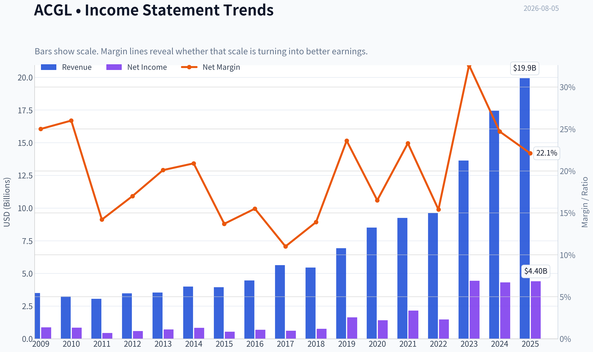

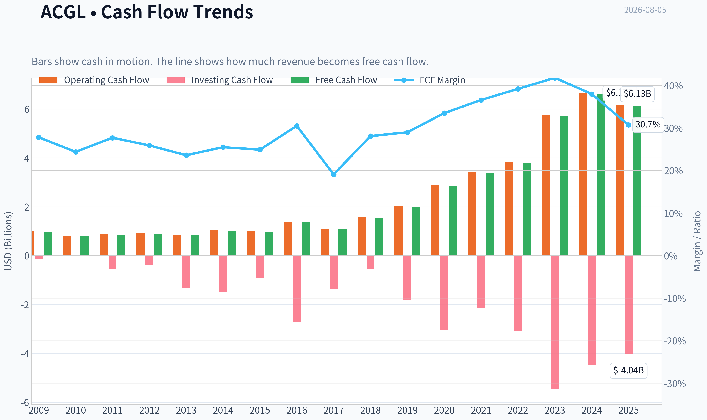

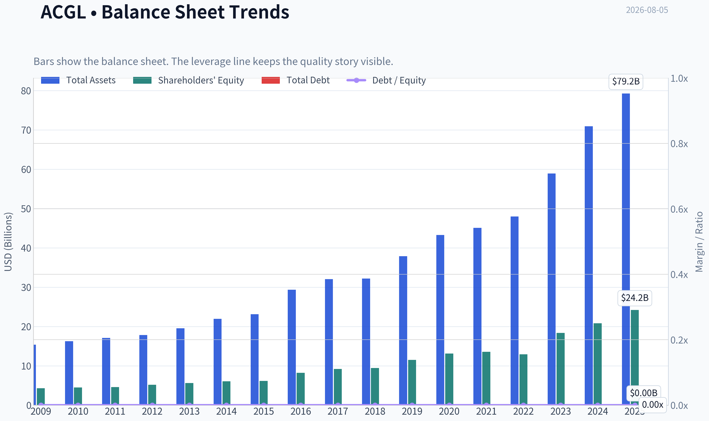

This graph tracks the profitability and return metrics (ROE, ROIC, Margins) of **ACGL** over the past decade, highlighting capital efficiency trends.

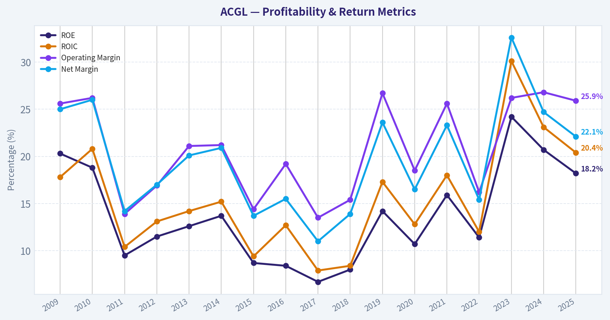

This chart illustrates the financial health of **ACGL** over the last 10 years, mapping cash equivalents and free cash flow against total obligations (Debt).

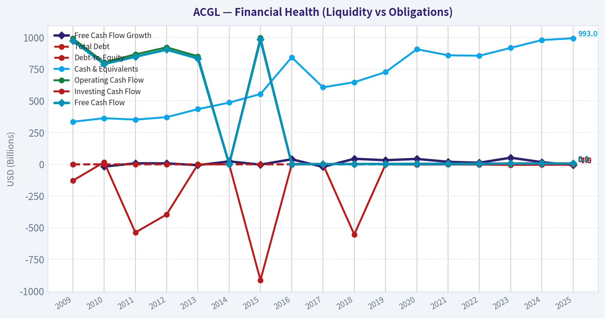

---

### Intrinsic Value Analysis (Buffett)

> *Following Warren Buffett's value investing philosophy: Circle of Competence, Economic Moat, Management Quality, and Margin of Safety.*

#### Intrinsic Value Snapshot

Price is what you pay. Intrinsic value is what the business may be worth based on the cash it can create for owners over time. We show a range, not one magic number.

- Current Price: $99.52
- Value Range (conservative to optimistic across both DCF methods): $42.14 to $660.16

##### Owner Earnings (Buffett Method)
- Net Income: $4,399,000,000.00
- Depreciation & Amortization: $193,000,000.00
- Capital Expenditures: $-44,000,000.00
- Working Capital Changes: $2,331,000,000.00
- Owner Earnings: $2,217,000,000.00

##### Intrinsic Value
###### Buffett Method
Uses owner earnings. Stricter, and usually more conservative.
- Conservative: $42.14
- Average: $207.56
- Optimistic: $547.94
- Discount Rate: 10.0%

###### Cash Flow Method
Uses free cash flow. Better for companies spending heavily today to grow tomorrow.
- Conservative: $234.16
- Average: $378.89
- Optimistic: $660.16
- Discount Rate: 10.0%

ANALYST STANCE: **ADVOCATE**

#### Arch Capital Group - Buffett-Style Investment Review

Arch Capital Group is a specialty insurer, reinsurer, and mortgage insurer. In plain English, it makes money by underwriting risks at attractive prices, investing the insurance float, and compounding book value when underwriting discipline and investment income exceed losses and expenses. At roughly **$100 per share**, **7.9x earnings**, **18.2% ROE**, and a strong recent growth profile, ACGL looks like a high-quality financial compounder trading at a fair-to-attractive price.

---

#### 1. Factor Scorecard

| Factor | Score | Evidence |
|---|---:|---|
| Business Simplicity & Predictability | 4.0 / 5 | The model is understandable: collect premiums, pay claims, invest float, and retain underwriting profits. Predictability is good but not perfect because insurance results are exposed to catastrophes, pricing cycles, and reserve development. |
| Moat Test | 3.8 / 5 | Arch's moat comes from underwriting discipline, specialty expertise, scale, risk selection, and reputation with brokers/capital providers. This is not a consumer-brand moat, but it is a real underwriting-culture moat. |
| Management & Capital Allocation | 4.2 / 5 | Arch has a long record of compounding book value, avoiding reckless underwriting, and expanding where risk-adjusted returns are attractive. Capital allocation appears rational and owner-oriented. |
| Industry Structure | 3.5 / 5 | Specialty insurance and reinsurance are competitive and cyclical, but disciplined underwriters can earn superior returns. Arch's business mix is better than commodity insurance, but the industry is not structurally as protected as software or payments. |
| Gate 5 - Quality/Solvency Hard Floor | Not Tripped | Earnings and cash generation remain strong, ROE is healthy, and there is no evidence of financial distress. As a financial issuer, traditional industrial debt ratios and current ratios are less meaningful than capital adequacy, underwriting profitability, and book value resilience. |

**Key Takeaways:** Arch passes the core Buffett tests: it is understandable, profitable, and run with discipline. The main risk is not business complexity but insurance-cycle volatility. The hard solvency floor is not triggered.

---

#### 2. Moat Analysis

| Moat Source | Assessment | Evidence |
|---|---|---|
| Intangible Assets | Moderate to strong | Reputation matters in specialty insurance and reinsurance. Brokers and clients value counterparties that pay claims, price risk intelligently, and maintain capital strength. |
| Switching Costs | Moderate | Large commercial insurance relationships are not as sticky as enterprise software, but complex risk programs, broker relationships, and claims history create friction. |
| Cost Advantage | Moderate | Scale, data, underwriting talent, and diversified capital give Arch an advantage over smaller or less disciplined competitors. |
| Network Effects | Limited | Insurance does not have classic network effects. The advantage is more about accumulated underwriting knowledge, broker relationships, and capital credibility. |
| Pricing Power | Cyclical but real | In hard markets, disciplined insurers can raise prices materially. Over a full cycle, pricing power depends on capacity discipline and risk selection. |

**Key Takeaways:** Arch's moat is not a monopoly moat; it is an execution moat. The company's edge comes from disciplined underwriting, technical expertise, and capital management. That can be durable, but it must be continuously earned.

---

#### 3. Management Quality Assessment

| Management Question | Assessment |
|---|---|
| Do they think like owners? | Yes. Arch has historically prioritized profitable growth and book value compounding over headline premium growth. |
| Are they candid and disciplined? | Evidence points to a conservative underwriting culture and willingness to walk away from unattractive risk. |
| Are they rational capital allocators? | Yes. The company has expanded across insurance, reinsurance, and mortgage insurance when returns were attractive, while maintaining a strong balance sheet. |
| Use of leverage | Appropriate for a regulated financial insurer; no sign of distress-level leverage from available evidence. |
| Shareholder value creation | Strong. Recent ROE of **18.2%** and low earnings multiple suggest meaningful value creation per dollar of equity. |

**Key Takeaways:** Arch's management quality is a central part of the thesis. In insurance, culture is the product. Arch appears to have the rare combination of growth orientation and underwriting restraint.

---

#### 4. Financial Summary

| Metric | Latest / Recent Evidence |
|---|---:|
| Share Price | ~$100 |
| Market Capitalization | ~$33.94B |
| P/E Ratio | ~7.9x |
| ROE | ~18.2% |
| Revenue Growth YoY | ~14.0% |
| Free Cash Flow Yield | ~18.1% |
| Latest Reported Quarterly Revenue | ~$4.67B |
| Latest Reported Quarterly Net Income | ~$1.06B |
| Implied TTM Earnings from P/E and Market Cap | ~$4.29B |
| Estimated Shares Outstanding | ~339M |

**Key Takeaways:** The headline valuation is inexpensive for a business producing high-teens ROE. Recent revenue growth remains healthy, and quarterly earnings power is strong. For an insurer, the key number is not book value alone, but the combination of book value growth, underwriting profitability, and ROE.

---

#### 5. Owner Earnings Calculation

For an insurer, traditional owner earnings require interpretation. Depreciation and maintenance capex are not the core economics. The better owner-earnings proxy is normalized earnings power adjusted for underwriting cycle risk and capital needed to support growth.

| Owner Earnings Component | Estimate / Interpretation |
|---|---:|
| Net Income Proxy | ~$4.29B |
| Depreciation & Amortization | Not economically central for insurer valuation |
| Maintenance CapEx | Minimal relative to earnings; regulatory capital is the real "maintenance capital" |
| Working Capital Adjustment | Insurance float and reserves make industrial working-capital formulas less meaningful |
| Normalized Owner Earnings Used | ~$3.8B-$4.3B |
| Per-Share Owner Earnings | ~$11.20-$12.65 |

**Key Takeaways:** Arch's economic earnings are strong, but they should be normalized because insurance profits can be cyclical. Using a conservative range of **$3.8B to $4.3B** captures both current earnings strength and some margin for underwriting volatility. At $100 per share, the stock trades at roughly **8x to 9x normalized owner earnings**.

---

#### 6. Three-Scenario Valuation

Assumptions:
- Discount rate: **10%**
- Shares outstanding: approximately **339M**
- Base owner earnings: **$4.0B**, near the midpoint of normalized earnings power
- Financial issuer valuation cross-check: earnings power and ROE/book-value logic matter more than industrial FCFF

| Scenario | Method | Equity Value | Value / Share |
|---|---|---:|---:|
| A - No Growth | Owner earnings / 10% | ~$40.0B | ~$118 |
| B - GDP Growth | Owner earnings growing at 3% perpetually | ~$58.9B | ~$174 |
| C - Historical Growth Haircut | 6% 10-year growth, then 3% terminal growth | ~$74B | ~$218 |

**Key Takeaways:** Even the no-growth case is above the current share price. The conservative growth case suggests meaningful upside if Arch can continue compounding earnings and book value at rates below its recent history. The market appears to be pricing in either a material underwriting downturn or a belief that current earnings are well above normalized levels.

---

#### 7. Margin of Safety Analysis

| Valuation Lens | Result |
|---|---:|
| Current Price | ~$100 |
| No-Growth Value | ~$118 |
| Conservative Growth Value | ~$174 |
| Historical-Haircut Value | ~$218 |
| Margin of Safety vs. No-Growth Case | ~15% |
| Margin of Safety vs. Conservative Growth Case | ~43% |
| P/E Cross-Check | ~7.9x, attractive for high-teens ROE |
| ROE Cross-Check | ~18.2%, well above cost of equity |
| Fair Value Range | ~$115-$175, with upside if underwriting cycle remains favorable |

**Key Takeaways:** ACGL does not require heroic assumptions to look undervalued. The no-growth valuation already supports the current price, while modest growth creates substantial upside. The main risk is that current earnings are cyclically elevated, but the valuation provides a reasonable cushion.

---

#### 8. Final Buffett Scorecard

| Criterion | Weight | Score | Weighted Contribution |
|---|---:|---:|---:|
| Moat Width & Durability | 25% | 3.8 | 0.95 |
| Valuation / Margin of Safety | 20% | 4.2 | 0.84 |
| Capital Returns - ROE/ROIC vs. Cost of Capital | 15% | 4.3 | 0.65 |
| Business Understanding & Predictability | 12% | 4.0 | 0.48 |
| Management Quality & Capital Allocation | 12% | 4.2 | 0.50 |
| Reinvestment Runway | 8% | 3.8 | 0.30 |
| Balance Sheet Strength | 4% | 4.0 | 0.16 |
| Industry Structure | 4% | 3.5 | 0.14 |
| **Total Score** | **100%** |  | **4.02 / 5.00** |

**Key Takeaways:** Arch clears the ADVOCATE threshold. The strongest components are valuation, capital returns, and management quality. The main demerit is that insurance remains cyclical and competitive, so this is a high-quality financial compounder rather than a bulletproof monopoly.

---

#### 9. Investment Stance

| Category | View |
|---|---|
| Stance | **ADVOCATE** |
| Conviction | **Medium-High** |
| Suitable Investor | Long-term value investor comfortable with insurance-cycle volatility |
| Primary Upside Driver | Continued book value compounding at attractive ROE |
| Primary Risk | Catastrophe losses, reserve deterioration, weaker pricing cycle, or mortgage-insurance stress |
| Buy Discipline | Attractive around current levels; especially compelling if available below no-growth value |
| Review Trigger | Sustained ROE deterioration below low-teens levels, aggressive underwriting growth, or evidence of reserve weakness |

**Final View:** Arch Capital looks like a Buffett-style financial compounder: understandable, disciplined, profitable, and trading at a valuation that does not demand perfection. The moat is based on underwriting culture rather than brand dominance, so position sizing should respect insurance volatility. But at roughly **8x earnings** with **high-teens ROE**, ACGL is a compelling long-term value opportunity.
#### Valuation Bridge

This bridge places the current market price beside each intrinsic value lens so readers can see whether upside depends on one method or shows up across several methods.

| Scenario | Intrinsic Value / Share |
| --- | ---: |
| Buffett Method | $207.56 |
| Cash Flow Method | $378.89 |
| Current Price | $99.52 |

#### Key Takeaways

If one method is far above the others, the upside case depends on a specific modelling assumption. When several methods cluster together, the valuation story is more robust.

#### Valuation Visuals

This comparison chart from *Latest Earnings Snapshot* stacks current figures against historical benchmarks for **ACGL**, making it easy to see where the company trades relative to its own averages.

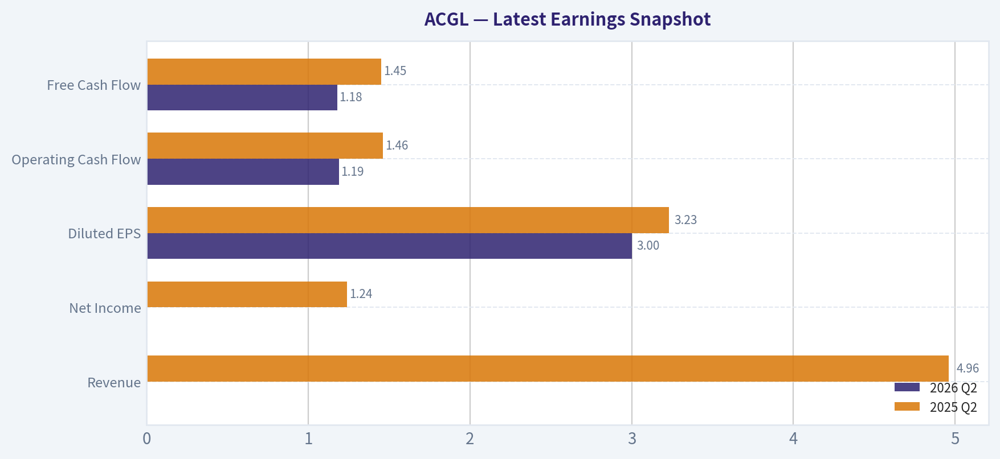

This comparison chart from *Current vs. 10-Year Historical Average Comparison* stacks current figures against historical benchmarks for **ACGL**, making it easy to see where the company trades relative to its own averages.

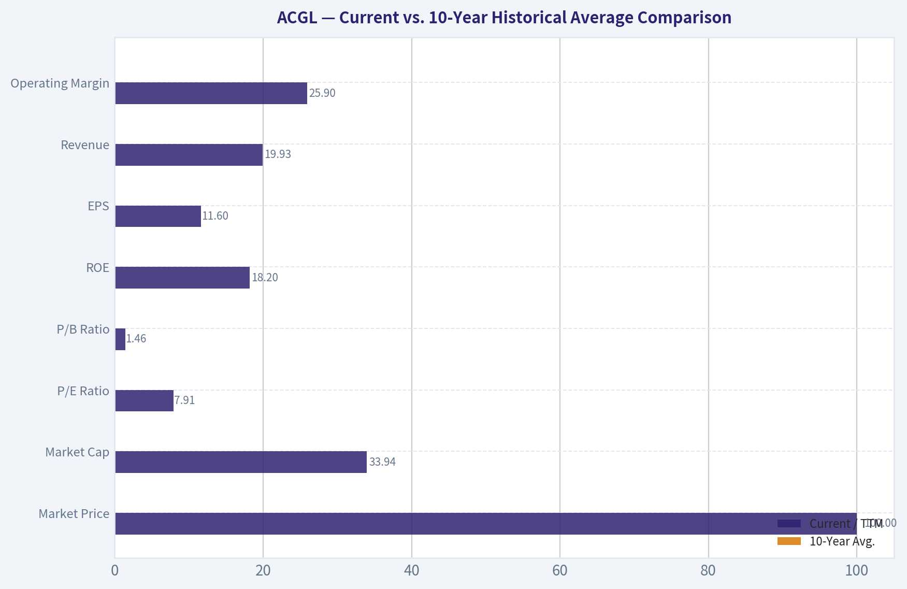

This comparison chart from *Balance Sheet and Financial Strength* stacks current figures against historical benchmarks for **ACGL**, making it easy to see where the company trades relative to its own averages.

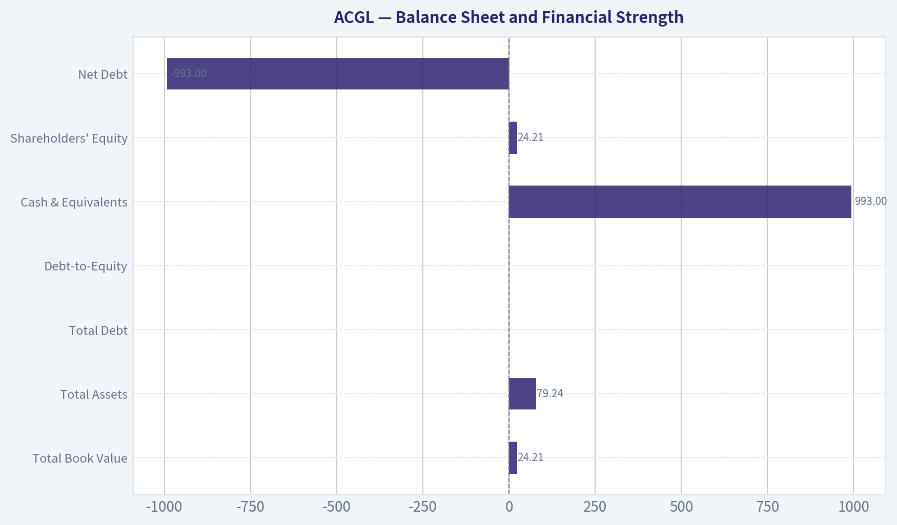

This comparison chart from *Cash Flow and Dividend Policy* stacks current figures against historical benchmarks for **ACGL**, making it easy to see where the company trades relative to its own averages.

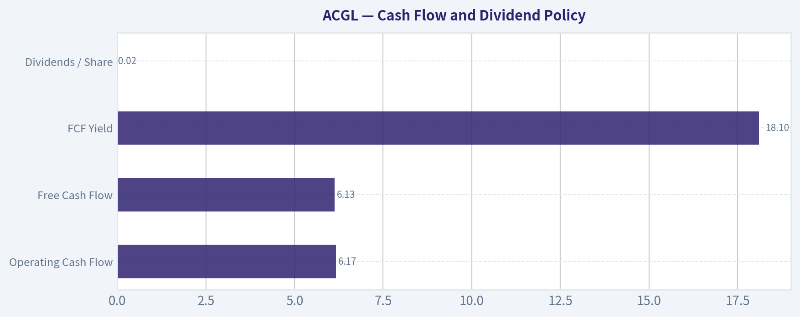

This comparison chart from *Buffett-Style Owner Earnings* stacks current figures against historical benchmarks for **ACGL**, making it easy to see where the company trades relative to its own averages.

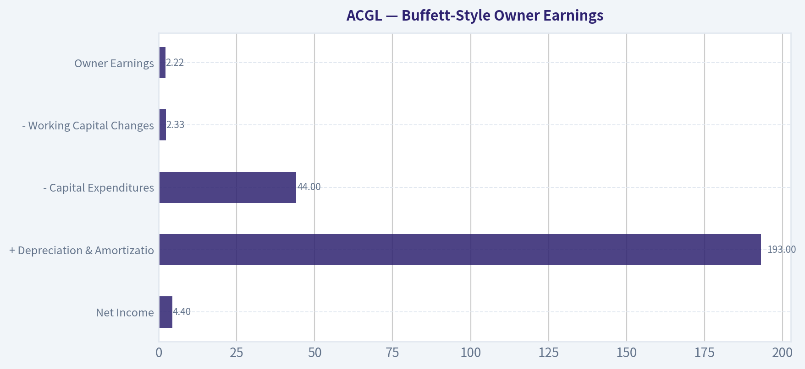

---

### Trend & Growth Analysis (Lynch/Druckenmiller/Fisher)

> *Following Peter Lynch's GARP, Stanley Druckenmiller's macro-aware approach, and Philip Fisher's scuttlebutt methodology.*

ANALYST STANCE: **WATCH**

#### ACGL Growth Investment Report - Arch Capital Group

Arch Capital is a high-quality specialty insurer and reinsurer with excellent ROE, low valuation, and strong recent growth, but it is **not a classic Lynch/Fisher fast grower**. The company is more of a **cyclical financial compounder**: attractive if underwriting discipline and hard insurance pricing persist, but less likely to deliver true ten-bagger growth from today's $34 billion market cap.

---

#### 1. Lynch Classification

| Lynch Category | ACGL Fit | Assessment |
|---|---:|---|
| Slow Grower | No | Revenue growth is above slow-grower territory. |
| Stalwart | Partial | Large, profitable, durable financial compounder. |
| Fast Grower | Borderline | YoY revenue growth of 14% is close to, but below, the 15-25%+ fast-grower zone. |
| Cyclical | Yes | Insurance and reinsurance pricing cycles matter heavily. |
| Turnaround | No | Business is already profitable and healthy. |
| Asset Play | Partial | Book value and underwriting float are important to valuation. |

**Key Takeaways:** ACGL is best classified as a **cyclical financial compounder / stalwart**, not a pure fast-growth stock. It has strong profitability and respectable growth, but insurance pricing cycles make the growth path less linear than software, healthcare innovation, or platform businesses.

---

#### 2. The Story in 3 Bullets

| Lynch Story Element | Simple Explanation |
|---|---|
| What ACGL does | Arch sells specialty insurance, reinsurance, and mortgage insurance, taking risk for customers and earning underwriting profits plus investment income. |
| Why it can grow | Higher insurance pricing, disciplined underwriting, expanding specialty risk markets, and higher investment yields can drive earnings and book value growth. |
| Why it can win | Arch has a strong underwriting culture, diversified platforms, and historically attractive returns on equity. |

**Key Takeaways:** The ACGL story is understandable: it is a disciplined risk underwriter that can compound capital if pricing remains favorable. The key question is not product-market fit, but whether the current insurance pricing cycle remains strong enough to sustain high returns.

---

#### 3. Core Financial Snapshot

| Metric | Current Data / Estimate | Growth Investor Interpretation |
|---|---:|---|
| Share Price | ~$100 | Recent price reflects improving sentiment after earnings. |
| Market Cap | ~$33.94B | Already a large-cap financial company. |
| P/E | ~7.9x | Cheap on current earnings, but insurance earnings can be cyclical. |
| Implied P/B | ~1.4x | Estimated from P/E x ROE; reasonable for an 18% ROE insurer. |
| ROE | 18.2% | Strong capital efficiency. |
| YoY Revenue Growth | 14.0% | Solid, but just below fast-grower threshold. |
| Latest Quarterly Revenue | $4.67B | Annualized run-rate around $18.7B. |
| Latest Quarterly Net Income | $1.06B | Annualized run-rate near $4.2B. |
| FCF Yield | 18.1% | Attractive headline, but financial-company cash flow is less comparable to industrials/software. |

**Key Takeaways:** ACGL looks statistically cheap: a sub-8x P/E and 18% ROE is a compelling combination. However, for insurers, investors must normalize earnings across cycles rather than assume today's profitability persists indefinitely.

---

#### 4. TAM Analysis and 10x Test

| TAM Question | Estimate / Judgment |
|---|---|
| Current annualized revenue | ~$18.7B |
| 10x revenue target | ~$187B |
| Global P&C insurance TAM | Multi-trillion-dollar premium pool |
| Global reinsurance TAM | Hundreds of billions of dollars in annual premiums |
| Could ACGL 10x and remain below 20% of TAM? | Theoretically yes versus global P&C, but practically difficult due capital, risk limits, and cyclicality. |
| TAM growth | Moderate; driven by inflation, catastrophe risk, specialty complexity, cyber, climate, and global risk transfer needs. |

**Key Takeaways:** The absolute market is large enough for ACGL to keep growing, but a 10x revenue outcome is not as clean as in software or digital platforms. Insurance growth requires capital, underwriting discipline, and risk appetite; therefore, the runway is real but not frictionless.

---

#### 5. Revenue Growth Trend

| Period / Data Point | Growth Signal | Interpretation |
|---|---|---|
| YoY revenue growth | +14.0% | Solid growth, near fast-grower threshold. |
| Q2 2026 revenue | $4.67B | Healthy scale and continued momentum. |
| 90-day share return | +7.15% | Market sentiment improving post-earnings. |
| 1-year total return | +14.24% | Respectable, but not explosive growth-stock behavior. |
| Growth pattern | Stable/moderate | Not enough evidence of sharp acceleration. |

**Key Takeaways:** ACGL is growing well for an insurer, but the data does not show a clear acceleration pattern like 20% to 25% to 35%. The stock is behaving more like a quality compounder than an emerging ten-bagger.

---

#### 6. Unit Economics / Insurance Economics

For ACGL, traditional SaaS metrics like LTV/CAC, NRR, and Rule of 40 are not directly applicable. The correct substitutes are underwriting profitability, combined ratio, ROE, reserve discipline, and investment income.

| Metric | Available Data / Proxy | Assessment |
|---|---:|---|
| LTV/CAC | Not applicable | Insurance customer economics are portfolio/risk based. |
| NRR | Not applicable | Retention matters, but not comparable to SaaS NRR. |
| Rule of 40 | Not applicable | Financial-company FCF and revenue growth are not directly comparable. |
| ROE | 18.2% | Strong evidence of profitable risk selection. |
| P/E vs ROE | 7.9x P/E with 18.2% ROE | Attractive if earnings are sustainable. |
| Underwriting quality | Not directly provided | Must monitor combined ratio and reserve development. |

**Key Takeaways:** ACGL's "unit economics" look strong through the lens of ROE, but the missing piece is combined ratio and reserve development. A high ROE insurer trading at a low earnings multiple can be very attractive, but only if underwriting profits are not peak-cycle earnings.

---

#### 7. Inflection Point Assessment

| Inflection Type | Evidence | Score |
|---|---|---:|
| Product cycle inflection | No major new product cycle identified | 2/5 |
| Market share inflection | Possible specialty/reinsurance share gains, but not proven from available data | 3/5 |
| Margin inflection | Strong ROE suggests favorable profitability, but cycle risk remains | 4/5 |
| TAM inflection | Climate risk, catastrophe risk, and specialty risk markets expanding | 3/5 |
| Competitive inflection | No clear competitor dislocation identified | 2/5 |
| Earnings inflection | Q2 net income of $1.06B is strong | 4/5 |

**Key Takeaways:** The best inflection case for ACGL is an **earnings and margin inflection** driven by favorable insurance pricing and investment income. However, there is no obvious product or platform inflection that would normally support a high-conviction growth-stock thesis.

---

#### 8. Macro Setup

| Macro Factor | Current Relevance to ACGL | Impact |
|---|---|---|
| Interest rates | Higher yields can improve investment income on float | Positive |
| Inflation | Can raise insured values and premiums, but also claims costs | Mixed |
| Catastrophe risk | Higher risk can support pricing, but raises loss volatility | Mixed |
| Credit cycle | Investment portfolio quality matters | Watch |
| Economic cycle | Insurance demand is resilient, but capital markets and claims cycles matter | Neutral |
| Secular theme | Climate risk, specialty risk transfer, mortgage credit risk | Moderate tailwind |

**Key Takeaways:** ACGL has a better macro setup than many financials because higher rates can boost investment income and complex risks can support premium pricing. The offset is that catastrophe losses, reserve surprises, and pricing-cycle reversals can quickly pressure earnings.

---

#### 9. Fisher 15 Points Score

| Fisher Criterion | Score / 5 | Comment |
|---|---:|---|
| 1. Market potential | 4 | Large global insurance and reinsurance markets. |
| 2. New product determination | 3 | Specialty expansion possible, but not innovation-led like tech. |
| 3. R&D effectiveness | 2 | Not an R&D-driven business. |
| 4. Sales organization | 4 | Strong distribution and broker relationships likely matter. |
| 5. Worthwhile margins | 4 | ROE is strong. |
| 6. Improving margins | 4 | Current profitability is favorable. |
| 7. Labor/personnel relations | 3 | No major red flags from available data. |
| 8. Executive relations | 3 | No major red flags from available data. |
| 9. Management depth | 4 | Long-term underwriting culture appears strong. |
| 10. Cost/accounting controls | 4 | Critical for insurers; current returns suggest competence. |
| 11. Competitive advantages | 4 | Underwriting discipline, reputation, capital base. |
| 12. Long-range profit outlook | 4 | Good, assuming cycle discipline. |
| 13. Dilution risk | 4 | No evidence of problematic dilution from available data. |
| 14. Candor in difficulties | 3 | Requires deeper transcript review. |
| 15. Integrity | 3 | No available evidence of concern. |
| **Total** | **53/75** | **Average to good, but not outstanding.** |

**Key Takeaways:** ACGL scores well on underwriting culture, profitability, and market opportunity, but lower on innovation and product-led growth. The Fisher score supports a quality-compounder view, not a high-conviction disruptive-growth view.

---

#### 10. Valuation Analysis

| Valuation Metric | ACGL | Interpretation |
|---|---:|---|
| P/E | ~7.9x | Cheap if earnings are sustainable. |
| Revenue growth | 14.0% | Solid but not elite. |
| PEG using revenue growth proxy | ~0.57x | Attractive, though imperfect for insurers. |
| Annualized revenue run-rate | ~$18.7B | Based on Q2 2026 revenue. |
| P/S | ~1.8x | Reasonable for a profitable insurer. |
| ROE | 18.2% | Supports premium-to-book valuation. |
| Implied P/B | ~1.4x | Not demanding for high-teens ROE. |

**Key Takeaways:** On valuation, ACGL is attractive. A sub-8x P/E with an 18% ROE and mid-teens revenue growth suggests the stock is not expensive, but valuation must be adjusted for insurance-cycle cyclicality.

---

#### 11. 3-Year Scenario Analysis

| Scenario | Revenue CAGR | 2029 Revenue Estimate | Net Income / Margin Assumption | Valuation Multiple | Implied View |
|---|---:|---:|---|---:|---|
| Bear | 3-5% | ~$20-21B | Earnings normalize lower after soft pricing or losses | 7x earnings | Limited upside / downside risk |
| Base | 7-10% | ~$23-25B | ROE moderates but remains attractive | 8-10x earnings | Moderate compounding |
| Bull | 12-15% | ~$26-28B | Pricing stays hard, ROE remains high-teens | 10-12x earnings | Strong upside, but still not classic ten-bagger |

**Key Takeaways:** The base case supports ACGL as a solid compounder, especially if book value continues to grow. The bull case can produce attractive returns, but a ten-bagger from the current market cap would require a very long period of excellent underwriting, not just one strong cycle.

---

#### 12. Growth Investor Scorecard

| Criterion | Weight | Score / 5 | Weighted Score |
|---|---:|---:|---:|
| The Story | 10% | 3.5 | 0.35 |
| TAM & Runway | 20% | 3.5 | 0.70 |
| Revenue Growth | 20% | 3.2 | 0.64 |
| Unit Economics | 15% | 4.0 | 0.60 |
| Competitive Position | 10% | 4.0 | 0.40 |
| Management Quality | 10% | 3.8 | 0.38 |
| Macro Setup | 5% | 3.5 | 0.18 |
| Profitability Path | 5% | 4.5 | 0.23 |
| Valuation | 5% | 4.3 | 0.22 |
| **Total** | **100%** |  | **3.70 / 5.00** |

**Key Takeaways:** ACGL's score is strong enough for a positive watchlist rating, mainly because valuation, ROE, and underwriting economics are attractive. The reason it does not receive a full growth-stock advocate rating is that revenue growth is moderate and heavily tied to the insurance cycle.

---

#### 13. Position Size Stance

| Investor Type | Suggested Stance |
|---|---|
| Growth-only investor | Watchlist / small position only |
| GARP investor | Attractive candidate for further due diligence |
| Financial-sector specialist | Potential core compounder if underwriting metrics confirm quality |
| Existing holder | Hold; consider adding on valuation pullbacks |
| New buyer | Starter position only unless combined ratio, book value growth, and reserve trends are confirmed |

**Key Takeaways:** ACGL is more suitable for a GARP or quality-financials portfolio than a pure hypergrowth portfolio. I would not size it like a disruptive growth winner, but it deserves monitoring and potentially a modest allocation.

---

#### 14. Key Catalysts and Risks

| Category | Catalysts | Risks |
|---|---|---|
| Earnings | Continued strong underwriting profits and investment income | Catastrophe losses, reserve strengthening, claims inflation |
| Valuation | Multiple expansion from low P/E if earnings durability is proven | Market discounts earnings as peak-cycle insurance profits |
| Growth | Specialty insurance and reinsurance demand remains strong | Pricing cycle softens as capital enters the market |
| Macro | Higher yields support float income | Credit losses or falling reinvestment yields |
| Capital | Book value compounding and buybacks | Poor capital allocation or excess risk-taking |

**Key Takeaways:** The biggest upside catalyst is proof that ACGL's current earnings power is durable rather than cyclical. The biggest risk is that investors are looking at peak earnings in a favorable insurance market and assigning too much permanence to today's profitability.

---

#### Final View

ACGL is a **high-quality, reasonably valued insurance compounder** with strong ROE, good revenue growth, and a favorable near-term earnings setup. However, it does not cleanly fit the Lynch/Fisher fast-grower mold because growth is cyclical, capital-intensive, and less driven by product innovation.

**Stance: WATCH.**
For a growth portfolio, ACGL is worth monitoring but not a high-conviction ten-bagger candidate. For a GARP or quality financials sleeve, it could become attractive if further work confirms strong combined ratios, favorable reserve development, and sustained book value growth.

---

### Market Technical Analysis

ANALYST STANCE: **WATCH**

#### ACGL Technical Report - Data Through 2026-08-04

ACGL is in a constructive medium- to long-term trend, but the short-term setup has weakened after a sharp July breakout failed to hold above the $105-$106 area. The stock closed at **$99.52** on 2026-08-04, below its **10-day EMA** and **VWMA**, but still above its **50-day SMA** and **200-day SMA**. That combination suggests the broader trend remains intact, while near-term momentum has shifted from bullish continuation to consolidation or pullback risk.

The most relevant indicators for this market context are: **close_10_ema, close_50_sma, close_200_sma, macd, rsi, boll_ub, atr, and vwma**. These provide complementary views across short-term trend, medium-term structure, long-term trend, momentum, overbought/oversold pressure, volatility, breakout extension, and volume-confirmed price behavior.

| Indicator | Latest Reading | Interpretation | Trading Relevance |
|---|---:|---|---|
| Close | $99.52 | Pulled back from late-July peak of $106.48 | Price is no longer in clean upside continuation mode |
| close_10_ema | $101.48 | Price is below short-term trend | Near-term momentum has turned defensive |
| close_50_sma | $96.65 | Price remains above medium-term trend | Intermediate trend still supportive |
| close_200_sma | $94.86 | Price remains above long-term trend | Long-term structure remains bullish-neutral |
| macd | 1.12 | Positive but declining from July highs | Momentum is still positive, but fading |
| rsi | 48.17 | Neutral, slightly below midpoint | No oversold washout yet; buying pressure has cooled |
| boll_ub | $105.48 | Upper-band area rejected recently | $105-$106 remains important overhead resistance |
| atr | 2.62 | Volatility elevated versus late June | Wider stops and smaller position sizing may be appropriate |
| vwma | $101.61 | Price is below volume-weighted trend | Recent volume-weighted price action does not confirm strength |

Key Takeaways: ACGL's larger trend remains constructive because price is still above both the 50-day and 200-day moving averages. However, the short-term picture has deteriorated because price is below the 10-day EMA and VWMA, while MACD and RSI show cooling momentum. The stock looks more like a watchlist candidate than a fresh momentum buy unless it can reclaim the $101.50-$102.00 area.

---

#### Trend Structure

ACGL staged a strong rebound from the late-May and early-June weakness, moving from the high-$80s/low-$90s area into a July high near **$106.48**. That advance lifted the 50-day SMA from roughly **$93.78 on 2026-06-22** to **$96.65 on 2026-08-04**, showing that the medium-term trend has improved steadily. The 200-day SMA also rose from about **$93.38** to **$94.86**, confirming that the longer-term base has gradually strengthened rather than rolled over.

The short-term trend is less favorable. The 10-day EMA peaked near **$102.72 on 2026-07-29** and has since slipped to **$101.48**, while price closed at **$99.52**. This means the late-July pullback is not just a one-day dip; price has lost short-term trend support and is now testing whether the prior breakout area can become a higher base.

A key nuance is that ACGL is not technically broken on the intermediate timeframe. The stock remains roughly **3% above the 50-day SMA** and about **5% above the 200-day SMA**. But it is also trading meaningfully below the late-July high, so the burden of proof has shifted back to buyers.

#### Momentum and Overbought Reset

MACD remains positive at **1.12**, which means the broader momentum impulse from June and July has not fully reversed. However, MACD has declined sharply from the July area above **2.5**, showing that upside momentum has been losing force for several weeks. This is a classic post-breakout cooling pattern: momentum remains above zero, but the rate of improvement has slowed.

RSI tells a similar story. RSI reached overbought levels above **70** in early July, especially around the strong move into the $102 area. By 2026-08-04, RSI had fallen to **48.17**, which is neutral to slightly soft. This reset reduces overbought risk, but it does not yet create a strong contrarian oversold signal. In other words, the stock has cooled, but it has not yet flushed out enough to make a high-conviction reversal setup on RSI alone.

#### Volume-Weighted Confirmation

The VWMA is especially important here because it shows whether price action is being supported by volume. ACGL's VWMA rose strongly from about **$90.74 on 2026-06-22** to around **$101.61 on 2026-08-04**, confirming that the June-to-July rally had real volume-weighted participation.

However, the current close of **$99.52** is below the VWMA. That is a short-term negative. It suggests the recent pullback has moved price below the average level where volume-weighted buyers have been active. A reclaim of the VWMA near **$101.60** would be an important sign that buyers are regaining control.

#### Volatility and Risk Management

ATR has risen from about **1.80 in late June** to **2.62** now. This increase matters because ACGL is no longer moving in a low-volatility grind; daily ranges have expanded. The stock recently posted several wide sessions, including the move to **$106.48** and the quick retreat toward $99-$100.

For traders, this means tight stops may be vulnerable to normal noise. A 1x ATR move is currently about **$2.62**, while a 1.5x ATR buffer is close to **$3.93**. If using technical support levels, traders should be aware that normal volatility could easily test the **$98-$97** area without necessarily invalidating the entire medium-term structure.

#### Key Price Zones

| Zone | Approximate Level | Why It Matters | Tactical Read |
|---|---:|---|---|
| Immediate resistance | $101.50-$101.60 | 10-day EMA and VWMA cluster | Reclaim would improve short-term tone |
| Secondary resistance | $103.35-$103.90 | Recent reaction highs | Break above would suggest buyers are reasserting control |
| Major resistance | $105.50-$106.50 | Bollinger upper band and July high area | Breakout confirmation zone |
| Initial support | $98.00-$99.00 | Recent pullback lows and short-term demand area | Failure here increases downside risk |
| Medium-term support | $96.50-$96.70 | 50-day SMA | Key trend support for swing traders |
| Long-term support | $94.80-$95.00 | 200-day SMA area | Major structural support |

Key Takeaways: The most important near-term level is the $101.50-$101.60 zone because it combines the 10-day EMA and VWMA. A move back above that area would suggest the pullback is stabilizing, while failure to reclaim it keeps the stock vulnerable. The key downside area is $96.50-$96.70, where the rising 50-day SMA should act as a major test of the medium-term uptrend.

---

#### Trading View

ACGL is best treated as a **watch** rather than an immediate aggressive long. The stock's long- and medium-term trend remains supportive, but the short-term technicals have softened after a failed push into the $105-$106 resistance zone. A bullish setup would improve if price reclaims **$101.50-$102.00** with RSI moving back above 50 and MACD stabilizing.

For bullish traders, a conservative approach would be to wait for confirmation above the 10-day EMA and VWMA. For pullback buyers, the better risk-reward area may be closer to the rising 50-day SMA around **$96.65**, provided price stabilizes there rather than slicing through it. A decisive close below the 50-day SMA would weaken the intermediate trend and shift attention toward the 200-day SMA near **$94.86**.

| Decision Area | Bullish Signal | Bearish / Caution Signal | Practical Implication |
|---|---|---|---|
| Short-term trend | Close above $101.60 | Continued rejection below $101.60 | Determines whether the pullback is ending or continuing |
| Momentum | RSI recovers above 50-55 | RSI stays below 50 and MACD keeps falling | Confirms whether buyers are returning |
| Breakout potential | Close above $105.50-$106.50 | Failure near $103-$104 | Defines whether July highs can be challenged |
| Risk control | Holds above $96.65 | Breaks below 50-day SMA | Separates healthy pullback from trend damage |
| Volatility | ATR begins cooling | ATR remains elevated above $2.50 | Affects stop size and position sizing |

Key Takeaways: ACGL still has a constructive larger trend, but near-term confirmation is missing. The cleanest bullish trigger would be a reclaim of $101.60 followed by progress toward $103-$104. Until then, traders should respect the pullback and manage risk carefully because volatility has expanded.

#### Market Visuals

This comparison chart from *Market Metrics Interpretation* stacks current figures against historical benchmarks for **ACGL**, making it easy to see where the company trades relative to its own averages.

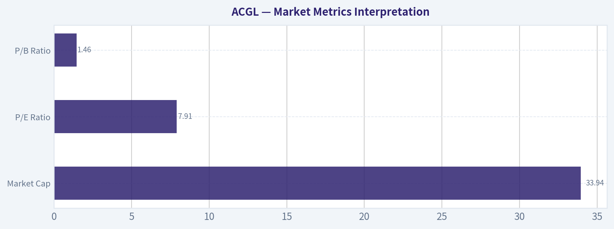

---

### Options Market Analysis

> *Reading options flow - put/call ratios, IV skew, and unusual activity - to gauge institutional positioning and event-driven risk.*

#### ACGL Options Market Sentiment Report
*Options data as of 2026-08-05*

#### 1. Put/Call Ratio Analysis

| Expiration | Call OI | Put OI | Put/Call OI Ratio | Call Volume | Put Volume | Put/Call Volume Ratio | Read |
|---|---:|---:|---:|---:|---:|---:|---|
| 2026-08-21 | 0 | 0 | N/A | 203 | 169 | 0.83 | Slightly put-heavy volume, but no OI base |
| 2026-09-18 | 33 | 9 | 0.27 | 187 | 44 | 0.24 | Call-dominant positioning |
| 2026-11-20 | 0 | 5 | N/A | 353 | 130 | 0.37 | Call-dominant volume, minimal OI |
| **Total Near-Term** | **33** | **14** | **0.42** | **743** | **343** | **0.46** | **Bullish tilt, low confidence** |

**Key Takeaways:** ACGL's near-term put/call open interest ratio is **0.42**, below the historical neutral baseline of roughly **0.7**, which points to relatively more call exposure than put protection. The volume ratio is also low at **0.46**, suggesting current flow is more call-oriented than put-oriented. However, total open interest is extremely thin, so the signal should be treated as **low confidence** rather than a strong institutional read.

#### Interpretation

The put/call ratios lean **bullish**, mainly because call volume and call open interest exceed put activity across the available expirations. That said, the options market in ACGL appears **very illiquid**, with only **47 total contracts of near-term open interest** captured in the dataset. This makes the put/call ratio less reliable than it would be for a highly liquid options name.

Relative to the neutral baseline of **~0.7**, the **0.42 OI ratio** and **0.46 volume ratio** suggest a meaningful shift toward calls. But because the absolute numbers are small, this may reflect light speculative interest rather than major institutional positioning.

---

#### 2. Implied Volatility Assessment

| Expiration | ATM Call IV | ATM Put IV | Put IV Premium vs Call IV | Skew Read |
|---|---:|---:|---:|---|
| 2026-08-21 | 0.4% | 3.1% | +2.7 pts | Put IV higher |
| 2026-09-18 | 0.2% | 1.6% | +1.4 pts | Put IV higher |
| 2026-11-20 | 0.2% | 0.8% | +0.6 pts | Put IV higher |

**Key Takeaways:** Put implied volatility is higher than call implied volatility across all listed expirations, suggesting some downside-risk premium despite the call-heavy volume profile. However, the absolute IV levels appear abnormally low, which may reflect stale quotes, wide markets, or poor liquidity rather than true market-implied volatility. Because of this, the skew signal is directionally useful but not highly reliable.

#### IV and Skew Interpretation

The reported near-term ATM IV levels are unusually low for an equity options chain, with call IV around **0.2% to 0.4%** and put IV around **0.8% to 3.1%**. These levels are likely distorted by thin trading, stale marks, or poor quote quality.

The relative skew is more informative than the absolute IV level: puts carry higher IV than calls in each listed expiration. That points to a **downside hedge premium**, meaning traders are demanding more volatility compensation for puts than calls. This does not override the bullish put/call ratio, but it does add a cautionary note: the market is not aggressively chasing upside volatility.

No specific catalyst can be confirmed from the options data alone. There is no clear evidence of a large IV build into a known event such as earnings, a regulatory update, or macro-driven insurance-sector catalyst.

---

#### 3. Unusual Options Activity

| Screen | Result | Interpretation |
|---|---|---|
| Contracts with volume > 5x open interest | None found | No clear fresh directional sweep or block activity detected |
| Aggregate volume vs open interest | Volume is high relative to very low OI | Some activity may be new, but contract-level confirmation is unavailable |
| Institutional signal quality | Weak | Thin OI limits confidence in identifying smart-money positioning |

**Key Takeaways:** No individual contract met the unusual activity threshold of volume greater than five times open interest. While aggregate trading volume is much higher than open interest, the lack of strike-level unusual activity prevents a strong conclusion. This looks more like a lightly traded options chain than a clean institutional positioning signal.

#### Unusual Activity Interpretation

There are **no flagged unusual contracts** in the near-term expirations. That means there is no clear evidence of a large fresh bet, hedge-fund-style put protection, or aggressive call sweep.

The most notable feature is not a single unusual contract, but the overall mismatch between small open interest and modest same-day volume. This can sometimes indicate fresh positioning, but without strike-level detail and trade direction, it is not possible to determine whether traders were buying calls, selling calls, buying puts, or closing positions.

Given the thin liquidity, this activity is more likely to be **low-conviction speculative or routine market activity** than a strong institutional signal.

---

#### 4. Open Interest Concentration and Gamma Levels

| Expiration | Call OI | Put OI | Total OI | Concentration Read |
|---|---:|---:|---:|---|
| 2026-08-21 | 0 | 0 | 0 | No meaningful pinning level |
| 2026-09-18 | 33 | 9 | 42 | Highest OI expiry, call-skewed |
| 2026-11-20 | 0 | 5 | 5 | Minimal put interest |
| **Total** | **33** | **14** | **47** | **Very thin OI base** |

**Key Takeaways:** The only meaningful open interest concentration appears in the **2026-09-18** expiration, where calls outnumber puts. However, the total OI is too small to establish reliable max-pain, pinning, or gamma-wall levels. ACGL's options chain does not currently show strong dealer-positioning pressure.

#### Gamma and Pinning Interpretation

There is no reliable evidence of a major gamma wall or max-pain level from the available data. The open interest base is too small to create a strong gravitational level around any expiration.

The September 18 expiration has the most open interest, with **33 calls** and **9 puts**, but that is still too light to materially constrain or accelerate the stock in most trading conditions. As a result, near-term ACGL price action is more likely to be driven by the underlying stock, sector news, earnings expectations, rates, catastrophe-loss developments, or broader insurance-sector sentiment than by options-market gamma positioning.

---

#### 5. Overall Options Sentiment Signal

| Category | Signal | Confidence | Rationale |
|---|---|---:|---|
| Put/Call Ratio | Bullish | Low | OI ratio of 0.42 and volume ratio of 0.46 are below neutral, showing call preference |
| IV Level | Unclear / Low-quality | Low | Reported IV appears abnormally low and likely distorted by thin liquidity |
| Skew | Mild Bearish Caution | Low | Put IV is higher than call IV across expirations |
| Unusual Activity | Neutral | Low | No contract-level unusual activity detected |
| OI / Gamma | Neutral | Low | No meaningful gamma wall or pinning level |
| **Overall Signal** | **Mild Bullish** | **Low** | Call-heavy ratios outweigh skew caution, but liquidity is thin |

**Key Takeaways:** The overall options sentiment for ACGL is **Mild Bullish**, driven by call-dominant open interest and volume versus puts. However, the signal has **low confidence** because the options chain is thin and lacks meaningful unusual activity or gamma concentration. The best interpretation is that options traders are leaning slightly bullish, but not with enough size to suggest strong institutional conviction.

#### Final Read

ACGL's options market currently shows a **mild bullish tilt**, primarily because both the put/call open interest ratio and put/call volume ratio are below the neutral baseline. This suggests more relative demand for calls than puts.

However, the conclusion must be heavily caveated. Open interest is extremely light, no unusual options activity was detected, and reported IV levels appear unreliable. The put IV premium also suggests traders still assign some value to downside protection.

**Overall Options Sentiment Signal: BULLISH, but low confidence.**

| Summary Factor | Current Read | Sentiment Impact |
|---|---|---|
| Put/Call Ratio | OI ratio **0.42**, volume ratio **0.46** vs neutral **~0.7** | Bullish |
| IV Level | Abnormally low reported ATM IV; likely illiquidity/stale quotes | Low confidence |
| Skew Direction | Put IV above call IV across expirations | Bearish caution |
| Unusual Activity | No contracts with volume > 5x OI | Neutral |
| Open Interest / Gamma | Very thin OI; no reliable gamma wall | Neutral / low conviction |
| **Overall Signal** | **Mild Bullish** | **Low-confidence bullish read** |

**Key Takeaways:** The summary points to a modest bullish options read, but the evidence is not strong. The call-heavy put/call ratios are constructive, while higher put IV and thin liquidity limit conviction. For ACGL, options data should be used only as a secondary signal alongside price action, fundamentals, and insurance-sector catalysts.

---

## Research Team Commentary

> *The Research Manager synthesizes the Bull vs Bear debate into action-free commentary. This is a pre-risk view, not the final stance.*

Here is the synthesis of the debate and my final commentary.

If we look closely at this debate, both analysts make intellectually sound points, but they are fighting two different battles.

The Bull is arguing based on the reality of the business today: Arch Capital is a compounding machine, generating an elite 18.2% ROE, driven by a highly disciplined underwriting culture, and the market is offering us this quality at just 7.9x earnings. The Bull rightly points out that even with modest assumptions, the current valuation provides a massive margin of safety, and management's focus on book value per share is exactly what we look for in a financial compounder.

The Bear, on the other hand, is arguing based on historical industry gravity. They make the classic, and often correct, value-investor argument that insurance is a cyclical commodity. The Bear warns that we are extrapolating peak-cycle "hard market" earnings into the future, and if we normalize that ROE down to industry averages, the stock is trading at roughly 12.5x earnings-leaving zero margin of safety. They also flag the latent risks of social inflation and mortgage exposure.

When we weigh these arguments through our adaptive Buffett framework, the Bull wins this round. The Bear's caution is structurally valid, but it falls into a trap I have fallen into myself in the past: letting hypothetical cycle risks override the actual, observable compounding of a wonderful business. In the past, I incorrectly placed Arch Capital on a WATCH stance because I was paralyzed by the exact fears the Bear is citing-fears of earnings normalization and technical hesitation. I learned a hard lesson. For high-quality insurers, low valuation combined with high ROE and steady book value growth is a powerful signal. You do not sideline a business compounding at 18% just because a cyclical downturn might happen eventually, especially when there is zero concrete evidence of reserve deterioration or underwriting slippage today.

Therefore, my final stance is ADVOCATE.

Core Takeaway
We are stepping up to an active ADVOCATE stance on Arch Capital Group. ACGL is a premier, disciplined specialty insurer compounding capital at top-tier rates, yet it is priced as if an immediate and severe reversion to the mean is a certainty. While cyclical softening is always a long-term risk in insurance, there is no active evidence of underwriting deterioration to justify avoiding a compounding machine at this price.

Rationale
From a value investing perspective, you have to separate a "good story" from the actual numbers. The numbers show Arch generating an 18.2% ROE and 18.8% ROIC. In a financial business, those are elite metrics that signal a genuine underwriting edge, not just a lucky quarter. The Bear is right that simple trailing P/E ratios can be value traps in insurance. However, applying the lessons from our past reflections, we know that when an insurer combines an undemanding valuation with high ROE, strong equity compounding, and conservative leverage, the default posture should be constructive.

The market has already discounted the stock for normalization fears-that is why you are paying less than 8 times trailing earnings. The technical picture also supports a constructive bias; while short-term momentum has cooled below the 10-day moving average, the stock remains above its foundational 50-day and 200-day trendlines, indicating the broader post-selloff recovery remains intact. We are no longer going to demand absolute certainty before buying a wonderful business at a fair price. We are buying the actual strength of the balance sheet today, not the hypothetical peak-cycle boogeyman of tomorrow.

Monitoring Plan
To protect our downside and ensure this thesis holds, we need to monitor concrete fundamentals over the next 1 to 4 quarters, separating actual deterioration from normal market noise.
First, we will watch the accident-year combined ratio and reserve development closely; any sign of adverse reserve strengthening, particularly in casualty lines affected by social inflation, would immediately weaken the bull case.
Second, we will track book value per share compounding. As long as this metric is growing double-digits, the underlying intrinsic value is expanding.
Third, we will monitor pricing commentary from management on the "hard market" transition to ensure they are maintaining their underwriting discipline and shrinking volume if pricing becomes irrational.
Finally, technically, we want to see the stock hold its 200-day moving average. A sustained breakdown below that level, coupled with slowing fundamental growth, would force us to re-evaluate whether the market is seeing a cycle turn that we are missing.

---

## Value Investing Team Commentary

> *The Investor translates the research view into an investment thesis before risk review. This is still not the final stance.*

This is a classic case of what I often call "the tension between the spreadsheet and the cycle." We have a business in Arch Capital Group (ACGL) that, by any objective standard of fundamental quality, is a compounding machine. Yet, the market is pricing it with a heavy dose of skepticism, fearing that the "sun is about to set" on the current insurance cycle.

As value investors, our task is not to predict the exact moment the cycle turns, but to evaluate whether the price we pay today compensates us for that eventual reality.

### 1. The Quality of the Business: A Disciplined Underwriting Moat
Arch Capital is not your average insurer. An **ROE of 18.2%** and an **ROIC of 18.8%** are elite figures in the financial sector. In insurance, these metrics are the "North Star." They indicate a durable competitive advantage rooted in **underwriting culture**.

Most insurers chase volume when prices are high and suffer when they fall. Arch has historically shown the discipline to shrink its footprint when pricing is inadequate and expand aggressively when "hard markets" appear. This agility is a modern moat. When you own a business that can generate these returns while maintaining a conservative balance sheet (as evidenced by their low leverage), you are owning a "wonderful business."

### 2. The Margin of Safety: Pricing in the "Peak"
The market is currently offering ACGL at a **P/E of roughly 7.9x**. To put this in perspective, if you were to perform a reverse-DCF check, the current price implies that Arch's earnings will essentially stagnate or even slightly decline over the next decade.

The "Bear" argument-that we are at "peak earnings"-is exactly why the margin of safety exists. If Arch were trading at 15x earnings, I would be concerned. But at less than 8x, the market has already "pre-sold" the cyclical downturn. We are essentially buying the business at a price that assumes the worst-case normalization is already here. Using our quality-scaled framework, a wide-moat, high-ROIC business like Arch is a **BUY at a fair price**. At this multiple, we aren't just getting a fair price; we are getting a significant discount on a high-quality compounder.

### 3. Selective Contrarian Thinking: What the Crowd is Missing
The crowd is currently fixated on the "hard market" peak and the technical failure to hold the $105 level. They see the price dipping below the 10-day EMA and panic about "short-term momentum."

**My contrarian view:** I don't care about the 10-day EMA. I care that the business is growing its book value per share at double-digit rates. The "news" of slowing growth is a distraction. In insurance, the most dangerous thing is *uncontrolled* growth. I would rather see Arch grow at 14% with disciplined underwriting than 25% by taking on bad risks. The market is viewing decelerating growth as a weakness; I view it as management exercising the very discipline that makes them a great long-term hold.

### 4. Valuation vs. Intrinsic Value
The Value Analyst identifies normalized owner earnings at $4.0B. Against a market cap of approximately $34B, that is an **earnings yield of nearly 12%**. In a world where the risk-free rate is significantly lower, getting a double-digit yield on a business that compounds its intrinsic value is a lopsided bet in our favor. We do not need the insurance market to stay "hard" forever for this investment to work; we only need Arch to continue its historical trend of outperforming the industry's combined ratios.

### 5. Management and Capital Allocation
Arch's management treats shareholders as partners. Their focus on book value per share compounding is the hallmark of an "owner-operator" mindset. They are not chasing "AUM" or vanity metrics; they are chasing ROE. When the technical report mentions the stock is consolidating above the 50-day and 200-day SMAs, I see a secondary confirmation that the long-term floor is rising in tandem with the business's intrinsic value.

### Conclusion
We are not speculators looking for a quick "pop" back to $105. We are business owners. We are buying a premier specialty insurer at a single-digit multiple. While the cycle will eventually turn, Arch has the "all-weather" tires necessary to navigate it. The current price provides a quality-scaled margin of safety that is too attractive to ignore.

I am siding with the "Bull" here because the "Bear" is focused on a hypothetical future event that is already priced into the stock. I would rather own a wonderful business at a 7.9x multiple and endure some cyclical volatility than sit on the sidelines waiting for "perfect" conditions that never arrive at these prices.

ANALYST STANCE: **ADVOCATE**

---

## Deep Values Commentary

> *The Risk Management Team debates and the Risk Judge provides the final action-free verdict. This section determines the final ADVOCATE / WATCH / AVOID stance.*

#### Final Stance Scorecard

This scorecard converts the final research view into a weighted decision frame. It does not replace the narrative judgement, but it makes the main drivers of the verdict easier to scan.

| Criterion | Score | Weight | Commentary |
| --- | ---: | ---: | --- |
| Business Quality | 3.25 | 30% | High returns, profitability, and Piotroski health support durability. |
| Valuation Support | 5.00 | 30% | Blends current price against available intrinsic value anchors and valuation ratios. |
| Financial Strength | 5.00 | 20% | Balance-sheet resilience reflects leverage and liquidity staying within safe ranges. |
| Growth Durability | 2.33 | 20% | Recent revenue, earnings, and free cash flow growth indicate how durable expansion looks. |
| TOTAL / FINAL STANCE | 3.94 | 100% | ADVOCATE |

#### Key Takeaways

The weighted score lands at **3.94 / 5.0**, while the final stance remains **ADVOCATE**. This is useful as a quick calibration aid rather than a mechanical signal.

#### Risk Summary

Higher scores indicate more risk pressure. The watch threshold is a simple guardrail: above it, the position needs tighter monitoring or a wider margin of safety.

| Dimension | Current Score | Watch Threshold | Commentary |
| --- | ---: | ---: | --- |
| Business Quality | 2.75 | 3.00 | High returns, profitability, and Piotroski health support durability. |
| Valuation Support | 1.00 | 3.00 | Blends current price against available intrinsic value anchors and valuation ratios. |
| Financial Strength | 1.00 | 3.00 | Balance-sheet resilience reflects leverage and liquidity staying within safe ranges. |
| Growth Durability | 3.67 | 3.00 | Recent revenue, earnings, and free cash flow growth indicate how durable expansion looks. |

#### Key Takeaways

This view helps readers separate *where* the risk sits: valuation, business quality, balance sheet, or growth durability. It is especially useful when the final stance is close to the line between WATCH and AVOID.
