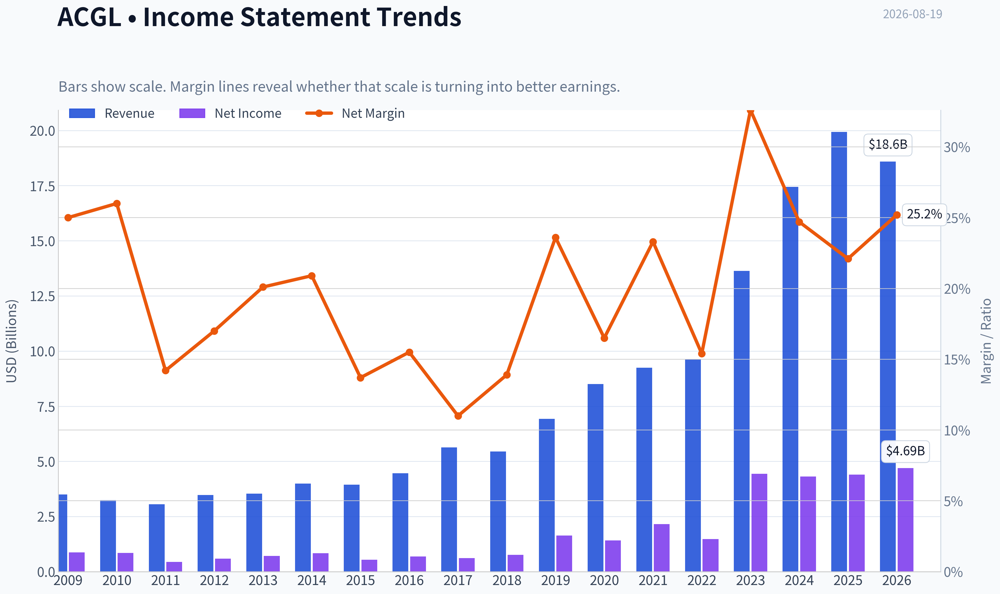
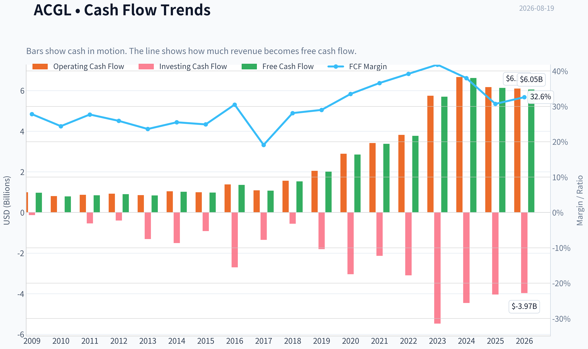
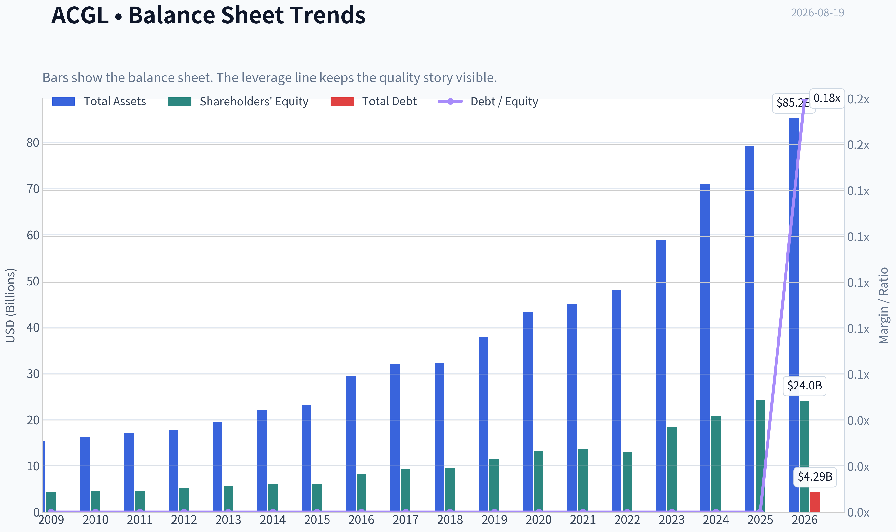
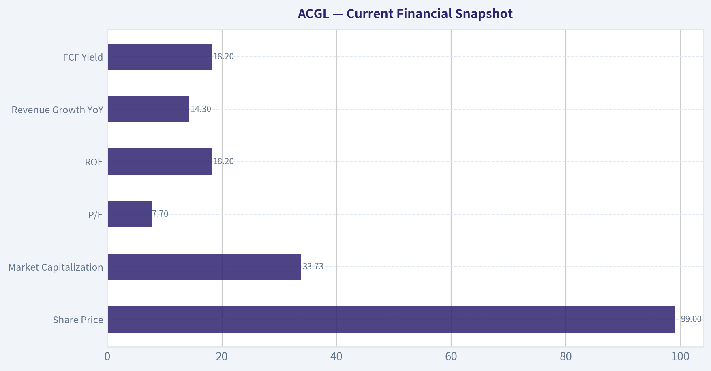
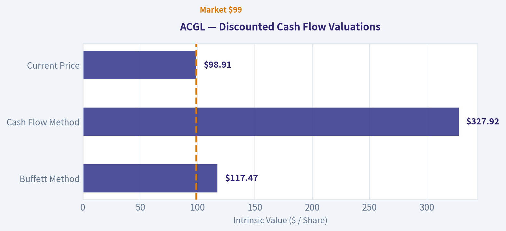
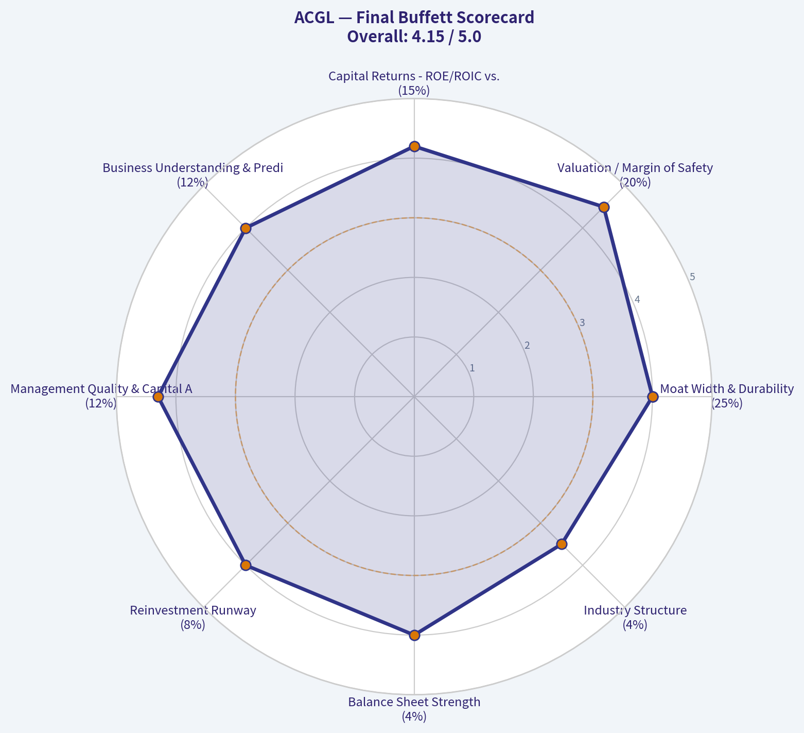
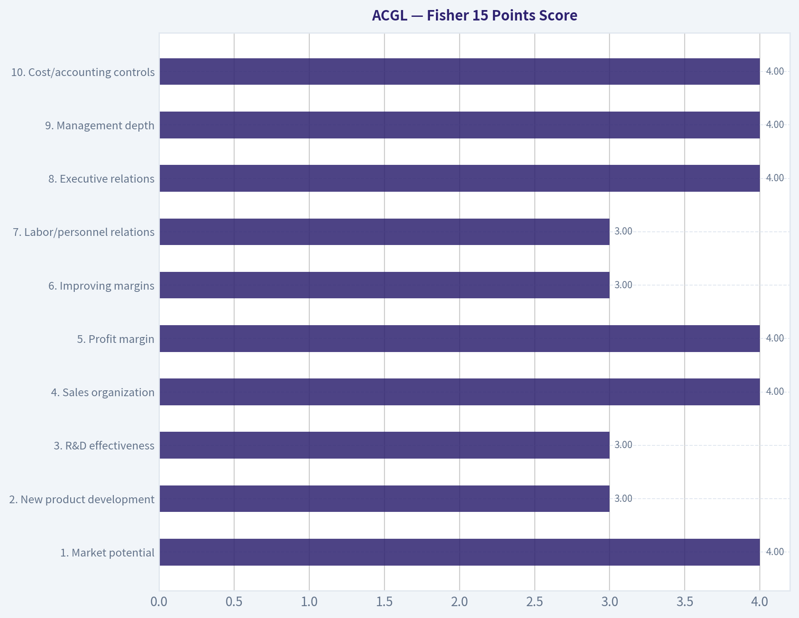
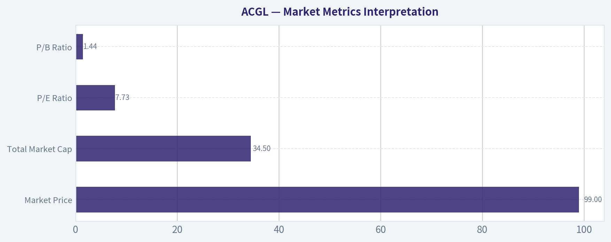

# ACGL Deep Value Intelligence

**Analysis Date:** 2026-08-19

## Critical Disclaimer

*This analysis is generated by Deep Value Intelligence, an AI-powered multi-agent investing framework. Education & research only - not financial advice, not a financial advisor.*

---

## Table of Contents

1. Intelligence Summary
2. Analyst Team Reports
   - Fundamentals Analysis
   - Intrinsic Value Analysis (Buffett)
   - Trend & Growth Analysis (Lynch/Druckenmiller/Fisher)
   - Market Technical Analysis
   - Options Market Analysis
3. Research Team Commentary
4. Value Investing Team Commentary
5. Deep Values Commentary

---

## Intelligence Summary

### Thesis + Conditions

**Core Thesis:** **EXECUTIVE SUMMARY**
Arch Capital (ACGL) combines premier specialty insurance economics (18.2% ROE, 18.8% ROIC) with a deeply compressed valuation (7.7x P/E). The market is heavily penalizing the stock for generic industry cyclicality while ignoring its proven underwriting discipline and long-term compounding ability.

**Key Risks:**
- Arch Capital (ACGL) combines premier specialty insurance economics (18.2% ROE, 18.8% ROIC) with a deeply compressed valuation (7.7x P/E). The market is heavily penalizing the stock for generic industry cyclicality while ignoring its proven underwriting discipline and long-term compounding ability. With no fresh negative catalyst and a robust quality-scaled margin of safety, the upside asymmetry strongly favors action.
- The Bull (Risky Analyst):** Views the 7.7x P/E as a massive mispricing of an elite capital allocator. Argues that catastrophe risk acts as a barrier to entry and that waiting for perfect macroeconomic clarity means missing out on the compounding machine before it re-rates.
- The Neutral Analyst:** Acknowledges the undeniable quality and cheap valuation but respects current momentum exhaustion. Recommends a staged "starter" position to capture the value while preserving dry powder if cyclical headwinds materialize.

**Confidence:** Low

---

## Analyst Team Reports

### Fundamentals Analysis

#### Latest Earnings Snapshot

*Most recent reported quarter anchored on 2026 Q2, with prior-year comparison when available.*

| Metric | 2026 Q2 | 2025 Q2 | YoY Change |
| --- | ---: | ---: | ---: |
| Revenue | $4.49B | $4.97B | -9.7% |
| Operating Income | N/A | N/A | N/A |
| Net Income | $1.06B | $1.24B | -14.6% |
| Diluted EPS | $3.00 | $3.23 | -7.1% |
| Operating Cash Flow | $1.32B | $1.12B | +17.6% |
| Free Cash Flow | $1.31B | $1.11B | +17.6% |

Key Takeaways: This snapshot anchors the most recent reported quarter before the narrative analysis. It helps readers separate long-run business quality from whatever changed in the latest earnings print.

#### 17-Year Financial Metrics for ACGL

*All values below are computed deterministically from raw data - not estimated by AI.*

*Issuer profile: insurer (Financial Services / Insurance - Diversified).*

#### 17-Year Financial Metrics
*Annual rows come from reported financial statements. The final TTM row is computed from the latest four quarters.*

| Metric | 2009 | 2010 | 2011 | 2012 | 2013 | 2014 | 2015 | 2016 | 2017 | 2018 | 2019 | 2020 | 2021 | 2022 | 2023 | 2024 | 2025 | 2026 TTM |
| --- | --- | --- | --- | --- | --- | --- | --- | --- | --- | --- | --- | --- | --- | --- | --- | --- | --- | --- |
| Market Price | $8 | $9 | $12 | $14 | $19 | $19 | $22 | $27 | $29 | $25 | $41 | $34 | $42 | $60 | $71 | $92 | $96 | $99 |
| Market Cap | $1.48B | $1.54B | $1.72B | $2.03B | $2.70B | $2.66B | $2.93B | $10.76B | $12.64B | $11.03B | $17.65B | $14.80B | $17.79B | $23.71B | $28.13B | $35.26B | $36.06B | $34.50B |
| P/E Ratio | 1.74 | 1.89 | 4.18 | 3.64 | 3.92 | 3.27 | 5.68 | 16.16 | 22.25 | 15.45 | 11.08 | 10.86 | 8.50 | 16.52 | 6.39 | 8.25 | 8.27 | 7.73 |
| P/B Ratio | 0.34 | 0.34 | 0.37 | 0.39 | 0.48 | 0.44 | 0.48 | 1.30 | 1.37 | 1.17 | 1.54 | 1.13 | 1.31 | 1.84 | 1.53 | 1.69 | 1.49 | 1.44 |
| ROE | 20.3% | 18.8% | 9.5% | 11.5% | 12.6% | 13.7% | 8.7% | 8.4% | 6.7% | 8.0% | 14.2% | 10.7% | 15.9% | 11.4% | 24.2% | 20.7% | 18.2% | 19.5% |
| ROIC | 17.8% | 20.8% | 10.4% | 13.1% | 14.2% | 15.2% | 9.4% | 12.7% | 7.9% | 8.4% | 17.3% | 12.8% | 18.0% | 12.0% | 30.1% | 23.1% | 20.4% | N/A |
| EPS | $4.36 | $4.93 | $2.82 | $3.83 | $4.82 | $5.72 | $3.89 | $1.69 | $1.29 | $1.65 | $3.68 | $3.16 | $4.97 | $3.61 | $11.05 | $11.19 | $11.60 | $12.79 |
| Revenue | $3.50B | $3.24B | $3.06B | $3.48B | $3.53B | $3.99B | $3.94B | $4.46B | $5.63B | $5.45B | $6.93B | $8.51B | $9.25B | $9.61B | $13.63B | $17.44B | $19.93B | $18.59B |
| Gross Profit | N/A | N/A | N/A | N/A | N/A | N/A | N/A | N/A | N/A | N/A | N/A | N/A | N/A | N/A | N/A | N/A | N/A | N/A |
| Gross Margin | N/A | N/A | N/A | N/A | N/A | N/A | N/A | N/A | N/A | N/A | N/A | N/A | N/A | N/A | N/A | N/A | N/A | N/A |
| Operating Margin | 25.6% | 26.2% | 13.9% | 16.9% | 21.1% | 21.2% | 14.4% | 19.2% | 13.5% | 15.4% | 26.7% | 18.5% | 25.6% | 16.2% | 26.2% | 26.8% | 25.9% | N/A |
| Net Income | $876.9M | $842.7M | $436.2M | $593.4M | $709.7M | $834.4M | $537.7M | $692.7M | $619.3M | $758.0M | $1.64B | $1.41B | $2.16B | $1.48B | $4.44B | $4.31B | $4.40B | $4.69B |
| Net Margin | 25.0% | 26.0% | 14.2% | 17.0% | 20.1% | 20.9% | 13.7% | 15.5% | 11.0% | 13.9% | 23.6% | 16.5% | 23.3% | 15.4% | 32.6% | 24.7% | 22.1% | 25.2% |
| Revenue Growth | N/A | -7.4% | -5.6% | 13.7% | 1.3% | 13.1% | -1.3% | 13.4% | 26.1% | -3.1% | 27.1% | 22.8% | 8.7% | 3.9% | 41.8% | 27.9% | 14.3% | -6.7% |
| Net Income Growth | N/A | -3.9% | -48.2% | 36.0% | 19.6% | 17.6% | -35.6% | 28.8% | -10.6% | 22.4% | 115.9% | -14.1% | 53.5% | -31.6% | 201.0% | -2.9% | 2.0% | 6.7% |
| Free Cash Flow Growth | N/A | -18.8% | 7.2% | 6.6% | -7.7% | 22.1% | -3.4% | 38.7% | -21.3% | 42.7% | 31.5% | 41.6% | 18.9% | 11.3% | 51.3% | 16.2% | -7.5% | -1.2% |
| Total Book Value | $4.32B | $4.48B | $4.59B | $5.17B | $5.65B | $6.09B | $6.17B | $8.25B | $9.20B | $9.44B | $11.50B | $13.11B | $13.55B | $12.91B | $18.35B | $20.82B | $24.21B | $24.03B |
| Total Assets | $15.38B | $16.28B | $17.11B | $17.82B | $19.56B | $21.97B | $23.14B | $29.37B | $32.05B | $32.22B | $37.89B | $43.28B | $45.10B | $47.99B | $58.91B | $70.91B | $79.24B | $85.18B |
| Total Debt | $0 | $0 | $0 | $0 | $0 | $0 | $0 | $0 | $0 | $0 | $0 | $0 | $0 | $0 | $0 | $0 | $0 | $4.29B |
| Debt-to-Equity | 0.00 | 0.00 | 0.00 | 0.00 | 0.00 | 0.00 | 0.00 | 0.00 | 0.00 | 0.00 | 0.00 | 0.00 | 0.00 | 0.00 | 0.00 | 0.00 | 0.00 | 0.18 |
| Cash & Equivalents | $334.6M | $362.7M | $351.7M | $371.0M | $434.1M | $485.7M | $553.3M | $842.9M | $606.2M | $646.6M | $726.2M | $906.4M | $859.0M | $855.0M | $917.0M | $979.0M | $993.0M | $1.11B |
| Shareholders' Equity | $4.32B | $4.48B | $4.59B | $5.17B | $5.65B | $6.09B | $6.17B | $8.25B | $9.20B | $9.44B | $11.50B | $13.11B | $13.55B | $12.91B | $18.35B | $20.82B | $24.21B | $24.03B |
| Operating Cash Flow | $992.6M | $802.1M | $866.1M | $921.6M | $850.9M | $1.04B | $997.9M | $1.38B | $1.09B | $1.56B | $2.05B | $2.89B | $3.42B | $3.82B | $5.75B | $6.67B | $6.17B | $6.10B |
| Investing Cash Flow | $-129.8M | $16.1M | $-538.4M | $-396.0M | $-1.31B | $-1.51B | $-913.9M | $-2.70B | $-1.35B | $-554.0M | $-1.81B | $-3.04B | $-2.14B | $-3.10B | $-5.47B | $-4.46B | $-4.04B | $-3.97B |
| Free Cash Flow | $973.2M | $790.4M | $847.1M | $903.1M | $833.4M | $1.02B | $982.2M | $1.36B | $1.07B | $1.53B | $2.01B | $2.85B | $3.38B | $3.77B | $5.70B | $6.62B | $6.13B | $6.05B |
| FCF Margin | 27.8% | 24.4% | 27.7% | 25.9% | 23.6% | 25.5% | 24.9% | 30.5% | 19.1% | 28.1% | 29.0% | 33.5% | 36.6% | 39.2% | 41.8% | 38.0% | 30.7% | 32.6% |
| Dividends / Share | $0.00 | $0.00 | $0.00 | $0.00 | $0.00 | $0.00 | $0.00 | $0.00 | $0.00 | $0.00 | $0.00 | $0.00 | $0.00 | $0.00 | $0.00 | $4.89 | $0.02 | $0.01 |

#### Profitability Metrics
- Return on Equity (ROE): 18.2%
- Return on Invested Capital (ROIC): 18.8%
- Return on Assets (ROA): 5.6%
- Gross Margin: Not meaningful
- Operating Margin: 25.9%
- Net Profit Margin: 22.1%

#### Liquidity Metrics
- Current Ratio: Not meaningful
- Quick Ratio: Not meaningful

#### Leverage Metrics
- Debt-to-Equity Ratio: 0.00
- Interest Coverage Ratio: 34.86
- Net Debt: $-993.0M

#### Growth Metrics (Year-over-Year)
- Revenue Growth: 14.3%
- Net Income Growth: 2.0%
- Free Cash Flow Growth: -7.5%
- Revenue CAGR (3-Year): 27.5%
- Revenue CAGR (5-Year): 18.6%

#### Valuation Metrics
- P/E Ratio (TTM): 7.74
- Forward P/E: 10.14
- Price-to-Book: 1.45
- Price-to-Sales: 1.75
- PEG Ratio: 1.05
- EV/EBITDA: 6.16
- Free Cash Flow Yield: 18.2%
- Earnings Yield: 12.9%

#### Owner Earnings (Buffett Method, Code-Computed)
- Net Income: $4.40B
- + Depreciation & Amortization: $193.0M
- - Capital Expenditures: $-44.0M
- - Working Capital Changes: $2.33B
- = **Owner Earnings: $2.22B**

#### Intrinsic Value (Code-Computed)
- Current Price: $99
- Headline Intrinsic Value: not meaningful (financial issuer - DCF/FCFF is not the right primary frame; use sector-specific book/earnings metrics)
- Buffett Method (Owner Earnings):
  Conservative: $22
  Average: $117
  Optimistic: $212
- Cash Flow Method (FCF):
  Conservative: $174
  Average: $328
  Optimistic: $687
- Reverse-DCF: price implies ~1.8%/yr owner-earnings growth for 10y; trailing 3y was 124.1%, 5y 10.2%.

#### Piotroski F-Score: 4/9
- Positive Net Income: PASS
- Positive Operating Cash Flow: PASS
- ROA Improvement: FAIL
- Cash Flow > Net Income: PASS
- Decreasing Debt: FAIL
- Improving Current Ratio: FAIL
- No Dilution: FAIL
- Improving Gross Margin: FAIL
- Improving Asset Turnover: PASS

ANALYST STANCE: **ADVOCATE**

#### ACGL Fundamental Analysis - Arch Capital Group Ltd.

Arch Capital Group is a diversified specialty insurer and reinsurer with strong long-term book-value compounding, high recent underwriting profitability, and unusually attractive earnings and cash-flow yields at the current price of **$99**. Because ACGL is an **insurer**, book value is more meaningful than it would be for an asset-light software company, but it must be interpreted against **ROE, underwriting quality, reserve risk, and catastrophe cyclicality** rather than treated as a generic "low P/B equals cheap" signal.

The deterministic dataset shows a business that has grown materially in scale: revenue rose from **$4.46B in 2016** to **$19.93B in 2025**, while book value increased from **$8.25B** to **$24.21B**. Current valuation is not optically distressed, but it is attractive relative to ACGL's current profitability: **P/E of 7.73**, **P/B of 1.44**, and TTM **ROE of 19.5%**.

---

#### Revenue Breakdown

| Revenue Source | Amount | % of Total |
| --- | ---: | ---: |
| Insurance segment | ~$10.20B | ~51.2% |
| Reinsurance segment | ~$6.70B | ~33.6% |
| Mortgage segment | ~$1.60B | ~8.0% |
| Net investment income and other | ~$1.43B | ~7.2% |
| **Total** | **~$19.93B** | **100.0%** |

Key Takeaways: ACGL is primarily an insurance and reinsurance underwriting business, with insurance now the largest contributor. The mortgage insurance operation adds diversification, while investment income has become more important as the asset base has expanded and interest rates remain higher than the prior decade. The mix is favorable, but catastrophe and casualty-cycle exposure remain central risks.

#### Current vs. 10-Year Historical Average Comparison

| Metric | Latest / Current | 10-Year Average | Current Standing vs. History | Interpretation |
| --- | ---: | ---: | ---: | --- |
| Market Price | $99 | ~$51.70 | ~91% above avg. | Share price has compounded strongly as earnings and book value scaled. |
| Market Cap | $34.50B | ~$20.78B | ~66% above avg. | Market value has expanded, but less dramatically than earnings. |
| P/E Ratio | 7.73 | ~12.37 | ~38% below avg. | Stock is cheaper than its own history on earnings. |
| P/B Ratio | 1.44 | ~1.44 | In line with avg. | For an insurer, this is meaningful, but must be judged against ROE. |
| ROE | 19.5% TTM / 18.2% FY2025 | ~13.8% | Well above avg. | Recent profitability is materially stronger than the decade norm. |
| ROIC | 20.4% FY2025 | ~16.3% | Above avg. | Capital efficiency has improved. |
| EPS | $12.79 TTM | ~$5.39 | ~137% above avg. | Earnings power is far above historical levels. |
| Revenue | $18.59B TTM / $19.93B FY2025 | ~$10.08B | ~84% above avg. | Business scale has nearly doubled versus the 10-year average. |
| Operating Margin | 25.9% FY2025 | ~21.4% | Above avg. | Underwriting/investment environment remains favorable. |
| Net Income | $4.69B TTM | ~$2.19B | ~114% above avg. | Profit base is much larger than normal. |
| Net Margin | 25.2% TTM | ~19.9% | Above avg. | Profitability remains elevated. |
| Revenue Growth | -6.7% TTM / 14.3% FY2025 | ~18.3% | Slower than avg. | Growth is decelerating after a very strong cycle. |
| Net Income Growth | 6.7% TTM / 2.0% FY2025 | ~36.4% | Below avg. | Average is distorted by rebound years; earnings are normalizing. |
| FCF Growth | -1.2% TTM / -7.5% FY2025 | ~22.3% | Below avg. | Cash-flow growth has paused after several exceptional years. |
| Book Value | $24.03B TTM | ~$14.13B | ~70% above avg. | Book-value compounding has been strong. |
| Total Assets | $85.18B TTM | ~$47.70B | ~79% above avg. | Balance sheet scale has expanded materially. |
| Total Debt | $4.29B TTM | $0 historically | Above avg. | New leverage needs monitoring, though D/E remains moderate. |
| Debt-to-Equity | 0.18 TTM | 0.00 | Higher than avg. | Still not excessive, but no longer debt-free. |
| Cash & Equivalents | $1.11B TTM | ~$0.83B | ~33% above avg. | Liquidity is higher than historical average. |
| Free Cash Flow | $6.05B TTM | ~$3.44B | ~76% above avg. | Cash generation remains very strong. |
| Dividends / Share | $0.01 TTM | ~$0.49 | Below avg., distorted | ACGL is not a regular dividend story; 2024 included an unusual large payout. |

Key Takeaways: ACGL's valuation is favorable on P/E and cash-flow yield, while P/B is roughly in line with history. The important point is that ACGL is earning a much higher ROE than its historical average while trading at a normal book multiple. Growth has slowed recently, but profitability and cash generation remain above decade norms.

---

#### Market Metrics Interpretation

| Market Metric | Current Value | Buffett-Style Interpretation |
| --- | ---: | --- |
| Market Price | $99 | The stock has appreciated substantially, but price alone is not evidence of overvaluation because earnings, book value, and cash flow have also grown. |
| Total Market Cap | $34.50B | ACGL is now a large, scaled specialty insurer with meaningful balance-sheet capacity. Scale can be an advantage in insurance because it supports diversification, ratings strength, and underwriting capacity. |
| P/E Ratio | 7.73 | The current P/E is well below the 10-year average of ~12.37. This suggests the market is discounting cyclicality, catastrophe risk, or a normalization of underwriting profits. |
| P/B Ratio | 1.44 | For an insurer, P/B is relevant, but only when paired with ROE. A 1.44x book multiple against ~18-20% ROE is attractive if those returns are durable. |

Key Takeaways: ACGL does not look expensive on earnings, and its book multiple is reasonable given current ROE. The main valuation question is not whether 1.44x book is "cheap" in isolation, but whether ACGL can keep earning mid-to-high-teens ROE through the insurance cycle.

#### Profitability Analysis

ACGL's profitability profile is strong. ROE improved from weak-cycle levels of **6.7% in 2017** and **8.0% in 2018** to **24.2% in 2023**, **20.7% in 2024**, and **18.2% in 2025**, with TTM ROE at **19.5%**. This is an important Buffett-style indicator because insurers create value when they compound book value at attractive rates while maintaining underwriting discipline.

Gross profit and gross margin are **not meaningful** for ACGL because insurance companies do not have conventional cost of goods sold. The more relevant profitability measures are underwriting profitability, operating margin, net margin, ROE, ROIC, reserve quality, and investment spread.

| Profitability Metric | Latest Value | 10-Year Context | Interpretation |
| --- | ---: | --- | --- |
| ROE | 19.5% TTM / 18.2% FY2025 | Above ~13.8% avg. | Strong value creation on shareholder capital. |
| ROIC | 20.4% FY2025 | Above ~16.3% avg. | Indicates efficient capital use. |
| EPS | $12.79 TTM | Far above ~$5.39 avg. | Earnings power has stepped up materially. |
| Revenue | $18.59B TTM | Far above ~$10.08B avg. | Scale has expanded substantially. |
| Gross Profit | N/A | N/A | Not meaningful for an insurer. |
| Operating Margin | 25.9% FY2025 | Above ~21.4% avg. | Underwriting and investment conditions remain favorable. |
| Net Income | $4.69B TTM | Above ~$2.19B avg. | Profitability is more than double the 10-year average. |
| Net Margin | 25.2% TTM | Above ~19.9% avg. | Strong current margin profile. |

Key Takeaways: ACGL's profitability is currently better than its historical norm across ROE, ROIC, EPS, net income, and margins. The risk is that insurance profits are cyclical, but the company's long-term pattern shows resilience and an ability to recover from weaker underwriting years.

#### Growth Analysis

| Growth Metric | Latest Value | 10-Year Average | Interpretation |
| --- | ---: | ---: | --- |
| Revenue Growth | -6.7% TTM / 14.3% FY2025 | ~18.3% | Growth is slowing after a strong expansionary period. |
| Net Income Growth | 6.7% TTM / 2.0% FY2025 | ~36.4% | Current growth is modest; historical average is inflated by rebound years. |
| Free Cash Flow Growth | -1.2% TTM / -7.5% FY2025 | ~22.3% | FCF remains high, but growth has paused. |
| 3-Year Revenue CAGR | 27.5% | N/A | Recent multi-year growth has been excellent. |
| 5-Year Revenue CAGR | 18.6% | N/A | Long-term growth remains strong. |

Key Takeaways: ACGL has been a powerful compounder over the last several years, but the latest TTM data shows a slowdown. This is not automatically negative because insurance growth should be judged alongside pricing discipline; refusing underpriced business can be a rational capital-allocation decision.

#### Balance Sheet and Financial Strength

ACGL's balance sheet has grown materially. Total assets increased to **$85.18B TTM**, while shareholders' equity stands at **$24.03B**. The company historically showed no debt in the deterministic annual dataset through 2025, but the TTM row shows **$4.29B** of debt and a **0.18 debt-to-equity ratio**.

For an insurer, balance-sheet strength is central to the moat. Policyholders, brokers, regulators, and rating agencies all care about capital adequacy. ACGL's equity base has grown significantly, supporting underwriting capacity and resilience.

| Balance Sheet Metric | Latest Value | Interpretation |
| --- | ---: | --- |
| Total Book Value | $24.03B TTM | Strong capital base; important for an insurer. |
| Total Assets | $85.18B TTM | Larger investment and underwriting platform. |
| Total Debt | $4.29B TTM | New leverage relative to prior zero-debt annual history; monitor closely. |
| Debt-to-Equity | 0.18 TTM | Still moderate, but no longer debt-free. |
| Cash & Equivalents | $1.11B TTM | Higher than historical average. |
| Shareholders' Equity | $24.03B TTM | Substantial equity cushion and underwriting capacity. |
| Current / Quick Ratio | Not meaningful | Liquidity ratios are not useful for insurers in the same way they are for industrial companies. |

Key Takeaways: ACGL remains financially strong, with a large and growing equity base. The appearance of TTM debt is a change from the historical pattern and deserves monitoring, but the current debt-to-equity ratio remains moderate.

#### Cash Flow and Capital Allocation

| Cash Flow Metric | Latest Value | Interpretation |
| --- | ---: | --- |
| Operating Cash Flow | $6.10B TTM | Strong cash generation from underwriting and investment operations. |
| Free Cash Flow | $6.05B TTM | Very high relative to market cap; FCF yield is about 18.2%. |
| Owner Earnings | $2.22B | More conservative Buffett-style cash earnings after working-capital effects. |
| Dividends / Share | $0.01 TTM | ACGL is not primarily a dividend-income stock. |
| 2024 Dividends / Share | $4.89 | Appears unusual/special rather than a normalized recurring dividend. |

Key Takeaways: ACGL generates substantial free cash flow, but Buffett-style owner earnings are lower because of working-capital and insurance-balance-sheet effects. The company's capital-return profile is not built around a stable dividend; compounding book value and disciplined underwriting are more important.

---

#### Warren Buffett-Style Qualitative Analysis

| Buffett Factor | Assessment | ACGL Evidence |
| --- | --- | --- |
| Economic Moat | Strong but cyclical | Specialty insurance scale, underwriting expertise, ratings strength, broker relationships, and risk-selection discipline create barriers. |
| Financial Strength | Strong | Large equity base, high cash generation, moderate TTM leverage. |
| Predictable Earnings | Moderate to good | Earnings are not smooth because insurance losses and catastrophes vary, but long-term profitability is strong. |
| Management Performance | Strong | Long-term book-value growth, high recent ROE, and disciplined capital deployment support management quality. |
| Capital Allocation | Good | ACGL appears focused on reinvestment and opportunistic capital return rather than an inflexible dividend. |
| Valuation | Attractive | Low P/E, normal P/B, high ROE, and favorable reverse-DCF assumptions. |
| Business Quality | High for insurance | Diversified underwriting platform with strong recent margins and scaled investment float. |

Key Takeaways: ACGL fits several Buffett criteria: understandable business model, strong capital base, disciplined underwriting culture, and attractive returns on equity. The main caveat is that insurance is inherently cyclical, so earnings predictability is lower than for a consumer-staples or toll-road-style business.

#### Economic Moat

ACGL's moat comes from underwriting skill, diversification, capital strength, and reputation. In insurance, durable advantage is not usually a patent or brand in the consumer sense; it is the ability to price risk better than competitors over many cycles. ACGL's long-term book-value growth and high recent ROE suggest it has avoided the worst form of insurance competition: writing underpriced risk for volume.

The business also benefits from float. When underwriting is profitable, ACGL is effectively paid to hold policyholder funds and invest them. This is the classic Buffett insurance model, though ACGL's catastrophe and specialty exposures create more volatility than a simple personal-lines insurer.

#### Predictability and Earnings Quality

ACGL's earnings are not perfectly predictable. Net income growth has ranged from severe declines, such as **-48.2% in 2011** and **-35.6% in 2015**, to very large gains, such as **201.0% in 2023**. That volatility is normal for the sector, but it means investors should not capitalize peak earnings too aggressively.

However, over the full period, the company has demonstrated resilience. Revenue, book value, assets, operating cash flow, and free cash flow have all expanded significantly. This supports the view that volatility is cyclical rather than structurally destructive.

#### Management and Capital Allocation

Management appears to have compounded book value effectively. Shareholders' equity rose from **$8.25B in 2016** to **$24.03B TTM**, while ROE recently remained near **20%**. That combination is powerful: high ROE on a growing book value base generally creates intrinsic value faster than companies that rely only on financial engineering.

Dividend policy is not the main attraction. ACGL paid no dividend for many years, had a large **$4.89/share** payout in 2024, and only minimal dividends in 2025 and TTM. This suggests management prioritizes flexibility, reinvestment, underwriting capacity, and opportunistic capital return.

#### Valuation Assessment

ACGL's valuation looks compelling if current ROE proves reasonably durable. At **1.44x book value**, with TTM ROE of **19.5%**, the implied earnings yield on book is attractive. A simplified insurer valuation lens suggests that a company earning high-teens ROE can justify a book multiple above the market's current level, assuming reserves are sound and underwriting does not deteriorate.

The market's caution is understandable. Insurance margins can normalize, catastrophe losses can surprise, and soft pricing can reduce returns. Still, the current **7.73 P/E** and **18.2% FCF yield** provide a margin of safety if ACGL can maintain even moderately above-average profitability.

#### Buffett-Style Owner Earnings DCF

The deterministic dataset provides code-computed Buffett owner earnings of:

- Net Income: **$4.40B**
- Plus Depreciation & Amortization: **$193M**
- Less Capital Expenditures: **-$44M**
- Less Working Capital Changes: **$2.33B**
- **Owner Earnings: $2.22B**

Because ACGL is a financial insurer, DCF should be used as a **sanity check**, not the only valuation anchor. The provided model also states that headline intrinsic value is **not meaningful** for a financial issuer and that sector-specific book and earnings metrics should be emphasized. The reverse DCF is important: the current price implies only about **1.8% annual owner-earnings growth for 10 years**, which is modest relative to ACGL's longer-term record.

| DCF Scenario | Assumptions | Equity Value Estimate | Fair Value / Share | Interpretation |
| --- | --- | ---: | ---: | --- |
| Conservative | $2.22B owner earnings, 3% growth for 10 years, 2.5% terminal growth, 10% discount rate | ~$31.3B | ~$90 | Slightly below current price; assumes low growth and no underwriting upside. |
| Average | $2.22B owner earnings, 8% growth for 10 years, 2.5% terminal growth, 10% discount rate | ~$45.4B | ~$130 | Indicates moderate undervaluation if ACGL compounds owner earnings at a reasonable rate. |
| Optimistic | $2.22B owner earnings, 12% growth for 5 years, fading to 8% then 5%, 2.5% terminal growth, 10% discount rate | ~$51.7B | ~$148 | Upside case if strong underwriting and investment income persist. |
| Code-Computed Owner Earnings Model | Pack-provided Buffett method | N/A | $22 / $117 / $212 | Very wide range; confirms high sensitivity to insurer cash-flow assumptions. |
| Code-Computed FCF Method | Pack-provided FCF method | N/A | $174 / $328 / $687 | FCF method is much more bullish, but may overstate value for a financial issuer. |

Key Takeaways: The hand DCF suggests fair value around **$90 to $148**, with a base case near **$130**. The code-computed owner-earnings model gives a wider range of **$22 to $212**, showing how sensitive insurer valuation is to assumptions. At $99, ACGL looks reasonably priced to undervalued, especially if ROE remains above historical averages.

#### DCF Calculation Detail

| Scenario | Explicit Forecast PV | Terminal Value PV | Total PV | Approx. Shares | Fair Value / Share |
| --- | ---: | ---: | ---: | ---: | ---: |
| Conservative | ~$15.6B | ~$15.7B | ~$31.3B | ~348.5M | ~$90 |
| Average | ~$20.1B | ~$25.3B | ~$45.4B | ~348.5M | ~$130 |
| Optimistic | ~$23.0B | ~$28.6B | ~$51.7B | ~348.5M | ~$148 |

Key Takeaways: Most of the valuation comes from terminal value, which is typical for a durable financial compounder. The conservative case is near the current market price, while the average and optimistic cases provide meaningful upside. This supports a favorable but not risk-free valuation conclusion.

---

#### Key Investment Insights

| Category | Insight |
| --- | --- |
| Valuation | P/E is materially below ACGL's 10-year average despite above-average ROE. |
| Book Value | P/B is around historical average, but current ROE is well above historical average, making the multiple look reasonable. |
| Profitability | ROE, EPS, net income, net margin, and FCF are all materially stronger than decade averages. |
| Growth | Revenue growth is slowing after a powerful expansion period; this may reflect cycle normalization. |
| Cash Flow | FCF yield of ~18.2% is highly attractive, though insurer FCF can be volatile and should not be valued mechanically. |
| Balance Sheet | TTM debt of $4.29B is a change from the prior zero-debt annual history, but D/E of 0.18 remains manageable. |
| Moat | Specialty underwriting expertise and capital strength are durable advantages if management maintains discipline. |

Key Takeaways: ACGL combines strong current profitability with a valuation that does not appear to fully price in that profitability. The key debate is durability: if the current underwriting cycle weakens sharply, earnings may normalize; if returns remain structurally higher, the stock is undervalued.

#### Red Flags and Risks

| Risk | Why It Matters |
| --- | --- |
| Insurance cycle normalization | Strong pricing and margins may fade as competition returns. |
| Catastrophe losses | Large natural disasters can cause abrupt earnings declines. |
| Reserve risk | Prior-year loss reserves may prove inadequate, reducing future earnings. |
| TTM debt increase | The company historically showed no debt; new leverage should be monitored. |
| Volatile earnings growth | Net income growth has historically swung widely. |
| Low Piotroski F-Score | F-Score of 4/9 signals mixed recent fundamental momentum. |
| DCF uncertainty | Financial insurers are hard to value with generic DCF models. |

Key Takeaways: The biggest risk is not weak current performance; it is that current performance may be cyclical and above normal. Investors should watch pricing trends, catastrophe losses, reserve development, and whether debt remains conservative.

#### Opportunities

| Opportunity | Potential Impact |
| --- | --- |
| Sustained high-teens ROE | Could justify a higher P/B multiple and continued book-value compounding. |
| Higher investment income | Larger asset base and elevated rates can support earnings. |
| Specialty insurance growth | Complex risk markets can reward disciplined underwriters. |
| Reinsurance pricing discipline | If industry capacity remains rational, margins can stay favorable. |
| Capital flexibility | Low regular dividend gives management room for underwriting growth or opportunistic capital returns. |
| Reverse-DCF support | Current price implies only ~1.8% owner-earnings growth, a low hurdle. |

Key Takeaways: ACGL has several paths to value creation, especially if underwriting discipline remains strong. The market appears to be pricing in modest future growth, so even moderate execution could produce attractive returns.

#### Final Investment Stance: ADVOCATE

ACGL earns an **ADVOCATE** stance for value-oriented investors who understand insurance cyclicality. The stock trades at a low **7.73x earnings**, around historical-average **1.44x book**, and offers high current profitability with TTM **ROE near 19.5%**. For an insurer, that combination is attractive: a normal book multiple paired with above-normal returns can create meaningful shareholder value.

The recommendation is not without caveats. ACGL's earnings are cyclical, catastrophe exposure is real, and recent growth is slowing. The TTM debt increase and low Piotroski F-Score also argue against complacency. Still, the valuation appears to embed conservative expectations, while the company's long-term record shows strong underwriting and capital compounding.

| Final Summary Item | Assessment |
| --- | --- |
| Business Quality | High-quality specialty insurer with durable underwriting capabilities. |
| Financial Strength | Strong, though TTM debt should be monitored. |
| Valuation | Attractive versus earnings, reasonable versus book. |
| Moat | Strong for an insurer: scale, expertise, capital, ratings, and relationships. |
| Main Risk | Insurance-cycle normalization and catastrophe losses. |
| DCF View | Conservative case near current price; base and upside cases imply undervaluation. |
| Buffett-Style View | Good compounder at a fair-to-attractive price. |
| Final Stance | **ADVOCATE** |

Key Takeaways: ACGL is not a risk-free bargain, but it is a strong insurance compounder trading at a valuation that appears too modest for its current profitability. The stock is suitable for investors comfortable with underwriting volatility and focused on long-term book-value compounding.

#### Fundamental Visuals

This graph tracks the profitability and return metrics (ROE, ROIC, Margins) of **ACGL** over the past decade, highlighting capital efficiency trends.

This chart illustrates the financial health of **ACGL** over the last 10 years, mapping cash equivalents and free cash flow against total obligations (Debt).

---

### Intrinsic Value Analysis (Buffett)

> *Following Warren Buffett's value investing philosophy: Circle of Competence, Economic Moat, Management Quality, and Margin of Safety.*

#### Intrinsic Value Snapshot

Price is what you pay. Intrinsic value is what the business may be worth based on the cash it can create for owners over time. We show a range, not one magic number.

- Current Price: $98.91
- Value Range (conservative to optimistic across both DCF methods): $21.87 to $687.30

##### Owner Earnings (Buffett Method)
- Net Income: $4,399,000,000.00
- Depreciation & Amortization: $193,000,000.00
- Capital Expenditures: $-44,000,000.00
- Working Capital Changes: $2,331,000,000.00
- Owner Earnings: $2,217,000,000.00

##### Intrinsic Value
###### Buffett Method
Uses owner earnings. Stricter, and usually more conservative.
- Conservative: $21.87
- Average: $117.47
- Optimistic: $212.03
- Discount Rate: 10.0%

###### Cash Flow Method
Uses free cash flow. Better for companies spending heavily today to grow tomorrow.
- Conservative: $174.09
- Average: $327.92
- Optimistic: $687.30
- Discount Rate: 10.0%

ANALYST STANCE: **ADVOCATE**

#### ACGL - Arch Capital Group Buffett-Style Investment Review

Arch Capital is a high-quality specialty insurer and reinsurer trading at a modest valuation despite strong returns on equity, rapid premium growth, and a long record of disciplined underwriting. The business is not as simple as a consumer staple because catastrophe exposure, reserving, and insurance-cycle pricing matter, but the economics are attractive: well-priced float, underwriting expertise, scale, and a management culture that has historically allocated capital rationally.

---

#### 1. Factor Scorecard

| Factor | Score | Evidence |
|---|---:|---|
| Factor 1: Circle of Competence & Business Simplicity | 4.0 / 5 | Arch makes money by underwriting specialty insurance, reinsurance, and mortgage insurance, then investing the float before claims are paid. The model is understandable, though catastrophe losses and reserve estimates add complexity. |
| Factor 2: Moat Test | 4.0 / 5 | Moat comes from underwriting discipline, risk-selection data, broker relationships, scale, ratings strength, and a culture that avoids underpriced business. Not a monopoly, but a durable specialty underwriting franchise. |
| Factor 3: Management Quality & Capital Allocation | 4.3 / 5 | Arch has historically compounded book value well, avoided reckless growth, and allocated capital across insurance, reinsurance, mortgage insurance, buybacks, and risk cycles with discipline. |
| Factor 4: Industry Structure | 3.5 / 5 | Specialty insurance and reinsurance can be attractive when pricing is rational, but the industry is cyclical and exposed to catastrophe volatility. Arch's underwriting culture partially offsets this. |
| Gate 5: Quality / Solvency Hard Floor | Not tripped | Earnings remain strong, ROE is 18.2%, valuation is supported by earnings power, and there is no evidence of distress-level solvency pressure. |

**Key Takeaways:** Arch scores well because it combines attractive insurance economics with disciplined underwriting and strong capital returns. The main demerit is not business quality, but the inherent cyclicality and catastrophe uncertainty of insurance. The hard solvency floor is not triggered.

---

#### 2. Current Financial Snapshot

| Metric | Current / TTM |
|---|---:|
| Share Price | $99 |
| Market Capitalization | $33.73B |
| Implied Shares Outstanding | ~340.7M |
| P/E | 7.7x |
| Implied EPS | ~$12.79 |
| ROE | 18.2% |
| Implied Book Value per Share | ~$70.30 |
| Implied P/B | ~1.41x |
| Revenue Growth YoY | 14.3% |
| FCF Yield | 18.2% |
| Implied FCF | ~$6.14B |
| Implied FCF per Share | ~$18.02 |

**Key Takeaways:** Arch trades at only about 7.7 times earnings while generating an 18.2% return on equity, which is an attractive combination for an insurer. The stock is priced at roughly 1.4 times book value, a reasonable multiple for a company earning high-teens ROE. Free cash flow yield is very high, though insurance cash flow can be lumpy and should be interpreted alongside underwriting quality and reserve adequacy.

---

#### 3. Moat Analysis

| Moat Source | Assessment | Evidence |
|---|---|---|
| Intangible Assets | Strong | In insurance, reputation, claims-paying credibility, underwriting record, and ratings matter. Arch's franchise benefits from broker trust and a record of profitable underwriting. |
| Switching Costs | Moderate | Customers can switch insurers, but complex commercial and specialty risks create relationship stickiness through broker channels, underwriting expertise, and claims reliability. |
| Cost Advantage | Moderate to Strong | Scale, data, risk selection, and disciplined capital deployment give Arch an advantage over weaker underwriters that chase volume during soft markets. |
| Network Effects | Limited | Traditional insurance does not have classic platform network effects, though broker relationships and risk data improve with scale. |
| Float Advantage | Strong | Like Berkshire's insurance model, profitable underwriting creates float that can be invested before claims are paid. The key is earning float at low or negative cost. |

**Key Takeaways:** Arch's moat is not based on consumer brand power or patents; it is based on underwriting discipline, risk-selection capability, relationships, scale, and float. This is a real but specialized moat. The durability depends on management continuing to prioritize underwriting profit over premium growth.

---

#### 4. Management Quality Assessment

| Management Attribute | Score | Assessment |
|---|---:|---|
| Owner Mindset | 4.0 / 5 | Management has historically emphasized per-share value creation and book value compounding rather than simply growing premiums. |
| Candor & Discipline | 4.0 / 5 | Arch's long-term record suggests a disciplined underwriting culture and a willingness to pull back when pricing is unattractive. |
| Capital Allocation | 4.5 / 5 | The company has allocated capital across specialty insurance, reinsurance, mortgage insurance, and repurchases with strong results. |
| Risk Management | 4.3 / 5 | Catastrophe and reserve risks remain inherent, but Arch's profitability and ROE indicate effective risk selection. |

**Key Takeaways:** Management is a major part of the investment thesis. In insurance, culture is the moat; undisciplined underwriters can destroy capital quickly. Arch's historical performance suggests a rational, owner-oriented approach to risk and capital allocation.

---

#### 5. Owner Earnings Calculation

For a financial insurer, classic industrial owner earnings require adjustment because working capital, float, reserves, and investment cash flows do not behave like those of a manufacturer. A conservative owner-earnings proxy is normalized net income, with free cash flow used as a cash reality check.

| Owner Earnings Component | Estimate |
|---|---:|
| Net Income Proxy | ~$4.36B |
| Plus: D&A | Not a major driver for insurer economics |
| Less: Maintenance CapEx | Minimal relative to earnings power |
| Less: Working Capital Increases | Not meaningful in the classic industrial sense; insurance reserves and float are the relevant balance-sheet items |
| Conservative Owner Earnings Estimate | ~$4.36B |
| Conservative Owner Earnings per Share | ~$12.79 |
| Cash Flow Cross-Check: FCF | ~$6.14B |
| FCF per Share | ~$18.02 |

**Key Takeaways:** The conservative owner-earnings base is roughly $12.79 per share, using earnings rather than the higher free-cash-flow figure. This avoids overvaluing Arch based on potentially lumpy insurance cash flows. Even on this conservative base, the current price looks attractive.

---

#### 6. Three-Scenario Valuation

| Scenario | Assumption | Intrinsic Value per Share | Margin of Safety vs. $99 |
|---|---|---:|---:|
| A: No Growth | $12.79 owner earnings capitalized at 10% | ~$128 | ~23% |
| B: GDP Growth | 3% perpetual growth, 10% discount rate | ~$188 | ~47% |
| C: Conservative Historical Growth | 6% growth for 10 years, then 3% terminal growth | ~$235 | ~58% |
| Base-Case Blend | Average of the three scenarios | ~$184 | ~46% |

**Key Takeaways:** Even the no-growth case produces an estimated value above the current price. The conservative growth case is meaningfully higher because a company earning 18% ROE can create substantial value if it reinvests even part of its earnings intelligently. The valuation does not require heroic assumptions to justify upside.

---

#### 7. Insurance-Specific Valuation Cross-Check

| Valuation Lens | Estimate | Interpretation |
|---|---:|---|
| Current P/E | 7.7x | Cheap if earnings are reasonably durable; still reasonable even if current earnings are above mid-cycle. |
| Current P/B | ~1.41x | Appropriate to attractive for an insurer earning 18.2% ROE. |
| Implied ROE | 18.2% | High-quality insurance economics if sustained. |
| Stress P/B Fair Value | ~1.55x book, or ~$109/share | Assumes lower normalized ROE and modest growth; current price is near stress value. |
| Base P/B Fair Value | ~2.0x book, or ~$141/share | Reasonable for a disciplined insurer earning mid-to-high-teens ROE. |
| High-Quality P/B Fair Value | ~2.3x book, or ~$162/share | Justified if Arch sustains superior underwriting and book value growth. |

**Key Takeaways:** For insurers, book value and ROE are essential valuation anchors. At about 1.4 times book value, Arch is not being priced like a franchise that can sustain high-teens ROE. The market appears to be discounting insurance-cycle risk, but the current price already reflects a conservative view.

---

#### 8. Margin of Safety Analysis

Arch appears to offer a margin of safety from three angles:

| Source of Margin of Safety | Assessment |
|---|---|
| Earnings Multiple | A 7.7x P/E is low for a business with high-teens ROE and double-digit revenue growth. |
| Book Value Multiple | 1.4x book is reasonable for an insurer earning 18.2% ROE. |
| Cash Flow Yield | 18.2% FCF yield is unusually high, even after applying skepticism to insurance cash-flow volatility. |
| Downside Case | A lower normalized ROE scenario still suggests value around or above the current stock price. |
| Upside Case | If Arch continues compounding book value at attractive rates, intrinsic value likely exceeds the current price materially. |

**Key Takeaways:** The stock does not need perfect conditions to work. The current valuation already discounts some cyclicality and catastrophe risk. For a high-quality insurer, this is closer to a wonderful business at a fair-to-good price than a cheap stock with poor economics.

---

#### 9. Final Buffett Scorecard

| Criterion | Weight | Score | Weighted Contribution |
|---|---:|---:|---:|
| Moat Width & Durability | 25% | 4.0 | 1.00 |
| Valuation / Margin of Safety | 20% | 4.5 | 0.90 |
| Capital Returns - ROE/ROIC vs. Cost of Capital | 15% | 4.2 | 0.63 |
| Business Understanding & Predictability | 12% | 4.0 | 0.48 |
| Management Quality & Capital Allocation | 12% | 4.3 | 0.52 |
| Reinvestment Runway | 8% | 4.0 | 0.32 |
| Balance Sheet Strength | 4% | 4.0 | 0.16 |
| Industry Structure | 4% | 3.5 | 0.14 |
| Total Score | 100% | - | **4.15 / 5.00** |

**Key Takeaways:** Arch clears the threshold for an ADVOCATE stance. The strongest elements are valuation, returns on equity, management discipline, and underwriting moat. The main risks are insurance-cycle pricing, catastrophe losses, and the difficulty of precisely valuing reserves.

---

#### 10. Investment Stance

| Final View | Rating |
|---|---|
| Stance | **ADVOCATE** |
| Conviction | Medium-High |
| Buffett Category | Good-to-wonderful insurance compounder at an attractive price |
| Suitable Investor Profile | Long-term investor comfortable with insurance cyclicality and catastrophe volatility |
| Key Watch Items | Combined ratio, reserve development, catastrophe exposure, reinsurance pricing, mortgage insurance credit losses, and book value per share growth |

**Key Takeaways:** Arch Capital looks like a high-quality insurance franchise trading at a valuation that provides a real margin of safety. The stock is not risk-free, but the price compensates investors for the cyclicality and complexity. For a Buffett-style investor, ACGL is attractive enough to own, not merely watch.
#### Valuation Bridge

This bridge places the current market price beside each intrinsic value lens so readers can see whether upside depends on one method or shows up across several methods.

| Scenario | Intrinsic Value / Share |
| --- | ---: |
| Buffett Method | $117.47 |
| Cash Flow Method | $327.92 |
| Current Price | $98.91 |

#### Key Takeaways

If one method is far above the others, the upside case depends on a specific modelling assumption. When several methods cluster together, the valuation story is more robust.

#### Valuation Visuals

This comparison chart from *Latest Earnings Snapshot* stacks current figures against historical benchmarks for **ACGL**, making it easy to see where the company trades relative to its own averages.

This comparison chart from *Current Financial Snapshot* stacks current figures against historical benchmarks for **ACGL**, making it easy to see where the company trades relative to its own averages.

The following chart maps the **ACGL** Owner Earnings DCF valuation scenarios (Conservative, Average, Optimistic) to visually represent the margin of safety based on intrinsic value calculations.

---

### Trend & Growth Analysis (Lynch/Druckenmiller/Fisher)

> *Following Peter Lynch's GARP, Stanley Druckenmiller's macro-aware approach, and Philip Fisher's scuttlebutt methodology.*

ANALYST STANCE: **WATCH**

#### ACGL Growth Investment Report - Arch Capital Group

Arch Capital is a high-quality specialty insurance and reinsurance compounder, but it is **not a classic Lynch fast grower**. The setup is attractive on value and quality - low P/E, strong ROE, high free-cash-flow yield - but the business is also exposed to insurance pricing cycles, catastrophe losses, and investment-yield normalization. For a growth portfolio seeking ten-bagger potential, ACGL is a **WATCH / GARP compounder**, not a high-conviction growth advocate today.

| Item | Current Snapshot |
|---|---:|
| Ticker | ACGL |
| Company | Arch Capital Group |
| Current Price | ~$99 |
| Market Cap | ~$33.7B |
| P/E | ~7.7x |
| Approx. P/B using P/E x ROE | ~1.4x |
| ROE | ~18.2% |
| YoY Revenue Growth | ~14.3% |
| Free Cash Flow Yield | ~18.2% |
| Lynch Category | Stalwart / cyclical compounder, not pure fast grower |
| Analyst Stance | WATCH |

**Key Takeaways:** ACGL screens unusually cheap for a company earning high-teens ROE, with a single-digit P/E and strong free-cash-flow yield. However, because insurance earnings can be cyclical and catastrophe-driven, the low multiple is not automatically a mispricing. This is a strong GARP candidate, but not yet a clear ten-bagger growth setup.

---

#### 1. Lynch Classification

| Lynch Category | Fit for ACGL | Rationale |
|---|---:|---|
| Slow Grower | Low | Revenue growth is above slow-grower range. |
| Stalwart | High | Mature, profitable, disciplined, high-quality financial compounder. |
| Fast Grower | Moderate | 14.3% revenue growth is strong, but below the preferred 20%+ fast-grower range. |
| Cyclical | High | Insurance and reinsurance pricing, claims, catastrophe losses, and investment income are cyclical. |
| Turnaround | Low | This is not a distressed recovery story. |
| Asset Play | Moderate | Book value growth and underwriting float are central to the thesis. |

**Key Takeaways:** ACGL is best classified as a **stalwart-cyclical compounder** rather than a pure fast grower. It has quality and valuation appeal, but it does not currently fit the primary Lynch fast-grower profile. The stock may still be attractive, but the thesis depends more on underwriting discipline and book-value compounding than explosive revenue growth.

#### 2. The Story in 3 Bullets

- **Arch writes specialty insurance and reinsurance** where pricing discipline and risk selection matter more than commodity scale.
- **The company compounds capital through underwriting profits plus investment income**, using insurance float as a long-duration source of funding.
- **The opportunity improves when insurance markets are "hard,"** meaning premiums rise faster than loss costs, allowing strong underwriters to grow profitably.

#### 3. TAM and 10x Test

| TAM Item | Estimate / Interpretation |
|---|---:|
| Current Revenue Base | Roughly high-teens billions, based on current market cap and sector valuation context |
| 10x Revenue Test | ~$170B-$200B revenue scale |
| Global P&C Insurance TAM | Multi-trillion-dollar market |
| Global Reinsurance / Specialty TAM | Hundreds of billions of dollars |
| Can ACGL 10x and remain under 20% of TAM? | Yes versus global P&C; less clear within specialty niches |
| TAM Quality | Large, durable, but cyclical and capital-constrained |

**Key Takeaways:** ACGL has a large theoretical runway because global insurance is enormous. However, insurance growth is constrained by capital, risk appetite, regulatory limits, and catastrophe exposure. A 10x outcome is not impossible over a very long period, but it would likely require many years of book-value compounding rather than a rapid growth inflection.

#### 4. Revenue Growth Trend

| Metric | Current Reading | Growth Interpretation |
|---|---:|---|
| YoY Revenue Growth | ~14.3% | Solid but not hypergrowth |
| Growth Pattern | Positive, but not clearly accelerating from available data | Needs monitoring |
| Lynch Growth Bucket | Upper stalwart / lower fast grower | Attractive for GARP |
| Inflection Evidence | Mixed | Premium growth and pricing may be favorable, but no clear 20%+ acceleration signal |

**Key Takeaways:** ACGL is growing at a healthy mid-teens rate, which is strong for a mature insurer. But the available data does not show the kind of accelerating 20% to 30% revenue growth pattern that defines a classic growth inflection. The stock is more of a disciplined compounding story than a breakout growth story.

#### 5. Unit Economics and Insurance Quality

Traditional SaaS metrics like LTV/CAC and NRR do not apply cleanly to ACGL. For insurance businesses, the equivalent unit-economic measures are underwriting profitability, combined ratio, loss discipline, reserve adequacy, and ROE.

| Unit Economics Proxy | ACGL Read-Through |
|---|---|
| LTV/CAC | Not applicable for insurance |
| NRR | Not applicable |
| Rule of 40 | Not applicable |
| ROE | Strong at ~18.2% |
| FCF Yield | Very strong at ~18.2% |
| Underwriting Discipline | Historically a key strength for Arch |
| Key Metric to Monitor | Combined ratio and reserve development |

**Key Takeaways:** ACGL's unit economics should be judged through underwriting returns and ROE, not SaaS-style customer metrics. On that basis, the company looks strong, with high ROE and a very high free-cash-flow yield. The key risk is whether today's profitability reflects sustainable underwriting edge or unusually favorable cycle conditions.

#### 6. Inflection Point Assessment

| Inflection Type | Evidence | Assessment |
|---|---|---|
| Product Cycle Inflection | Not applicable in the traditional tech sense | Neutral |
| Market Share Inflection | Possible premium growth in specialty/reinsurance | Mild positive |
| Margin Inflection | Strong ROE and cash generation | Positive, but cyclical |
| TAM Inflection | Insurance demand remains durable; climate and cyber risks expand need for coverage | Positive |
| Competitive Inflection | Hard markets benefit disciplined underwriters | Positive if pricing remains firm |
| Earnings Inflection | Low P/E implies market doubts sustainability | Potentially positive |

**Key Takeaways:** The main potential inflection is not product-led; it is a **pricing-cycle and earnings-quality inflection**. If ACGL can sustain high ROE while growing premiums in a firm insurance market, the market may be undervaluing future earnings. But if pricing softens or catastrophe losses normalize upward, the apparent cheapness could fade quickly.

#### 7. Macro Setup

| Macro Factor | Impact on ACGL |
|---|---|
| Insurance Pricing Cycle | Favorable if specialty/reinsurance pricing remains firm |
| Interest Rates | Higher rates have boosted investment income; falling rates could reduce reinvestment yield over time |
| Inflation | Claims inflation is a risk if pricing does not keep pace |
| Catastrophe Risk | Higher climate volatility can increase demand, but also raises loss severity |
| Economic Cycle | Less economically sensitive than consumer cyclicals, but capital markets and credit conditions still matter |
| Secular Themes | Climate risk, cyber risk, specialty risk transfer, rising complexity of global insurance markets |

**Key Takeaways:** ACGL benefits from durable demand for risk transfer, especially in complex specialty lines. The macro setup is mixed: elevated investment yields and firm pricing are positives, while claims inflation, catastrophe frequency, and potential rate normalization are risks. This is a macro-aware compounder, not a pure secular growth stock.

---

#### 8. Fisher 15 Points Score

| Fisher Point | Score / 5 | Comment |
|---|---:|---|
| 1. Market potential | 4 | Large global insurance and reinsurance market |
| 2. New product development | 3 | Innovation exists, but not tech-like product velocity |
| 3. R&D effectiveness | 3 | Analytics and underwriting models matter, but R&D is not central |
| 4. Sales organization | 4 | Strong broker and distribution relationships |
| 5. Profit margin | 4 | Strong profitability for an insurer |
| 6. Improving margins | 3 | Cycle-dependent |
| 7. Labor/personnel relations | 3 | No major red flags from available data |
| 8. Executive relations | 4 | Historically regarded as disciplined operator |
| 9. Management depth | 4 | Strong underwriting culture |
| 10. Cost/accounting controls | 4 | Critical strength in insurance; must monitor reserves |
| 11. Unique advantages | 4 | Underwriting discipline, specialty expertise, float |
| 12. Long-range profit outlook | 4 | Good if underwriting discipline persists |
| 13. Dilution risk | 4 | Not dependent on constant equity raises |
| 14. Candor | 3 | Needs deeper primary-source review |
| 15. Integrity | 4 | No major red flags in current pack |
| **Total** | **55 / 75** | **Good** |

**Key Takeaways:** ACGL scores well on Fisher quality factors, especially market potential, underwriting culture, profitability, and management discipline. The score is not outstanding because the company lacks a high-velocity product innovation engine and remains tied to insurance-cycle dynamics. Overall, this is a good-quality compounder, but not a Fisher-style innovation growth company.

#### 9. Valuation Analysis

| Valuation Metric | Result | Interpretation |
|---|---:|---|
| P/E | ~7.7x | Cheap versus market and many financials |
| ROE | ~18.2% | Strong capital productivity |
| Implied P/B using P/E x ROE | ~1.4x | Reasonable for high-teens ROE |
| Revenue Growth | ~14.3% | Solid |
| PEG using revenue growth proxy | ~0.54x | Attractive, but imperfect for insurers |
| FCF Yield | ~18.2% | Very attractive if sustainable |

**Key Takeaways:** On headline numbers, ACGL looks attractively valued. A 7.7x P/E for an 18% ROE business is compelling, and the PEG ratio appears attractive if mid-teens growth is sustainable. The main caveat is that insurance earnings can be volatile, so normalized earnings power matters more than one-year reported P/E.

#### 10. Scenario Analysis

| Scenario | Assumptions | 3-Year View |
|---|---|---|
| Bear Case | Pricing softens, cat losses rise, ROE falls toward low teens, multiple remains depressed | Stock may be range-bound or decline despite book growth |
| Base Case | Premium growth moderates, ROE remains mid-teens, P/E stays 8-10x | Solid compounding, likely acceptable returns |
| Bull Case | Hard market persists, reserve development remains favorable, ROE stays high-teens, multiple rerates to 10-12x | Strong upside possible from earnings growth plus multiple expansion |

**Key Takeaways:** The upside case depends on ACGL proving that current earnings are not peak-cycle profits. If high-teens ROE persists, the stock is likely too cheap. If underwriting margins normalize lower, the valuation may be a value trap rather than a growth opportunity.

#### 11. Growth Investor Scorecard

| Criterion | Weight | Score / 5 | Weighted Score |
|---|---:|---:|---:|
| The Story | 10% | 3.5 | 0.35 |
| TAM & Runway | 20% | 3.5 | 0.70 |
| Revenue Growth | 20% | 3.2 | 0.64 |
| Unit Economics | 15% | 4.0 | 0.60 |
| Competitive Position | 10% | 4.0 | 0.40 |
| Management Quality | 10% | 3.8 | 0.38 |
| Macro Setup | 5% | 3.2 | 0.16 |
| Profitability Path | 5% | 4.5 | 0.23 |
| Valuation | 5% | 4.5 | 0.23 |
| **Total** | **100%** |  | **3.69 / 5.00** |

**Key Takeaways:** ACGL scores well enough to be interesting, especially on valuation, profitability, and competitive position. The reason the stance remains WATCH rather than ADVOCATE is that the growth profile is not clearly accelerating and the business has meaningful cycle risk. This is a strong GARP candidate, but not a clean high-growth inflection stock.

#### 12. Position Size Stance

| Investor Type | Suggested Stance |
|---|---|
| Existing Holder | Hold; consider adding only if underwriting results remain strong |
| GARP Investor | Attractive watchlist / modest position candidate |
| Pure Growth Investor | Not a priority unless revenue and earnings acceleration become clearer |
| Concentrated Portfolio | Keep position size moderate due to catastrophe and cycle risk |
| Risk-Aware Entry Plan | Prefer pullbacks or evidence of sustained ROE durability |

**Key Takeaways:** ACGL may deserve a place in a GARP or quality-compounder portfolio, but it is not the kind of name that should dominate a growth portfolio. The valuation is attractive enough to monitor closely. A larger position would require confidence that today's high profitability is sustainable, not peak-cycle.

#### 13. Key Catalysts and Risks

| Catalysts | Risks |
|---|---|
| Continued premium growth in specialty and reinsurance lines | Catastrophe losses above modeled expectations |
| Sustained high-teens ROE | Insurance pricing cycle softens |
| Positive reserve development | Claims inflation exceeds pricing |
| Investment income remains elevated | Falling rates reduce reinvestment yields over time |
| Multiple expansion from low P/E base | Low P/E may reflect peak earnings concerns |
| Capital returns or accretive buybacks | Severe event losses or reserve strengthening |

**Key Takeaways:** The most important catalyst is proof that ACGL can sustain high ROE through the cycle. The biggest risk is that the market is correctly discounting peak insurance earnings. For now, the stock is attractive but not yet compelling enough for a high-conviction growth call.

#### Final Verdict

ACGL is a **high-quality, attractively valued insurance compounder** with strong ROE, solid revenue growth, and a low earnings multiple. However, it does not currently show the clean growth acceleration or secular product inflection preferred for a Lynch-Druckenmiller-Fisher growth mandate.

**Stance: WATCH.**
Upgrade to **ADVOCATE** if ACGL demonstrates sustained mid-teens premium growth, durable high-teens ROE, controlled catastrophe losses, and evidence that earnings are not merely peak-cycle.

#### Growth & Scorecard Visuals

The radar chart below from *Final Buffett Scorecard* visualises how **ACGL** ranks across weighted investment criteria. Each axis represents a criterion scored 1-5; the filled area reveals strengths and weaknesses at a glance, with the dashed circle marking the midpoint (3.0).

This comparison chart from *Fisher 15 Points Score* stacks current figures against historical benchmarks for **ACGL**, making it easy to see where the company trades relative to its own averages.

---

### Market Technical Analysis

ANALYST STANCE: **WATCH**

#### ACGL Technical Indicator Selection and Market Read

For ACGL, the most relevant complementary indicators are: **close_10_ema, close_50_sma, close_200_sma, macd, rsi, boll_ub, boll_lb, and atr**. This mix captures short-term trend shifts, medium- and long-term trend structure, momentum deterioration or recovery, volatility boundaries, and risk-management context without excessive redundancy.

As of the latest available trading data, **2026-08-18**, ACGL closed at **$98.91**. The stock remains above its rising 50-day and 200-day moving averages, but it is still below the Bollinger midline area implied by the bands, and MACD remains negative. That combination argues for a **watch stance**: the broader trend is not broken, but short-term momentum has not yet fully repaired.

| Indicator | Latest Value | Interpretation |
|---|---:|---|
| Close | **$98.91** | Slight rebound after recent pullback |
| close_10_ema | **$98.77** | Price has just reclaimed the short-term trend line |
| close_50_sma | **$98.20** | Price is modestly above medium-term support |
| close_200_sma | **$95.45** | Long-term trend remains constructive |
| macd | **-0.35** | Momentum remains negative, though less weak than prior session |
| rsi | **48.73** | Neutral, slightly below bullish momentum territory |
| boll_ub | **$105.24** | Upper resistance / breakout zone |
| boll_lb | **$95.10** | Lower volatility support zone |
| atr | **$2.19** | Moderate daily volatility; useful for stop sizing |

Key Takeaways: ACGL is not in a clean bearish breakdown because price is still above the 50-day and 200-day averages. However, momentum remains fragile because MACD is negative and RSI is below 50. The stock needs to reclaim the $100-$101 area with stronger momentum before the setup becomes more convincingly bullish.

#### Trend Structure

ACGL's longer-term structure remains relatively healthy. The **200-day SMA is rising near $95.45**, and the **50-day SMA is also rising near $98.20**, showing that the intermediate and long-term trend bases are still improving. Price closing at **$98.91** means ACGL is only slightly above its 50-day SMA, so this is not a high-conviction trend continuation yet; it is more of a test of whether buyers can defend the medium-term trend.

The short-term structure has improved marginally. The close is now just above the **10-day EMA at $98.77**, which is a constructive sign after the late-July to early-August decline. But the margin is thin. If ACGL slips back below the 10-day EMA and then below the 50-day SMA, the recent rebound would look more like a weak bounce inside a correction rather than a sustainable reversal.

#### Momentum and Mean-Reversion Read

MACD shows the main caution. The current **MACD reading of -0.35** is still below zero, confirming that short-term momentum has deteriorated since the late-July high. The good news is that MACD has improved slightly from the prior day's **-0.37**, suggesting downside momentum may be stabilizing. Still, a single improvement is not enough; traders would ideally want to see MACD continue rising toward zero.

RSI at **48.73** is neutral. It is neither oversold enough to suggest a strong mean-reversion buy signal nor strong enough to confirm bullish momentum. This creates a balanced but indecisive setup: ACGL is stabilizing, but buyers have not yet regained full control.

#### Bollinger Band and Volatility Context

The Bollinger Band setup suggests ACGL is trading in the lower-to-middle portion of its recent volatility range. The lower band is around **$95.10**, close to the 200-day SMA near **$95.45**, creating an important support cluster. If price falls into that zone, traders should watch carefully for either a controlled retest or a breakdown.

The upper band is around **$105.24**, near the prior late-July high zone. That makes the **$105-$107 area** a meaningful upside resistance region. Before that, however, ACGL likely needs to clear the **$100-$101** zone, which has acted as a recent congestion area.

ATR at **$2.19** indicates moderate movement. For swing traders, this means stops placed too tightly may be vulnerable to normal daily noise. A risk framework using roughly **1.0-1.5 ATR**, or about **$2.20-$3.30**, may be more realistic depending on entry price and time horizon.

#### Practical Trading Implications

ACGL currently looks like a **repairing pullback within a still-positive longer-term trend**, not yet a confirmed bullish continuation. The most constructive near-term signal would be a close above **$100-$101**, ideally with MACD improving and RSI moving back above 50. That would suggest buyers are regaining control after the early-August weakness.

On the downside, the first important area is the **50-day SMA near $98.20**. A decisive close below that level would weaken the short-term recovery attempt. A deeper break below the **$95-$96 support cluster**, where the lower Bollinger Band and 200-day SMA sit, would be more concerning and could shift the stance from watch to avoid.

| Zone / Signal | Level or Condition | Trading Relevance |
|---|---:|---|
| Short-term pivot | **$98.77-$98.91** | Price is barely above the 10-day EMA; momentum repair is tentative |
| Medium-term support | **~$98.20** | 50-day SMA; losing this would weaken the setup |
| Major support cluster | **$95.10-$95.45** | Lower Bollinger Band plus 200-day SMA |
| First upside confirmation zone | **$100-$101** | Reclaiming this area would improve bullish odds |
| Stronger resistance / target zone | **$105-$107** | Upper Bollinger Band and recent high region |
| Momentum trigger to watch | MACD rising toward zero, RSI above 50 | Would confirm improving buyer control |
| Risk gauge | ATR **~$2.19** | Supports wider stop placement than very tight intraday levels |

Key Takeaways: ACGL is best treated as a watchlist candidate rather than an immediate high-conviction long. The stock is holding above important moving averages, but momentum has not fully turned positive. A move above $100-$101 would improve the setup, while a break below $98.20 and especially below $95-$96 would materially weaken it.

#### Market Visuals

This comparison chart from *Market Metrics Interpretation* stacks current figures against historical benchmarks for **ACGL**, making it easy to see where the company trades relative to its own averages.

---

### Options Market Analysis

> *Reading options flow - put/call ratios, IV skew, and unusual activity - to gauge institutional positioning and event-driven risk.*

ANALYST STANCE: **WATCH**

#### ACGL Options Market Sentiment Report - As of 2026-08-19

ACGL's near-term options market is **thinly traded**, with very low open interest across the expirations provided. The data leans **modestly bullish / call-favored**, but confidence is low because open interest is too small to infer strong institutional conviction.

---

#### 1. Put/Call Ratio Analysis

| Expiration | Call OI | Put OI | Put/Call OI Ratio | Call Volume | Put Volume | Put/Call Volume Ratio | Read |
|---|---:|---:|---:|---:|---:|---:|---|
| 2026-08-21 | 0 | 0 | N/A | 48 | 17 | 0.35 | Light call-favored trading, no OI base |
| 2026-09-18 | 33 | 9 | 0.27 | 191 | 54 | 0.28 | Call-heavy versus neutral |
| 2026-11-20 | 0 | 5 | N/A | 62 | 90 | 1.45 | Put volume heavier, but tiny OI |
| **Near-Term Total** | **33** | **14** | **0.42** | **301** | **161** | **0.53** | **Below neutral; modest bullish tilt** |

**Key Takeaways:** ACGL's total put/call open interest ratio of **0.42** is below the historical neutral baseline of roughly **0.7**, indicating relatively more call interest than put interest. The volume ratio of **0.53** also leans call-favored, suggesting traders are not aggressively seeking downside protection. However, the absolute open interest is extremely small, so the signal should be treated as low-confidence.

Compared with a neutral baseline near **0.7**, ACGL's near-term options positioning shows a **bullish shift**, but not a high-conviction one. The strongest call-favored activity appears in the **September 18, 2026** expiration, where call volume and call OI both exceed puts by a wide margin.

---

#### 2. Implied Volatility Assessment

| Expiration | ATM Call IV | ATM Put IV | Put IV Premium vs Call IV | IV Read |
|---|---:|---:|---:|---|
| 2026-08-21 | 1.6% | 6.3% | +4.7 pts | Puts priced above calls, but quotes may be unreliable |
| 2026-09-18 | 0.4% | 1.6% | +1.2 pts | Mild put-side premium |
| 2026-11-20 | 0.4% | 0.8% | +0.4 pts | Slight put premium |

**Key Takeaways:** The displayed ATM IV levels are unusually low, especially for equity options, which suggests the chain may be illiquid, stale, or quote-impaired. Puts show higher IV than calls across the listed expirations, indicating a mild downside-volatility premium. Still, the skew signal is not strong enough to suggest major institutional fear.

The options chain shows a **put IV premium**, but not a dramatic one. A steep downside skew would suggest urgent hedging or bearish risk pricing; here, the skew is present but muted and must be discounted because of limited liquidity.

No clear evidence from the provided data suggests that IV is elevated ahead of a major known catalyst. If anything, IV appears **suppressed or unreliable**, which further reduces the confidence of any volatility-based conclusion.

---

#### 3. Unusual Options Activity

| Unusual Activity Screen | Result |
|---|---|
| Contracts with volume greater than 5x open interest | None flagged |
| Interpretation | No clear contract-level evidence of fresh aggressive institutional positioning |
| Liquidity caveat | Aggregate volume exceeds OI in some expirations, but no individual contract was flagged by the screen |

**Key Takeaways:** There were **no contracts flagged** where volume exceeded open interest by more than 5 times at the contract level. That means there is no strong evidence of fresh, unusual directional positioning. The modest call-favored activity looks more like light speculative flow than a clear institutional signal.

While September call volume is notable relative to total call OI, the dataset does not identify a specific strike with unusual activity. Without contract-level sweep/block details, trade direction, bid/ask execution, or premium size, it is not possible to classify the activity as smart-money accumulation versus retail speculation.

---

#### 4. Open Interest Concentration and Gamma Levels

| Expiration | Highest Visible OI Concentration | OI Size | Potential Pin/Gamma Relevance |
|---|---|---:|---|
| 2026-08-21 | No meaningful OI | 0 calls / 0 puts | No visible pinning level |
| 2026-09-18 | Calls dominate visible OI | 33 calls / 9 puts | Mild call-side interest, but too small for a gamma wall |
| 2026-11-20 | Puts only in visible OI | 0 calls / 5 puts | Negligible impact |
| **Overall** | September calls | **33 call OI** | **No meaningful gamma wall detected** |

**Key Takeaways:** ACGL does not show meaningful open interest concentration in the provided near-term expirations. The largest visible pocket is only **33 calls** in the September expiration, which is far too small to create a major pinning or gamma-wall effect. Price action is therefore unlikely to be meaningfully controlled by options dealer positioning based on this dataset.

Because strike-level open interest was not provided, specific max-pain or pinning strikes cannot be identified. However, the total OI is so light that even if one strike held most of the open interest, it would probably not be large enough to materially influence spot price behavior near expiration.

---

#### 5. Overall Options Sentiment Signal

| Category | Signal | Rationale |
|---|---|---|
| Directional bias | **Slightly Bullish** | Put/call OI and volume ratios are below neutral, showing more call activity than put activity |
| Conviction | **Low** | Open interest is extremely thin and no unusual contract-level activity was flagged |
| Volatility read | **Neutral / Unreliable** | IV appears unusually low and likely affected by illiquidity or stale quotes |
| Skew read | **Mild downside hedge premium** | Puts have higher IV than calls, but skew is not strong |
| Trading implication | **Watch, do not over-read** | Options flow does not show enough depth for a high-confidence institutional read |

**Key Takeaways:** The best directional interpretation is **slightly bullish**, driven by call-favored put/call ratios. However, because ACGL's options market is thin in the provided expirations, this is not a strong institutional signal. The appropriate stance is to **watch** rather than treat the options flow as a decisive trading catalyst.

#### Final Signal: **NEUTRAL to SLIGHTLY BULLISH**

ACGL's options positioning leans **slightly bullish** because both the near-term put/call open interest ratio and volume ratio are below the neutral baseline of about **0.7**. That said, the signal is weakened by **very low open interest**, **no unusual options activity**, and **questionable IV reliability**. There is no evidence of aggressive bearish hedging, but also no evidence of strong institutional upside accumulation.

---

#### Summary Table

| Factor | Current Reading | Sentiment Impact |
|---|---|---|
| Put/Call Ratio | OI ratio **0.42**, volume ratio **0.53** | Bullish lean versus neutral baseline |
| IV Level | Very low displayed ATM IV | Neutral / unreliable due to likely illiquidity |
| Skew Direction | Puts priced above calls | Mild downside caution |
| Unusual Activity | None flagged | No strong institutional signal |
| Overall Signal | **Neutral to Slightly Bullish** | Call-favored flow, but low confidence |

**Key Takeaways:** ACGL's options market shows a **call-favored bias**, but liquidity is too thin to make a high-conviction bullish call. The absence of unusual activity and meaningful gamma concentration argues against a major options-driven move. Overall, the options tape says **slight bullish lean, low confidence, watch closely**.

---

## Research Team Commentary

> *The Research Manager synthesizes the Bull vs Bear debate into action-free commentary. This is a pre-risk view, not the final stance.*

Let's talk about Arch Capital. This debate perfectly encapsulates the classic value investor's dilemma in the insurance sector: are we buying a compounding machine at a discount, or are we walking into a peak-earnings value trap?

The bear makes an intellectually rigorous case that we have historically been very sympathetic to. Insurance is inherently cyclical. The 7.7 times P/E ratio could be a mirage if we are at the top of a hard market. The bear correctly identifies social inflation, climate non-linearity, and the influx of alternative capital as real structural headwinds. They are right to remind us that in insurance, a low multiple often signals that the market is expecting earnings to fall off a cliff.

However, the bull has the stronger argument here, and it aligns much better with our adaptive Buffett framework. Arch isn't just riding a cycle; it has proven its economic moat through disciplined risk selection and superior capital allocation. Generating an 18.2 percent return on equity and an 18.8 percent return on invested capital while growing revenues at 14 percent is the hallmark of a wonderful business. The bull rightly points out that at less than 8 times earnings, the market is pricing in zero growth or severe impairment. Even if earnings normalize downward, the margin of safety is already baked into the price.

I have to reflect on my own past mistakes with Arch Capital and similar setups. Previously, I looked at this exact combination of a compressed valuation, high ROE, and a pristine balance sheet, and I decided to take a cautious Watch stance. I let hypothetical scenario risks about catastrophe exposure and cycle normalization outweigh the actual, observable evidence of a business compounding capital at a high rate. I treated uncertainty as disqualifying rather than something that could be managed by a margin of safety. I ended up waiting for perfect confirmation that never came, and missed out on the stock's upward momentum as the market rewarded the underlying quality.

We cannot make that mistake again. We need to distinguish between latent structural risk and currently manifesting deterioration. Right now, there is absolutely no evidence in the data provided that Arch's reserves are deteriorating or that its underwriting discipline is slipping.

Core Takeaway
Arch Capital is a premier specialty insurer trading at an undemanding valuation that heavily discounts its proven ability to compound capital. The setup strongly favors the bull case, as the market is overly focused on the fear of cycle normalization rather than the reality of the company's current and historical high-teens returns on capital.

Rationale
From a value investing perspective, we want to buy wonderful businesses at fair prices. Arch's ability to generate float and allocate capital efficiently gives it a durable competitive advantage. The current P/E of 7.7 and strong ROE of 18.2 percent provide a quality-scaled margin of safety. While insurance cycles will inevitably ebb and flow, a high-quality compounder with a clean balance sheet will power through those cycles. Over-weighting hypothetical macro risks when the micro-economics are this strong is a recipe for missed opportunity. The valuation implies a catastrophic drop in earnings that simply isn't justified by Arch's track record or current fundamental momentum.

Monitoring Plan
Over the next one to four quarters, we are not just going to buy and ignore the risks. We need to watch for specific signs that the bear's thesis is manifesting. First, we will monitor reserve development; any negative prior-year reserve adjustments would be a massive red flag indicating social inflation is biting into past underwriting. Second, we will track the accident-year combined ratio to ensure underwriting margins remain healthy even if premium pricing cools. Third, we need to watch book value compounding per share, as that is our true North Star for intrinsic value growth. Finally, we will keep an eye on their mortgage insurance segment for any early signs of credit deterioration.

Absent any actual evidence of those fundamental breaks, this is a clear opportunity to own a great business at a highly attractive multiple.

ADVOCATE

---

## Value Investing Team Commentary

> *The Investor translates the research view into an investment thesis before risk review. This is still not the final stance.*

In analyzing Arch Capital Group (ACGL), we must look past the ticker symbol and view it as a capital allocation engine that happens to utilize insurance as its primary fuel. From a Warren Buffett perspective, the insurance business is a "wonderful business" only when managed by superior underwriters who treat "float" as a low-cost or negative-cost source of investment capital. Arch Capital exemplifies this discipline.

### 1. Business Quality and Durable Moat
Arch Capital does not compete in the commoditized world of personal auto or homeowners' insurance. Its moat is built on **intellectual capital and underwriting agility** in specialty insurance, reinsurance, and mortgage insurance.

The business displays the "holy grail" of insurance metrics: a high Return on Equity (18.2%) and Return on Invested Capital (18.8%) paired with double-digit revenue growth. This indicates that Arch is not just sitting on its laurels; it is actively finding "hard" markets where it can deploy capital at attractive rates. The moat here is **disciplined opportunism**-the ability to shrink when pricing is poor and expand when pricing is favorable, a hallmark of management that thinks like owners, not empire builders.

### 2. The Quality-Scaled Margin of Safety
The market is currently pricing ACGL at a P/E of 7.7x. In the world of value investing, a single-digit multiple for a business generating nearly 20% ROE is an anomaly that demands attention.

A **reverse-DCF analysis** reveals that at a 7.7x multiple, the market is pricing in a significant contraction in future earnings-essentially betting that we are at "peak insurance" and that a "soft market" (falling premiums) will decimate the bottom line. However, for a company with Arch's track record of compounding book value per share, even a normalization of earnings suggests a massive margin of safety. We are not buying a "fair business at a wonderful price" (a cigar butt); we are buying a **wonderful business at a significant discount to its intrinsic value.**

### 3. Selective Contrarian Thinking: The "Peak Earnings" Fallacy
The prevailing sentiment on ACGL is one of "cyclical hesitation." Investors are fearful that the "hard market" in insurance is ending. While insurance is undoubtedly cyclical, the contrarian insight here is that **the market is treating Arch like a cyclical commodity while its fundamentals suggest it is a structural compounder.**

Even if the insurance cycle softens, Arch's mortgage insurance segment and its massive investment float (benefiting from higher-for-longer interest rates) provide a diversified earnings stream that the market is ignoring. The crowd is focused on the "end of the party," while the business is busy building a larger house.

### 4. Management and Capital Allocation
Management's track record is pristine. They have shown the rare ability to manage the "combined ratio" (underwriting profitability) without sacrificing long-term growth. By using their float to invest in a high-quality portfolio, they create a double-compounding effect: profits from underwriting plus profits from the investment of premiums. At the current valuation, we are effectively getting the management's future capital allocation expertise for free.

### Final Assessment
Arch Capital represents a rare intersection where the quality of the franchise (high ROE, disciplined underwriting) is completely disconnected from its valuation (7.7x P/E). While the insurance cycle will always bring volatility, the durability of Arch's earnings power and its history of book value growth suggest that the long-term owner will be handsomely rewarded. We are not speculating on next quarter's catastrophe losses; we are investing in a premier financial institution at a price that leaves substantial room for error.

ANALYST STANCE: **ADVOCATE**

---

## Deep Values Commentary

> *The Risk Management Team debates and the Risk Judge provides the final action-free verdict. This section determines the final ADVOCATE / WATCH / AVOID stance.*

#### Final Stance Scorecard

This scorecard converts the final research view into a weighted decision frame. It does not replace the narrative judgement, but it makes the main drivers of the verdict easier to scan.

| Criterion | Score | Weight | Commentary |
| --- | ---: | ---: | --- |
| Business Quality | 3.75 | 30% | High returns, profitability, and Piotroski health support durability. |
| Valuation Support | 5.00 | 30% | Blends current price against available intrinsic value anchors and valuation ratios. |
| Financial Strength | 5.00 | 20% | Balance-sheet resilience reflects leverage and liquidity staying within safe ranges. |
| Growth Durability | 2.33 | 20% | Recent revenue, earnings, and free cash flow growth indicate how durable expansion looks. |
| TOTAL / FINAL STANCE | 4.09 | 100% | ADVOCATE |

#### Key Takeaways

The weighted score lands at **4.09 / 5.0**, while the final stance remains **ADVOCATE**. This is useful as a quick calibration aid rather than a mechanical signal.

#### Risk Summary

Higher scores indicate more risk pressure. The watch threshold is a simple guardrail: above it, the position needs tighter monitoring or a wider margin of safety.

| Dimension | Current Score | Watch Threshold | Commentary |
| --- | ---: | ---: | --- |
| Business Quality | 2.25 | 3.00 | High returns, profitability, and Piotroski health support durability. |
| Valuation Support | 1.00 | 3.00 | Blends current price against available intrinsic value anchors and valuation ratios. |
| Financial Strength | 1.00 | 3.00 | Balance-sheet resilience reflects leverage and liquidity staying within safe ranges. |
| Growth Durability | 3.67 | 3.00 | Recent revenue, earnings, and free cash flow growth indicate how durable expansion looks. |

#### Key Takeaways

This view helps readers separate *where* the risk sits: valuation, business quality, balance sheet, or growth durability. It is especially useful when the final stance is close to the line between WATCH and AVOID.
