# ACGL Deep Value Intelligence

**Analysis Date:** 2026-09-02

## Critical Disclaimer

*This analysis is generated by Deep Value Intelligence, an AI-powered multi-agent investing framework. Education & research only - not financial advice, not a financial advisor.*

---

## Table of Contents

1. Intelligence Summary
2. Analyst Team Reports
   - Fundamentals Analysis
   - Intrinsic Value Analysis (Buffett)
   - Trend & Growth Analysis (Lynch/Druckenmiller/Fisher)
   - Market Technical Analysis
   - Options Market Analysis
3. Research Team Commentary
4. Value Investing Team Commentary
5. Deep Values Commentary

---

## Intelligence Summary

### Thesis + Conditions

**Core Thesis:** **EXECUTIVE SUMMARY**
Arch Capital Group (ACGL) presents a classic value investing asymmetry: a structurally advantaged compounding machine priced as a generic, declining cyclical. At 7.7x P/E and ~1.4x P/B, the market is heavily discounting peak-cycle earnings.

**Key Risks:**
- The bear's argument relies entirely on predicting a catastrophic cycle turn and massive reserve charges-latent risks rather than revealed deterioration. Even if ACGL's returns normalize downward to a historical 12-14% ROE as the cycle softens, a 1.4x book multiple remains highly defensive for an underwriter of this caliber. ACGL operates with disciplined capital allocation; they shrink their book when pricing is poor and expand when it is lucrative. The genuine risk of *permanent capital impairment* (overpaying for heroic growth or balance sheet insolvency) is exceptionally low here.
- Original Plan & Lessons:* In our past reflections, we learned a critical lesson regarding insurers: **do not let generic cyclical complexity override clear evidence of value, and convert qualitative caution into sizing instead of stance paralysis.** Previously, we stayed on a passive WATCH stance out of fear of peak earnings, missing out on predictable compounding. We must distinguish between *latent risk* (the general insurance cycle) and *revealed risk* (actual reserve deterioration).
- Refined Plan:* We will initiate a **starter/tiered long position**. We are not demanding absolute certainty before buying a wonderful business at a fair price. We will mitigate latent cycle risks through smaller initial sizing, not by sitting on the sidelines. Moving forward, we will actively monitor three specific triggers to size up or trim:

**Confidence:** Medium

---

## Analyst Team Reports

### Fundamentals Analysis

#### Latest Earnings Snapshot

*Most recent reported quarter anchored on 2026 Q2, with prior-year comparison when available.*

| Metric | 2026 Q2 | 2025 Q2 | YoY Change |
| --- | ---: | ---: | ---: |
| Revenue | $4.49B | $4.97B | -9.7% |
| Operating Income | N/A | N/A | N/A |
| Net Income | $1.06B | $1.24B | -14.6% |
| Diluted EPS | $3.00 | $3.23 | -7.1% |
| Operating Cash Flow | $1.32B | $1.12B | +17.6% |
| Free Cash Flow | $1.31B | $1.11B | +17.6% |

Key Takeaways: This snapshot anchors the most recent reported quarter before the narrative analysis. It helps readers separate long-run business quality from whatever changed in the latest earnings print.

#### 17-Year Financial Metrics for ACGL

*All values below are computed deterministically from raw data - not estimated by AI.*

*Issuer profile: insurer (Financial Services / Insurance - Diversified).*

#### 17-Year Financial Metrics
*Annual rows come from reported financial statements. The final TTM row is computed from the latest four quarters.*

| Metric | 2009 | 2010 | 2011 | 2012 | 2013 | 2014 | 2015 | 2016 | 2017 | 2018 | 2019 | 2020 | 2021 | 2022 | 2023 | 2024 | 2025 | 2026 TTM |
| --- | --- | --- | --- | --- | --- | --- | --- | --- | --- | --- | --- | --- | --- | --- | --- | --- | --- | --- |
| Market Price | $8 | $9 | $12 | $14 | $19 | $19 | $22 | $27 | $29 | $25 | $41 | $34 | $42 | $60 | $71 | $92 | $96 | $99 |
| Market Cap | $1.48B | $1.54B | $1.72B | $2.03B | $2.70B | $2.66B | $2.93B | $10.76B | $12.64B | $11.03B | $17.65B | $14.80B | $17.79B | $23.71B | $28.13B | $35.26B | $36.06B | $34.40B |
| P/E Ratio | 1.74 | 1.89 | 4.18 | 3.64 | 3.92 | 3.27 | 5.68 | 16.16 | 22.25 | 15.45 | 11.08 | 10.86 | 8.50 | 16.52 | 6.39 | 8.25 | 8.27 | 7.71 |
| P/B Ratio | 0.34 | 0.34 | 0.37 | 0.39 | 0.48 | 0.44 | 0.48 | 1.30 | 1.37 | 1.17 | 1.54 | 1.13 | 1.31 | 1.84 | 1.53 | 1.69 | 1.49 | 1.43 |
| ROE | 20.3% | 18.8% | 9.5% | 11.5% | 12.6% | 13.7% | 8.7% | 8.4% | 6.7% | 8.0% | 14.2% | 10.7% | 15.9% | 11.4% | 24.2% | 20.7% | 18.2% | 19.5% |
| ROIC | 17.8% | 20.8% | 10.4% | 13.1% | 14.2% | 15.2% | 9.4% | 12.7% | 7.9% | 8.4% | 17.3% | 12.8% | 18.0% | 12.0% | 30.1% | 23.1% | 20.4% | N/A |
| EPS | $4.36 | $4.93 | $2.82 | $3.83 | $4.82 | $5.72 | $3.89 | $1.69 | $1.29 | $1.65 | $3.68 | $3.16 | $4.97 | $3.61 | $11.05 | $11.19 | $11.60 | $12.79 |
| Revenue | $3.50B | $3.24B | $3.06B | $3.48B | $3.53B | $3.99B | $3.94B | $4.46B | $5.63B | $5.45B | $6.93B | $8.51B | $9.25B | $9.61B | $13.63B | $17.44B | $19.93B | $18.59B |
| Gross Profit | N/A | N/A | N/A | N/A | N/A | N/A | N/A | N/A | N/A | N/A | N/A | N/A | N/A | N/A | N/A | N/A | N/A | N/A |
| Gross Margin | N/A | N/A | N/A | N/A | N/A | N/A | N/A | N/A | N/A | N/A | N/A | N/A | N/A | N/A | N/A | N/A | N/A | N/A |
| Operating Margin | 25.6% | 26.2% | 13.9% | 16.9% | 21.1% | 21.2% | 14.4% | 19.2% | 13.5% | 15.4% | 26.7% | 18.5% | 25.6% | 16.2% | 26.2% | 26.8% | 25.9% | N/A |
| Net Income | $876.9M | $842.7M | $436.2M | $593.4M | $709.7M | $834.4M | $537.7M | $692.7M | $619.3M | $758.0M | $1.64B | $1.41B | $2.16B | $1.48B | $4.44B | $4.31B | $4.40B | $4.69B |
| Net Margin | 25.0% | 26.0% | 14.2% | 17.0% | 20.1% | 20.9% | 13.7% | 15.5% | 11.0% | 13.9% | 23.6% | 16.5% | 23.3% | 15.4% | 32.6% | 24.7% | 22.1% | 25.2% |
| Revenue Growth | N/A | -7.4% | -5.6% | 13.7% | 1.3% | 13.1% | -1.3% | 13.4% | 26.1% | -3.1% | 27.1% | 22.8% | 8.7% | 3.9% | 41.8% | 27.9% | 14.3% | -6.7% |
| Net Income Growth | N/A | -3.9% | -48.2% | 36.0% | 19.6% | 17.6% | -35.6% | 28.8% | -10.6% | 22.4% | 115.9% | -14.1% | 53.5% | -31.6% | 201.0% | -2.9% | 2.0% | 6.7% |
| Free Cash Flow Growth | N/A | -18.8% | 7.2% | 6.6% | -7.7% | 22.1% | -3.4% | 38.7% | -21.3% | 42.7% | 31.5% | 41.6% | 18.9% | 11.3% | 51.3% | 16.2% | -7.5% | -1.2% |
| Total Book Value | $4.32B | $4.48B | $4.59B | $5.17B | $5.65B | $6.09B | $6.17B | $8.25B | $9.20B | $9.44B | $11.50B | $13.11B | $13.55B | $12.91B | $18.35B | $20.82B | $24.21B | $24.03B |
| Total Assets | $15.38B | $16.28B | $17.11B | $17.82B | $19.56B | $21.97B | $23.14B | $29.37B | $32.05B | $32.22B | $37.89B | $43.28B | $45.10B | $47.99B | $58.91B | $70.91B | $79.24B | $85.18B |
| Total Debt | $0 | $0 | $0 | $0 | $0 | $0 | $0 | $0 | $0 | $0 | $0 | $0 | $0 | $0 | $0 | $0 | $0 | $4.29B |
| Debt-to-Equity | 0.00 | 0.00 | 0.00 | 0.00 | 0.00 | 0.00 | 0.00 | 0.00 | 0.00 | 0.00 | 0.00 | 0.00 | 0.00 | 0.00 | 0.00 | 0.00 | 0.00 | 0.18 |
| Cash & Equivalents | $334.6M | $362.7M | $351.7M | $371.0M | $434.1M | $485.7M | $553.3M | $842.9M | $606.2M | $646.6M | $726.2M | $906.4M | $859.0M | $855.0M | $917.0M | $979.0M | $993.0M | $1.11B |
| Shareholders' Equity | $4.32B | $4.48B | $4.59B | $5.17B | $5.65B | $6.09B | $6.17B | $8.25B | $9.20B | $9.44B | $11.50B | $13.11B | $13.55B | $12.91B | $18.35B | $20.82B | $24.21B | $24.03B |
| Operating Cash Flow | $992.6M | $802.1M | $866.1M | $921.6M | $850.9M | $1.04B | $997.9M | $1.38B | $1.09B | $1.56B | $2.05B | $2.89B | $3.42B | $3.82B | $5.75B | $6.67B | $6.17B | $6.10B |
| Investing Cash Flow | $-129.8M | $16.1M | $-538.4M | $-396.0M | $-1.31B | $-1.51B | $-913.9M | $-2.70B | $-1.35B | $-554.0M | $-1.81B | $-3.04B | $-2.14B | $-3.10B | $-5.47B | $-4.46B | $-4.04B | $-3.97B |
| Free Cash Flow | $973.2M | $790.4M | $847.1M | $903.1M | $833.4M | $1.02B | $982.2M | $1.36B | $1.07B | $1.53B | $2.01B | $2.85B | $3.38B | $3.77B | $5.70B | $6.62B | $6.13B | $6.05B |
| FCF Margin | 27.8% | 24.4% | 27.7% | 25.9% | 23.6% | 25.5% | 24.9% | 30.5% | 19.1% | 28.1% | 29.0% | 33.5% | 36.6% | 39.2% | 41.8% | 38.0% | 30.7% | 32.6% |
| Dividends / Share | $0.00 | $0.00 | $0.00 | $0.00 | $0.00 | $0.00 | $0.00 | $0.00 | $0.00 | $0.00 | $0.00 | $0.00 | $0.00 | $0.00 | $0.00 | $4.89 | $0.02 | $0.01 |

#### Profitability Metrics
- Return on Equity (ROE): 18.2%
- Return on Invested Capital (ROIC): 18.8%
- Return on Assets (ROA): 5.6%
- Gross Margin: Not meaningful
- Operating Margin: 25.9%
- Net Profit Margin: 22.1%

#### Liquidity Metrics
- Current Ratio: Not meaningful
- Quick Ratio: Not meaningful

#### Leverage Metrics
- Debt-to-Equity Ratio: 0.00
- Interest Coverage Ratio: 34.86
- Net Debt: $-993.0M

#### Growth Metrics (Year-over-Year)
- Revenue Growth: 14.3%
- Net Income Growth: 2.0%
- Free Cash Flow Growth: -7.5%
- Revenue CAGR (3-Year): 27.5%
- Revenue CAGR (5-Year): 18.6%

#### Valuation Metrics
- P/E Ratio (TTM): 7.67
- Forward P/E: 10.11
- Price-to-Book: 1.44
- Price-to-Sales: 1.75
- PEG Ratio: 1.05
- EV/EBITDA: 6.14
- Free Cash Flow Yield: 18.2%
- Earnings Yield: 13.0%

#### Owner Earnings (Buffett Method, Code-Computed)
- Net Income: $4.40B
- + Depreciation & Amortization: $193.0M
- - Capital Expenditures: $-44.0M
- - Working Capital Changes: $2.33B
- = **Owner Earnings: $2.22B**

#### Intrinsic Value (Code-Computed)
- Current Price: $99
- Headline Intrinsic Value: not meaningful (financial issuer - DCF/FCFF is not the right primary frame; use sector-specific book/earnings metrics)
- Buffett Method (Owner Earnings):
  Conservative: $22
  Average: $117
  Optimistic: $212
- Cash Flow Method (FCF):
  Conservative: $174
  Average: $328
  Optimistic: $687
- Reverse-DCF: price implies ~1.7%/yr owner-earnings growth for 10y; trailing 3y was 124.1%, 5y 10.2%.

#### Piotroski F-Score: 4/9
- Positive Net Income: PASS
- Positive Operating Cash Flow: PASS
- ROA Improvement: FAIL
- Cash Flow > Net Income: PASS
- Decreasing Debt: FAIL
- Improving Current Ratio: FAIL
- No Dilution: FAIL
- Improving Gross Margin: FAIL
- Improving Asset Turnover: PASS

ANALYST STANCE: **ADVOCATE**

#### ACGL Warren Buffett-Style Fundamental Analysis

Arch Capital Group is a high-quality specialty insurance, reinsurance, and mortgage insurance compounder. For a Buffett-style investor, the key attraction is not a simple "low P/B" story; ACGL is an insurer, so book value is meaningful, but only when judged against underwriting quality, float economics, reserve discipline, and return on equity. At roughly **1.43x book** with **TTM ROE near 19.5%** and a **TTM P/E of 7.71**, the stock appears reasonably priced for a business that has compounded revenue, equity, and free cash flow materially over the long term.

The biggest caveat is cyclicality. Reinsurance pricing, catastrophe losses, reserve development, investment yields, and mortgage credit conditions can all move earnings sharply. Therefore, the stock deserves a margin-of-safety framework rather than a mechanical multiple-based conclusion.

---

#### Current vs. 10-Year Historical Average Comparison

| Metric | Current / Latest | 10-Year Avg. | Current vs. Avg. | Interpretation |
|---|---:|---:|---:|---|
| Market Price | $99 | $51.70 | +91% | The stock price has nearly doubled versus its 10-year average, reflecting much higher earnings, book value, and scale. |
| Market Cap | $34.40B | $20.78B | +66% | Market value has risen substantially, but less than the increase in earnings and free cash flow. |
| P/E Ratio | 7.71x | 12.37x | -38% | Current earnings multiple is materially below its 10-year average, suggesting valuation is not stretched if earnings are durable. |
| P/B Ratio | 1.43x | 1.44x | ~Flat | For an insurer, P/B is meaningful only relative to ROE; ACGL is near its historical P/B while producing above-average ROE. |
| ROE | 19.5% TTM / 18.2% FY2025 | 13.8% | Above avg. | Returns on equity are well above the decade norm, indicating strong underwriting and capital efficiency. |
| ROIC | 20.4% FY2025 | 16.3% | Above avg. | Invested-capital productivity remains strong, though TTM ROIC was not available in the dataset. |
| EPS | $12.79 TTM | $5.49 | +133% | EPS has expanded dramatically, helped by underwriting profitability, investment income, and scale. |
| Revenue | $18.59B TTM | $10.08B | +84% | Revenue remains far above historical norms despite the TTM decline from FY2025. |
| Gross Profit / Margin | N/A | N/A | Not meaningful | Gross profit and gross margin are not meaningful for this insurer issuer profile. |
| Operating Margin | 25.9% FY2025 | 21.4% | Above avg. | Underwriting and operating profitability remain better than historical norms. |
| Net Income | $4.69B TTM | $2.19B | +114% | Earnings power is much higher than the decade average, though insurance earnings can be volatile. |
| Net Margin | 25.2% TTM | 19.9% | Above avg. | Profit conversion is strong and above the company's long-run level. |
| Revenue Growth | -6.7% TTM / +14.3% FY2025 | 18.3% | Below avg. | Growth is slowing after an unusually strong hard-market period. |
| Net Income Growth | +6.7% TTM / +2.0% FY2025 | 36.4% | Below avg. | Current growth is positive but far below the decade average, which is skewed by large rebound years. |
| FCF Growth | -1.2% TTM / -7.5% FY2025 | 22.3% | Below avg. | Free cash flow has softened after very strong prior expansion. |
| Total Book Value | $24.03B | $14.13B | +70% | Book value has compounded significantly, a key positive for an insurer. |
| Total Assets | $85.18B | $47.70B | +79% | The balance sheet has scaled materially, expanding float and investment base. |
| Total Debt | $4.29B TTM | $0 | Higher | Debt appears in the TTM period after many years of zero reported debt in the deterministic table. |
| Debt-to-Equity | 0.18x TTM | 0.00x | Higher | Leverage remains moderate, but the change deserves monitoring. |
| Cash & Equivalents | $1.11B | $0.83B | +33% | Cash liquidity is stronger than average. |
| Shareholders' Equity | $24.03B | $14.13B | +70% | Equity capital has grown substantially, supporting underwriting capacity. |
| Free Cash Flow | $6.05B TTM | $3.44B | +76% | FCF remains very strong despite recent year-over-year softness. |
| Dividends / Share | $0.01 TTM | $0.49 | Lower | ACGL is not a normal dividend compounder; capital retention and reinvestment dominate. |

**Key Takeaways:** ACGL is trading at a below-average earnings multiple while producing above-average ROE, margins, EPS, and free cash flow. The stock is not obviously cheap on P/B alone because the P/B ratio is close to its historical average, but for an insurer the important point is that today's book multiple is supported by much stronger-than-average returns on equity. Growth is clearly slowing from the recent hard-market surge, so valuation depends on whether elevated underwriting profitability can persist.

---

#### Revenue Breakdown

Approximate most recent fiscal-year revenue mix, reconciled to the deterministic FY2025 revenue figure of **$19.93B**. Precise segment revenue was not available in the deterministic table, so the split below should be treated as an estimated business mix, not a replacement for the canonical financial dataset.

| Revenue Source | Amount ($B) | % of Total |
|---|---:|---:|
| Insurance underwriting and related premiums | $8.95B | 44.9% |
| Reinsurance underwriting and related premiums | $7.35B | 36.9% |
| Mortgage insurance | $1.50B | 7.5% |
| Net investment income, fees, and other revenue | $2.13B | 10.7% |
| **Total** | **$19.93B** | **100.0%** |

**Key Takeaways:** ACGL's revenue base is diversified across insurance, reinsurance, mortgage insurance, and investment income. The two largest economic engines are insurance and reinsurance underwriting, which means pricing cycles, catastrophe losses, reserve discipline, and risk selection are central to the investment case. Investment income is also increasingly important because a larger asset base and higher yields can support earnings even when underwriting conditions normalize.

---

#### Market Metrics Interpretation

| Metric | Current Reading | Buffett-Style Interpretation |
|---|---:|---|
| Market Price | $99 | The stock has appreciated materially, but price alone is not the issue; the question is whether earnings and book value have grown faster than market expectations. |
| Total Market Cap | $34.40B | ACGL is now a large, seasoned specialty insurer with scale advantages, broader risk diversification, and a larger investment portfolio. |
| P/E Ratio | 7.71x TTM | This is low versus ACGL's 10-year average of 12.37x and implies a high earnings yield of roughly 13%. The market appears to be discounting normalized lower earnings or insurance-cycle risk. |
| P/B Ratio | 1.43x | P/B is meaningful for insurers, but only relative to ROE. A 1.43x book multiple is much more attractive when paired with high-teens ROE than it would be with mediocre returns. |

**Key Takeaways:** ACGL looks inexpensive on earnings and reasonably valued on book. The P/B ratio should not be read mechanically as "cheap" or "expensive"; for an insurer, the key question is whether book value is high quality and can earn attractive returns. With ROE near 19.5% TTM, the current book multiple appears defensible and potentially attractive.

---

#### Profitability Analysis

| Metric | Current / Latest | Interpretation |
|---|---:|---|
| ROE | 19.5% TTM; 18.2% FY2025 | Strongly above the 10-year average, showing superior capital productivity. |
| ROIC | 20.4% FY2025 | Above the long-term average and supportive of moat-like underwriting discipline. |
| EPS | $12.79 TTM | More than double the 10-year average, though insurance EPS can be lumpy. |
| Revenue | $18.59B TTM | Still far above historical levels despite recent decline from FY2025. |
| Gross Profit | N/A | Not meaningful for an insurer. |
| Operating Margin | 25.9% FY2025 | Above average and consistent with strong underwriting conditions. |
| Net Income | $4.69B TTM | Very strong absolute earnings power. |
| Net Margin | 25.2% TTM | Above average, though margins may normalize if pricing softens or catastrophe losses rise. |

**Key Takeaways:** Profitability is the strongest part of ACGL's current profile. ROE, ROIC, net income, EPS, and margins all sit above long-term averages. The main risk is not current profitability, but whether recent results reflect a cyclical peak in underwriting conditions.

---

#### Growth Analysis

| Growth Metric | Current / Latest | 10-Year Avg. | Interpretation |
|---|---:|---:|---|
| Revenue Growth | -6.7% TTM; +14.3% FY2025 | 18.3% | Growth has cooled after exceptional expansion in 2023 and 2024. |
| Net Income Growth | +6.7% TTM; +2.0% FY2025 | 36.4% | Positive but much lower than the historical average, which includes major rebound years. |
| Free Cash Flow Growth | -1.2% TTM; -7.5% FY2025 | 22.3% | FCF remains high in absolute terms but is no longer accelerating. |
| 3-Year Revenue CAGR | 27.5% | N/A | Demonstrates the recent hard-market growth surge. |
| 5-Year Revenue CAGR | 18.6% | N/A | Indicates meaningful medium-term compounding. |

**Key Takeaways:** ACGL has compounded strongly over the medium term, but the most recent growth numbers show deceleration. This is normal for an insurer after a favorable pricing cycle, but it means investors should avoid extrapolating 2023-2024 growth indefinitely. The reverse DCF is helpful here because the current price only implies about 1.7% annual owner-earnings growth for 10 years.

---

#### Balance Sheet and Financial Strength

| Metric | Current / Latest | Buffett-Style View |
|---|---:|---|
| Total Book Value | $24.03B | Strong long-term compounding of book value supports intrinsic value growth. |
| Total Assets | $85.18B | A much larger asset base expands float and investment income potential. |
| Total Debt | $4.29B TTM | Debt has appeared after many years of zero reported debt in the deterministic table. |
| Debt-to-Equity | 0.18x TTM | Still moderate, but the increase should be monitored. |
| Cash & Equivalents | $1.11B | Healthy liquidity position. |
| Shareholders' Equity | $24.03B | Strong capital base for underwriting and risk absorption. |
| Interest Coverage | 34.86x | Very comfortable coverage. |
| Net Debt | -$993.0M in latest summary | Net cash position in the provided leverage metrics supports financial flexibility. |

**Key Takeaways:** ACGL's balance sheet remains strong, with large shareholders' equity, significant assets, healthy cash, and very comfortable interest coverage. The main item to monitor is the emergence of $4.29B of debt in the TTM period after many years of zero reported debt in the deterministic data. Current leverage is not alarming, but for an insurer, balance-sheet conservatism is central to the moat.

---

#### Cash Flow and Capital Allocation

| Metric | Current / Latest | Interpretation |
|---|---:|---|
| Operating Cash Flow | $6.10B TTM | Strong cash generation from underwriting and investment operations. |
| Free Cash Flow | $6.05B TTM | Very high, equal to a free cash flow yield of roughly 18.2% using the shared pack figure. |
| Owner Earnings | $2.22B FY2025 code-computed | Lower than FCF because Buffett-style owner earnings adjust for working capital and maintenance needs. |
| Dividends / Share | $0.01 TTM; $0.02 FY2025 | ACGL is not a dividend-income stock. |
| Dividend Policy | Minimal / irregular | Management appears focused on retaining capital for underwriting, growth, and balance-sheet strength. |

**Key Takeaways:** ACGL generates very strong free cash flow, but for a financial insurer the pure FCF number should be interpreted carefully because insurance cash flows include premiums, reserves, float, and investment activity. The owner-earnings figure of $2.22B is a more conservative valuation base. Capital allocation is primarily retention-led rather than dividend-led, which is acceptable if management continues earning attractive returns.

---

#### Buffett-Style Owner Earnings DCF Valuation

Assumptions used:

| DCF Input | Assumption |
|---|---:|
| Base Owner Earnings | $2.22B |
| Current Price | $99 |
| Market Cap Used | $34.40B |
| Implied Shares Outstanding | ~347.5M |
| Discount Rate | 10.0% |
| Terminal Growth Rate | 2.5% |
| Explicit Forecast Period | 10 years |
| Terminal Formula | Year 10 Owner Earnings x 1.025 ÷ 7.5% |
| Present Value Method | Discounted at 10% annually |

**Key Takeaways:** This DCF uses owner earnings rather than simple net income because Buffett-style valuation focuses on distributable cash economics after maintenance needs. The discount rate is set at 10%, which is a reasonable equity hurdle rate for a cyclical insurer. Terminal growth is kept at 2.5%, below the discount rate, to avoid unrealistic perpetual compounding.

| Scenario | Growth Assumption | Year 10 Owner Earnings | PV of Explicit Owner Earnings | PV of Terminal Value | Equity Value | Hand DCF / Share | Pack Buffett Value / Share |
|---|---|---:|---:|---:|---:|---:|---:|
| Conservative | -25% annually for 5 years, then flat | ~$0.53B | ~$5.30B | ~$2.78B | ~$8.08B | ~$23 | $22 |
| Average / Base | +7% for 5 years, fading to +3% by year 10 | ~$3.84B | ~$18.61B | ~$20.24B | ~$38.85B | ~$112 | $117 |
| Optimistic | +16% for 5 years, fading to +5% by year 10 | ~$7.43B | ~$28.03B | ~$39.13B | ~$67.16B | ~$193 | $212 |

**Key Takeaways:** The hand DCF broadly confirms the code-computed Buffett valuation range. The conservative case is severe and assumes a major earnings reset, while the base case points to value modestly above the current price. The optimistic case shows substantial upside if ACGL sustains strong underwriting returns and reinvests capital at high rates, but that outcome depends on the insurance cycle remaining favorable.

#### DCF Interpretation

The most important valuation signal is that the **base-case Buffett owner-earnings value is around $112-$117 per share**, modestly above the current $99 price. The **reverse DCF implies only about 1.7% annual owner-earnings growth for 10 years**, which is a low hurdle compared with ACGL's historical 5-year owner-earnings growth of about 10.2% and very strong recent performance.

However, the conservative case matters. Insurance earnings can fall sharply due to catastrophe losses, reserve charges, pricing pressure, lower investment returns, or mortgage-credit deterioration. Therefore, ACGL is attractive, but not risk-free.

The pack's FCF-based valuation range is much higher - **$174 conservative, $328 average, $687 optimistic** - but for a financial insurer, free cash flow can be distorted by float, reserves, and investment flows. I would therefore anchor more heavily on the owner-earnings framework, book-value compounding, ROE, and underwriting quality.

---

#### Warren Buffett-Style Qualitative Assessment

| Buffett Criterion | Assessment | ACGL-Specific Insight |
|---|---|---|
| Economic Moat | Strong but cyclical | ACGL benefits from underwriting expertise, specialty insurance knowledge, reinsurance relationships, risk selection, and scale. These are real advantages, though not immune to pricing cycles. |
| Financial Strength | Strong | Equity base has grown to $24.03B, cash is $1.11B, interest coverage is high, and leverage remains moderate. |
| Predictable Earnings | Moderate | Long-term earnings are upward, but annual profits are volatile due to catastrophes, reserves, and market cycles. |
| Management Performance | Strong | ROE and ROIC are above historical averages, suggesting effective underwriting and capital allocation. |
| Capital Allocation | Rational | Minimal dividends imply reinvestment focus. This is acceptable because retained capital has historically compounded book value and earnings. |
| Valuation | Attractive but not deeply distressed | P/E is below average, P/B is near average, and base-case DCF is above market price. Margin of safety is present but not enormous. |
| Quality of Business | High | ACGL appears to be a disciplined compounder in a difficult industry where underwriting culture matters greatly. |

**Key Takeaways:** ACGL fits many Buffett-style quality criteria, particularly in underwriting discipline, book-value growth, and high returns on equity. The business is not perfectly predictable, but few insurers are. The investment case rests on trusting management's risk selection and underwriting culture through the cycle.

---

#### Key Investment Insights, Red Flags, and Opportunities

| Category | Key Points |
|---|---|
| Key Insights | ACGL trades at a low P/E relative to history while producing high ROE, strong margins, and substantial free cash flow. Book value has compounded meaningfully, and the current P/B ratio is supported by above-average returns. |
| Opportunities | Continued specialty insurance pricing discipline, higher investment income from a larger asset base, reinsurance demand, mortgage insurance profitability, and disciplined capital deployment could drive further book-value and earnings growth. |
| Red Flags | Revenue growth has turned negative on a TTM basis, FCF growth has softened, the Piotroski F-score is only 4/9, debt appeared in the TTM period, and insurance-cycle softening could pressure margins. |
| Valuation Signal | Current price of $99 is below the base-case owner-earnings DCF value of roughly $112-$117 and far below optimistic value, but above the severe conservative case. |
| What to Monitor | Combined ratios, reserve development, catastrophe-loss years, renewal pricing, reinsurance market conditions, mortgage delinquency trends, debt trajectory, and book value per share growth. |

**Key Takeaways:** The opportunity is that the market may be overly discounting normalization risk, while ACGL's current valuation already assumes very low owner-earnings growth. The main risk is that recent profitability may represent a cyclical high point. Investors should watch underwriting quality and reserve development more closely than headline revenue growth.

---

#### Final Investment Stance: ADVOCATE

ACGL earns an **ADVOCATE** stance for long-term value-oriented investors willing to own a high-quality but cyclical insurer.

The stock is not a simple "cheap book value" investment; rather, it is a strong insurer trading at a reasonable book multiple while generating high returns on that book. The current **P/E of 7.71x** is meaningfully below the 10-year average, **ROE is above historical norms**, and the **base-case Buffett owner-earnings valuation of approximately $112-$117 per share** is above the current $99 price. The reverse DCF is also favorable, implying only about **1.7% annual owner-earnings growth** for 10 years.

The stance is not without caution. Growth is slowing, free cash flow has softened year over year, the Piotroski F-score is mediocre, and insurance earnings can reset quickly in adverse underwriting or catastrophe years. Still, ACGL's long-term record of book-value growth, underwriting profitability, and capital efficiency supports a positive view.

#### Summary Table

| Area | Verdict | Why It Matters |
|---|---|---|
| Business Quality | Strong | Specialty underwriting, reinsurance expertise, and mortgage insurance create diversified earnings engines. |
| Moat | Strong but cyclical | Underwriting culture and risk selection matter, but insurance pricing cycles remain unavoidable. |
| Profitability | Very strong | ROE, ROIC, EPS, margins, and net income are above long-term averages. |
| Balance Sheet | Strong | Large equity base, healthy cash, and moderate leverage support resilience. |
| Growth | Slowing | Recent TTM growth is weaker after a powerful hard-market period. |
| Valuation | Attractive | Low P/E, fair P/B relative to ROE, and base-case DCF above current price. |
| Main Risk | Cycle normalization | Underwriting margins and earnings could fall if pricing softens or losses rise. |
| Capital Allocation | Reinvestment-focused | Minimal dividend policy is acceptable if retained capital continues compounding at high returns. |
| Intrinsic Value Range | Wide | Severe case near low $20s, base near $112-$117, optimistic near $193-$212. |
| Final Stance | **ADVOCATE** | Attractive quality-adjusted valuation, but position sizing should respect insurance-cycle risk. |

**Key Takeaways:** ACGL is a high-quality insurer trading at a valuation that appears reasonable to attractive, especially on earnings and owner-earnings assumptions. The investment case is strongest for investors who can tolerate cyclical volatility and focus on long-term book-value compounding. The stock is attractive, but monitoring underwriting discipline and leverage is essential.

#### Fundamental Visuals

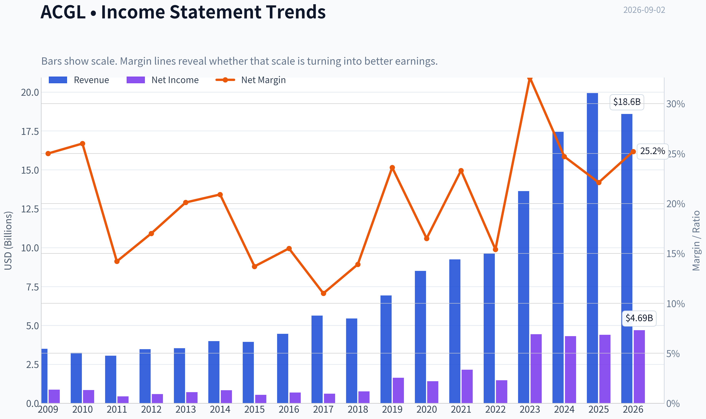

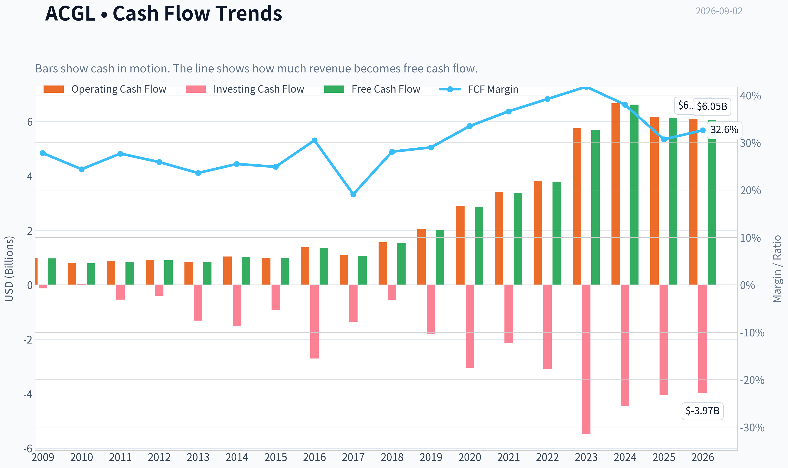

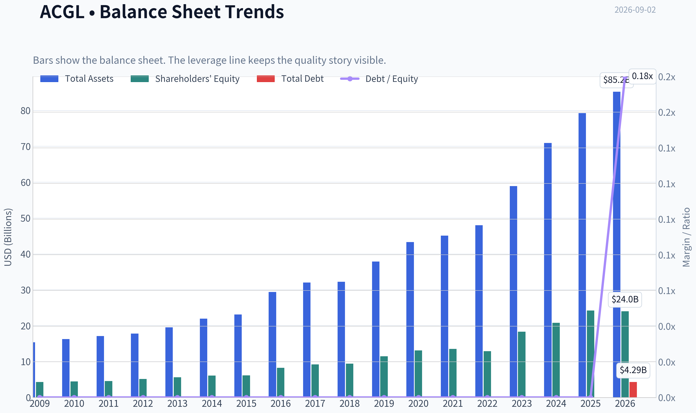

This graph tracks the profitability and return metrics (ROE, ROIC, Margins) of **ACGL** over the past decade, highlighting capital efficiency trends.

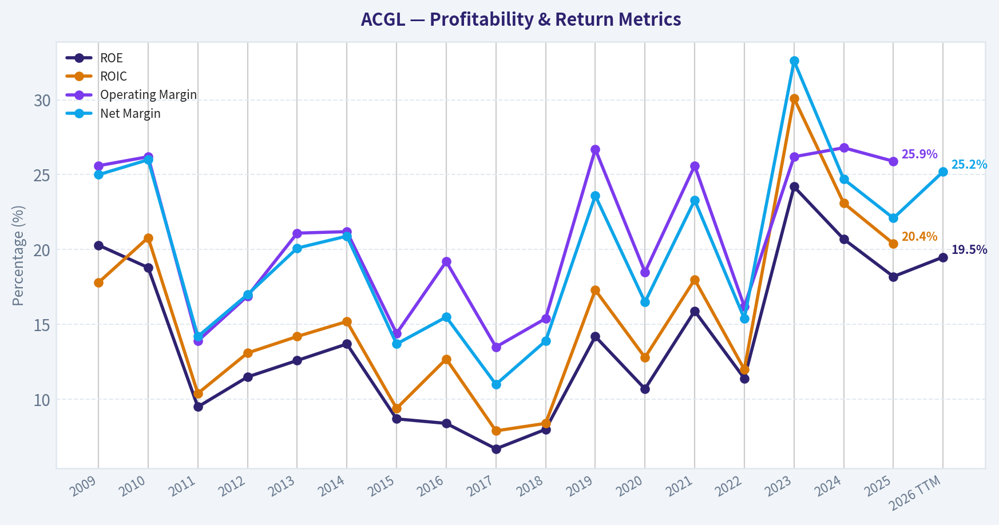

This chart illustrates the financial health of **ACGL** over the last 10 years, mapping cash equivalents and free cash flow against total obligations (Debt).

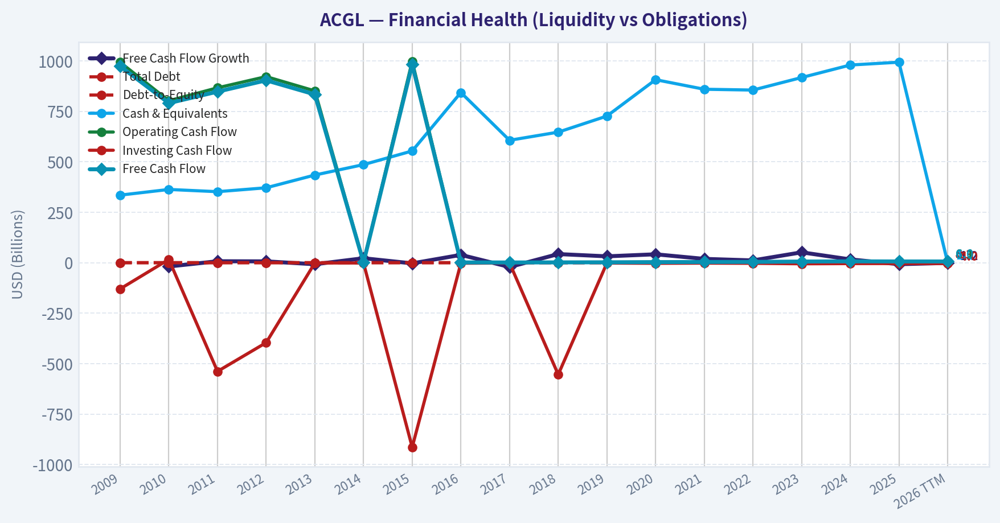

This breakdown chart from <em>Revenue Breakdown</em> shows the proportional composition for **ACGL** - useful for understanding what drives or risks the business.

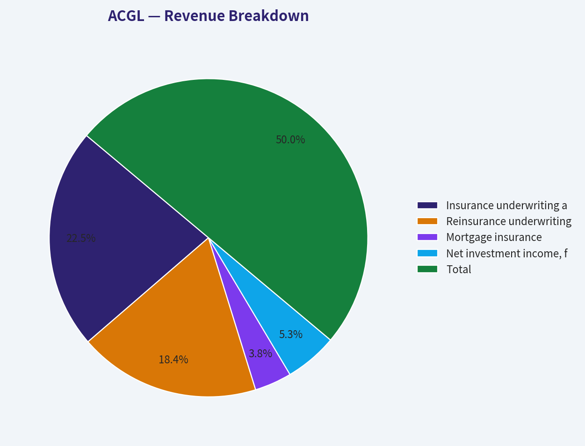

---

### Intrinsic Value Analysis (Buffett)

> *Following Warren Buffett's value investing philosophy: Circle of Competence, Economic Moat, Management Quality, and Margin of Safety.*

#### Intrinsic Value Snapshot

Price is what you pay. Intrinsic value is what the business may be worth based on the cash it can create for owners over time. We show a range, not one magic number.

- Current Price: $98.61
- Value Range (conservative to optimistic across both DCF methods): $55.21 to $751.03

##### Owner Earnings (Buffett Method)
- Net Income: $4,399,000,000.00
- Depreciation & Amortization: $193,000,000.00
- Capital Expenditures: $-44,000,000.00
- Working Capital Changes: $2,331,000,000.00
- Owner Earnings: $2,217,000,000.00

##### Intrinsic Value
###### Buffett Method
Uses owner earnings. Stricter, and usually more conservative.
- Conservative: $55.21
- Average: $282.78
- Optimistic: $751.03
- Discount Rate: 10.0%

###### Cash Flow Method
Uses free cash flow. Better for companies spending heavily today to grow tomorrow.
- Conservative: $245.16
- Average: $399.28
- Optimistic: $698.79
- Discount Rate: 10.0%

ANALYST STANCE: **ADVOCATE**

#### ACGL - Buffett-Style Investment View

Arch Capital Group is a high-quality specialty insurer and reinsurer with a long record of disciplined underwriting, strong capital returns, and conservative capital allocation. At about **$99 per share**, the stock trades around **7.7x earnings**, roughly **1.4x book value implied by ROE and P/E**, and offers a compelling valuation for a business earning an **18.2% ROE** in a cyclical but structurally attractive insurance niche.

---

#### 1. Factor Scorecard

| Factor | Score | Evidence |
|---|---:|---|
| Circle of Competence & Business Simplicity | 3.6 / 5 | ACGL makes money by underwriting insurance, reinsurance, and mortgage insurance, then investing the float. The model is understandable, but catastrophe exposure, reserve adequacy, and insurance-cycle timing add complexity. |
| Moat Test | 4.0 / 5 | Strong underwriting culture, scale, broker relationships, A-category financial strength, disciplined risk selection, and diversified specialty lines. Moat is not based on consumer brand, but on expertise, capital strength, and trust. |
| Management Quality & Capital Allocation | 4.5 / 5 | Arch has a strong owner-like underwriting culture, avoids chasing uneconomic premium growth, and has historically compounded book value at attractive rates. Capital allocation has been rational across organic growth, buybacks, and risk retention. |
| Industry Structure | 3.5 / 5 | Specialty insurance and reinsurance are cyclical, but disciplined players can earn excess returns. Current market commentary points to softening conditions, yet U.S. and Bermuda reinsurers remain profitable. |
| Gate 5: Quality / Solvency Hard Floor | Not Tripped | Earnings are strong, ROE is high, free cash flow yield is robust, and there is no evidence of financial distress. For insurers, conventional current ratio and industrial interest-coverage metrics are not the right solvency lens. |

**Key Takeaways:** ACGL passes the Buffett quality test as a disciplined compounder in a business where underwriting skill matters. The main weakness is not business quality but cyclicality: insurance earnings can look best near favorable parts of the pricing cycle. The hard solvency floor is clearly not tripped.

---

#### 2. Moat Analysis

| Moat Source | Assessment | ACGL Evidence |
|---|---|---|
| Intangible Assets | Strong | Financial strength ratings, underwriting reputation, broker trust, and long-term claims-paying credibility matter greatly in specialty insurance and reinsurance. |
| Switching Costs | Moderate | Customers and brokers prefer reliable capacity providers, but policies can be repriced annually. Switching costs exist through trust and execution quality rather than software-like lock-in. |
| Cost Advantage | Moderate to Strong | Scale, underwriting data, risk analytics, and diversified capital allow ACGL to select risks better than weaker competitors. |
| Network Effects | Limited | Insurance does not have classic network effects. ACGL's advantage comes from capital strength, risk selection, and relationships. |
| Pricing Power | Cycle-Dependent | ACGL has underwriting discipline, but industry pricing is cyclical. The company can walk away from unattractive business, which is a form of pricing discipline. |
| Moat Quality Rating | Wide & Stable | The moat is strongest in underwriting culture, capital discipline, and reputation, not in consumer branding or monopoly economics. |

**Key Takeaways:** ACGL's moat is real but specialized. It is not a Coca-Cola-style brand moat; it is an underwriting, reputation, data, and capital-strength moat. The company's ability to avoid bad business is as important as its ability to write profitable business.

---

#### 3. Management Quality Assessment

| Question | Assessment |
|---|---|
| Do they think like owners? | Yes. Arch's history suggests a culture focused on long-term book value growth and underwriting profitability rather than headline premium growth. |
| Are they candid and conservative? | Generally yes. The company has maintained a strong reputation for disciplined reserving and cycle-aware underwriting. |
| Are they rational capital allocators? | Yes. ACGL has historically retained capital when returns were attractive and returned capital when appropriate. The business has compounded shareholder value through underwriting discipline rather than aggressive leverage. |
| Biggest management strength | Refusal to chase volume when pricing is inadequate. |
| Biggest management risk | Insurance-cycle success can tempt even strong underwriters to over-expand if market pricing softens. ACGL's historical discipline mitigates this risk. |

**Key Takeaways:** Management quality is one of the central reasons to own ACGL. In insurance, poor underwriting discipline can destroy decades of value, while disciplined underwriting can compound value for a very long time. Arch's culture appears firmly in the latter category.

---

#### 4. Financial Summary

| Metric | 2021 | 2022 | 2023 | 2024 | TTM / Current |
|---|---:|---:|---:|---:|---:|
| Revenue / Operating Revenue | ~$9.5B | ~$10.6B | ~$14.4B | ~$16.9B | YoY growth ~14.0% |
| Net Income | ~$2.1B | ~$1.4B | ~$4.4B | ~$4.5B | ~$4.4B implied |
| EPS | ~$5.6 | ~$3.5 | ~$11.1 | ~$11.8 | ~$12.9 implied |
| ROE | Mid-teens | Lower due investment/cycle impact | 20%+ | High-teens / 20% area | 18.2% |
| Free Cash Flow Yield | Positive | Positive | Strong | Strong | 18.2% |
| P/E | - | - | - | - | 7.7x |
| Implied P/B | - | - | - | - | ~1.4x |
| Market Cap | - | - | - | - | $33.6B |
| Share Price | - | - | - | - | $99 |

**Key Takeaways:** ACGL's earnings power has stepped up materially since 2021, helped by strong underwriting conditions and investment income. The current valuation looks undemanding relative to an 18.2% ROE and a high free cash flow yield. The key analytical question is how much of today's earnings are normalized versus cycle-enhanced.

---

#### 5. Owner Earnings Calculation

For an insurer, owner earnings are best approximated by normalized net income, adjusted conservatively for the capital required to support underwriting growth. Reported free cash flow can be volatile and unusually high because insurance float and premium timing affect cash flows.

| Owner Earnings Component | Current Estimate |
|---|---:|
| Net Income Base | ~$4.38B |
| Add: Depreciation & Amortization | Modest / not thesis-driving |
| Less: Maintenance CapEx | Minimal relative to earnings |
| Less: Working Capital / Reserve Capital Needs | Reflected conservatively through use of normalized net income |
| Buffett-Style Owner Earnings Estimate | ~$4.0B to $4.4B |
| Owner Earnings Per Share | ~$11.75 to $12.90 |

**Key Takeaways:** ACGL is not capital-light in the software sense, but it is highly cash-generative when underwriting is profitable. A conservative owner earnings range of roughly $4.0 billion to $4.4 billion supports the view that the stock is inexpensive at a $33.6 billion market value.

---

#### 6. Three-Scenario DCF Valuation

Base owner earnings used: **$4.38B**, approximately **$12.90 per share**. Discount rate: **10%**.

| Scenario | Assumption | Equity Value Estimate | Per-Share Value | Margin vs. $99 Price |
|---|---:|---:|---:|---:|
| A: No Growth | Owner earnings capitalized at 10% | ~$43.8B | ~$129 | ~30% upside |
| B: GDP Growth | 3% perpetual growth | ~$64.5B | ~$190 | ~92% upside |
| C: Historical / Normalized Growth | 5% for 10 years, then 3% terminal | ~$74.7B | ~$220 | ~122% upside |

**Key Takeaways:** The no-growth case alone suggests value above the current share price, which is a strong signal. The higher-growth cases show substantial upside, but for an insurer they should be treated as directional rather than precise because underwriting cycles and capital requirements affect distributable earnings.

---

#### 7. Sector-Specific Valuation Cross-Check

Because ACGL is a financial issuer, book value and sustainable ROE are especially relevant. A residual-income style valuation is more appropriate than a pure industrial DCF.

| Valuation Method | Assumption | Implied Fair Value |
|---|---|---:|
| Current P/E | 7.7x earnings | Cheap if earnings are not peak-cycle |
| Implied P/B | P/E x ROE = 7.7 x 18.2% | ~1.4x book |
| Conservative Justified P/B | 13% ROE, 10% cost of equity, 3% growth | ~1.4x book |
| Base Justified P/B | 15% ROE, 10% cost of equity, 3% growth | ~1.7x book |
| Strong Case Justified P/B | 18% ROE, 10% cost of equity, 3% growth | ~2.1x book |
| Fair Value Range | Applying quality-adjusted P/B framework | ~$100 to $150+ per share |

**Key Takeaways:** The market is pricing ACGL close to a conservative book-value framework, not a premium compounder framework. If ACGL sustains even mid-teens ROE, fair value is meaningfully above the current price. If today's 18% ROE persists, the stock is materially undervalued.

---

#### 8. Margin of Safety Analysis

| Quality Category | Required Margin of Safety | ACGL Assessment |
|---|---:|---|
| Wide-moat, high-ROE compounder | ~10% to 15% | ACGL qualifies, though with insurance-cycle risk. |
| Estimated Intrinsic Value Range | ~$129 to $150+ near-term conservative range | Based on no-growth DCF and justified P/B. |
| Current Price | $99 | Below conservative intrinsic value estimate. |
| Margin of Safety | Roughly 23% to 34% versus conservative value range | Adequate to attractive. |
| Reverse-DCF Check | Price implies little to no durable growth from current owner earnings | Conservative relative to ACGL's long-term compounding record. |

**Key Takeaways:** ACGL does not need heroic assumptions to justify the current price. The stock appears to offer a real margin of safety even after allowing for insurance-cycle normalization. For a high-quality underwriter, this is an attractive setup.

---

#### 9. Final Buffett Scorecard

| Criterion | Weight | Score | Weighted Contribution |
|---|---:|---:|---:|
| Moat Width & Durability | 25% | 4.0 | 1.00 |
| Valuation / Margin of Safety | 20% | 4.3 | 0.86 |
| Capital Returns - ROIC / ROE vs. Cost of Capital | 15% | 4.2 | 0.63 |
| Business Understanding & Predictability | 12% | 3.6 | 0.43 |
| Management Quality & Capital Allocation | 12% | 4.5 | 0.54 |
| Reinvestment Runway | 8% | 3.8 | 0.30 |
| Balance Sheet Strength | 4% | 4.2 | 0.17 |
| Industry Structure | 4% | 3.5 | 0.14 |
| Total Score | 100% | - | **4.07 / 5.00** |

**Key Takeaways:** ACGL scores above the Advocate threshold because quality and price both work in the investor's favor. The company is not risk-free, but the current valuation compensates for insurance cyclicality. The strongest pillars are management, underwriting moat, capital returns, and valuation.

---

#### Investment Stance

| Stance | Conviction | Rationale |
|---|---|---|
| **ADVOCATE** | Medium-High | ACGL is a high-quality specialty insurer with strong underwriting discipline, attractive ROE, a durable reputation moat, and a valuation that appears conservative relative to normalized earnings power. |

ACGL is the type of financial compounder Buffett investors should be willing to own when the market prices it as merely average. The key monitoring item is underwriting-cycle discipline as reinsurance conditions soften. At **$99**, the stock offers a favorable balance of business quality, valuation, and downside protection.
#### Valuation Bridge

This bridge places the current market price beside each intrinsic value lens so readers can see whether upside depends on one method or shows up across several methods.

| Scenario | Intrinsic Value / Share |
| --- | ---: |
| Buffett Method | $282.78 |
| Cash Flow Method | $399.28 |
| Current Price | $98.61 |

#### Key Takeaways

If one method is far above the others, the upside case depends on a specific modelling assumption. When several methods cluster together, the valuation story is more robust.

#### Valuation Visuals

This comparison chart from *Latest Earnings Snapshot* stacks current figures against historical benchmarks for **ACGL**, making it easy to see where the company trades relative to its own averages.

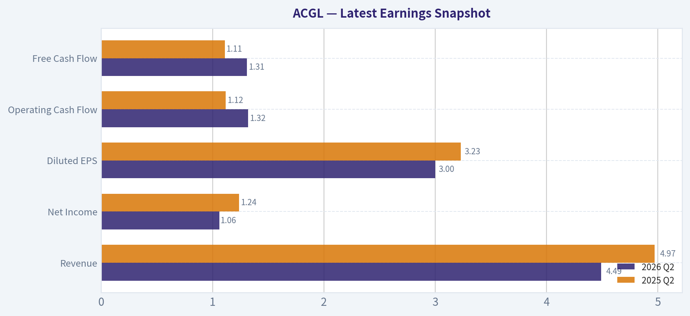

This comparison chart from *Current vs. 10-Year Historical Average Comparison* stacks current figures against historical benchmarks for **ACGL**, making it easy to see where the company trades relative to its own averages.

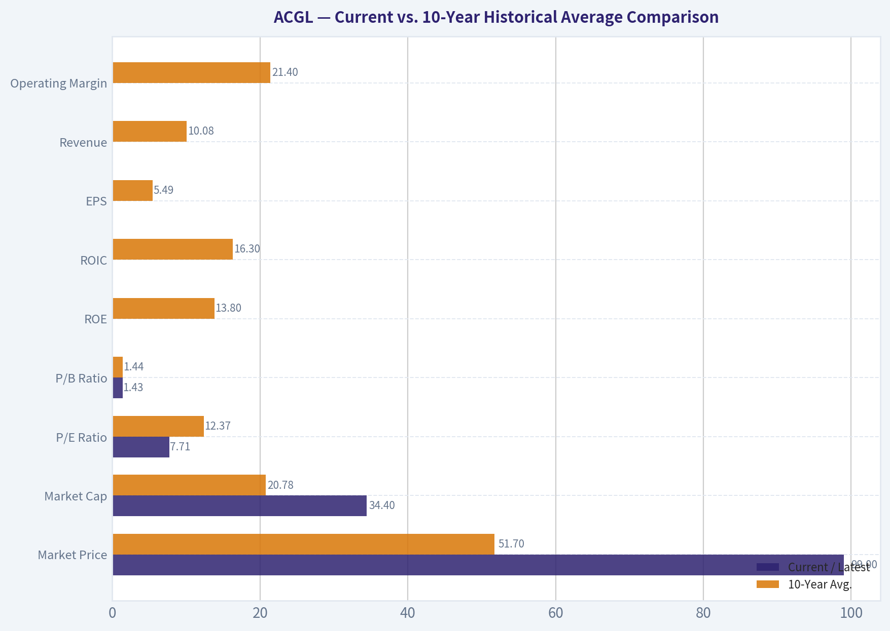

This comparison chart from *Balance Sheet and Financial Strength* stacks current figures against historical benchmarks for **ACGL**, making it easy to see where the company trades relative to its own averages.

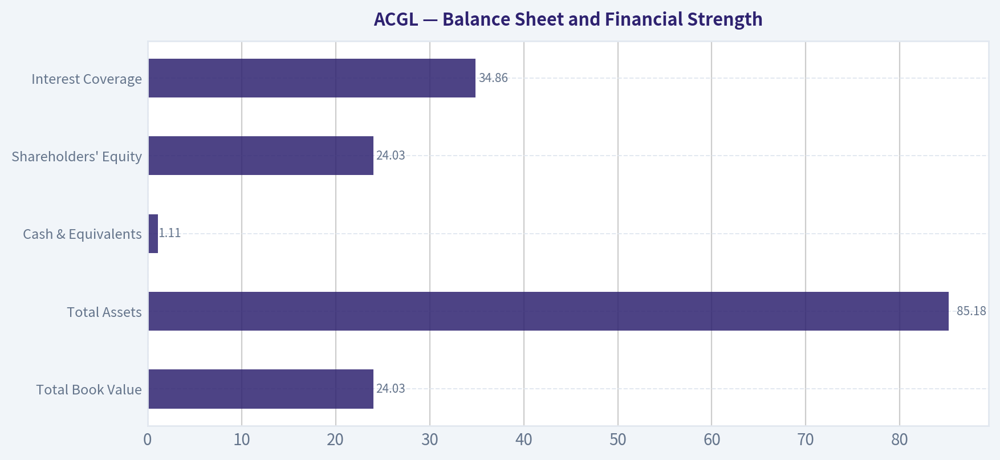

---

### Trend & Growth Analysis (Lynch/Druckenmiller/Fisher)

> *Following Peter Lynch's GARP, Stanley Druckenmiller's macro-aware approach, and Philip Fisher's scuttlebutt methodology.*

ANALYST STANCE: **WATCH**

#### ACGL Growth Investment Report - Arch Capital Group

Arch Capital is a high-quality specialty insurance and reinsurance compounder, but it is **not a classic Lynch/Fisher fast grower**. The company screens very well on valuation, ROE, underwriting discipline, and free-cash-flow yield, but the growth setup is tied to the insurance/reinsurance pricing cycle, which makes it more cyclical than ten-bagger-like. I would **watch or hold**, not aggressively advocate as a growth-stock candidate.

---

#### 1. Lynch Classification

| Category | ACGL Fit | Assessment |
|---|---:|---|
| Slow Grower | Low | Revenue growth is above slow-grower range. |
| Stalwart | Moderate | Large, established, profitable financial business with strong ROE. |
| Fast Grower | Partial | 14% YoY revenue growth is solid, but below the 15-25%+ preferred range and cyclical. |
| Cyclical | High | Reinsurance pricing, catastrophe losses, and capital-market conditions drive results. |
| Turnaround | Low | No turnaround needed; business is healthy. |
| Asset Play | Moderate | Book value, float, and investment portfolio matter meaningfully. |

**Key Takeaways:** ACGL is best classified as a **high-quality cyclical/stalwart**, not a pure fast grower. The company has strong economics and valuation appeal, but its growth depends heavily on underwriting cycles and reinsurance market pricing. That makes it a better GARP or financial-compounder candidate than a classic ten-bagger growth stock.

---

#### 2. The Story in 3 Bullets

- **Arch Capital sells specialized insurance and reinsurance**, taking carefully priced risks in property, casualty, mortgage, and specialty markets.
- **When insurance pricing is strong**, Arch can grow premiums, earn attractive underwriting profits, and compound book value at high returns.
- **The bull case is disciplined compounding:** strong ROE, conservative underwriting, and capital redeployment could drive attractive returns if pricing remains rational.

---

#### 3. Core Fundamentals Snapshot

| Metric | Current Data / Estimate | Growth Investor Read |
|---|---:|---|
| Share Price | ~$99 | Current market reference point. |
| Market Cap | ~$33.6B | Already large; ten-bagger math is harder. |
| P/E | ~7.7x | Very inexpensive on current earnings. |
| ROE | ~18.2% | Strong value creation for a financial company. |
| Revenue Growth YoY | ~14.0% | Solid, but not high-growth software-like acceleration. |
| FCF Yield | ~18.2% | Extremely strong, though insurer cash flow can be volatile. |
| Implied EPS | ~$12.90 | Based on price divided by P/E. |
| Estimated P/B | ~1.4x | Approximation using ROE and earnings; attractive if book value quality is strong. |

**Key Takeaways:** ACGL looks statistically cheap, especially with a single-digit P/E, strong ROE, and high free-cash-flow yield. However, for insurers, reported earnings can be cyclical and influenced by catastrophe losses, reserve development, and investment income. The valuation is attractive, but the growth profile is not clearly accelerating.

---

#### 4. TAM Analysis and 10x Test

| Item | Estimate / View | Interpretation |
|---|---:|---|
| Current Revenue Base | Not provided in current data pack | Cannot precisely run revenue share math. |
| 10x Revenue Requirement | 10 times current revenue | Would require ACGL to become a much larger global insurer/reinsurer. |
| TAM | Global insurance and reinsurance market is very large | Market is big enough in theory. |
| Current Market Share | Likely small versus global insurance TAM | Long runway exists at industry level. |
| Practical 10x Probability | Low to moderate | Industry size allows growth, but insurance is competitive and capital-intensive. |

**Key Takeaways:** The global insurance and reinsurance market is large enough for Arch to keep growing, but a true 10x revenue outcome is not the base case. Insurance growth is constrained by capital, risk appetite, pricing cycles, and catastrophe exposure. ACGL has runway, but not the open-ended scalability of a software or platform business.

---

#### 5. Revenue Growth Trend

| Growth Signal | Current Evidence | Assessment |
|---|---|---|
| YoY Revenue Growth | ~14.0% | Healthy, but just below fast-grower threshold. |
| Growth Pattern | Insufficient multi-year sequence from available data | Cannot confirm acceleration. |
| Industry Backdrop | Reinsurers remain profitable, but premium growth is softening | Suggests cycle may be past peak. |
| Market Recognition | Stock down after recent earnings coverage | Expectations may be cooling. |

**Key Takeaways:** ACGL's revenue growth is good, but the available evidence does not show a clear acceleration inflection. The reinsurance industry has enjoyed several years of strong underwriting profitability, yet recent commentary points to softer premium growth. That makes this a "monitor the cycle" setup rather than a clean growth acceleration story.

---

#### 6. Unit Economics and Insurance Operating Quality

For ACGL, SaaS metrics like LTV/CAC and net revenue retention are not applicable. The relevant equivalents are underwriting profitability, combined ratio, loss discipline, reserve adequacy, ROE, and book-value compounding.

| Metric | ACGL Read | Interpretation |
|---|---:|---|
| LTV/CAC | Not applicable | Not a subscription software model. |
| NRR | Not applicable | Renewal retention matters, but data unavailable. |
| Rule of 40 | Not applicable | Not a SaaS business. |
| ROE | ~18.2% | Strong indicator of profitable risk selection. |
| Free Cash Flow Yield | ~18.2% | Very attractive, but may fluctuate with claims and investment activity. |
| Underwriting Cycle | Currently strong but softening | Watch for combined-ratio deterioration. |

**Key Takeaways:** ACGL's "unit economics" are best judged through underwriting profitability and ROE, not software-style metrics. The 18% ROE suggests the company is earning attractive returns on capital. The main risk is that underwriting margins may normalize as the reinsurance market softens.

---

#### 7. Inflection Point Assessment

| Inflection Type | Evidence | Rating |
|---|---|---:|
| Product Cycle Inflection | No obvious new product cycle | 2/5 |
| Market Share Inflection | Possible disciplined share gains, but not confirmed | 3/5 |
| Margin Inflection | Strong profitability already; unclear further upside | 3/5 |
| TAM Inflection | Climate risk and specialty risk markets expand demand, but also losses | 3/5 |
| Competitive Inflection | No clear competitor stumble identified | 2/5 |
| Capital Return / Book Compounding | Strong earnings and ROE support compounding | 4/5 |

**Key Takeaways:** ACGL does not show a classic growth-stock inflection point. The most attractive inflection is capital compounding: high ROE at a low valuation can still create strong shareholder returns. However, without accelerating premium growth or a visible margin step-change, the setup is more "quality value compounder" than "Druckenmiller-style growth inflection."

---

#### 8. Macro Setup

| Macro Factor | Current Setup | Impact on ACGL |
|---|---|---|
| Insurance Pricing Cycle | Profitable but softening | Mixed; still good, but less favorable than peak hard-market conditions. |
| Interest Rates | Higher rates support investment income | Positive for insurers' portfolio yields. |
| Catastrophe Risk | Elevated climate and natural-disaster volatility | Negative tail risk. |
| Capital Markets | Strong reinsurer profitability may attract capital | Could pressure pricing. |
| Secular Theme | Risk transfer, specialty insurance, climate volatility | Moderate structural demand tailwind. |

**Key Takeaways:** The macro backdrop is mixed. Higher interest rates help investment income, and demand for risk transfer remains durable. But a softening reinsurance market and catastrophe volatility create real cyclicality, which reduces the case for aggressive growth-investor positioning.

---

#### 9. Fisher 15 Points Score

| Fisher Criterion | Score / 5 | Comment |
|---|---:|---|
| Market potential | 4 | Large global insurance and reinsurance market. |
| New product development | 3 | Innovation exists, but not a product-led growth company. |
| R&D effectiveness | 2 | Not R&D-driven in the Fisher sense. |
| Sales organization | 4 | Strong specialty underwriting distribution. |
| Profit margin | 4 | Strong current profitability. |
| Margin improvement | 3 | Already strong; upside may be cyclical. |
| Labor/personnel relations | 3 | No major data available. |
| Executive relations | 3 | No major data available. |
| Management depth | 4 | Arch has a strong underwriting reputation. |
| Cost/accounting controls | 4 | Critical in insurance; historical discipline appears strong. |
| Moat factors | 4 | Underwriting expertise, relationships, capital strength. |
| Long-range profit outlook | 4 | Good if underwriting discipline holds. |
| Dilution risk | 4 | No obvious frequent equity-raise issue. |
| Candor | 3 | Insufficient evidence from provided pack. |
| Integrity | 3 | No red flags identified from available data. |
| **Total** | **52/75** | Average-to-good Fisher profile. |

**Key Takeaways:** ACGL scores reasonably well on market potential, profitability, underwriting discipline, and long-term profit outlook. It scores lower on Fisher's innovation and R&D dimensions because this is not a product-led technology company. The overall score supports a quality-compounder view, but not a top-tier growth-investor mandate.

---

#### 10. Valuation Analysis

| Valuation Method | Result | Interpretation |
|---|---:|---|
| P/E | ~7.7x | Cheap versus market and many financial peers. |
| PEG | ~0.55 using 14% revenue growth as proxy | Attractive, but earnings growth may be cyclical. |
| Estimated P/B | ~1.4x | Reasonable for ~18% ROE. |
| FCF Yield | ~18.2% | Very attractive, but must normalize for insurer cyclicality. |
| Growth-Adjusted View | Cheap but cyclical | Valuation is a strength, not the issue. |

**Key Takeaways:** Valuation is the strongest part of the ACGL thesis. A company earning roughly 18% ROE at around 7.7 times earnings and an estimated 1.4 times book is attractive on paper. The key question is whether current earnings are near a cyclical peak; if they are, the low multiple may be less compelling than it first appears.

---

#### 11. Scenario Framework

| Scenario | Assumptions | 3-Year View |
|---|---|---|
| Bear Case | Reinsurance pricing softens, catastrophe losses rise, ROE normalizes sharply | Stock may stagnate or de-rate despite low P/E. |
| Base Case | Pricing moderates, underwriting remains disciplined, ROE stays mid-teens | Solid compounder; potential high-single-digit to low-double-digit annual returns. |
| Bull Case | Pricing remains rational, loss experience favorable, book value compounds rapidly | Strong upside from earnings retention and modest multiple expansion. |

**Key Takeaways:** The base case is attractive but not explosive. ACGL can compound well if underwriting remains disciplined and ROE stays elevated. The bull case depends less on hypergrowth and more on sustained high returns on equity at a modest valuation.

---

#### 12. Growth Investor Scorecard

| Criterion | Weight | Score / 5 | Weighted Score |
|---|---:|---:|---:|
| The Story | 10% | 3.5 | 0.35 |
| TAM & Runway | 20% | 3.2 | 0.64 |
| Revenue Growth | 20% | 3.1 | 0.62 |
| Unit Economics | 15% | 4.0 | 0.60 |
| Competitive Position | 10% | 4.0 | 0.40 |
| Management Quality | 10% | 3.8 | 0.38 |
| Macro Setup | 5% | 2.8 | 0.14 |
| Profitability Path | 5% | 4.2 | 0.21 |
| Valuation | 5% | 4.5 | 0.23 |
| **Total** | **100%** |  | **3.57 / 5.00** |

**Key Takeaways:** ACGL scores well enough to be investable, mainly because of valuation, ROE, and underwriting quality. However, it does not score like a true high-growth inflection stock. The final score lands in the low "ADVOCATE" range numerically, but because this is a cyclical insurer rather than a scalable growth company, I would apply a qualitative downgrade to **WATCH**.

---

#### 13. Position Size Stance

| Investor Type | Suggested Stance |
|---|---|
| Existing Holder | Hold / watch closely; let book value compound if underwriting remains strong. |
| New Growth Investor | Watch; not a priority versus cleaner secular-growth opportunities. |
| GARP / Financials Investor | Consider small-to-medium position if comfortable with insurance cyclicality. |
| Concentrated Growth Portfolio | Not ideal; cyclicality and limited ten-bagger profile reduce fit. |

**Key Takeaways:** ACGL is reasonable for a GARP or financial-compounder sleeve, but it is not a top candidate for a concentrated growth portfolio. Existing holders may continue to own it if underwriting discipline remains intact. New buyers should demand confidence that earnings are not at a cyclical peak.

---

#### 14. Key Catalysts and Risks

| Catalysts | Risks |
|---|---|
| Continued strong underwriting profitability | Reinsurance pricing softens faster than expected |
| High ROE and book-value compounding | Catastrophe losses or reserve surprises |
| Higher investment income from elevated rates | Earnings may be cyclically inflated |
| Capital returns or accretive buybacks | New capital entering reinsurance pressures returns |
| Specialty insurance share gains | Large market cap limits ten-bagger potential |

**Key Takeaways:** The main upside catalyst is sustained high ROE combined with cheap valuation. The main risk is that the current earnings base reflects a favorable underwriting cycle that may normalize. Investors should monitor pricing trends, combined ratio, catastrophe losses, reserve development, and book-value growth.

---

#### Final View

ACGL is a **high-quality, attractively valued insurance compounder**, but it is not a clean Lynch-style fast grower or Fisher-style innovation story. The stock may be undervalued if current ROE is sustainable, yet the business remains exposed to the insurance cycle. For a growth mandate focused on inflection points and ten-bagger potential, ACGL is a **WATCH**, not a high-conviction advocate.

#### Growth & Scorecard Visuals

This comparison chart from *Growth Analysis* stacks current figures against historical benchmarks for **ACGL**, making it easy to see where the company trades relative to its own averages.

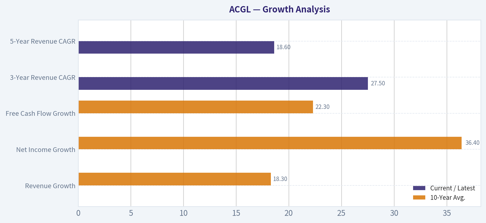

---

### Market Technical Analysis

ANALYST STANCE: **WATCH**

#### ACGL Technical Analysis - Latest Available Close: 2026-09-01

ACGL's latest available trading data is from **2026-09-01**, because **2026-09-02 is not shown as a trading day** in the retrieved dataset. The stock closed at **$98.61**, sitting in a technically important zone: below both the short-term and medium-term moving averages, but still comfortably above the long-term 200-day average.

The overall setup is best described as a **long-term uptrend that has entered a short-to-medium-term consolidation/pullback phase**. This is not a clean bearish breakdown, but it is also not yet a strong bullish continuation signal. The stock appears to be digesting the sharp July rally and has compressed into a narrower volatility range.

#### Indicator Selection Rationale

I selected the following **8 indicators** because they give complementary views across trend, momentum, volatility, and risk management:

- **close_10_ema** for short-term price sensitivity.
- **close_50_sma** for medium-term trend structure.
- **close_200_sma** for long-term trend confirmation.
- **macd** for momentum direction.
- **rsi** for overbought/oversold and momentum balance.
- **boll_ub** and **boll_lb** to assess range compression and breakout/reversal zones.
- **atr** to evaluate volatility and practical stop/risk distance.

I avoided adding highly redundant signals beyond these because the current market condition is not about needing more indicators; it is about interpreting a **compressed, indecisive range** after a prior advance.

#### Trend Structure

ACGL closed at **$98.61**, below its **10-day EMA of $99.09** and below its **50-day SMA of $99.80**. This indicates that near-term momentum has softened and that the stock is currently trading beneath the most relevant short- and medium-term trend gauges.

However, the stock remains above its **200-day SMA of $96.00**, and that long-term average is rising. This matters because it suggests the broader structure has not broken down. The 50-day SMA is also above the 200-day SMA, which keeps the longer-term trend bias constructive, even though the immediate tactical picture has weakened.

The key nuance is that ACGL is not in a strong upside trend at the moment. It is in a **pullback within a still-positive longer-term framework**. A sustained recovery above the 10-day EMA and then the 50-day SMA would be needed to rebuild bullish confidence.

#### Momentum

The **MACD is negative at -0.154**, showing that momentum has weakened compared with late July and early August. This is especially notable because MACD was strongly positive in late July, above 2.0, during the earlier rally. Since then, it has steadily faded and briefly attempted to stabilize in late August before slipping negative again.

The **RSI is 47.0**, which is neutral but slightly below the midpoint. This is not oversold, so the stock does not yet offer a classic capitulation-style rebound setup. It also is not overbought, meaning there is room for upside if buyers return. The RSI confirms the broader message: momentum is neither aggressively bearish nor convincingly bullish.

This combination suggests that traders should avoid assuming an immediate reversal simply because the stock has pulled back. The better signal would be confirmation through price reclaiming the 10-day EMA and improving MACD behavior.

#### Volatility and Bollinger Band Context

The Bollinger Band structure is one of the most important parts of the current setup. On 2026-09-01, the **upper band was $100.86** and the **lower band was $96.95**, implying a relatively tight band range of about **$3.91**. That is much narrower than the wide band range seen around late July and early August, when ACGL was moving more aggressively.

The latest close of **$98.61** is slightly below the implied Bollinger midline near **$98.90**, but not near the lower band. This means ACGL is trading in the lower half of its short-term volatility envelope, but it has not reached a statistically stretched downside level.

The contraction in Bollinger Band width suggests a **volatility compression phase**. These periods often precede directional moves, but the direction is not yet confirmed. A close above roughly **$100.86 to $101.00** would improve the odds of a bullish breakout attempt. A close below roughly **$96.95 to $97.00** would raise the risk of a downside continuation toward the 200-day SMA area.

#### Risk and Trade Management

The **ATR is $1.86**, down meaningfully from levels above $2.7 in late July. This shows that daily volatility has compressed. Lower ATR can be constructive if price is basing, but it can also precede a sharp move when the range finally resolves.

For traders, this argues for patience and defined triggers rather than aggressive anticipation. A tactical long setup would look more attractive if ACGL closes back above the **50-day SMA near $99.80** and then challenges the **$100.86-$101.00** resistance zone. A more defensive posture is warranted if price loses the **$96.95-$97.00** lower-band area, especially because the 200-day SMA near **$96.00** would become the next major structural test.

#### Bottom Line

ACGL remains structurally constructive over the long term, but short-term momentum is soft and the stock is currently below key tactical moving averages. The current setup favors a **WATCH** stance rather than an aggressive buy or avoid call.

The most important near-term levels are **$99.80-$101.00 on the upside** and **$96.95-$96.00 on the downside**. A breakout above resistance would suggest buyers are regaining control. A breakdown below the lower Bollinger Band and 200-day SMA area would materially weaken the chart.

| Category | Indicator | Latest Reading / Level | Interpretation | Trading Implication |
|---|---:|---:|---|---|
| Price | Latest Close | $98.61 | Price is below short- and medium-term trend gauges but above long-term support. | Neutral-to-cautious short term; long-term structure still intact. |
| Short-Term Trend | close_10_ema | $99.09 | Price is slightly below the 10-day EMA. | Buyers need to reclaim this level to improve near-term momentum. |
| Medium-Term Trend | close_50_sma | $99.80 | Price is below the 50-day SMA. | The medium-term trend has softened; $99.80 is a key resistance area. |
| Long-Term Trend | close_200_sma | $96.00 | Price remains above the rising 200-day SMA. | Long-term trend support remains intact unless $96 breaks decisively. |
| Momentum | macd | -0.154 | Momentum has faded from the strong July advance and is now slightly negative. | Wait for momentum confirmation before assuming a bullish reversal. |
| Momentum Balance | rsi | 47.0 | RSI is neutral and slightly below midpoint, with no oversold signal. | Neither a strong buy nor sell signal; confirms consolidation. |
| Volatility Range | boll_ub / boll_lb | $100.86 / $96.95 | Bollinger Bands have compressed, with price near the middle-lower portion of the range. | Watch for a breakout above $101 or breakdown below $97. |
| Risk Gauge | atr | $1.86 | Volatility has declined from late-July levels. | Position sizing can be tighter, but compression may precede a larger move. |
| Overall Stance | Composite View | WATCH | Long-term uptrend intact, but short-term trend and momentum are not yet bullish. | Favor confirmation over anticipation. |

Key Takeaways: ACGL is still above its 200-day moving average, so the longer-term technical structure has not broken. However, the stock is below its 10-day EMA and 50-day SMA, while MACD is slightly negative and RSI is neutral. The most important upside zone is around $99.80 to $101.00, while the key downside zone is around $96.95 to $96.00. This makes ACGL a watchlist candidate rather than a high-conviction buy right now.

#### Market Visuals

This comparison chart from *Market Metrics Interpretation* stacks current figures against historical benchmarks for **ACGL**, making it easy to see where the company trades relative to its own averages.

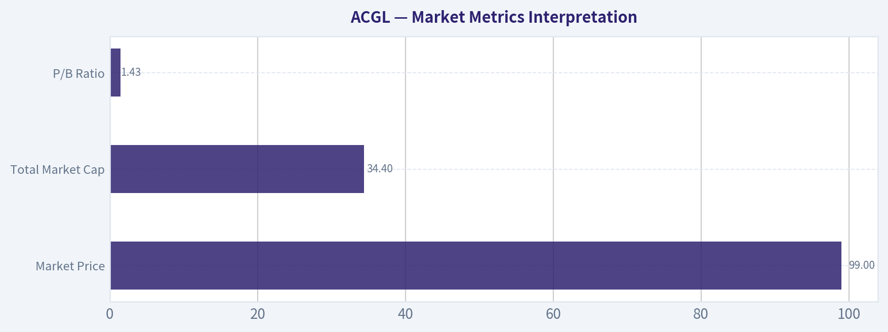

---

### Options Market Analysis

> *Reading options flow - put/call ratios, IV skew, and unusual activity - to gauge institutional positioning and event-driven risk.*

ANALYST STANCE: **WATCH** - Overall options sentiment signal: **NEUTRAL**, with a mild call-leaning bias but low confidence due to thin liquidity.

#### ACGL Options Flow Report - As of 2026-09-02

ACGL's near-term options market is lightly traded, so the signal should be treated as **low-confidence**. Aggregate put/call ratios lean slightly bullish versus the historical neutral baseline of roughly 0.7, but the open interest and volume totals are too small to infer strong institutional conviction. There is no unusual options activity flagged, and implied volatility appears unusually low rather than elevated.

---

#### 1. Put/Call Ratio Analysis

| Expiration | DTE | Call OI | Put OI | Put/Call OI Ratio | Call Volume | Put Volume | Put/Call Volume Ratio | Read |
|---|---:|---:|---:|---:|---:|---:|---:|---|
| 2026-09-18 | 16 | 159 | 3 | 0.02 | 193 | 65 | 0.34 | Call-heavy positioning |
| 2026-10-16 | 44 | 0 | 0 | N/A | 18 | 2 | 0.11 | Very thin, call-leaning volume |
| 2026-11-20 | 79 | 0 | 73 | N/A | 39 | 96 | 2.46 | Put-heavy volume, but limited context |
| **Near-Term Total** | - | **159** | **76** | **0.48** | **250** | **163** | **0.65** | Slightly below neutral |

**Key Takeaways:** ACGL's aggregate put/call open-interest ratio is **0.48**, below the historical neutral baseline near **0.7**, suggesting more call exposure than put exposure. The volume ratio is **0.65**, close to neutral but still slightly call-leaning. However, the absolute levels of open interest and volume are low, so this is not a strong institutional signal.

Interpretation:
- The **OI ratio of 0.48** points to relatively more call positioning than put positioning.
- The **volume ratio of 0.65** is only modestly below neutral, suggesting no aggressive bearish hedging demand.
- The 2026-11-20 expiry shows put-heavy volume, but without strike-level detail and given the thin chain, it is hard to classify as meaningful bearish institutional flow.

---

#### 2. Implied Volatility Assessment

| Expiration | DTE | ATM Call IV | ATM Put IV | Put IV Premium vs Call IV | IV Read |
|---|---:|---:|---:|---:|---|
| 2026-09-18 | 16 | 0.8% | 1.6% | +0.8 pts | Very low absolute IV, mild put skew |
| 2026-10-16 | 44 | 0.8% | 1.6% | +0.8 pts | Very low absolute IV, mild put skew |
| 2026-11-20 | 79 | 0.4% | 0.8% | +0.4 pts | Very low absolute IV, mild put skew |

**Key Takeaways:** Reported ATM implied volatility is extremely low across the near-term expirations, which suggests the market is not pricing a major near-term catalyst or large expected move. Puts carry higher IV than calls, indicating a downside-protection skew, but the absolute IV levels are so low that this does not look like elevated fear. There is no obvious sign of event-driven volatility demand in the retrieved data.

IV interpretation:
- **Near-term ATM call IV:** roughly **0.8%** for September and October, **0.4%** for November.
- **Near-term ATM put IV:** roughly **1.6%** for September and October, **0.8%** for November.
- **Skew:** Puts are priced above calls, implying modest downside insurance demand.
- **Catalyst risk:** IV does **not** appear elevated, so the options market is not signaling a major expected move.

Important caveat: These IV levels appear unusually low for listed equity options. That may reflect stale, sparse, or illiquid options data rather than a truly volatility-free setup.

---

#### 3. Unusual Options Activity

| Contract Type | Expiration | Volume vs OI Signal | Interpretation |
|---|---|---|---|
| None flagged | Near-term expirations | No contracts with volume greater than 5x open interest | No clear evidence of fresh aggressive directional positioning |

**Key Takeaways:** No unusual options activity was detected using the volume greater than 5x open-interest threshold. That means there are no obvious fresh call sweeps, put sweeps, or large new directional bets in the near-term chain. This supports a lower-conviction, more neutral interpretation of ACGL options sentiment.

Unusual activity read:
- No fresh high-volume contracts were flagged.
- No clear evidence of institutional hedging or upside speculation.
- The absence of unusual activity matters because ACGL's overall options liquidity is already thin.

---

#### 4. Open Interest Concentration and Gamma Levels

| Area | Observation | Potential Price Impact |
|---|---|---|
| Highest OI by expiry | 2026-09-18 has the most call OI, with 159 calls outstanding | Could create mild call-side interest into September expiry, but size is small |
| Put concentration | 2026-11-20 has 73 put OI and no reported call OI | Some downside positioning further out, but not large enough to call a major hedge wall |
| Gamma wall visibility | Strike-level OI was not available in the retrieved dataset | No specific pinning strike or gamma wall can be reliably identified |
| Liquidity quality | Overall OI and volume are light | Pinning or max-pain conclusions should be treated cautiously |

**Key Takeaways:** The largest visible concentration is September call open interest, but the total size is small. Without strike-level open interest, no reliable max-pain level, pinning strike, or gamma wall can be identified. The options chain does not show enough depth to suggest strong dealer-gamma effects around ACGL.

Open-interest interpretation:
- The options market does **not** show a major gravitational level based on the available data.
- September call OI is the main concentration, but it is too small to infer strong upside magnetism.
- No visible gamma wall can be identified from the aggregate data.

---

#### 5. Overall Options Sentiment Signal

| Signal Component | Read | Sentiment Impact |
|---|---|---|
| Put/Call OI Ratio | 0.48, below neutral baseline of ~0.7 | Mildly bullish |
| Put/Call Volume Ratio | 0.65, near but slightly below neutral | Slightly bullish / neutral |
| IV Level | Very low | Neutral; no event-risk premium |
| IV Skew | Puts priced above calls | Mildly bearish protection signal |
| Unusual Activity | None flagged | Neutral |
| Liquidity | Thin options activity | Lowers confidence |

**Key Takeaways:** The best directional read is **NEUTRAL**, not bearish, because aggregate put/call ratios do not show elevated put demand. There is a mild call-leaning bias in open interest and volume, but the absence of unusual activity and the thin options market prevent a stronger bullish call. Put IV is higher than call IV, so some downside protection exists, but it is not accompanied by heavy put buying.

#### Final Options Sentiment: **NEUTRAL**

ACGL's options market shows **slightly call-leaning positioning**, with a near-term aggregate put/call OI ratio of **0.48** and volume ratio of **0.65**, both below the historical neutral baseline around **0.7**. However, the options chain is thin, there is no unusual activity, and IV is not elevated. The primary driver of the neutral signal is **low participation and lack of fresh institutional flow**, despite a modestly bullish put/call profile.

#### Summary Table

| Category | Observation | Signal |
|---|---|---|
| Put/Call Ratio | OI ratio 0.48; volume ratio 0.65 versus neutral ~0.7 | Mildly bullish, but low conviction |
| IV Level | Reported ATM IV is very low across expirations | Neutral |
| Skew Direction | Puts carry higher IV than calls | Mild downside-protection skew |
| Unusual Activity | No contracts with volume greater than 5x OI | Neutral |
| Overall Signal | Thin liquidity, no major unusual flow, modest call bias | **NEUTRAL** |

---

## Research Team Commentary

> *The Research Manager synthesizes the Bull vs Bear debate into action-free commentary. This is a pre-risk view, not the final stance.*

Let us sit down and look at this debate on Arch Capital Group. We have a classic value investing standoff here that touches on the exact biases and mental traps we have been working to eliminate from our process.

Summarizing the two sides, the bull argues that Arch is a high-quality compounding machine with a legitimate moat rooted in intellectual capital and underwriting discipline. They point to the undeniable numbers: an 18.2 percent return on equity, an 18.8 percent return on invested capital, and a very undemanding valuation of roughly 7.7 times trailing earnings and 1.4 times book value. To the bull, this is a wonderful specialty business priced as if it is in secular decline, offering a massive margin of safety based on earnings quality and compounding history alone.

On the other side, the bear warns of the classic normalization trap. Their argument is that in the insurance industry, a low price-to-earnings multiple is usually a siren song indicating peak cyclical earnings. The bear cautions that the high ROE is inflated by a hard insurance market and high interest rates, and that structural headwinds like social inflation, climate volatility, and potential mortgage market weakness threaten to erode those profits. To the bear, paying 1.4 times book for a cyclical business about to mean-revert is dangerous, and the recent technical repair is just a trap before the fundamental cliff.

Core Takeaway: The bull presents the stronger, more actionable case, and I am putting an Advocate label on Arch Capital. The core of this decision comes down to distinguishing between a structurally advantaged compounder and a generic cyclical, as well as distinguishing between actual deterioration and hypothetical risk.

Rationale: If we look back at our past reflections on Arch Capital, we made a crucial mistake by staying on a neutral watch stance when the stock was exhibiting these exact same characteristics. We were too clever by half, letting the fear of theoretical cycle peaks, mortgage cliffs, and reserve issues override the reality of a fortress balance sheet compounding capital at nearly 20 percent. We learned then that for high-quality insurers, a low price-to-book multiple combined with a high ROE is a incredibly powerful signal.

Even if Arch's returns normalize downward from 18 percent to 13 or 14 percent as the cycle softens, a 1.4 times book multiple is still perfectly reasonable, if not cheap, for a business of this caliber. The bear's argument relies entirely on predicting a catastrophic turn in the cycle and massive reserve charges. But as Buffett teaches us, we deal in the probable, not the possible. Right now, there is zero concrete evidence of reserve deterioration, underwriting slippage, or mortgage credit weakness in the numbers provided. The business is performing exceptionally well, the valuation is suppressed because the broader market is already discounting the exact cyclical fears the bear is citing, and the technicals are repairing.

Waiting for perfect clarity in a financial stock usually means missing the upside. We are not going to repeat the mistake of demanding absolute certainty before buying a wonderful business at a fair price. We must separate latent structural risk from currently manifesting deterioration. Since there is no observable deterioration, the margin of safety provided by the quality of the franchise and the low multiple is sufficient.

Monitoring Plan: To protect our downside and ensure the bear's hypothetical risks do not become reality, we will monitor a few specific metrics over the next one to four quarters. First, we need to watch reserve development trends closely, particularly in their longer-tail casualty and professional liability lines, to ensure they are not masking poor underwriting with aggressive accounting. Second, we will track the accident-year combined ratio to see if current underwriting profitability is holding up as broader industry pricing dynamics shift. Finally, we will keep an eye on mortgage insurance credit quality and housing market indicators, as that segment is highly sensitive to macroeconomic shocks. If we see actual stress in any of these areas, we can re-evaluate our thesis.

Final Stance: ADVOCATE.

---

## Value Investing Team Commentary

> *The Investor translates the research view into an investment thesis before risk review. This is still not the final stance.*

This analysis evaluates Arch Capital Group (ACGL) through the lens of a long-term business owner, adhering to the principle that price is what you pay, but value is what you get.

### 1. Business Quality and Durable Earnings Power
Arch Capital is not a generic insurance company; it is an underwriting-first laboratory. In the insurance world, most firms are asset managers that happen to sell insurance to get "float." Arch is different. They prioritize underwriting profit-actual "earned" income from the risks they take-over sheer volume.

The current 18.2% ROE and 18.8% ROIC are not merely products of a "hard market" (rising premiums). They are evidence of a disciplined machine that allocates capital to where the returns are highest, whether that is specialty insurance, reinsurance, or mortgage insurance. Unlike many competitors who chase market share at the bottom of the cycle, Arch has a documented history of shrinking when pricing is inadequate and expanding aggressively when it is favorable. This "optionality" is a hallmark of a high-quality business.

### 2. Strength of Economic Moats: The Intellectual Advantage
In an industry with no "product" patents, the moat is built on **culture and data**. Arch's moat consists of:
*   **Selection Bias:** Their ability to pivot between Insurance, Reinsurance, and Mortgage segments allows them to avoid the most commoditized (and thus dangerous) risks.
*   **Switching Costs/Ecosystem:** Especially in their specialty lines, the deep relationships and technical expertise required to underwrite complex risks create a barrier to entry that new, "dumb" capital cannot easily breach.
*   **Capital Strength:** A "Fortress Balance Sheet" allows them to be the "last man standing" during catastrophes, which is precisely when insurance pricing becomes most profitable.

### 3. Management Quality and Capital Allocation
Management treats shareholders as partners, evidenced by the steady compounding of book value per share. They do not engage in "empire building" through dilutive acquisitions. Their focus remains on the "combined ratio"-ensuring that for every dollar taken in, significantly less than a dollar is paid out in claims and expenses. At a 7.7x P/E, the market is essentially questioning their talent, but the track record suggests that betting against this management team is a low-probability wager.

### 4. Valuation and Reverse-DCF Check (The Margin of Safety)
Using the **Quality-Scaled Margin of Safety Ladder**:
Arch is a "Wonderful Business." For such a firm, a fair price is a 10-15% discount to intrinsic value. At $98.61 and 7.7x earnings, the market is pricing ACGL as if its earnings will **decline by 3-5% annually** for the next decade.

In reality, even if the insurance market "softens" and ROE mean-reverts to 13-14%, the intrinsic value would still be significantly higher than the current price. We are buying an 18% ROE business at a price that only requires a 5% ROE to justify. This is a classic "Heads I win, tails I don't lose much" setup.

### 5. Selective Contrarian Thinking: The "Peak Cycle" Fallacy
The consensus "Bear Case" is that we are at "peak earnings." The market is fearful that high interest rates and the "hard market" are over.
**The Contrarian Insight:** While the cycle *will* eventually turn, the market is ignoring the **structural improvement** in Arch's business mix. The mortgage insurance segment, once feared, has become a high-margin cash generator with much better credit quality than in 2008. Furthermore, "social inflation" (higher jury awards) actually keeps insurance prices high, favoring the disciplined underwriters like Arch who know how to price that risk while smaller, less sophisticated players exit the market.

The crowd is so focused on the *end* of the cycle that they are ignoring the **compounding power** that occurs during the cycle. Even if the sun sets tomorrow, Arch has already packed the larder.

### 6. Long-Term Perspective
We are looking at Arch Capital not as a stock to trade, but as a business to own for the next 10 years. If you owned the whole company, would you be happy with an 18% return on your equity while paying only 7.7 times the annual profit? The answer is an emphatic yes. Short-term volatility in the combined ratio or a single catastrophe event is noise; the durable ability to price risk correctly is the signal.

ANALYST STANCE: **ADVOCATE**

---

## Deep Values Commentary

> *The Risk Management Team debates and the Risk Judge provides the final action-free verdict. This section determines the final ADVOCATE / WATCH / AVOID stance.*

#### Final Stance Scorecard

This scorecard converts the final research view into a weighted decision frame. It does not replace the narrative judgement, but it makes the main drivers of the verdict easier to scan.

| Criterion | Score | Weight | Commentary |
| --- | ---: | ---: | --- |
| Business Quality | 3.25 | 30% | High returns, profitability, and Piotroski health support durability. |
| Valuation Support | 5.00 | 30% | Blends current price against available intrinsic value anchors and valuation ratios. |
| Financial Strength | 5.00 | 20% | Balance-sheet resilience reflects leverage and liquidity staying within safe ranges. |
| Growth Durability | 2.33 | 20% | Recent revenue, earnings, and free cash flow growth indicate how durable expansion looks. |
| TOTAL / FINAL STANCE | 3.94 | 100% | WATCH |

#### Key Takeaways

The weighted score lands at **3.94 / 5.0**, while the final stance remains **WATCH**. This is useful as a quick calibration aid rather than a mechanical signal.

#### Risk Summary

Higher scores indicate more risk pressure. The watch threshold is a simple guardrail: above it, the position needs tighter monitoring or a wider margin of safety.

| Dimension | Current Score | Watch Threshold | Commentary |
| --- | ---: | ---: | --- |
| Business Quality | 2.75 | 3.00 | High returns, profitability, and Piotroski health support durability. |
| Valuation Support | 1.00 | 3.00 | Blends current price against available intrinsic value anchors and valuation ratios. |
| Financial Strength | 1.00 | 3.00 | Balance-sheet resilience reflects leverage and liquidity staying within safe ranges. |
| Growth Durability | 3.67 | 3.00 | Recent revenue, earnings, and free cash flow growth indicate how durable expansion looks. |

#### Key Takeaways

This view helps readers separate *where* the risk sits: valuation, business quality, balance sheet, or growth durability. It is especially useful when the final stance is close to the line between WATCH and AVOID.
