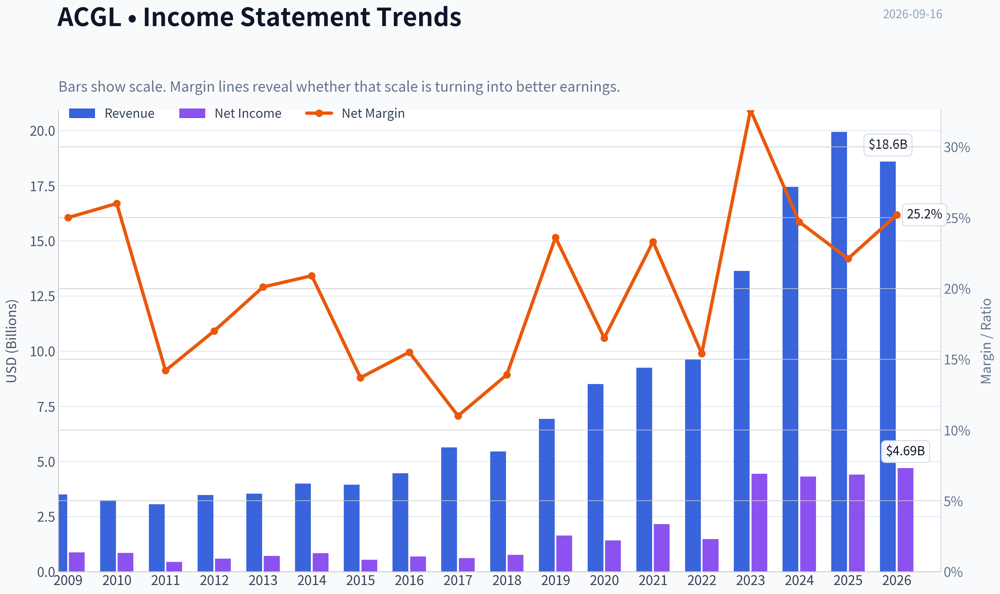
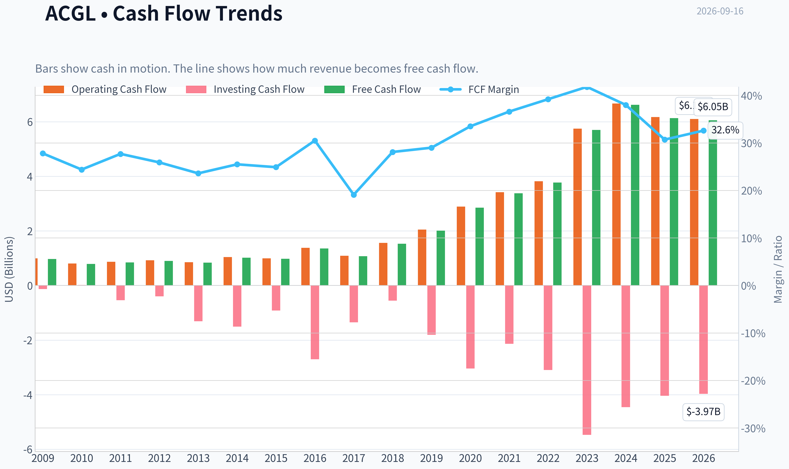
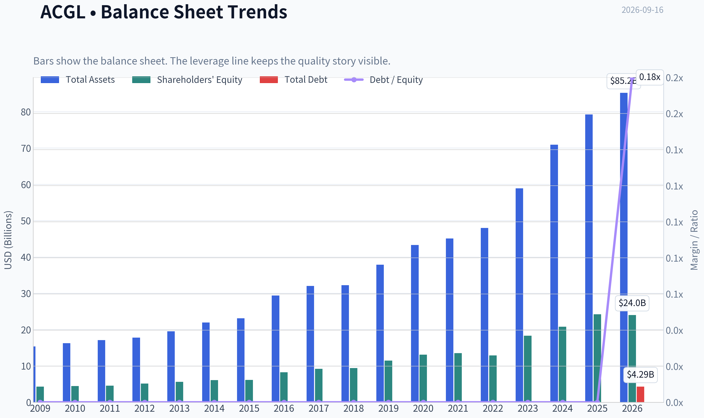
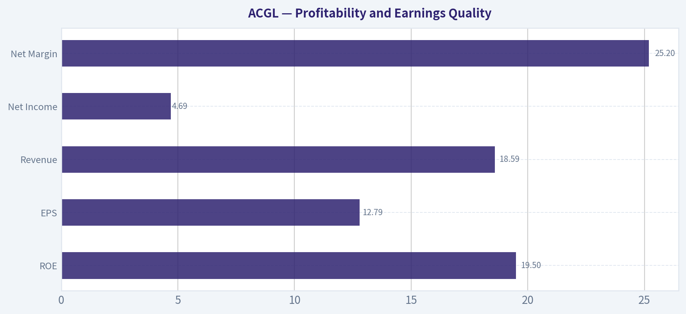
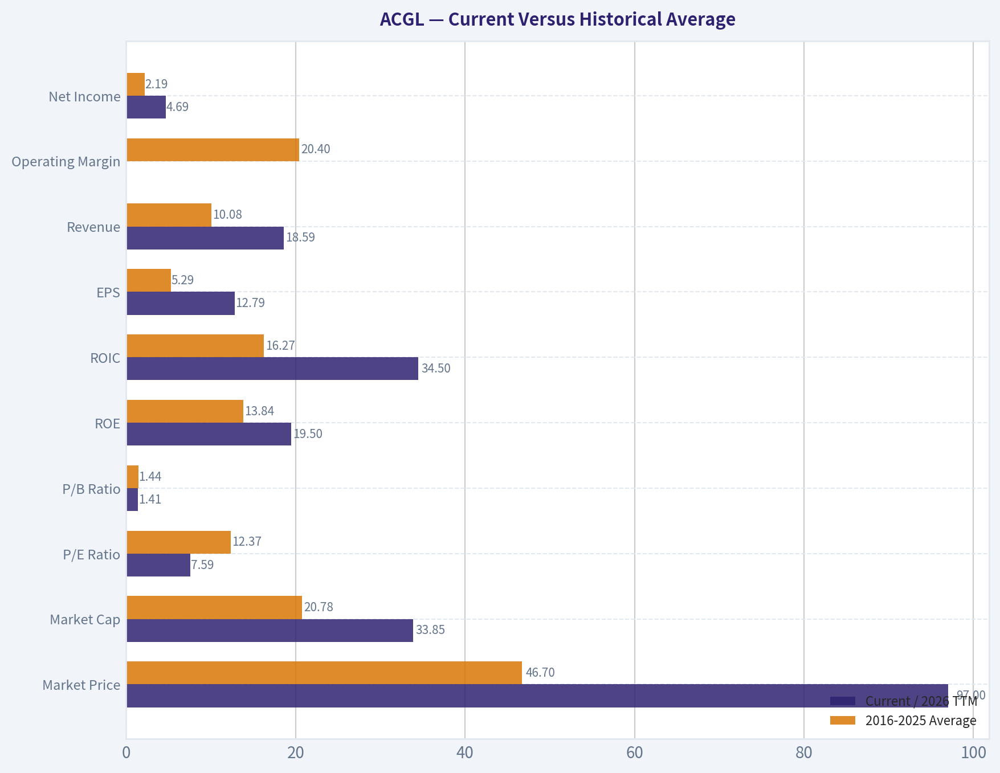
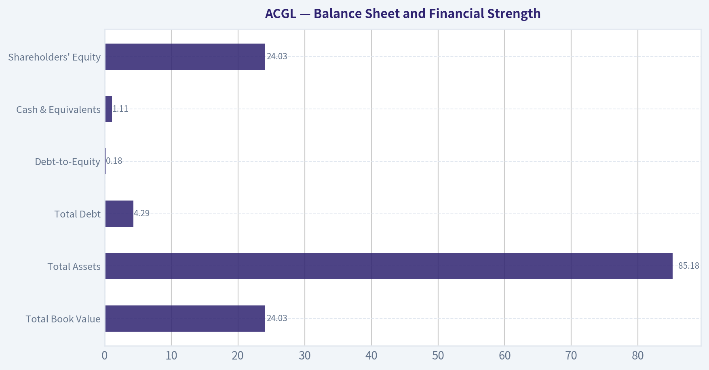
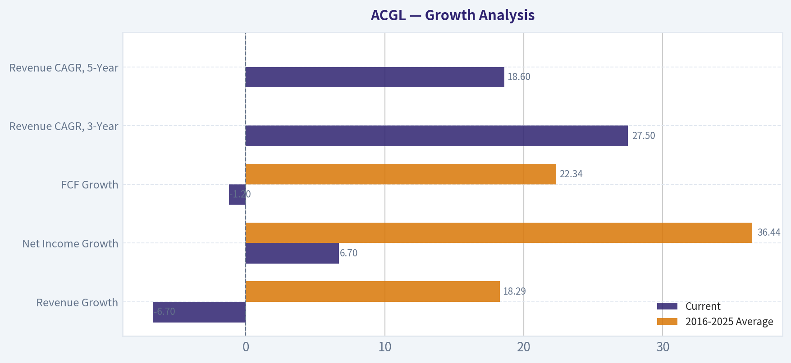
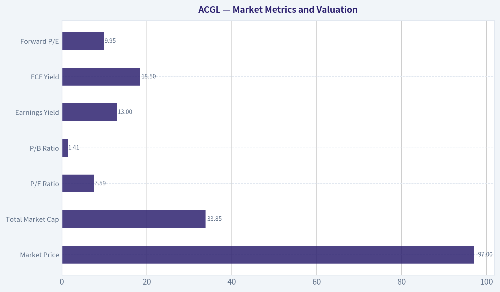

# ACGL Deep Value Intelligence

**Analysis Date:** 2026-09-16

## Critical Disclaimer

*This analysis is generated by Deep Value Intelligence, an AI-powered multi-agent investing framework. Education & research only - not financial advice, not a financial advisor.*

---

## Table of Contents

1. Intelligence Summary
2. Analyst Team Reports
   - Fundamentals Analysis
   - Intrinsic Value Analysis (Buffett)
   - Trend & Growth Analysis (Lynch/Druckenmiller/Fisher)
   - Market Technical Analysis
   - Options Market Analysis
3. Research Team Commentary
4. Value Investing Team Commentary
5. Deep Values Commentary

---

## Intelligence Summary

### Thesis + Conditions

**Core Thesis:** ## Executive Briefing

**Key Risks:**
- Begin with **25%-33% of the intended position**, then add only as underwriting quality is confirmed. The chart is neutral-not a thesis breaker-and options data are inconclusive. The principal risk is not volatility; it is permanent impairment from adverse reserves, underpriced growth, or weakened capital.
- ### Risky Analyst: inexpensive quality with rerating potential
- Even if normalized EPS falls to **$10.00-$10.50**, ACGL trades at roughly **9.2x-9.7x** earnings.

**Confidence:** Low

---

## Analyst Team Reports

### Fundamentals Analysis

#### Latest Earnings Snapshot

*Most recent reported quarter anchored on 2026 Q2, with prior-year comparison when available.*

| Metric | 2026 Q2 | 2025 Q2 | YoY Change |
| --- | ---: | ---: | ---: |
| Revenue | $4.49B | $4.97B | -9.7% |
| Operating Income | N/A | N/A | N/A |
| Net Income | $1.06B | $1.24B | -14.6% |
| Diluted EPS | $3.00 | $3.23 | -7.1% |
| Operating Cash Flow | $1.32B | $1.12B | +17.6% |
| Free Cash Flow | $1.31B | $1.11B | +17.6% |

Key Takeaways: This snapshot anchors the most recent reported quarter before the narrative analysis. It helps readers separate long-run business quality from whatever changed in the latest earnings print.

#### 17-Year Financial Metrics for ACGL

*All values below are computed deterministically from raw data - not estimated by AI.*

*Issuer profile: insurer (Financial Services / Insurance - Diversified).*

#### 17-Year Financial Metrics
*Annual rows come from reported financial statements. The final TTM row is computed from the latest four quarters.*

| Metric | 2009 | 2010 | 2011 | 2012 | 2013 | 2014 | 2015 | 2016 | 2017 | 2018 | 2019 | 2020 | 2021 | 2022 | 2023 | 2024 | 2025 | 2026 TTM |
| --- | --- | --- | --- | --- | --- | --- | --- | --- | --- | --- | --- | --- | --- | --- | --- | --- | --- | --- |
| Market Price | $8 | $9 | $12 | $14 | $19 | $19 | $22 | $27 | $29 | $25 | $41 | $34 | $42 | $60 | $71 | $92 | $96 | $97 |
| Market Cap | $1.48B | $1.54B | $1.72B | $2.03B | $2.70B | $2.66B | $2.93B | $10.76B | $12.64B | $11.03B | $17.65B | $14.80B | $17.79B | $23.71B | $28.13B | $35.26B | $36.06B | $33.85B |
| P/E Ratio | 1.74 | 1.89 | 4.18 | 3.64 | 3.92 | 3.27 | 5.68 | 16.16 | 22.25 | 15.45 | 11.08 | 10.86 | 8.50 | 16.52 | 6.39 | 8.25 | 8.27 | 7.59 |
| P/B Ratio | 0.34 | 0.34 | 0.37 | 0.39 | 0.48 | 0.44 | 0.48 | 1.30 | 1.37 | 1.17 | 1.54 | 1.13 | 1.31 | 1.84 | 1.53 | 1.69 | 1.49 | 1.41 |
| ROE | 20.3% | 18.8% | 9.5% | 11.5% | 12.6% | 13.7% | 8.7% | 8.4% | 6.7% | 8.0% | 14.2% | 10.7% | 15.9% | 11.4% | 24.2% | 20.7% | 18.2% | 19.5% |
| ROIC | 17.8% | 20.8% | 10.4% | 13.1% | 14.2% | 15.2% | 9.4% | 12.7% | 7.9% | 8.4% | 17.3% | 12.8% | 18.0% | 12.0% | 30.1% | 23.1% | 20.4% | N/A |
| EPS | $4.36 | $4.93 | $2.82 | $3.83 | $4.82 | $5.72 | $3.89 | $1.69 | $1.29 | $1.65 | $3.68 | $3.16 | $4.97 | $3.61 | $11.05 | $11.19 | $11.60 | $12.79 |
| Revenue | $3.50B | $3.24B | $3.06B | $3.48B | $3.53B | $3.99B | $3.94B | $4.46B | $5.63B | $5.45B | $6.93B | $8.51B | $9.25B | $9.61B | $13.63B | $17.44B | $19.93B | $18.59B |
| Gross Profit | N/A | N/A | N/A | N/A | N/A | N/A | N/A | N/A | N/A | N/A | N/A | N/A | N/A | N/A | N/A | N/A | N/A | N/A |
| Gross Margin | N/A | N/A | N/A | N/A | N/A | N/A | N/A | N/A | N/A | N/A | N/A | N/A | N/A | N/A | N/A | N/A | N/A | N/A |
| Operating Margin | 25.6% | 26.2% | 13.9% | 16.9% | 21.1% | 21.2% | 14.4% | 19.2% | 13.5% | 15.4% | 26.7% | 18.5% | 25.6% | 16.2% | 26.2% | 26.8% | 25.9% | N/A |
| Net Income | $876.9M | $842.7M | $436.2M | $593.4M | $709.7M | $834.4M | $537.7M | $692.7M | $619.3M | $758.0M | $1.64B | $1.41B | $2.16B | $1.48B | $4.44B | $4.31B | $4.40B | $4.69B |
| Net Margin | 25.0% | 26.0% | 14.2% | 17.0% | 20.1% | 20.9% | 13.7% | 15.5% | 11.0% | 13.9% | 23.6% | 16.5% | 23.3% | 15.4% | 32.6% | 24.7% | 22.1% | 25.2% |
| Revenue Growth | N/A | -7.4% | -5.6% | 13.7% | 1.3% | 13.1% | -1.3% | 13.4% | 26.1% | -3.1% | 27.1% | 22.8% | 8.7% | 3.9% | 41.8% | 27.9% | 14.3% | -6.7% |
| Net Income Growth | N/A | -3.9% | -48.2% | 36.0% | 19.6% | 17.6% | -35.6% | 28.8% | -10.6% | 22.4% | 115.9% | -14.1% | 53.5% | -31.6% | 201.0% | -2.9% | 2.0% | 6.7% |
| Free Cash Flow Growth | N/A | -18.8% | 7.2% | 6.6% | -7.7% | 22.1% | -3.4% | 38.7% | -21.3% | 42.7% | 31.5% | 41.6% | 18.9% | 11.3% | 51.3% | 16.2% | -7.5% | -1.2% |
| Total Book Value | $4.32B | $4.48B | $4.59B | $5.17B | $5.65B | $6.09B | $6.17B | $8.25B | $9.20B | $9.44B | $11.50B | $13.11B | $13.55B | $12.91B | $18.35B | $20.82B | $24.21B | $24.03B |
| Total Assets | $15.38B | $16.28B | $17.11B | $17.82B | $19.56B | $21.97B | $23.14B | $29.37B | $32.05B | $32.22B | $37.89B | $43.28B | $45.10B | $47.99B | $58.91B | $70.91B | $79.24B | $85.18B |
| Total Debt | $0 | $0 | $0 | $0 | $0 | $0 | $0 | $0 | $0 | $0 | $0 | $0 | $0 | $0 | $0 | $0 | $0 | $4.29B |
| Debt-to-Equity | 0.00 | 0.00 | 0.00 | 0.00 | 0.00 | 0.00 | 0.00 | 0.00 | 0.00 | 0.00 | 0.00 | 0.00 | 0.00 | 0.00 | 0.00 | 0.00 | 0.00 | 0.18 |
| Cash & Equivalents | $334.6M | $362.7M | $351.7M | $371.0M | $434.1M | $485.7M | $553.3M | $842.9M | $606.2M | $646.6M | $726.2M | $906.4M | $859.0M | $855.0M | $917.0M | $979.0M | $993.0M | $1.11B |
| Shareholders' Equity | $4.32B | $4.48B | $4.59B | $5.17B | $5.65B | $6.09B | $6.17B | $8.25B | $9.20B | $9.44B | $11.50B | $13.11B | $13.55B | $12.91B | $18.35B | $20.82B | $24.21B | $24.03B |
| Operating Cash Flow | $992.6M | $802.1M | $866.1M | $921.6M | $850.9M | $1.04B | $997.9M | $1.38B | $1.09B | $1.56B | $2.05B | $2.89B | $3.42B | $3.82B | $5.75B | $6.67B | $6.17B | $6.10B |
| Investing Cash Flow | $-129.8M | $16.1M | $-538.4M | $-396.0M | $-1.31B | $-1.51B | $-913.9M | $-2.70B | $-1.35B | $-554.0M | $-1.81B | $-3.04B | $-2.14B | $-3.10B | $-5.47B | $-4.46B | $-4.04B | $-3.97B |
| Free Cash Flow | $973.2M | $790.4M | $847.1M | $903.1M | $833.4M | $1.02B | $982.2M | $1.36B | $1.07B | $1.53B | $2.01B | $2.85B | $3.38B | $3.77B | $5.70B | $6.62B | $6.13B | $6.05B |
| FCF Margin | 27.8% | 24.4% | 27.7% | 25.9% | 23.6% | 25.5% | 24.9% | 30.5% | 19.1% | 28.1% | 29.0% | 33.5% | 36.6% | 39.2% | 41.8% | 38.0% | 30.7% | 32.6% |
| Dividends / Share | $0.00 | $0.00 | $0.00 | $0.00 | $0.00 | $0.00 | $0.00 | $0.00 | $0.00 | $0.00 | $0.00 | $0.00 | $0.00 | $0.00 | $0.00 | $4.89 | $0.02 | $0.01 |

#### Profitability Metrics
- Return on Equity (ROE): 18.2%
- Return on Invested Capital (ROIC): 34.5%
- Return on Assets (ROA): 5.6%
- Gross Margin: Not meaningful
- Operating Margin: 25.9%
- Net Profit Margin: 22.1%

#### Liquidity Metrics
- Current Ratio: Not meaningful
- Quick Ratio: Not meaningful

#### Leverage Metrics
- Debt-to-Equity Ratio: 0.00
- Interest Coverage Ratio: 34.86
- Net Debt: $-11.54B

#### Growth Metrics (Year-over-Year)
- Revenue Growth: 14.3%
- Net Income Growth: 2.0%
- Free Cash Flow Growth: -7.5%
- Revenue CAGR (3-Year): 27.5%
- Revenue CAGR (5-Year): 18.6%

#### Valuation Metrics
- P/E Ratio (TTM): 7.67
- Forward P/E: 9.95
- Price-to-Book: 1.42
- Price-to-Sales: 1.72
- PEG Ratio: 1.05
- EV/EBITDA: 6.04
- Free Cash Flow Yield: 18.5%
- Earnings Yield: 13.0%

#### Owner Earnings (Buffett Method, Code-Computed)
- Net Income: $4.40B
- + Depreciation & Amortization: $193.0M
- - Capital Expenditures: $-44.0M
- - Working Capital Changes: $2.33B
- = **Owner Earnings: $2.22B**

#### Intrinsic Value (Code-Computed)
- Current Price: $97
- Headline Intrinsic Value: not meaningful (financial issuer - DCF/FCFF is not the right primary frame; use sector-specific book/earnings metrics)
- Buffett Method (Owner Earnings):
  Conservative: $22
  Average: $117
  Optimistic: $212
- Cash Flow Method (FCF):
  Conservative: $174
  Average: $328
  Optimistic: $687
- Reverse-DCF: price implies ~1.3%/yr owner-earnings growth for 10y; trailing 3y was 124.1%, 5y 10.2%.

#### Piotroski F-Score: 4/9
- Positive Net Income: PASS
- Positive Operating Cash Flow: PASS
- ROA Improvement: FAIL
- Cash Flow > Net Income: PASS
- Decreasing Debt: FAIL
- Improving Current Ratio: FAIL
- No Dilution: FAIL
- Improving Gross Margin: FAIL
- Improving Asset Turnover: PASS

ANALYST STANCE: **ADVOCATE**

#### Executive Summary

Arch Capital Group, or ACGL, is a high-quality specialty insurer and reinsurer trading at approximately **$97 per share**, with a deterministic trailing P/E of **7.59**, price-to-book of **1.41**, and free-cash-flow yield of approximately **18.5%**. Its current **19.5% ROE** and **34.5% model-reported ROIC** are materially stronger than its recent historical averages.

The principal investment case is not based on a low price-to-book ratio alone. ACGL is an insurer, so book value is economically relevant but must be judged alongside underwriting profitability, reserve quality, catastrophe exposure, investment results, and normalized ROE. At the current price, valuation appears reasonable to attractive if Arch can sustain mid-to-high single-digit book-value and earnings compounding without a major underwriting reversal.

The main risks are insurance-cycle volatility, catastrophe losses, reserve development, investment-market losses, and the difficulty of treating reported free cash flow as fully distributable owner earnings for a financial institution.

#### Current Versus Historical Average

The comparison below uses the **2016-2025 decade** as the historical reference period. The current column uses the deterministic **2026 TTM** figures where available.

| Metric | Current / 2026 TTM | 2016-2025 Average | Interpretation |
|---|---:|---:|---|
| Market Price | $97 | $46.70 | More than double the decade average, reflecting substantial earnings and book-value growth |
| Market Cap | $33.85B | $20.78B | 63% above the decade average |
| P/E Ratio | 7.59 | 12.37 | Approximately 39% below average; valuation is currently more conservative |
| P/B Ratio | 1.41 | 1.44 | Essentially in line with the decade average |
| ROE | 19.5% | 13.84% | Strongly above average |
| ROIC | 34.5%* | 16.27% | Substantially above historical average; TTM series is not directly available |
| EPS | $12.79 | $5.29 | More than twice the decade average |
| Revenue | $18.59B | $10.08B | Approximately 84% above the average |
| Operating Margin | N/A TTM | 20.4% | 2025 was 25.9%; current TTM operating margin is unavailable |
| Net Income | $4.69B | $2.19B | More than twice the decade average |
| Net Margin | 25.2% | 20.86% | Above average, though below the exceptional 2023 level |
| Revenue Growth | -6.7% | 18.29% | Current decline reflects a difficult comparison and insurance revenue volatility |
| Net Income Growth | 6.7% | 36.44%** | Positive but far below the decade average, which is distorted by unusually large rebound years |
| FCF Growth | -1.2% | 22.34% | Slight contraction after a very strong multi-year expansion |
| Total Book Value | $24.03B | $14.13B | Approximately 70% above the decade average |
| Total Assets | $85.18B | $47.70B | Significant balance-sheet expansion |
| Total Debt | $4.29B | Approximately zero | New reported leverage requires monitoring |
| Debt-to-Equity | 0.18 | 0.00 | Still moderate, but materially higher than historical levels |
| Cash & Equivalents | $1.11B | $0.83B | Above average, although insurer liquidity is broader than cash alone |
| Free Cash Flow | $6.05B | $3.44B | Well above the decade average |
| Dividends per Share | $0.01 | $0.49 | Decade average is distorted by the $4.89 special dividend in 2024 |

\* The supplied profitability block reports TTM ROIC of 34.5%, while the annual historical table marks 2026 TTM ROIC as unavailable.
\** The average is heavily distorted by 2019 and 2023 rebound figures and is not a good normalized growth expectation.

**Key Takeaways:** ACGL's profitability, earnings power, book value, and cash generation are substantially stronger than the decade average, while its P/E is significantly lower. The current revenue and FCF declines are important, but they follow unusually strong prior growth and do not yet demonstrate a structural deterioration. Leverage has appeared for the first time in the dataset and should be watched.

#### Market Metrics and Valuation

| Market Metric | Current Value | Historical Context |
|---|---:|---|
| Market Price | $97 | Versus a 2016-2025 average of $46.70; the higher price is supported by materially higher EPS and book value |
| Total Market Cap | $33.85B | Versus a decade average of $20.78B |
| P/E Ratio | 7.59 | Below the 12.37 decade average and below the shared research snapshot of approximately 7.67 |
| P/B Ratio | 1.41 | Close to the 1.44 decade average |
| Earnings Yield | 13.0% | Attractive on a normalized earnings basis |
| FCF Yield | 18.5% | Very high, but requires insurer-specific interpretation |
| Forward P/E | 9.95 | Higher than trailing P/E, suggesting analysts expect some normalization or near-term earnings pressure |

**Key Takeaways:** The market is paying a higher absolute price but a lower earnings multiple than it typically paid during the previous decade. The near-18.5% FCF yield is appealing, although insurer cash flows can be distorted by premium collections, claims timing, investment portfolios, and reserve movements. Price-to-book is not a standalone "cheapness" signal; ACGL's 1.41 multiple is most persuasive because it is paired with nearly 20% ROE.

For an insurer, a useful conceptual framework is whether the company can earn a return on equity above its cost of equity while growing book value prudently. ACGL's current ROE is approximately **5.7 percentage points above** its 2016-2025 average, and its P/B is not elevated relative to its own history. That combination is more favorable than a low P/B multiple accompanied by weak underwriting returns.

#### Profitability and Earnings Quality

| Profitability Metric | Current | Historical Average / Pattern |
|---|---:|---|
| ROE | 19.5% | 13.84% average for 2016-2025 |
| ROIC | 34.5% reported in profitability block | 16.27% average for 2016-2025; annual TTM comparison is unavailable |
| EPS | $12.79 | $5.29 average for 2016-2025 |
| Revenue | $18.59B | $10.08B average |
| Gross Profit / Gross Margin | Not meaningful | Not an appropriate primary measure for an insurer |
| Operating Margin | N/A TTM; 25.9% in 2025 | 20.4% average |
| Net Income | $4.69B | $2.19B average |
| Net Margin | 25.2% | 20.86% average |

**Key Takeaways:** ACGL currently earns substantially better returns than it did during the weaker 2015-2018 period. Earnings quality is supported by positive operating cash flow, positive net income, and a long record of profitable operations, but insurance earnings remain cyclical and can change sharply after catastrophes or reserve revisions.

Reported EPS increased from **$1.29 in 2017** to **$12.79 TTM**, although the path was uneven. Net income declined in several individual years, including 2017, 2020, 2022, and 2024, demonstrating that ACGL is not a perfectly smooth compounder. Nevertheless, the broader trajectory shows improved scale, stronger underwriting economics, and greater earnings capacity.

The dataset reports current net margin at **25.2%**, above the decade average but below the extraordinary **32.6% in 2023**. This moderation is not automatically negative; it may represent normalization after unusually favorable underwriting and investment conditions.

#### Growth Analysis

| Growth Metric | Current | 2016-2025 Average | Assessment |
|---|---:|---:|---|
| Revenue Growth | -6.7% | 18.29% | Current contraction contrasts with strong long-term expansion |
| Net Income Growth | 6.7% | 36.44% | Positive but the average is inflated by rebound years |
| FCF Growth | -1.2% | 22.34% | Small decline after rapid cash-flow growth |
| Revenue CAGR, 3-Year | 27.5% | N/A | Indicates strong medium-term expansion despite the latest decline |
| Revenue CAGR, 5-Year | 18.6% | N/A | Strong compound growth over a longer period |

**Key Takeaways:** The latest year is weaker than the historical growth trend, but three-year and five-year revenue CAGRs remain robust. ACGL's growth should be evaluated through normalized book value, underwriting income, and earnings power rather than revenue alone, because insurance revenue can be affected by premiums, reinsurance structures, and reporting changes.

The reverse DCF supplied with the research pack indicates that the current price implies only about **1.3% annual owner-earnings growth over ten years**. That is a modest embedded expectation, particularly compared with ACGL's five-year revenue CAGR of 18.6%. However, the implied-growth calculation should not be treated as precise because owner earnings for an insurer are more difficult to define than for an industrial or software company.

#### Balance Sheet and Financial Strength

| Balance-Sheet Metric | Current | Historical Context |
|---|---:|---|
| Total Book Value | $24.03B | Versus $14.13B average for 2016-2025 |
| Total Assets | $85.18B | Versus $47.70B average |
| Total Debt | $4.29B | Historically reported as zero through 2025 |
| Debt-to-Equity | 0.18 | Higher than the historical 0.00 level |
| Cash & Equivalents | $1.11B | Above the $0.83B decade average |
| Shareholders' Equity | $24.03B | Consistent with total book value in the dataset |
| Net Debt | Negative $11.54B in the supplied pack | Indicates substantial net liquidity under the pack's calculation |

**Key Takeaways:** ACGL has built a much larger capital base and asset base than it had a decade ago. Debt has appeared in the latest period, but the reported debt-to-equity ratio of 0.18 remains moderate, and the research pack reports substantial net liquidity. For an insurer, capital adequacy, reserve strength, reinsurance recoverables, and investment-portfolio quality are more important than conventional current-ratio analysis.

The deterministic data flags current and quick ratios as **not meaningful** for this issuer. Those ratios should not be mechanically applied to an insurer because policyholder liabilities and investable assets do not behave like ordinary corporate working capital.

The Piotroski F-score is **4 out of 9**. Positive net income, positive operating cash flow, cash flow exceeding net income, and improving asset turnover are positives. Failures include debt reduction, dilution, current-ratio improvement, gross-margin improvement, and ROA improvement. This score is a warning that recent balance-sheet and operating changes are not uniformly favorable, but it is not designed specifically for insurers and should not override underwriting analysis.

#### Cash Flow and Capital Allocation

| Cash-Flow Metric | Current | Historical Context |
|---|---:|---|
| Operating Cash Flow | $6.10B | Above the $3.42B average for 2016-2025 |
| Free Cash Flow | $6.05B | Above the $3.44B average |
| FCF Margin | 32.6% | Below 2021-2024 peaks but well above most earlier years |
| Owner Earnings | $2.22B | Lower than reported net income after working-capital adjustments |
| Dividends per Share | $0.01 | Current regular distribution is minimal |
| Largest Reported Dividend | $4.89 in 2024 | Appears to be a special or non-recurring distribution |

**Key Takeaways:** ACGL generates considerable reported cash flow, with a current FCF margin above 30%. However, the Buffett owner-earnings calculation reduces cash generation to $2.22 billion after a large working-capital adjustment, so the FCF figure should not be treated as fully distributable without understanding insurance-float movements.

ACGL's dividend policy is flexible rather than income-oriented. The 2024 $4.89 per-share payment demonstrates a willingness to return excess capital, but the current $0.01 dividend indicates that shareholders should primarily expect value creation through retained capital, book-value growth, share repurchases, or opportunistic distributions.

#### Revenue Breakdown

The deterministic dataset does not provide a segment revenue schedule. ACGL's most economically meaningful public reporting structure is generally its **Insurance**, **Reinsurance**, and **Mortgage** businesses. Exact segment revenue amounts cannot be verified from the supplied canonical dataset, and gross written premiums should not be substituted for GAAP revenue because premiums, earned premiums, and fee or investment income are different measures.

| Revenue Source | Amount ($M or $B) | % of Total |
|---|---:|---:|
| Insurance | Not disclosed in deterministic dataset | Not available |
| Reinsurance | Not disclosed in deterministic dataset | Not available |
| Mortgage | Not disclosed in deterministic dataset | Not available |
| Total reported revenue | $18.59B | 100% |

**Key Takeaways:** ACGL is diversified across insurance, reinsurance, and mortgage-related risk, but the supplied dataset does not support a precise dollar allocation among those businesses. This limits segment-level analysis and makes the consolidated underwriting and book-value trends more important. Investors should consult the latest company filing for segment earned premiums, underwriting income, loss ratios, and premium growth before making a position-size decision.

#### Buffett-Style Business Quality Assessment

**Economic moat:** ACGL's moat is based on underwriting expertise, specialized risk selection, broker relationships, claims infrastructure, capital strength, and the ability to deploy capital when competitors retreat. Specialty insurance can produce attractive returns because difficult or unusual risks require expertise and disciplined pricing. The moat is real but less permanent than that of a dominant consumer brand or software platform.

**Competitive durability:** Arch benefits from scale and diversification across insurance and reinsurance. Its ability to participate in hard-market pricing and use capital opportunistically can support high returns. The principal limitation is that insurance pricing attracts new capital; strong returns eventually encourage competition and pricing pressure.

**Financial strength:** The balance sheet has expanded significantly, and current equity is approximately $24.03 billion. Debt-to-equity of 0.18 is still manageable, but the shift from zero reported debt to $4.29 billion deserves attention. Cash is above its decade average, while the reported net-debt figure is strongly negative.

**Predictable earnings:** Earnings are durable over a cycle but not smooth year to year. Net income growth ranged from substantial declines to exceptional rebounds. Catastrophe losses, reserve development, interest rates, equity-market results, and pricing conditions can materially affect quarterly and annual results.

**Management performance:** The increase in ROE from a 2016-2025 average of 13.84% to approximately 19.5% indicates effective capital deployment and improved business economics. The large 2024 special dividend suggests management can return excess capital when appropriate. The limited regular dividend also indicates a preference for retaining capital to support underwriting growth.

**Quality of business:** ACGL has strong current margins, high returns, robust balance-sheet growth, and attractive long-term revenue expansion. Its quality is best described as a disciplined, cyclical compounder rather than a completely predictable, low-volatility business.

#### Buffett-Style Owner Earnings DCF

The supplied owner-earnings calculation is:

| Owner-Earnings Calculation | Amount |
|---|---:|
| Net income | $4.40B |
| Plus depreciation and amortization | $0.193B |
| Less capital expenditures | $0.044B |
| Less working-capital changes | $2.33B |
| Calculated owner earnings | $2.22B |
| Approximate shares outstanding, based on $33.85B market cap / $97 price | 349 million |
| Owner earnings per share | Approximately $6.36 |

**Key Takeaways:** The owner-earnings figure is substantially below reported net income because of the large working-capital adjustment. That makes this DCF conservative in one sense, but it also highlights the limitation of applying an industrial-company owner-earnings formula to an insurer, where float and reserve movements are central to the business model.

For a transparent hand DCF, I use:

- Starting owner earnings: **$2.22 billion**
- Approximate shares: **349 million**
- Discount rate: **10%**
- Terminal growth rate: **2.5%**
- Forecast horizon: **10 years**
- No permanent extrapolation of unusually high historical growth

The three hand-modeled cases are:

| Scenario | Growth Assumption | Present Value of Years 1-10 | Present Value of Terminal Value | Equity Value | Estimated Value per Share |
|---|---:|---:|---:|---:|---:|
| Conservative | 0% for 10 years, then 2.5% terminal growth | $13.64B | $11.70B | $25.34B | $73 |
| Average | 8% for 10 years, then 2.5% terminal growth | $18.54B | $25.27B | $43.81B | $126 |
| Optimistic | 12% for 10 years, then 2.5% terminal growth | $21.98B | $36.19B | $58.17B | $167 |

**Key Takeaways:** The hand DCF produces a wide value range because insurer cash flows are difficult to normalize and terminal value dominates the calculation. At $97, ACGL is above the conservative hand value but below the average and optimistic values. This supports an attractive but not risk-free valuation, provided normalized owner earnings are closer to the average case than to the conservative case.

Detailed calculation examples:

**Conservative case**

- Years 1-10 owner earnings remain approximately $2.22 billion annually.
- Present value of years 1-10:
  $2.22B x 6.145 = **$13.64B**
- Year-10 owner earnings: $2.22B
- Terminal value:
  $2.22B x 1.025 ÷ (10% - 2.5%) = **$30.34B**
- Present value of terminal value:
  $30.34B ÷ 1.10¹⁰ = **$11.70B**
- Total equity value: $13.64B + $11.70B = **$25.34B**
- Per-share value: $25.34B ÷ 349 million = approximately **$73**

**Average case**

- Year-10 owner earnings:
  $2.22B x 1.08¹⁰ = **$4.80B**
- Present value of years 1-10:
  $2.22B x 8.35 = **$18.54B**
- Terminal value:
  $4.80B x 1.025 ÷ 7.5% = **$65.56B**
- Present value of terminal value: approximately **$25.27B**
- Total equity value: approximately **$43.81B**
- Per-share value: approximately **$126**

**Optimistic case**

- Year-10 owner earnings:
  $2.22B x 1.12¹⁰ = **$6.87B**
- Present value of years 1-10:
  $2.22B x 9.90 = **$21.98B**
- Terminal value:
  $6.87B x 1.025 ÷ 7.5% = **$93.87B**
- Present value of terminal value: approximately **$36.19B**
- Total equity value: approximately **$58.17B**
- Per-share value: approximately **$167**

The deterministic research pack separately provides model-based Buffett owner-earnings values of **$22 conservative, $117 average, and $212 optimistic**, as well as FCF-based values of **$174, $328, and $687**. The FCF-based figures appear aggressive for an insurer because they may capitalize cash flows that are needed to support underwriting capacity and policyholder obligations. I therefore place greater weight on the owner-earnings model, book-value compounding, ROE, and underwriting discipline than on the headline FCF DCF.

#### Key Investment Insights, Risks, and Opportunities

| Category | Assessment |
|---|---|
| Key opportunity | Current P/E of 7.59 is well below the decade average despite current ROE being well above average |
| Key opportunity | Five-year revenue CAGR of 18.6% and three-year CAGR of 27.5% show meaningful scale expansion |
| Key opportunity | Current ROE of approximately 19.5% supports a 1.41 price-to-book multiple |
| Key opportunity | Reverse DCF implies only about 1.3% annual owner-earnings growth |
| Key risk | Catastrophe losses can create sharp earnings and book-value volatility |
| Key risk | Reserve strengthening can reverse previously reported underwriting profits |
| Key risk | Debt increased from zero historically to $4.29B in the latest period |
| Key risk | Revenue and FCF declined in the latest period |
| Key risk | Reported FCF may overstate distributable cash for an insurer |
| Key risk | The Piotroski score of 4/9 indicates several recent quality and balance-sheet weaknesses |
| Monitoring item | Regular dividend is only $0.01 per share despite a large 2024 special distribution |
| Monitoring item | Forward P/E of 9.95 is above trailing P/E, implying expected earnings normalization |

**Key Takeaways:** ACGL offers an unusually favorable combination of low earnings valuation, high current ROE, strong historical growth, and a specialized insurance franchise. The opportunity is greatest if the current earnings level proves durable through a normal catastrophe cycle. The key risk is that investors mistake peak-cycle underwriting profits or insurer cash-flow timing for permanent owner earnings.

#### Final Investment Stance

**ADVOCATE - suitable for a long-term value portfolio, with a cyclical-risk position size.**

The rationale is:

1. **Valuation is attractive:** P/E is approximately 39% below the 2016-2025 average, while current ROE is materially higher than average.
2. **Business economics are strong:** ROE, margins, book value, revenue, and earnings have improved substantially over the decade.
3. **Capital strength is acceptable:** Debt-to-equity of 0.18 is manageable, although the appearance of debt is a new issue.
4. **Growth expectations are modest:** The reverse DCF's implied 1.3% owner-earnings growth leaves room for upside if ACGL merely compounds at a moderate rate.
5. **The margin of safety is not absolute:** The conservative owner-earnings value is below the current price, and insurance results can deteriorate quickly following catastrophe events or reserve problems.

At $97, the stock appears more attractive for investors who understand insurance-cycle risk than for investors seeking smooth, predictable earnings or high regular dividends. A reasonable underwriting and reserve record could support a value range around the supplied average owner-earnings estimate of **$117** and the hand-D​​CF average estimate of approximately **$126**. Investors should demand a larger margin of safety if debt rises further, ROE falls toward the historical average, or reserve development turns adverse.

| Key Point | Assessment |
|---|---|
| Business type | Specialty insurer, reinsurer, and mortgage-risk platform |
| Current valuation | Low P/E, market-level P/B for the company's history, high reported FCF yield |
| Profitability | Strong; current ROE and reported ROIC exceed historical norms |
| Growth | Long-term growth is strong, but latest revenue and FCF growth are negative |
| Balance sheet | Large and expanding equity base; new debt requires monitoring |
| Earnings predictability | Durable over a cycle but volatile year to year |
| Moat | Underwriting expertise, distribution, scale, capital flexibility, and specialty-market knowledge |
| DCF anchor | Buffett owner-earnings model: $22 / $117 / $212 |
| Hand DCF check | Approximately $73 / $126 / $167 |
| Primary risks | Catastrophes, reserve losses, pricing-cycle reversal, investment volatility, cash-flow normalization |
| Overall stance | **ADVOCATE** with disciplined position sizing |

#### Fundamental Visuals

This graph tracks the profitability and return metrics (ROE, ROIC, Margins) of **ACGL** over the past decade, highlighting capital efficiency trends.

This chart illustrates the financial health of **ACGL** over the last 10 years, mapping cash equivalents and free cash flow against total obligations (Debt).

This comparison chart from *Profitability and Earnings Quality* stacks current figures against historical benchmarks for **ACGL**, making it easy to see where the company trades relative to its own averages.

---

### Intrinsic Value Analysis (Buffett)

> *Following Warren Buffett's value investing philosophy: Circle of Competence, Economic Moat, Management Quality, and Margin of Safety.*

#### Intrinsic Value Snapshot

Price is what you pay. Intrinsic value is what the business may be worth based on the cash it can create for owners over time. We show a range, not one magic number.

- Current Price: $97.04
- Value Range (conservative to optimistic across both DCF methods): $21.87 to $687.30

##### Owner Earnings (Buffett Method)
- Net Income: $4,399,000,000.00
- Depreciation & Amortization: $193,000,000.00
- Capital Expenditures: $-44,000,000.00
- Working Capital Changes: $2,331,000,000.00
- Owner Earnings: $2,217,000,000.00

##### Intrinsic Value
###### Buffett Method
Uses owner earnings. Stricter, and usually more conservative.
- Conservative: $21.87
- Average: $117.47
- Optimistic: $212.03
- Discount Rate: 10.0%

###### Cash Flow Method
Uses free cash flow. Better for companies spending heavily today to grow tomorrow.
- Conservative: $174.09
- Average: $327.92
- Optimistic: $687.30
- Discount Rate: 10.0%

ANALYST STANCE: **ADVOCATE**

#### Executive Summary

Arch Capital Group is a high-quality specialty insurer and reinsurer trading at approximately **7.7 times earnings** with an estimated **18.5% free-cash-flow yield**. Its competitive advantage comes from underwriting expertise, specialty-market relationships, diversification, and the ability to invest insurance float.

The primary risks are inherent to insurance: catastrophe losses, reserve deterioration, pricing-cycle reversals, and investment-market volatility. Nevertheless, the valuation appears conservative relative to ACGL's **18.2% ROE**, **14.3% revenue growth**, and strong capital-generation profile.

#### Financial Summary

| Metric | Latest value |
|---|---:|
| Share price | $97.00 |
| Market capitalization | $33.09 billion |
| P/E ratio | 7.7x |
| Implied earnings per share | Approximately $12.66 |
| ROE | 18.2% |
| Revenue growth, year over year | 14.3% |
| FCF yield | 18.5% |
| Implied FCF per share | Approximately $17.95 |
| Gross margin | Not meaningful for an insurer |
| Current ratio | Not meaningful for an insurer |
| Intrinsic-value headline metric | Not meaningful; insurance valuation should emphasize earnings, book value, and normalized returns |

**Key Takeaways:** ACGL combines a low earnings multiple with an 18.2% ROE and double-digit revenue growth. The implied earnings and free-cash-flow figures suggest substantial cash-generation capacity, although insurer cash flow must be interpreted alongside reserve movements, premium growth, and catastrophe claims.

#### Factor Scorecard

| Factor | Score | Assessment |
|---|---:|---|
| Circle of competence and simplicity | 3.5/5 | The basic model is understandable: collect premiums, underwrite risk, and invest the resulting float. Catastrophe modeling and reserve accounting add complexity. |
| Durable competitive advantage | 4.0/5 | Specialty expertise, underwriting relationships, scale, licenses, data, and reputation create meaningful advantages. |
| Management and capital allocation | 4.0/5 | ACGL's long-term record reflects disciplined specialty underwriting and capital deployment. Insurer management quality is best judged through normalized underwriting profits, reserve development, and per-share book-value growth. |
| Industry structure | 4.0/5 | Specialty insurance and reinsurance can be rational and capacity-constrained, though pricing cycles and alternative capital create competitive pressure. |

**Gate 5 - Quality/Solvency:** **Not tripped.** The available evidence does not indicate deteriorating earnings combined with financial distress or sub-1x interest coverage. Standard debt-to-equity and interest-coverage comparisons are less useful for an insurance issuer than capital adequacy, reserves, and underwriting performance.

**Key Takeaways:** ACGL scores well because it operates in a specialized market where expertise and underwriting discipline matter. Its main weakness is not business quality but earnings volatility: one severe catastrophe year can temporarily overwhelm otherwise sound long-term economics.

#### Moat Analysis

| Moat source | Evidence | Strength |
|---|---|---:|
| Intangible assets | Specialty underwriting knowledge, broker relationships, claims expertise, and a reputation for reliable capacity | Strong |
| Switching costs | Brokers and commercial clients value proven claims-paying ability and established underwriting relationships | Moderate to strong |
| Cost advantages | Scale improves data, risk selection, diversification, and operating efficiency | Moderate |
| Network effects | Not a classic consumer network-effect business, but more market participation improves data, relationships, and risk diversification | Moderate |

ACGL's moat is primarily an **underwriting and relationship moat**, rather than a brand moat. The company does not need to be the lowest-priced insurer; it benefits when customers and brokers prefer dependable capacity and specialized risk judgment.

The moat is strongest in specialty lines where risks are difficult to price using simple commodity-like models. It is weaker during periods when abundant reinsurance capital forces pricing downward.

#### Management Quality Assessment

Management appears aligned with long-term value creation when judged through the economics of the business:

- Specialty underwriting rewards patience and risk discipline rather than maximizing short-term premium volume.
- Retaining capital can be highly accretive when management can reinvest at attractive underwriting and investment returns.
- Diversification across insurance, reinsurance, and mortgage-related activities can reduce dependence on any single market.
- The principal management test is whether growth is pursued without sacrificing underwriting profitability or reserve quality.

The most important items to monitor are:

1. Whether book value per share compounds through the cycle.
2. Whether reserve releases are genuinely conservative rather than merely delayed losses.
3. Whether premium growth remains profitable.
4. Whether share repurchases occur below intrinsic value.
5. Whether catastrophe exposure is sized prudently.

#### Owner Earnings Calculation

For a financial company, conventional owner earnings require adjustment because insurance premiums, claims reserves, investment income, and float are intertwined. A practical normalized approach is to use earnings per share as the base measure and cross-check it against free cash flow.

| Owner-earnings component | Per-share estimate |
|---|---:|
| Implied net income per share from P/E | $12.66 |
| Add: depreciation and amortization | Not separately available |
| Less: maintenance capital expenditure | Not separately available |
| Less: working-capital investment | Not meaningful in the industrial-company sense |
| Normalized owner earnings proxy | Approximately $12.66 per share |
| FCF cross-check | Approximately $17.95 per share |

**Key Takeaways:** The normalized owner-earnings proxy is approximately $12.66 per share, while the reported FCF yield implies roughly $17.95 per share of cash generation. The difference is a reason to use conservative earnings-based valuation rather than assuming all reported free cash flow is permanently distributable.

#### Three-Scenario Valuation

Because ACGL is an insurer, the valuation uses normalized earnings per share rather than a conventional industrial-company DCF.

| Scenario | Assumption | Estimated value per share |
|---|---|---:|
| A. No growth | $12.66 earnings per share capitalized at 10% | $126.60 |
| B. GDP growth | 3% perpetual growth, 10% discount rate | $186.60 |
| C. Historical-growth framework | 7.15% long-term growth, based on 50% of 14.3% recent revenue growth, with a 10-year DCF | Approximately $254 |

**Key Takeaways:** Even the no-growth valuation is above the current $97 share price. The GDP-growth case offers substantial upside, while the historical-growth case is more sensitive to assumptions and should be treated as an upper-range estimate rather than a central forecast.

#### Margin of Safety Analysis

| Valuation reference | Value | Upside versus $97 | Margin of safety |
|---|---:|---:|---:|
| No-growth earnings value | $126.60 | 30.5% | 24.0% |
| 3% perpetual-growth value | $186.60 | 92.4% | 48.0% |
| Historical-growth framework | Approximately $254 | Approximately 162% | Approximately 62% |

The no-growth case provides a meaningful margin of safety without requiring continued expansion. The valuation is especially attractive if ACGL can sustain an ROE near its current level and continue growing book value per share.

For a business exposed to catastrophe and reserve risk, a reasonable underwriting discipline would be to demand a larger discount than for a highly predictable consumer franchise. ACGL appears to meet that standard under the conservative no-growth framework.

#### Buffett Scorecard

| Criterion | Weight | Score | Weighted contribution |
|---|---:|---:|---:|
| Moat width and durability | 25% | 4.0 | 1.00 |
| Valuation and margin of safety | 20% | 5.0 | 1.00 |
| Capital returns versus WACC | 15% | 4.0 | 0.60 |
| Business understanding and predictability | 12% | 3.5 | 0.42 |
| Management quality and capital allocation | 12% | 4.0 | 0.48 |
| Reinvestment runway | 8% | 4.0 | 0.32 |
| Balance-sheet strength | 4% | 3.5 | 0.14 |
| Industry structure | 4% | 4.0 | 0.16 |
| **Total** | **100%** |  | **4.12/5.00** |

**Key Takeaways:** ACGL's score is driven by attractive valuation, strong returns on equity, and a durable specialty-insurance franchise. The deduction is primarily for earnings unpredictability and catastrophe exposure, not for weak economics or financial distress.

#### Principal Risks

- Large catastrophe events can produce substantial annual losses.
- Reserve strengthening can reduce reported earnings and book value.
- Reinsurance pricing may soften as alternative capital enters the market.
- Investment losses can compound underwriting pressure.
- Rapid premium growth can destroy value if pricing discipline weakens.
- Insurance accounting makes reported cash flow and earnings less straightforward than in an industrial business.

#### Investment Stance

**ADVOCATE - Medium-high conviction.**

At $97, ACGL appears to offer a favorable combination of quality and price: a specialty insurer with an 18.2% ROE, double-digit growth, and a low earnings multiple. The conservative no-growth valuation already indicates undervaluation, while stronger scenarios provide substantial upside.

The investment thesis depends on continued underwriting discipline and sound reserve management. ACGL is suitable for a long-term value portfolio, but position sizing should recognize that insurance earnings can be volatile and that a single catastrophe year can materially affect reported results.
#### Valuation Bridge

This bridge places the current market price beside each intrinsic value lens so readers can see whether upside depends on one method or shows up across several methods.

| Scenario | Intrinsic Value / Share |
| --- | ---: |
| Buffett Method | $117.47 |
| Cash Flow Method | $327.92 |
| Current Price | $97.04 |

#### Key Takeaways

If one method is far above the others, the upside case depends on a specific modelling assumption. When several methods cluster together, the valuation story is more robust.

#### Valuation Visuals

This comparison chart from *Latest Earnings Snapshot* stacks current figures against historical benchmarks for **ACGL**, making it easy to see where the company trades relative to its own averages.

This comparison chart from *Current Versus Historical Average* stacks current figures against historical benchmarks for **ACGL**, making it easy to see where the company trades relative to its own averages.

This comparison chart from *Balance Sheet and Financial Strength* stacks current figures against historical benchmarks for **ACGL**, making it easy to see where the company trades relative to its own averages.

---

### Trend & Growth Analysis (Lynch/Druckenmiller/Fisher)

> *Following Peter Lynch's GARP, Stanley Druckenmiller's macro-aware approach, and Philip Fisher's scuttlebutt methodology.*

ANALYST STANCE: **WATCH**

#### 1. Lynch Classification

**ACGL is a high-quality stalwart approaching fast-grower territory**, rather than a pure fast grower. Reported revenue growth of 14.3% is below the 15-25% fast-grower threshold, but underwriting profitability, capital strength, and reinsurance pricing could produce periods of faster earnings growth.

| Metric | ACGL |
|---|---:|
| Current price | $97 |
| Market capitalization | $33.1 billion |
| Revenue growth, year over year | 14.3% |
| P/E | 7.7x |
| ROE | 18.2% |
| FCF yield | 18.5% |
| Gross margin | Not meaningful for an insurer |

**Key Takeaways:** ACGL combines strong returns and apparent cash generation with a low earnings multiple. However, its growth rate is closer to a strong stalwart than a classic fast grower, and insurance cash flow must be interpreted through underwriting and reserve accounting.

#### 2. The Story in Three Bullets

- **Arch is a disciplined specialty insurer and reinsurer** operating in markets where pricing and risk selection matter more than simple premium volume.
- **The opportunity is a favorable insurance cycle:** catastrophe risk, casualty inflation, regulatory complexity, and demand for reinsurance can support premium growth and attractive pricing.
- **The potential inflection is operating leverage:** if premium growth persists while loss ratios remain controlled, book value and earnings can compound faster than the headline revenue rate.

#### 3. TAM and the 10x Test

| Item | Assessment |
|---|---|
| Core markets | Specialty insurance, property and casualty reinsurance, mortgage insurance |
| TAM growth | Likely moderate overall, with faster pockets in catastrophe, specialty casualty, and mortgage risk |
| Current revenue scale | Large, established global insurer |
| 10x revenue test | Difficult to pass literally; a 10x ACGL would require a very large share of global specialty insurance markets |
| Runway quality | Attractive for compounding book value and earnings, but not obviously a 10x revenue runway |

**Key Takeaways:** ACGL has a substantial market opportunity, but it is already a large insurer, so the ten-bagger case depends on sustained book-value compounding and capital allocation rather than a small-company TAM explosion. Specialty niches and third-party capital can expand effective capacity, but the overall runway is more moderate than that of software or emerging technology companies.

#### 4. Revenue Growth Trend

| Indicator | Result | Interpretation |
|---|---:|---|
| Latest revenue growth | 14.3% | Healthy, but just below fast-grower territory |
| Multi-period acceleration | Not provided | Cannot confirm an acceleration inflection |
| Earnings growth | Not provided | Requires current quarterly filings |
| Growth quality | Primarily underwriting-cycle dependent | Must distinguish price, exposure growth, and acquisitions |

**Key Takeaways:** ACGL is growing at a healthy pace, but the available data do not establish acceleration. The critical question is whether growth is coming from durable exposure and market-share gains or simply favorable insurance pricing that may normalize.

#### 5. Unit Economics and Financial Quality

| Metric | ACGL assessment |
|---|---|
| LTV/CAC | Not applicable; insurer economics are measured through underwriting returns and retention |
| Net revenue retention | Not applicable |
| Rule of 40 | Not applicable |
| ROE | 18.2%, strong |
| FCF yield | 18.5%, attractive but insurer accounting makes interpretation important |
| Capital adequacy | Not supplied; should be verified through statutory filings |
| Underwriting metrics | Combined ratio and reserve development are essential but unavailable here |

**Key Takeaways:** ACGL's 18.2% ROE is the strongest quality signal in the supplied data. For an insurer, combined ratio, reserve adequacy, catastrophe losses, and book-value growth are more informative than SaaS metrics such as LTV, NRR, or Rule of 40.

#### 6. Inflection Point Assessment

| Potential inflection | Current view | Importance |
|---|---|---|
| Pricing inflection | Favorable specialty and reinsurance pricing appears supportive | Positive |
| Market-share inflection | Not confirmed | Neutral |
| Margin inflection | Possible if premium growth outpaces loss-cost inflation | Positive, but unverified |
| TAM inflection | Alternative capital is reshaping reinsurance capacity | Positive but potentially competitive |
| Competitive inflection | No major competitor failure identified | Neutral |
| Earnings inflection | Not demonstrated by supplied data | Key missing evidence |

**Key Takeaways:** The most credible ACGL inflection is cycle-driven: strong pricing and demand could translate into higher underwriting returns. This is not yet a confirmed acceleration story because the available information lacks current combined-ratio, reserve, and earnings-growth trends.

#### 7. Macro Setup

| Macro factor | Assessment |
|---|---|
| Insurance pricing | Generally supportive in specialty and reinsurance markets |
| Catastrophe exposure | Raises demand for protection but creates earnings volatility |
| Alternative capital | Expands market capacity and can pressure pricing over time |
| Interest rates | Higher yields support investment income; falling rates could reduce reinvestment returns |
| Economic cycle | Mixed; specialty insurance is less economically sensitive than many financial businesses |
| Overall macro | Constructive but cyclical |

**Key Takeaways:** ACGL has a relatively favorable macro backdrop because risk transfer demand remains high and investment income benefits from elevated yields. The main counterweight is that alternative capital can eventually increase capacity and compress reinsurance pricing.

#### 8. Fisher 15-Point Assessment

| Fisher criterion | Score / 5 | Comment |
|---|---:|---|
| Market potential | 4 | Large specialty and reinsurance markets |
| New-product determination | 4 | Specialty underwriting and risk innovation are important |
| R&D effectiveness | 3 | Less relevant than underwriting analytics and data |
| Sales organization | 4 | Established distribution and broker relationships |
| Profit margins | 4 | Strong ROE suggests attractive economics |
| Margin improvement | 3 | Needs combined-ratio evidence |
| Labor relations | 3 | Insufficient data |
| Executive relations | 3 | Insufficient data |
| Management depth | 4 | Global specialty insurer with established platform |
| Cost analysis/accounting | 4 | Sophisticated risk and capital management required |
| Outstanding advantages | 4 | Underwriting expertise, data, relationships, and diversification |
| Long-term profit outlook | 4 | Positive, though cycle-sensitive |
| Dilution risk | 4 | No major dilution concern in supplied data |
| Management candor | 3 | Not enough evidence |
| Management integrity | 4 | No adverse evidence supplied |
| **Total** | **55 / 75** | **Good, but not outstanding based on available evidence** |

**Key Takeaways:** ACGL scores as a good business with durable underwriting capabilities, but the Fisher score is constrained by missing evidence on management communication, labor culture, reserve discipline, and margin progression. The company appears stronger operationally than its growth classification alone suggests.

#### 9. Valuation Analysis

| Valuation measure | Result | Interpretation |
|---|---:|---|
| P/E | 7.7x | Low versus many high-quality financial businesses |
| FCF yield | 18.5% | Apparently compelling, subject to insurer cash-flow interpretation |
| ROE | 18.2% | Supports a premium to weak insurers |
| Proxy PEG using 14.3% revenue growth | 0.54 | Attractive mathematically, but not a valid earnings PEG |
| Intrinsic value headline | Not meaningful | Use book value, earnings power, and underwriting returns |

**Key Takeaways:** ACGL appears inexpensive on earnings and cash-flow measures. The proxy PEG looks attractive, but it should not be treated as a true PEG because revenue growth is not the same as sustainable earnings growth. The correct valuation framework is price-to-book relative to sustainable ROE, normalized earnings, and reserve quality.

#### 10. Growth Investor Scorecard

| Criterion | Weight | Score / 5 |
|---|---:|---:|
| Lynch story | 10% | 3.5 |
| TAM and runway | 20% | 3.0 |
| Revenue growth | 20% | 3.4 |
| Unit economics | 15% | 3.8 |
| Competitive position | 10% | 4.0 |
| Management quality | 10% | 3.7 |
| Macro setup | 5% | 3.8 |
| Profitability path | 5% | 4.3 |
| Valuation | 5% | 4.5 |
| **Weighted score** | **100%** | **3.6 / 5** |

**Key Takeaways:** ACGL earns a "good setup" score, primarily because of valuation, ROE, competitive capabilities, and supportive insurance-market conditions. It does not score higher because the evidence does not yet show accelerating growth or a clear tenfold revenue runway.

#### 11. Position Size Stance

**Suggested stance: WATCH / modest starter position only.**

- For a diversified growth portfolio: **1-2% initial position**, increasing only after confirmation of accelerating earnings and book-value growth.
- For an income or quality-financial portfolio: ACGL could justify a larger allocation, subject to catastrophe and reserve-risk limits.
- Do not size it like a software-style ten-bagger candidate; its likely return profile is **high-quality compounding plus valuation support**, not explosive top-line expansion.

#### 12. Key Catalysts and Risks

| Catalysts | Risks |
|---|---|
| Continued specialty insurance pricing strength | Reinsurance pricing cycle turns downward |
| Premium growth above 15% with stable loss ratios | Catastrophe losses or adverse reserve development |
| Book value per share compounds rapidly | Casualty reserves prove inadequate |
| Strong mortgage-insurance performance | Housing or credit deterioration |
| Alternative capital expands distribution without destroying pricing | Alternative capital increases capacity and compresses margins |
| Share repurchases or disciplined capital deployment | Investment-income decline if rates fall |

**Key Takeaways:** The best catalyst would be a combination of accelerating premium growth, stable combined ratios, and strong book-value compounding. The principal risks are not ordinary revenue softness but insurance-specific surprises: catastrophe losses, reserve deterioration, and a reversal in market pricing.

#### Bottom Line

ACGL is a **high-quality, attractively valued specialty insurer**, but the current evidence supports **WATCH rather than ADVOCATE** for a growth investor. The stock could deliver strong risk-adjusted returns if underwriting conditions remain favorable, yet it lacks the demonstrated acceleration and enormous runway required for a confident ten-bagger thesis. The next decision should hinge on quarterly premium growth, combined ratio, reserve development, book-value growth, and capital returns.

#### Growth & Scorecard Visuals

This comparison chart from *Growth Analysis* stacks current figures against historical benchmarks for **ACGL**, making it easy to see where the company trades relative to its own averages.

---

### Market Technical Analysis

ANALYST STANCE: **WATCH**

#### ACGL Technical and Market Report

**Data cutoff:** September 15, 2026, the latest available trading session. September 16 is not represented as a trading day in the retrieved data. ACGL closed at **$97.04**, after trading between **$95.92 and $98.39**.

#### Executive assessment

ACGL's technical picture is **long-term constructive but short- and intermediate-term damaged**. The stock remains above its rising 200-day SMA, indicating that the broader one-year trend has not fully broken. However, price is below the 10-day EMA, 50-day SMA, and volume-weighted moving average, while MACD remains negative. This combination suggests that the current market is better characterized as a corrective phase within a still-positive long-term structure, rather than a confirmed new uptrend.

The key issue is that ACGL's decline from its late-July high near **$107.09** has not yet produced a convincing momentum reversal. The recent rebound from the September 8 low of **$95.71** has stabilized price, but it has not reclaimed the important moving-average levels clustered near **$97.4 to $99.7**.

#### Trend structure

ACGL advanced from approximately **$87.38 in September 2025 to $97.04 currently**, producing an approximate one-year gain of **11%**. The advance was not linear. The stock weakened sharply in October 2025, recovered into the mid-$90s by year-end, rallied toward $103 in February, corrected into the low-$90s during March and May, and then accelerated to a high above $107 in July.

The medium-term trend weakened after the July peak. The stock moved below $101 in late July and then spent August mostly between approximately $97 and $101. The September decline toward $95.71 increased downside pressure, although the subsequent rebound prevented an immediate breakdown below the longer-term trend benchmark.

The moving-average configuration remains important:

- The **200-day SMA is approximately $96.23** and is still rising gradually.
- The **50-day SMA is approximately $99.74**, but it has turned lower from around $100.03 earlier in September.
- The **10-day EMA is approximately $97.37**, leaving the latest close just below short-term trend resistance.
- The **50-day SMA remains above the 200-day SMA**, preserving a broadly bullish long-term alignment.

This is a transitional setup. A sustained move above the 10-day EMA would be an initial improvement, but a more meaningful trend repair would require ACGL to reclaim the 50-day SMA around **$99.7 to $100.0**. Conversely, a decisive close below the 200-day SMA near **$96.2**, particularly on expanding volume, would weaken the long-term structure and raise the probability of a deeper retracement.

#### Momentum analysis

Momentum is currently negative but showing limited signs of stabilization.

The MACD reading was approximately **-0.70** on September 15. It had deteriorated from a near-zero level in late August and remained below zero through mid-September. This indicates that the intermediate momentum trend still favors sellers. The MACD histogram was also negative, although it improved from approximately **-0.35 on September 11 to -0.16 on September 15**. That improvement suggests that downside momentum may be losing intensity, but it does not yet constitute a confirmed bullish crossover.

RSI was approximately **45.1**, up from **38.3 on September 8**. This is a meaningful recovery from weak momentum conditions, but RSI remains below the neutral 50 level. It is neither oversold nor overbought. The implication is that ACGL has room to recover without immediately becoming technically overextended, but buyers have not yet demonstrated enough strength to establish clear upside control.

A more credible bullish signal would be a combination of:

1. RSI reclaiming and holding above 50;
2. MACD turning upward toward zero;
3. Price closing above the 10-day EMA and then the 50-day SMA.

Without those developments, the recent bounce should be treated as a stabilization attempt rather than a confirmed reversal.

#### Volume and participation

The volume-weighted moving average was approximately **$97.95**, above the latest close of $97.04. This indicates that the recent volume-weighted trading range is positioned above the current market price, creating overhead supply near the $98 area.

Several recent sessions recorded elevated volume, including approximately **7.68 million shares on September 3**, **5.76 million on September 8**, **5.15 million on September 14**, and **4.13 million on September 15**. High volume accompanying weakness can indicate distribution, portfolio repositioning, or event-related risk. The September 14 rebound occurred on heavy volume, which is potentially constructive, but the failure to hold the session's strength on September 15 limits the bullish interpretation.

For buyers, the quality of any breakout should be assessed through both price and participation. A move through $98 to $100 accompanied by sustained volume would carry more significance than a low-volume recovery. On the downside, a high-volume close below approximately $96 would be a more serious warning than an isolated intraday dip.

#### Volatility and risk management

ATR was approximately **$1.92**, compared with readings above **$2.15 in mid-August**. Volatility has therefore moderated from its recent peak, but the daily ATR still represents roughly **2% of the share price**. ACGL remains capable of moving several dollars over a short sequence of sessions, especially when volume expands.

The declining ATR suggests that the stock may be entering a compression phase following the July-August decline. Compression can precede either a renewed breakdown or a directional recovery. It should not be interpreted as bullish by itself.

Using ATR as a risk framework, a stop or tactical invalidation level placed too close to the current price could be vulnerable to normal daily fluctuations. A move of approximately one ATR is not unusual, so position sizing should reflect the stock's current volatility rather than relying on a narrow fixed percentage.

#### Key price zones and scenarios

The first resistance area is approximately **$97.4 to $98.0**, defined by the 10-day EMA and VWMA. A recovery above this zone would indicate that short-term selling pressure is easing.

The more important resistance band is approximately **$99.7 to $100.0**, where the 50-day SMA and recent August-September trading activity converge. Reclaiming this zone would improve the intermediate-term outlook and could open a path toward the **$101 to $103** area, followed by the July high near **$107**.

Initial support is near **$96.2 to $95.7**, corresponding to the 200-day SMA and the September 8 low. Holding that area would preserve the broader bullish trend structure. A break below it would shift attention toward the low-$94s and potentially the March-May consolidation region near **$91 to $93**.

The most favorable tactical development would be a higher low above the 200-day SMA followed by a close above $98 and then $100. The more concerning development would be repeated failure beneath the 10-day EMA, followed by a high-volume breakdown below $96.

#### Selected indicators

The selected indicators are deliberately diversified across trend, momentum, volume, and volatility. MACD is used rather than simultaneously emphasizing multiple closely related MACD outputs, reducing redundancy while retaining momentum information.

| Indicator | Latest reading | Technical interpretation | Practical significance |
|---|---:|---|---|
| Close price | $97.04 | Below short- and medium-term averages, but near the long-term trend benchmark | The stock is in a corrective phase with support being tested |
| 10-day EMA | $97.37 | Price is slightly below the short-term average | Reclaiming this level would be an initial momentum improvement |
| 50-day SMA | $99.74 | Rising earlier but now edging lower | Major intermediate resistance and trend-repair threshold |
| 200-day SMA | $96.23 | Rising and below current price | Long-term trend remains constructive unless this level fails decisively |
| MACD | -0.70 | Negative and below zero | Intermediate momentum still favors sellers |
| RSI | 45.1 | Recovered from 38.3 but remains below neutral 50 | Selling pressure has eased, but bullish momentum is unconfirmed |
| ATR | $1.92 | Moderating from above $2.15 | Volatility has cooled, but daily price swings remain material |
| VWMA | $97.95 | Above the current close and declining | Volume-weighted overhead supply is concentrated near $98 |

**Key Takeaways:** ACGL remains above its rising 200-day SMA, so the long-term trend has not decisively broken. However, price is below the 10-day EMA, 50-day SMA, and VWMA, while MACD is negative and RSI remains below 50. The most important near-term test is whether ACGL can reclaim $98 and then $100; failure below the $95.7 to $96.2 support zone would materially weaken the outlook.

#### Market Visuals

This comparison chart from *Market Metrics and Valuation* stacks current figures against historical benchmarks for **ACGL**, making it easy to see where the company trades relative to its own averages.

---

### Options Market Analysis

> *Reading options flow - put/call ratios, IV skew, and unusual activity - to gauge institutional positioning and event-driven risk.*

#### ACGL Options Flow Report

*Data as of September 16, 2026. The supplied chain is notably thin, and no underlying spot price or individual strike-level data was provided. Confidence is therefore low.*

#### Put/Call Ratio Analysis

| Expiration | Call OI | Put OI | Put/Call OI | Call Volume | Put Volume | Put/Call Volume |
|---|---:|---:|---:|---:|---:|---:|
| Sep. 18, 2026 | 159 | 28 | 0.18 | 168 | 270 | 1.61 |
| Oct. 16, 2026 | 0 | 0 | N/A | 7 | 16 | 2.29 |
| Nov. 20, 2026 | 15 | 116 | 7.73 | 19 | 84 | 4.42 |
| **Total** | **174** | **144** | **0.83** | **194** | **370** | **1.91** |

**Key Takeaways:** ACGL's aggregate put/call open-interest ratio is 0.83, only modestly above the approximately 0.70 neutral baseline. However, put volume is almost twice call volume, and November positioning is strongly put-heavy. This points to near-term hedging or bearish positioning, although the September call open interest prevents the overall OI picture from becoming decisively bearish.

#### Implied Volatility Assessment

| Expiration | Call ATM IV | Put ATM IV | Assessment |
|---|---:|---:|---|
| Sep. 18, 2026 | 3.1% | 3.1% | Very low, balanced ATM volatility |
| Oct. 16, 2026 | 1.6% | 0.8% | Very low; limited usable signal |
| Nov. 20, 2026 | 0.8% | 0.8% | Extremely low and balanced |

**Key Takeaways:** Near-term ATM implied volatility is exceptionally low, with September options at only 3.1% and later expirations below 2%. The available data does not include OTM call and put IV, so a true volatility skew calculation is unavailable. There is no clear evidence of a major event premium or pronounced downside volatility fear, but the low readings may partly reflect illiquidity or stale quotes.

#### Unusual Options Activity

| Finding | Interpretation |
|---|---|
| No contracts had volume greater than five times open interest | No formally identified unusual activity |
| Sep. 18 puts: 270 volume versus 28 put OI | Elevated activity, but not enough to meet the tool's unusual-activity threshold |
| Nov. 20 puts: 84 volume versus 116 put OI | Put-heavy positioning, but likely includes existing positions |
| Nov. 20 calls: 19 volume versus 15 call OI | Some fresh call activity, though very small in absolute terms |

**Key Takeaways:** The data does not identify any contract as a high-confidence unusual-options trade. The strongest directional clue is the concentration of November put volume and open interest, which is more consistent with protection or bearish exposure than aggressive upside speculation. Because trade direction and execution details are unavailable, these positions cannot reliably be classified as institutional opening trades.

#### Open Interest Concentration and Gamma Levels

| Expiration | Largest Available OI Concentration | Potential Interpretation |
|---|---|---|
| Sep. 18, 2026 | Calls: 159 total; puts: 28 total | Call-side positioning dominates this expiry |
| Oct. 16, 2026 | No open interest | No meaningful pinning level |
| Nov. 20, 2026 | Puts: 116 total; calls: 15 total | Strong put-side concentration |

**Key Takeaways:** Strike-level open interest was not supplied, so specific gravitational prices, max-pain levels, and gamma walls cannot be calculated. The expiration-level data suggests a call-heavy near-term structure and a distinctly put-heavy November structure. Given the small contract counts, any pinning or gamma effect is likely weak and should not be treated as reliable.

#### Overall Options Sentiment

**Signal: BEARISH, with low confidence.**

The primary driver is the 1.91 near-term put/call volume ratio, combined with a very high November put/call OI ratio of 7.73. This indicates more active downside protection or bearish positioning than upside speculation. The signal is tempered by the aggregate OI ratio of 0.83, the large September call position, extremely low implied volatility, and the absence of validated unusual activity.

ACGL's options market also appears **illiquid**: total open interest is only 318 contracts across the displayed expirations, and several expirations have negligible or zero open interest. Therefore, the bearish read should be treated as a tentative positioning signal rather than a strong institutional conviction indicator.

#### Summary

| Category | Assessment |
|---|---|
| Put/Call Ratio | Aggregate OI ratio 0.83, mildly cautious; volume ratio 1.91, bearish-leaning |
| IV Level | Extremely low; 3.1% near-term ATM IV and below 2% in later expirations |
| Skew Direction | Not determinable from supplied data; OTM IV by strike is unavailable |
| Unusual Activity | None meeting the volume-over-five-times-OI threshold |
| Overall Signal | **BEARISH, low confidence**; driven primarily by heavy put volume and November put concentration |

**Key Takeaways:** ACGL's options flow leans bearish because puts are materially more active than calls and November open interest is heavily concentrated in puts. Still, low liquidity, very low implied volatility, and missing strike-level data substantially reduce confidence.

---

## Research Team Commentary

> *The Research Manager synthesizes the Bull vs Bear debate into action-free commentary. This is a pre-risk view, not the final stance.*

Core takeaway: The bull has the stronger argument, although not by the full precision implied by the $124 valuation. Arch Capital appears to be an above-average specialty insurer trading at a price that already anticipates meaningful earnings normalization. At $97.04, 7.67 times earnings, with 18.2% ROE and 14.3% revenue growth, the stock offers favorable long-term asymmetry provided underwriting quality and reserve adequacy remain intact. I would begin a moderately sized position and accumulate in stages rather than wait for either a perfect chart or an unlikely $70-$80 entry.

The strongest bull argument is that this is inexpensive quality rather than merely a statistically cheap insurer. Arch's underwriting expertise, broker relationships, ratings credibility, and ability to shift capital among insurance, reinsurance, and mortgage businesses constitute a credible-though not impregnable-moat. Its high-teens ROE indicates attractive recent economics, while the single-digit earnings multiple shows that investors are already skeptical about their durability. Revenue growth of 14.3% also contradicts the idea that the company is presently in structural decline.

The valuation remains appealing after a reasonable normalization adjustment. Current implied EPS is approximately $12.65. If normalized earnings fall to $10.00-$10.50, ACGL trades at roughly 9.2-9.7 times earnings. That is not distressed pricing, but it is undemanding for a disciplined insurer capable of earning low-to-mid-teens ROE and growing per-share economic value over time. I would use a less precise intrinsic-value range of approximately $110-$125 rather than anchor exclusively to $124. That indicates roughly 12%-22% upside from the current price, sufficient for a high-quality financial franchise but not enough to justify maximum position sizing.

The bear's best point is that the supplied data do not establish normalized earnings with confidence. Combined ratios, accident-year loss ratios, reserve development, catastrophe exposure, rate versus loss-cost trends, book value per share, and regulatory capital headroom are central-not optional-inputs for an insurer. The reported 34.5% ROIC is not particularly useful in this business model, and revenue growth alone says little about whether new underwriting is creating value. The bull's reverse-DCF shortcut also overstates the cushion by treating earnings as though they were fully distributable. Insurers must retain capital to support ratings, reserves, and premium growth.

The bear is also right that the $124 estimate is sensitive to the required return. A 10% cost of equity is defensible for a proven, well-capitalized underwriter, but 11%-11.5% is reasonable given catastrophe, casualty-reserve, and mortgage-credit uncertainty. Raising the discount rate and reducing normalized EPS can bring fair value close to the current price. That limits conviction.

Where the bear goes too far is in treating plausible cycle risks almost as though deterioration had already appeared. No evidence supplied here shows adverse reserve development, collapsing underwriting margins, solvency weakness, or destructive capital allocation. An $8.50 normalized EPS assumption may be possible during an adverse period, but it should not become the base case without corresponding operating evidence. Likewise, demanding $70-$80 effectively requires a large discount to an already bearish valuation and risks missing a capable compounder because insurance outcomes can never be known with complete certainty.

This is where the lessons from the previous ACGL calls matter. One overly cautious assessment correctly identified cheap quality but missed a quick rerating; another WATCH call avoided an immediate drawdown because the chart and growth trends lacked confirmation. The appropriate lesson is neither "always buy the low multiple" nor "always wait for confirmation." It is to separate business conviction from entry timing. Here, the fundamentals justify ownership, while the neutral chart argues for phased accumulation.

Technically, the stock is sitting near an important decision area. The price is slightly above the rising 200-day average of about $96.23, but below the 10-day EMA near $97.37 and the declining 50-day average near $99.74. That is neutral rather than broken. Holding the 200-day average would support an initial position, while a sustained move above roughly $100 would improve the odds of a broader rerating. A break below the 200-day is not itself a fundamental sell signal, but it would argue against deploying the full position immediately. The thin options data and 0.83 put/call ratio add little.

The rationale, from a Buffett-style perspective, is that ACGL appears to offer a good combination of franchise quality, capital productivity, and conservative market expectations. The price does not require current peak earnings to persist. It does, however, require Arch to remain an above-average underwriter and avoid a major reserve or catastrophe impairment. That is a reasonable proposition, but not one to accept blindly. The appropriate implementation is a starter or normal-sized position with room to add as insurer-specific evidence confirms the thesis.

Over the next one to four quarters, I would focus first on accident-year combined ratios and prior-year reserve development. Stable or improving underlying loss ratios, without material reliance on reserve releases, would strengthen the claim that earnings quality deserves a higher multiple. Adverse reserve development-especially in long-tail casualty lines-would materially weaken it.

I would also compare renewal pricing with loss-cost inflation. Slower premium growth is acceptable, and may even demonstrate discipline, if Arch is refusing inadequately priced risks. Rapid premium growth alongside weakening margins would be much more concerning. Segment-level results should show that diversification is enabling intelligent capital reallocation rather than concealing deterioration in one business.

Book value per share and tangible book value per share should continue compounding at attractive rates after dividends and repurchases. Normalized ROE remaining above roughly 13% would support a fair value above the current price; a sustained decline toward 10% without offsetting valuation compression would undermine the thesis. Capital and ratings headroom, catastrophe losses relative to modeled expectations, mortgage delinquencies, and investment-portfolio credit quality also deserve attention.

Evidence of stable reserves, profitable new underwriting, low-to-mid-teens normalized ROE, and continued per-share book-value growth would justify adding. Material adverse development, pricing below loss-cost inflation, repeated combined-ratio deterioration, or normalized EPS falling below approximately $9-$10 without a credible recovery path would cause a downgrade.

Final stance: ADVOCATE.

---

## Value Investing Team Commentary

> *The Investor translates the research view into an investment thesis before risk review. This is still not the final stance.*

### Investment Commentary

ACGL appears to be an above-average insurance franchise offered at a reasonable price. The investment case is not simply that the shares trade at 7.67 times trailing earnings; insurers frequently look cheapest near favorable points in the underwriting cycle. The stronger argument is that Arch Capital has historically combined underwriting discipline, specialized risk expertise, financial strength, and flexible capital allocation across insurance, reinsurance, and mortgage insurance.

At $97.04, the shares offer enough prospective return to justify ownership, but not enough certainty for an unusually large position.

### Business quality and moat

Arch's competitive advantages are credible, although less impregnable than those of the very best consumer or platform businesses. They include:

- Specialized underwriting expertise and proprietary risk data
- Long-standing broker and distribution relationships
- Ratings strength and claims-paying credibility
- The ability to reallocate capital among insurance, reinsurance, and mortgage insurance
- A culture that appears to prioritize risk-adjusted returns over premium growth for its own sake

These advantages matter because insurance capital is largely commoditized. The enduring value comes from selecting, pricing, and reserving risks better than competitors across a full cycle. Arch's 18.2% ROE is encouraging, but one favorable period does not establish normalized earning power. The more important test is whether it can sustain low-to-mid-teens ROE without depending on reserve releases, unusually benign catastrophe experience, or temporarily elevated pricing.

The stated 34.5% ROIC should receive little weight. Conventional ROIC is poorly suited to insurers because policyholder liabilities and investment assets are integral to the operating model. Combined ratios, reserve development, book-value growth, regulatory capital, and returns across underwriting cycles are more informative.

### Earnings quality and valuation

Trailing EPS implied by the supplied price and P/E is approximately $12.65. That figure should not be capitalized as though it were permanent. If normalized EPS declines to $10.00-$10.50, ACGL is selling for approximately 9.2-9.7 times normalized earnings. That remains an undemanding valuation for a financially sound insurer capable of earning low-to-mid-teens returns on equity.

The proposed $110-$125 intrinsic-value range is reasonable as a working estimate, but it should not be mistaken for precision. Relative to $97.04, it implies:

- Approximately 13% upside to $110
- Approximately 21% upside to the $117.50 midpoint
- Approximately 29% upside to $125

The lower end offers only a modest margin of safety, while the midpoint is more attractive. Given the cyclicality and accounting opacity inherent in insurance, ACGL deserves a larger discount than an exceptionally predictable consumer franchise. On that basis, the current price supports a measured purchase rather than maximum conviction.

The valuation also provides a useful reverse-expectations insight: the market does not appear to require Arch to maintain current peak-like earnings indefinitely. Even after a meaningful earnings normalization, the multiple remains below ten times. The central question is therefore not whether earnings decline from the current level, but whether normalized earnings remain around $10 or better and continue growing over time. If normalized EPS ultimately settles near $8.50-$9 because of casualty reserve problems or sustained margin compression, the apparent discount would narrow considerably.

### Selective contrarian interpretation

Sentiment appears skeptical rather than euphoric. The shares remain below the declining 50-day average, close to the rising 200-day average, and at a single-digit earnings multiple despite double-digit reported revenue growth and high-teens ROE. The thin options chain and 0.83 put/call ratio provide little reliable information, but they do not indicate speculative enthusiasm.

The contrarian opportunity is that investors may be over-discounting ordinary earnings normalization while failing to distinguish Arch from weaker underwriters. A slowdown in premium growth would not necessarily be adverse. If pricing becomes inadequate, writing less business can protect shareholder value. For a disciplined insurer, lower volume accompanied by stable margins and reserve strength can be more attractive than rapid growth.

However, contrarianism must remain evidence-based. The absence of disclosed deterioration in this handoff is not proof that reserves are sound. Long-tail casualty liabilities can develop slowly, and social inflation can make historical assumptions inadequate. Likewise, catastrophe risk can produce volatile quarterly results even when underwriting decisions were economically rational. A temporary catastrophe loss could create an opportunity; repeated reserve deficiencies would indicate a damaged thesis.

### Technical context and implementation

The chart should influence entry pacing, not determine whether the business is worth owning for a decade. ACGL is:

- Slightly above its rising 200-day average near $96.23
- Slightly below its 10-day EMA near $97.37
- Below its declining 50-day average near $99.74

That is a neutral decision zone, not evidence of a broken franchise. Waiting for a perfect breakout risks paying more after uncertainty has already diminished. Conversely, the proximity to the 200-day average argues against committing the entire intended allocation immediately.

A sensible implementation would be:

1. Establish a moderate starter position around the current valuation.
2. Add if underwriting results, reserve development, and book-value growth confirm normalized earning power.
3. Consider adding on price weakness if the decline is sentiment-driven and business fundamentals remain intact.
4. Do not automatically add merely because the stock falls; first determine whether reserve quality or expected returns have deteriorated.

A move above $100 would improve market confirmation but would not itself increase intrinsic value. A break below the 200-day average would justify slower deployment, not an automatic sale.

### What matters over the next several reporting periods

The thesis should be judged primarily on insurer-specific evidence:

- **Accident-year combined ratios:** Underlying underwriting profitability should remain sound.
- **Reserve development:** Material adverse development, particularly in long-tail casualty lines, would be a serious warning.
- **Pricing versus loss costs:** Renewal rates should keep pace with claims inflation.
- **Book value per share:** Per-share book value should compound attractively through the cycle.
- **Normalized ROE:** Sustained returns above roughly 13% would support a valuation above the current price.
- **Capital allocation:** Repurchases should occur below conservatively estimated intrinsic value, while retained capital should earn attractive incremental returns.
- **Catastrophe exposure:** Losses should remain broadly consistent with modeled risk over time.
- **Mortgage insurance:** Delinquencies, housing conditions, and capital adequacy require monitoring.
- **Ratings and regulatory capital:** Strong headroom is essential because ratings are part of the franchise.

I would downgrade the thesis if Arch reports repeated adverse reserve development, persistently prices below loss-cost inflation, produces worsening combined ratios across multiple periods, or appears unable to earn at least approximately $9-$10 per share on a normalized basis. A temporary earnings decline caused by an isolated catastrophe would not necessarily warrant a sale if pricing improves and the balance sheet remains sound.

ACGL offers an attractive combination of specialized underwriting capability, capital flexibility, strong recent profitability, and subdued market expectations. The margin of safety is meaningful but not overwhelming, and critical insurance disclosures are missing from the supplied evidence. The appropriate response is phased ownership with disciplined monitoring-not paralysis while waiting for certainty and not blind reliance on a low trailing multiple.

ANALYST STANCE: **ADVOCATE** - ACGL merits a moderate initial position and staged accumulation. The shares appear modestly to materially undervalued under reasonable normalized assumptions, while the main risks-reserve adequacy, casualty inflation, catastrophe exposure, and cycle normalization-justify measured sizing rather than maximum conviction.

---

## Deep Values Commentary

> *The Risk Management Team debates and the Risk Judge provides the final action-free verdict. This section determines the final ADVOCATE / WATCH / AVOID stance.*

#### Final Stance Scorecard

This scorecard converts the final research view into a weighted decision frame. It does not replace the narrative judgement, but it makes the main drivers of the verdict easier to scan.

| Criterion | Score | Weight | Commentary |
| --- | ---: | ---: | --- |
| Business Quality | 3.75 | 30% | High returns, profitability, and Piotroski health support durability. |
| Valuation Support | 5.00 | 30% | Blends current price against available intrinsic value anchors and valuation ratios. |
| Financial Strength | 5.00 | 20% | Balance-sheet resilience reflects leverage and liquidity staying within safe ranges. |
| Growth Durability | 2.33 | 20% | Recent revenue, earnings, and free cash flow growth indicate how durable expansion looks. |
| TOTAL / FINAL STANCE | 4.09 | 100% | ADVOCATE |

#### Key Takeaways

The weighted score lands at **4.09 / 5.0**, while the final stance remains **ADVOCATE**. This is useful as a quick calibration aid rather than a mechanical signal.

#### Risk Summary

Higher scores indicate more risk pressure. The watch threshold is a simple guardrail: above it, the position needs tighter monitoring or a wider margin of safety.

| Dimension | Current Score | Watch Threshold | Commentary |
| --- | ---: | ---: | --- |
| Business Quality | 2.25 | 3.00 | High returns, profitability, and Piotroski health support durability. |
| Valuation Support | 1.00 | 3.00 | Blends current price against available intrinsic value anchors and valuation ratios. |
| Financial Strength | 1.00 | 3.00 | Balance-sheet resilience reflects leverage and liquidity staying within safe ranges. |
| Growth Durability | 3.67 | 3.00 | Recent revenue, earnings, and free cash flow growth indicate how durable expansion looks. |

#### Key Takeaways

This view helps readers separate *where* the risk sits: valuation, business quality, balance sheet, or growth durability. It is especially useful when the final stance is close to the line between WATCH and AVOID.
