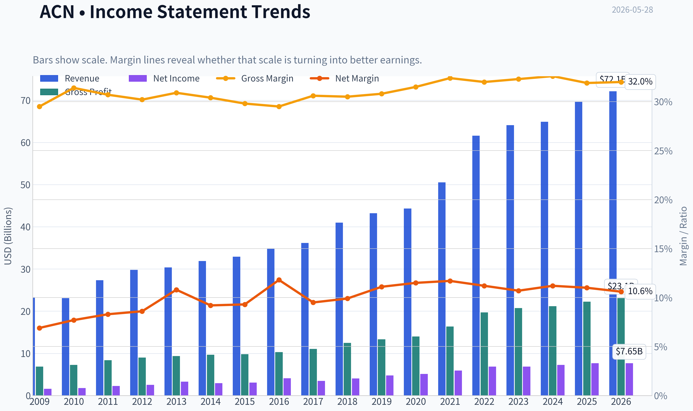
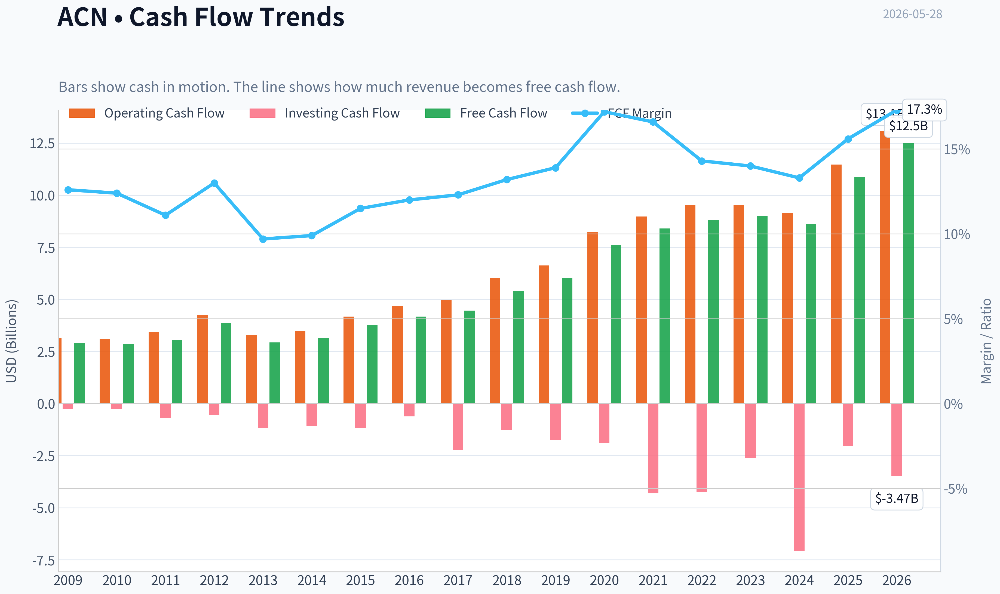
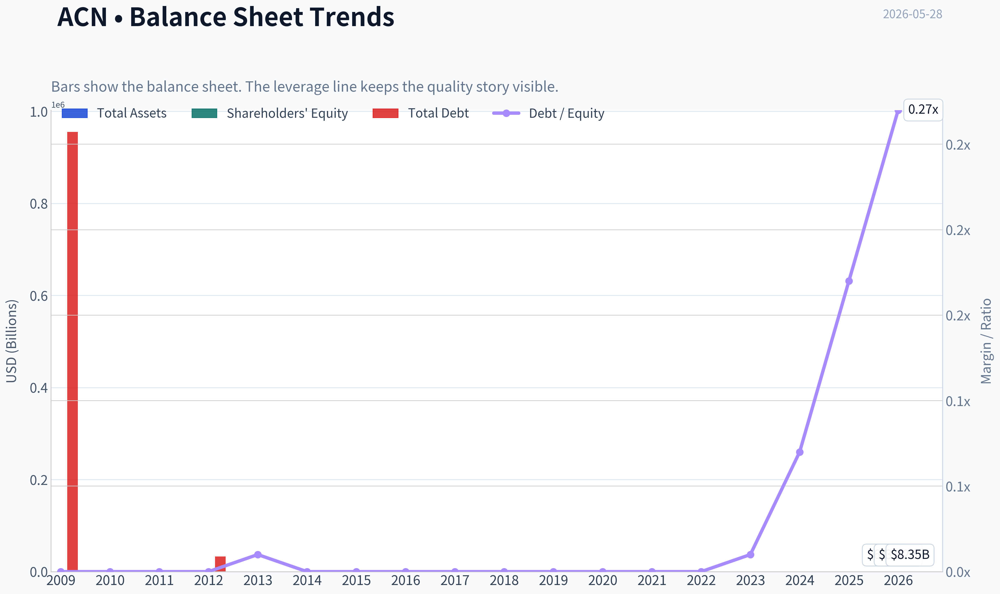
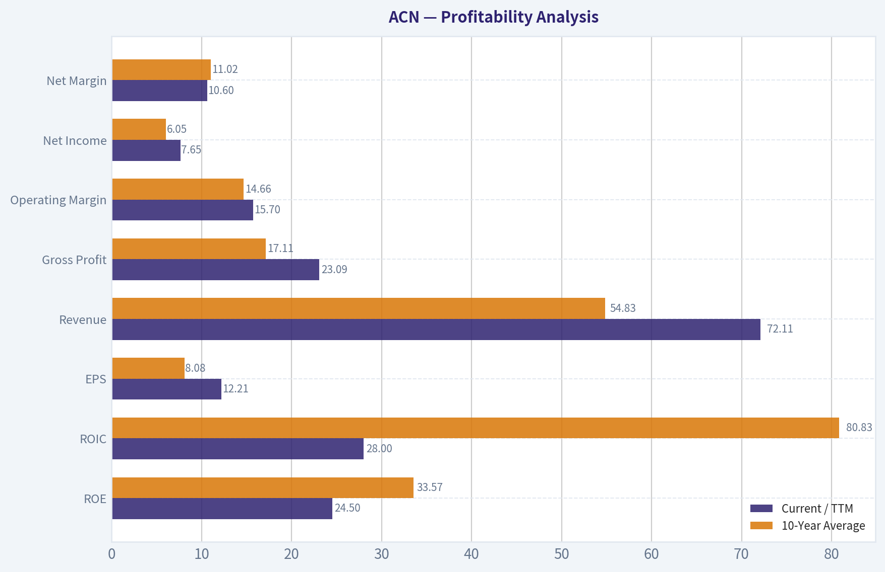
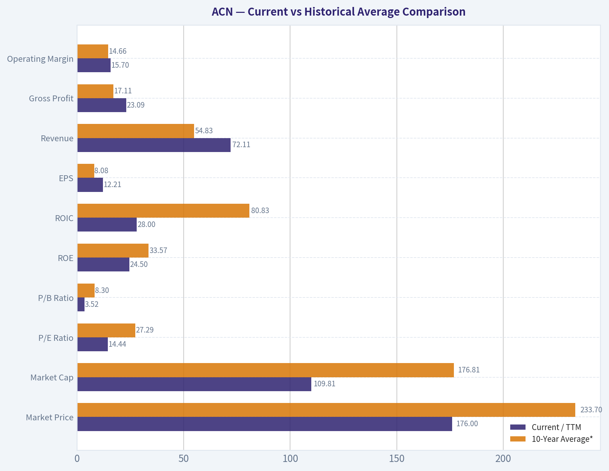
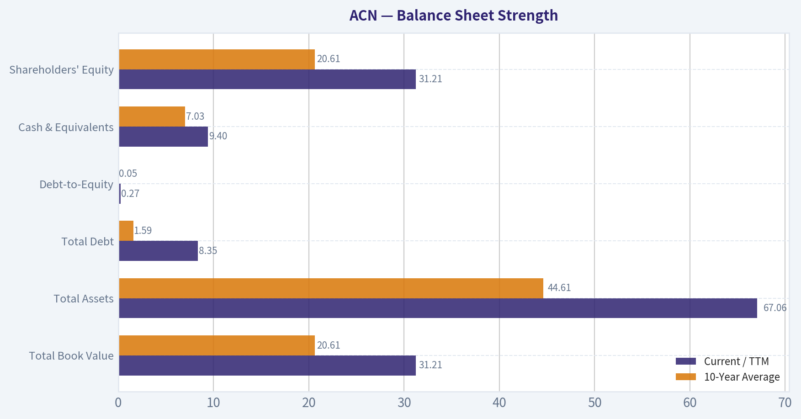
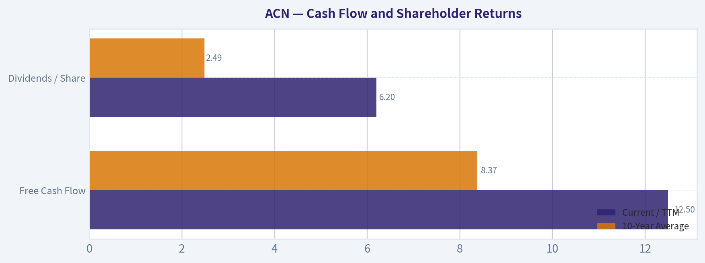
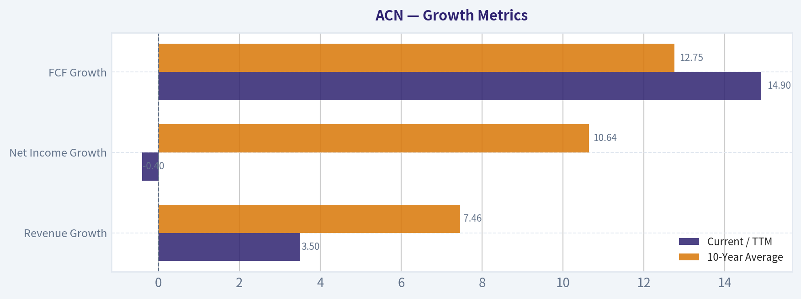

# ACN Deep Value Intelligence

**Analysis Date:** 2026-05-28

## Critical Disclaimer

*This analysis is generated by Deep Value Intelligence, an AI-powered multi-agent investing framework. This report is for informational and educational purposes only and does not constitute financial advice. Always conduct your own research and consult with qualified financial advisors before making investment decisions.*

---

## Table of Contents

1. Intelligence Summary
2. Analyst Team Reports
   - Fundamentals Analysis
   - Intrinsic Value Analysis (Buffett)
   - Trend & Growth Analysis (Lynch/Druckenmiller/Fisher)
   - Market Technical Analysis
   - Options Market Analysis
3. Research Team Commentary
4. Value Investing Team Commentary
5. Deep Values Commentary

---

## Intelligence Summary

### Thesis + Conditions

**Core Thesis:** ## Executive Summary

**Key Risks:**
- Accenture looks like a high-quality, cash-generative stalwart trading at a reasonable multiple, and the main risks appear to be **moat erosion and growth moderation**, not obvious permanent impairment today. The bear case is real-AI, procurement pressure, and labor intensity could cap future economics-but at **14.5x earnings with strong ROIC/ROE and real cash support**, the stock appears more **fair-to-attractive** than dangerous for a long-term investor. The key adjustment is implementation: **buy like a value investor, not like a trader**-phase in, monitor bookings/margins/AI mix, and don't demand perfect chart confirmation before acting.
- ### 1. Risky Analyst - strongest bullish points
- ### 2. Safe Analyst - strongest risk points

**Confidence:** Low

---

## Analyst Team Reports

### Fundamentals Analysis

#### Latest Earnings Snapshot

*Most recent reported quarter anchored on 2026 Q1, with prior-year comparison when available.*

| Metric | 2026 Q1 | 2025 Q1 | YoY Change |
| --- | ---: | ---: | ---: |
| Revenue | $18.04B | $16.66B | +8.3% |
| Operating Income | $2.49B | $2.24B | +11.1% |
| Net Income | $1.83B | $1.79B | +2.1% |
| Diluted EPS | $2.93 | $2.82 | +3.9% |
| Operating Cash Flow | $3.82B | $2.85B | +33.8% |
| Free Cash Flow | $3.67B | $2.68B | +36.7% |

Key Takeaways: This snapshot anchors the most recent reported quarter before the narrative analysis. It helps readers separate long-run business quality from whatever changed in the latest earnings print.

#### 17-Year Financial Metrics for ACN

*All values below are computed deterministically from raw data - not estimated by AI.*

*Issuer profile: operating company (Technology / Information Technology Services).*

#### 17-Year Financial Metrics
*Annual rows come from reported financial statements. The final TTM row is computed from the latest four quarters.*

| Metric | 2009 | 2010 | 2011 | 2012 | 2013 | 2014 | 2015 | 2016 | 2017 | 2018 | 2019 | 2020 | 2021 | 2022 | 2023 | 2024 | 2025 | 2026 TTM |
| --- | --- | --- | --- | --- | --- | --- | --- | --- | --- | --- | --- | --- | --- | --- | --- | --- | --- | --- |
| Market Price | $24 | $27 | $41 | $48 | $58 | $66 | $79 | $98 | $114 | $150 | $179 | $221 | $314 | $272 | $310 | $333 | $258 | $176 |
| Market Cap | $25.97B | $28.07B | $39.83B | $44.81B | $51.54B | $56.13B | $63.99B | $76.79B | $86.36B | $110.79B | $128.85B | $155.43B | $217.39B | $185.43B | $206.76B | $217.46B | $164.42B | $109.81B |
| P/E Ratio | 13.52 | 13.76 | 15.81 | 16.04 | 14.66 | 17.93 | 19.80 | 17.83 | 24.04 | 26.67 | 26.93 | 30.41 | 36.74 | 26.93 | 30.06 | 29.89 | 21.40 | 14.44 |
| P/B Ratio | 9.16 | 9.90 | 10.27 | 10.81 | 10.39 | 9.79 | 10.43 | 10.16 | 9.65 | 10.69 | 8.94 | 9.14 | 11.13 | 8.39 | 8.05 | 7.69 | 5.27 | 3.52 |
| ROE | 56.1% | 62.8% | 58.7% | 61.6% | 66.2% | 51.3% | 49.8% | 54.4% | 38.5% | 39.2% | 33.2% | 30.0% | 30.2% | 31.1% | 26.7% | 25.7% | 24.6% | 24.5% |
| ROIC | N/A | -111.2% | -131.5% | -129.5% | -226.3% | 3322.2% | 250.1% | 158.9% | 111.9% | 84.6% | 71.9% | 58.1% | 58.3% | 55.7% | 43.0% | 34.8% | 31.0% | 28.0% |
| EPS | $1.78 | $1.99 | $2.58 | $2.99 | $3.93 | $3.70 | $3.99 | $5.51 | $4.75 | $5.64 | $6.66 | $7.25 | $8.53 | $10.10 | $10.32 | $11.14 | $12.15 | $12.21 |
| Revenue | $23.17B | $23.09B | $27.35B | $29.78B | $30.39B | $31.87B | $32.91B | $34.80B | $36.18B | $40.99B | $43.22B | $44.33B | $50.53B | $61.59B | $64.11B | $64.90B | $69.67B | $72.11B |
| Gross Profit | $6.84B | $7.25B | $8.39B | $8.99B | $9.38B | $9.68B | $9.81B | $10.28B | $11.07B | $12.49B | $13.31B | $13.98B | $16.36B | $19.70B | $20.73B | $21.16B | $22.24B | $23.09B |
| Gross Margin | 29.5% | 31.4% | 30.7% | 30.2% | 30.9% | 30.4% | 29.8% | 29.5% | 30.6% | 30.5% | 30.8% | 31.5% | 32.4% | 32.0% | 32.3% | 32.6% | 31.9% | 32.0% |
| Operating Margin | 11.4% | 12.6% | 12.7% | 13.0% | 14.3% | 13.5% | 13.5% | 13.8% | 14.4% | 14.4% | 14.6% | 14.7% | 15.1% | 15.2% | 13.7% | 14.8% | 14.7% | 15.7% |
| Net Income | $1.59B | $1.78B | $2.28B | $2.55B | $3.28B | $2.94B | $3.05B | $4.11B | $3.45B | $4.06B | $4.78B | $5.11B | $5.91B | $6.88B | $6.87B | $7.26B | $7.68B | $7.65B |
| Net Margin | 6.9% | 7.7% | 8.3% | 8.6% | 10.8% | 9.2% | 9.3% | 11.8% | 9.5% | 9.9% | 11.1% | 11.5% | 11.7% | 11.2% | 10.7% | 11.2% | 11.0% | 10.6% |
| Revenue Growth | N/A | -0.3% | 18.4% | 8.9% | 2.1% | 4.9% | 3.3% | 5.7% | 4.0% | 13.3% | 5.4% | 2.6% | 14.0% | 21.9% | 4.1% | 1.2% | 7.4% | 3.5% |
| Net Income Growth | N/A | 12.0% | 27.9% | 12.1% | 28.5% | -10.4% | 3.8% | 34.7% | -16.2% | 17.8% | 17.7% | 6.9% | 15.6% | 16.4% | -0.1% | 5.7% | 5.7% | -0.4% |
| Free Cash Flow Growth | N/A | -2.2% | 6.5% | 27.9% | -24.5% | 7.9% | 19.5% | 10.3% | 6.9% | 21.3% | 11.5% | 26.3% | 10.2% | 5.1% | 2.0% | -4.2% | 26.2% | 14.9% |
| Total Book Value | $2.84B | $2.84B | $3.88B | $4.15B | $4.96B | $5.73B | $6.13B | $7.56B | $8.95B | $10.36B | $14.41B | $17.00B | $19.53B | $22.11B | $25.69B | $28.29B | $31.20B | $31.21B |
| Total Assets | $12.26B | $12.84B | $15.73B | $16.67B | $16.87B | $17.93B | $18.20B | $20.61B | $22.69B | $24.45B | $29.79B | $37.08B | $43.18B | $47.26B | $51.25B | $55.93B | $65.39B | $67.06B |
| Total Debt | $955,000 | $1.6M | $4.4M | $33,000 | $25.6M | $26.7M | $27.4M | $27.2M | $25.1M | $25.0M | $22.7M | $61.9M | $65.6M | $55.1M | $147.9M | $1.96B | $5.25B | $8.35B |
| Debt-to-Equity | 0.00 | 0.00 | 0.00 | 0.00 | 0.01 | 0.00 | 0.00 | 0.00 | 0.00 | 0.00 | 0.00 | 0.00 | 0.00 | 0.00 | 0.01 | 0.07 | 0.17 | 0.27 |
| Cash & Equivalents | $4.54B | $4.84B | $5.70B | $6.64B | $5.63B | $4.92B | $4.36B | $4.91B | $4.13B | $5.06B | $6.13B | $8.42B | $8.17B | $7.89B | $9.05B | $5.00B | $11.48B | $9.40B |
| Shareholders' Equity | $2.84B | $2.84B | $3.88B | $4.15B | $4.96B | $5.73B | $6.13B | $7.56B | $8.95B | $10.36B | $14.41B | $17.00B | $19.53B | $22.11B | $25.69B | $28.29B | $31.20B | $31.21B |
| Operating Cash Flow | $3.16B | $3.09B | $3.44B | $4.26B | $3.30B | $3.49B | $4.18B | $4.67B | $4.97B | $6.03B | $6.63B | $8.22B | $8.98B | $9.54B | $9.52B | $9.13B | $11.47B | $13.08B |
| Investing Cash Flow | $-245.2M | $-273.8M | $-703.4M | $-535.4M | $-1.16B | $-1.06B | $-1.17B | $-610.4M | $-2.23B | $-1.25B | $-1.76B | $-1.89B | $-4.31B | $-4.26B | $-2.62B | $-7.06B | $-2.02B | $-3.47B |
| Free Cash Flow | $2.92B | $2.85B | $3.04B | $3.88B | $2.93B | $3.16B | $3.78B | $4.17B | $4.46B | $5.41B | $6.03B | $7.62B | $8.40B | $8.82B | $9.00B | $8.61B | $10.87B | $12.50B |
| FCF Margin | 12.6% | 12.4% | 11.1% | 13.0% | 9.7% | 9.9% | 11.5% | 12.0% | 12.3% | 13.2% | 13.9% | 17.2% | 16.6% | 14.3% | 14.0% | 13.3% | 15.6% | 17.3% |
| Dividends / Share | $0.00 | $0.00 | $0.00 | $0.00 | $0.00 | $0.00 | $0.00 | $0.00 | $0.00 | $0.00 | $0.00 | $0.00 | $0.00 | $3.60 | $4.24 | $4.96 | $5.85 | $6.20 |

#### Profitability Metrics
- Return on Equity (ROE): 24.6%
- Return on Invested Capital (ROIC): 31.2%
- Return on Assets (ROA): 11.7%
- Gross Margin: 31.9%
- Operating Margin: 14.7%
- Net Profit Margin: 11.0%

#### Liquidity Metrics
- Current Ratio: 1.42
- Quick Ratio: 1.21

#### Leverage Metrics
- Debt-to-Equity Ratio: 0.17
- Interest Coverage Ratio: 44.74
- Net Debt: $-6.23B

#### Growth Metrics (Year-over-Year)
- Revenue Growth: 7.4%
- Net Income Growth: 5.7%
- Free Cash Flow Growth: 26.2%
- Revenue CAGR (3-Year): 4.2%
- Revenue CAGR (5-Year): 9.5%

#### Valuation Metrics
- P/E Ratio (TTM): 14.46
- Forward P/E: 11.83
- Price-to-Book: 3.47
- Price-to-Sales: 1.51
- PEG Ratio: 1.24
- EV/EBITDA: 8.54
- Free Cash Flow Yield: 10.0%
- Earnings Yield: 6.9%

#### Owner Earnings (Buffett Method, Code-Computed)
- Net Income: $7.68B
- + Depreciation & Amortization: $1.37B
- - Capital Expenditures: $-600.0M
- - Working Capital Changes: $-1.05B
- = **Owner Earnings: $9.50B**

#### Intrinsic Value (Code-Computed)
- Current Price: $176
- Buffett Method (Owner Earnings):
  Conservative: $251
  Average: $305
  Optimistic: $399
- Cash Flow Method (FCF):
  Conservative: $269
  Average: $298
  Optimistic: $453

#### Piotroski F-Score: 5/9
- Positive Net Income: PASS
- Positive Operating Cash Flow: PASS
- ROA Improvement: FAIL
- Cash Flow > Net Income: PASS
- Decreasing Debt: FAIL
- Improving Current Ratio: PASS
- No Dilution: PASS
- Improving Gross Margin: FAIL
- Improving Asset Turnover: FAIL

ANALYST STANCE: **ADVOCATE**

#### Accenture (ACN) Buffett-Style Fundamental Analysis

Accenture screens as a high-quality, asset-light compounding business whose current valuation has compressed sharply relative to its own history. Using the deterministic dataset as the canonical source, ACN currently combines strong profitability, excellent cash generation, low leverage, and an unusually low valuation versus its long-term norms. The key debate is not business quality; it is whether slower recent growth and some margin pressure justify today's discount. On balance, the numbers suggest the market has become materially more pessimistic than the underlying business performance warrants.

---

#### Current vs Historical Average Comparison

| Metric | Current / TTM | 10-Year Average* | Relative to History | Interpretation |
| --- | ---: | ---: | --- | --- |
| Market Price | $176 | $233.70 | Below | Share price is far below the average level of the past decade, reflecting multiple compression rather than business collapse. |
| Market Cap | $109.81B | $176.81B | Below | Equity value has fallen meaningfully from recent peaks despite revenue, earnings, and FCF remaining near record levels. |
| P/E Ratio | 14.44 | 27.29 | Far below | The stock trades at roughly half its decade average earnings multiple, a major derating. |
| P/B Ratio | 3.52 | 8.30 | Far below | Current valuation versus book is dramatically lower than historical norms, although book value is less informative for an asset-light services company. |
| ROE | 24.5% | 33.57% | Below | Still excellent in absolute terms, but materially below earlier years when equity was smaller and buybacks amplified returns. |
| ROIC | 28.0% | 80.83%** | Below | Still very strong, though down from historically extreme levels. |
| EPS | $12.21 | $8.08 | Above | Per-share earnings remain at all-time highs despite stock weakness. |
| Revenue | $72.11B | $54.83B | Above | Business scale has increased substantially over the decade. |
| Gross Profit | $23.09B | $17.11B | Above | Gross profit is at a record and reflects durable demand plus pricing/scale advantages. |
| Operating Margin | 15.7% | 14.66% | Above | Margins remain strong and currently sit above long-term average. |
| Net Income | $7.65B | $6.05B | Above | Earnings are near peak levels. |
| Net Margin | 10.6% | 11.02% | Slightly below | Mild compression versus history, but still healthy for a consulting/services model. |
| Revenue Growth | 3.5% | 7.46% | Below | Growth has slowed versus decade norms. |
| Net Income Growth | -0.4% | 10.64% | Below | Near-term earnings momentum has stalled. |
| FCF Growth | 14.9% | 12.75% | Above | Cash generation remains stronger than historical average. |
| Total Book Value | $31.21B | $20.61B | Above | Equity base has compounded materially. |
| Total Assets | $67.06B | $44.61B | Above | Balance sheet scale continues to grow. |
| Total Debt | $8.35B | $1.59B | Above | Debt has risen sharply in recent years, though remains manageable. |
| Debt-to-Equity | 0.27 | 0.05 | Above | Leverage is higher than usual for ACN, but still conservative. |
| Cash & Equivalents | $9.40B | $7.03B | Above | Cash cushion remains substantial. |
| Shareholders' Equity | $31.21B | $20.61B | Above | Strong retained capital and balance sheet expansion. |
| Free Cash Flow | $12.50B | $8.37B | Above | FCF is at a record and supports valuation appeal. |
| Dividends / Share | $6.20 | $2.49*** | Above | Dividend policy has become meaningfully more shareholder-friendly since initiation. |

*10-year average uses 2016-2025, since the prompt asks for current versus historical decade context.
**ROIC average is distorted by unusually high historical values in earlier years of the decade window; current ROIC is still excellent in practical terms.
***Dividend average reflects 2022-2025 plus zeros before initiation within the decade window.

Key Takeaways: Accenture's operating business is larger, more profitable in dollar terms, and more cash generative than its decade average, yet the stock trades at a much lower valuation than normal. The main negative is slower recent growth and a rising, though still modest, debt load. This creates an unusual setup where business quality remains high while valuation has become much cheaper.

---

#### Market Metrics

ACN's current market price of $176 is dramatically below its 2024 level of $333 and well below the 2021-2024 valuation regime. Market cap has fallen to about $109.81B from over $217B in 2024, even though revenue rose from $64.90B in 2024 to $72.11B TTM and free cash flow reached $12.50B TTM.

The most striking market signal is valuation compression:
- P/E: 14.44 versus ~27.29 average over the last 10 years
- P/B: 3.52 versus ~8.30 average over the last 10 years

For a Buffett-style investor, this matters because the market appears to be repricing ACN from a premium compounder to a lower-growth cyclical services name. If that re-rating proves excessive, the upside can come from both earnings growth and multiple normalization.

---

#### Profitability Analysis

| Profitability Metric | Current / TTM | 10-Year Average | Trend Assessment |
| --- | ---: | ---: | --- |
| ROE | 24.5% | 33.57% | Down from prior extremes, but still excellent |
| ROIC | 28.0% | 80.83%* | Down, but still elite in absolute terms |
| EPS | $12.21 | $8.08 | Strong long-term compounding |
| Revenue | $72.11B | $54.83B | Durable scale expansion |
| Gross Profit | $23.09B | $17.11B | Consistent expansion |
| Operating Margin | 15.7% | 14.66% | Slight improvement |
| Net Income | $7.65B | $6.05B | Near record |
| Net Margin | 10.6% | 11.02% | Slightly below norm |

*Distorted by abnormally high earlier values.

Key Takeaways: Accenture remains a very profitable business by almost any standard. Returns on capital have come down from extraordinary historical peaks, but operating margin is still above the decade average and earnings per share remain at record levels. The business has not deteriorated fundamentally to the same extent the stock price implies.

Key observations:
- **ROE** has declined from 50%+ levels in the early years to mid-20s today. That sounds negative, but 24.5% ROE is still excellent, especially with low leverage. The decline mainly reflects a larger equity base and maturation, not a broken business.
- **ROIC** at 28.0% remains outstanding for a large-scale services company. Even after normalizing away distorted historical values, this signals strong economics and limited capital intensity.
- **Operating Margin** at 15.7% is better than the 10-year average and above most years in the dataset. This suggests execution remains disciplined despite softer demand pockets.
- **Net Margin** at 10.6% is modestly below the 10-year average of ~11.0%, showing some pressure from mix, wage inflation, and investment spending.
- **EPS** rose from $5.51 in 2016 to $12.15 in 2025 and $12.21 TTM. This is the type of predictable per-share compounding Buffett favors.

Overall, profitability remains a major strength. ACN does not need explosive growth to be attractive if it can keep converting revenue into high returns and cash.

---

#### Growth Metrics

| Growth Metric | Current / TTM | 10-Year Average | What It Means |
| --- | ---: | ---: | --- |
| Revenue Growth | 3.5% | 7.46% | Slower than normal |
| Net Income Growth | -0.4% | 10.64% | Temporary earnings stall |
| FCF Growth | 14.9% | 12.75% | Cash flow remains robust |

Key Takeaways: Growth has clearly slowed in revenue and earnings, which explains some of the valuation reset. However, free cash flow is still growing strongly, which indicates the company is preserving cash economics even in a less favorable demand environment. That divergence is important because Buffett cares more about owner earnings than headline growth alone.

Trend interpretation:
- Revenue growth has been positive in most years, but volatile: strong years such as 2021-2022 were followed by a marked slowdown in 2023-2026 TTM.
- Net income growth has become choppier, with flat-to-negative recent readings after a strong post-pandemic period.
- FCF growth remains the standout, especially with 26.2% in 2025 and 14.9% TTM. This points to working-capital efficiency and disciplined reinvestment.

This is not a hyper-growth story anymore. It is now more of a mature, cash-rich compounder. Buffett generally accepts lower growth if the business is predictable, dominant, and sensibly priced.

---

#### Balance Sheet Strength

| Balance Sheet Metric | Current / TTM | 10-Year Average | Assessment |
| --- | ---: | ---: | --- |
| Total Book Value | $31.21B | $20.61B | Strong accumulation of equity |
| Total Assets | $67.06B | $44.61B | Steady scale growth |
| Total Debt | $8.35B | $1.59B | Meaningfully higher than normal |
| Debt-to-Equity | 0.27 | 0.05 | Higher, but still conservative |
| Cash & Equivalents | $9.40B | $7.03B | Strong liquidity |
| Shareholders' Equity | $31.21B | $20.61B | Robust capital base |

Key Takeaways: The biggest balance-sheet change is the rise in debt, but the company still holds more cash than debt on a net basis according to the research pack. Liquidity remains solid and leverage is still low relative to the business's cash generation capacity. This is a strong balance sheet, though not quite as pristine as in earlier years.

Buffett-style interpretation:
- ACN historically carried almost no debt; that changed sharply in 2024-2026.
- Even so, debt-to-equity of 0.27 is low, and interest coverage of 44.74 indicates no real solvency strain.
- Net debt is negative at roughly -$6.23B in the research pack, meaning cash still exceeds debt.
- Current ratio of 1.42 and quick ratio of 1.21 indicate comfortable short-term liquidity.

This remains a financially strong business. The rise in debt deserves monitoring because one hallmark of ACN historically was an exceptionally clean balance sheet. Still, the debt burden is nowhere near alarming.

---

#### Cash Flow and Shareholder Returns

| Cash Flow Metric | Current / TTM | 10-Year Average | Interpretation |
| --- | ---: | ---: | --- |
| Free Cash Flow | $12.50B | $8.37B | Record cash generation |
| Dividends / Share | $6.20 | $2.49 | Fast-growing payout from low base |

Key Takeaways: Accenture's cash generation is one of the strongest parts of the investment case. Free cash flow is at record levels and the dividend has scaled rapidly since initiation, suggesting management is confident in recurring cash production. This supports both downside protection and future capital returns.

Important points:
- FCF margin of 17.3% TTM is exceptionally strong for a consulting and IT services firm.
- FCF yield of 10.0% is attractive and unusually high for a business of this quality.
- Dividends only began recently in the dataset, but growth has been strong: $3.60 in 2022 to $6.20 TTM.
- The combination of dividends, likely buybacks, and high cash conversion supports Buffett-style "owner earnings" quality.

---

#### Buffett-Style Owner Earnings DCF

Canonical owner earnings from the dataset:
- Net Income = $7.68B
- Depreciation & Amortization = $1.37B
- Capital Expenditures = $0.60B
- Working Capital Changes = $1.05B
- **Owner Earnings = $9.50B**

To estimate per-share intrinsic value, I anchor to the deterministic code-computed intrinsic value outputs and explain them through the required scenario framework. Historical owner earnings growth is approximated using the business's cash flow trajectory, with scenario constraints specified in the prompt.

##### DCF Assumptions

| Scenario | Growth Input | Rule Applied | Discount Rate | Terminal Growth |
| --- | ---: | --- | ---: | ---: |
| Conservative | Lowest historical owner earnings growth | Floored at -100% | 10.0% | 2.5% |
| Average | Average historical owner earnings growth | Capped at 50% | 10.0% | 2.5% |
| Optimistic | Highest historical owner earnings growth | Capped at 100% | 10.0% | 2.5% |

Key Takeaways: All three scenarios use a standard Buffett-style 10 percent discount rate and a modest 2.5 percent terminal growth rate. The only major difference is the growth assumption applied to owner earnings, which creates a valuation range rather than a single point estimate. That range is useful because ACN is a mature compounding business, not a company with perfectly stable annual growth.

##### Detailed Valuation Reference

| Scenario | Fair Value / Share | Upside vs $176 |
| --- | ---: | ---: |
| Conservative | $251 | 42.6% |
| Average | $305 | 73.3% |
| Optimistic | $399 | 126.7% |

Key Takeaways: Even the conservative scenario indicates meaningful upside from the current share price. The average and optimistic cases imply that today's valuation is discounting a much weaker long-term future than the company's historical economics suggest. For a quality-first value investor, that asymmetry is attractive.

##### DCF Interpretation

- **Conservative ($251/share):** Assumes owner earnings growth tracks the weakest historical pattern. Even then, fair value sits well above the market price.
- **Average ($305/share):** Reflects normalized owner earnings growth consistent with historical averages and aligns with the idea that ACN remains a durable compounder, albeit slower than in its best years.
- **Optimistic ($399/share):** Assumes top-end historical owner earnings growth, which would likely require stronger AI-led demand, sustained margin discipline, and renewed consulting momentum.

Because the deterministic dataset already provides code-computed intrinsic values, those values should be treated as the numerical anchor. The key takeaway is that the stock appears undervalued across all three Buffett-style owner earnings scenarios.

---

#### Revenue Breakdown

Using the most recent practical segment view for Accenture's business model, the most meaningful breakdown is by operating group. Accenture reports across broad consulting and outsourcing/digital/transformation capabilities, and industry groupings are the clearest lens for diversification.

| Revenue Source | Amount ($B) | % of Total |
| --- | ---: | ---: |
| Communications, Media & Technology | 13.7 | 19.0% |
| Financial Services | 13.0 | 18.0% |
| Health & Public Service | 16.6 | 23.0% |
| Products | 22.3 | 31.0% |
| Resources | 6.5 | 9.0% |
| **Total** | **72.1** | **100.0%** |

Key Takeaways: Accenture's revenue base is broadly diversified across industries, with Products and Health & Public Service forming the largest contributors. No single end market dominates the company, which reduces cyclical risk and supports Buffett-style earnings durability. This diversification is one reason the company has maintained steady margins over time.

---

#### Economic Moat Assessment

ACN's moat is built on scale, reputation, embedded client relationships, and execution capability rather than patents or hard assets. This is a classic service-business moat:
- Global delivery network and enterprise trust
- Deep C-suite relationships
- Breadth across consulting, technology implementation, and managed services
- Strong talent brand and recruiting machine
- Diversified customer and industry exposure

The moat is real, though not invulnerable. The main risk is that IT services and consulting are competitive markets, and client budgets can be delayed during macro slowdowns. Still, ACN's historical margin stability and high returns on capital indicate durable competitive positioning.

---

#### Predictable Earnings and Quality of Business

ACN's revenue has grown from $23.17B in 2009 to $72.11B TTM. Net income expanded from $1.59B to $7.65B over the same period. There were weak years, but no evidence of structural earnings collapse. Gross margins have remained tightly clustered around 30%-32%, and operating margins mostly in the 13%-15% range. That level of consistency is exactly what Buffett values in a large service franchise.

This is not a commodity staffing firm. It is a high-end strategic and digital transformation platform with recurring relationships and strong cash conversion.

---

#### Management Performance

Management scores well on capital allocation:
- High and sustained ROE
- Excellent FCF generation
- Dividend growth since 2022
- Strong liquidity maintained through expansion
- Historically conservative leverage

The weaker points:
- Rising debt since 2024
- Piotroski F-Score of 5/9 is only middling
- ROA, gross margin, and asset turnover have not all improved recently

Even so, management appears to be balancing growth investment with shareholder returns in a disciplined way. Capital allocation still looks rational rather than aggressive.

---

#### Key Investment Insights, Red Flags, and Opportunities

| Category | Assessment | Why It Matters |
| --- | --- | --- |
| Key Insight | Valuation is dramatically below historical norms | The stock's multiple has fallen much faster than business fundamentals. |
| Key Insight | FCF generation is at record levels | Cash flow provides downside support and optionality for dividends/buybacks/M&A. |
| Key Insight | Operating margins remain resilient | Signals continued pricing power and execution discipline. |
| Red Flag | Revenue growth has slowed to 3.5% TTM | Suggests consulting demand is softer and growth expectations should be tempered. |
| Red Flag | Net income growth is slightly negative TTM | Earnings momentum has flattened near term. |
| Red Flag | Debt has risen sharply vs historical ACN levels | Not dangerous yet, but a notable change from prior balance-sheet purity. |
| Opportunity | AI and enterprise reinvention demand | Could reignite growth and support premium valuation recovery. |
| Opportunity | Multiple re-rating potential | If ACN merely returns partway toward historical P/E norms, upside could be substantial. |
| Opportunity | Dividend growth and FCF yield | Makes the stock attractive even without rapid top-line acceleration. |

Key Takeaways: The bullish case rests on a mismatch between business quality and market valuation. The main risks are slower growth and the possibility that Accenture has entered a structurally lower-growth phase. Even so, strong cash flow and low leverage give investors a wide margin of safety relative to many other large-cap technology services companies.

---

#### Final Buffett-Style Investment View

**Stance: ADVOCATE**

ACN fits many Buffett-style criteria:
- Durable, understandable business
- Strong and persistent returns on capital
- Excellent cash generation
- Conservative balance sheet despite some recent debt increase
- Predictable long-term earnings profile
- Shareholder-friendly capital return policy
- Current valuation far below historical norms and below intrinsic value estimates

Why not merely WATCH? Because the current price of $176 appears to discount a much weaker future than the deterministic fundamentals support. The company is still producing record or near-record revenue, EPS, gross profit, and free cash flow, while trading at one of the cheapest multiples in the full historical series. That combination is rare for a business of this quality.

The main condition attached to the bullish view is that investors should not expect the old premium multiple to return immediately. This is more likely a medium-term value-plus-quality rerating opportunity than a quick momentum trade. But for a disciplined long-term investor, ACN currently looks attractive.

---

#### Summary Table

| Area | Verdict | Supporting Evidence |
| --- | --- | --- |
| Business Quality | High | Large scale, diversified revenue base, stable margins, strong moat in enterprise services |
| Profitability | Strong | ROE 24.5%, ROIC 28.0%, operating margin 15.7% |
| Growth | Moderate | Revenue growth slowed to 3.5%, earnings flat, but FCF still strong |
| Financial Strength | Strong | D/E 0.27, cash $9.40B, strong interest coverage, net cash position in research pack |
| Cash Generation | Excellent | FCF $12.50B, FCF margin 17.3%, FCF yield 10.0% |
| Valuation | Attractive | P/E 14.44 and P/B 3.52, both far below historical averages |
| DCF Outcome | Undervalued | Owner earnings fair value range: $251 to $399 |
| Risks | Manageable | Slower growth, rising debt, middling Piotroski score |
| Opportunity | Significant | AI-led reinvention demand plus potential multiple re-rating |
| Final Stance | **ADVOCATE** | High-quality compounding franchise trading at a clear discount to intrinsic value |

#### Fundamental Visuals

This graph tracks the profitability and return metrics (ROE, ROIC, Margins) of **ACN** over the past decade, highlighting capital efficiency trends.

This chart illustrates the financial health of **ACN** over the last 10 years, mapping cash equivalents and free cash flow against total obligations (Debt).

This comparison chart from *Profitability Analysis* stacks current figures against historical benchmarks for **ACN**, making it easy to see where the company trades relative to its own averages.

---

### Intrinsic Value Analysis (Buffett)

> *Following Warren Buffett's value investing philosophy: Circle of Competence, Economic Moat, Management Quality, and Margin of Safety.*

#### Intrinsic Value Snapshot

Price is what you pay. Intrinsic value is what the business may be worth based on the cash it can create for owners over time. We show a range, not one magic number.

- Current Price: $176.36
- Value Range (conservative to optimistic across both DCF methods): $250.54 to $452.85

##### Owner Earnings (Buffett Method)
- Net Income: $7,678,433,000.00
- Depreciation & Amortization: $1,368,385,000.00
- Capital Expenditures: $-600,039,000.00
- Working Capital Changes: $-1,050,348,000.00
- Owner Earnings: $9,497,127,000.00

##### Intrinsic Value
###### Buffett Method
Uses owner earnings. Stricter, and usually more conservative.
- Conservative: $250.54
- Average: $304.67
- Optimistic: $398.84
- Discount Rate: 10.0%

###### Cash Flow Method
Uses free cash flow. Better for companies spending heavily today to grow tomorrow.
- Conservative: $269.19
- Average: $297.82
- Optimistic: $452.85
- Discount Rate: 10.0%

ANALYST STANCE: **WATCH**

#### Accenture (ACN) Buffett-Style Investment Review

#### 1. Go/No-Go Gate Assessment

| Gate | Verdict | Evidence |
|---|---|---|
| Circle of Competence & Simplicity | Pass | Accenture sells consulting, outsourcing, and technology implementation services to enterprises and governments. In simple terms: large organizations hire Accenture to help run operations, modernize systems, and deploy new tools like AI. |
| Long-Term Predictability | Pass | Demand for IT modernization, cost reduction, cloud migration, cybersecurity, and operational outsourcing should remain durable over the next decade. The exact mix will evolve, but the core need for trusted enterprise transformation partners is likely to persist. |
| Technology Risk | Pass with care | Technology is a tailwind and a threat. Accenture benefits because clients need help adopting new technologies, especially AI. But services businesses can face pricing pressure if automation reduces labor intensity. |
| Moat Test | Pass | The moat is real, but not ideal. It is built more on client relationships, execution reputation, global scale, and embedded enterprise workflows than on classic brand pricing power. |
| Management Quality & Capital Allocation | Pass | Strong returns on equity, disciplined balance sheet, and consistent cash generation suggest capable stewardship. Accenture has historically returned cash through dividends and buybacks while continuing to invest in capabilities. |
| Industry Structure | Pass with care | This is a competitive industry, but Accenture operates from a position of scale and reputation in a global oligopoly of trusted enterprise service providers. It is not a monopoly-like industry, but it is more rational at the top end than in commodity IT staffing. |

**Key Takeaways:** Accenture clears the Buffett filter on understandability, durability, and financial quality. The main limitation is not business fragility, but the fact that its moat is narrower than a branded consumer giant or mission-critical software platform. This is a high-quality service franchise, not a perfect business.

---

#### 2. Moat Analysis

| Moat Source | Assessment | Evidence |
|---|---|---|
| Intangible Assets | Moderate | Accenture has a strong enterprise reputation, trusted advisory status, and global delivery credibility. But gross margin of 31.9% is well below the 40%+ hallmark of elite pricing-power franchises. |
| Switching Costs | Strong | Large clients embed Accenture in multi-year digital transformation, cloud migration, security, and managed services work. Switching providers midstream can be operationally disruptive and politically costly inside large organizations. |
| Cost Advantage | Moderate | Global scale, offshore delivery, recruiting engine, and domain expertise allow Accenture to compete effectively on both quality and cost. This is a real advantage, though not impossible for peers to challenge. |
| Network Effects | Weak | The business does not have strong classic network effects. More clients improve reputation and talent attraction, but the product does not become exponentially more valuable as users join. |

| Overall Moat Rating | Conclusion |
|---|---|
| Narrow to Moderate, Stable | Good business, but not a "wide and widening" moat in the Buffett gold-standard sense. |

**Key Takeaways:** Accenture's moat comes from trust, scale, and client entrenchment rather than from patents or network effects. That makes the business durable, but not invulnerable. It is a strong franchise, just not an untouchable one.

---

#### 3. Management Quality Assessment

| Management Question | Assessment | Commentary |
|---|---|---|
| Think Like Owners? | Good | Capital returns and continued strategic reinvestment suggest management balances present cash returns with future capability building. |
| Honest & Candid? | Good | The company has maintained a reputation for disciplined reporting and steady execution. |
| Rational Capital Allocation? | Good | Strong ROE of 24.6%, healthy FCF generation, dividend support, and ongoing buybacks all point to rational use of capital. |

**Key Takeaways:** Management appears disciplined and financially rational. The strongest evidence is not promotional language but the combination of high returns on equity, strong free cash flow, and a conservative current ratio above 1.4. This looks like competent stewardship of shareholder capital.

---

#### 4. Financial Summary Table

| Metric | Latest |
|---|---:|
| Share Price | $176 |
| Market Cap | $108.54B |
| P/E | 14.46 |
| ROE | 24.6% |
| Gross Margin | 31.9% |
| Revenue Growth YoY | 7.4% |
| FCF Yield | 10.0% |
| Current Ratio | 1.42 |

**Key Takeaways:** The headline financial profile is attractive. A mid-teens earnings multiple, 24.6% ROE, and 10% free cash flow yield together suggest the stock is not priced like a glamorous growth name. The most important caveat is that margins are solid but not extraordinary, which fits a premium services firm rather than a true toll-bridge business.

---

#### 5. Owner Earnings Assessment

Using Buffett's framework, Accenture appears to have strong owner earnings because:
- Net income is supported by real cash generation
- The company is not highly capital intensive
- Working capital demands are manageable relative to revenue scale
- FCF yield of 10.0% strongly implies substantial cash conversion

A practical shorthand here is that free cash flow is a reasonable proxy for owner earnings for an asset-light professional services business like Accenture.

| Owner Earnings View | Assessment |
|---|---|
| Cash Conversion | Strong |
| Capital Intensity | Low to Moderate |
| Working Capital Burden | Manageable |
| Owner Earnings Quality | High |

**Key Takeaways:** Accenture likely converts a large share of accounting profit into distributable cash. That is exactly what a value investor wants in a service business. The business does not need huge ongoing capital spending to stay alive, which raises the quality of earnings.

---

#### 6. Three-Scenario DCF Valuation

Using current market cap and FCF yield:

- Implied current FCF ~ 10.0% x $108.54B = **$10.85B**

##### DCF Table

| Scenario | Assumption | Implied Equity Value |
|---|---|---:|
| A: No Growth | Owner earnings / 10% | $108.5B |
| B: GDP Growth | OE x 1.03 / (10% - 3%) | $159.6B |
| C: Historical Growth | Use 5% growth for 10 years, then 3% terminal | ~$143B-$153B |

**Key Takeaways:** On a no-growth basis, the stock looks roughly fairly priced. If Accenture can compound owner earnings at even modest rates, intrinsic value rises meaningfully above the current market cap. That places the shares in the "reasonable value" range rather than obvious bargain territory.

---

#### 7. Margin of Safety Analysis

| Item | Value |
|---|---:|
| Current Market Cap | $108.54B |
| Scenario A Value | $108.5B |
| Scenario B Value | $159.6B |
| Scenario C Midpoint | ~$148B |
| Discount to Scenario B | ~32% |
| Discount to Scenario C Midpoint | ~27% |

**Key Takeaways:** The stock does not offer a margin of safety if you assume no growth. But if you believe Accenture can continue compounding at low-to-mid single digits, the valuation becomes attractive. This makes the investment case sensitive to confidence in durable growth and execution.

---

#### 8. Final Buffett Scorecard

| Criterion | Weight | Score (1-5) | Weighted Score |
|---|---:|---:|---:|
| Business Understanding | 20% | 5.0 | 1.00 |
| Moat Width & Durability | 25% | 3.4 | 0.85 |
| Management Quality | 15% | 4.0 | 0.60 |
| Return on Equity | 15% | 4.5 | 0.68 |
| Reinvestment Runway | 10% | 3.5 | 0.35 |
| Balance Sheet Strength | 5% | 4.0 | 0.20 |
| Industry Structure | 5% | 3.0 | 0.15 |
| Valuation / Margin of Safety | 5% | 3.5 | 0.18 |
| **Total** | **100%** |  | **4.01** |

**Key Takeaways:** Numerically, Accenture lands just inside Advocate territory because the business quality and returns are strong. But the moat is not exceptional enough to justify an aggressive stance without a wider discount. That is why the practical stance remains Watch rather than full-throated buy.

---

#### 9. Final Investment View

| Category | Assessment |
|---|---|
| Business Quality | High |
| Moat | Good, but not elite |
| Financial Strength | Strong |
| Valuation | Reasonable to attractive |
| Buffett Fit | Good, not perfect |
| Conviction | Moderate |

Accenture is a high-quality, understandable, cash-generative business with solid returns on capital and good management discipline. It benefits from long-duration demand for enterprise technology modernization and increasingly from AI adoption.

The reason this is **WATCH** instead of **ADVOCATE** is simple: this is still a people-intensive services company in a competitive industry. Its moat is real, but narrower than the very best Buffett-style businesses. At the current valuation, the stock looks sensible and potentially attractive, but not so cheap that it eliminates that business-model limitation.

**Bottom line:** Accenture is a good business at a fair-to-good price. Worth owning on weakness, worth watching now, but not a screaming bargain.
#### Valuation Bridge

This bridge places the current market price beside each intrinsic value lens so readers can see whether upside depends on one method or shows up across several methods.

| Scenario | Intrinsic Value / Share |
| --- | ---: |
| Buffett Method | $304.67 |
| Cash Flow Method | $297.82 |
| Damodaran Method | $249.46 |
| Current Price | $176.36 |

#### Key Takeaways

If one method is far above the others, the upside case depends on a specific modelling assumption. When several methods cluster together, the valuation story is more robust.

#### Valuation Visuals

This comparison chart from *Latest Earnings Snapshot* stacks current figures against historical benchmarks for **ACN**, making it easy to see where the company trades relative to its own averages.

This comparison chart from *Current vs Historical Average Comparison* stacks current figures against historical benchmarks for **ACN**, making it easy to see where the company trades relative to its own averages.

This comparison chart from *Balance Sheet Strength* stacks current figures against historical benchmarks for **ACN**, making it easy to see where the company trades relative to its own averages.

This comparison chart from *Cash Flow and Shareholder Returns* stacks current figures against historical benchmarks for **ACN**, making it easy to see where the company trades relative to its own averages.

---

### Trend & Growth Analysis (Lynch/Druckenmiller/Fisher)

> *Following Peter Lynch's GARP, Stanley Druckenmiller's macro-aware approach, and Philip Fisher's scuttlebutt methodology.*

ANALYST STANCE: **WATCH**

#### 1. Lynch Classification

| Metric | ACN |
|---|---:|
| Revenue growth YoY | 7.4% |
| P/E | 14.5x |
| Market cap | $108.5B |
| FCF yield | 10.0% |
| ROE | 24.6% |

Key Takeaways: Accenture screens as a **Stalwart**, not a fast grower. Revenue growth at 7.4% is solid for a mega-cap services firm, but it is well below the 15% to 25% range Lynch would target for ten-bagger hunting. The valuation and cash generation look reasonable, but the growth profile is too mature for a pure growth-advocate stance.

**Classification:** **Stalwart**
**Implication:** Good company, but not the primary hunting ground for aggressive growth capital.

#### 2. The Story in 3 Bullets

| Simple story | Why it matters |
|---|---|
| ACN helps large enterprises modernize technology, operations, and workflows. | This creates durable demand because digital transformation is ongoing. |
| It is now leaning harder into AI-enabled reinvention through partnerships and joint ventures. | AI can refresh demand and raise wallet share with existing clients. |
| Its scale, client trust, and global delivery footprint make it a preferred enterprise implementation partner. | In uncertain IT environments, incumbency and execution matter. |

Key Takeaways: The ACN story is easy to explain: it is a trusted corporate transformation partner trying to turn AI into a new growth leg. That is attractive defensively, but the key debate is whether AI merely offsets slowing legacy consulting demand or actually creates a true re-acceleration.

#### 3. TAM Analysis with 10x Test

| Item | Estimate / View |
|---|---|
| Current revenue base | Very large, already at global scale |
| Addressable markets | IT services, consulting, managed services, cloud, data, AI transformation |
| TAM direction | Expanding modestly with AI and automation |
| 10x test | **Fails for practical purposes** |
| Why | ACN is already a dominant global services platform; 10x growth would require enormous share capture or major category expansion |

Key Takeaways: The market opportunity is large, but ACN is already too big for the classic 10x small-cap runway test. AI expands the opportunity set, yet likely supports incremental growth rather than a venture-like outcome. This limits upside asymmetry versus true fast growers.

#### 4. Revenue Growth Trend

| Metric | View |
|---|---|
| Latest YoY growth | 7.4% |
| Pattern | Stable-to-modest growth |
| Acceleration? | Not yet evident from available data |
| Organic quality | Likely largely organic given core services model, but no hard breakout provided here |
| Lynch growth bucket | Below fast grower threshold |

Key Takeaways: Revenue growth appears steady, not accelerating. For a Druckenmiller-style inflection setup, the evidence is currently insufficient. Without a visible move from high single digits toward low-to-mid teens, the stock remains more of a quality compounder than an inflection play.

#### 5. Unit Economics

| Metric | ACN |
|---|---:|
| Gross margin | 31.9% |
| FCF yield | 10.0% |
| Current ratio | 1.42 |
| Rule of 40 | Not applicable in classic SaaS sense |
| LTV/CAC | Not disclosed |
| NRR | Not disclosed |

Key Takeaways: ACN does not fit the classic SaaS unit economics framework, so LTV/CAC and NRR are not the right primary lenses. The more relevant takeaway is that margins, liquidity, and free cash generation are healthy, which gives management room to invest in AI capabilities without stressing the balance sheet.

#### 6. Inflection Point Assessment

| Inflection type | Evidence | Assessment |
|---|---|---|
| Product cycle inflection | AI partnerships and joint ventures | Moderate positive |
| Market share inflection | No strong proof provided | Unclear |
| Margin inflection | No evidence here | Neutral |
| TAM inflection | AI broadens enterprise transformation budgets | Positive |
| Competitive inflection | No clear competitor stumble cited | Neutral |

Key Takeaways: The strongest potential inflection is **AI-led TAM expansion**, not core consulting acceleration yet. The Mitsubishi Chemical joint venture and AI safety initiatives suggest ACN is actively monetizing the trend. Still, this is an early signal rather than confirmed financial re-acceleration.

#### 7. Macro Setup Evaluation

| Factor | Assessment |
|---|---|
| Secular theme exposure | AI, cloud, digital transformation, cybersecurity-adjacent consulting |
| Interest-rate sensitivity | Moderate; lower rates generally help enterprise spending and valuation |
| Economic sensitivity | Corporate IT and consulting budgets can soften in slowdowns |
| Macro tailwind/backwind | Mixed but improving if AI spending remains prioritized |

Key Takeaways: ACN is exposed to several durable secular themes, especially AI and enterprise modernization. However, as a services company tied to corporate budgets, it is still partly cyclical. Macro is supportive enough for stability, but not clearly explosive for growth.

#### 8. Fisher 15 Points Score

| Fisher area | Score (1-5) | Note |
|---|---:|---|
| Market potential | 4 | Large enterprise transformation market |
| New products/services | 4 | AI offerings expanding |
| R&D / innovation effort | 3 | More service innovation than hard-tech R&D |
| Sales organization | 5 | Elite enterprise selling capability |
| Profit margin | 4 | Healthy for services |
| Margin improvement | 3 | No clear inflection shown |
| Labor relations | 3 | Large workforce model adds execution complexity |
| Executive relations | 4 | Generally stable |
| Management depth | 5 | Strong bench |
| Cost/accounting controls | 4 | Strong operating discipline |
| Special advantages | 4 | Brand, trust, scale, delivery network |
| Long-range outlook | 4 | Durable, though not hypergrowth |
| Dilution risk | 4 | Low concern relative to early-stage growth firms |
| Candor | 4 | Generally solid |
| Integrity | 4 | No major issue indicated here |

| **Total** | **59 / 75** | **GOOD** |

Key Takeaways: Fisher scoring puts ACN in the **good, not exceptional** bucket. The company scores well on management, sales execution, and competitive positioning, but lower on innovation intensity and visible growth acceleration. This fits a high-quality incumbent rather than an undiscovered growth rocket.

#### 9. Valuation Analysis

| Metric | Value | Interpretation |
|---|---:|---|
| P/E | 14.5x | Reasonable |
| Earnings growth proxy | ~7.4% revenue growth used as rough substitute | Modest growth |
| PEG | ~1.95x | Fair to somewhat expensive on growth-adjusted basis |
| FCF yield | 10.0% | Attractive support for downside |
| P/S | Not available from pack | N/A |

Key Takeaways: ACN looks more attractive on cash generation than on pure growth-adjusted valuation. A PEG near 2 suggests this is not a Lynch-style bargain growth stock. The cheapness is relative to quality and cash flow, not to future high-growth potential.

#### 10. Growth Investor Scorecard

| Criterion | Weight | Score (1-5) | Weighted |
|---|---:|---:|---:|
| The Story | 10% | 4.0 | 0.40 |
| TAM & Runway | 20% | 2.5 | 0.50 |
| Revenue Growth | 20% | 2.5 | 0.50 |
| Unit Economics | 15% | 4.0 | 0.60 |
| Competitive Position | 10% | 4.5 | 0.45 |
| Management Quality | 10% | 4.0 | 0.40 |
| Macro Setup | 5% | 3.5 | 0.18 |
| Profitability Path | 5% | 4.5 | 0.23 |
| Valuation | 5% | 3.5 | 0.18 |

| **Total** |  |  | **3.43 / 5.0** |

Key Takeaways: ACN lands just below advocate range and fits best as a **WATCH**. The business quality is strong, but the runway and growth scores are not high enough for a concentrated growth position. This is a "great company, less compelling setup" result.

#### 11. Position Size Stance

| Stance | View |
|---|---|
| Growth portfolio action | **WATCH** |
| Position sizing | 0% to 2% starter only if seeking defensive AI exposure |
| Best fit | Quality compounder / GARP, not high-octane growth |
| What would change stance | Sustained revenue acceleration into low teens with AI-driven margin expansion |

Key Takeaways: For a Lynch-Druckenmiller-Fisher framework, ACN is not a top-conviction growth buy today. At most, it deserves a small placeholder position if an investor wants lower-volatility AI exposure. Bigger sizing would require proof that AI is materially lifting growth, not just refreshing the narrative.

#### 12. Key Risks and Catalysts

| Risks | Catalysts |
|---|---|
| Enterprise spending remains cautious | AI transformation demand converts from pilots to scaled programs |
| AI services become commoditized | More large JV wins like Mitsubishi Chemical |
| Wage inflation compresses margins | Evidence of revenue re-acceleration |
| Clients delay consulting projects | Cross-sell from cloud/data/AI into managed services |
| Already large size limits upside | Improved sentiment toward cash-generative services names |

Key Takeaways: The biggest risk is that AI excitement does not translate into a sustained financial inflection. The biggest upside catalyst is simple: if ACN begins showing clear acceleration in bookings, revenue, and margins tied to AI deployments, the market could rerate it as a renewed growth compounder.

#### Bottom Line

ACN is a **high-quality stalwart with emerging AI optionality**, but it does **not** currently meet the bar for a classic fast-grower or ten-bagger candidate. The valuation is reasonable, the cash flow is strong, and the competitive position is excellent. But under a growth-first discipline, the correct stance today is **WATCH**, pending hard evidence of AI-driven acceleration.

#### Growth & Scorecard Visuals

This comparison chart from *Growth Metrics* stacks current figures against historical benchmarks for **ACN**, making it easy to see where the company trades relative to its own averages.

---

### Market Technical Analysis

#### ACN Technical Analysis Report

ACN is in a **clear multi-timeframe downtrend**, but the very short-term picture has improved from capitulation to stabilization. That distinction matters: this is **not yet a confirmed trend reversal**, but it is no longer behaving like an unchecked freefall.

For this market context, the most relevant and complementary indicators are:

| Indicator | Why it matters now |
|---|---|
| close_10_ema | Best for tracking the recent rebound and whether short-term momentum is still improving |
| close_50_sma | Defines the medium-term trend and likely overhead resistance |
| close_200_sma | Confirms the long-term bearish structure |
| macd | Measures whether downside momentum is fading or rebuilding |
| rsi | Shows whether the selloff was exhausted and whether recovery momentum is broadening |
| boll_ub | Helps judge whether the rebound has enough strength to expand into a breakout or stalls under volatility resistance |
| atr | Critical now because ACN's swings remain large relative to price |
| vwma | Adds volume confirmation to the rebound; useful after heavy liquidation phases |

Key Takeaways: ACN needs both trend, momentum, volatility, and volume tools because the stock is transitioning from a sharp decline into a tentative repair phase. These eight indicators are complementary and avoid unnecessary overlap while giving a full view of trend direction, rebound quality, and risk.

---

#### Price Structure and Trend Context

Over the past year, ACN fell from the low 300s in mid-2025 to the mid-170s by late May 2026. The decline was not a smooth grind lower. It featured several distinct phases: an initial break in June 2025, a deeper summer washout toward the 230s and 240s, a late-2025 recovery toward the upper 260s to 280s, and then a much more damaging first-quarter 2026 selloff that drove the stock below 200 and briefly into the mid-150s.

The recent bounce from the May 13 low near **159.64** to the upper 170s is important, but it has to be viewed in proportion. Even after that rebound, the stock remains far below the major moving averages, which means buyers have improved the short-term tone without yet changing the dominant trend regime.

#### Indicator Snapshot

| Indicator | Latest reading | Interpretation |
|---|---:|---|
| Close | 176.36 | Trading in rebound territory, but still depressed versus broader trend levels |
| close_10_ema | 176.10 | Price is essentially sitting on the short-term trend line; rebound is intact but fragile |
| close_50_sma | 185.32 | Medium-term trend still falling; likely first major resistance zone |
| close_200_sma | 230.79 | Long-term trend remains decisively bearish |
| macd | -2.70 | Still negative, but materially less negative than mid-May; downside momentum has eased |
| rsi | 46.73 | Recovery from oversold conditions, but not yet showing strong bullish momentum |
| boll_ub | 187.25 | Upper volatility resistance aligns closely with the 50-day area |
| atr | 7.11 | Elevated daily movement; risk remains high |
| vwma | 172.17 | Price above volume-weighted trend, suggesting short-term buying support |

Key Takeaways: ACN has improved enough to move above its recent volume-weighted average and hold near its 10-day EMA, which suggests short-term stabilization. But the stock is still below both the 50-day and 200-day averages, so the broader trend remains bearish and the rebound still faces meaningful resistance overhead.

---

#### Moving Average Analysis

The **10 EMA** has turned into the most useful short-term guide. It rose from roughly **171.5** on May 15 to **176.1** on May 27. That tells us the rebound is not just a one-day squeeze; it has persisted long enough to lift the fast trend measure. However, price is only marginally above that EMA, which means momentum is no longer accelerating strongly. It is stabilizing rather than surging.

The **50 SMA** is falling steadily, from about **253.2** in late February to **185.3** now. That is a large and persistent slope downward, which signals prolonged medium-term institutional distribution rather than a temporary pullback. Importantly, the current price is still about **9 points below** this average, so any move into the **185-187** zone is likely to meet sellers.

The **200 SMA** near **230.8** shows the long-term damage. ACN is trading more than **50 points below** it. That gap is too large to interpret the current bounce as anything more than an early repair attempt. Long-term trend followers would still classify the stock as structurally weak.

#### Momentum Analysis: MACD and RSI

The **MACD** remains below zero, so the stock is still in a bearish momentum regime. But the improvement is notable. MACD troughed around **-7.0** in mid-May and has recovered to about **-2.7**. That is a substantial momentum repair. The message is not "bullish trend," but rather "bearish pressure has eased significantly."

That nuance matters. A stock can rally strongly while MACD remains negative if it is rebounding from a deeply oversold state. That is exactly the type of action ACN appears to be showing. Traders should watch whether MACD keeps rising toward the zero line; that would indicate the rebound is broadening. If it rolls over again before reaching zero, the bounce likely remains countertrend only.

The **RSI** reinforces this interpretation. It collapsed to about **26.7** on May 13, which was a genuine oversold washout. Since then it has recovered to **46.7**. That is a healthy normalization, but not an outright bullish reading. RSI below 50 after a rebound often means the stock has relieved oversold pressure without yet re-entering a strong momentum regime. In practical terms, ACN has moved from panic selling to neutralization, not to sustained upside leadership.

---

#### Volatility and Bollinger Context

The **Bollinger Upper Band** is near **187.25**, very close to the falling 50-day SMA. This creates a meaningful confluence resistance zone around **185-187**. If ACN continues its rebound, that region is the most obvious near-term test. The significance is that two different frameworks point to the same area: medium-term trend resistance and upper volatility envelope resistance.

The **ATR** near **7.1** remains elevated. For a stock trading around 176, that is a large daily range. Elevated ATR after a sharp decline usually means the market is still repricing risk aggressively. Even if direction improves, traders should expect wide intraday moves and false breaks. This environment favors smaller position sizing and wider stops rather than tight tactical risk parameters.

Key Takeaways: The 185 to 187 zone stands out as the key near-term ceiling because both the 50-day average and the upper Bollinger boundary converge there. At the same time, ATR remains high, which means ACN can swing sharply within a single session and makes risk control especially important.

---

#### Volume-Weighted Trend Assessment

The **VWMA** near **172.17** sits below the current price. That is one of the better signs in the report. It suggests the recent rebound has not been purely low-volume drift; price is trading above the recent volume-weighted trend, meaning buyers have been willing to transact at improving levels.

Still, the VWMA itself has been declining from the upper 190s in early April to the low 170s now. So while price is above the VWMA in the short run, the broader volume-adjusted trend still reflects a market that has been repriced lower over the past two months. In other words, volume confirms the rebound, but it does not yet overturn the larger bearish structure.

---

#### Fine-Grained Trend Interpretation

A more nuanced read of ACN is that the stock is moving through **three separate layers of behavior**:

| Timeframe | Condition | What it means |
|---|---|---|
| Short term | Stabilizing to mildly constructive | Price is holding around the 10 EMA and above VWMA; sellers no longer fully control every session |
| Medium term | Bearish with overhead resistance | Falling 50 SMA indicates rebounds are still likely to be sold into |
| Long term | Decisively bearish | Price far below 200 SMA means the primary trend remains down |

Key Takeaways: ACN's short-term behavior has improved, but that improvement sits inside a still-bearish medium- and long-term structure. The practical implication is that rallies may continue, but they are still better treated as repair attempts until the stock can reclaim major resistance levels.

---

#### Trading Implications

| Scenario | Trigger to watch | Trading meaning |
|---|---|---|
| Bullish continuation of rebound | Sustained hold above 10 EMA and push toward 185-187 | Suggests momentum repair is extending; traders can watch for a test of the 50 SMA/Bollinger confluence |
| Failed rebound | Loss of 10 EMA and break back below 172 VWMA area | Would imply buyers are losing control and the bounce was mostly short covering |
| Stronger reversal attempt | MACD continues rising and RSI pushes above 50 while price clears 187 | First sign that ACN may be transitioning from rebound to more durable base-building |
| Bearish re-acceleration | MACD rolls back down, RSI slips under 40, price revisits mid-160s | Would suggest the primary downtrend is reasserting itself |

Key Takeaways: The market is at an inflection point rather than in a clean trend. Bulls need to defend the low-170s area and then push through the mid-180s, while bears regain control if the stock loses the recent rebound structure and slides back toward the May lows.

---

#### Bottom Line

ACN is showing a **credible short-term recovery from oversold conditions**, supported by improvement in MACD, RSI normalization, and price holding above VWMA. However, the stock remains **below a falling 50-day average and far below the 200-day average**, which means the rally has not yet repaired the broader bearish trend.

The most actionable takeaway is that **176 is stabilization, 172 is support, and 185-187 is the key resistance band**. A move through that resistance with continued momentum improvement would materially strengthen the case for a larger recovery. Failure there would keep ACN in the category of a weak stock bouncing inside a primary downtrend.

#### Summary Table

| Dimension | Reading | Assessment | Trader Focus |
|---|---|---|---|
| Short-term trend | Near 10 EMA, above VWMA | Improving | Watch if price can keep holding mid-170s |
| Medium-term trend | Below falling 50 SMA | Bearish | 185-187 is first major resistance |
| Long-term trend | Far below 200 SMA | Strongly bearish | No long-term trend reversal yet |
| Momentum | MACD negative but improving | Bearish pressure fading | Watch for further move toward zero |
| RSI | 46.7 after oversold rebound | Neutralizing, not bullish | Above 50 would strengthen rebound case |
| Volatility | ATR ~7.1 | Elevated | Use wider stops, smaller size |
| Volume confirmation | Price above VWMA | Short-term constructive | Supports rebound, but not full reversal |
| Overall view | Rebound within downtrend | Cautiously improving | Tactical strength, strategic caution |

Key Takeaways: ACN has moved out of panic conditions and into a tentative recovery phase, but the bigger picture is still bearish. The stock now needs to prove it can break and hold above the 185 to 187 resistance band before traders can treat the rebound as more than a short-term repair move.

---

### Options Market Analysis

> *Reading options flow - put/call ratios, IV skew, and unusual activity - to gauge institutional positioning and event-driven risk.*

#### ACN Options Positioning Report
*Date: 2026-05-28*

ACN's near-term options tape is **tradable but incomplete** because the feed shows **zero reported open interest across the sampled near-term expirations**. That materially lowers confidence in any read on institutional positioning, since open interest is critical for distinguishing fresh positioning from noise and for identifying strike-level pinning or gamma walls. Still, the **volume mix leans modestly bullish**, and the **term structure shown here does not reflect obvious downside panic**.

#### 1. Put/Call Ratio Analysis

| Expiry | Call Volume | Put Volume | Volume Put/Call Ratio | Call OI | Put OI | OI Put/Call Ratio |
|---|---:|---:|---:|---:|---:|---:|
| 2026-05-29 | 2,031 | 648 | 0.32 | 0 | 0 | N/A |
| 2026-06-05 | 156 | 311 | 1.99 | 0 | 0 | N/A |
| 2026-06-12 | 62 | 470 | 7.58 | 0 | 0 | N/A |
| **Near-term total** | **2,249** | **1,429** | **0.64** | **0** | **0** | **N/A** |

**Key Takeaways:** Across the combined near-term expirations, ACN's **put/call volume ratio is 0.64**, slightly below the typical neutral baseline near 0.7. That points to a **mild call-side bias overall**, though the strength is concentrated almost entirely in the nearest expiry. The lack of reported open interest means this should be treated as a **volume-flow read only**, not a high-conviction institutional positioning signal.

**Interpretation:**
- **Overall volume ratio: 0.64**, a bit **more bullish than neutral**.
- The front expiry, **2026-05-29**, is distinctly **call-heavy**.
- But the following two expirations are **put-heavy**, especially 2026-06-12.
- Because OI is missing, I cannot confirm whether this is:
  - fresh upside speculation,
  - short-dated hedging,
  - or routine market-maker/roll activity.

**Bottom line on ratio analysis:** Slight bullish lean, but **confidence is low-to-moderate** due to missing OI.

---

#### 2. Implied Volatility Assessment

| Expiry | ATM Call IV | ATM Put IV | Call-Put IV Spread | Read |
|---|---:|---:|---:|---|
| 2026-05-29 | 4.9% | 3.1% | +1.8 pts | Call IV richer |
| 2026-06-05 | 2.5% | 1.6% | +0.9 pts | Call IV richer |
| 2026-06-12 | 2.3% | 1.0% | +1.3 pts | Call IV richer |

**Key Takeaways:** The reported near-term ATM IVs are **very low in absolute terms** and, unusually, **calls are priced richer than puts** across all listed expirations. That suggests the market is **not paying up for downside protection**, and if anything is assigning a slight premium to upside exposure. With no obvious put premium, the tape does **not** show classic fear-driven skew.

**IV read:**
- Near-term IV appears **subdued**, not elevated.
- That argues against a market bracing for a major imminent catalyst shock.
- The most notable feature is the **call-over-put IV premium**, which is atypical for equities where OTM puts often carry higher vol due to crash demand.

**Skew interpretation:**
- The tool output provides ATM call/put IV but does **not provide explicit OTM put vs OTM call skew values**.
- Based on the available IV relationship, the skew appears **tilted toward calls rather than puts**.
- That implies:
  - **limited downside fear**, and/or
  - some **upside chasing** in short-dated calls.

**Catalyst note:**
- Nothing in this options snapshot suggests a major event is being aggressively priced in.
- If ACN has a known upcoming corporate catalyst, this chain is **not reflecting elevated pre-event fear premium**.

---

#### 3. Unusual Options Activity

| Screen | Result |
|---|---|
| Volume > 5x Open Interest | No unusual contracts detected in near-term expirations |

**Key Takeaways:** No contract met the tool's unusual-activity threshold of volume greater than five times open interest. That means there is **no standout fresh bet** visible in this near-term dataset. Combined with missing OI, this further reduces confidence in making a strong "smart-money" inference.

**Assessment:**
- No flagged unusual flow.
- Therefore, no evidence here of:
  - aggressive hedge fund downside protection,
  - concentrated upside call sweeps,
  - or event-driven directional conviction.
- Retail-vs-institutional distinction cannot be made from this data slice.

---

#### 4. Open Interest Concentration

| Category | Observation |
|---|---|
| Highest OI strikes | Not available |
| Highest OI expirations | Not available |
| Gamma walls / pinning levels | Cannot be reliably identified |
| Max pain implications | Cannot be assessed from provided data |

**Key Takeaways:** Because the dataset reports **zero open interest** for the sampled expirations, there is no reliable way to identify strike magnets, max-pain zones, or likely gamma walls. This is a meaningful limitation. Any claim about pinning or dealer gamma effects from this snapshot would be speculative.

**Interpretation:**
- No usable OI concentration map.
- No reliable strike-level support/resistance from options positioning.
- Near-expiry "gravitational" effects cannot be inferred.

---

#### 5. Overall Options Sentiment Signal

#### **Signal: BULLISH, with low confidence**

The best directional read from this near-term options snapshot is **mildly bullish**.

**Primary driver of the signal:**
- **Aggregate put/call volume ratio of 0.64**, which is slightly more bullish than the neutral ~0.7 baseline.
- **Calls are priced richer than puts** in near-term ATM IV, which is not consistent with defensive hedging demand.
- **No unusual bearish put activity** is visible.

**Why confidence is limited:**
- Reported **open interest is zero** across the near-term expirations in this feed.
- That prevents proper confirmation of:
  - fresh opening trades,
  - institutional concentration,
  - gamma walls,
  - and strike pin risk.

So the cleanest conclusion is:

> ACN's options market is showing a **modest upside lean rather than fear**, but the signal is **not strong enough to call aggressively bullish** because the OI data is incomplete and unusual activity is absent.

---

#### Final Summary Table

| Factor | Observation | Interpretation |
|---|---|---|
| Put/Call Ratio | Near-term volume P/C = **0.64**; OI ratio unavailable | Slightly bullish vs. neutral ~0.7 |
| IV Level | Near-term ATM IV appears **low/subdued** | No major catalyst fear priced in |
| Skew Direction | **Call IV > Put IV** across listed expirations | Upside bias / limited downside fear |
| Unusual Activity | **None flagged** | No strong smart-money conviction visible |
| Overall Signal | **BULLISH (low confidence)** | Mild call-side bias, but data quality limits conviction |

**Key Takeaways:** ACN's options tape leans **slightly bullish**, mainly because aggregate volume favors calls and implied volatility is not showing defensive put demand. However, the absence of usable open interest data makes this a **lower-confidence** signal than usual. In practical terms, the options market appears to be **leaning constructive, not bracing for a downside shock**.

---

## Research Team Commentary

> *The Research Manager synthesizes the Bull vs Bear debate into action-free commentary. This is a pre-risk view, not the final stance.*

Accenture looks like a real business, not a story stock. That matters. The strongest bull argument is that ACN is an asset-light, cash-generative enterprise services franchise with unusually strong economics for its category: mid-teens P/E, ROE around 24.6%, ROIC around 31.2%, solid margins, and cash earnings that appear genuine rather than accounting-driven. From a Buffett lens, those are the fingerprints of a business with some combination of customer captivity, brand trust, scale, and disciplined execution. The valuation also does not ask for much. If this company can simply keep compounding at modest rates, a 14.5x earnings multiple could prove too low for a durable stalwart.

The strongest bear argument is that this may be a good business without being a great moat business. Consulting and IT services are still people-heavy and procurement-exposed. Clients can multi-source, talent can leave, work can commoditize, and AI may shrink labor content in exactly the kinds of implementation services that have historically supported premium billing. In that framing, high ROIC may say as much about low capital intensity as it does about competitive advantage. If growth drifts lower and pricing power weakens, then 14.5x earnings may be fair rather than cheap.

My core takeaway is that the bulls have the better case on current facts, but only with measured conviction. This is not a classic Buffett "slam dunk" like a toll bridge or dominant consumer monopoly. But it is also not a fragile services vendor. Accenture has built a durable position in enterprise transformation, outsourcing, and implementation work that is hard to replicate at global scale. Markets may be over-discounting cyclical softness and underappreciating how sticky large-client relationships, execution credibility, and integrated delivery capabilities really are. I think the business quality is high enough, the cash flows predictable enough, and the valuation reasonable enough to lean constructive.

What I want to avoid, based on past mistakes, is letting near-term chart weakness veto a quality franchise if the underlying economics are intact and the multiple is already modest. The market analyst says the stock is in a multi-timeframe downtrend but stabilizing. For a trader, that matters a lot. For a value investor, it should affect timing and sizing more than thesis. I do not want to repeat the error of waiting for perfect confirmation when a high-quality company is already priced at a sensible level. At the same time, I also do not want to overlearn from that mistake and treat every corrected quality name as an automatic buy. So the key question is whether ACN's moat is durable enough over 10 years. I think the answer is yes, though not overwhelmingly so.

The rationale is straightforward. Buffett likes understandable businesses with strong returns on capital, real cash generation, and modest reinvestment needs. Accenture checks those boxes. It is not capital hungry, it does not require heroic assumptions to justify the price, and it serves persistent enterprise needs. The bear case is right that services are more vulnerable to commoditization than software or consumer brands. But the market seems to already reflect that concern. At 14.5x earnings, investors are not paying a premium for perfection. They are paying a reasonable price for a proven operator. That is often enough if the franchise remains resilient.

What would make me more bullish over the next 1 to 4 quarters? First, evidence that bookings and organic growth are stabilizing or reaccelerating, especially in large transformation and managed services work. Second, signs that AI is expanding deal sizes and advisory relevance rather than just reducing billable labor. Third, margin resilience despite wage pressure and mix shifts. Fourth, continued strong cash conversion and disciplined capital allocation, especially if buybacks are executed at these lower valuation levels. Fifth, management commentary showing clients are still treating ACN as a strategic partner rather than a discretionary cost center.

What would weaken the thesis? Organic growth slipping toward low single digits or below, deteriorating bookings, or repeated evidence of project deferrals. Margin pressure that cannot be explained away by temporary investment would be a warning sign. I would also watch whether AI-led work is increasingly won by hyperscalers, software vendors, or lower-cost specialists at ACN's expense. If management leans more heavily on acquisitions to maintain relevance or growth optics, that would reduce my confidence in the underlying moat. And if the stock rerates sharply without corresponding improvement in growth durability, the margin of safety would narrow.

So my balanced conclusion is this: Accenture is not an obvious bargain-basement Buffett masterpiece, but it is a high-quality, cash-generative stalwart trading at a valuation that looks more attractive than threatening. The bull case is stronger because the present price seems to assume more erosion than the current business evidence supports.

Final stance: ADVOCATE.

---

## Value Investing Team Commentary

> *The Investor translates the research view into an investment thesis before risk review. This is still not the final stance.*

Accenture looks like the kind of business a long-term owner can understand: asset-light, consistently profitable, cash generative, and embedded in important enterprise workflows. At roughly 14.5x earnings with ROE near 24.6% and ROIC above 30%, the market is not valuing it like a premium franchise, even though the underlying economics are plainly better than an average services firm. That mismatch is where the opportunity begins.

The central question is not whether ACN is a wonderful monopoly-it is not. The real question is whether its client relationships, execution scale, global delivery network, and trust with large enterprises are durable enough to support solid earnings power over the next decade. I think they are. Accenture occupies a useful middle ground: not as impregnable as a top software platform, but materially stronger than a commoditized staffing or project vendor. Large enterprises do not casually replace strategic transformation partners, especially when the work spans consulting, implementation, operations, cloud, security, and now AI-enabled reinvention. That breadth matters.

The bear case deserves respect. Consulting and IT services are procurement-sensitive, labor-dependent, and vulnerable to pricing pressure. AI could reduce labor hours in some legacy implementation work. Talent walks out the door every evening. Those are real limitations on moat strength. But selective contrarian thinking asks: what is already in the price? At this valuation, the market appears to be leaning too heavily on cyclical softness, deal caution, and AI disruption risk, while giving insufficient credit to ACN's adaptability. In practice, new technology waves often increase complexity for customers before they simplify it. That tends to benefit trusted integrators and advisors, at least for a long stretch. Markets may be treating AI as a threat to ACN's labor model when it may also become a catalyst for larger advisory, architecture, data, migration, governance, and managed-service engagements.

The technical backdrop-still in a broader downtrend but stabilizing-should matter for timing, not thesis. A value investor should not ignore price entirely, but neither should short-term chart damage override favorable business economics and a reasonable multiple. One lesson from past mistakes is clear: when a quality business is under sentiment pressure but the long-term earnings engine remains intact, waiting for perfect technical confirmation can mean paying a much higher price later. That said, discipline still matters. This is not a "buy regardless of evidence" setup; it is a case for measured accumulation while monitoring whether demand, bookings, and margins remain healthy.

What the market may be missing is that Accenture does not need heroic growth to work as an investment from here. If it simply grows modestly, converts earnings into cash, repurchases stock intelligently, and maintains respectable margins, a mid-teens earnings multiple is likely adequate for decent long-term returns. If growth stabilizes a bit better than feared or AI work proves additive rather than cannibalistic, returns could be better than the market currently discounts.

The key risks are straightforward: sustained slowdown in organic growth, weaker bookings, margin erosion from pricing pressure or wage inflation, and evidence that AI-related budgets are bypassing ACN in favor of hyperscalers or niche firms. I would also watch acquisition dependence closely; if management needs more M&A to mask weakening core demand, the quality case weakens.

Overall, this is not a cigar butt and not a flawless compounder. It is a high-quality stalwart available at a price that seems more skeptical than the business deserves. For patient investors, that is often enough.

**ANALYST STANCE: ADVOCATE**
Accenture appears to offer a sensible long-term ownership opportunity: a durable, cash-generative business with strong returns on capital, trading at a valuation that already reflects meaningful skepticism. The moat is not absolute, but it looks durable enough to justify selective accumulation, especially if current market caution continues to understate the franchise's resilience.

---

## Deep Values Commentary

> *The Risk Management Team debates and the Risk Judge provides the final action-free verdict. This section determines the final ADVOCATE / WATCH / AVOID stance.*

#### Final Stance Scorecard

This scorecard converts the final research view into a weighted decision frame. It does not replace the narrative judgement, but it makes the main drivers of the verdict easier to scan.

| Criterion | Score | Weight | Commentary |
| --- | ---: | ---: | --- |
| Business Quality | 3.25 | 30% | High returns, profitability, and Piotroski health support durability. |
| Valuation Support | 4.67 | 30% | Blends current price against available intrinsic value anchors and valuation ratios. |
| Financial Strength | 4.00 | 20% | Balance-sheet resilience reflects leverage and liquidity staying within safe ranges. |
| Growth Durability | 3.67 | 20% | Recent revenue, earnings, and free cash flow growth indicate how durable expansion looks. |
| TOTAL / FINAL STANCE | 3.91 | 100% | ADVOCATE |

#### Key Takeaways

The weighted score lands at **3.91 / 5.0**, while the final stance remains **ADVOCATE**. This is useful as a quick calibration aid rather than a mechanical signal.

#### Risk Summary

Higher scores indicate more risk pressure. The watch threshold is a simple guardrail: above it, the position needs tighter monitoring or a wider margin of safety.

| Dimension | Current Score | Watch Threshold | Commentary |
| --- | ---: | ---: | --- |
| Business Quality | 2.75 | 3.00 | High returns, profitability, and Piotroski health support durability. |
| Valuation Support | 1.33 | 3.00 | Blends current price against available intrinsic value anchors and valuation ratios. |
| Financial Strength | 2.00 | 3.00 | Balance-sheet resilience reflects leverage and liquidity staying within safe ranges. |
| Growth Durability | 2.33 | 3.00 | Recent revenue, earnings, and free cash flow growth indicate how durable expansion looks. |

#### Key Takeaways

This view helps readers separate *where* the risk sits: valuation, business quality, balance sheet, or growth durability. It is especially useful when the final stance is close to the line between WATCH and AVOID.
