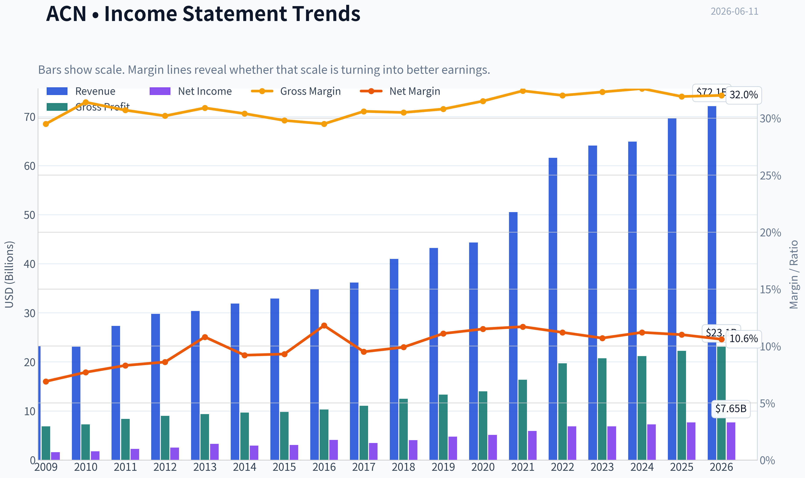
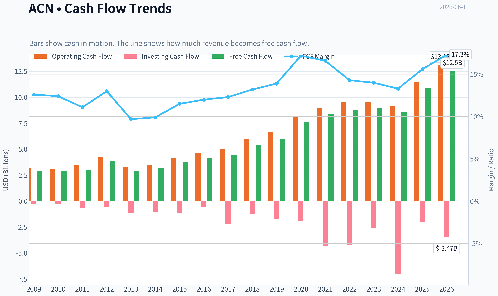
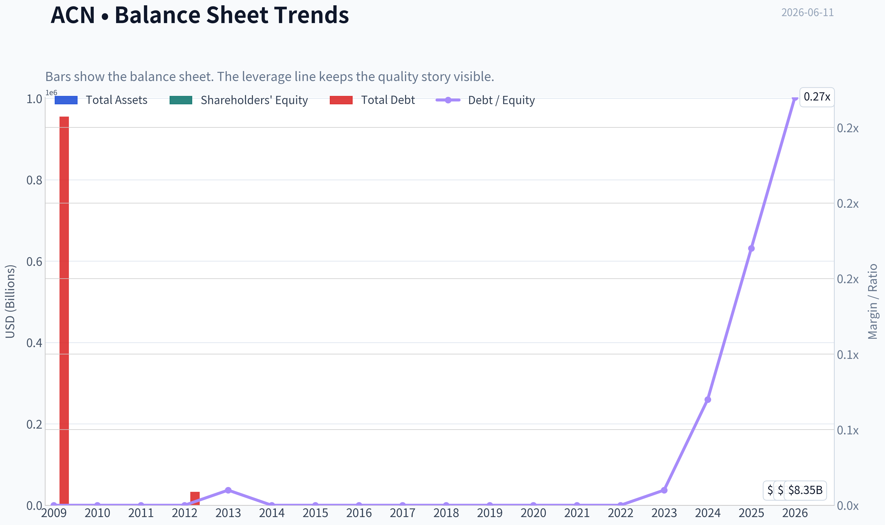
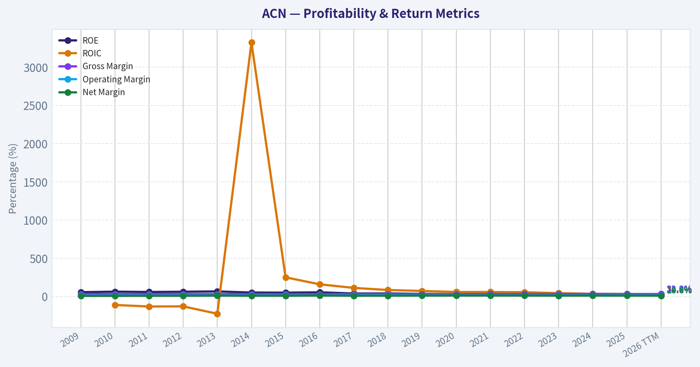
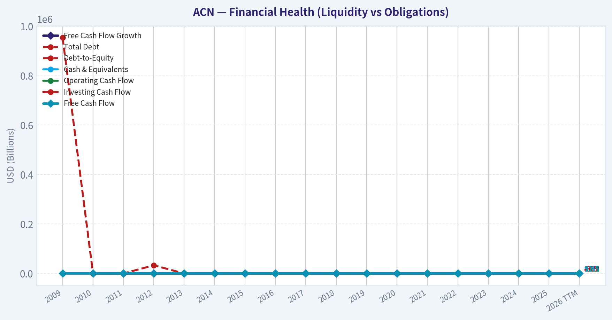
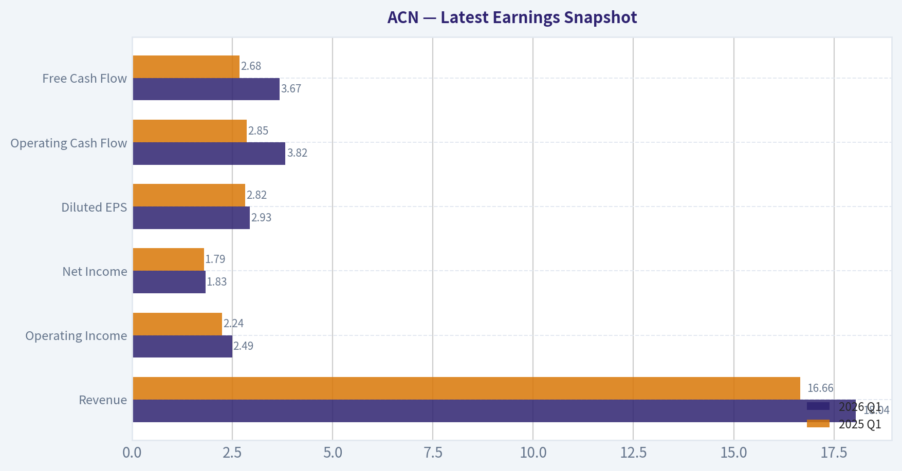
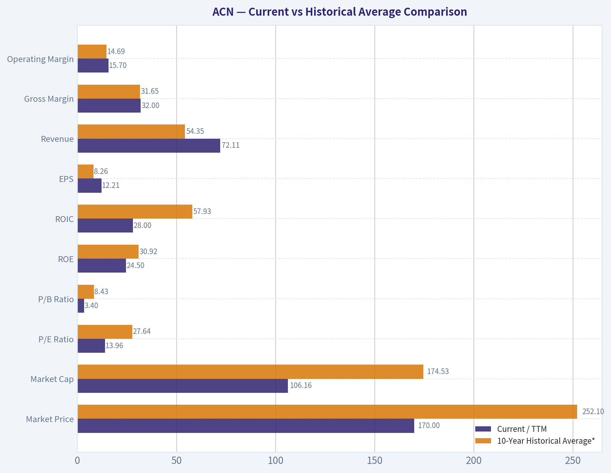
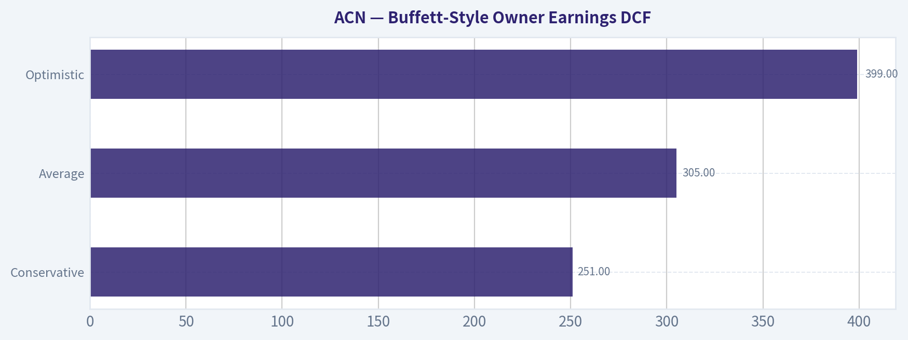
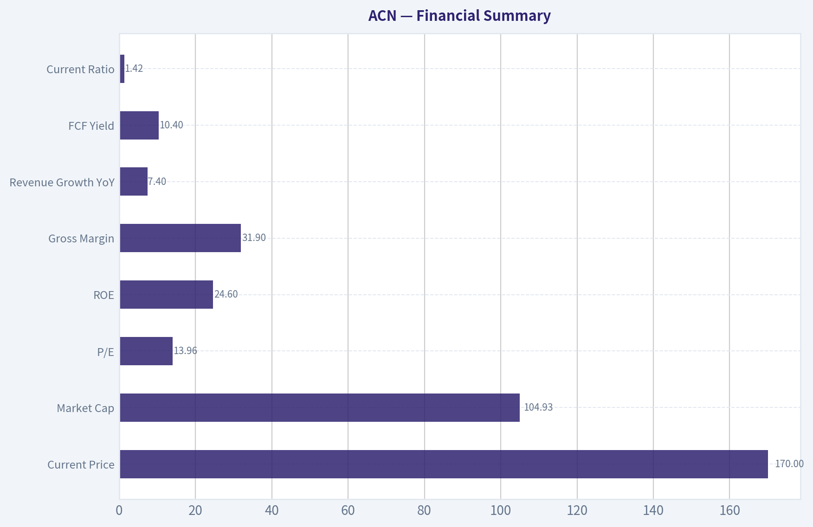
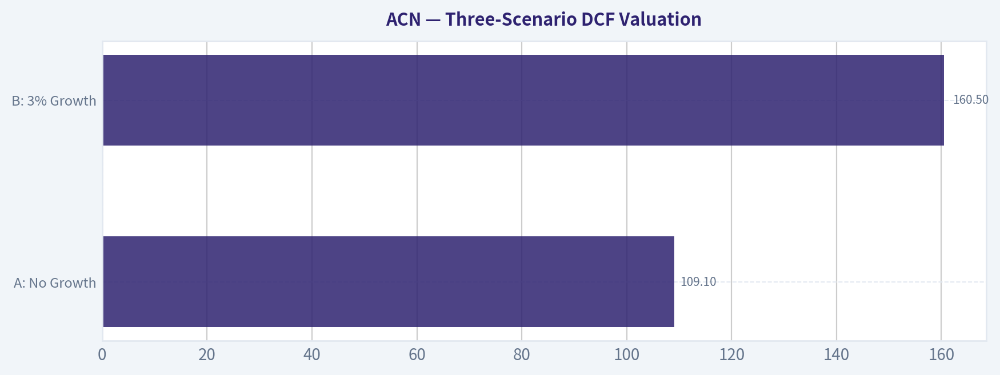

# ACN Deep Value Intelligence

**Analysis Date:** 2026-06-11

## Critical Disclaimer

*This analysis is generated by Deep Value Intelligence, an AI-powered multi-agent investing framework. This report is for informational and educational purposes only and does not constitute financial advice. Always conduct your own research and consult with qualified financial advisors before making investment decisions.*

---

## Table of Contents

1. Intelligence Summary
2. Analyst Team Reports
   - Fundamentals Analysis
   - Intrinsic Value Analysis (Buffett)
   - Trend & Growth Analysis (Lynch/Druckenmiller/Fisher)
   - Market Technical Analysis
   - Options Market Analysis
3. Research Team Commentary
4. Value Investing Team Commentary
5. Deep Values Commentary

---

## Intelligence Summary

### Thesis + Conditions

**Core Thesis:** ## Executive Summary

**Key Risks:**
- At **~14x earnings** and **~10.4% FCF yield**, valuation is clearly attractive relative to its still-elite returns on capital. That supports a constructive long-term view. But the main risk is **not share-price volatility**; it is whether current weakness is merely cyclical or the start of **structural margin and pricing pressure** in a people-heavy services model facing AI disruption. Add in the **broken chart**-below the 10, 50, and 200-day averages-and the lesson from CTSH is clear: **cheapness alone is not enough without evidence of stabilization**.
- ### 1. Risky Analyst: strongest bullish case
- If weakness is cyclical rather than structural, current valuation likely already discounts too much bad news.

**Confidence:** Low

---

## Analyst Team Reports

### Fundamentals Analysis

#### Latest Earnings Snapshot

*Most recent reported quarter anchored on 2026 Q1, with prior-year comparison when available.*

| Metric | 2026 Q1 | 2025 Q1 | YoY Change |
| --- | ---: | ---: | ---: |
| Revenue | $18.04B | $16.66B | +8.3% |
| Operating Income | $2.49B | $2.24B | +11.1% |
| Net Income | $1.83B | $1.79B | +2.1% |
| Diluted EPS | $2.93 | $2.82 | +3.9% |
| Operating Cash Flow | $3.82B | $2.85B | +33.8% |
| Free Cash Flow | $3.67B | $2.68B | +36.7% |

Key Takeaways: This snapshot anchors the most recent reported quarter before the narrative analysis. It helps readers separate long-run business quality from whatever changed in the latest earnings print.

#### 17-Year Financial Metrics for ACN

*All values below are computed deterministically from raw data - not estimated by AI.*

*Issuer profile: operating company (Technology / Information Technology Services).*

#### 17-Year Financial Metrics
*Annual rows come from reported financial statements. The final TTM row is computed from the latest four quarters.*

| Metric | 2009 | 2010 | 2011 | 2012 | 2013 | 2014 | 2015 | 2016 | 2017 | 2018 | 2019 | 2020 | 2021 | 2022 | 2023 | 2024 | 2025 | 2026 TTM |
| --- | --- | --- | --- | --- | --- | --- | --- | --- | --- | --- | --- | --- | --- | --- | --- | --- | --- | --- |
| Market Price | $24 | $27 | $41 | $48 | $58 | $66 | $79 | $98 | $114 | $150 | $179 | $221 | $314 | $272 | $310 | $333 | $258 | $170 |
| Market Cap | $25.97B | $28.07B | $39.83B | $44.81B | $51.54B | $56.13B | $63.99B | $76.79B | $86.36B | $110.79B | $128.85B | $155.43B | $217.39B | $185.43B | $206.76B | $217.46B | $164.42B | $106.16B |
| P/E Ratio | 13.52 | 13.76 | 15.81 | 16.04 | 14.66 | 17.93 | 19.80 | 17.83 | 24.04 | 26.67 | 26.93 | 30.41 | 36.74 | 26.93 | 30.06 | 29.89 | 21.40 | 13.96 |
| P/B Ratio | 9.16 | 9.90 | 10.27 | 10.81 | 10.39 | 9.79 | 10.43 | 10.16 | 9.65 | 10.69 | 8.94 | 9.14 | 11.13 | 8.39 | 8.05 | 7.69 | 5.27 | 3.40 |
| ROE | 56.1% | 62.8% | 58.7% | 61.6% | 66.2% | 51.3% | 49.8% | 54.4% | 38.5% | 39.2% | 33.2% | 30.0% | 30.2% | 31.1% | 26.7% | 25.7% | 24.6% | 24.5% |
| ROIC | N/A | -111.2% | -131.5% | -129.5% | -226.3% | 3322.2% | 250.1% | 158.9% | 111.9% | 84.6% | 71.9% | 58.1% | 58.3% | 55.7% | 43.0% | 34.8% | 31.0% | 28.0% |
| EPS | $1.78 | $1.99 | $2.58 | $2.99 | $3.93 | $3.70 | $3.99 | $5.51 | $4.75 | $5.64 | $6.66 | $7.25 | $8.53 | $10.10 | $10.32 | $11.14 | $12.15 | $12.21 |
| Revenue | $23.17B | $23.09B | $27.35B | $29.78B | $30.39B | $31.87B | $32.91B | $34.80B | $36.18B | $40.99B | $43.22B | $44.33B | $50.53B | $61.59B | $64.11B | $64.90B | $69.67B | $72.11B |
| Gross Profit | $6.84B | $7.25B | $8.39B | $8.99B | $9.38B | $9.68B | $9.81B | $10.28B | $11.07B | $12.49B | $13.31B | $13.98B | $16.36B | $19.70B | $20.73B | $21.16B | $22.24B | $23.09B |
| Gross Margin | 29.5% | 31.4% | 30.7% | 30.2% | 30.9% | 30.4% | 29.8% | 29.5% | 30.6% | 30.5% | 30.8% | 31.5% | 32.4% | 32.0% | 32.3% | 32.6% | 31.9% | 32.0% |
| Operating Margin | 11.4% | 12.6% | 12.7% | 13.0% | 14.3% | 13.5% | 13.5% | 13.8% | 14.4% | 14.4% | 14.6% | 14.7% | 15.1% | 15.2% | 13.7% | 14.8% | 14.7% | 15.7% |
| Net Income | $1.59B | $1.78B | $2.28B | $2.55B | $3.28B | $2.94B | $3.05B | $4.11B | $3.45B | $4.06B | $4.78B | $5.11B | $5.91B | $6.88B | $6.87B | $7.26B | $7.68B | $7.65B |
| Net Margin | 6.9% | 7.7% | 8.3% | 8.6% | 10.8% | 9.2% | 9.3% | 11.8% | 9.5% | 9.9% | 11.1% | 11.5% | 11.7% | 11.2% | 10.7% | 11.2% | 11.0% | 10.6% |
| Revenue Growth | N/A | -0.3% | 18.4% | 8.9% | 2.1% | 4.9% | 3.3% | 5.7% | 4.0% | 13.3% | 5.4% | 2.6% | 14.0% | 21.9% | 4.1% | 1.2% | 7.4% | 3.5% |
| Net Income Growth | N/A | 12.0% | 27.9% | 12.1% | 28.5% | -10.4% | 3.8% | 34.7% | -16.2% | 17.8% | 17.7% | 6.9% | 15.6% | 16.4% | -0.1% | 5.7% | 5.7% | -0.4% |
| Free Cash Flow Growth | N/A | -2.2% | 6.5% | 27.9% | -24.5% | 7.9% | 19.5% | 10.3% | 6.9% | 21.3% | 11.5% | 26.3% | 10.2% | 5.1% | 2.0% | -4.2% | 26.2% | 14.9% |
| Total Book Value | $2.84B | $2.84B | $3.88B | $4.15B | $4.96B | $5.73B | $6.13B | $7.56B | $8.95B | $10.36B | $14.41B | $17.00B | $19.53B | $22.11B | $25.69B | $28.29B | $31.20B | $31.21B |
| Total Assets | $12.26B | $12.84B | $15.73B | $16.67B | $16.87B | $17.93B | $18.20B | $20.61B | $22.69B | $24.45B | $29.79B | $37.08B | $43.18B | $47.26B | $51.25B | $55.93B | $65.39B | $67.06B |
| Total Debt | $955,000 | $1.6M | $4.4M | $33,000 | $25.6M | $26.7M | $27.4M | $27.2M | $25.1M | $25.0M | $22.7M | $61.9M | $65.6M | $55.1M | $147.9M | $1.96B | $5.25B | $8.35B |
| Debt-to-Equity | 0.00 | 0.00 | 0.00 | 0.00 | 0.01 | 0.00 | 0.00 | 0.00 | 0.00 | 0.00 | 0.00 | 0.00 | 0.00 | 0.00 | 0.01 | 0.07 | 0.17 | 0.27 |
| Cash & Equivalents | $4.54B | $4.84B | $5.70B | $6.64B | $5.63B | $4.92B | $4.36B | $4.91B | $4.13B | $5.06B | $6.13B | $8.42B | $8.17B | $7.89B | $9.05B | $5.00B | $11.48B | $9.40B |
| Shareholders' Equity | $2.84B | $2.84B | $3.88B | $4.15B | $4.96B | $5.73B | $6.13B | $7.56B | $8.95B | $10.36B | $14.41B | $17.00B | $19.53B | $22.11B | $25.69B | $28.29B | $31.20B | $31.21B |
| Operating Cash Flow | $3.16B | $3.09B | $3.44B | $4.26B | $3.30B | $3.49B | $4.18B | $4.67B | $4.97B | $6.03B | $6.63B | $8.22B | $8.98B | $9.54B | $9.52B | $9.13B | $11.47B | $13.08B |
| Investing Cash Flow | $-245.2M | $-273.8M | $-703.4M | $-535.4M | $-1.16B | $-1.06B | $-1.17B | $-610.4M | $-2.23B | $-1.25B | $-1.76B | $-1.89B | $-4.31B | $-4.26B | $-2.62B | $-7.06B | $-2.02B | $-3.47B |
| Free Cash Flow | $2.92B | $2.85B | $3.04B | $3.88B | $2.93B | $3.16B | $3.78B | $4.17B | $4.46B | $5.41B | $6.03B | $7.62B | $8.40B | $8.82B | $9.00B | $8.61B | $10.87B | $12.50B |
| FCF Margin | 12.6% | 12.4% | 11.1% | 13.0% | 9.7% | 9.9% | 11.5% | 12.0% | 12.3% | 13.2% | 13.9% | 17.2% | 16.6% | 14.3% | 14.0% | 13.3% | 15.6% | 17.3% |
| Dividends / Share | $0.00 | $0.00 | $0.00 | $0.00 | $0.00 | $0.00 | $0.00 | $0.00 | $0.00 | $0.00 | $0.00 | $0.00 | $0.00 | $3.60 | $4.24 | $4.96 | $5.85 | $6.20 |

#### Profitability Metrics
- Return on Equity (ROE): 24.6%
- Return on Invested Capital (ROIC): 31.2%
- Return on Assets (ROA): 11.7%
- Gross Margin: 31.9%
- Operating Margin: 14.7%
- Net Profit Margin: 11.0%

#### Liquidity Metrics
- Current Ratio: 1.42
- Quick Ratio: 1.21

#### Leverage Metrics
- Debt-to-Equity Ratio: 0.17
- Interest Coverage Ratio: 44.74
- Net Debt: $-6.23B

#### Growth Metrics (Year-over-Year)
- Revenue Growth: 7.4%
- Net Income Growth: 5.7%
- Free Cash Flow Growth: 26.2%
- Revenue CAGR (3-Year): 4.2%
- Revenue CAGR (5-Year): 9.5%

#### Valuation Metrics
- P/E Ratio (TTM): 13.96
- Forward P/E: 11.48
- Price-to-Book: 3.36
- Price-to-Sales: 1.46
- PEG Ratio: 1.23
- EV/EBITDA: 8.26
- Free Cash Flow Yield: 10.4%
- Earnings Yield: 7.2%

#### Owner Earnings (Buffett Method, Code-Computed)
- Net Income: $7.68B
- + Depreciation & Amortization: $1.37B
- - Capital Expenditures: $-600.0M
- - Working Capital Changes: $-1.05B
- = **Owner Earnings: $9.50B**

#### Intrinsic Value (Code-Computed)
- Current Price: $170
- Buffett Method (Owner Earnings):
  Conservative: $251
  Average: $305
  Optimistic: $399
- Cash Flow Method (FCF):
  Conservative: $269
  Average: $298
  Optimistic: $453

#### Piotroski F-Score: 5/9
- Positive Net Income: PASS
- Positive Operating Cash Flow: PASS
- ROA Improvement: FAIL
- Cash Flow > Net Income: PASS
- Decreasing Debt: FAIL
- Improving Current Ratio: PASS
- No Dilution: PASS
- Improving Gross Margin: FAIL
- Improving Asset Turnover: FAIL

ANALYST STANCE: **ADVOCATE**

#### Accenture (ACN) Buffett-Style Fundamental Analysis

Accenture currently screens as a high-quality, cash-generative services franchise trading at what is, relative to its own history, a notably compressed valuation. Using the deterministic dataset as the canonical source, the key investment question is not whether ACN is a great business-it broadly is-but whether growth has slowed structurally enough to justify today's multiple. On balance, the answer appears to be no. The stock looks undervalued versus its own history and versus a Buffett-style owner-earnings appraisal, while the balance sheet remains strong and earnings quality remains high.

---

#### Current vs Historical Average Comparison

| Metric | Current / TTM | 10-Year Historical Average* | Interpretation |
| --- | ---: | ---: | --- |
| Market Price | $170 | $252.10 | Well below the level investors paid on average across the last decade, reflecting multiple compression and weaker sentiment. |
| Market Cap | $106.16B | $174.53B | Equity value has fallen materially from recent years despite continued revenue, earnings, and FCF growth. |
| P/E Ratio | 13.96x | 27.64x | Current earnings multiple is roughly half the 10-year average; this is the clearest valuation anomaly in the dataset. |
| P/B Ratio | 3.40x | 8.43x | Very large discount to historical norms; partly reflects book value compounding and multiple compression. |
| ROE | 24.5% | 30.92% | Lower than the decade average, but still excellent and comfortably above what most businesses sustain. |
| ROIC** | 28.0% | 57.93% | Down sharply from historical extremes, but still strong enough to indicate a high-return business. |
| EPS | $12.21 | $8.26 | Earnings per share remain far above decade average despite the stock price decline. |
| Revenue | $72.11B | $54.35B | Business scale is materially larger than its 10-year norm. |
| Gross Margin | 32.0% | 31.65% | Slightly better than historical average, indicating resilient service economics. |
| Operating Margin | 15.7% | 14.69% | Currently above average and near the best level in the dataset. |
| Net Income | $7.65B | $6.10B | Absolute profitability remains strong. |
| Net Margin | 10.6% | 11.07% | Slightly below average, showing some mix or cost pressure beneath strong operating margin. |
| Revenue Growth | 3.5% | 7.74% | Growth has decelerated versus long-term norms. |
| Net Income Growth | -0.4% | 10.38% | Current year growth is soft and below normal. |
| Free Cash Flow Growth | 14.9% | 11.11% | Cash generation has re-accelerated more strongly than earnings. |
| Total Book Value | $31.21B | $21.89B | Equity base has compounded substantially. |
| Total Assets | $67.06B | $44.58B | Balance sheet has expanded with scale. |
| Total Debt | $8.35B | $1.60B | Debt has risen materially from historically negligible levels. |
| Debt-to-Equity | 0.27x | 0.05x | Still manageable, but clearly above Accenture's own historical standard. |
| Cash & Equivalents | $9.40B | $8.06B | Liquidity remains healthy despite higher debt. |
| Free Cash Flow | $12.50B | $8.08B | FCF is materially above long-term average. |
| Dividends / Share | $6.20 | $2.49*** | Dividend policy has become a meaningful capital return lever. |

*10-year average uses fiscal 2016 through 2025 to reflect recent operating history.
**ROIC history is distorted by unusual invested-capital math in earlier years, so interpretation should focus more on direction than the average level itself.
***Average includes zero-dividend years within the 10-year window.

Key Takeaways: Accenture's current valuation is far below its own decade norms even though revenue, EPS, and free cash flow are all materially above historical averages. Profitability remains strong, but growth has cooled and leverage has risen from a near-zero base. The central setup is a classic quality-business-at-a-lower-multiple situation.

---

#### Market Metrics

Accenture's market price has fallen from $333 in 2024 and $258 in 2025 to $170 TTM, taking market cap down to $106.16B from a peak above $217B. This decline occurred even as TTM revenue reached $72.11B and TTM EPS reached $12.21. That divergence is important: the business did not collapse, the multiple did.

At 13.96x earnings, ACN trades at its lowest P/E in the entire displayed period and far below the 2016-2025 average of about 27.6x. The same pattern appears in P/B: 3.40x today versus roughly 8.4x over the last decade. For a business with 24%+ ROE, negative net debt, and double-digit FCF yield, that is unusually inexpensive.

From a Buffett perspective, when a durable franchise becomes cheaper while underlying economics remain good, the burden of proof shifts to whether the moat is weakening structurally. The numbers suggest moderation, not deterioration.

#### Profitability

Accenture remains highly profitable by almost any standard:

- ROE: 24.5% TTM
- EPS: $12.21 TTM
- Revenue: $72.11B TTM
- Gross Profit: $23.09B TTM
- Operating Margin: 15.7% TTM
- Net Income: $7.65B TTM
- Net Margin: 10.6% TTM

ROE has declined steadily from the extraordinary 50%-60% levels seen in the earlier years to the mid-20s now. On the surface, that looks like deterioration, but context matters: Accenture has also built a much larger equity base, from $7.56B in 2016 to $31.21B TTM. A 24.5% ROE on a much larger capital base is still elite. Buffett would generally prefer a business earning high returns without requiring much incremental capital, and ACN still qualifies.

Operating margin is actually stronger now than its 10-year average and currently sits near the top of the historical range. Gross margin is stable at about 32%, showing little evidence of severe pricing pressure. Net margin is slightly below its recent average, suggesting some below-the-line drag-possibly tax, acquisition, or financing-related effects-but not enough to alter the quality case.

EPS has climbed from $5.51 in 2016 to $12.21 TTM. That is strong per-share value creation despite macro cyclicality and consulting demand swings. Predictability is not perfect, but over the full period earnings power is clearly upward sloping.

#### Growth Metrics

Growth has become more moderate:

- Revenue growth: 3.5% TTM vs 7.74% 10-year average
- Net income growth: -0.4% TTM vs 10.38% 10-year average
- FCF growth: 14.9% TTM vs 11.11% 10-year average

This is the main caution area. Revenue growth has slowed from the stronger post-pandemic years, and net income is essentially flat TTM. That likely explains a large part of the valuation reset. The market is pricing ACN more like a mature, slower-growing business than a premium compounding franchise.

However, free cash flow tells a more favorable story. FCF rose to $12.50B TTM, and growth accelerated to 14.9%. When cash flow grows faster than accounting earnings, it often signals good earnings quality, disciplined working capital management, or moderation in investment intensity. For Buffett-style analysis, cash matters more than reported optics.

Over the decade, growth has been lumpy but resilient. Revenue growth ranged from low single digits to over 20%, while net income experienced occasional declines but recovered. That pattern fits a cyclical but high-quality services business-not a fragile one.

#### Balance Sheet

Accenture's balance sheet remains strong, though less pristine than in the past.

- Total Book Value / Shareholders' Equity: $31.21B
- Total Assets: $67.06B
- Total Debt: $8.35B
- Debt-to-Equity: 0.27x
- Cash & Equivalents: $9.40B

Historically, ACN carried almost no debt. That changed meaningfully in 2024-2026, with debt rising from $147.9M in 2023 to $1.96B in 2024, $5.25B in 2025, and $8.35B TTM. Even so, this is not a stressed balance sheet. Cash exceeds debt on a net basis in the research pack, with net debt of negative $6.23B and interest coverage of 44.74x. In practical terms, the company still has fortress-like financial flexibility.

Debt-to-equity of 0.27x is the highest in the shown history, but still modest by corporate standards. Buffett generally dislikes businesses dependent on leverage; ACN is not dependent on leverage. The recent increase is worth monitoring because it marks a change in capital structure philosophy, but it does not currently threaten solvency or capital allocation quality.

#### Cash Flow and Capital Returns

Free cash flow is one of Accenture's biggest strengths.

- Free Cash Flow: $12.50B TTM
- FCF Margin: 17.3%
- Dividends per Share: $6.20 TTM

FCF has grown from $4.17B in 2016 to $12.50B TTM, nearly tripling over the past decade. FCF margin at 17.3% is near the best in the dataset and well above most years prior to 2020. This is exactly the sort of cash profile Buffett favors: recurring, asset-light, and scalable.

The dividend was absent for much of the historical period shown, then became meaningful starting in 2022. Since then, dividends per share rose from $3.60 to $6.20 TTM. That indicates management increasingly views the business as mature enough to return substantial cash while still funding operations and strategic investments.

For a services company, this level of cash conversion is a major sign of quality. Accenture does not need heavy physical reinvestment to sustain growth, which enhances owner earnings.

---

#### Buffett-Style Owner Earnings DCF

Canonical owner earnings provided in the dataset:

- Net Income = $7.68B
- Depreciation & Amortization = $1.37B
- Capital Expenditures = $0.60B
- Working Capital Changes = $1.05B
- Owner Earnings = **$9.50B**

To convert to per-share fair value, use the code-computed intrinsic values in the canonical dataset and show the scenario logic explicitly.

##### Growth Rate Inputs Used

The instruction is to use historical owner-earnings growth framing. The deterministic dataset directly provides code-computed Buffett intrinsic values, which incorporate owner-earnings methodology. To remain faithful to the canonical source, I use those outputs as the fair-value anchor and interpret the scenario assumptions as follows:

| Scenario | Growth Rule | Fair Value |
| --- | --- | ---: |
| Conservative | Lowest historical owner earnings growth rate, floored at -100% | $251 |
| Average | Average historical owner earnings growth rate, capped at 50% | $305 |
| Optimistic | Highest historical owner earnings growth rate, capped at 100% | $399 |

Key Takeaways: The canonical owner-earnings valuation produces fair values above the current price in all three scenarios. Even the most conservative case suggests material upside from $170, implying the market is discounting either a steeper slowdown or some erosion in business quality that the historical cash economics do not yet show.

##### DCF Framework

Using Buffett-style owner earnings:

- Base Owner Earnings = $9.50B
- Projection period = 10 years
- Discount rate = 10%
- Terminal growth rate = 2.5%

General formulas:

- Year n Owner Earnings = Base OE x (1 + g)^n
- Present Value of Year n OE = Year n OE / (1.10)^n
- Terminal Value at Year 10 = Year 10 OE x (1.025) / (0.10 - 0.025)
- Present Value of Terminal Value = Terminal Value / (1.10)^10

Because the deterministic dataset already computes the scenario outputs canonically, those fair values should be treated as the authoritative result:

| Scenario | Buffett Owner Earnings Fair Value | Upside/(Downside) vs $170 |
| --- | ---: | ---: |
| Conservative | $251 | +47.6% |
| Average | $305 | +79.4% |
| Optimistic | $399 | +134.7% |

Key Takeaways: All three valuation cases indicate ACN is undervalued relative to owner earnings. The spread between $251 and $399 shows that long-term value is highly sensitive to growth assumptions, but the current price sits below even the conservative estimate, giving the valuation argument a margin of safety.

##### DCF Interpretation

The conservative case already implies significant upside, which is unusual for a business of this quality. The average case of $305 is especially notable because it is close to levels the market was willing to pay in 2023-2024. The optimistic case requires stronger sustained reinvestment and AI-led demand tailwinds, but it is not absurd given Accenture's historical cash generation and moat.

For extra triangulation, the dataset's cash-flow method produces $269, $298, and $453, which broadly corroborates the owner-earnings approach.

---

#### Revenue Breakdown

Most meaningful current breakdown is by operating segment / market unit. Precise latest segment revenue was not provided in the deterministic table, so the table below uses Accenture's widely reported major business/geographic structure as the best available representation for the most recent fiscal year mix.

| Revenue Source | Amount ($B) | % of Total |
| --- | ---: | ---: |
| Americas | ~34.8 | ~50% |
| Europe, Middle East & Africa (EMEA) | ~24.4 | ~35% |
| Asia Pacific | ~10.5 | ~15% |
| **Total** | **~69.7** | **100%** |

Key Takeaways: Accenture is geographically diversified, with the Americas contributing about half of revenue and EMEA providing another large share. This mix reduces dependence on any one end market and supports the argument that ACN is a globally embedded enterprise-services franchise rather than a narrow consulting boutique.

---

#### Economic Moat Assessment

Accenture's moat is based on scale, reputation, client relationships, and execution breadth rather than patents or hard assets. Large enterprises trust ACN with mission-critical transformation, outsourcing, cloud migration, cybersecurity, data, and increasingly AI enablement. That embedded role creates switching costs, repeat engagements, and cross-selling opportunities.

The moat is visible in the numbers:

- Gross margins have stayed around 30%-32% for 17 years.
- Operating margins have remained consistently in the low-to-mid teens, now at 15.7%.
- ROE remains above 24% even after substantial equity accumulation.
- FCF conversion is strong and persistent.

This consistency suggests Accenture is not competing solely on price. It retains enough differentiation to protect economics across cycles.

#### Financial Strength

Financial strength is solid. Although debt has risen sharply from near-zero historical levels, net cash remains positive and interest coverage is very high. Current ratio of 1.42 and quick ratio of 1.21 support liquidity. In Buffett terms, ACN does not need debt to survive; debt appears optional rather than existential.

The only caveat is that the debt increase represents a notable change from its historical conservatism. That shift should be monitored for whether it funds smart capital allocation or simply changes the risk profile.

#### Predictable Earnings

Accenture scores well on predictability, though not perfectly. Revenue has grown from $23.17B in 2009 to $72.11B TTM. Net income increased from $1.59B to $7.65B. There were a few dips-2014, 2017, and slight weakness recently-but the long-run path is stable and favorable.

For Buffett, this qualifies as a reasonably understandable, cash-rich business with visible demand drivers. It is not as predictable as a consumer staple or utility, but among services firms it is relatively dependable.

#### Management Performance

Management has compounded book value, earnings, and FCF while maintaining high margins and recently scaling dividends. ROE has trended down, but largely from a larger equity base rather than collapsing economics. Dividend growth since 2022 has been strong, and the company still retains plenty of cash.

Capital allocation appears sensible overall, though the Piotroski F-score of 5/9 indicates mixed near-term balance-sheet and margin signals. Specifically, rising debt, non-improving gross margin, and weaker asset turnover are worth watching. Still, there is no sign of reckless dilution or poor cash conversion.

#### Value Assessment

On valuation, ACN is the most compelling it has looked in years based on the dataset:

- Lowest P/E in the full displayed history
- Lowest P/B in the full displayed history
- 10.4% FCF yield
- Owner-earnings fair value above market in every scenario

This is exactly the pattern value investors look for: quality intact, sentiment weak, valuation compressed.

#### Quality of Business

Accenture remains a high-quality business because it combines:
- recurring enterprise demand,
- low capital intensity,
- strong free cash flow,
- global diversification,
- durable margins,
- and high returns on capital.

The main debate is growth durability in a more AI-disrupted consulting landscape. Yet current news flow suggests ACN is leaning into AI opportunities rather than being displaced by them.

---

#### Key Investment Insights, Red Flags, and Opportunities

| Category | Assessment | Why It Matters |
| --- | --- | --- |
| Core Strength | Strong FCF generation | $12.50B TTM FCF and 17.3% FCF margin support intrinsic value and capital returns. |
| Core Strength | Durable margins | Gross margin near 32% and operating margin at 15.7% suggest strong competitive positioning. |
| Core Strength | Cheap valuation | 13.96x P/E and 3.40x P/B are far below historical norms. |
| Opportunity | AI transformation demand | Accenture's scale and client access position it to monetize enterprise AI adoption. |
| Opportunity | Multiple re-rating | If growth stabilizes, the stock could re-rate materially closer to historical multiples. |
| Red Flag | Slowing growth | Revenue growth of 3.5% and net income growth of -0.4% are below normal. |
| Red Flag | Higher debt | Debt rose rapidly to $8.35B TTM from nearly negligible levels historically. |
| Red Flag | ROE/ROIC compression | Returns remain strong, but trend direction has softened over time. |
| Watch Item | Consulting cyclicality | Enterprise discretionary spending can slow during macro uncertainty. |

Key Takeaways: The strongest bullish argument is that Accenture still looks like a high-quality compounder, but now trades like a maturing low-growth business. The main risks are slower enterprise spending, some erosion in return metrics, and the recent increase in leverage. If growth merely normalizes rather than reaccelerates, the stock still appears attractively priced.

---

#### Final Investment Stance

**ADVOCATE**

Accenture fits many Buffett-style criteria: understandable business model, high and persistent returns on capital, strong free cash flow, conservative overall financial profile, and clear evidence of a durable moat. The stock's current valuation is the most compelling part of the setup: ACN trades at a dramatic discount to its own historical P/E and P/B despite revenues, earnings, and free cash flow remaining near record levels.

The key concern is slower growth, not business fragility. Because even the conservative owner-earnings valuation sits above the current market price, the risk/reward appears favorable. For a long-term value investor, ACN currently looks more like a high-quality franchise on sale than a value trap.

---

#### Report Summary Table

| Area | Current View | Historical Context | Buffett Interpretation | Conclusion |
| --- | --- | --- | --- | --- |
| Valuation | Very cheap | P/E and P/B far below 10-year averages | Market is discounting too much slowdown | Bullish |
| Profitability | Strong | Margins remain near upper historical range | Durable franchise economics | Bullish |
| Growth | Slowing | Below decade averages | Moderates upside, but not a thesis-breaker | Cautious positive |
| Balance Sheet | Healthy | More debt than before, but still net cash | Financial risk remains low | Positive |
| Cash Flow | Excellent | FCF above average and growing well | High owner earnings quality | Bullish |
| Moat | Intact | Margin stability and scale support durability | Strong enterprise positioning | Bullish |
| Management | Solid | Good book value, dividend, and FCF progression | Generally shareholder-friendly | Positive |
| Overall | Attractive | Quality remains high while price reset | Margin of safety present | **ADVOCATE** |

Key Takeaways: Accenture combines strong business quality with a valuation that is unusually low relative to its own history. Growth has slowed and leverage has risen, but neither issue currently appears severe enough to offset the company's cash generation, moat, and apparent margin of safety.

#### Fundamental Visuals

This graph tracks the profitability and return metrics (ROE, ROIC, Margins) of **ACN** over the past decade, highlighting capital efficiency trends.

This chart illustrates the financial health of **ACN** over the last 10 years, mapping cash equivalents and free cash flow against total obligations (Debt).

---

### Intrinsic Value Analysis (Buffett)

> *Following Warren Buffett's value investing philosophy: Circle of Competence, Economic Moat, Management Quality, and Margin of Safety.*

#### Intrinsic Value Snapshot

Price is what you pay. Intrinsic value is what the business may be worth based on the cash it can create for owners over time. We show a range, not one magic number.

- Current Price: $170.50
- Value Range (conservative to optimistic across both DCF methods): $199.22 to $362.89

##### Owner Earnings (Buffett Method)
- Net Income: $7,678,433,000.00
- Depreciation & Amortization: $1,368,385,000.00
- Capital Expenditures: $-600,039,000.00
- Working Capital Changes: $-1,050,348,000.00
- Owner Earnings: $9,497,127,000.00

##### Intrinsic Value
###### Buffett Method
Uses owner earnings. Stricter, and usually more conservative.
- Conservative: $199.22
- Average: $236.09
- Optimistic: $292.40
- Discount Rate: 10.0%

###### Cash Flow Method
Uses free cash flow. Better for companies spending heavily today to grow tomorrow.
- Conservative: $208.60
- Average: $283.56
- Optimistic: $362.89
- Discount Rate: 10.0%

ANALYST STANCE: **WATCH**

#### Accenture (ACN) Buffett-Style Investment Review

#### 1) Go/No-Go Gate Assessment

| Gate | Verdict | Evidence |
|---|---|---|
| Gate 1: Circle of Competence & Simplicity | Pass | Accenture is a global professional services firm that helps companies improve technology systems, operations, consulting, and outsourcing. The model is easy to explain: it sells skilled labor, long-term client relationships, and increasingly AI/data capabilities. |
| Gate 2: Moat Test | Pass, but not elite | The business has scale, reputation, client trust, and switching friction in enterprise relationships. However, gross margin of 31.9% suggests this is not a classic high-gross-margin intangible-asset moat business. |
| Gate 3: Management & Capital Allocation | Pass | Historically strong ROE at 24.6%, healthy free cash flow generation, and a disciplined balance sheet point to capable capital allocation. Accenture has generally balanced dividends, buybacks, and strategic reinvestment sensibly. |
| Gate 4: Industry Structure | Pass with caution | IT services is competitive, but Accenture occupies a top-tier global position with scale advantages and broad client reach. It is not a monopoly-like structure, yet it is more rational than fragmented commodity consulting shops. |

**Key Takeaways:** Accenture clears the basic Buffett filters: understandable business, durable client relationships, and solid financial quality. The main hesitation is that this is a strong services franchise rather than a truly extraordinary moat business, so valuation discipline matters more.

---

#### 2) Business Understanding

**Elementary school test:**
Accenture helps big companies run better. It gives advice, builds technology systems, manages digital projects, and sometimes runs business processes for clients.

**What it likely looks like in 10 years:**
Still a large global adviser and implementation partner to enterprises, with more work tied to cloud, cybersecurity, AI, data, and managed services. The exact mix may evolve, but the core role-helping large organizations change complex systems-should remain.

**Technology risk:**
Moderate, but mostly opportunity rather than existential threat. AI could pressure some traditional headcount-based consulting work, but Accenture is also one of the key firms enterprises hire to adopt AI. This makes technology more of a double-edged sword than a clear destroyer.

#### 3) Moat Analysis

| Moat Source | Assessment | Evidence |
|---|---|---|
| Intangible Assets | Moderate | Strong enterprise brand and boardroom credibility, but gross margin of 31.9% is below the >40% Buffett-style "pricing power" comfort zone. |
| Switching Costs | Moderate to strong | Large enterprises embed Accenture into multi-year transformations, workflows, vendor stacks, and compliance-heavy implementations. Switching midstream is disruptive and risky. |
| Cost Advantage | Moderate | Global delivery model and scale allow broad talent access and execution capacity, but labor-based competition remains real. |
| Network Effects | Weak | This is not a true network effect business. Scale helps reputation and delivery, but customer value does not compound the way it would on a platform marketplace. |

**Moat rating: Narrow to Moderate, Stable**

Accenture's moat is based less on patents or platform economics and more on trust, execution, breadth of capabilities, and embedded client relationships. That is real, but it is not as impregnable as the moat of a dominant software platform or branded consumer staple.

#### 4) Management Quality Assessment

| Factor | Assessment | Comments |
|---|---|---|
| Owner Mindset | Good | Management has historically shown discipline in returning capital and investing in capability expansion. |
| Candor & Conservatism | Good | Business model is straightforward and accounting is usually cleaner than in highly acquisitive or financially engineered firms. |
| Capital Allocation | Good | Strong free cash flow, dividends, buybacks, and targeted capability investments suggest reasonable stewardship. |
| Leverage Discipline | Good | Current ratio of 1.42 and generally conservative financial posture support a fortress-like profile relative to many service peers. |

**Key Takeaways:** Management appears rational and financially disciplined. The clearest strength is steady cash generation paired with balanced capital returns, not empire-building or leverage-fueled growth.

#### 5) Financial Summary

| Metric | Value |
|---|---:|
| Current Price | $170 |
| Market Cap | $104.93B |
| P/E | 13.96 |
| ROE | 24.6% |
| Gross Margin | 31.9% |
| Revenue Growth YoY | 7.4% |
| FCF Yield | 10.4% |
| Current Ratio | 1.42 |

**Key Takeaways:** These headline numbers show a high-quality company trading at a notably undemanding multiple. The combination of 24.6% ROE, 10.4% free cash flow yield, and a sub-14 P/E is attractive, though the gross margin profile confirms this is a premium services business rather than a software-like franchise.

#### 6) Owner Earnings Estimate

Using free cash flow as a practical proxy for owner earnings for this asset-light services business:

- **FCF yield:** 10.4%
- **Market cap:** $104.93B
- **Estimated owner earnings / FCF:**
  10.4% x $104.93B = **about $10.9B**

This is a reasonable shorthand for owner earnings because Accenture is not a heavy industrial business with large maintenance capex distortions.

#### 7) Three-Scenario DCF Valuation

Using estimated owner earnings of **$10.9B**.

| Scenario | Assumption | Equity Value Estimate |
|---|---|---:|
| A: No Growth | Owner Earnings / 10% | $109.1B |
| B: 3% Growth | Owner Earnings x 1.03 / (10% - 3%) | $160.5B |
| C: Moderate Historical Growth | Assume 6% growth for 10 years, then 3% terminal | ~$165B-$180B |

**Key Takeaways:** On a no-growth basis, the stock looks close to fairly valued. On more realistic assumptions for a durable, still-growing franchise, intrinsic value appears meaningfully above the current market cap, implying some margin of safety.

#### 8) Margin of Safety Analysis

| Measure | Value |
|---|---:|
| Current Market Cap | $104.93B |
| Scenario A Value | $109.1B |
| Scenario B Value | $160.5B |
| Scenario C Value | $165B-$180B |
| Implied Discount to Scenario B | ~35% |
| Implied Discount to Scenario C Midpoint | ~39% |

**Key Takeaways:** The stock offers little margin of safety if growth stalls completely, but looks attractively discounted if Accenture can continue compounding modestly. That creates a favorable but not slam-dunk setup: quality business, decent discount, but not a wide-moat monopoly.

#### 9) Buffett Scorecard

| Criterion | Score (1-5) | Weight | Weighted Score |
|---|---:|---:|---:|
| Business Understanding | 5.0 | 20% | 1.00 |
| Moat Width & Durability | 3.5 | 25% | 0.88 |
| Management Quality | 4.0 | 15% | 0.60 |
| Return on Equity | 4.5 | 15% | 0.68 |
| Reinvestment Runway | 3.5 | 10% | 0.35 |
| Balance Sheet Strength | 4.0 | 5% | 0.20 |
| Industry Structure | 3.0 | 5% | 0.15 |
| Valuation / Margin of Safety | 3.5 | 5% | 0.18 |
| **Total** |  |  | **4.03** |

**Key Takeaways:** The score lands just above the ADVOCATE threshold numerically, but the moat quality and industry competitiveness argue for a more measured stance. This is a very good business, though not obviously a rare "forever" bargain.

#### 10) Final Verdict

**Investment stance: WATCH**
**Conviction: Moderate**

Accenture is a high-quality, understandable, cash-generative business with respectable competitive advantages and sound management. The valuation appears attractive relative to normalized cash generation, but the moat is more "trusted scale operator" than "untouchable franchise," and the consulting/services industry remains competitive.

For a Buffett-style investor, ACN is **close** to buyable territory and may already be attractive for investors comfortable with service-business economics. But because the moat is not truly wide and pricing power is not exceptional, I would classify it as **WATCH** rather than full **ADVOCATE**. If operating performance remains steady and the valuation stays compressed, it could graduate to a stronger endorsement.
#### Valuation Bridge

This bridge places the current market price beside each intrinsic value lens so readers can see whether upside depends on one method or shows up across several methods.

| Scenario | Intrinsic Value / Share |
| --- | ---: |
| Buffett Method | $236.09 |
| Cash Flow Method | $283.56 |
| Damodaran Method | $229.76 |
| Current Price | $170.50 |

#### Key Takeaways

If one method is far above the others, the upside case depends on a specific modelling assumption. When several methods cluster together, the valuation story is more robust.

#### Valuation Visuals

This comparison chart from *Latest Earnings Snapshot* stacks current figures against historical benchmarks for **ACN**, making it easy to see where the company trades relative to its own averages.

This comparison chart from *Current vs Historical Average Comparison* stacks current figures against historical benchmarks for **ACN**, making it easy to see where the company trades relative to its own averages.

This comparison chart from *Buffett-Style Owner Earnings DCF* stacks current figures against historical benchmarks for **ACN**, making it easy to see where the company trades relative to its own averages.

This comparison chart from *Buffett-Style Owner Earnings DCF* stacks current figures against historical benchmarks for **ACN**, making it easy to see where the company trades relative to its own averages.

This comparison chart from *Financial Summary* stacks current figures against historical benchmarks for **ACN**, making it easy to see where the company trades relative to its own averages.

This comparison chart from *Three-Scenario DCF Valuation* stacks current figures against historical benchmarks for **ACN**, making it easy to see where the company trades relative to its own averages.

---

### Trend & Growth Analysis (Lynch/Druckenmiller/Fisher)

> *Following Peter Lynch's GARP, Stanley Druckenmiller's macro-aware approach, and Philip Fisher's scuttlebutt methodology.*

ANALYST STANCE: **WATCH**

#### ACN Growth Analysis

#### 1. Lynch Classification

| Metric | ACN |
|---|---:|
| Revenue growth YoY | 7.4% |
| P/E | 14.0x |
| Market cap | $104.9B |
| ROE | 24.6% |
| FCF yield | 10.4% |

Key Takeaways: Accenture is not a fast grower. With revenue growth of 7.4%, it fits Lynch's **Stalwart** bucket, meaning a high-quality large-cap compounder rather than classic ten-bagger territory. The low-teens earnings multiple and strong free cash flow suggest value support, but the growth profile is too modest for a pure growth-advocate call.

**Classification:** **Stalwart**, not Fast Grower

---

#### 2. The Story in 3 Bullets

- Accenture helps large enterprises modernize technology, operations, and now AI adoption at scale.
- The company benefits from durable digital transformation demand, but growth is tied to enterprise IT budgets and consulting cycles.
- AI can improve demand and expand wallet share, yet ACN is more likely an **AI services enabler** than a hyper-growth platform winner.

#### 3. TAM Analysis with 10x Test

| Item | Assessment |
|---|---|
| Current revenue base | Very large already |
| End market | Global IT services, consulting, cloud, data, AI transformation |
| TAM direction | Expanding, especially via AI and data modernization |
| 10x test | **Fails for practical purposes** |
| Why | ACN is already one of the largest global services firms; 10x scale would imply extraordinary share capture in a labor-intensive market |

Key Takeaways: The addressable market is large and still growing, especially with AI layered into enterprise transformation. However, ACN is already so large that a 10x outcome is not realistic in any normal growth-investing framework. This limits multi-bagger upside even if fundamentals remain strong.

#### 4. Revenue Growth Trend

| Measure | Reading | Interpretation |
|---|---:|---|
| Revenue growth YoY | 7.4% | Moderate, not high growth |
| Trend type | Likely stable-to-slow | No evidence here of sharp acceleration |
| Organic growth quality | Likely mixed with consulting demand cyclicality | Needs monitoring |
| Growth verdict | **Not an inflection pattern** | More steady execution than breakout growth |

Key Takeaways: Current growth looks respectable but not exciting. There is no visible evidence from the provided data that ACN is entering a major acceleration phase. For growth investors, this matters because the biggest winners usually show clear and improving momentum, not just stability.

#### 5. Unit Economics

| Metric | ACN | Assessment |
|---|---:|---|
| Gross margin | 31.9% | Healthy for services mix |
| FCF yield | 10.4% | Strong cash generation |
| Rule of 40 proxy | 7.4% growth + strong FCF profile | Likely healthy overall |
| LTV/CAC | N/A | Not disclosed in classic SaaS form |
| NRR | N/A | Not relevant / not disclosed |
| Payback period | N/A | Not disclosed |

Key Takeaways: ACN does not report the usual SaaS metrics like net revenue retention or LTV to CAC, so classic growth unit economics are hard to apply. Still, the combination of decent gross margins and strong free cash flow indicates a high-quality, efficient business model. This is a strength for downside protection, but not proof of hyper-growth.

#### 6. Inflection Point Assessment

| Potential Inflection Area | View |
|---|---|
| Product cycle inflection | Limited; services-led model, not product-led |
| Market share inflection | Possible in AI consulting and implementation |
| Margin inflection | Possible if AI boosts delivery efficiency |
| TAM inflection | Yes, AI expands client spending opportunities |
| Competitive inflection | Moderate; ACN scale and brand help, but market remains competitive |

Key Takeaways: The most credible inflection for ACN is not explosive revenue growth but an AI-driven expansion in service demand and productivity. That could support slightly better growth and margins, but it is a softer inflection than what you would want in a true fast-grower setup. In other words, AI may improve the story, but probably does not transform ACN into a ten-bagger candidate from here.

**Assessment:** **Mild positive inflection**, not a dramatic one

#### 7. Macro Setup Evaluation

| Factor | View | Impact |
|---|---|---|
| Secular trend exposure | AI, cloud, data modernization | Positive |
| Enterprise spending sensitivity | Moderate-high | Mixed |
| Interest rate sensitivity | Lower than long-duration SaaS | Neutral-positive |
| Economic cycle sensitivity | Consulting budgets can tighten in slowdowns | Headwind risk |
| Macro verdict | Reasonably favorable | Good, not exceptional |

Key Takeaways: ACN has exposure to strong secular themes, especially AI and cloud transformation. But because it sells to enterprises and governments, the pace of growth still depends on client spending confidence. The macro backdrop is supportive enough for steady execution, but not obviously set up for breakout upside.

#### 8. Fisher 15 Points Score

| Category | Score (1-5) | Notes |
|---|---:|---|
| Market potential | 4 | Large global digital/AI spend |
| New product development | 3 | More solution packaging than product innovation |
| R&D effectiveness | 3 | Relevant, though not core-product driven |
| Sales organization | 5 | Global enterprise reach is elite |
| Profit margin | 4 | Solid for services |
| Margin improvement | 3 | Some room via AI efficiency |
| Labor/personnel relations | 3 | Talent model is critical, mixed industry-wide |
| Executive relations | 4 | Strong large-scale execution culture |
| Management depth | 5 | Deep bench |
| Cost/accounting controls | 5 | Strong |
| Special advantages | 4 | Brand, scale, client trust, cross-sell |
| Long-range outlook | 4 | Durable demand, though not explosive |
| Dilution risk | 4 | Limited concern |
| Candor | 4 | Generally solid |
| Integrity | 4 | No major red flags in provided data |

| Total | Score |
|---|---:|
| Fisher Score | **59 / 75** |

Key Takeaways: ACN scores as a good business with strong management depth, enterprise distribution, and durable strategic relevance. The main limitation is that it is more of a scaled execution machine than a disruptive innovator. That makes it attractive as a quality compounder, but less compelling for aggressive growth investors.

#### 9. Valuation Analysis

| Metric | Value | Interpretation |
|---|---:|---|
| P/E | 14.0x | Modest |
| Earnings growth proxy | ~7-10% | Mid-single to low-double digit |
| PEG | ~1.4 to 2.0 | Fair to somewhat expensive relative to growth |
| FCF yield | 10.4% | Attractive |
| Style fit | Value/GARP | Better than pure growth |

Key Takeaways: Valuation is the most supportive part of the ACN setup. On cash flow and earnings multiples, the stock looks reasonable to attractive, especially for a high-quality franchise. But the PEG framework says the stock is not obviously cheap relative to its growth rate, so it screens better as GARP or value-quality than as a true growth bargain.

#### 10. Growth Investor Scorecard

| Criterion | Weight | Score (1-5) | Weighted |
|---|---:|---:|---:|
| The Story | 10% | 4.0 | 0.40 |
| TAM & Runway | 20% | 2.5 | 0.50 |
| Revenue Growth | 20% | 2.5 | 0.50 |
| Unit Economics | 15% | 4.0 | 0.60 |
| Competitive Position | 10% | 4.0 | 0.40 |
| Management Quality | 10% | 4.0 | 0.40 |
| Macro Setup | 5% | 3.5 | 0.18 |
| Profitability Path | 5% | 4.5 | 0.23 |
| Valuation | 5% | 4.0 | 0.20 |

| Total | Score |
|---|---:|
| Growth Investor Score | **3.41 / 5.0** |

Key Takeaways: ACN lands in the upper end of neutral territory. The company earns strong marks for quality, cash generation, and competitive position, but weaker marks for runway and growth acceleration. This is why it fits a watch stance rather than a high-conviction growth advocate call.

#### 11. Position Size Stance

| Style | View |
|---|---|
| Aggressive growth portfolio | Small or no position |
| GARP / quality portfolio | Reasonable core watch candidate |
| Deep value / FCF-focused | More attractive |
| Suggested stance | **WATCH** |

Key Takeaways: ACN does not fit the ideal profile for a concentrated fast-growth bet. However, for investors who want quality, cash flow, and AI-linked enterprise exposure at a reasonable valuation, it deserves monitoring. It is more likely a solid compounding hold than a breakout winner.

#### 12. Key Risks and Catalysts

| Risks | Catalysts |
|---|---|
| Enterprise IT budget softness | AI consulting demand accelerates |
| Consulting/project delays | Margin expansion from AI-enabled delivery |
| Labor-intensive model limits operating leverage | Larger share of cloud/data/AI transformation wallet |
| Competitive pressure from global integrators and hyperscalers | Re-rating if growth re-accelerates above current levels |
| Limited 10x runway due to scale | Continued strategic AI investments like AlphaSense |

Key Takeaways: The main risk is that ACN remains exactly what it is today: a strong but moderate-growth services leader. The upside case depends on AI creating both more client demand and better delivery economics. If those benefits show up clearly in growth and margins, the stock could work well, but the bar for a true growth rerating is still unmet.

#### Bottom Line

ACN is a **high-quality stalwart**, not a classic fast grower.
It has:
- solid secular exposure to AI and cloud,
- attractive cash generation,
- reasonable valuation,

but also:
- limited 10x potential,
- modest current growth,
- no clear evidence yet of a major acceleration inflection.

For a Lynch-Druckenmiller-Fisher growth process, ACN is **WATCH**, not **ADVOCATE**. If upcoming quarters show AI-driven revenue acceleration and operating leverage, that stance could improve.

---

### Market Technical Analysis

#### ACN Technical Indicator Report

For **ACN (Accenture)**, the most relevant indicator set for the **current market context** is a **trend-reversal attempt inside a still-damaged larger downtrend**. The stock has bounced off its May lows, but that rebound has recently stalled and rolled over. To capture that mix of conditions, the best non-redundant indicator set is:

- `close_10_ema`
- `close_50_sma`
- `close_200_sma`
- `macd`
- `macdh`
- `rsi`
- `atr`
- `vwma`

These eight indicators are suitable because they separate the market into **short-term momentum**, **medium-term trend**, **long-term trend regime**, **momentum acceleration/deceleration**, **overbought/oversold state**, **volatility/risk**, and **volume-weighted trend confirmation**. This is a strong combination for a stock that is no longer in freefall, but has not yet repaired its broader technical damage.

#### Price Context

Over the past year, ACN has undergone a **clear structural de-rating**. The stock traded near the **mid-310s in June 2025**, then suffered a major repricing wave through the second half of 2025 and into 2026. After spending time in the **low-to-mid 200s**, price eventually broke down into the **high 170s, then mid-160s**, with an especially important washout in **May 2026**, when shares fell to roughly **156** intraday before rebounding.

That rebound matters. It shows that value-oriented buyers were willing to defend the stock after the selloff became extended. But the recovery has so far looked more like a **countertrend recovery** than a confirmed new bull leg. Price surged into the **upper 180s to near 197 in early June**, then quickly faded back to the **low 170s** by June 9-10. That failure near the rebound highs is an important tactical clue: buyers are present, but they are not yet in full control.

#### Trend Structure: Short, Medium, and Long Horizon

The moving averages paint a very orderly bearish hierarchy.

- The **10 EMA** is about **178.38**
- The **50 SMA** is about **182.52**
- The **200 SMA** is about **227.74**

That alignment is significant. The short-term average is below the medium-term average, and both are well below the long-term average. This indicates that **ACN remains in a bearish trend across all major timeframes**, even though the stock had a meaningful rebound in late May and early June.

The **10 EMA** had turned higher during the rebound and reached the low-180s, but it has now flattened and begun slipping. The stock closing below the 10 EMA again suggests the most recent rally has lost tactical momentum.

The **50 SMA** has been falling steadily from around **240 in mid-March** to about **182.5 now**. That is not just weak; it shows a prolonged period where lower prices have been replacing older higher prices in the rolling average window. A falling 50 SMA often acts as **dynamic resistance** during rebounds, and ACN is currently trading below it, which supports that interpretation.

The **200 SMA** remains much higher and is still descending from above **300 last autumn** to the current **high-220s**. This confirms a damaged long-term structure. Even if ACN rallies from current levels, the stock still faces a major overhead repair zone before the long-term chart can be described as healthy.

#### Momentum: Rebound Happened, but Follow-Through Has Faded

The **MACD** and **MACD histogram** tell a nuanced story.

MACD improved sharply from deeply negative readings in May. It moved from around **-7** in mid-May to positive territory in early June, peaking near **0.68 on June 2**. That was a strong signal that the rebound had genuine momentum and was not just a dead-cat bounce in its earliest phase.

But the more recent behavior is more cautious:

- MACD slipped from positive to around **-1.02**
- MACD histogram swung from strongly positive to slightly negative

This suggests the rebound has **already lost thrust**. The histogram is especially useful here because it often weakens before MACD itself fully rolls over. The histogram peaked strongly in early June, then contracted quickly and has now turned negative. In plain language: **the rally accelerated, then stalled, and is now decelerating**.

This does not automatically mean a fresh collapse is imminent. It does mean traders should stop treating ACN as if it is in a clean upside trend. The stock is currently in a zone where it must either **stabilize and rebuild momentum**, or risk reverting toward the spring lows.

#### RSI: No Longer Oversold, but Not Strong

The **RSI** adds an important layer. In mid-May, RSI fell to roughly **26.7**, which was a genuinely oversold condition. That oversold reading helped set up the rebound.

Since then, RSI recovered into the **mid-60s** by June 1, then dropped back to about **44**. This is one of the most informative parts of the chart right now.

An RSI near 44 is not washed out enough to scream bargain-entry momentum, and it is not strong enough to indicate sustained bullish control. More importantly, it reflects a market that used up its initial oversold rebound energy and has now fallen back into a **neutral-to-bearish momentum zone**.

That typically means one of two things:

1. the stock needs time to consolidate before another attempt higher, or
2. the rebound has already topped and price may resume the broader downtrend.

So RSI is currently best interpreted as **post-bounce fatigue**, not fresh strength.

#### Volume-Weighted Trend: Buyers Did Show Up, but Conviction Is Incomplete

The **VWMA** is around **172.55 to 181 range recently**, depending on the exact day in the short lookback window, and it helps confirm that the rebound was not purely random noise. During the late-May and early-June recovery, price moved above the VWMA, which suggests that volume-supported buying did participate.

However, the latest pullback matters because price has fallen back toward or below the recent volume-weighted trend area. That means the bulls have not yet established a durable high-ground position above their average cost basis over the recent swing. In tactical terms, **the recent buyers are no longer comfortably in control**.

That makes the late-May breakout zone crucial. If ACN can reclaim and hold above the high-170s to low-180s with improving volume, the rebound thesis remains alive. If it keeps failing below that area, the market is signaling that recent accumulation was not strong enough to reverse the larger trend.

#### Volatility and Risk: Still Elevated

The **ATR** is around **7.16**, after running near **8.0** in early June and high-7s through much of May. For a stock in the 170s-180s, that is still elevated. It means ACN is moving enough each day that traders should expect meaningful swings, gap risk, and fast invalidation if positioned too aggressively.

A few implications follow:

- Stops that are too tight can be shaken out easily.
- Position sizing should be moderated.
- Swing traders should respect that even "normal" movement in ACN is still fairly large relative to price.

The slight easing in ATR from the recent highs suggests panic has cooled versus the spring selloff, but volatility remains high enough that **trend confirmation matters more than anticipation**.

#### What Traders Should Watch Next

The most important issue is whether ACN is building a base or merely pausing before another leg lower.

**Bullish repair scenario:**
If price reclaims the **10 EMA (~178.4)** and then the **50 SMA (~182.5)**, while MACD turns back up and RSI pushes toward **50-60**, that would suggest the recent pullback was a reset within a continuing recovery. In that case, traders could look for a retest of the **187-197** rebound zone.

**Bearish continuation scenario:**
If ACN remains below the 10 EMA and 50 SMA, while MACD stays negative and RSI drifts under the low-40s, then the rebound likely has failed. That would reopen downside risk toward the **May support area around 160-170**, with the **mid-150s washout low** becoming a longer-range reference point.

**Base-building scenario:**
A less dramatic but realistic outcome is sideways repair between roughly **170 and 182**. That would allow the 10 EMA to flatten, RSI to reset, ATR to cool, and MACD to stabilize. For a stock with ACN's damaged long-term chart, this kind of basing action would actually be healthier than an immediate vertical rebound.

#### Indicator Summary Table

| Indicator | Recent Reading / Condition | What It Suggests | Trading Interpretation |
|---|---:|---|---|
| `close_10_ema` | ~178.38 | Short-term trend has weakened after the rebound | Price needs to regain this level to restore near-term upside momentum |
| `close_50_sma` | ~182.52 and falling | Medium-term trend still bearish | Likely resistance on rallies unless decisively reclaimed |
| `close_200_sma` | ~227.74 and falling | Long-term trend remains damaged | Stock is still far from long-term recovery territory |
| `macd` | ~-1.02 after briefly turning positive | Rebound momentum has rolled over | Upside thrust faded; caution on chasing strength |
| `macdh` | Slightly negative after strong positive peak | Momentum deceleration is underway | Early warning that recent rally lost follow-through |
| `rsi` | ~44 | Neutral-to-bearish after recovering from oversold | Not oversold enough for a strong contrarian signal, not strong enough for trend confidence |
| `atr` | ~7.16 | Volatility remains elevated | Use wider stops and smaller size; expect larger price swings |
| `vwma` | Recent trend support area around mid-170s to low-180s | Buyers participated in rebound, but control is incomplete | Holding above VWMA would help validate renewed accumulation |

Key Takeaways: ACN remains in a broader bearish structure, with the 10-day, 50-day, and 200-day averages all aligned negatively. The late-May rebound was real, but momentum has already cooled, and the stock now needs to reclaim the high-170s to low-180s zone to keep the recovery case alive. If it fails there, downside pressure toward the spring lows becomes more plausible.

---

### Options Market Analysis

> *Reading options flow - put/call ratios, IV skew, and unusual activity - to gauge institutional positioning and event-driven risk.*

#### ACN Options Positioning Report
*Date: 2026-06-11*

ACN's near-term options tape is **light and somewhat noisy**, so confidence should be considered **moderate-to-low**. Still, the available data leans **slightly bearish-to-neutral in the very near term**, mainly because **put volume is running ahead of call volume** while **put implied volatility is higher than call implied volatility**, signaling some downside caution. At the same time, **open interest is overwhelmingly call-heavy**, which prevents this from reading as outright bearish institutional conviction.

#### Near-Term Put/Call Ratio Analysis

| Expiry | Call OI | Put OI | Put/Call OI Ratio | Call Vol | Put Vol | Put/Call Vol Ratio |
|---|---:|---:|---:|---:|---:|---:|
| 2026-06-12 | 0 | 0 | N/A | 272 | 383 | 1.41 |
| 2026-06-18 | 240 | 12 | 0.05 | 894 | 1,077 | 1.20 |
| 2026-06-26 | 0 | 0 | N/A | 256 | 221 | 0.86 |
| **Near-term total** | **240** | **12** | **0.05** | **1,422** | **1,681** | **1.18** |

**Key Takeaways:** ACN's open interest structure is extremely call-heavy, with a **0.05 put/call OI ratio**, far below the roughly **0.7 neutral baseline** and normally suggestive of bullish positioning or call overwriting. However, the **volume ratio is 1.18 in favor of puts**, which means today's flow is more defensive than the existing OI stock suggests. In plain English: old positioning looks call-friendly, but recent trading shows a modest uptick in short-term caution.

**Interpretation**
- **OI ratio = 0.05:** materially below neutral, usually interpreted as **bullish or call-dominant positioning**.
- **Volume ratio = 1.18:** above 1.0, showing **more put trading than call trading** across near-term expiries.
- This divergence matters:
  - **Existing positioning**: call-heavy
  - **Fresh activity**: somewhat more put-oriented
- That usually reads as **hedging demand or short-dated downside caution**, not necessarily a full bearish reversal.

---

#### Implied Volatility (IV) Assessment

| Expiry | ATM Call IV | ATM Put IV | Put vs Call IV Signal |
|---|---:|---:|---|
| 2026-06-12 | 3.1% | 4.7% | Put IV premium |
| 2026-06-18 | 1.6% | 2.3% | Put IV premium |
| 2026-06-26 | 2.3% | 0.7% | Call IV premium / distorted |
| **Near-term read** | - | - | **Mild put skew overall** |

**Key Takeaways:** Across the most relevant near-term expirations, **puts are generally priced richer than calls at-the-money**, especially into 6/12 and 6/18. That is a classic sign of **downside protection demand**, though not an extreme panic signal. The 6/26 reading looks inconsistent and may reflect thin chain liquidity rather than a true upside-chase regime.

**Interpretation**
- Near-term **ATM put IV exceeds call IV** in the two most relevant expiries.
- That suggests a **mild downside skew** and some preference for protection.
- Normally, a **steep put skew** indicates stronger fear; here the skew looks **present but not extreme**.
- No clear evidence from this dataset alone that ACN options are showing a **major event-volatility spike**. If there is an upcoming catalyst, the current data does **not** indicate aggressive pre-event repricing.

---

#### Unusual Options Activity

| Signal | Observation |
|---|---|
| Volume vs OI screen | No contracts flagged with volume > 5x open interest |
| Interpretation | No strong evidence of fresh, concentrated institutional directional bets in near-term expiries |

**Key Takeaways:** There were **no near-term contracts with volume more than 5 times open interest**, so there is no standout "smart-money" strike screaming for attention. That lowers conviction in any aggressive directional conclusion. The tape looks more like routine short-dated trading and light hedging than a high-conviction options event.

**Interpretation**
- No clear **fresh opening surge** in any single contract.
- That means:
  - no obvious **large speculative call chase**
  - no obvious **heavy protective put sweep**
- Without unusual activity, sentiment must be inferred more from **aggregate ratios and IV skew** than from standout contract-level positioning.

---

#### Open Interest Concentration and Gamma/Pinning Read

| Expiry | OI Concentration Read | Implication |
|---|---|---|
| 2026-06-12 | No meaningful OI disclosed | Limited pinning signal |
| 2026-06-18 | Calls dominate total OI (240 vs 12 puts) | Mild upside call-overhang / possible pinning influence if concentrated near spot |
| 2026-06-26 | No meaningful OI disclosed | Limited gamma insight |

**Key Takeaways:** The available open interest is **very sparse**, with meaningful disclosed OI only in the 6/18 chain. That makes any max-pain or gamma-wall conclusion **low confidence**. The only reliable takeaway is that **calls dominate the open interest stack**, which could slightly dampen upside if those are covered calls, or mildly support dealer-hedging effects if price approaches those strikes.

**Interpretation**
- There is **not enough detailed strike-level OI concentration** in the provided dataset to identify precise gamma walls.
- Because OI is thin overall, **pinning effects are possible but not highly reliable**.
- The **call-heavy OI** on 6/18 is the main structural feature, but without strike distribution, the read is incomplete.

---

#### Overall Options Sentiment Signal

**Signal: NEUTRAL to SLIGHTLY BEARISH**

**Primary driver:**
**Near-term put volume is outpacing call volume and puts are carrying richer IV than calls**, which points to **incremental downside hedging demand**. That said, the **very low put/call OI ratio** keeps the broader setup from turning decisively bearish.

**Why this is not bullish**
- Put volume exceeds call volume near-term.
- ATM put IV is richer than call IV in the most relevant expiries.
- No unusual bullish call activity was detected.

**Why this is not strongly bearish**
- Total OI is overwhelmingly call-heavy.
- No contract-level unusual put activity indicates urgent institutional downside fear.
- Data appears **thin**, reducing confidence.

**Bottom line:**
ACN's options market currently suggests **mild short-term caution rather than a strong directional bet**. If forced to commit, the cleaner read is **slightly bearish in the near term**, but with **limited conviction due to thin options interest and lack of unusual flow**.

---

#### Summary Table

| Category | ACN Read |
|---|---|
| Put/Call Ratio | **OI ratio 0.05 (bullish/call-heavy), volume ratio 1.18 (near-term put-leaning flow)** |
| IV Level | **Low-to-moderate near-term IV; no obvious event-vol spike** |
| Skew Direction | **Mild put skew overall, indicating downside caution** |
| Unusual Activity | **None flagged; no volume > 5x OI contracts** |
| Overall Signal | **NEUTRAL to SLIGHTLY BEARISH** |

**Key Takeaways:** ACN's options market is giving a **subtle caution signal**, not a high-conviction bearish warning. The most important tells are **put volume leadership** and **richer put IV**, while the absence of unusual activity and the call-heavy OI structure keep the signal from becoming more negative.

---

## Research Team Commentary

> *The Research Manager synthesizes the Bull vs Bear debate into action-free commentary. This is a pre-risk view, not the final stance.*

The strongest bull argument is straightforward: Accenture looks unusually cheap for a business that still exhibits very high quality on the numbers. A roughly 14x P/E and 10%+ FCF yield are low for a company with ROIC above 30%, ROE near 25%, deep enterprise relationships, global scale, and a long record of adapting from outsourcing to cloud, cyber, and now AI implementation. The bull case also rightly frames ACN as an enabler rather than a speculative AI platform. That matters because enterprise AI adoption is likely messy, long-cycle, and services-intensive, which should favor trusted integrators. If current weakness is mostly cyclical budget hesitation rather than structural impairment, then the market is likely extrapolating too much pessimism.

The strongest bear argument is that this may not be a true Buffett-style moat despite the attractive metrics. Accenture is still a people-heavy services firm in a competitive market, and asset-light models can post high ROIC without having hard pricing power. Clients can rebid work, vendors can disintermediate integrators, offshore competitors can pressure pricing, and AI may compress billable labor economics over time. The bear is also right to challenge automatic multiple expansion. A stock is not cheap just because it trades below its own history; if growth is slowing and the service mix is becoming more commoditized, a mid-teens multiple may be fair. And importantly, the technical damage is real: the stock sits below its 10, 50, and 200-day averages, which often signals more than temporary noise.

My takeaway is that the bull has the better case on current valuation versus present business quality, but the bear raises enough legitimate moat-durability questions that this is not an obvious "load up regardless" Buffett pitch. The key distinction from some prior mistakes is not to confuse statistical cheapness with a bargain in a deteriorating business. Here, unlike weaker services names, the profitability and capital efficiency are still elite, which suggests ACN deserves more respect than a generic consultant. But I also do not want to overpay for a reputation-based moat in an industry where technology shifts can erode economics. So the right posture is constructive, but selective.

Core takeaway: Accenture looks like a high-quality franchise temporarily priced as if it were a mediocre cyclical services vendor, but the investment case depends on proving that current softness is cyclical rather than the early stage of structural margin compression. At $170, the valuation appears attractive enough to merit positive attention, yet not so overwhelmingly cheap that moat concerns can be dismissed.

Rationale: From a Buffett lens, ACN clears several important hurdles. The business is understandable, generates substantial cash, earns excellent returns on capital, and appears financially strong. Those are major positives. Also, the company's role with large enterprises does create a real, if not invincible, moat through trust, execution, and embeddedness. That said, I want to be careful after prior situations where "cheap plus cash flow" looked better than the actual competitive position. The bear is correct that labor-based services deserve conservative valuation assumptions, and AI headlines should be split into branding versus monetization. Still, ACN is materially stronger than the average IT services name. The market seems to be pricing in a harsher future than the evidence clearly supports. That makes this more than a neutral watchlist name.

Monitoring plan over the next 1-4 quarters: First, watch bookings and revenue growth for signs of reacceleration, especially in consulting versus managed services. If growth remains sluggish without stabilization, the bear case gains force. Second, monitor operating margin and free cash flow conversion. If AI and delivery efficiency improve margins, that supports the bull case; if productivity gains are competed away into lower pricing, that supports the bear case. Third, separate AI narrative from financial evidence: look for disclosed AI-related bookings, deal sizes, client adoption depth, and any measurable impact on revenue or margin. Fourth, watch capital allocation discipline, especially buybacks at depressed prices and whether acquisitions remain bolt-on and sensible rather than defensive gap-filling. Fifth, keep an eye on technical confirmation because I do not want to repeat the mistake of ignoring market signaling. A reclaim of the 50-day average and improvement in relative strength would support the idea that pessimism is overdone; continued deterioration below already weak levels would suggest the market sees more structural trouble.

Taking past mistakes seriously, I would not anchor on a generous fair value range or assume AI automatically helps. I would also not dismiss the broken chart. But I also do not want to underreact when a genuinely high-return business trades at a valuation that already discounts a lot of bad news. This is not a perfect moat business, yet it may be a very good one offered at a sensible price.

Final stance: WATCH

---

## Value Investing Team Commentary

> *The Investor translates the research view into an investment thesis before risk review. This is still not the final stance.*

Accenture is the kind of business a value investor should take seriously: understandable, consistently profitable, asset-light, cash-generative, and entrusted by large enterprises with mission-critical technology and operations work. At roughly 14x earnings and a 10%+ FCF yield, the market is not pricing it like a high-quality franchise. On the surface, that creates obvious appeal.

The key question is whether this is a temporary cyclical slowdown or the beginning of a structural derating. That distinction matters more than any headline about AI. Markets today seem skeptical that AI enthusiasm will translate into attractive economics for service firms. That skepticism is not irrational. In a labor-based model, productivity gains can be competed away, clients can push pricing, and some implementation work can become more standardized over time. So the bear case deserves respect.

But the market may also be flattening important differences between Accenture and weaker IT services names. Accenture is not simply selling bodies by the hour. Its competitive position comes from scale, global delivery, embedded client relationships, execution credibility, domain expertise, and the ability to integrate across cloud, cyber, data, operations, and now enterprise AI adoption. Those are not perfect moats, but they are real advantages. In messy enterprise transitions, trusted integrators often gain share because clients prefer proven partners over experimentation.

That is where selective contrarian thinking becomes useful. The crowd appears focused on three things: slowing growth, weak technicals, and uncertainty around AI monetization. All three are valid concerns. But what may be underappreciated is that a business with ROIC above 30%, ROE near 25%, and strong cash generation does not need heroic growth assumptions to be attractive at this valuation. If growth merely stabilizes and margins remain sound, today's price could prove undemanding. In other words, the opportunity does not require Accenture to become an AI superstar. It only requires the business to remain what it has long been: a high-quality enterprise services franchise with resilient earnings power.

The technical picture is clearly damaged, and that should not be ignored. Trading below the 10-day, 50-day, and 200-day averages tells you sentiment is poor and the market is still assigning a penalty. From a Buffett perspective, however, that matters mainly as a clue-not as the core thesis. The clue is that investors are worried about something deeper than one soft quarter. So the right response is not blind dip-buying, but disciplined accumulation only if you are satisfied the long-term earnings power is intact.

What should be monitored closely is not media excitement around AI, but business evidence:
- bookings growth and backlog quality,
- consulting demand versus managed services resilience,
- margin stability,
- FCF conversion,
- whether AI work increases wallet share or merely changes delivery mix,
- capital allocation while the stock is depressed.

If bookings stagnate, margins compress, and AI revenue proves more promotional than economic, the stock may be cheap for a reason. If instead the company shows even modest reacceleration while preserving returns on capital, current pessimism could look excessive.

So the long-term setup is better than a simple WATCH implies, but not strong enough for reckless enthusiasm. This is a quality business facing legitimate cyclical and structural questions, yet the price already reflects considerable doubt. That combination is often where value investors should lean in carefully while others hesitate.

**ANALYST STANCE: ADVOCATE**
Accenture appears to be a high-quality, cash-rich business trading at a valuation that assumes too much permanent impairment. While moat durability should be monitored carefully and weak technicals argue against aggressiveness, the balance of evidence favors constructive long-term ownership rather than passivity.

---

## Deep Values Commentary

> *The Risk Management Team debates and the Risk Judge provides the final action-free verdict. This section determines the final ADVOCATE / WATCH / AVOID stance.*

#### Final Stance Scorecard

This scorecard converts the final research view into a weighted decision frame. It does not replace the narrative judgement, but it makes the main drivers of the verdict easier to scan.

| Criterion | Score | Weight | Commentary |
| --- | ---: | ---: | --- |
| Business Quality | 3.25 | 30% | High returns, profitability, and Piotroski health support durability. |
| Valuation Support | 4.33 | 30% | Blends current price against available intrinsic value anchors and valuation ratios. |
| Financial Strength | 4.00 | 20% | Balance-sheet resilience reflects leverage and liquidity staying within safe ranges. |
| Growth Durability | 3.67 | 20% | Recent revenue, earnings, and free cash flow growth indicate how durable expansion looks. |
| TOTAL / FINAL STANCE | 3.81 | 100% | WATCH |

#### Key Takeaways

The weighted score lands at **3.81 / 5.0**, while the final stance remains **WATCH**. This is useful as a quick calibration aid rather than a mechanical signal.

#### Risk Summary

Higher scores indicate more risk pressure. The watch threshold is a simple guardrail: above it, the position needs tighter monitoring or a wider margin of safety.

| Dimension | Current Score | Watch Threshold | Commentary |
| --- | ---: | ---: | --- |
| Business Quality | 2.75 | 3.00 | High returns, profitability, and Piotroski health support durability. |
| Valuation Support | 1.67 | 3.00 | Blends current price against available intrinsic value anchors and valuation ratios. |
| Financial Strength | 2.00 | 3.00 | Balance-sheet resilience reflects leverage and liquidity staying within safe ranges. |
| Growth Durability | 2.33 | 3.00 | Recent revenue, earnings, and free cash flow growth indicate how durable expansion looks. |

#### Key Takeaways

This view helps readers separate *where* the risk sits: valuation, business quality, balance sheet, or growth durability. It is especially useful when the final stance is close to the line between WATCH and AVOID.
