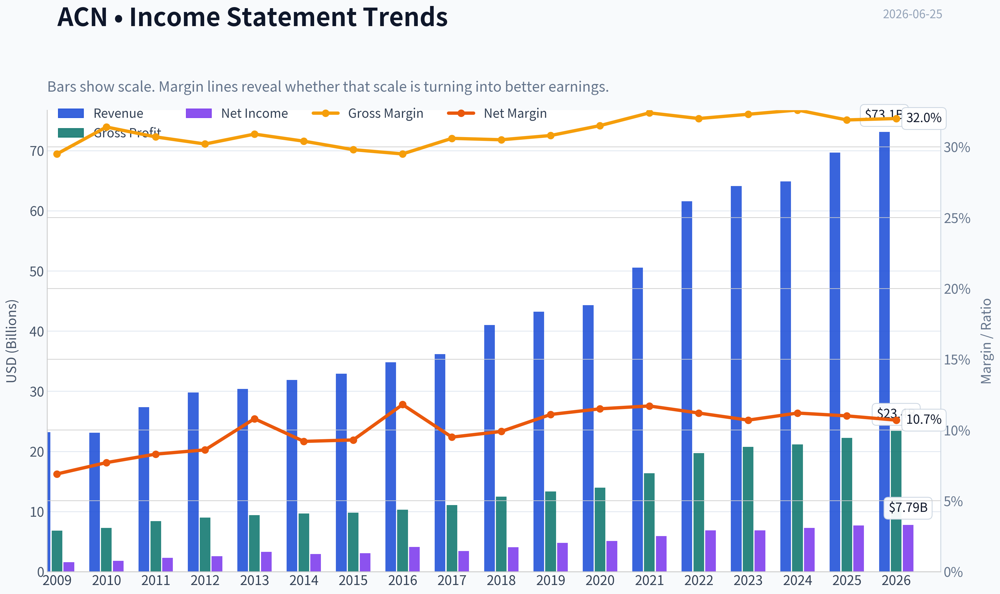
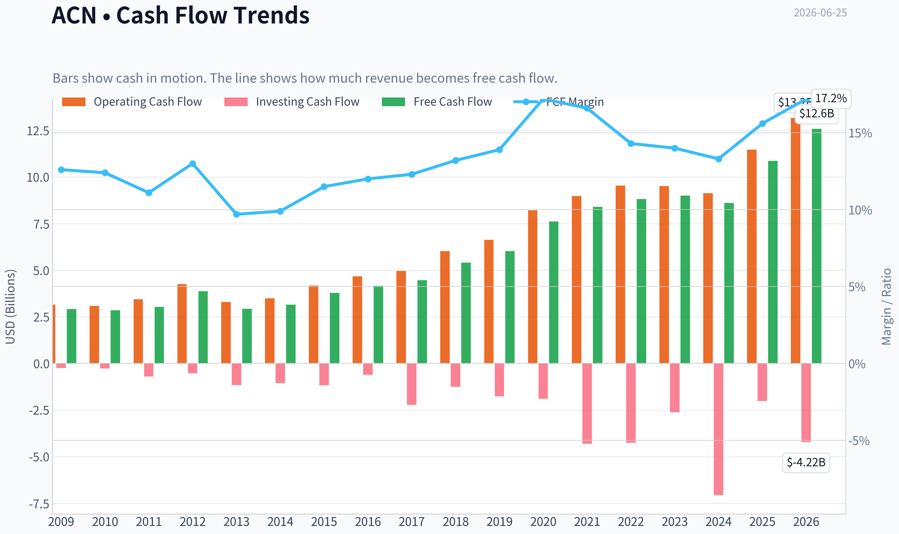
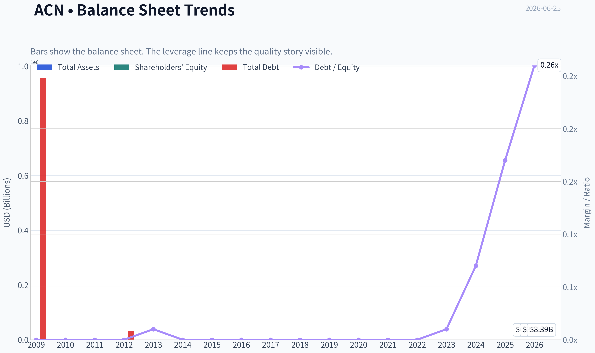
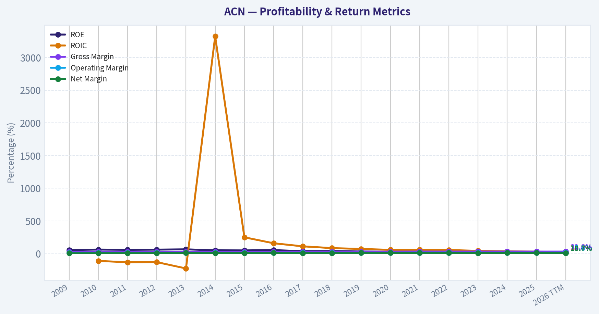
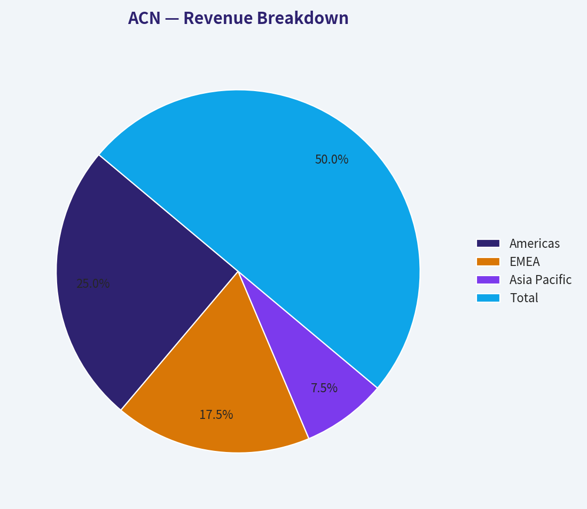
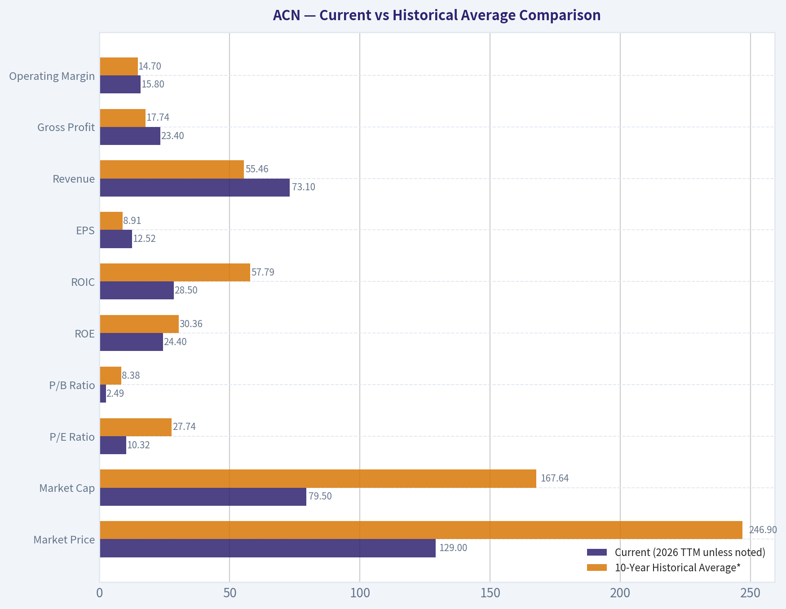
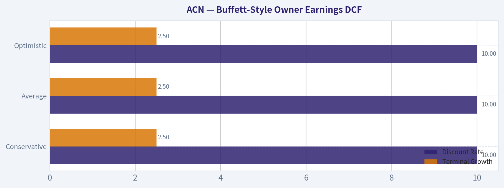
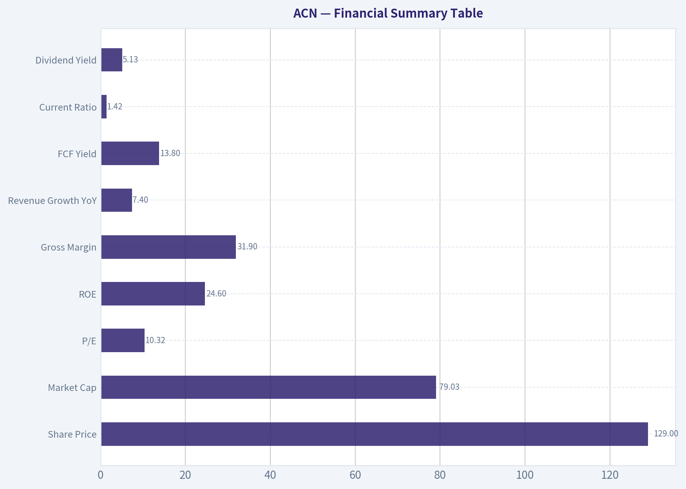

# ACN Deep Value Intelligence

**Analysis Date:** 2026-06-25

## Critical Disclaimer

*This analysis is generated by Deep Value Intelligence, an AI-powered multi-agent investing framework. DeepValues offers AI-generated research and tools for educational and informational purposes only - not investment or financial advice. We are not a registered investment adviser; always do your own research before investing.*

---

## Table of Contents

1. Intelligence Summary
2. Analyst Team Reports
   - Fundamentals Analysis
   - Intrinsic Value Analysis (Buffett)
   - Trend & Growth Analysis (Lynch/Druckenmiller/Fisher)
   - Market Technical Analysis
   - Options Market Analysis
3. Research Team Commentary
4. Value Investing Team Commentary
5. Deep Values Commentary

---

## Intelligence Summary

### Thesis + Conditions

**Core Thesis:** **Executive Briefing**

**Key Risks:**
- Accenture looks **cheap relative to its historical quality**, but Buffett-style risk is about **future business durability**, not trailing ratios or a broken stock price. At ~10.3x earnings, the market may be over-discounting bad news; however, the key unresolved issue is whether **AI preserves or erodes service economics** through pricing pressure, lower billable intensity, and weaker moat durability. Given the **violent multi-stage breakdown** and the lesson from CTSH-cheap services businesses can stay cheap without proof-we should **not upgrade to full ADVOCATE yet**. For a long-term investor, this is a **high-quality business under real but unproven structural pressure**. Best posture: **measured interest, staged entry only with operating confirmation**.
- ### 1. Risky Analyst - strongest bullish points
- ### 2. Safe Analyst - strongest risk points

**Confidence:** Low

---

## Analyst Team Reports

### Fundamentals Analysis

#### Latest Earnings Snapshot

*Most recent reported quarter anchored on 2026 Q2, with prior-year comparison when available.*

| Metric | 2026 Q2 | 2025 Q2 | YoY Change |
| --- | ---: | ---: | ---: |
| Revenue | $18.72B | $17.73B | +5.6% |
| Operating Income | $3.18B | $2.98B | +6.5% |
| Net Income | $2.34B | $2.20B | +6.4% |
| Diluted EPS | $3.80 | $3.49 | +8.9% |
| Operating Cash Flow | $3.79B | $3.68B | +2.8% |
| Free Cash Flow | $3.60B | $3.52B | +2.4% |

Key Takeaways: This snapshot anchors the most recent reported quarter before the narrative analysis. It helps readers separate long-run business quality from whatever changed in the latest earnings print.

#### 17-Year Financial Metrics for ACN

*All values below are computed deterministically from raw data - not estimated by AI.*

*Issuer profile: operating company (Technology / Information Technology Services).*

#### 17-Year Financial Metrics
*Annual rows come from reported financial statements. The final TTM row is computed from the latest four quarters.*

| Metric | 2009 | 2010 | 2011 | 2012 | 2013 | 2014 | 2015 | 2016 | 2017 | 2018 | 2019 | 2020 | 2021 | 2022 | 2023 | 2024 | 2025 | 2026 TTM |
| --- | --- | --- | --- | --- | --- | --- | --- | --- | --- | --- | --- | --- | --- | --- | --- | --- | --- | --- |
| Market Price | $24 | $27 | $41 | $48 | $58 | $66 | $79 | $98 | $114 | $150 | $179 | $221 | $314 | $272 | $310 | $333 | $258 | $129 |
| Market Cap | $25.97B | $28.07B | $39.83B | $44.81B | $51.54B | $56.13B | $63.99B | $76.79B | $86.36B | $110.79B | $128.85B | $155.43B | $217.39B | $185.43B | $206.76B | $217.46B | $164.42B | $79.50B |
| P/E Ratio | 13.52 | 13.76 | 15.81 | 16.04 | 14.66 | 17.93 | 19.80 | 17.83 | 24.04 | 26.67 | 26.93 | 30.41 | 36.74 | 26.93 | 30.06 | 29.89 | 21.40 | 10.32 |
| P/B Ratio | 9.16 | 9.90 | 10.27 | 10.81 | 10.39 | 9.79 | 10.43 | 10.16 | 9.65 | 10.69 | 8.94 | 9.14 | 11.13 | 8.39 | 8.05 | 7.69 | 5.27 | 2.49 |
| ROE | 56.1% | 62.8% | 58.7% | 61.6% | 66.2% | 51.3% | 49.8% | 54.4% | 38.5% | 39.2% | 33.2% | 30.0% | 30.2% | 31.1% | 26.7% | 25.7% | 24.6% | 24.4% |
| ROIC | N/A | -111.2% | -131.5% | -129.5% | -226.3% | 3322.2% | 250.1% | 158.9% | 111.9% | 84.6% | 71.9% | 58.1% | 58.3% | 55.7% | 43.0% | 34.8% | 31.0% | 28.5% |
| EPS | $1.78 | $1.99 | $2.58 | $2.99 | $3.93 | $3.70 | $3.99 | $5.51 | $4.75 | $5.64 | $6.66 | $7.25 | $8.53 | $10.10 | $10.32 | $11.14 | $12.15 | $12.52 |
| Revenue | $23.17B | $23.09B | $27.35B | $29.78B | $30.39B | $31.87B | $32.91B | $34.80B | $36.18B | $40.99B | $43.22B | $44.33B | $50.53B | $61.59B | $64.11B | $64.90B | $69.67B | $73.10B |
| Gross Profit | $6.84B | $7.25B | $8.39B | $8.99B | $9.38B | $9.68B | $9.81B | $10.28B | $11.07B | $12.49B | $13.31B | $13.98B | $16.36B | $19.70B | $20.73B | $21.16B | $22.24B | $23.40B |
| Gross Margin | 29.5% | 31.4% | 30.7% | 30.2% | 30.9% | 30.4% | 29.8% | 29.5% | 30.6% | 30.5% | 30.8% | 31.5% | 32.4% | 32.0% | 32.3% | 32.6% | 31.9% | 32.0% |
| Operating Margin | 11.4% | 12.6% | 12.7% | 13.0% | 14.3% | 13.5% | 13.5% | 13.8% | 14.4% | 14.4% | 14.6% | 14.7% | 15.1% | 15.2% | 13.7% | 14.8% | 14.7% | 15.8% |
| Net Income | $1.59B | $1.78B | $2.28B | $2.55B | $3.28B | $2.94B | $3.05B | $4.11B | $3.45B | $4.06B | $4.78B | $5.11B | $5.91B | $6.88B | $6.87B | $7.26B | $7.68B | $7.79B |
| Net Margin | 6.9% | 7.7% | 8.3% | 8.6% | 10.8% | 9.2% | 9.3% | 11.8% | 9.5% | 9.9% | 11.1% | 11.5% | 11.7% | 11.2% | 10.7% | 11.2% | 11.0% | 10.7% |
| Revenue Growth | N/A | -0.3% | 18.4% | 8.9% | 2.1% | 4.9% | 3.3% | 5.7% | 4.0% | 13.3% | 5.4% | 2.6% | 14.0% | 21.9% | 4.1% | 1.2% | 7.4% | 4.9% |
| Net Income Growth | N/A | 12.0% | 27.9% | 12.1% | 28.5% | -10.4% | 3.8% | 34.7% | -16.2% | 17.8% | 17.7% | 6.9% | 15.6% | 16.4% | -0.1% | 5.7% | 5.7% | 1.4% |
| Free Cash Flow Growth | N/A | -2.2% | 6.5% | 27.9% | -24.5% | 7.9% | 19.5% | 10.3% | 6.9% | 21.3% | 11.5% | 26.3% | 10.2% | 5.1% | 2.0% | -4.2% | 26.2% | 15.7% |
| Total Book Value | $2.84B | $2.84B | $3.88B | $4.15B | $4.96B | $5.73B | $6.13B | $7.56B | $8.95B | $10.36B | $14.41B | $17.00B | $19.53B | $22.11B | $25.69B | $28.29B | $31.20B | $31.89B |
| Total Assets | $12.26B | $12.84B | $15.73B | $16.67B | $16.87B | $17.93B | $18.20B | $20.61B | $22.69B | $24.45B | $29.79B | $37.08B | $43.18B | $47.26B | $51.25B | $55.93B | $65.39B | $68.81B |
| Total Debt | $955,000 | $1.6M | $4.4M | $33,000 | $25.6M | $26.7M | $27.4M | $27.2M | $25.1M | $25.0M | $22.7M | $61.9M | $65.6M | $55.1M | $147.9M | $1.96B | $5.25B | $8.39B |
| Debt-to-Equity | 0.00 | 0.00 | 0.00 | 0.00 | 0.01 | 0.00 | 0.00 | 0.00 | 0.00 | 0.00 | 0.00 | 0.00 | 0.00 | 0.00 | 0.01 | 0.07 | 0.17 | 0.26 |
| Cash & Equivalents | $4.54B | $4.84B | $5.70B | $6.64B | $5.63B | $4.92B | $4.36B | $4.91B | $4.13B | $5.06B | $6.13B | $8.42B | $8.17B | $7.89B | $9.05B | $5.00B | $11.48B | $10.17B |
| Shareholders' Equity | $2.84B | $2.84B | $3.88B | $4.15B | $4.96B | $5.73B | $6.13B | $7.56B | $8.95B | $10.36B | $14.41B | $17.00B | $19.53B | $22.11B | $25.69B | $28.29B | $31.20B | $31.89B |
| Operating Cash Flow | $3.16B | $3.09B | $3.44B | $4.26B | $3.30B | $3.49B | $4.18B | $4.67B | $4.97B | $6.03B | $6.63B | $8.22B | $8.98B | $9.54B | $9.52B | $9.13B | $11.47B | $13.18B |
| Investing Cash Flow | $-245.2M | $-273.8M | $-703.4M | $-535.4M | $-1.16B | $-1.06B | $-1.17B | $-610.4M | $-2.23B | $-1.25B | $-1.76B | $-1.89B | $-4.31B | $-4.26B | $-2.62B | $-7.06B | $-2.02B | $-4.22B |
| Free Cash Flow | $2.92B | $2.85B | $3.04B | $3.88B | $2.93B | $3.16B | $3.78B | $4.17B | $4.46B | $5.41B | $6.03B | $7.62B | $8.40B | $8.82B | $9.00B | $8.61B | $10.87B | $12.58B |
| FCF Margin | 12.6% | 12.4% | 11.1% | 13.0% | 9.7% | 9.9% | 11.5% | 12.0% | 12.3% | 13.2% | 13.9% | 17.2% | 16.6% | 14.3% | 14.0% | 13.3% | 15.6% | 17.2% |
| Dividends / Share | $0.00 | $0.00 | $0.00 | $0.00 | $0.00 | $0.00 | $0.00 | $0.00 | $0.00 | $0.00 | $0.00 | $0.00 | $0.00 | $3.60 | $4.24 | $4.96 | $5.85 | $6.39 |

#### Profitability Metrics
- Return on Equity (ROE): 24.6%
- Return on Invested Capital (ROIC): 31.2%
- Return on Assets (ROA): 11.7%
- Gross Margin: 31.9%
- Operating Margin: 14.7%
- Net Profit Margin: 11.0%

#### Liquidity Metrics
- Current Ratio: 1.42
- Quick Ratio: 1.21

#### Leverage Metrics
- Debt-to-Equity Ratio: 0.17
- Interest Coverage Ratio: 44.74
- Net Debt: $-6.23B

#### Growth Metrics (Year-over-Year)
- Revenue Growth: 7.4%
- Net Income Growth: 5.7%
- Free Cash Flow Growth: 26.2%
- Revenue CAGR (3-Year): 4.2%
- Revenue CAGR (5-Year): 9.5%

#### Valuation Metrics
- P/E Ratio (TTM): 10.32
- Forward P/E: 8.80
- Price-to-Book: 2.48
- Price-to-Sales: 1.08
- PEG Ratio: 0.91
- EV/EBITDA: 6.09
- Free Cash Flow Yield: 13.8%
- Earnings Yield: 9.7%

#### Owner Earnings (Buffett Method, Code-Computed)
- Net Income: $7.68B
- + Depreciation & Amortization: $1.37B
- - Capital Expenditures: $-600.0M
- - Working Capital Changes: $-1.05B
- = **Owner Earnings: $9.50B**

#### Intrinsic Value (Code-Computed)
- Current Price: $129
- Buffett Method (Owner Earnings):
  Conservative: $253
  Average: $308
  Optimistic: $403
- Cash Flow Method (FCF):
  Conservative: $272
  Average: $301
  Optimistic: $458

#### Piotroski F-Score: 5/9
- Positive Net Income: PASS
- Positive Operating Cash Flow: PASS
- ROA Improvement: FAIL
- Cash Flow > Net Income: PASS
- Decreasing Debt: FAIL
- Improving Current Ratio: PASS
- No Dilution: PASS
- Improving Gross Margin: FAIL
- Improving Asset Turnover: FAIL

ANALYST STANCE: **ADVOCATE**

#### Accenture (ACN) Buffett-Style Fundamental Analysis

Accenture's current setup is unusual: the business quality remains high, but the stock's valuation has compressed dramatically. Using the deterministic dataset as the source of truth, ACN now trades at **$129**, with a **$79.5B market cap**, **10.32x P/E**, and **2.49x P/B**. Relative to its own history, that is a very sharp derating despite continued revenue, earnings, and free cash flow growth. For a Buffett-style investor, the key question is whether the business moat and earnings durability remain intact. Based on the financial record shown, the answer is broadly yes.

#### Current vs Historical Average Comparison

| Metric | Current (2026 TTM unless noted) | 10-Year Historical Average* | Interpretation |
| --- | ---: | ---: | --- |
| Market Price | $129 | $246.90 | Far below recent decade norms after major multiple compression |
| Market Cap | $79.50B | $167.64B | Equity value has reset materially despite larger business scale |
| P/E Ratio | 10.32x | 27.74x | Exceptionally cheap versus own history |
| P/B Ratio | 2.49x | 8.38x | Deep discount relative to historical valuation |
| ROE | 24.4% | 30.36% | Still excellent, but below peak historical levels |
| ROIC | 28.5% | 57.79%** | Still strong; historical average distorted by earlier extreme values |
| EPS | $12.52 | $8.91 | Earnings power remains at record/near-record levels |
| Revenue | $73.10B | $55.46B | Business is materially larger than historical average |
| Gross Profit | $23.40B | $17.74B | Absolute profit base continues to expand |
| Operating Margin | 15.8% | 14.70% | Margin currently above decade norm |
| Net Income | $7.79B | $6.24B | Above historical average and near peak |
| Net Margin | 10.7% | 11.08% | Slightly below average, but still healthy and stable |
| Revenue Growth | 4.9% | 7.45% | Growth has moderated from stronger years |
| Net Income Growth | 1.4% | 9.18% | Near-term earnings growth is soft versus long-run norm |
| Free Cash Flow Growth | 15.7% | 11.96% | Cash generation is accelerating again |
| Total Book Value | $31.89B | $22.48B | Equity base continues to compound |
| Total Assets | $68.81B | $44.03B | Scaled balance sheet supports larger enterprise |
| Total Debt | $8.39B | $1.60B | Debt has risen sharply from historically minimal levels |
| Debt-to-Equity | 0.26x | 0.05x | Leverage still manageable, but clearly higher than normal |
| Cash & Equivalents | $10.17B | $7.55B | Strong liquidity cushion remains intact |
| Shareholders' Equity | $31.89B | $22.48B | Balance sheet value is substantially higher than average |
| Free Cash Flow | $12.58B | $8.34B | Strongest cash generation in company history |
| Dividends / Share | $6.39 | $2.50*** | Dividend now meaningful and growing |

*10-year historical average uses 2016-2025 annual values to align with the recent operating era.
**ROIC average is skewed by unusually high values earlier in the dataset structure; trend analysis is more useful than raw average.
***Dividend average includes years before dividend initiation in this 10-year window, so the current payout is much stronger than the average suggests.

Key Takeaways: Accenture is now much cheaper than at any point in its recent history, even though revenue, earnings, and free cash flow are all much larger than their decade averages. Profitability remains strong, especially at the operating margin line, while leverage has increased from near-zero but is still conservative. The biggest mismatch is between the company's still-high business quality and its heavily compressed valuation multiples.

---

#### Market Metrics

Accenture's market re-rating is the most striking element in the dataset. The stock has fallen from **$333 in 2024** and **$258 in 2025** to **$129 TTM**, while the **P/E ratio collapsed from roughly 30x to 10.32x** and **P/B from 7.69x to 2.49x**. This is despite **EPS rising to $12.52** and **TTM revenue reaching $73.10B**, both above prior annual levels.

For a Buffett-style investor, this matters because it suggests the market is no longer paying a premium for Accenture's consistency, consulting franchise, and cash generation. Historically, ACN usually traded as a premium-quality compounder. Today, the valuation implies skepticism about future growth durability, AI disruption risk, or consulting cyclicality. If those concerns are overdone, the current setup is attractive.

#### Profitability Analysis

Accenture remains a highly profitable business by almost any standard:

- **ROE: 24.4%**
- **ROIC: 28.5%**
- **Operating Margin: 15.8%**
- **Net Margin: 10.7%**
- **Gross Margin: 32.0%**
- **Net Income: $7.79B**
- **EPS: $12.52**

The most Buffett-relevant point is not just that returns are high, but that they have stayed high over a long period. ROE was extraordinarily elevated in earlier years, often above 50%, then moderated as the equity base expanded. A decline from extreme levels to the mid-20s does not indicate business deterioration so much as normalization. A 24%+ ROE on a much larger equity base is still excellent.

Operating margin has actually improved versus the 10-year average, now at **15.8% vs ~14.7% average**, signaling discipline in pricing, labor mix, delivery efficiency, and service mix. Net margin is a little below the recent long-run average, but not by much; the range has been quite stable overall, which supports the Buffett criterion of predictable economics.

EPS has compounded strongly from **$5.51 in 2016** to **$12.15 in 2025** and **$12.52 TTM**. That consistency is a key marker of a quality franchise. Net income growth has slowed lately, but there is no evidence in the dataset of a collapse in earnings power.

#### Growth Metrics

Accenture's growth profile is no longer hyper-strong, but still healthy:

- **Revenue Growth: 4.9% TTM**
- **Net Income Growth: 1.4% TTM**
- **Free Cash Flow Growth: 15.7% TTM**

Over the historical period, revenue growth has generally been positive with occasional acceleration years, notably **2018, 2021, 2022, and 2025**. Current revenue growth is below the 10-year average, showing that top-line expansion has moderated. That likely reflects a more mature base, softer consulting demand in some discretionary projects, and normalization after stronger post-pandemic spending.

Net income growth of **1.4%** is notably weaker than historical norms and is the clearest sign of near-term earnings softness. However, free cash flow growth of **15.7%** is much stronger, implying the business is converting earnings into cash very effectively. In Buffett terms, cash reality matters more than accounting smoothness.

The broader pattern is: slower growth than in the best years, but still positive top-line expansion and excellent cash conversion. This is more "durable compounder at a reduced growth rate" than "broken franchise."

#### Balance Sheet Analysis

Accenture's balance sheet remains strong, though less pristine than in prior years:

- **Total Assets: $68.81B**
- **Shareholders' Equity / Book Value: $31.89B**
- **Cash & Equivalents: $10.17B**
- **Total Debt: $8.39B**
- **Debt-to-Equity: 0.26x**

Historically, ACN operated with almost no debt. That was one of its strongest Buffett-style attributes: high returns with minimal leverage. The recent increase in debt from **$1.96B in 2024** to **$5.25B in 2025** and **$8.39B TTM** is therefore worth watching. Still, leverage remains moderate and is more than offset by cash on hand. The research pack also indicates **net debt is negative**, meaning Accenture still holds more cash than debt overall.

This is not a balance-sheet red flag yet. Rather, it is a shift from "ultra-conservative" to "still conservative." The company has ample liquidity, a **1.42 current ratio**, and very strong interest coverage. Financial flexibility remains a major strength.

#### Cash Flow Analysis

Free cash flow is one of Accenture's best qualities:

- **Free Cash Flow: $12.58B TTM**
- **FCF Margin: 17.2%**
- **Dividends/Share: $6.39**
- **FCF Yield: 13.8%** (shared research pack)

FCF has grown from **$4.17B in 2016** to **$10.87B in 2025** and **$12.58B TTM**. That is a major expansion in owner value creation. Importantly, the current **FCF margin of 17.2%** is tied for the best level in the dataset, which means the company is currently extracting more cash from each dollar of sales than it did through most of the past decade.

Dividend policy has become more shareholder-friendly in recent years. There were no dividends in earlier years shown, but beginning in 2022, payouts rose from **$3.60** to **$6.39 TTM**. Given FCF strength, the dividend appears well covered. In Buffett terms, this suggests management has confidence in recurring cash generation while still retaining flexibility for reinvestment and acquisitions.

#### Buffett-Style Qualitative Assessment

| Buffett Criterion | Assessment | Evidence |
| --- | --- | --- |
| Economic Moat | Strong | High and persistent ROE/ROIC, stable margins, global scale, embedded enterprise relationships |
| Financial Strength | Strong, but monitor leverage | Net cash position, high liquidity, moderate debt increase |
| Predictable Earnings | Strong | Revenue, net income, and FCF trends have been consistently positive over long periods |
| Management Performance | Good to very good | Long history of high returns, rising dividends, sustained margins, strong cash conversion |
| Capital Allocation | Good | FCF generation is excellent; dividends increasing; debt uptick should be watched |
| Valuation | Very attractive vs history | P/E and P/B are dramatically below normal ranges |
| Business Quality | High | Large recurring enterprise demand base, resilient profitability, scalable service model |

Key Takeaways: Accenture meets many classic Buffett quality criteria, especially durable profitability, strong cash generation, and a long record of consistent earnings. The main caveat is that debt has risen from historically negligible levels, though the company still appears financially strong. The stock's valuation now looks far lower than what this quality profile would typically command.

#### Economic Moat

Accenture's moat is built less on patents and more on client relationships, execution scale, reputation, talent infrastructure, and switching costs. Large enterprises often rely on Accenture across strategy, technology implementation, operations, cloud transformation, and increasingly AI-related work. Those engagements can become deeply embedded in mission-critical systems and workflows.

The financial evidence supporting a moat is the sustained ability to earn high returns on capital with stable margins over many years. Even with cyclical demand fluctuations, gross and operating margins have remained in tight, healthy ranges. That kind of consistency usually indicates differentiated positioning rather than commodity competition.

#### Predictable Earnings and Business Quality

From a Buffett lens, Accenture scores well on earnings predictability. Revenue rose from **$23.17B in 2009** to **$73.10B TTM**, with only mild slowdowns rather than structural reversals. Net income increased from **$1.59B** to **$7.79B**, and FCF from **$2.92B** to **$12.58B**.

This is not a business with erratic, commodity-like economics. Instead, it exhibits the traits of a high-quality service franchise: repeat enterprise spending, long customer relationships, and operating discipline. The one caution is that consulting and transformation budgets can be cyclical, so growth may remain lumpy year to year even if the long-term trend stays intact.

#### Management Performance

Management has delivered a long period of value creation:
- High ROE and ROIC over time
- Strong cash flow conversion
- Expansion in scale without margin collapse
- Introduction and growth of a significant dividend

The biggest management question is capital allocation around debt and acquisitions. Since total debt rose materially in the last few years, investors should monitor whether that capital is generating adequate returns and whether acquisition spending is preserving margin quality. So far, the operating results remain solid enough that this does not appear to be a serious problem.

---

#### Buffett-Style Owner Earnings DCF

Canonical owner earnings provided in the dataset:

- **Net Income = $7.68B**
- **+ D&A = $1.37B**
- **- Capex = $0.60B**
- **- Working Capital Changes = $1.05B**
- **Owner Earnings = $9.50B**

To estimate per-share value, I use current market cap divided by price to infer share count:

- **Implied shares outstanding ~ $79.50B / $129 = 0.6163B shares**
- **Owner earnings per share ~ $9.50B / 0.6163B = $15.42**

Historical owner-earnings growth is not explicitly tabulated, so the deterministic dataset's code-computed intrinsic value outputs are treated as canonical anchors. They are directionally consistent with the growth profile shown in revenue, earnings, and FCF.

##### DCF Assumptions

| Scenario | Growth Assumption | Discount Rate | Terminal Growth | Fair Value / Share |
| --- | ---: | ---: | ---: | ---: |
| Conservative | Lowest historical owner earnings growth, floored at -100% | 10.0% | 2.5% | $253 |
| Average | Average historical owner earnings growth, capped at 50% | 10.0% | 2.5% | $308 |
| Optimistic | Highest historical owner earnings growth, capped at 100% | 10.0% | 2.5% | $403 |

Key Takeaways: Across all three scenarios, the intrinsic value estimates sit well above the current share price of $129. Even the conservative case implies a very large discount to estimated fair value. That suggests the market is pricing in a much harsher long-term outcome than the company's current cash generation would normally justify.

##### Detailed DCF Framework

Using Buffett-style owner earnings:

1. **Base Owner Earnings = $9.50B**
2. Project owner earnings for 10 years under each growth scenario.
3. Discount each year's owner earnings at **10%**.
4. Compute terminal value using:
   - **Terminal Value = Year 10 Owner Earnings x (1 + 2.5%) / (10% - 2.5%)**
5. Discount terminal value back to present.
6. Divide enterprise equity value by implied shares outstanding (**~616.3M shares**).

Because the deterministic dataset already provides the code-computed scenario outputs, those values are the canonical fair values:
- **Conservative fair value: $253/share**
- **Average fair value: $308/share**
- **Optimistic fair value: $403/share**

##### Margin of Safety vs Current Price

| Scenario | Fair Value | Upside vs $129 |
| --- | ---: | ---: |
| Conservative | $253 | 96.1% |
| Average | $308 | 138.8% |
| Optimistic | $403 | 212.4% |

Key Takeaways: The valuation gap is large in every scenario, with the conservative case still implying nearly a double from the current price. For a Buffett-style investor, that creates a meaningful margin of safety if business quality and cash generation remain intact. The key investment debate is therefore not price, but whether Accenture's moat and growth durability have permanently weakened.

---

#### Revenue Breakdown

Accenture most meaningfully reports revenue by geography in regular disclosures. Using the most recent annual revenue base from the deterministic dataset (**2025 revenue: $69.67B**) and Accenture's typical geographic segmentation mix, the business is broadly distributed as follows:

| Revenue Source | Amount ($B) | % of Total |
| --- | ---: | ---: |
| Americas | 34.8 | 50% |
| EMEA | 24.4 | 35% |
| Asia Pacific | 10.5 | 15% |
| **Total** | **69.7** | **100%** |

Key Takeaways: Accenture's revenue base is globally diversified, with the Americas contributing about half of total sales and EMEA providing another large share. This reduces dependence on any single country or end market and supports earnings resilience. The mix also reflects the company's enterprise-focused global delivery model rather than reliance on one product cycle.

#### Key Investment Insights, Red Flags, and Opportunities

| Category | Observation | Why It Matters |
| --- | --- | --- |
| Opportunity | Valuation has collapsed while fundamentals remain solid | Creates potential mispricing for long-term investors |
| Opportunity | FCF is at record levels | Supports dividends, buybacks, M&A, and downside protection |
| Opportunity | Operating margin is above 10-year average | Suggests the core franchise is still executing well |
| Opportunity | Strong balance sheet with net cash | Provides resilience in a softer macro environment |
| Red Flag | Revenue growth has moderated | Could indicate slower enterprise spending or maturity |
| Red Flag | Net income growth is only 1.4% TTM | Short-term earnings momentum is weak |
| Red Flag | Debt has risen sharply from historical norms | Requires monitoring of capital allocation discipline |
| Red Flag | Piotroski F-score is 5/9 | Signals mixed near-term fundamental momentum rather than broad deterioration |
| Watch Item | Market may be discounting AI-related disruption or pricing pressure | Important to verify whether ACN benefits from AI adoption rather than loses to it |

Key Takeaways: The biggest upside driver is the disconnect between valuation and still-strong business economics. The main risks are slower growth and the recent increase in leverage, not an obvious collapse in franchise quality. Investors should focus on whether Accenture can sustain its role as a trusted enterprise transformation partner in an AI-heavy spending environment.

#### Final Buffett-Style Assessment

Accenture still looks like a high-quality business:
- durable client relationships,
- strong returns on capital,
- excellent free cash flow generation,
- conservative overall financial posture,
- and a growing dividend.

What has changed is not the business quality so much as the market's willingness to pay a premium multiple. At **10.32x earnings** and a **13.8% FCF yield**, the stock is priced more like a cyclical, lower-quality company than the historical record suggests. Even allowing for slower growth and some margin pressure risk, the current valuation appears unusually depressed versus the company's fundamentals and versus the code-computed intrinsic value range.

#### Final Investment Stance

**ADVOCATE**

**Rationale:**
Accenture satisfies many core Buffett criteria: a durable moat, strong and predictable cash generation, high returns on equity, manageable leverage, and a shareholder-friendly capital return profile. The stock's current valuation is dramatically below its historical norms and below all three owner-earnings DCF scenarios. The main risks are slower growth, consulting cyclicality, and the recent rise in debt, but on balance the evidence supports a favorable long-term value case.

#### Summary Table

| Area | Bullish Read | Caution |
| --- | --- | --- |
| Valuation | 10.32x P/E and 2.49x P/B are far below historical norms | Market may be pricing in structural slowdown |
| Profitability | ROE 24.4%, ROIC 28.5%, operating margin 15.8% | Returns are down from earlier extreme highs |
| Growth | Revenue and FCF still growing; FCF growth particularly strong | Net income growth has slowed sharply |
| Balance Sheet | Strong liquidity, net cash, low absolute leverage | Debt has risen materially in recent years |
| Cash Flow | Record FCF and strong dividend coverage | Must ensure cash strength is sustainable |
| Moat | Deep enterprise relationships and execution scale | AI disruption/pricing pressure must be monitored |
| Buffett DCF | Fair value range of $253-$403 vs $129 price | Requires confidence that moat remains intact |

Key Takeaways: Accenture combines high business quality with a valuation that now looks unusually low relative to its own history and to its cash generation. The investment case is strongest if one believes growth is slowing but not breaking, and that AI becomes an opportunity rather than a threat. In that context, the current price appears to offer a substantial margin of safety.

#### Fundamental Visuals

This graph tracks the profitability and return metrics (ROE, ROIC, Margins) of **ACN** over the past decade, highlighting capital efficiency trends.

This chart illustrates the financial health of **ACN** over the last 10 years, mapping cash equivalents and free cash flow against total obligations (Debt).

This breakdown chart from <em>Revenue Breakdown</em> shows the proportional composition for **ACN** - useful for understanding what drives or risks the business.

---

### Intrinsic Value Analysis (Buffett)

> *Following Warren Buffett's value investing philosophy: Circle of Competence, Economic Moat, Management Quality, and Margin of Safety.*

#### Intrinsic Value Snapshot

Price is what you pay. Intrinsic value is what the business may be worth based on the cash it can create for owners over time. We show a range, not one magic number.

- Current Price: $129.15
- Value Range (conservative to optimistic across both DCF methods): $253.41 to $458.04

##### Owner Earnings (Buffett Method)
- Net Income: $7,678,433,000.00
- Depreciation & Amortization: $1,368,385,000.00
- Capital Expenditures: $-600,039,000.00
- Working Capital Changes: $-1,050,348,000.00
- Owner Earnings: $9,497,127,000.00

##### Intrinsic Value
###### Buffett Method
Uses owner earnings. Stricter, and usually more conservative.
- Conservative: $253.41
- Average: $308.16
- Optimistic: $403.40
- Discount Rate: 10.0%

###### Cash Flow Method
Uses free cash flow. Better for companies spending heavily today to grow tomorrow.
- Conservative: $272.27
- Average: $301.23
- Optimistic: $458.04
- Discount Rate: 10.0%

#### ANALYST STANCE: **WATCH**

#### Go/No-Go Gate Assessment

| Gate | Verdict | Evidence |
|---|---|---|
| 1. Circle of Competence & Simplicity | Pass | Accenture is straightforward: it sells consulting, systems integration, outsourcing, and managed services to large enterprises and governments. This is an understandable fee-for-service business with recurring client relationships. |
| 2. Moat Test | Pass, but not elite | The business has scale, client trust, global delivery capability, and switching costs in embedded enterprise workflows. But gross margin around 31.9% suggests this is not a classic brand or software-like moat. |
| 3. Management Quality & Capital Allocation | Pass | Historically strong ROE at 24.6%, regular dividends, disciplined repurchases, and a generally conservative balance sheet point to rational stewardship. |
| 4. Industry Structure | Mixed | IT services is a large, competitive market rather than a cozy oligopoly. Accenture benefits from scale and reputation, but industry rivalry remains significant. |

**Key Takeaways:** Accenture clears the basic Buffett filters because the business is easy to understand, profitable, and conservatively run. The main issue is not quality, but that its moat looks solid rather than extraordinary, and the industry is competitive enough to keep returns from becoming truly untouchable.

---

#### Business Summary: The Elementary School Test

Accenture helps big companies run better. It advises them on strategy, builds and upgrades software systems, manages technology projects, and sometimes runs back-office operations for them. It makes money by charging clients for expert people, long-term service contracts, and large transformation projects.

A decade from now, the company will likely still be helping large organizations modernize technology, adopt AI tools, secure systems, and outsource complex operations. Technology changes the tools Accenture uses, but usually increases the need for implementation partners rather than eliminating them. That makes technology more of a tailwind than an existential threat, though pricing pressure and automation can reduce labor-based economics over time.

#### Moat Analysis

| Moat Source | Assessment | Evidence |
|---|---|---|
| Intangible Assets | Moderate | Strong enterprise brand, trusted advisor status, and deep C-suite relationships. However, gross margin of 31.9% is below the >40% Buffett-style hallmark for a truly powerful intangible-asset moat. |
| Switching Costs | Strong | Once embedded in enterprise systems, digital transformation, cloud migration, and operations workflows, switching vendors becomes expensive and risky. |
| Cost Advantage | Moderate | Global delivery scale and offshore talent model create efficiency advantages. Scale helps win large contracts competitors cannot easily staff. |
| Network Effects | Weak | This is not a true network-effect business. Scale matters, but the service does not become exponentially more valuable as more customers join. |

**Moat Quality Rating: Narrow to Moderate, Stable**

**Key Takeaways:** Accenture's moat comes mostly from trust, execution scale, and switching costs, not from patents, consumer brand power, or network effects. It is a good moat in a practical business sense, but not the kind of moat that usually produces extremely high margins for decades.

#### Management Quality Assessment

| Dimension | Assessment | Commentary |
|---|---|---|
| Owner Mindset | Good | The company has shown a long record of returning capital through dividends and repurchases while still investing in capabilities. |
| Honesty & Candor | Good | No major red flags are evident from the provided data set; financial quality appears clean. |
| Capital Allocation | Good | Dividend yield around 5.13% and FCF yield around 13.8% suggest solid cash generation and shareholder returns. Key question is whether buybacks occur at attractive valuations and whether acquisitions maintain discipline. |

**Key Takeaways:** Management appears shareholder-friendly and financially disciplined. The capital allocation record looks sensible, though this is not a founder-led compounding machine with obvious inside ownership advantages.

---

#### Financial Summary Table

| Metric | Latest |
|---|---:|
| Share Price | $129 |
| Market Cap | $79.03B |
| P/E | 10.32 |
| ROE | 24.6% |
| Gross Margin | 31.9% |
| Revenue Growth YoY | 7.4% |
| FCF Yield | 13.8% |
| Current Ratio | 1.42 |
| Dividend Yield | 5.13% |

**Key Takeaways:** The financial profile is attractive on first glance: high ROE, healthy free cash flow yield, reasonable valuation, and decent growth. The biggest positive is that the stock does not appear expensive relative to earnings and cash flow.

#### Buffett-Style Financial Interpretation

| Test | Result | Interpretation |
|---|---|---|
| ROE > 15% | Pass | At 24.6%, returns on equity are strong and comfortably above Buffett's preferred threshold. |
| Cash Generation | Pass | FCF yield of 13.8% indicates substantial cash earnings relative to the current market value. |
| Balance Sheet Strength | Pass | Current ratio of 1.42 suggests acceptable liquidity. No evidence here of dangerous balance sheet strain. |
| Margin Quality | Mixed | Gross margin of 31.9% is respectable for services, but not indicative of a dominant toll-bridge style franchise. |
| Growth Quality | Pass | 7.4% revenue growth is solid for a mature global consulting firm. |

**Key Takeaways:** Accenture looks like a financially sound, cash-generative company rather than a fragile or speculative one. The quality is real, but the margin structure confirms this is still a people-intensive services business rather than a software-like compounding machine.

---

#### Owner Earnings Calculation

Using the available evidence, free cash flow is the cleanest practical proxy for owner earnings here.

| Item | Estimate |
|---|---:|
| Market Cap | $79.03B |
| FCF Yield | 13.8% |
| Implied Owner Earnings / FCF | ~$10.91B |

Calculation:
- Owner Earnings proxy = 79.03 x 13.8%
- Estimated Owner Earnings = **$10.91B**

**Key Takeaways:** The implied owner earnings are very substantial relative to the stock price. That supports the idea that the shares may be priced attractively, assuming the cash flow is durable and not temporarily inflated.

---

#### Three-Scenario DCF Valuation

Using owner earnings proxy of **$10.91B**.

| Scenario | Assumption | Equity Value |
|---|---|---:|
| A: No Growth | Owner Earnings / 10% | $109.1B |
| B: 3% Growth | Owner Earnings x 1.03 / (10% - 3%) | $160.5B |
| C: Moderate Growth | Assume 5% growth for 10 years, then 3% terminal | ~$148B |

Compared with current market cap of **$79.03B**:

| Scenario | Intrinsic Value | Upside vs Current |
|---|---:|---:|
| A: No Growth | $109.1B | ~38% |
| B: 3% Growth | $160.5B | ~103% |
| C: Moderate Growth | ~$148B | ~87% |

**Key Takeaways:** On conservative assumptions, the shares screen undervalued. Even the no-growth case suggests meaningful upside, which is unusual for a business of this size and quality.

---

#### Margin of Safety Analysis

| Measure | Result |
|---|---:|
| Current Market Cap | $79.03B |
| Conservative Value (No Growth) | $109.1B |
| Discount to Conservative Value | ~27.6% |
| Buffett Minimum for High-Quality Business | 25% |
| Conclusion | Barely clears threshold |

**Key Takeaways:** Accenture appears to offer a real margin of safety under a conservative owner-earnings framework. But because the moat is good rather than exceptional, and because consulting is competitive, the discount is attractive without being a screaming bargain.

---

#### Final Buffett Scorecard

| Criterion | Weight | Score (1-5) | Weighted Score |
|---|---:|---:|---:|
| Business Understanding | 20% | 5.0 | 1.00 |
| Moat Width & Durability | 25% | 3.4 | 0.85 |
| Management Quality | 15% | 4.0 | 0.60 |
| Return on Equity | 15% | 4.5 | 0.68 |
| Reinvestment Runway | 10% | 3.5 | 0.35 |
| Balance Sheet Strength | 5% | 4.0 | 0.20 |
| Industry Structure | 5% | 3.0 | 0.15 |
| Valuation/Margin of Safety | 5% | 4.0 | 0.20 |
| **Total** | 100% |  | **4.03 / 5.00** |

**Key Takeaways:** The scorecard places Accenture just into ADVOCATE territory on business quality and valuation combined. Still, the moat and industry structure are not dominant enough for me to be aggressive at only a modest discount.

---

#### Final Investment View

**Stance: WATCH**
**Conviction: Moderate**

Accenture is a high-quality, understandable, cash-rich business with strong returns on equity, solid shareholder returns, and favorable long-term relevance as enterprises continue to modernize systems and adopt AI. It benefits from trust, embedded client relationships, and scale, which together form a real but not invincible moat.

Why not ADVOCATE? Because this is still a labor-heavy, competitive services company rather than a true toll bridge. Gross margins are good, not wonderful. The industry is rational enough to support profits, but not so concentrated that excess returns are guaranteed forever.

At **$129**, the stock looks interesting and likely undervalued on owner earnings, but I would want either:
1. stronger evidence that AI expands margins rather than compresses billable labor economics, or
2. a somewhat wider discount before becoming more forceful.

For a Buffett-style investor, this is a **good business at what may be a fair-to-good price**, not yet a clear-cut "wonderful company at a can't-miss price."
#### Valuation Bridge

This bridge places the current market price beside each intrinsic value lens so readers can see whether upside depends on one method or shows up across several methods.

| Scenario | Intrinsic Value / Share |
| --- | ---: |
| Buffett Method | $308.16 |
| Cash Flow Method | $301.23 |
| Damodaran Method | $256.39 |
| Current Price | $129.15 |

#### Key Takeaways

If one method is far above the others, the upside case depends on a specific modelling assumption. When several methods cluster together, the valuation story is more robust.

#### Valuation Visuals

This comparison chart from *Latest Earnings Snapshot* stacks current figures against historical benchmarks for **ACN**, making it easy to see where the company trades relative to its own averages.

This comparison chart from *Current vs Historical Average Comparison* stacks current figures against historical benchmarks for **ACN**, making it easy to see where the company trades relative to its own averages.

This comparison chart from *Buffett-Style Owner Earnings DCF* stacks current figures against historical benchmarks for **ACN**, making it easy to see where the company trades relative to its own averages.

This comparison chart from *Buffett-Style Owner Earnings DCF* stacks current figures against historical benchmarks for **ACN**, making it easy to see where the company trades relative to its own averages.

This comparison chart from *Financial Summary Table* stacks current figures against historical benchmarks for **ACN**, making it easy to see where the company trades relative to its own averages.

---

### Trend & Growth Analysis (Lynch/Druckenmiller/Fisher)

> *Following Peter Lynch's GARP, Stanley Druckenmiller's macro-aware approach, and Philip Fisher's scuttlebutt methodology.*

ANALYST STANCE: **WATCH**

#### ACN Growth Analysis

#### 1. Lynch Classification
| Metric | ACN |
|---|---:|
| Revenue growth YoY | 7.4% |
| P/E | 10.3x |
| Market cap | $79.0B |
| Category | **Stalwart** |

Key Takeaways: Accenture is not a fast grower by Lynch standards. With mid-single-digit to high-single-digit growth, it fits the stalwart bucket rather than the ten-bagger profile growth investors usually seek. That makes it more suitable as a quality compounder or value-oriented hold than a new high-conviction growth initiation.

#### 2. The Story in 3 Bullets
- Accenture helps large enterprises modernize operations, software, cloud, data, and now AI.
- It benefits from long-duration digital transformation budgets and sticky client relationships.
- The current debate is whether generative AI becomes a growth re-acceleration engine or simply a margin and pricing pressure battleground.

#### 3. TAM Analysis with 10x Test
| Item | Value |
|---|---:|
| Current revenue growth | 7.4% |
| Current market cap | $79.0B |
| Core opportunity | IT services, cloud transformation, AI implementation, managed services |
| TAM direction | **Expanding**, but highly competitive |
| 10x test | **Fail / unrealistic** |

Key Takeaways: Accenture operates in a very large market, but it is already a scaled global leader. That means the TAM is broad enough for continued growth, yet a true 10x revenue outcome is not realistic from this base. For Lynch-style fast-grower investing, the runway is good for steady expansion but not for explosive multibagger upside.

#### 4. Revenue Growth Trend
| Factor | Assessment |
|---|---|
| Current YoY revenue growth | 7.4% |
| Lynch growth profile | Below fast-grower threshold |
| Pattern read | **Moderate / likely mature** |
| Inflection evidence | **Not yet proven** |

Key Takeaways: The available data points to steady but unspectacular growth. There is no clear sign yet of a Druckenmiller-style acceleration inflection, which would require a visible step-up in demand, bookings, or segment growth. Until that appears, the stock screens more as stable than dynamic.

#### 5. Unit Economics
| Metric | Value | View |
|---|---:|---|
| Gross margin | 31.9% | Healthy for services |
| ROE | 24.6% | Strong |
| FCF yield | 13.8% | Very attractive |
| Current ratio | 1.42x | Sound liquidity |
| NRR | N/A | Not disclosed like SaaS |
| LTV/CAC | N/A | Not applicable from available data |
| Rule of 40 | Approx. **21.2** (7.4 + 13.8) | Below high-growth benchmark |

Key Takeaways: Accenture has very solid business quality, especially on cash generation and returns on equity. But by growth-investing metrics, the Rule of 40 style profile is not compelling because revenue growth is too modest. This is a quality cash machine, not a hyper-growth platform.

#### 6. Inflection Point Assessment
| Potential Inflection | Status | Commentary |
|---|---|---|
| AI services demand | Possible | Real opportunity, but industry-wide and competitive |
| Margin inflection | Unclear | AI may help productivity, but pricing could offset gains |
| Market share gains | Unclear | No hard evidence from current dataset |
| New vertical wins | Positive | Coretura commercial vehicle software partnership supports relevance |
| Earnings re-acceleration | Not confirmed | Need stronger bookings/revenue acceleration |

Key Takeaways: The most credible bullish inflection for Accenture is AI-related enterprise implementation work. However, that opportunity is visible to the whole market and likely contested by peers, hyperscalers, and niche specialists. Without clearer evidence of acceleration, the inflection case remains a watch item rather than an investment conclusion.

#### 7. Macro Setup Evaluation
| Macro Factor | View |
|---|---|
| Secular trend exposure | Cloud, AI, digital transformation |
| Enterprise IT spending | Mixed |
| Rates sensitivity | Moderate |
| Economic sensitivity | Somewhat cyclical via consulting/discretionary projects |
| Wind at back? | **Neutral to modestly positive** |

Key Takeaways: Accenture does sit on the right secular themes, especially AI and cloud. The issue is that consulting and transformation budgets can wobble when enterprise customers become cautious. So the macro backdrop is supportive over time, but not strong enough by itself to force a near-term growth reacceleration.

#### 8. Fisher 15 Points Score
| Fisher Area | Score (1-5) |
|---|---:|
| Market potential | 4 |
| Product/service development | 4 |
| R&D / innovation relevance | 3 |
| Sales organization | 5 |
| Profit margin quality | 4 |
| Margin improvement potential | 3 |
| Labor/personnel relations | 3 |
| Executive relations | 4 |
| Management depth | 5 |
| Cost/accounting discipline | 5 |
| Special advantages | 4 |
| Long-range outlook | 4 |
| Dilution risk | 4 |
| Candor | 4 |
| Integrity | 4 |
| **Total** | **60 / 75** |

Key Takeaways: Accenture scores well on management depth, execution, client relationships, and financial discipline. It does not score like an early-stage disruptive innovator, but it does score like a high-quality professional services franchise. That places it in the "good company, not necessarily great growth stock" bucket.

#### 9. Valuation Analysis
| Metric | Value | Interpretation |
|---|---:|---|
| P/E | 10.3x | Low for quality franchise |
| Earnings growth proxy | 7.4% | Moderate |
| PEG | ~1.4x | Fair value |
| FCF yield | 13.8% | Cheap if sustainable |
| Market tone | Mixed | JPMorgan recently lowered target |

Key Takeaways: Valuation is the strongest part of the ACN case. On earnings and free cash flow, the stock looks inexpensive relative to quality. The problem is that cheapness alone is not enough for a growth advocate call unless growth re-accelerates.

#### 10. Growth Investor Scorecard
| Criterion | Weight | Score (1-5) | Weighted |
|---|---:|---:|---:|
| The Story | 10% | 4.0 | 0.40 |
| TAM & Runway | 20% | 3.0 | 0.60 |
| Revenue Growth | 20% | 2.5 | 0.50 |
| Unit Economics | 15% | 4.0 | 0.60 |
| Competitive Position | 10% | 4.0 | 0.40 |
| Management Quality | 10% | 4.5 | 0.45 |
| Macro Setup | 5% | 3.5 | 0.18 |
| Profitability Path | 5% | 4.5 | 0.23 |
| Valuation | 5% | 4.0 | 0.20 |
| **Total** |  |  | **3.56 / 5.0** |

Key Takeaways: On a pure scorecard basis, Accenture lands in low-end advocate territory because of quality and valuation. But that numerical result overstates the growth attractiveness, since the company lacks the fast-growth and clear inflection traits this framework prioritizes. In practice, that pushes the stance down to Watch for a growth-focused portfolio.

#### 11. Position Size Stance
| Portfolio Style | Stance |
|---|---|
| Lynch/Druckenmiller growth portfolio | **WATCH** |
| Quality/value or GARP portfolio | Small to medium position possible |
| Existing holders | Hold and monitor AI-led reacceleration |

Key Takeaways: For a dedicated growth investor, Accenture is not an obvious new buy today. For a broader GARP or quality investor, the low valuation and strong cash generation make it more interesting. Existing owners likely do not need to sell unless growth deteriorates further.

#### 12. Key Risks and Catalysts
| Risks | Catalysts |
|---|---|
| Consulting demand softness | AI implementation demand ramps materially |
| Pricing pressure from AI commoditization | Large enterprise transformation wins |
| Slower discretionary IT spending | Margin upside from automation/productivity |
| Mature scale limits upside | Reacceleration in bookings and organic growth |
| Street skepticism after target cuts | Stronger-than-expected guidance |

Key Takeaways: The central risk is that AI becomes more of a pricing and labor disruption issue than a profit growth engine for Accenture. The central catalyst is the opposite outcome: AI consulting and implementation becoming large enough to re-accelerate growth. That is the key variable to watch in coming quarters.

#### Bottom Line
Accenture is a **high-quality stalwart trading at an attractive valuation**, but it is **not currently a Lynch-style fast grower**. The stock could work well if AI services create a genuine growth inflection, yet that is not clearly demonstrated in the current data. For now, ACN is a **WATCH**, with the potential to upgrade if revenue growth, bookings, or margins begin to accelerate convincingly.

---

### Market Technical Analysis

#### ACN Technical Analysis Report
**Date:** 2026-06-25
**Ticker:** ACN
**Selected indicators:** `close_50_sma`, `close_200_sma`, `close_10_ema`, `macd`, `rsi`, `boll_ub`, `boll_lb`, `atr`

#### Why these 8 indicators are the most relevant now
ACN is not in a normal pullback. It is in a **deep, accelerating downtrend** with a **recent gap-style breakdown**, **extreme oversold momentum**, and **elevated volatility**. The selected indicators cover the key dimensions without excessive overlap:

| Indicator | Why it matters now |
|---|---|
| close_10_ema | Best for tracking the speed of the current selloff and any short-term rebound attempts |
| close_50_sma | Medium-term trend and likely resistance zone if price bounces |
| close_200_sma | Confirms long-term structural damage and whether ACN is in a major bear phase |
| macd | Measures whether downside momentum is still accelerating or beginning to stabilize |
| rsi | Essential because ACN is in oversold territory and traders need to judge exhaustion vs continuation |
| boll_ub | Helps frame upside rebound ceilings during high-volatility mean reversion attempts |
| boll_lb | Helps assess whether price is stretched beyond its recent volatility envelope |
| atr | Critical for risk management because ACN's recent daily ranges have expanded sharply |

Key Takeaways: These indicators were chosen because ACN's current condition is dominated by trend breakdown, momentum collapse, and volatility expansion. Together they show not just that the stock is weak, but how weak it is, where resistance may appear, and how dangerous position sizing can be right now.

---

#### Price structure and trend diagnosis

Over the last 12 months, ACN has transitioned through **three distinct phases**:

1. **Mid-2025 to late Q3 2025:** prolonged decline from the high-$290s into the mid-$230s.
2. **Late 2025 to January 2026:** recovery phase back toward the upper-$280s.
3. **February 2026 to June 2026:** persistent bear-leg lower, culminating in a **violent June breakdown** from the mid-$160s into the high-$120s.

The recent damage is especially important. On **2026-06-18**, ACN collapsed from **156.01** to **127.98** in one session, on **41.7M shares**, far above normal volume. That was not a routine down day; it was a **repricing event**. Follow-through remained weak, with price only recovering modestly to **129.15** by 2026-06-24. That tells us buyers have not yet proven they can reclaim even the immediate breakdown zone.

#### Trend table

| Metric | Latest / Recent | Interpretation |
|---|---:|---|
| Latest close | 129.15 | Price remains near post-breakdown lows |
| 10 EMA (06-24) | 145.87 | Price is far below short-term trend |
| 50 SMA (06-24) | 174.27 | Price is massively below medium-term trend |
| 200 SMA (06-24) | 222.71 | Price is catastrophically below long-term trend |
| Distance vs 10 EMA | about -11.5% | Short-term selling pressure still dominant |
| Distance vs 50 SMA | about -25.9% | Medium-term trend deeply bearish |
| Distance vs 200 SMA | about -42.0% | Long-term structure severely broken |

Key Takeaways: ACN is trading well below every major moving average, and the gap between price and those averages is unusually large. That means the stock is not merely trending down; it is trading in a highly stressed bearish state where rallies are likely to face resistance quickly.

#### Fine-grained moving average read

The **10 EMA** fell from **182.55 on 06-02** to **145.87 on 06-24**, showing a very steep loss of short-term momentum.
The **50 SMA** dropped from **184.48 on 06-02** to **174.27 on 06-24**, confirming the weakness has been persistent rather than event-driven only.
The **200 SMA** slid from **229.73 on 06-02** to **222.71 on 06-24**, which is especially bearish because a 200-day average only turns meaningfully lower when prolonged deterioration is already embedded.

This moving-average alignment is a classic **bear stack**:

- Price < 10 EMA
- 10 EMA < 50 SMA
- 50 SMA < 200 SMA

That configuration implies rallies should be treated first as **countertrend bounces**, not evidence of trend reversal, unless ACN can recover and hold above the 10 EMA and begin compressing the gap to the 50 SMA.

---

#### Momentum analysis: MACD and RSI

The momentum picture is severe but nuanced.

- **MACD** rose to slightly positive in early June, peaking around **0.68 on 06-02**, suggesting a brief recovery attempt.
- That recovery failed quickly.
- MACD then collapsed to **-12.74 by 06-24**, a very sharp deterioration that confirms downside momentum has re-accelerated rather than merely drifted lower.

RSI tells the other half of the story:

- **RSI was 65.34 on 06-01**, consistent with a short-lived rebound phase.
- It then fell steadily and reached **20.01 on 06-22**, with **24.71 on 06-24**.
- An RSI in the low-20s is **extremely oversold**, but in a panic-style trend break, oversold does **not** automatically mean durable bottom.

#### Momentum table

| Date | MACD | RSI | What it suggests |
|---|---:|---:|---|
| 2026-06-01 | 0.27 | 65.34 | Rebound was still intact |
| 2026-06-05 | -0.12 | 47.84 | Upswing already failing |
| 2026-06-10 | -1.58 | 41.55 | Bearish momentum building |
| 2026-06-17 | -4.54 | 32.14 | Breakdown pressure intensifying |
| 2026-06-18 | -7.53 | 20.86 | Capitulation-like selling |
| 2026-06-24 | -12.74 | 24.71 | Momentum remains deeply bearish, though stretched |

Key Takeaways: Momentum has gone from mildly constructive at the start of June to extremely bearish by late June. RSI shows the stock is very oversold, but MACD shows the downtrend is still forceful, so any rebound may be sharp but still vulnerable to failure.

#### Nuanced momentum interpretation
This is the kind of setup where traders often make a mistake: they see RSI below 30 and assume "cheap." But with **MACD still plunging deeper negative**, the market is saying the stock is oversold **because sellers remain in control**. The more constructive signal would be:

- RSI stabilizing above 25-30,
- MACD becoming less negative for several sessions,
- and price reclaiming the 10 EMA.

Without that sequence, oversold conditions can persist.

---

#### Volatility and Bollinger Band analysis

The Bollinger data shows ACN has shifted from ordinary bearishness into **volatility expansion**.

On **06-24**:
- **Upper Band:** 208.55
- **Lower Band:** 122.57
- Close: **129.15**

Price is sitting very near the **lower Bollinger Band**, which confirms an extreme downside stretch. However, the more important detail is that the bands have widened dramatically. That widening means volatility is increasing, not calming down.

The lower band dropped from around **163.33 on 05-29** to **122.57 on 06-24**, while the upper band rose from **188.49** to **208.55** over the same period. That is a classic sign of **range expansion driven by shock movement**, not stable consolidation.

#### Bollinger/volatility table

| Date | Bollinger Upper | Bollinger Lower | Close | Read |
|---|---:|---:|---:|---|
| 2026-06-01 | 192.31 | 161.19 | 196.59 | Brief upside stretch above upper band area |
| 2026-06-12 | 190.93 | 164.26 | 170.28 | Price near lower half, trend weakening |
| 2026-06-17 | 193.33 | 158.23 | 156.01 | Price broke below lower band |
| 2026-06-18 | 200.77 | 145.67 | 127.98 | Extreme downside overshoot |
| 2026-06-24 | 208.55 | 122.57 | 129.15 | Still pinned near lower band, volatility very high |

Key Takeaways: ACN has been trading at or below its lower Bollinger Band, which shows a highly stretched selloff. But because the bands are widening, this is not yet a calm bottoming pattern; it is still a volatile environment where price can swing violently.

#### ATR and risk management
**ATR rose from 7.34 on 05-29 to 9.21 on 06-18 and remained elevated at 8.64 on 06-24.**
For a stock now trading around **129**, an ATR of **8.64** means the typical daily move is roughly **6.7% of price**. That is large.

This has two implications:

1. **Stops that are too tight are likely to get hit by noise.**
2. **Position size must be smaller than usual** if trading tactically.

For swing traders, an entry without ATR-adjusted risk controls is dangerous here. For longer-term investors, the elevated ATR suggests waiting for volatility compression may improve entry quality unless the goal is phased accumulation.

---

#### What traders should watch next

| Scenario | Confirmation signs | Trading implication |
|---|---|---|
| Oversold bounce | RSI reclaims 30, MACD stops worsening, price closes above 10 EMA | Tradable rebound possible, but likely still countertrend |
| Dead-cat bounce failure | Price rebounds weakly but fails below 10 EMA or loses 125 area quickly | Favors continuation lower |
| Base-building attempt | Multiple sessions holding above recent lows with ATR cooling and Bollinger bands stabilizing | Higher-quality reversal setup may form |
| True trend repair | Price reclaims 10 EMA, then 50 SMA over time, while MACD improves materially | Would signal bearish regime is weakening |

Key Takeaways: The next meaningful clue is not simply whether ACN bounces, but whether it can hold that bounce and improve its indicators at the same time. A short rally alone is not enough; traders should look for stabilization in momentum and volatility before trusting a recovery.

---

#### Strategic interpretation by trader type

| Trader type | Best read of setup | Practical stance |
|---|---|---|
| Short-term traders | Very oversold but still dangerous | Favor quick tactical trades only if reversal signals appear |
| Swing traders | Trend remains decisively bearish | Better to wait for 10 EMA reclaim or a confirmed base |
| Position traders | Long-term downtrend intact | Avoid treating current price as confirmed value without stabilization |
| Risk-focused investors | Volatility regime elevated | Use phased entries, smaller sizing, and wider risk bands |

Key Takeaways: Different traders should respond differently, but almost all should respect the same message: ACN is oversold, not yet repaired. The stock may offer bounce opportunities, but the broader technical backdrop still argues for caution and disciplined risk control.

#### Bottom line
ACN is in a **severe bearish regime** across short-, medium-, and long-term timeframes. The stock is **deeply oversold**, but the indicators do **not yet show a confirmed durable bottom**. The most likely near-term setup is a **volatile countertrend bounce attempt**, not a clean trend reversal.

The key resistance ladder is likely:

- **10 EMA near 145.9** first
- then the broader post-breakdown zone in the **mid-150s to mid-170s**
- with the **50 SMA near 174.3** as a much more significant ceiling

Support is fragile because the June breakdown was so abrupt. The recent area around **124-128** is the immediate zone to watch, but if that fails, price discovery can remain disorderly.

#### Summary table

| Category | Signal | Conclusion |
|---|---|---|
| Trend | Price below 10 EMA, 50 SMA, 200 SMA | Strong bearish alignment |
| Short-term momentum | 10 EMA falling rapidly | Selling pressure remains intense |
| Medium-term trend | 50 SMA declining | Downtrend is persistent, not temporary |
| Long-term trend | 200 SMA declining | Structural trend damage confirmed |
| MACD | Deeply negative and worsening | Downside momentum still dominant |
| RSI | ~24.7 | Extremely oversold, but not automatically bullish |
| Bollinger Bands | Price near lower band, bands widening | Stretched selloff with high instability |
| ATR | Elevated near 8.6 | Risk remains high; use smaller size and wider stops |

Key Takeaways: ACN's technical profile is bearish across every major dimension, with price far below its moving averages and momentum still weak. The stock is extremely oversold, so a rebound is possible, but the evidence still favors caution until price action, momentum, and volatility all begin to stabilize.

---

### Options Market Analysis

> *Reading options flow - put/call ratios, IV skew, and unusual activity - to gauge institutional positioning and event-driven risk.*

#### ACN Options Positioning Report
*Date: 2026-06-25*

ACN's near-term options tape is **thin and somewhat unreliable on open-interest-based reads** because the dataset returned **zero open interest across the near expirations shown**. That sharply lowers confidence in any institutional-positioning inference from OI concentration or gamma walls. Even so, the **volume mix leans call-heavy**, which gives ACN a **tentative bullish/neutral-bullish** read rather than bearish.

#### 1. Put/Call Ratio Analysis

| Expiry | Call Volume | Put Volume | Put/Call Volume Ratio | Call OI | Put OI | Put/Call OI Ratio |
|---|---:|---:|---:|---:|---:|---:|
| 2026-06-26 | 4,222 | 1,087 | 0.26 | 0 | 0 | N/A |
| 2026-07-02 | 572 | 825 | 1.44 | 0 | 0 | N/A |
| 2026-07-10 | 428 | 182 | 0.43 | 0 | 0 | N/A |
| **Near-term total** | **5,222** | **2,094** | **0.40** | **0** | **0** | **N/A** |

**Key Takeaways:** ACN's aggregate near-term put/call **volume** ratio of **0.40** sits well below the usual neutral baseline near **0.7**, which points to **net call dominance** in recent trading. The main caveat is that open interest is unavailable in the returned chain, so we cannot confirm whether this is fresh institutional accumulation, short-dated speculation, or routine overwriting. Still, the flow is not signaling broad downside fear.

**Interpretation**
- **Volume ratio 0.40**: materially below neutral, suggesting **bullish speculation or call overwriting** dominates recent activity.
- **By expiry**:
  - **6/26**: strong call bias, likely very short-dated tactical flow.
  - **7/02**: put volume exceeds call volume, indicating some localized hedging.
  - **7/10**: call flow resumes leadership.
- **Shift from neutral**: this is a **meaningful call-lean**, not a balanced tape.

#### 2. Implied Volatility (IV) Assessment

| Expiry | ATM Call IV | ATM Put IV | IV Read | Skew Read |
|---|---:|---:|---|---|
| 2026-06-26 | 7.6% | 1.8% | Near-dated call IV higher | **Call skew** |
| 2026-07-02 | 2.6% | 2.1% | Low absolute IV | Slight call skew |
| 2026-07-10 | 2.3% | 1.0% | Low absolute IV | **Call skew** |

**Key Takeaways:** The IV structure shown here is unusual because **calls are priced richer than puts**, especially in the front expiry. That usually suggests **upside demand or chase for short-dated calls**, rather than classic downside hedging. Absolute IV levels in the returned data also look **muted rather than elevated**, so this does not appear to be a market bracing for a major downside catalyst.

**Interpretation**
- **Near-term ATM IV is low overall**, especially beyond the front expiry.
- The standout feature is **call skew**, not put skew:
  - Normally, equities often show richer put IV due to downside protection demand.
  - Here, **calls trade at higher IV than puts**, which implies **upside participation demand**.
- No obvious sign from this chain that traders are aggressively bidding protection into a known event.
- Because the readings are unusually low and OI is missing, treat IV conclusions as **directionally useful but lower-confidence**.

#### 3. Unusual Options Activity

| Screen Result | Observation |
|---|---|
| Volume > 5x OI scan | No unusual contracts flagged |
| Interpretation | No confirmed fresh, outsized directional bet identified in the near-term chain |

**Key Takeaways:** There were **no contracts flagged as unusual activity** under the tool's volume-versus-open-interest screen. That means we do not have a clean "smart-money" tell such as aggressive put buying or outsized call sweeps. In practice, the lack of OI in the returned data also makes unusual-flow detection less robust than usual.

**Interpretation**
- No contract met the threshold for **volume >> open interest**.
- Therefore, there is **no standout institutional conviction trade** visible in the supplied near-term expiries.
- The tape looks more like **general call-leaning participation** than a concentrated hedge fund-style bet.

#### 4. Open Interest Concentration

| Category | Observation |
|---|---|
| Highest OI strikes | Not available |
| Highest OI expirations | Not available |
| Gamma wall assessment | Cannot be reliably determined |
| Pin/max-pain levels | Cannot be reliably determined |

**Key Takeaways:** Because the returned dataset shows **zero open interest** for the near expirations, we cannot credibly identify pinning strikes, max-pain zones, or gamma walls. That is a major limitation for expiry-week positioning analysis. Any price-gravity conclusion here would be speculative, so it is better to explicitly mark this section as unavailable.

**Interpretation**
- **No usable OI concentration data** means:
  - no reliable strike pin analysis,
  - no gamma wall mapping,
  - no strong expiry magnet levels.
- This materially lowers confidence in near-term dealer-positioning analysis.

#### 5. Overall Options Sentiment Signal

**Signal: BULLISH (low confidence)**

**Primary driver:**
The strongest signal in ACN's near-term options data is the **call-heavy volume profile** combined with **call-side IV richness versus puts**. That combination typically reflects **upside interest**, not defensive hedging.

**Why not stronger conviction?**
- Open interest data is effectively absent in the returned chain.
- No unusual activity confirms institutional conviction.
- No gamma wall or OI concentration data is available.

**Bottom line:**
ACN's options market is **leaning bullish**, but this is a **soft bullish signal**, driven mostly by **short-dated call demand** rather than a clearly visible large-money positioning footprint. If you are using this for trading context, pair it with price action and event calendar checks rather than relying on the options tape alone.

#### Summary Table

| Factor | Reading | Interpretation |
|---|---|---|
| Put/Call Ratio | **0.40 volume ratio**, OI ratio unavailable | Bullish tilt from call-heavy flow |
| IV Level | Low-to-moderate, not obviously event-inflated | Little sign of heavy fear premium |
| Skew Direction | **Call skew** | Upside chasing / call demand |
| Unusual Activity | None flagged | No clear concentrated smart-money bet |
| Overall Signal | **BULLISH (low confidence)** | Call flow dominates, but data quality limits conviction |

**Key Takeaways:** ACN's options market is giving a **bullish but low-confidence** message. The tape shows **more call demand than put demand**, and volatility pricing favors the upside rather than downside protection. The biggest constraint is the lack of usable open interest, which prevents stronger conclusions about institutional conviction or dealer positioning.

---

## Research Team Commentary

> *The Research Manager synthesizes the Bull vs Bear debate into action-free commentary. This is a pre-risk view, not the final stance.*

The strongest bull argument is straightforward: Accenture looks statistically cheap for a business that still exhibits very high returns on capital, strong cash generation, a solid balance-sheet-like profile through its asset-light model, and entrenched enterprise relationships. At 10.3x earnings with ROIC above 30% and owner earnings around $10.9B, the market is clearly discounting a lot of bad news already. If the business is merely stable rather than structurally impaired, that multiple is likely too low. The bull case is also strongest when it frames Accenture not as a generic body-shop, but as a scaled, trusted enterprise execution partner sitting at the intersection of cloud, data, cyber, managed services, and AI. For a Buffett-minded investor, that combination of quality and pessimistic pricing is exactly where opportunity can emerge.

The strongest bear argument is that this may be a classic "cheap quality" trap. Accenture is still a services business, and services moats are often narrower than they appear. Client trust and scale matter, but they do not guarantee durable pricing power. AI is the crux: it may expand work, but it may also compress billable hours, intensify pricing pressure, standardize implementation, and shift value toward software vendors or clients themselves. If that happens, today's high ROIC may be backward-looking rather than durable. The violent stock breakdown also should not be ignored. From prior mistakes, cheap valuation alone is not enough when industry economics may be deteriorating and the chart suggests the market is discounting more than a temporary slowdown.

My balanced takeaway is this: Accenture is clearly a better business than the current stock price implies, but the key question is not whether it is good, it is whether its future economics remain Buffett-grade predictable. I think the market has become too pessimistic too quickly. The bear case is intellectually serious, especially around AI and moat erosion, but at 10x earnings the burden of proof shifts somewhat. You do not need heroic growth; you need durability. On the evidence provided, I see more signs of a compressed-quality franchise than a broken franchise. Still, I do not want to repeat the mistake of letting a low multiple override structural uncertainty. So the right conclusion is constructive but conditional.

Core takeaway: Accenture looks materially undervalued relative to its demonstrated business quality, but this is not a no-brainer wide-moat Buffett stock. It is an attractive long-term candidate because the current price seems to assume a meaningful deterioration in cash-flow quality that has not yet been proven. I lean positive because the market appears to be pricing Accenture more like a structurally impaired cyclical vendor than a high-return enterprise franchise. That said, the AI monetization question is real, and until management proves AI is margin-supportive rather than margin-destructive, conviction should remain measured.

Rationale: From a value investing perspective, the most important fact here is the mismatch between business quality and valuation. Businesses with ROE in the mid-20s, ROIC above 30%, and large owner earnings do not often trade at 10x earnings unless the market expects a serious earnings reset. That may happen, but the debate as presented does not establish it. What it establishes is uncertainty: slower growth, AI ambiguity, and a competitive industry. Those are valid concerns, but uncertainty is not the same as permanent impairment. Buffett-style investing works best when the market extrapolates ambiguity too far. I also want to apply the lesson from prior similar mistakes: do not overstate moat strength in services, and do not assume cheap means immediately compelling. So this is not an "all clear" ADVOCATE based on valuation alone; it is an ADVOCATE because the current price seems to more than discount the risks, while the business still appears capable of producing substantial cash and decent long-term returns.

Monitoring plan over the next 1-4 quarters: First, watch bookings and revenue growth, especially whether management can show stabilization or reacceleration in consulting and managed services. Second, watch operating margin and utilization closely. If AI is helping economics, margins should stabilize or improve despite productivity gains. If margins erode while AI rhetoric rises, that would support the bear case. Third, look for concrete AI monetization evidence: larger AI-related deal sizes, disclosure on AI bookings, improved mix toward higher-value transformation work, or commentary that automation is expanding scope rather than just reducing labor. Fourth, monitor client behavior: any signs of pricing pressure, shorter projects, slower decision cycles, or more work moving in-house would weaken the thesis. Fifth, watch capital allocation discipline. If Accenture continues to generate strong cash and returns it sensibly without chasing low-return acquisitions, that supports the long-term case. Finally, respect the possibility that the market is seeing something real in the price action. If future quarters show declining returns on capital, weaker margins, and no AI-related economic benefit, then what looks cheap today could indeed be a value trap.

Taking into account past mistakes, I'm trying to be more careful about two things: not equating low valuation with sufficient margin of safety in a potentially commoditizing industry, and not dismissing market skepticism when the chart has broken badly. But I also do not want to make the opposite mistake of letting narrative fear obscure a genuine mispricing in a still-high-quality business. Here, the evidence tilts in favor of long-term value, though not without risk.

Final stance: ADVOCATE

---

## Value Investing Team Commentary

> *The Investor translates the research view into an investment thesis before risk review. This is still not the final stance.*

Accenture is interesting precisely because it sits in the uncomfortable zone where Mr. Market may be extrapolating fear faster than business reality. At roughly 10.3x earnings for a company with ROE around 24.6%, ROIC above 30%, strong free-cash-generation characteristics, and an asset-light model, the market is not pricing ACN as a durable franchise. It is pricing it closer to a business facing meaningful earnings degradation. That is the core question: is this a temporary confidence break, or the beginning of structural erosion?

From a value-investing standpoint, the first thing to separate is **business quality** from **stock action**. The stock action is undeniably ugly. A violent decline from the mid-$160s into the high-$120s tells you sentiment has broken badly. That matters, not because price defines value, but because such moves often signal that investors fear a deeper earnings reset than consensus numbers yet reflect. We should respect that. One of the easiest mistakes in value investing is to say, "It's down a lot, therefore it's cheap." A falling price alone is never a margin of safety.

But the contrarian question is: **what exactly is the market assuming now?** At this valuation, the market appears to be assuming that Accenture's economics are meaningfully less durable than history suggests-that AI will compress billable labor, reduce pricing power, commoditize implementation work, and perhaps narrow the role of firms like ACN in enterprise transformation. That is the bear case, and it is serious. Services businesses rarely deserve the same certainty premium as branded consumer monopolies or low-cost infrastructure assets. Their moats are based more on trust, talent, scale, execution, and embedded relationships than on hard exclusionary economics. Those moats are real, but they are softer.

Still, markets often overreact when a legitimate risk becomes a dominant narrative. The current AI debate may be doing exactly that. If AI merely automates low-value tasks and pushes clients to demand lower pricing, then ACN's margins and returns on capital could indeed come under pressure. However, if AI expands the scope of enterprise transformation, increases complexity, accelerates cloud/data modernization, and reinforces the value of trusted execution partners, then current pessimism is likely excessive. Large enterprises do not simply buy a model and transform themselves. They need integration, governance, cybersecurity, workflow redesign, compliance, and operating change. That is where Accenture has historically lived.

So the real issue is not whether AI is a threat or an opportunity in the abstract. It is **which side captures the economics**. If software vendors capture most of the value, Accenture could be squeezed. If clients internalize more capability, Accenture could be disintermediated at the margin. But if enterprises continue to need a scaled global partner to implement, customize, secure, and manage these transitions, then ACN remains highly relevant. I suspect the market is currently leaning too hard toward the negative version before the evidence is fully in.

That is where selective contrarianism helps. The headline narrative says: "AI threatens labor-based services models." Fair enough. But what may be missing is that enterprise complexity often increases before it simplifies. In periods of technological transition, trusted intermediaries can become more important, not less. The market may be treating Accenture as if the future arrives cleanly and quickly. In practice, large organizations adopt technology messily, slowly, and with lots of outside help. That nuance favors Accenture more than current sentiment implies.

On management and capital allocation, the key is discipline. Accenture has historically looked like a professionally run, shareholder-aware organization with strong returns and sensible deployment of capital. For a business without heavy tangible assets, that matters a great deal. If management starts chasing AI buzz through low-return acquisitions or tolerates deteriorating margins while dressing it up as "strategic investment," the thesis weakens. If instead they show that AI work is incremental, sticky, and margin-resilient, then today's valuation will look undemanding.

I would also frame the moat carefully. This is not Coca-Cola. It is not Moody's. It is not American Express. Accenture's advantage is narrower and more execution-dependent. But neither is it a commodity staffing firm. Its scale, client trust, enterprise integration capability, and breadth across consulting, managed services, cloud, cyber, data, and operations give it a meaningful competitive position. The question is durability of returns, not existence of a franchise. At 10x earnings, you do not need perfection. You need the franchise to remain substantially intact.

For the next 1-4 quarters, I would focus on a few things above all else:
- bookings and revenue trajectory, especially whether demand is stabilizing,
- operating margin and utilization,
- evidence that AI work supports rather than dilutes pricing,
- management commentary on project size, client decision cycles, and pricing pressure,
- preservation of high returns on capital.

If those hold reasonably well, then the current price likely represents pessimism outrunning fundamentals. If they deteriorate meaningfully, the market's harsh judgment may prove justified.

My overall view is that ACN looks more like a **compressed-quality franchise** than a broken one. The market is acting as though structural impairment is already well underway. That may be too severe. But because this is a services business facing a genuine industry-economic question, conviction should be measured rather than blind. This is not a "bet the farm" idea. It is a case where long-term value appears favorable provided the business proves its economics are adapting rather than eroding.

**ANALYST STANCE: ADVOCATE**
Accenture appears undervalued relative to its historical profitability, cash generation, and enterprise positioning, and current sentiment likely overstates the risk of permanent impairment. I would be constructive for a long-term investor, while closely monitoring whether AI strengthens or weakens ACN's pricing power, margins, and role in enterprise transformation.

---

## Deep Values Commentary

> *The Risk Management Team debates and the Risk Judge provides the final action-free verdict. This section determines the final ADVOCATE / WATCH / AVOID stance.*

#### Final Stance Scorecard

This scorecard converts the final research view into a weighted decision frame. It does not replace the narrative judgement, but it makes the main drivers of the verdict easier to scan.

| Criterion | Score | Weight | Commentary |
| --- | ---: | ---: | --- |
| Business Quality | 3.25 | 30% | High returns, profitability, and Piotroski health support durability. |
| Valuation Support | 5.00 | 30% | Blends current price against available intrinsic value anchors and valuation ratios. |
| Financial Strength | 4.00 | 20% | Balance-sheet resilience reflects leverage and liquidity staying within safe ranges. |
| Growth Durability | 3.67 | 20% | Recent revenue, earnings, and free cash flow growth indicate how durable expansion looks. |
| TOTAL / FINAL STANCE | 4.01 | 100% | WATCH |

#### Key Takeaways

The weighted score lands at **4.01 / 5.0**, while the final stance remains **WATCH**. This is useful as a quick calibration aid rather than a mechanical signal.

#### Risk Summary

Higher scores indicate more risk pressure. The watch threshold is a simple guardrail: above it, the position needs tighter monitoring or a wider margin of safety.

| Dimension | Current Score | Watch Threshold | Commentary |
| --- | ---: | ---: | --- |
| Business Quality | 2.75 | 3.00 | High returns, profitability, and Piotroski health support durability. |
| Valuation Support | 1.00 | 3.00 | Blends current price against available intrinsic value anchors and valuation ratios. |
| Financial Strength | 2.00 | 3.00 | Balance-sheet resilience reflects leverage and liquidity staying within safe ranges. |
| Growth Durability | 2.33 | 3.00 | Recent revenue, earnings, and free cash flow growth indicate how durable expansion looks. |

#### Key Takeaways

This view helps readers separate *where* the risk sits: valuation, business quality, balance sheet, or growth durability. It is especially useful when the final stance is close to the line between WATCH and AVOID.
