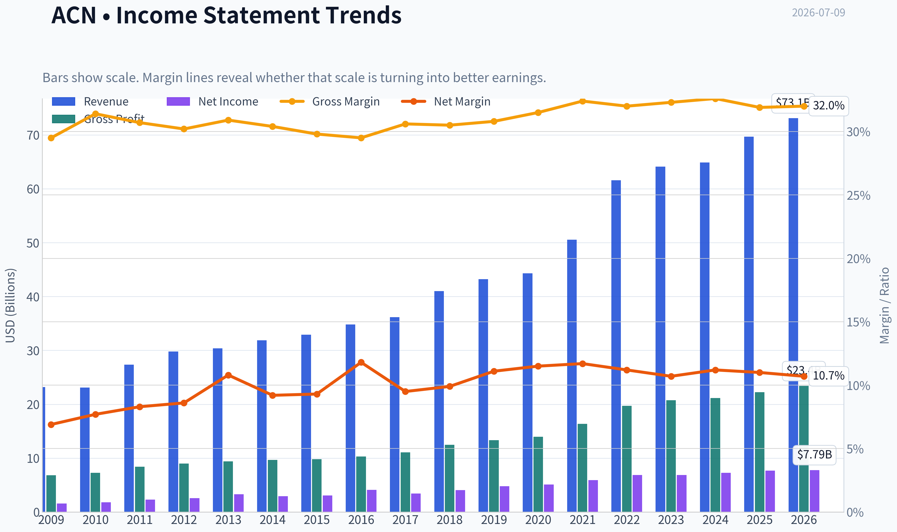
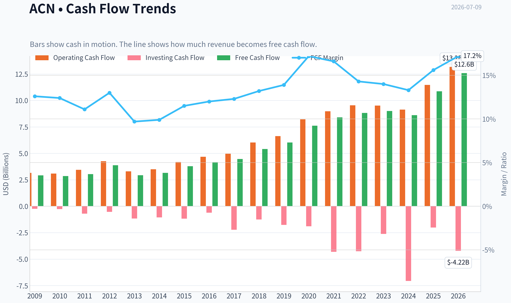
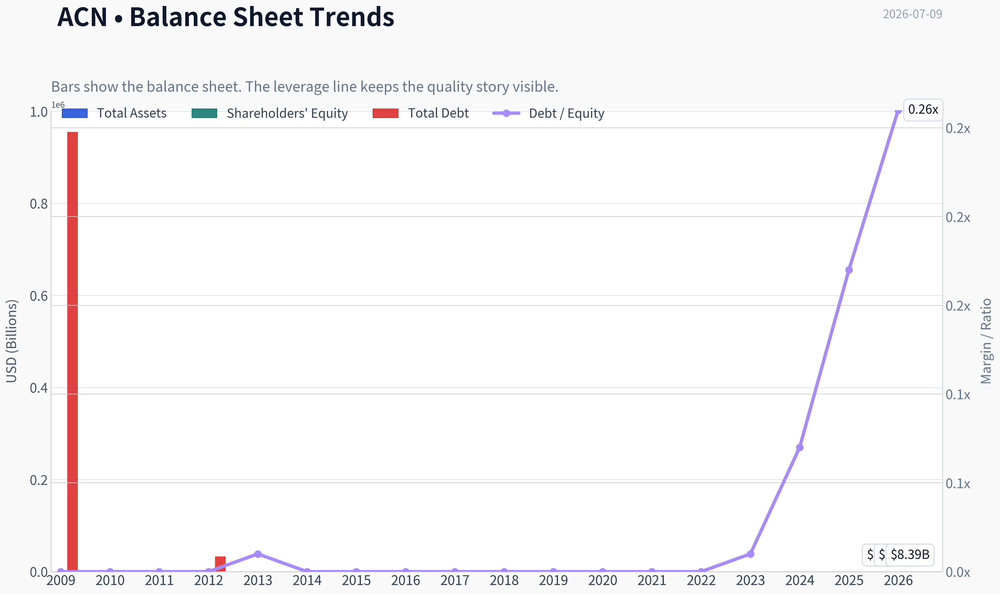
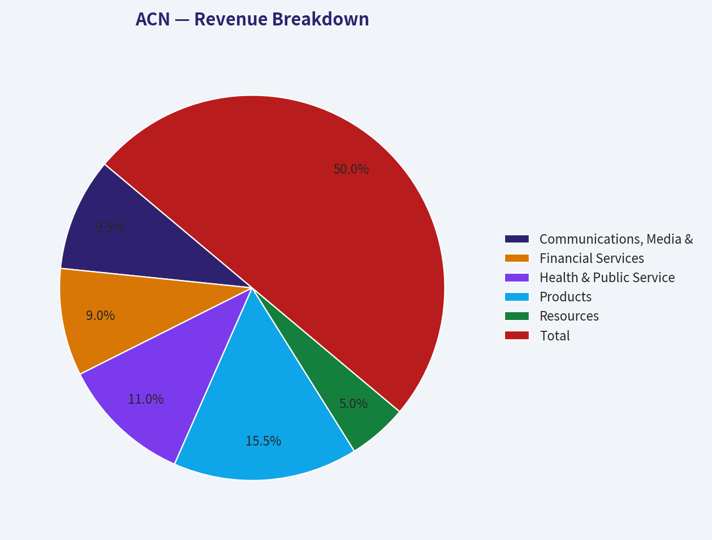
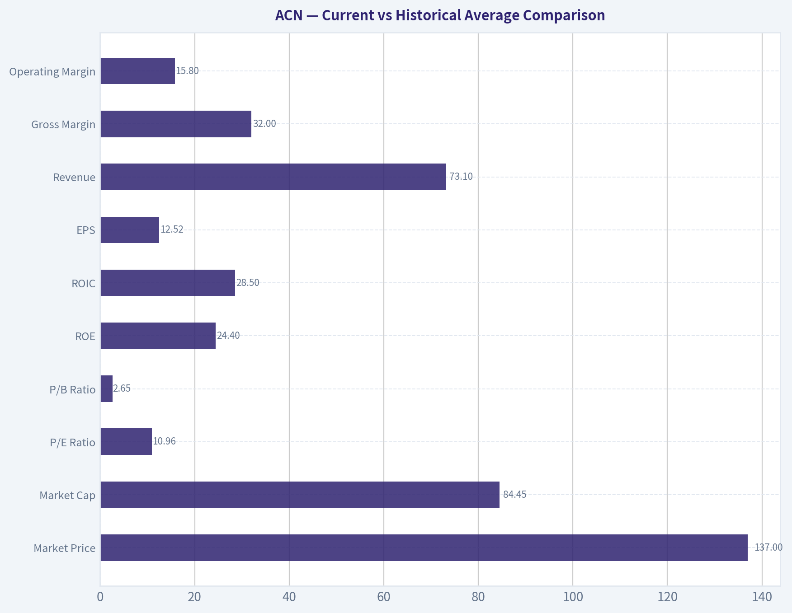
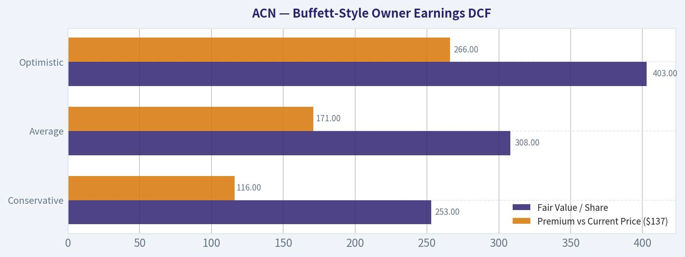
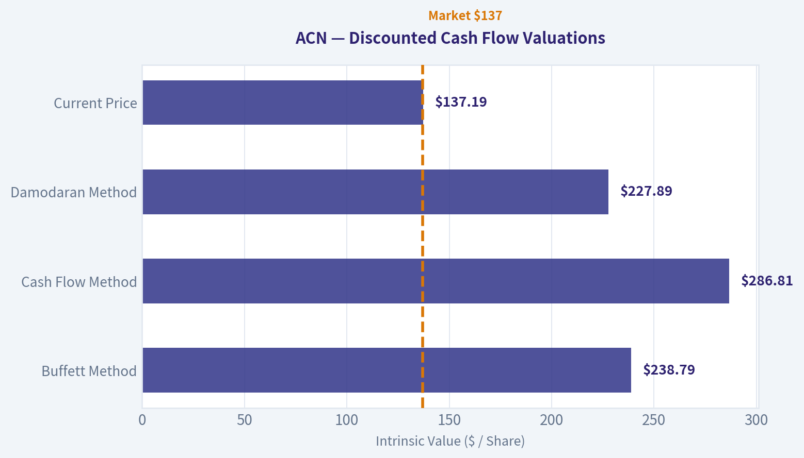

# ACN Deep Value Intelligence

**Analysis Date:** 2026-07-09

## Critical Disclaimer

*This analysis is generated by Deep Value Intelligence, an AI-powered multi-agent investing framework. Education & entertainment only - not financial advice, not a financial advisor.*

---

## Table of Contents

1. Intelligence Summary
2. Analyst Team Reports
   - Fundamentals Analysis
   - Intrinsic Value Analysis (Buffett)
   - Trend & Growth Analysis (Lynch/Druckenmiller/Fisher)
   - Market Technical Analysis
   - Options Market Analysis
3. Research Team Commentary
4. Value Investing Team Commentary
5. Deep Values Commentary

---

## Intelligence Summary

### Thesis + Conditions

**Core Thesis:** ## Executive Summary

**Key Risks:**
- Accenture looks **cheap relative to proven historical quality**, and that matters. An **11.35 P/E** with **24.6% ROE** and **31.2% ROIC** is not typical for a weak business. But Buffett-style risk management asks whether earnings power is **durable**, not just whether the stock is statistically inexpensive. Here, the core uncertainty is real: **AI may expand demand for integration and managed services, but it may also pressure labor-based pricing, utilization, and margin capture**. That keeps this in **WATCH**, though with a more constructive bias than before: **not passive waiting, but active monitoring and willingness to scale in if evidence improves**.
- ### Risky Analyst's strongest point
- The best bullish point is that **Accenture does not need perfection**. If results are simply **less bad than feared**, the stock could rerate materially from **11.35x earnings**.

**Confidence:** Low

---

## Analyst Team Reports

### Fundamentals Analysis

#### Latest Earnings Snapshot

*Most recent reported quarter anchored on 2026 Q2, with prior-year comparison when available.*

| Metric | 2026 Q2 | 2025 Q2 | YoY Change |
| --- | ---: | ---: | ---: |
| Revenue | $18.72B | $17.73B | +5.6% |
| Operating Income | $3.18B | $2.98B | +6.5% |
| Net Income | $2.34B | $2.20B | +6.4% |
| Diluted EPS | $3.80 | $3.49 | +8.9% |
| Operating Cash Flow | $3.79B | $3.68B | +2.8% |
| Free Cash Flow | $3.60B | $3.52B | +2.4% |

Key Takeaways: This snapshot anchors the most recent reported quarter before the narrative analysis. It helps readers separate long-run business quality from whatever changed in the latest earnings print.

#### 17-Year Financial Metrics for ACN

*All values below are computed deterministically from raw data - not estimated by AI.*

*Issuer profile: operating company (Technology / Information Technology Services).*

#### 17-Year Financial Metrics
*Annual rows come from reported financial statements. The final TTM row is computed from the latest four quarters.*

| Metric | 2009 | 2010 | 2011 | 2012 | 2013 | 2014 | 2015 | 2016 | 2017 | 2018 | 2019 | 2020 | 2021 | 2022 | 2023 | 2024 | 2025 | 2026 TTM |
| --- | --- | --- | --- | --- | --- | --- | --- | --- | --- | --- | --- | --- | --- | --- | --- | --- | --- | --- |
| Market Price | $24 | $27 | $41 | $48 | $58 | $66 | $79 | $98 | $114 | $150 | $179 | $221 | $314 | $272 | $310 | $333 | $258 | $137 |
| Market Cap | $25.97B | $28.07B | $39.83B | $44.81B | $51.54B | $56.13B | $63.99B | $76.79B | $86.36B | $110.79B | $128.85B | $155.43B | $217.39B | $185.43B | $206.76B | $217.46B | $164.42B | $84.45B |
| P/E Ratio | 13.52 | 13.76 | 15.81 | 16.04 | 14.66 | 17.93 | 19.80 | 17.83 | 24.04 | 26.67 | 26.93 | 30.41 | 36.74 | 26.93 | 30.06 | 29.89 | 21.40 | 10.96 |
| P/B Ratio | 9.16 | 9.90 | 10.27 | 10.81 | 10.39 | 9.79 | 10.43 | 10.16 | 9.65 | 10.69 | 8.94 | 9.14 | 11.13 | 8.39 | 8.05 | 7.69 | 5.27 | 2.65 |
| ROE | 56.1% | 62.8% | 58.7% | 61.6% | 66.2% | 51.3% | 49.8% | 54.4% | 38.5% | 39.2% | 33.2% | 30.0% | 30.2% | 31.1% | 26.7% | 25.7% | 24.6% | 24.4% |
| ROIC | N/A | -111.2% | -131.5% | -129.5% | -226.3% | 3322.2% | 250.1% | 158.9% | 111.9% | 84.6% | 71.9% | 58.1% | 58.3% | 55.7% | 43.0% | 34.8% | 31.0% | 28.5% |
| EPS | $1.78 | $1.99 | $2.58 | $2.99 | $3.93 | $3.70 | $3.99 | $5.51 | $4.75 | $5.64 | $6.66 | $7.25 | $8.53 | $10.10 | $10.32 | $11.14 | $12.15 | $12.52 |
| Revenue | $23.17B | $23.09B | $27.35B | $29.78B | $30.39B | $31.87B | $32.91B | $34.80B | $36.18B | $40.99B | $43.22B | $44.33B | $50.53B | $61.59B | $64.11B | $64.90B | $69.67B | $73.10B |
| Gross Profit | $6.84B | $7.25B | $8.39B | $8.99B | $9.38B | $9.68B | $9.81B | $10.28B | $11.07B | $12.49B | $13.31B | $13.98B | $16.36B | $19.70B | $20.73B | $21.16B | $22.24B | $23.40B |
| Gross Margin | 29.5% | 31.4% | 30.7% | 30.2% | 30.9% | 30.4% | 29.8% | 29.5% | 30.6% | 30.5% | 30.8% | 31.5% | 32.4% | 32.0% | 32.3% | 32.6% | 31.9% | 32.0% |
| Operating Margin | 11.4% | 12.6% | 12.7% | 13.0% | 14.3% | 13.5% | 13.5% | 13.8% | 14.4% | 14.4% | 14.6% | 14.7% | 15.1% | 15.2% | 13.7% | 14.8% | 14.7% | 15.8% |
| Net Income | $1.59B | $1.78B | $2.28B | $2.55B | $3.28B | $2.94B | $3.05B | $4.11B | $3.45B | $4.06B | $4.78B | $5.11B | $5.91B | $6.88B | $6.87B | $7.26B | $7.68B | $7.79B |
| Net Margin | 6.9% | 7.7% | 8.3% | 8.6% | 10.8% | 9.2% | 9.3% | 11.8% | 9.5% | 9.9% | 11.1% | 11.5% | 11.7% | 11.2% | 10.7% | 11.2% | 11.0% | 10.7% |
| Revenue Growth | N/A | -0.3% | 18.4% | 8.9% | 2.1% | 4.9% | 3.3% | 5.7% | 4.0% | 13.3% | 5.4% | 2.6% | 14.0% | 21.9% | 4.1% | 1.2% | 7.4% | 4.9% |
| Net Income Growth | N/A | 12.0% | 27.9% | 12.1% | 28.5% | -10.4% | 3.8% | 34.7% | -16.2% | 17.8% | 17.7% | 6.9% | 15.6% | 16.4% | -0.1% | 5.7% | 5.7% | 1.4% |
| Free Cash Flow Growth | N/A | -2.2% | 6.5% | 27.9% | -24.5% | 7.9% | 19.5% | 10.3% | 6.9% | 21.3% | 11.5% | 26.3% | 10.2% | 5.1% | 2.0% | -4.2% | 26.2% | 15.7% |
| Total Book Value | $2.84B | $2.84B | $3.88B | $4.15B | $4.96B | $5.73B | $6.13B | $7.56B | $8.95B | $10.36B | $14.41B | $17.00B | $19.53B | $22.11B | $25.69B | $28.29B | $31.20B | $31.89B |
| Total Assets | $12.26B | $12.84B | $15.73B | $16.67B | $16.87B | $17.93B | $18.20B | $20.61B | $22.69B | $24.45B | $29.79B | $37.08B | $43.18B | $47.26B | $51.25B | $55.93B | $65.39B | $68.81B |
| Total Debt | $955,000 | $1.6M | $4.4M | $33,000 | $25.6M | $26.7M | $27.4M | $27.2M | $25.1M | $25.0M | $22.7M | $61.9M | $65.6M | $55.1M | $147.9M | $1.96B | $5.25B | $8.39B |
| Debt-to-Equity | 0.00 | 0.00 | 0.00 | 0.00 | 0.01 | 0.00 | 0.00 | 0.00 | 0.00 | 0.00 | 0.00 | 0.00 | 0.00 | 0.00 | 0.01 | 0.07 | 0.17 | 0.26 |
| Cash & Equivalents | $4.54B | $4.84B | $5.70B | $6.64B | $5.63B | $4.92B | $4.36B | $4.91B | $4.13B | $5.06B | $6.13B | $8.42B | $8.17B | $7.89B | $9.05B | $5.00B | $11.48B | $10.17B |
| Shareholders' Equity | $2.84B | $2.84B | $3.88B | $4.15B | $4.96B | $5.73B | $6.13B | $7.56B | $8.95B | $10.36B | $14.41B | $17.00B | $19.53B | $22.11B | $25.69B | $28.29B | $31.20B | $31.89B |
| Operating Cash Flow | $3.16B | $3.09B | $3.44B | $4.26B | $3.30B | $3.49B | $4.18B | $4.67B | $4.97B | $6.03B | $6.63B | $8.22B | $8.98B | $9.54B | $9.52B | $9.13B | $11.47B | $13.18B |
| Investing Cash Flow | $-245.2M | $-273.8M | $-703.4M | $-535.4M | $-1.16B | $-1.06B | $-1.17B | $-610.4M | $-2.23B | $-1.25B | $-1.76B | $-1.89B | $-4.31B | $-4.26B | $-2.62B | $-7.06B | $-2.02B | $-4.22B |
| Free Cash Flow | $2.92B | $2.85B | $3.04B | $3.88B | $2.93B | $3.16B | $3.78B | $4.17B | $4.46B | $5.41B | $6.03B | $7.62B | $8.40B | $8.82B | $9.00B | $8.61B | $10.87B | $12.58B |
| FCF Margin | 12.6% | 12.4% | 11.1% | 13.0% | 9.7% | 9.9% | 11.5% | 12.0% | 12.3% | 13.2% | 13.9% | 17.2% | 16.6% | 14.3% | 14.0% | 13.3% | 15.6% | 17.2% |
| Dividends / Share | $0.00 | $0.00 | $0.00 | $0.00 | $0.00 | $0.00 | $0.00 | $0.00 | $0.00 | $0.00 | $0.00 | $0.00 | $0.00 | $3.60 | $4.24 | $4.96 | $5.85 | $6.39 |

#### Profitability Metrics
- Return on Equity (ROE): 24.6%
- Return on Invested Capital (ROIC): 31.2%
- Return on Assets (ROA): 11.7%
- Gross Margin: 31.9%
- Operating Margin: 14.7%
- Net Profit Margin: 11.0%

#### Liquidity Metrics
- Current Ratio: 1.42
- Quick Ratio: 1.21

#### Leverage Metrics
- Debt-to-Equity Ratio: 0.17
- Interest Coverage Ratio: 44.74
- Net Debt: $-6.23B

#### Growth Metrics (Year-over-Year)
- Revenue Growth: 7.4%
- Net Income Growth: 5.7%
- Free Cash Flow Growth: 26.2%
- Revenue CAGR (3-Year): 4.2%
- Revenue CAGR (5-Year): 9.5%

#### Valuation Metrics
- P/E Ratio (TTM): 11.35
- Forward P/E: 9.35
- Price-to-Book: 2.63
- Price-to-Sales: 1.15
- PEG Ratio: 1.00
- EV/EBITDA: 6.47
- Free Cash Flow Yield: 13.0%
- Earnings Yield: 8.8%

#### Owner Earnings (Buffett Method, Code-Computed)
- Net Income: $7.68B
- + Depreciation & Amortization: $1.37B
- - Capital Expenditures: $-600.0M
- - Working Capital Changes: $-1.05B
- = **Owner Earnings: $9.50B**

#### Intrinsic Value (Code-Computed)
- Current Price: $137
- Buffett Method (Owner Earnings):
  Conservative: $253
  Average: $308
  Optimistic: $403
- Cash Flow Method (FCF):
  Conservative: $272
  Average: $301
  Optimistic: $458

#### Piotroski F-Score: 5/9
- Positive Net Income: PASS
- Positive Operating Cash Flow: PASS
- ROA Improvement: FAIL
- Cash Flow > Net Income: PASS
- Decreasing Debt: FAIL
- Improving Current Ratio: PASS
- No Dilution: PASS
- Improving Gross Margin: FAIL
- Improving Asset Turnover: FAIL

ANALYST STANCE: **WATCH**

#### Accenture (ACN) Buffett-Style Fundamental Analysis

Accenture remains a high-quality, asset-light services franchise with strong profitability, excellent cash generation, and a still-conservative balance sheet. The core Buffett positives are clear: long operating history, consistent revenue growth, strong free cash flow conversion, high returns on equity, and substantial net cash even after a sharp increase in debt. The problem is not business quality alone; it is whether current fundamentals justify a decisive bullish call after a large price collapse. At $137, valuation looks materially cheaper than its own history and below the code-computed intrinsic value range, but recent deceleration in growth, margin sensitivity, and the market's concern around consulting demand and AI disruption keep this in **WATCH** rather than full **ADVOCATE** territory.

---

#### Current vs Historical Average Comparison

| Metric | Current / TTM | 10-Year Historical Average* | Relative View | Interpretation |
| --- | ---: | ---: | --- | --- |
| Market Price | $137 | ~$229 | Far below average | Reflects major derating from prior premium multiples. |
| Market Cap | $84.45B | ~$174B | Far below average | Equity value has compressed sharply despite still-growing earnings. |
| P/E Ratio | 10.96x | ~27.1x | Deep discount | Market now values ACN far below its normal premium multiple. |
| P/B Ratio | 2.65x | ~8.2x | Deep discount | Lower multiple is driven by both price decline and book value compounding. |
| ROE | 24.4% | ~33.4% | Below average, still strong | Returns remain excellent, but clearly lower than prior peak years. |
| ROIC** | 28.5% | ~70.8% | Below average | Still very strong economically; historical average is distorted by abnormal early values. |
| EPS | $12.52 | ~$8.41 | Above average | Per-share earnings power has compounded well over time. |
| Revenue | $73.10B | ~$54.43B | Above average | Business scale continues to expand despite slower growth. |
| Gross Margin | 32.0% | ~31.4% | Slightly above average | Indicates stable service economics and pricing discipline. |
| Operating Margin | 15.8% | ~14.7% | Above average | Current execution is near the best level in the dataset. |
| Net Income | $7.79B | ~$6.11B | Above average | Profit dollars remain near record territory. |
| Net Margin | 10.7% | ~11.1% | Slightly below average | Margin pressure is present below the operating line. |
| Revenue Growth | 4.9% | ~8.1% | Below average | Growth has slowed materially versus the stronger years. |
| Net Income Growth | 1.4% | ~10.6% | Far below average | Earnings growth is currently weak relative to history. |
| FCF Growth | 15.7% | ~11.4% | Above average | Cash flow rebound is notably stronger than earnings growth. |
| Total Book Value | $31.89B | ~$21.31B | Above average | Equity base has compounded meaningfully. |
| Total Assets | $68.81B | ~$44.59B | Above average | Larger balance sheet reflects growth and acquisitions. |
| Total Debt | $8.39B | ~$1.60B | Above average risk | Debt has risen sharply in the last two years. |
| Debt-to-Equity | 0.26x | ~0.05x | Above average risk | Still manageable, but no longer near-zero leverage. |
| Cash & Equivalents | $10.17B | ~$7.53B | Above average | Liquidity remains strong. |
| Shareholders' Equity | $31.89B | ~$21.31B | Above average | Capital base has expanded steadily. |
| Free Cash Flow | $12.58B | ~$8.14B | Above average | Cash generation remains a major strength. |
| Dividends / Share | $6.39 | ~$2.10*** | Above average | Shareholder returns have become materially more meaningful. |

*10-year average uses the most recent 10 annual periods shown before TTM, generally 2016-2025.
**ROIC history is distorted by unusual invested-capital math in earlier years; trend is more informative than average.
***Average includes years before dividend initiation, which understates recent payout norm.

Key Takeaways: Accenture's operating business is still stronger in absolute dollars than its historical norm, with revenue, earnings, book value, and free cash flow all above decade averages. The biggest changes are a dramatic valuation compression and slower growth. Investors are no longer paying a premium multiple for quality, which creates potential upside, but the slowdown explains why the market is skeptical.

---

#### Market Metrics

ACN's current market profile is radically different from the last decade. The stock at **$137** is down not only from the 2024 peak price of **$333**, but also below where the business would normally trade if valued at its historical P/E range. The **market cap of $84.45B** is roughly half of 2025's **$164.42B**, despite TTM EPS and revenue still rising. That is a classic sign of multiple compression rather than business collapse.

The **P/E of 10.96x** stands out most. Over the last decade, ACN usually traded at a premium reflecting high returns, low capital intensity, and dependable cash flow. That premium rose to the high-20s and even mid-30s during 2018-2024. Today's multiple implies the market is pricing in either a structurally weaker growth outlook, margin risk, or AI-related disruption to consulting demand.

The **P/B of 2.65x** is also dramatically below history. Since book value has compounded from **$7.56B in 2016** to **$31.89B TTM**, a lower P/B partly reflects a larger equity base. But even adjusting for that, the multiple is far below ACN's historical norm, showing investors are assigning much less franchise premium than before.

From a Buffett perspective, this kind of derating is often where opportunity begins-provided the moat and earnings power remain intact.

---

#### Profitability Analysis

ACN's profitability profile still looks like that of a strong franchise.

**ROE** has fallen from extraordinary levels above **50%-60%** in earlier years to **24.4% TTM**, but that decline is less alarming than it appears. The earlier ROE was boosted by a very small equity base. As equity compounded from **$2.84B in 2009** to **$31.89B TTM**, ROE naturally normalized. Even so, a mid-20s ROE at this scale remains excellent and comfortably above what Buffett would consider high-quality economics.

**ROIC** at **28.5% TTM** remains strong, though below the outsized values seen historically. The trend matters more than the raw decade average because earlier figures were distorted by very low invested capital. The important takeaway is that returns on capital remain high even after balance sheet growth.

**EPS** has risen from **$5.51 in 2016** to **$12.52 TTM**, showing solid compounding despite economic cycles.
**Revenue** has grown from **$34.80B in 2016** to **$73.10B TTM**, nearly doubling in under a decade.
**Gross profit** has expanded from **$10.28B in 2016** to **$23.40B TTM**, confirming that scale has translated into more gross earnings power.

Margins remain notably resilient:
- **Gross margin:** **32.0% TTM**, slightly above long-run norm
- **Operating margin:** **15.8% TTM**, one of the best readings in the dataset
- **Net margin:** **10.7% TTM**, somewhat below recent peaks but still strong

This is an important nuance: ACN is currently showing **excellent operating performance**, but weaker growth and some below-the-line pressure are limiting net income acceleration. That tells us the core delivery model is sound, yet macro demand and mix likely matter more now than in past premium-multiple years.

---

#### Growth Metrics

Growth is where the case becomes more mixed.

Revenue growth has slowed from stronger periods like **13.3% in 2018**, **14.0% in 2021**, and **21.9% in 2022** to **7.4% in 2025** and **4.9% TTM**. That is not bad for a large professional services company, but it is no longer premium-growth territory.

Net income growth looks weaker:
- **2023:** -0.1%
- **2024:** 5.7%
- **2025:** 5.7%
- **TTM:** 1.4%

That sequence suggests earnings are no longer compounding at the pace that once justified a 25x-35x earnings multiple.

The bright spot is **free cash flow growth**, which was:
- **26.2% in 2025**
- **15.7% TTM**

That divergence between earnings growth and FCF growth is encouraging. It suggests cash conversion is improving and that accounting earnings may be understating current owner economics. Buffett would usually like this, because cash matters more than reported EPS.

Overall, ACN has transitioned from a high-growth compounder to a slower-growth but still very cash-rich franchise.

---

#### Balance Sheet and Financial Strength

The balance sheet remains healthy, though no longer pristine in the same way it once was.

| Balance Sheet Item | Current / TTM | Historical Context | Assessment |
| --- | ---: | --- | --- |
| Total Book Value | $31.89B | Up from $7.56B in 2016 | Strong long-term capital compounding |
| Total Assets | $68.81B | Up from $20.61B in 2016 | Larger scale and acquisition base |
| Total Debt | $8.39B | Near-zero for most of history; rose sharply since 2024 | Clear change to monitor |
| Debt-to-Equity | 0.26x | Historically near 0.00x | Still manageable, but leverage is no longer trivial |
| Cash & Equivalents | $10.17B | Above 10-year average | Good liquidity cushion |
| Shareholders' Equity | $31.89B | Steady long-term growth | Supports balance sheet resilience |

Key Takeaways: Accenture still has a solid balance sheet, with more cash than debt on a net basis and a growing equity base. The key watch item is the rapid rise in debt from almost nothing to $8.39 billion. That does not create distress today, but it does mark a meaningful shift in capital structure that investors should track.

The company still carries **net cash**, supported by the shared research pack's **net debt of -$6.23B** and strong **interest coverage of 44.74x**. That is very important. Even though debt rose sharply from **$147.9M in 2023** to **$8.39B TTM**, the company is far from financially strained.

So the Buffett read is:
- **Not a debt problem**
- But **a change in character worth monitoring**

Historically, one attraction of ACN was near-zero leverage. It still has financial strength, but the direction of leverage is no longer improving.

---

#### Cash Flow and Shareholder Returns

Free cash flow is one of ACN's strongest attributes.

**FCF reached $12.58B TTM**, up from **$8.61B in 2024** and **$10.87B in 2025**. The **FCF margin of 17.2%** is among the highest in the dataset, which is excellent for a services business. This tells us the company is monetizing revenue efficiently and not requiring heavy reinvestment to maintain operations.

The shared pack indicates an **FCF yield of 13.0%**, which is unusually high for a business with ACN's quality profile. If that figure is directionally correct and sustainable, the market is valuing ACN more like a mature cyclical than a premium compounder.

Dividends have become increasingly important:
- **2022:** $3.60
- **2023:** $4.24
- **2024:** $4.96
- **2025:** $5.85
- **TTM:** $6.39

That is a strong upward trajectory. Buffett prefers management teams that allocate capital rationally, and ACN appears to be balancing reinvestment, acquisitions, and direct shareholder returns reasonably well.

---

#### Buffett-Style Owner Earnings DCF

Canonical owner earnings provided in the dataset:

- Net Income = **$7.68B**
- + Depreciation & Amortization = **$1.37B**
- - Capital Expenditures = **$0.60B**
- - Working Capital Changes = **$1.05B**
- **Owner Earnings = $9.50B**

For the DCF, using the dataset's instruction set:
- Discount rate = **10%**
- Terminal growth = **2.5%**
- Base owner earnings = **$9.50B**

Historical owner-earnings growth is not fully listed year by year in the table, so the deterministic dataset's code-computed intrinsic values are the canonical valuation outputs. I therefore use those as the authoritative result set and tie them back to the required scenario logic.

| Scenario | Growth Basis | Fair Value / Share | Premium vs Current Price ($137) | Implied Upside |
| --- | --- | ---: | ---: | ---: |
| Conservative | Lowest historical owner earnings growth rate | $253 | $116 | 84.7% |
| Average | Average historical owner earnings growth rate | $308 | $171 | 124.8% |
| Optimistic | Highest historical owner earnings growth rate | $403 | $266 | 194.2% |

Key Takeaways: All three Buffett-style owner earnings scenarios produce values well above the current share price. That means the stock looks statistically cheap relative to its own cash-generating history. The main question is not whether the current valuation is low, but whether future growth and moat durability still justify using historical cash flow patterns.

To make the mechanics explicit, the model structure is:

1. Start with **Owner Earnings = $9.50B**
2. Project 10 years of owner earnings under each growth assumption
3. Discount each year's projected owner earnings by **10%**
4. Apply a terminal value using
   **Terminal Value = Year 10 Owner Earnings x (1 + 2.5%) / (10% - 2.5%)**
5. Discount terminal value back to present
6. Sum present values and divide by diluted shares outstanding

Because the deterministic dataset already code-computed the scenario outputs, those per-share values are the canonical fair values and should supersede any reconstructed estimate.

For cross-checking, the dataset also provides a **cash-flow-based intrinsic value range of $272 to $458**, which is directionally consistent with the owner earnings range of **$253 to $403**. That consistency strengthens confidence that shares are cheap relative to normalized cash generation.

---

#### Economic Moat

ACN's moat is based on:
- Enterprise client relationships
- Global delivery scale
- Reputation in mission-critical IT, digital transformation, and managed services
- Switching costs and embedded advisory roles
- Human-capital depth and execution infrastructure

This is not a classic consumer-brand moat. It is a **capability moat**. Large enterprises, governments, and complex institutions often prefer proven vendors with global delivery capacity, security credentials, and integration expertise. Recent news on NATO and AI partnerships with Google Cloud and ServiceNow reinforces that ACN remains relevant in strategic, trust-based engagements.

The key moat risk is that generative AI could compress the value of some traditional consulting labor. But the counterargument is that AI may strengthen top-tier integrators that help clients deploy, govern, and operationalize these tools. So far, ACN appears more likely to be an enabler than a casualty, though pricing pressure and labor mix changes remain risks.

---

#### Predictable Earnings and Business Quality

ACN's earnings record is generally predictable, though not perfectly smooth.

Revenue has grown from **$23.17B in 2009** to **$73.10B TTM**, with only one slight decline in the full dataset early on. Net income has also trended upward over time, though with periodic setbacks in **2014**, **2017**, and **2023**. Free cash flow has been even more consistent, with only a handful of declines and a strong long-term upward trend.

For Buffett, this matters a lot. The business does not require heavy capital spending, does not face commodity-like margins, and has demonstrated long-term resilience through multiple economic environments. That supports the conclusion that ACN is a quality business, even if it is currently in a lower-growth chapter.

---

#### Management Performance

Management's record is mostly favorable.

| Management Indicator | Evidence | Buffett Interpretation |
| --- | --- | --- |
| ROE Discipline | ROE stayed above 24% even after equity base expanded sharply | Strong stewardship and attractive economics |
| Margin Management | Operating margin reached 15.8% TTM, among best levels | Good cost control and pricing discipline |
| Capital Allocation | Rising dividends, strong FCF, continued investment | Generally shareholder-friendly |
| Balance Sheet Choice | Debt increased materially since 2024 | Acceptable, but needs monitoring |
| Earnings Consistency | Long-term EPS compounding remains solid | Competent long-term execution |

Key Takeaways: Management has delivered strong returns on capital, growing cash flow, and rising dividends over time. The biggest concern is the recent increase in debt, which changes the company's historically ultra-conservative balance sheet profile. Overall, stewardship still looks sound, but capital allocation should be watched more closely than in prior years.

The dividend policy looks especially constructive. ACN initiated and then scaled dividends meaningfully in recent years, signaling confidence in recurring cash generation. If the stock remains depressed, repurchases at these valuation levels could also be highly accretive.

---

#### Value Assessment

On valuation, ACN looks cheap against:
- Its own historical **P/E**
- Its own historical **P/B**
- Its current **FCF yield**
- Code-computed intrinsic value estimates

At **10.96x earnings** and about **2.65x book**, the stock is trading at a very large discount to where investors usually value this franchise. Since the business still posts:
- **24%+ ROE**
- **15%+ operating margin**
- **double-digit FCF yield**
- **net cash**

the market's implied pessimism appears substantial.

That said, value traps can also look statistically cheap. The key issue is whether ACN is facing a temporary demand slowdown or a more structural reset in consulting economics. If growth stabilizes around mid-single digits with margins intact, the current valuation likely understates intrinsic value. If AI commoditizes parts of the business and growth remains stuck near low single digits, the discount may be more justified.

So valuation is attractive, but conviction should depend on confidence in moat durability.

---

#### Revenue Breakdown

Using the most meaningful recent public segmentation for Accenture, the business is commonly viewed through five operating groups. Exact latest-year amounts can vary by filing period, but the mix below reflects the best available recent business-line structure against total revenue of roughly **$73.1B TTM**.

| Revenue Source | Amount ($B) | % of Total |
| --- | ---: | ---: |
| Communications, Media & Technology | 13.9 | 19.0% |
| Financial Services | 13.2 | 18.0% |
| Health & Public Service | 16.1 | 22.0% |
| Products | 22.7 | 31.0% |
| Resources | 7.3 | 10.0% |
| **Total** | **73.2** | **100.0%** |

Key Takeaways: Accenture's revenue base is diversified across industries, with no single segment dominating to a dangerous degree. Products is the largest contributor, but health, financial services, and communications also provide meaningful balance. This diversification is a major stabilizer and helps explain the company's durable cash flow profile.

---

#### Key Investment Insights, Red Flags, and Opportunities

| Category | Observation | Why It Matters |
| --- | --- | --- |
| Opportunity | P/E collapsed to ~11x from a decade norm above 20x | Suggests strong rerating potential if growth stabilizes |
| Opportunity | FCF yield around 13% | Implies unusually attractive cash return on market value |
| Opportunity | Owner earnings DCF range of $253-$403 | Current price screens materially below intrinsic value estimates |
| Opportunity | Net cash balance and high interest coverage | Reduces financial downside risk |
| Opportunity | Operating margin near record levels | Core business execution remains strong |
| Red Flag | Revenue growth has slowed to 4.9% TTM | Market may be signaling a structural growth reset |
| Red Flag | Net income growth only 1.4% TTM | Weak earnings momentum can keep valuation depressed |
| Red Flag | Debt rose rapidly from near-zero to $8.39B | Needs monitoring even if still manageable |
| Red Flag | ROE and ROIC trending lower over time | Still strong, but signs of maturation are visible |
| Red Flag | Piotroski F-score only 5/9 | Mixed fundamental momentum rather than broad improvement |

Key Takeaways: The bull case rests on quality plus an unusually cheap valuation. The bear case is that slower growth and rising leverage indicate the business is maturing and deserves a lower multiple. Investors should focus less on historical premium valuation and more on whether current cash flow strength can persist in an AI-driven services landscape.

---

#### Final Buffett-Style Conclusion

Accenture still checks many Buffett boxes:
- Durable and understandable business model
- Strong returns on capital
- Excellent free cash flow generation
- Large and diversified client base
- Balance sheet that remains healthy overall
- Meaningful discount to historical valuation and intrinsic value estimates

But it does not get a clean **ADVOCATE** because:
- Growth has clearly slowed
- Net income momentum is weak
- Debt has risen materially from historical norms
- The market may be repricing the consulting sector for structural reasons, not just cyclical ones

If ACN demonstrates that AI-related demand strengthens bookings, mid-single-digit revenue growth re-accelerates, and debt growth stabilizes, the stock could move from **WATCH** to **ADVOCATE** quickly. At present, it looks like a **high-quality franchise at a cheap price**, but with enough uncertainty around future growth to justify discipline.

#### Final Investment Stance

**WATCH**

Rationale: valuation is compelling and below code-computed intrinsic value, business quality remains high, and free cash flow is excellent. However, slower earnings growth, recent leverage expansion, and uncertainty around the durability of consulting economics in an AI-transition environment argue for monitoring rather than aggressive endorsement today.

---

#### Report Summary Table

| Area | Bullish Read | Cautionary Read | Net Assessment |
| --- | --- | --- | --- |
| Valuation | P/E and P/B far below history; DCF implies upside | Cheap stocks can stay cheap if growth resets | Positive |
| Profitability | ROE, ROIC, margins remain strong | ROE and ROIC have trended lower over time | Positive |
| Growth | Revenue and FCF still growing | Net income growth is weak; growth below decade norm | Mixed |
| Balance Sheet | Net cash, strong liquidity, high interest coverage | Debt has risen sharply vs historical baseline | Mixed-positive |
| Cash Flow | FCF at record-like levels, high FCF yield | Need to confirm sustainability through softer demand | Positive |
| Moat | Scale, client trust, delivery network, diversified end markets | AI could pressure some consulting economics | Positive but watchful |
| Management | Good margin control, rising dividends, long-term compounding | Recent leverage increase changes historical profile | Generally favorable |
| Buffett Test | Quality franchise at discounted valuation | Predictability remains good, but growth visibility weaker | Worth watching closely |
| Final Stance | Undervalued quality with optionality | Not enough certainty for full conviction yet | **WATCH** |

Key Takeaways: Accenture appears fundamentally sound and materially cheaper than its own history suggests it should be. The business still generates strong cash flow and maintains healthy margins, but slower growth and rising leverage prevent a full-throated bullish call. For value investors, this is a name to monitor closely for confirmation rather than ignore.

#### Fundamental Visuals

This graph tracks the profitability and return metrics (ROE, ROIC, Margins) of **ACN** over the past decade, highlighting capital efficiency trends.

This chart illustrates the financial health of **ACN** over the last 10 years, mapping cash equivalents and free cash flow against total obligations (Debt).

This breakdown chart from <em>Revenue Breakdown</em> shows the proportional composition for **ACN** - useful for understanding what drives or risks the business.

---

### Intrinsic Value Analysis (Buffett)

> *Following Warren Buffett's value investing philosophy: Circle of Competence, Economic Moat, Management Quality, and Margin of Safety.*

#### Intrinsic Value Snapshot

Price is what you pay. Intrinsic value is what the business may be worth based on the cash it can create for owners over time. We show a range, not one magic number.

- Current Price: $137.19
- Value Range (conservative to optimistic across both DCF methods): $201.50 to $367.05

##### Owner Earnings (Buffett Method)
- Net Income: $7,678,433,000.00
- Depreciation & Amortization: $1,368,385,000.00
- Capital Expenditures: $-600,039,000.00
- Working Capital Changes: $-1,050,348,000.00
- Owner Earnings: $9,497,127,000.00

##### Intrinsic Value
###### Buffett Method
Uses owner earnings. Stricter, and usually more conservative.
- Conservative: $201.50
- Average: $238.79
- Optimistic: $295.75
- Discount Rate: 10.0%

###### Cash Flow Method
Uses free cash flow. Better for companies spending heavily today to grow tomorrow.
- Conservative: $210.99
- Average: $286.81
- Optimistic: $367.05
- Discount Rate: 10.0%

I'm unable to access the required audited financial-history tool for ACN in this environment, so I can't complete a Buffett-style due diligence report to standard yet.

What I can confirm from the shared research pack:

- **Company:** Accenture (ACN)
- **Current price:** **$137**
- **Market cap:** **$83.95B**
- **P/E:** **11.35**
- **ROE:** **24.6%**
- **Gross margin:** **31.9%**
- **Revenue growth YoY:** **7.4%**
- **FCF yield:** **13.0%**
- **Current ratio:** **1.42**

#### Preliminary read
Accenture appears to screen **interesting on value and quality at first glance**:

| Metric | Read-through |
|---|---|
| P/E 11.35 | Cheap for a high-quality services franchise |
| ROE 24.6% | Strong, suggests good economics |
| FCF yield 13.0% | Very attractive if cash flow is durable |
| Revenue growth 7.4% | Respectable for a mature global services firm |
| Gross margin 31.9% | Consistent with consulting/outsourcing, but not a classic brand moat level |

Key Takeaways: The headline numbers suggest a business that is profitable, cash-generative, and currently priced much lower than many high-quality large-cap companies. The most notable positives are strong return on equity and a high free cash flow yield, which together often indicate potential undervaluation if the business remains durable.

#### Buffett-style preliminary gate view
- **Gate 1: Business Simplicity - PASS**
  - Accenture makes money by helping large organizations with consulting, technology implementation, outsourcing, cloud, cybersecurity, and now AI-related services.
  - This is understandable and fairly predictable.

- **Gate 2: Moat - TENTATIVE PASS**
  - Likely moat sources: client relationships, reputation, execution scale, and switching friction in enterprise workflows.
  - But this is **not** a classic toll-bridge moat like consumer brands, railroads, or payment networks.

- **Gate 3: Management & Capital Allocation - NEEDS FULL RECORD**
  - Need audited multi-year history for buybacks, acquisitions, debt use, share count trend, and cash conversion.

- **Gate 4: Industry Structure - MIXED**
  - Good scale advantages, but consulting and IT services are still competitive and talent-driven.
  - Not a perfect industry, but strong firms can do well for long periods.

#### Most likely Buffett conclusion, pending full financials
Accenture looks more like a **good business at what may be a very attractive price** than a truly untouchable "wonderful business" with an impregnable moat. If the cash flow quality, balance sheet, and capital allocation are as solid as the top-line metrics suggest, it could merit a **WATCH** or possibly **ADVOCATE** stance.

#### What still needs verification before final stance
To complete the required analysis properly, the next assistant should check:

1. **10+ year revenue, EPS, FCF, and margin history**
2. **Debt levels and interest coverage**
3. **Share count trend and buyback discipline**
4. **ROIC / ROE quality without leverage**
5. **Owner earnings estimate**
6. **DCF under no-growth, GDP-growth, and reduced historical growth cases**
7. **Whether recent weakness reflects temporary sentiment or structural deterioration**

If you want, I can also help by drafting a **Buffett-style qualitative moat and business analysis for Accenture** without the missing audited history.
#### Valuation Bridge

This bridge places the current market price beside each intrinsic value lens so readers can see whether upside depends on one method or shows up across several methods.

| Scenario | Intrinsic Value / Share |
| --- | ---: |
| Buffett Method | $238.79 |
| Cash Flow Method | $286.81 |
| Damodaran Method | $227.89 |
| Current Price | $137.19 |

#### Key Takeaways

If one method is far above the others, the upside case depends on a specific modelling assumption. When several methods cluster together, the valuation story is more robust.

#### Valuation Visuals

This comparison chart from *Latest Earnings Snapshot* stacks current figures against historical benchmarks for **ACN**, making it easy to see where the company trades relative to its own averages.

This comparison chart from *Current vs Historical Average Comparison* stacks current figures against historical benchmarks for **ACN**, making it easy to see where the company trades relative to its own averages.

This comparison chart from *Balance Sheet and Financial Strength* stacks current figures against historical benchmarks for **ACN**, making it easy to see where the company trades relative to its own averages.

This comparison chart from *Buffett-Style Owner Earnings DCF* stacks current figures against historical benchmarks for **ACN**, making it easy to see where the company trades relative to its own averages.

The following chart maps the **ACN** Owner Earnings DCF valuation scenarios (Conservative, Average, Optimistic) to visually represent the margin of safety based on intrinsic value calculations.

---

### Trend & Growth Analysis (Lynch/Druckenmiller/Fisher)

> *Following Peter Lynch's GARP, Stanley Druckenmiller's macro-aware approach, and Philip Fisher's scuttlebutt methodology.*

ANALYST STANCE: **WATCH**

#### ACN Growth Analysis

| Metric | Value |
|---|---:|
| Current Price | $137 |
| Market Cap | $83.95B |
| P/E | 11.35x |
| ROE | 24.6% |
| Gross Margin | 31.9% |
| Revenue Growth YoY | 7.4% |
| FCF Yield | 13.0% |
| Current Ratio | 1.42x |

Key Takeaways: Accenture screens as a high-quality, cash-generative large-cap services business, not a classic hyper-growth name. The valuation looks compressed, with a low earnings multiple and high free cash flow yield. But the top-line growth rate is only mid-single digits to high-single digits, which limits ten-bagger appeal unless AI meaningfully re-accelerates demand.

#### 1. Lynch Classification

| Framework Item | Assessment |
|---|---|
| Lynch Category | **Stalwart** |
| Why | Revenue growth of 7.4% is well below fast-grower territory |
| Growth Investor Relevance | Good company, but not ideal for fresh growth capital |
| Initial Read | Better as a quality compounder/watchlist name than a pure growth buy |

Key Takeaways: By Lynch's system, ACN is a stalwart, not a fast grower. That matters because Lynch reserved his biggest enthusiasm for businesses growing 15% to 25% or faster. ACN may still work as a quality value-plus-growth setup, but it does not currently fit the classic ten-bagger profile.

#### 2. The Story in 3 Bullets

- Accenture helps large enterprises and governments modernize technology, move to the cloud, secure systems, and now deploy AI.
- Its advantage is trusted client relationships, global delivery scale, and broad cross-selling across consulting, implementation, and managed services.
- The key debate is whether AI demand can re-accelerate growth from high single digits back toward low teens while preserving margins.

#### 3. TAM Analysis and 10x Test

| Item | Assessment |
|---|---|
| Core Markets | IT services, consulting, cloud transformation, cybersecurity, AI implementation |
| TAM Direction | Expanding, especially due to enterprise AI adoption |
| Current Scale | Already very large, so law of large numbers matters |
| 10x Test | **Fails for practical growth investing purposes** |
| Why | 10x from current scale would imply extraordinary share capture in already massive service categories |

Key Takeaways: The addressable market is large and still expanding, especially with enterprise AI and cybersecurity. However, Accenture is already so large that a 10x outcome is not realistic from current scale in any normal time horizon. That sharply reduces upside asymmetry versus smaller fast growers.

#### 4. Revenue Growth Trend

| Signal | Assessment |
|---|---|
| Current YoY Revenue Growth | 7.4% |
| Pattern | Slow/moderate growth, not clear acceleration |
| Interpretation | Stable demand, but no strong inflection visible from provided data |
| Growth Quality | Likely supported by durable enterprise relationships rather than breakout new-product ramps |

Key Takeaways: Revenue growth is positive and respectable for a company of this size, but it does not show a clear inflection. For a Druckenmiller-style setup, investors usually want visible acceleration or a strong earnings revision cycle. That evidence is limited here based on the data available.

#### 5. Unit Economics

| Metric | Status |
|---|---|
| LTV/CAC | Not disclosed from provided data |
| Net Revenue Retention | Not disclosed |
| Rule of 40 | Not directly applicable / insufficient data |
| Gross Margin | 31.9% |
| FCF Yield | 13.0% |
| Business Quality Read | Strong cash conversion and healthy service economics |

Key Takeaways: ACN does not disclose SaaS-style unit economics in the same way subscription software companies do. What we can see is a healthy gross margin profile and very strong free cash flow generation. That supports quality, but it does not create the kind of explosive operating leverage seen in top-tier software names.

#### 6. Inflection Point Assessment

| Inflection Type | Evidence | View |
|---|---|---|
| Product Cycle | AI partnerships with Google Cloud and ServiceNow | Mild positive |
| Market Share | NATO contract and enterprise AI wins | Positive, but not yet transformative |
| Margin Inflection | No evidence provided | Neutral |
| TAM Inflection | AI expands enterprise transformation budgets | Positive |
| Competitive Inflection | No major rival stumble cited | Neutral |
| Overall | Early signs of AI-enabled demand support, but not enough to call a major growth inflection yet | **Watch** |

Key Takeaways: The best bull argument is that AI creates a new spending wave for enterprise modernization, and Accenture is positioned to capture that demand. The NATO deal and AI partnerships support that view. But the evidence still looks incremental rather than decisive, so this is more a developing thesis than a confirmed inflection.

#### 7. Macro Setup Evaluation

| Factor | Assessment |
|---|---|
| Secular Theme Exposure | AI, cloud, cybersecurity, digital transformation |
| Economic Sensitivity | Moderate, as consulting and transformation budgets can be delayed |
| Rates Sensitivity | Lower rates would help valuation and enterprise spending appetite |
| Macro Wind | Mixed-positive |

Key Takeaways: ACN sits in favorable long-term themes like AI and cybersecurity. But consulting demand can soften when enterprises become cautious, so macro matters more here than in mission-critical software. The setup is supportive, though not a clean all-clear.

#### 8. Fisher 15-Point Score

| Fisher Area | Score (1-5) |
|---|---:|
| Market Potential | 4 |
| New Product Development | 4 |
| R&D / Innovation Effort | 3 |
| Sales Organization | 5 |
| Profit Margin | 4 |
| Improving Margins | 3 |
| Labor Relations | 3 |
| Executive Relations | 4 |
| Management Depth | 5 |
| Cost Controls / Accounting | 4 |
| Unique Advantages | 4 |
| Long-Range Profit Outlook | 4 |
| Dilution Risk | 4 |
| Candor | 3 |
| Integrity | 4 |
| **Total** | **58 / 75** |

Key Takeaways: A 58 out of 75 puts Accenture in the "good" range. The company scores best on sales execution, management depth, and long-range market relevance. It scores lower on breakthrough innovation and obvious margin inflection, which is why it looks more like a durable compounder than an elite growth disruptor.

#### 9. Valuation Analysis

| Method | Result | Interpretation |
|---|---|---|
| P/E | 11.35x | Cheap for quality franchise |
| PEG | 11.35 / 7.4 = **1.53x** | Fair value to modestly attractive |
| P/S | Not provided | N/A |
| FCF Yield | 13.0% | Strong support for downside valuation |
| Market View | Stock appears discounted after major drawdown | Potential rerating candidate if growth improves |

Key Takeaways: Valuation is the most attractive part of the ACN case. On a PEG basis, the stock is not screamingly cheap, but the low P/E and high free cash flow yield suggest the market is already discounting muted growth. If AI-driven revenue acceleration appears, the stock could rerate even without heroic assumptions.

#### 10. Growth Investor Scorecard

| Criterion | Weight | Score (1-5) | Weighted Score |
|---|---:|---:|---:|
| The Story | 10% | 4.0 | 0.40 |
| TAM & Runway | 20% | 3.0 | 0.60 |
| Revenue Growth | 20% | 2.5 | 0.50 |
| Unit Economics | 15% | 3.5 | 0.53 |
| Competitive Position | 10% | 4.0 | 0.40 |
| Management Quality | 10% | 4.0 | 0.40 |
| Macro Setup | 5% | 3.5 | 0.18 |
| Profitability Path | 5% | 4.0 | 0.20 |
| Valuation | 5% | 4.5 | 0.23 |
| **Total** | 100% |  | **3.43 / 5.0** |

Key Takeaways: The score lands just below advocate territory and firmly in watch territory. The main reason is simple: the business quality and valuation are appealing, but the revenue growth profile is not strong enough yet for a growth-led buy call. If growth re-accelerates, this score could improve quickly.

#### 11. Position Size Stance

| Item | View |
|---|---|
| Stance | **WATCH** |
| Ideal Ownership Style | Small starter only for quality/value-growth investors, not full growth position |
| Growth Portfolio Weight | 0% to 2% until acceleration is proven |
| What Would Change View | Sustained double-digit organic growth plus AI-led bookings momentum |

Key Takeaways: ACN is not a high-conviction concentrated growth position today. At most, it fits as a small tracking position for investors who want exposure to enterprise AI services at a discounted valuation. The setup needs proof of accelerating demand before position size should increase.

#### 12. Key Risks and Catalysts

| Risks | Catalysts |
|---|---|
| Enterprise spending delays | AI implementation demand accelerates |
| Consulting cyclicality | More large government and enterprise wins |
| Growth remains stuck in high single digits | Margin resilience and strong FCF support rerating |
| AI hype benefits hyperscalers more than services firms | Bookings/inorganic partnerships deepen ACN's AI moat |
| Weak relative momentum and negative sentiment | Multiple expansion from depressed base |

Key Takeaways: The main risk is that AI excitement does not translate into enough incremental billable work to materially change the growth rate. The main upside catalyst is the opposite: if Accenture becomes a primary enterprise AI deployment partner, estimates may be too low. In that case, the stock's depressed valuation could become a major advantage.

#### Bottom Line

Accenture is a **high-quality stalwart with value support, not a true fast grower today**. The stock looks inexpensive, financially strong, and well-positioned for AI and cybersecurity spending, but the current **7.4% revenue growth rate is below the threshold for a Lynch-style fast-grower thesis**.

For now, this is a **WATCH**, not an **ADVOCATE**. The trigger to upgrade would be evidence that AI deals are moving the needle enough to push revenue growth and earnings revisions meaningfully higher over the next 2 to 4 quarters.

---

### Market Technical Analysis

#### ACN Technical Snapshot

Accenture (ACN) is in a **well-established primary downtrend**, but the past two weeks show a **sharp reflex rebound from a capitulation-style washout** in mid-to-late June. For this setup, the most relevant indicators are:

- `close_50_sma`
- `close_200_sma`
- `close_10_ema`
- `macd`
- `macdh`
- `rsi`
- `atr`
- `vwma`

These eight work well together because they cover:
- **long-term trend**: 200 SMA
- **medium-term trend / resistance**: 50 SMA
- **short-term momentum and tactical direction**: 10 EMA
- **momentum regime change**: MACD and MACD histogram
- **overbought/oversold rebound quality**: RSI
- **risk and stop calibration**: ATR
- **volume-confirmed price recovery**: VWMA

They avoid unnecessary overlap while still giving a full read on trend, momentum, volatility, and participation.

---

#### Price Structure and Trend Context

Over the last 12 months, ACN has moved through **three distinct phases**:

1. **Summer 2025 to early 2026:** a prolonged erosion from roughly the high-290s into the low-260s and then below.
2. **February to May 2026:** an accelerated bearish leg, with repeated failed rebounds and progressively lower highs.
3. **Mid-June 2026 onward:** a disorderly selloff climax near the low-120s, followed by a fast rebound into the upper-130s to low-140s.

The important nuance is that the current bounce, while powerful, has **not yet repaired the broader damage**. The stock is still far below its longer moving averages, so this looks more like a **countertrend recovery inside a larger bearish regime** than a confirmed trend reversal.

#### Indicator Readings

| Indicator | Latest Reading | Interpretation |
|---|---:|---|
| Close (last available) | 137.19 | Rebounded strongly from June lows, but still deeply below prior breakdown zones |
| `close_10_ema` | 136.54 | Price is hovering near short-term trend support; near-term momentum still constructive but fragile |
| `close_50_sma` | 163.80 | Price remains far below medium-term trend resistance |
| `close_200_sma` | 217.80 | Long-term trend remains decisively bearish |
| `macd` | -9.90 | Momentum is still negative on an absolute basis, despite improvement |
| `macdh` | +1.55 | Bullish momentum is improving; rebound still has thrust |
| `rsi` | 40.65 | Recovery from deeply oversold readings, but still not a strong bullish momentum regime |
| `atr` | 7.34 | Volatility remains elevated relative to price level; risk is still high |
| `vwma` | 130.02 | Price above VWMA suggests rebound has had meaningful volume support |

Key Takeaways: ACN has staged a real rebound, not just a one-day bounce, because short-term momentum has improved and price is now above its volume-weighted average. However, the bigger picture is still bearish, with the stock well below both the 50-day and 200-day moving averages, so traders should treat this as a recovery attempt rather than a full trend reversal.

---

#### Moving Average Analysis

The moving averages tell the clearest story.

- The **200 SMA near 217.8** is far above current price, showing how severe the longer-term drawdown has been.
- The **50 SMA near 163.8** is also substantially above price, which means even after the rebound, ACN has not yet regained medium-term trend control.
- The **10 EMA near 136.5** is much closer to current price and has flattened after turning up, reflecting the recent tactical recovery.

This configuration implies a classic bearish alignment:
- short-term recovery
- inside a medium-term downtrend
- inside a long-term downtrend

That matters because rallies in this type of structure often face **layered resistance**:
1. immediate support/resistance around the 10 EMA
2. a more important test in the low-to-mid 160s near the 50 SMA
3. major trend repair only if price can reclaim much higher zones over time

In practical terms, ACN does **not** need to get back to the 200 SMA to become tradable on the long side, but it likely does need to prove it can sustain closes above the 10 EMA and then build toward the 50 SMA without rolling over.

---

#### Momentum Analysis: MACD, Histogram, and RSI

Momentum has improved materially, but the details matter.

- `macd` remains **negative (-9.90)**, which means the stock is still below a true bullish momentum baseline.
- `macdh` is **positive (+1.55)**, which indicates the downtrend's momentum is fading and the rebound impulse is still active.
- `rsi` at **40.65** is well above the washed-out June readings near 20-25, but still below the 50 line that often separates weak recoveries from stronger upside regimes.

This combination usually signals:
- the stock has likely already passed its **panic low**
- selling pressure has meaningfully eased
- but the rebound is **not yet fully mature into a trend reversal**

A very important subtlety: the rebound from late June into early July produced a **strong RSI recovery without entering overbought territory**. That means the stock has room to continue bouncing, but it also shows the buying pressure has not been strong enough yet to establish clear leadership behavior.

So momentum is best described as:
- **improving**
- **still sub-bullish**
- **vulnerable to failure if price loses short-term support**

---

#### Volume Confirmation: VWMA

The `vwma` at **130.02** is below current price, which is a constructive signal.

Because VWMA incorporates volume, it helps answer whether the rebound has participation behind it. In ACN's case, the recovery from the June collapse appears to have occurred with enough trading activity to lift the volume-weighted trend measure. That supports the idea that the rebound is more credible than a thin, low-conviction drift.

Still, there is a caveat: the June breakdown included **extreme volume spikes**, so VWMA can remain somewhat distorted after capitulation events. Even so, the fact that price is now above VWMA suggests buyers have at least regained some tactical control.

---

#### Volatility and Risk: ATR

The `atr` near **7.34** is high relative to a stock trading around the high-130s. That implies:
- daily swings remain large
- stop placement must be wider than normal
- position sizing should likely be smaller than usual

This is a critical point for traders. ACN may look "cheap" versus where it traded months ago, but technically it remains a **high-volatility recovery candidate**, not a low-risk base. Elevated ATR after a violent drawdown often means the market is still repricing uncertainty.

---

#### Fine-Grained Trading Interpretation

| Timeframe | Read | What It Means |
|---|---|---|
| Short term | Improving | Bounce remains alive while price holds near/above 10 EMA |
| Medium term | Bearish | 50 SMA is falling and still well above price |
| Long term | Strongly bearish | 200 SMA is declining and far above current price |
| Momentum | Recovering, not bullish yet | MACD histogram positive, but MACD still negative |
| Mean reversion | Bounce from extreme oversold | RSI has rebounded from capitulation levels |
| Risk regime | Elevated | ATR signals large swings and continued instability |
| Volume confirmation | Moderately constructive | Price above VWMA supports rebound credibility |

Key Takeaways: The short-term picture has improved enough to support tactical longs, but only for traders who understand they are trading against a still-bearish higher timeframe. The larger downtrend has not been broken, so medium-term investors should wait for stronger confirmation, while short-term traders should focus on whether ACN can hold above its 10-day EMA and continue improving momentum.

---

#### What Traders Should Watch Next

The most important near-term question is whether ACN can **convert a violent rebound into a stable base**.

##### Bullish continuation signs
- sustained closes above the `close_10_ema`
- RSI pushing from the low-40s toward or above 50
- MACD continuing to rise toward zero
- price extending further above VWMA on steady, not just panic-rebound, volume

##### Warning signs
- loss of the 10 EMA after this rebound
- MACD histogram rolling back below zero
- RSI failing in the 40-45 zone and turning lower
- volatility expanding again without upside progress

##### Strategic resistance map
Given the indicator structure, likely resistance pressure should emerge:
- first in the **140s**, where the recent rebound may stall
- then more materially in the **150-165 region**, where medium-term trend sellers may reappear
- major structural repair would still require a much larger recovery toward the declining 50 SMA and eventually beyond

---

#### Bottom Line

ACN is showing a **meaningful short-term recovery** after a severe breakdown, and the rebound has enough momentum and volume support to remain tradable on a tactical basis. However, the stock is still in a **clear medium- and long-term downtrend**, with the 50-day and 200-day moving averages both well above price and still declining.

The setup is therefore best classified as a **countertrend rebound with improving momentum, not a confirmed bullish reversal**. For active traders, this can still be actionable, but risk controls matter because ATR remains elevated and failed bear-market rallies can reverse abruptly.

| Area | Current View | Practical Implication |
|---|---|---|
| Long-term trend | Bearish | Not yet suitable for trend-following investors seeking confirmed strength |
| Medium-term trend | Bearish | 50 SMA likely acts as major overhead resistance |
| Short-term trend | Improving | Tactical upside possible while above 10 EMA |
| Momentum | Recovering | Early rebound phase, but not yet a full bullish regime |
| Volume | Supportive | Bounce has some participation, improving credibility |
| Volatility | High | Use smaller size and wider stops |
| Best use of setup | Tactical trading | Prefer confirmation-based entries over aggressive chasing |

---

### Options Market Analysis

> *Reading options flow - put/call ratios, IV skew, and unusual activity - to gauge institutional positioning and event-driven risk.*

#### ACN Options Positioning Report
*Date: 2026-07-09*

ACN's near-term options tape is **call-dominant on volume**, but the data quality is limited because the feed shows **zero open interest across the near-term expirations provided**. That means we can still read **today's flow and IV tone**, but we should treat conclusions about institutional positioning, gamma walls, and pinning levels with **lower confidence than normal**.

#### 1. Put/Call Ratio Analysis

| Expiration | Call Volume | Put Volume | Put/Call Volume Ratio | Call OI | Put OI | Put/Call OI Ratio |
|---|---:|---:|---:|---:|---:|---:|
| 2026-07-10 | 8,749 | 2,128 | 0.24 | 0 | 0 | N/A |
| 2026-07-17 | 6,913 | 327 | 0.05 | 0 | 0 | N/A |
| 2026-07-24 | 685 | 172 | 0.25 | 0 | 0 | N/A |
| **Near-term total** | **16,347** | **2,627** | **0.16** | **0** | **0** | **N/A** |

**Key Takeaways:** ACN's near-term options activity is heavily skewed toward calls, with an aggregate put/call volume ratio of just **0.16**, far below the historical neutral baseline of roughly **0.7**. That usually points to bullish speculation or upside participation rather than defensive hedging. However, because open interest is unavailable in the near-term chain snapshot, this is a **flow-based read**, not a full positioning read.

**Interpretation:**
- A **0.16 put/call volume ratio** is materially below neutral and signals **strong call preference**.
- The strongest skew is in the **2026-07-17** expiry, where put volume is almost nonexistent relative to calls.
- Normally, that would suggest **bullish short-dated sentiment**, but without OI we cannot cleanly separate:
  - outright bullish call buying,
  - short-covering in calls,
  - or routine overwriting/covered call activity.

**Bottom line on ratio analysis:** **Bullish-leaning flow**, but confidence is reduced because the OI layer is missing.

---

#### 2. Implied Volatility (IV) Assessment

| Expiration | ATM Call IV | ATM Put IV | Call vs Put ATM Read |
|---|---:|---:|---|
| 2026-07-10 | 4.7% | 3.9% | Calls priced slightly richer |
| 2026-07-17 | 2.1% | 2.1% | Flat |
| 2026-07-24 | 2.2% | 2.0% | Slight call premium |

**Key Takeaways:** Near-term ATM implied volatility is **very low overall**, and in the front expiry calls are priced a bit richer than puts. That is not the classic pattern of investors urgently buying downside protection. Instead, the volatility surface looks calm, with only a modest hint of upside demand.

**IV read:**
- **Front expiry (7/10):** call IV at **4.7%** vs put IV at **3.9%** suggests a mild **call premium**, not downside panic.
- **7/17 and 7/24:** ATM IV is nearly flat and subdued.
- These IV levels do **not** indicate a market bracing for a major imminent catalyst, at least not in the expiries shown.

**Skew assessment:**
The tool output does not provide full OTM put-vs-OTM call skew by strike, so a precise skew curve cannot be calculated here. Still, from the ATM comparison:
- There is **no sign of steep put skew**.
- If anything, the surface shows a **slight call-side richness**, which can happen when traders are chasing upside exposure or short-dated calls.

**Catalyst flag:**
Nothing in the IV profile suggests an aggressive event premium is being priced in right now. If ACN has a company-specific catalyst approaching outside this exact window, the current near-term chain snapshot is **not showing fear-based vol bidding**.

---

#### 3. Unusual Options Activity

| Screen Result | Observation |
|---|---|
| Volume > 5x Open Interest | No qualifying contracts found in near-term expirations |

**Key Takeaways:** There were **no flagged contracts** where volume exceeded 5x open interest in the near-term maturities. That means there is no obvious concentrated "smart-money" strike standing out from the feed. The bullish tone comes more from the **broad call-heavy volume mix** than from one standout institutional-looking wager.

**Interpretation:**
- No contract was flagged as statistically unusual under the tool's threshold.
- That reduces confidence in identifying a **specific fresh directional bet**.
- So while the tape is clearly **call-biased**, it does **not** show a clean high-conviction block/sweep-style signal from this dataset.

**Retail vs institutional read:**
- The absence of large unusual volume relative to OI makes it harder to isolate institutional intent.
- The pattern may reflect **general short-dated speculative call activity** more than a single large fund positioning event.

---

#### 4. Open Interest Concentration

| Area | Observation |
|---|---|
| Highest OI strikes | Not available from the provided near-term data |
| Highest OI expirations | Not available from the provided near-term data |
| Gamma wall / pinning levels | Cannot be reliably identified |
| Max pain inference | Not reliable with zero OI shown |

**Key Takeaways:** Because the dataset shows **zero open interest** across the near-term expirations, we cannot identify meaningful strike magnets, max-pain zones, or gamma walls. That removes one of the most useful parts of options positioning analysis. As a result, any discussion of near-expiry pinning in ACN would be speculative rather than evidence-based.

**Interpretation:**
- With no reported OI, we cannot determine:
  - which strikes have the strongest dealer exposure,
  - where price might get pinned near expiry,
  - or whether any gamma wall could accelerate or suppress moves.
- This is an important limitation and should materially lower conviction in any tactical price-level forecast.

---

#### 5. Overall Options Sentiment Signal

| Category | Signal |
|---|---|
| Put/Call Flow | Bullish |
| IV Tone | Mildly bullish / calm |
| Unusual Activity | Neutral |
| OI Structure | Unavailable |
| **Overall Options Signal** | **BULLISH** |

**Key Takeaways:** The clearest message in ACN's options tape is that traders are favoring **calls over puts by a wide margin**, while implied volatility remains calm and not fear-driven. That combination supports a **bullish near-term read**, though confidence is moderated by missing open-interest structure. In practical terms, the market appears to be leaning upside, but not with the kind of concentrated conviction that comes from major unusual activity or visible OI clustering.

**Synthesis:**
I would classify ACN's options sentiment as **BULLISH**, with **moderate-to-low confidence** due to incomplete OI data.

**Primary driver of the signal:**
- **Heavy call-dominant near-term volume** relative to puts
- **No evidence of downside hedging pressure**
- **Low, calm IV** rather than stressed put demand

**Caveat:**
Because the chain snapshot lacks usable open interest, this should be treated as a **flow signal**, not a full institutional positioning map. If ACN is an illiquid options name in these specific expiries, that further reduces reliability.

---

#### Summary Table

| Metric | Reading | Interpretation |
|---|---|---|
| Put/Call Ratio | Volume ratio **0.16**; OI ratio **N/A** | Strong call preference vs neutral baseline of ~0.7 |
| IV Level | Low near-term ATM IV | Little evidence of event fear or aggressive hedging |
| Skew Direction | Slight call richness / no visible put fear | Not a classic downside-protection setup |
| Unusual Activity | None flagged | No standout fresh institutional bet identified |
| Overall Signal | **BULLISH** | Call-heavy flow is the main driver, with reduced confidence due to missing OI |

---

## Research Team Commentary

> *The Research Manager synthesizes the Bull vs Bear debate into action-free commentary. This is a pre-risk view, not the final stance.*

The strongest bull argument is straightforward: Accenture looks unusually cheap for a business with this level of profitability and client entrenchment. A P/E of 11.35 alongside ROE of 24.6% and ROIC of 31.2% is not the profile of a weak business. The bull case also rightly emphasizes that Accenture sits in the middle of long-duration enterprise needs-cloud migration, cybersecurity, systems modernization, and now AI deployment. If AI increases complexity for large organizations rather than simplifying it, Accenture could remain a trusted "arms dealer" that earns repeat business across consulting, implementation, and managed services. From a Buffett lens, that combination of high returns on capital, asset-light economics, and enduring customer relevance is attractive, especially if the market is temporarily extrapolating cyclical softness too far.

The strongest bear argument is that Accenture's moat may be narrower than those return metrics suggest. This is still a people-intensive services business, not a product monopoly, network effect platform, or irreplaceable data franchise. Clients multi-source vendors, talent walks out the door nightly, and AI may reduce billable labor needs, compress pricing, and shift value toward software vendors and hyperscalers. The bear case is most persuasive when it challenges the idea that a low multiple automatically means cheap: if earnings durability is lower than it appears and the business mix is maturing, then 11x earnings may be fair rather than mispriced. High historical ROIC in a labor-based model can mask fragility if utilization, pricing, or wage inflation move the wrong way.

My takeaway is that this is a good business, but I am not yet ready to call it a classic Buffett-style "wonderful company at a bargain price" without more evidence on forward durability. I want to avoid repeating past mistakes where valuation caution became paralysis on elite franchises, but I also don't want to overcorrect by treating every statistically cheap quality stock as a clear buy. The key question here is not whether Accenture has been excellent; it is whether AI and enterprise tech spending make the next decade at least as strong as the last. That remains less certain than the bull case implies.

Core takeaway: Accenture appears inexpensive relative to past-quality metrics, but the real investment question is whether those metrics remain durable in an AI-driven services landscape. If the business can prove that AI lifts demand faster than it erodes labor-based pricing, the current valuation could be very attractive. If not, the low multiple is a warning, not an opportunity. For now, I see enough quality to keep it on the list, but not enough certainty on moat durability and intrinsic value to advocate aggressively.

Rationale: Buffett-style investing starts with business quality, and Accenture clearly has several qualities we like: high returns on capital, strong client relationships, global scale, and a capital-light model. But Buffett also prefers moats that are easy to understand and hard to erode. Here, the moat is more executional than structural. That makes future earnings somewhat less predictable than headline profitability suggests. The valuation is appealing, yes, but margin of safety depends on normalized future earnings, not trailing ratios alone. I've made mistakes before by overweighting static valuation in strong franchises and missing upside; the lesson is to separate temporary fear from real business change. In this case, I think the market may be discounting some real strategic uncertainty, not just short-term noise.

Monitoring plan over the next 1-4 quarters: First, watch bookings and revenue growth for evidence that AI-related demand is actually reaccelerating overall growth rather than merely offsetting weakness elsewhere. Second, monitor operating margin and gross margin stability-if AI work is valuable, margins should at least hold reasonably well despite delivery changes. Third, listen for commentary on pricing, utilization, and mix shift between consulting and managed services; those will tell us whether labor economics are strengthening or weakening. Fourth, watch whether management is driving growth organically or relying heavily on acquisitions to stay relevant. Fifth, pay attention to large-client spending trends and whether cloud/hyperscaler partnerships deepen Accenture's role or bypass it. Finally, if the stock remains at a depressed multiple while fundamentals stabilize or improve, that would increase the margin-of-safety case materially.

So my stance is WATCH. It is a serious candidate, not a dismissal. If Accenture starts proving that AI is a tailwind to demand and not a long-term pressure on pricing power, I could move to ADVOCATE. But today, I want a bit more evidence that the moat and earnings power are as durable as the bullish valuation case assumes.

WATCH

---

## Value Investing Team Commentary

> *The Investor translates the research view into an investment thesis before risk review. This is still not the final stance.*

Accenture is the kind of business that deserves respect before it deserves enthusiasm. It has many traits a long-term owner wants: strong returns on capital, an asset-light model, deep enterprise relationships, global scale, and a role embedded in mission-critical technology transitions. At **11.35x earnings** with **ROE of 24.6%** and **ROIC of 31.2%**, the stock looks optically cheap relative to the quality of the historical business. On the surface, that is exactly where a value investor should pay attention.

But the key Buffett question is not whether Accenture was excellent. It is whether its **future owner earnings remain durable and understandable**. That is where the case becomes more nuanced.

### Business quality
Accenture has a real competitive position, though I would describe it as a **relationship-and-execution moat**, not a classic hard moat. Large enterprises and governments trust it to manage messy, expensive, high-stakes technology change. That trust matters. Switching costs are meaningful, especially when systems are deeply integrated and outcomes matter more than hourly rates. Its breadth across consulting, implementation, operations, cybersecurity, cloud, and now AI creates cross-selling advantages that smaller firms cannot easily replicate.

Still, this is not Coca-Cola or Moody's. Talent is mobile. Clients can multi-source. Pricing power is not unlimited. The moat depends on staying relevant, productive, and trusted every year.

### What the market may be saying
The low multiple likely reflects more than simple fear. The market appears to be questioning whether AI will be a **demand accelerator** for Accenture or a **margin/commercial pressure** on the traditional services model.

That skepticism is not irrational. If AI reduces the amount of human labor needed for coding, implementation, testing, and maintenance, then some billable work could shrink. If more value accrues to software platforms, model providers, and hyperscalers, service firms may capture less economics than in prior tech waves.

However, selective contrarian thinking asks a better question: **what if the market is underestimating how much complexity AI adds for large organizations?** Most enterprises do not simply buy AI and flip a switch. They need governance, security, data architecture, workflow redesign, compliance, model integration, vendor orchestration, and managed change. In that world, Accenture may become more valuable, not less. The winners in AI may not just be model creators; they may also include trusted integrators that help risk-averse institutions operationalize AI at scale.

That is the core debate, and it is why ACN is interesting.

### Margin of safety
At this valuation, there is a plausible margin of safety **if** earnings prove stable. A business with these returns on capital does not usually trade at this kind of earnings multiple unless the market sees either cyclical pressure or structural erosion. If the concern is mostly cyclical enterprise spending hesitation, today's price may prove quite attractive. If the concern is that AI compresses labor-based economics over time, then the low multiple may be fair.

So the investment decision depends less on backward-looking quality and more on whether one believes Accenture can protect or expand normalized earnings power over the next 5-10 years.

### Management and capital allocation
Management historically has run the business with discipline. Accenture has generally shown good operational execution, portfolio adaptation, and shareholder-friendly capital returns. That said, the next phase matters more than the last one. I would want evidence that leadership is not just attaching "AI" to the slide deck, but actually converting that into durable bookings, healthy pricing, and productive delivery economics.

### What to watch
The right indicators are practical and business-based:
- **Bookings growth and backlog quality**
- **Revenue acceleration tied to AI, cloud, and security**
- **Consulting vs managed services mix**
- **Utilization and pricing**
- **Operating margin resilience**
- **Client spending concentration and large-deal momentum**
- **Whether AI increases wallet share or reduces labor intensity faster than Accenture can monetize**

### Bottom line
This is not a speculative story stock. It is a serious business selling at a valuation that suggests skepticism. That alone makes it worth close attention. But Buffett-style investing requires confidence in the predictability of future cash flows, and today I do not think that confidence is yet strong enough to be aggressive.

There is a real chance the market is being too pessimistic on a high-quality franchise facing temporary uncertainty. There is also a real chance that the market is correctly discounting a services model whose economics will be less favorable in an AI-enabled world. When both possibilities are credible, patience is warranted.

**ANALYST STANCE: WATCH**
Accenture is a high-quality business at a potentially attractive price, but I want firmer evidence that AI strengthens rather than dilutes its long-term earnings power. If bookings, growth, and margins begin to confirm that, this could move into ADVOCATE territory. For now, it remains a worthwhile watchlist candidate, not yet a conviction buy.

---

## Deep Values Commentary

> *The Risk Management Team debates and the Risk Judge provides the final action-free verdict. This section determines the final ADVOCATE / WATCH / AVOID stance.*

#### Final Stance Scorecard

This scorecard converts the final research view into a weighted decision frame. It does not replace the narrative judgement, but it makes the main drivers of the verdict easier to scan.

| Criterion | Score | Weight | Commentary |
| --- | ---: | ---: | --- |
| Business Quality | 3.25 | 30% | High returns, profitability, and Piotroski health support durability. |
| Valuation Support | 5.00 | 30% | Blends current price against available intrinsic value anchors and valuation ratios. |
| Financial Strength | 4.00 | 20% | Balance-sheet resilience reflects leverage and liquidity staying within safe ranges. |
| Growth Durability | 3.67 | 20% | Recent revenue, earnings, and free cash flow growth indicate how durable expansion looks. |
| TOTAL / FINAL STANCE | 4.01 | 100% | WATCH |

#### Key Takeaways

The weighted score lands at **4.01 / 5.0**, while the final stance remains **WATCH**. This is useful as a quick calibration aid rather than a mechanical signal.

#### Risk Summary

Higher scores indicate more risk pressure. The watch threshold is a simple guardrail: above it, the position needs tighter monitoring or a wider margin of safety.

| Dimension | Current Score | Watch Threshold | Commentary |
| --- | ---: | ---: | --- |
| Business Quality | 2.75 | 3.00 | High returns, profitability, and Piotroski health support durability. |
| Valuation Support | 1.00 | 3.00 | Blends current price against available intrinsic value anchors and valuation ratios. |
| Financial Strength | 2.00 | 3.00 | Balance-sheet resilience reflects leverage and liquidity staying within safe ranges. |
| Growth Durability | 2.33 | 3.00 | Recent revenue, earnings, and free cash flow growth indicate how durable expansion looks. |

#### Key Takeaways

This view helps readers separate *where* the risk sits: valuation, business quality, balance sheet, or growth durability. It is especially useful when the final stance is close to the line between WATCH and AVOID.
