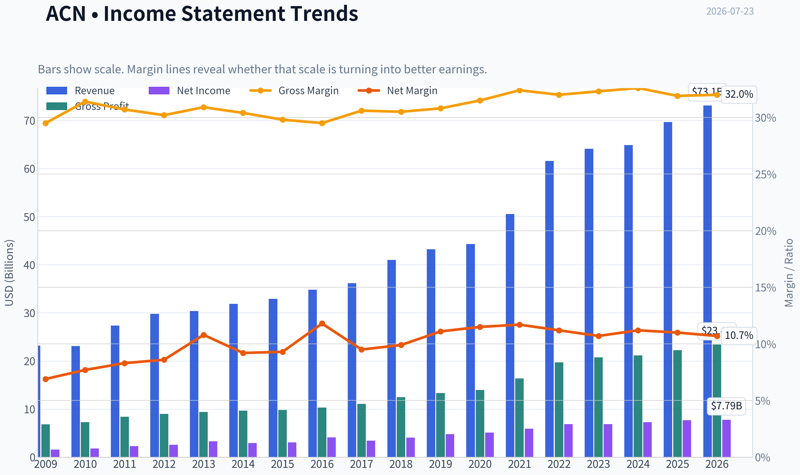
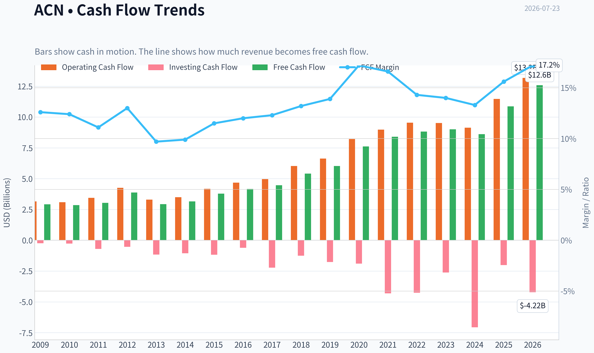
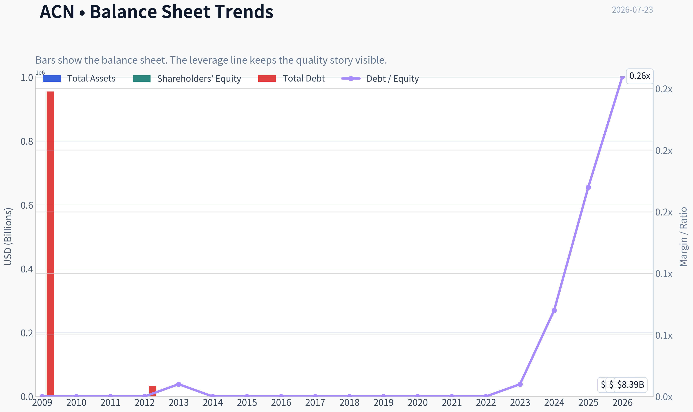
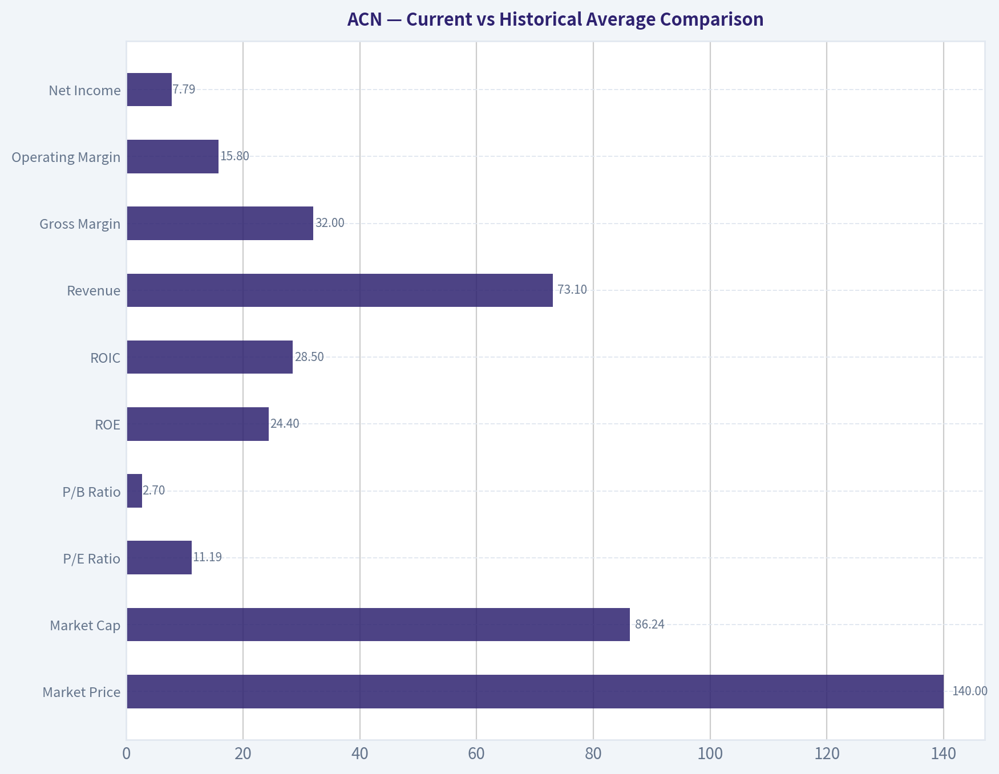
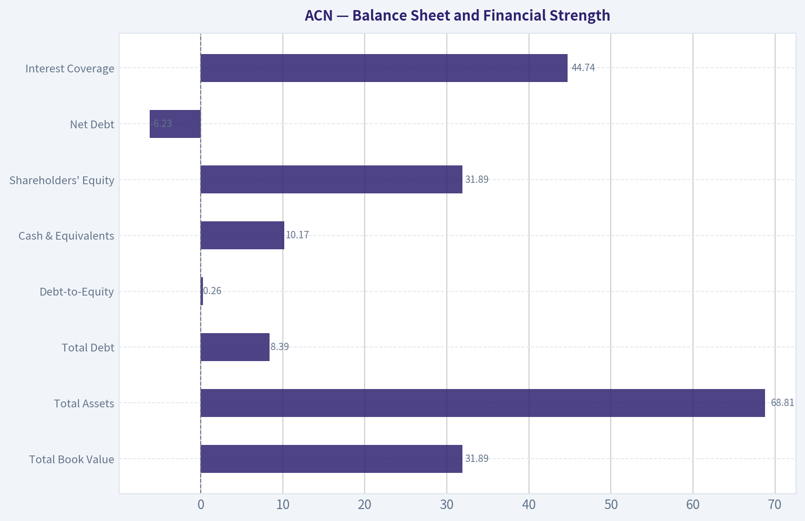
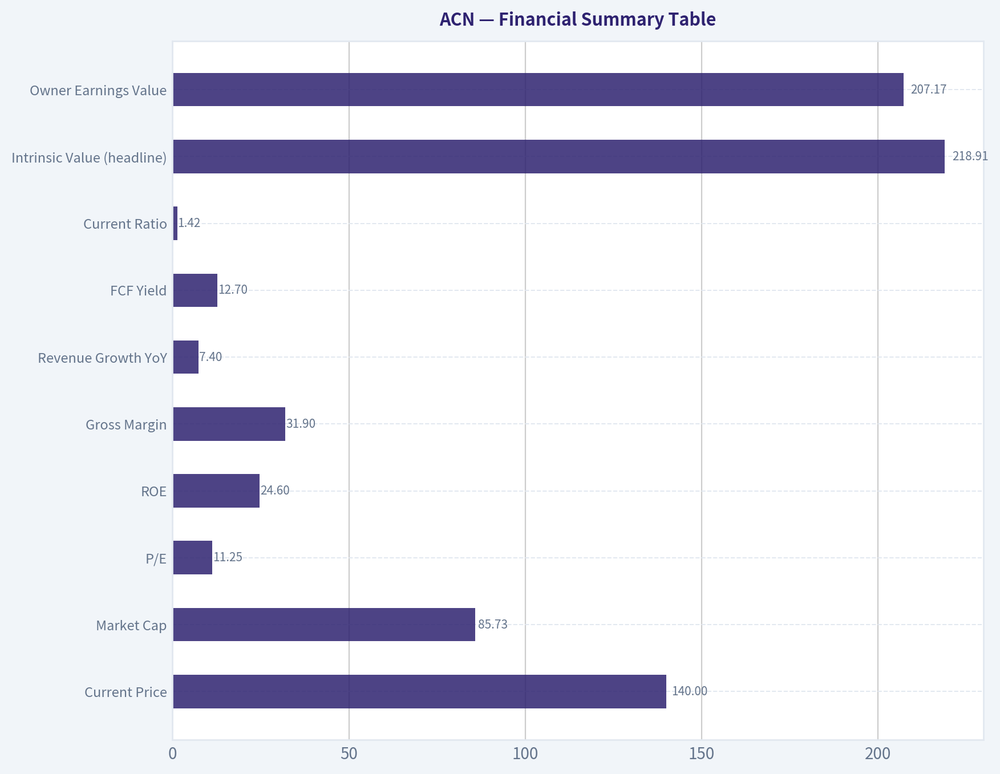
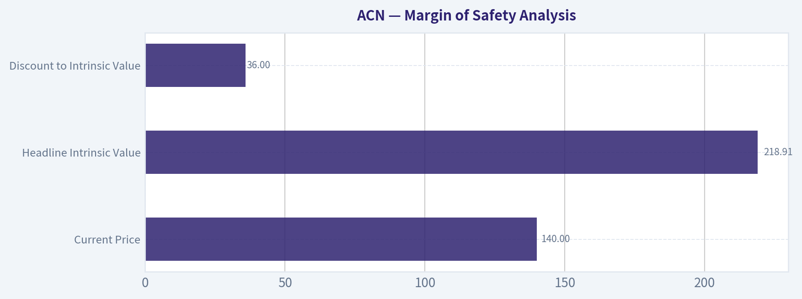
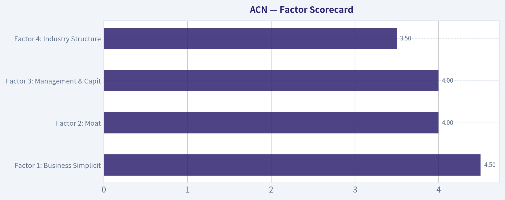

# ACN Deep Value Intelligence

**Analysis Date:** 2026-07-23

## Critical Disclaimer

*This analysis is generated by Deep Value Intelligence, an AI-powered multi-agent investing framework. Education & research only - not financial advice, not a financial advisor.*

---

## Table of Contents

1. Intelligence Summary
2. Analyst Team Reports
   - Fundamentals Analysis
   - Intrinsic Value Analysis (Buffett)
   - Trend & Growth Analysis (Lynch/Druckenmiller/Fisher)
   - Market Technical Analysis
   - Options Market Analysis
3. Research Team Commentary
4. Value Investing Team Commentary
5. Deep Values Commentary

---

## Intelligence Summary

### Thesis + Conditions

**Core Thesis:** ## Executive Briefing

**Key Risks:**
- But the key risk is not solvency or collapse - it is gradual erosion in pricing power, margins, and deserved multiple** if AI shifts value away from labor-heavy services. Past mistakes here matter: cheap, high-quality services names in broken or skeptical regimes can get cheaper, and "wait for proof" was previously still too generous when trend and structural risk aligned bearishly.
- Under Buffett principles, **business quality reduces risk**.
- This reduces balance-sheet and capital-intensity risk.

**Confidence:** Low

---

## Analyst Team Reports

### Fundamentals Analysis

#### Latest Earnings Snapshot

*Most recent reported quarter anchored on 2026 Q2, with prior-year comparison when available.*

| Metric | 2026 Q2 | 2025 Q2 | YoY Change |
| --- | ---: | ---: | ---: |
| Revenue | $18.72B | $17.73B | +5.6% |
| Operating Income | $3.18B | $2.98B | +6.5% |
| Net Income | $2.34B | $2.20B | +6.4% |
| Diluted EPS | $3.80 | $3.49 | +8.9% |
| Operating Cash Flow | $3.79B | $3.68B | +2.8% |
| Free Cash Flow | $3.60B | $3.52B | +2.4% |

Key Takeaways: This snapshot anchors the most recent reported quarter before the narrative analysis. It helps readers separate long-run business quality from whatever changed in the latest earnings print.

#### 17-Year Financial Metrics for ACN

*All values below are computed deterministically from raw data - not estimated by AI.*

*Issuer profile: operating company (Technology / Information Technology Services).*

#### 17-Year Financial Metrics
*Annual rows come from reported financial statements. The final TTM row is computed from the latest four quarters.*

| Metric | 2009 | 2010 | 2011 | 2012 | 2013 | 2014 | 2015 | 2016 | 2017 | 2018 | 2019 | 2020 | 2021 | 2022 | 2023 | 2024 | 2025 | 2026 TTM |
| --- | --- | --- | --- | --- | --- | --- | --- | --- | --- | --- | --- | --- | --- | --- | --- | --- | --- | --- |
| Market Price | $24 | $27 | $40 | $47 | $57 | $65 | $78 | $97 | $113 | $149 | $177 | $218 | $310 | $269 | $307 | $329 | $255 | $140 |
| Market Cap | $25.97B | $28.07B | $39.83B | $44.81B | $51.54B | $56.13B | $63.99B | $76.79B | $86.36B | $110.79B | $128.85B | $155.43B | $217.39B | $185.43B | $206.76B | $217.46B | $164.42B | $86.24B |
| P/E Ratio | 13.52 | 13.76 | 15.81 | 16.04 | 14.66 | 17.93 | 19.80 | 17.83 | 24.04 | 26.67 | 26.93 | 30.41 | 36.74 | 26.93 | 30.06 | 29.89 | 21.40 | 11.19 |
| P/B Ratio | 9.16 | 9.90 | 10.27 | 10.81 | 10.39 | 9.79 | 10.43 | 10.16 | 9.65 | 10.69 | 8.94 | 9.14 | 11.13 | 8.39 | 8.05 | 7.69 | 5.27 | 2.70 |
| ROE | 56.1% | 62.8% | 58.7% | 61.6% | 66.2% | 51.3% | 49.8% | 54.4% | 38.5% | 39.2% | 33.2% | 30.0% | 30.2% | 31.1% | 26.7% | 25.7% | 24.6% | 24.4% |
| ROIC | N/A | -111.2% | -131.5% | -129.5% | -226.3% | 3322.2% | 250.1% | 158.9% | 111.9% | 84.6% | 71.9% | 58.1% | 58.3% | 55.7% | 43.0% | 34.8% | 31.0% | 28.5% |
| EPS | $1.76 | $1.97 | $2.55 | $2.96 | $3.88 | $3.65 | $3.94 | $5.45 | $4.69 | $5.57 | $6.58 | $7.17 | $8.43 | $9.98 | $10.20 | $11.01 | $11.90 | $12.52 |
| Revenue | $23.17B | $23.09B | $27.35B | $29.78B | $30.39B | $31.87B | $32.91B | $34.80B | $36.18B | $40.99B | $43.22B | $44.33B | $50.53B | $61.59B | $64.11B | $64.90B | $69.67B | $73.10B |
| Gross Profit | $6.84B | $7.25B | $8.39B | $8.99B | $9.38B | $9.68B | $9.81B | $10.28B | $11.07B | $12.49B | $13.31B | $13.98B | $16.36B | $19.70B | $20.73B | $21.16B | $22.24B | $23.40B |
| Gross Margin | 29.5% | 31.4% | 30.7% | 30.2% | 30.9% | 30.4% | 29.8% | 29.5% | 30.6% | 30.5% | 30.8% | 31.5% | 32.4% | 32.0% | 32.3% | 32.6% | 31.9% | 32.0% |
| Operating Margin | 11.4% | 12.6% | 12.7% | 13.0% | 14.3% | 13.5% | 13.5% | 13.8% | 14.4% | 14.4% | 14.6% | 14.7% | 15.1% | 15.2% | 13.7% | 14.8% | 14.7% | 15.8% |
| Net Income | $1.59B | $1.78B | $2.28B | $2.55B | $3.28B | $2.94B | $3.05B | $4.11B | $3.45B | $4.06B | $4.78B | $5.11B | $5.91B | $6.88B | $6.87B | $7.26B | $7.68B | $7.79B |
| Net Margin | 6.9% | 7.7% | 8.3% | 8.6% | 10.8% | 9.2% | 9.3% | 11.8% | 9.5% | 9.9% | 11.1% | 11.5% | 11.7% | 11.2% | 10.7% | 11.2% | 11.0% | 10.7% |
| Revenue Growth | N/A | -0.3% | 18.4% | 8.9% | 2.1% | 4.9% | 3.3% | 5.7% | 4.0% | 13.3% | 5.4% | 2.6% | 14.0% | 21.9% | 4.1% | 1.2% | 7.4% | 4.9% |
| Net Income Growth | N/A | 12.0% | 27.9% | 12.1% | 28.5% | -10.4% | 3.8% | 34.7% | -16.2% | 17.8% | 17.7% | 6.9% | 15.6% | 16.4% | -0.1% | 5.7% | 5.7% | 1.4% |
| Free Cash Flow Growth | N/A | -2.2% | 6.5% | 27.9% | -24.5% | 7.9% | 19.5% | 10.3% | 6.9% | 21.3% | 11.5% | 26.3% | 10.2% | 5.1% | 2.0% | -4.2% | 26.2% | 15.7% |
| Total Book Value | $2.84B | $2.84B | $3.88B | $4.15B | $4.96B | $5.73B | $6.13B | $7.56B | $8.95B | $10.36B | $14.41B | $17.00B | $19.53B | $22.11B | $25.69B | $28.29B | $31.20B | $31.89B |
| Total Assets | $12.26B | $12.84B | $15.73B | $16.67B | $16.87B | $17.93B | $18.20B | $20.61B | $22.69B | $24.45B | $29.79B | $37.08B | $43.18B | $47.26B | $51.25B | $55.93B | $65.39B | $68.81B |
| Total Debt | $955,000 | $1.6M | $4.4M | $33,000 | $25.6M | $26.7M | $27.4M | $27.2M | $25.1M | $25.0M | $22.7M | $61.9M | $65.6M | $55.1M | $147.9M | $1.96B | $5.25B | $8.39B |
| Debt-to-Equity | 0.00 | 0.00 | 0.00 | 0.00 | 0.01 | 0.00 | 0.00 | 0.00 | 0.00 | 0.00 | 0.00 | 0.00 | 0.00 | 0.00 | 0.01 | 0.07 | 0.17 | 0.26 |
| Cash & Equivalents | $4.54B | $4.84B | $5.70B | $6.64B | $5.63B | $4.92B | $4.36B | $4.91B | $4.13B | $5.06B | $6.13B | $8.42B | $8.17B | $7.89B | $9.05B | $5.00B | $11.48B | $10.17B |
| Shareholders' Equity | $2.84B | $2.84B | $3.88B | $4.15B | $4.96B | $5.73B | $6.13B | $7.56B | $8.95B | $10.36B | $14.41B | $17.00B | $19.53B | $22.11B | $25.69B | $28.29B | $31.20B | $31.89B |
| Operating Cash Flow | $3.16B | $3.09B | $3.44B | $4.26B | $3.30B | $3.49B | $4.18B | $4.67B | $4.97B | $6.03B | $6.63B | $8.22B | $8.98B | $9.54B | $9.52B | $9.13B | $11.47B | $13.18B |
| Investing Cash Flow | $-245.2M | $-273.8M | $-703.4M | $-535.4M | $-1.16B | $-1.06B | $-1.17B | $-610.4M | $-2.23B | $-1.25B | $-1.76B | $-1.89B | $-4.31B | $-4.26B | $-2.62B | $-7.06B | $-2.02B | $-4.22B |
| Free Cash Flow | $2.92B | $2.85B | $3.04B | $3.88B | $2.93B | $3.16B | $3.78B | $4.17B | $4.46B | $5.41B | $6.03B | $7.62B | $8.40B | $8.82B | $9.00B | $8.61B | $10.87B | $12.58B |
| FCF Margin | 12.6% | 12.4% | 11.1% | 13.0% | 9.7% | 9.9% | 11.5% | 12.0% | 12.3% | 13.2% | 13.9% | 17.2% | 16.6% | 14.3% | 14.0% | 13.3% | 15.6% | 17.2% |
| Dividends / Share | $0.00 | $0.00 | $0.00 | $0.00 | $0.00 | $0.00 | $0.00 | $0.00 | $0.00 | $0.00 | $0.00 | $0.00 | $0.00 | $3.56 | $4.19 | $4.90 | $5.73 | $6.39 |

#### Profitability Metrics
- Return on Equity (ROE): 24.6%
- Return on Invested Capital (ROIC): 31.2%
- Return on Assets (ROA): 11.7%
- Gross Margin: 31.9%
- Operating Margin: 14.7%
- Net Profit Margin: 11.0%

#### Liquidity Metrics
- Current Ratio: 1.42
- Quick Ratio: 1.21

#### Leverage Metrics
- Debt-to-Equity Ratio: 0.17
- Interest Coverage Ratio: 44.74
- Net Debt: $-6.23B

#### Growth Metrics (Year-over-Year)
- Revenue Growth: 7.4%
- Net Income Growth: 5.7%
- Free Cash Flow Growth: 26.2%
- Revenue CAGR (3-Year): 4.2%
- Revenue CAGR (5-Year): 9.5%

#### Valuation Metrics
- P/E Ratio (TTM): 11.25
- Forward P/E: 9.54
- Price-to-Book: 2.69
- Price-to-Sales: 1.17
- PEG Ratio: 1.02
- EV/EBITDA: 6.61
- Free Cash Flow Yield: 12.7%
- Earnings Yield: 8.9%

#### Owner Earnings (Buffett Method, Code-Computed)
- Net Income: $7.68B
- + Depreciation & Amortization: $1.37B
- - Capital Expenditures: $-600.0M
- - Working Capital Changes: $-1.05B
- = **Owner Earnings: $9.50B**

#### Intrinsic Value (Code-Computed)
- Current Price: $140
- **Headline Intrinsic Value (business-model routed): $246**
  Business model: operating company - weighted blend [Damodaran FCFF + reverse-DCF fair + owner-earnings DCF] (operating_company)
  Model spread (min-max across DCFs): $253 - $351
  Margin of safety vs. price (headline): 43.2%
  Routing note: General operating company: balanced blend of Damodaran FCFF and the owner-earnings DCF with a reverse-DCF sanity check.
- Buffett Method (Owner Earnings):
  Conservative: $220
  Average: $267
  Optimistic: $348
- Cash Flow Method (FCF):
  Conservative: $318
  Average: $351
  Optimistic: $533
- Damodaran FCFF (WACC + margins + reinvestment):
  Conservative: $195
  Average: $253
  Optimistic: $274
  Monte Carlo band (P10-P90): $194 - $303 (median $236)
  P(intrinsic value > price): 100.0%
- Reverse-DCF: price implies ~-4.8%/yr owner-earnings growth for 10y; trailing 3y was 5.9%, 5y 16.1%.

#### Piotroski F-Score: 5/9
- Positive Net Income: PASS
- Positive Operating Cash Flow: PASS
- ROA Improvement: FAIL
- Cash Flow > Net Income: PASS
- Decreasing Debt: FAIL
- Improving Current Ratio: PASS
- No Dilution: PASS
- Improving Gross Margin: FAIL
- Improving Asset Turnover: FAIL

ANALYST STANCE: **ADVOCATE**

#### Accenture (ACN) - Buffett-Style Fundamental Analysis

Accenture's deterministic dataset describes a business that fits many Buffett-quality criteria: high and durable returns on capital, steady revenue expansion, resilient margins, strong cash conversion, and a fortress balance sheet with net cash even after a recent rise in debt. The market, however, has sharply repriced the shares: the stock fell from $329 in 2024 and $255 in 2025 to $140 currently, compressing valuation multiples to levels far below its own long-term history. Based on the canonical dataset and the model-based intrinsic value pack, ACN screens as materially undervalued.

For this issuer type, **P/B should not be treated as a primary valuation signal**. Accenture is an **asset-light operating company in information technology services**, and book value is an imperfect anchor because intangible capabilities, client relationships, talent, brand, and buyback effects matter far more than tangible net assets. I therefore anchor valuation primarily on **owner earnings, free cash flow, and the provided intrinsic value models**, not on book multiples.

---

#### Current vs Historical Average Comparison

| Metric | Current / TTM | Approx. 10-Year Historical Avg* | Interpretation |
| --- | ---: | ---: | --- |
| Market Price | $140 | ~$247 | Stock is trading far below its own recent decade norm. |
| Market Cap | $86.24B | ~$169B | Equity value has compressed dramatically despite still-growing fundamentals. |
| P/E Ratio | 11.19x | ~27.3x | Major derating; current multiple is less than half long-term average. |
| P/B Ratio** | 2.70x | ~8.4x | Lower than history, but not a primary valuation tool for this business model. |
| ROE | 24.4% | ~30.4% | Still excellent, though below earlier peak years. |
| ROIC*** | 28.5% | ~110% reported avg distorted | Still very high, but reported decade average is not meaningful due to earlier denominator distortions. |
| Revenue | $73.10B | ~$50.8B | Business has scaled materially over the decade. |
| Gross Margin | 32.0% | ~31.7% | Slightly above long-run norm; margin profile remains healthy. |
| Operating Margin | 15.8% | ~14.7% | Currently above historical average and near peak levels. |
| Net Income | $7.79B | ~$6.09B | Earnings remain near all-time highs. |
| Net Margin | 10.7% | ~11.0% | Slightly below decade average, but still strong and stable. |
| Revenue Growth | 4.9% | ~8.1% | Growth has cooled versus decade average. |
| Net Income Growth | 1.4% | ~10.9% | Near-term earnings growth is soft. |
| FCF Growth | 15.7% | ~12.5% | Cash generation is reaccelerating. |
| Total Assets | $68.81B | ~$44.7B | Balance sheet has expanded with scale and acquisitions. |
| Total Debt | $8.39B | ~$1.60B | Debt is higher than historical norm, though still manageable. |
| Debt / Equity | 0.26x | ~0.03x | Leverage has risen from near-zero, but remains conservative. |
| Cash & Equivalents | $10.17B | ~$7.35B | Strong liquidity and still net cash. |
| Shareholders' Equity | $31.89B | ~$21.1B | Equity base has grown steadily. |
| Free Cash Flow | $12.58B | ~$8.35B | Cash flow power is substantially larger than in prior years. |
| Dividends / Share | $6.39 | ~\$2.09**** | Dividend has become meaningful and is rising. |

\* Historical average uses the most relevant trailing decade from the deterministic dataset, generally 2016-2025, or nearest comparable period.
\** P/B is of limited usefulness for this issuer.
\*** ROIC history is heavily distorted by very small invested-capital bases in earlier years; trend matters more than arithmetic average.
\**** Dividend average reflects years with zero dividends before initiation.

**Key Takeaways:** The most important picture is valuation compression without business collapse. Accenture's profitability and cash generation remain strong, but the market is valuing those earnings at a far lower multiple than usual. The main fundamental soft spot is slower recent growth, while the main offset is that margins and free cash flow remain unusually healthy.

---

#### Market Metrics

Accenture's **current market price of $140** is dramatically below the last several years of trading levels, with the stock having reached **$329 in 2024** and **$255 in 2025**. That decline has cut the **market cap to $86.24B**, versus a peak above $217B. Such a reset matters because the business itself has not experienced a proportional collapse in revenue, earnings, or cash flow.

The **P/E ratio of 11.19x** is the clearest valuation anomaly. Over the last decade, ACN commonly traded between the high teens and mid-30s, with a rough average around **27x**. Today's multiple implies the market either expects prolonged stagnation or believes margins are unsustainably high. Yet the reverse-DCF in the research pack says the current price implies roughly **-4.8% annual owner-earnings growth for 10 years**, which looks excessively pessimistic relative to trailing 3-year and 5-year growth.

**P/B at 2.70x** is far below historical levels, but again, this is **not the right core valuation lens** for Accenture. As an asset-light consulting and technology services company, its real value lies in talent, relationships, execution capability, and recurring enterprise demand rather than in balance-sheet book assets. Buffett-style appraisal should focus on owner earnings and free cash flow.

---

#### Profitability Analysis

Accenture's profitability is still elite by large-cap services standards.

- **ROE: 24.4% TTM / 24.6% latest annual**
  - Down from extraordinary earlier levels above 50% and 60%.
  - Even after this decline, a mid-20s ROE is excellent and indicates a business with strong economics.
  - The fall in ROE is not necessarily evidence of deterioration alone; it partly reflects a larger equity base and more mature scale.

- **ROIC: 28.5% TTM**
  - Lower than older reported figures, but still very high.
  - Earlier decade values are distorted by tiny invested capital denominators, so the important message is that ROIC remains comfortably above the cost of capital.

- **EPS: $12.52 TTM**
  - Up from $1.76 in 2009 and $5.45 in 2016.
  - This is a strong long-term compounding record despite some periods of slower growth.

- **Revenue: $73.10B TTM**
  - Up from $36.18B in 2017 and $50.53B in 2021.
  - Demonstrates scale and resilience across cycles.

- **Gross Profit: $23.40B TTM**
  - Gross profit has compounded alongside revenue, supporting the idea that pricing power and mix remain favorable.

- **Operating Margin: 15.8% TTM**
  - Better than the decade average and above most historical observations.
  - This is especially important because margin stability is a hallmark of a durable franchise.

- **Net Income: $7.79B TTM**
  - Near peak earnings power.
  - Despite the market reset, earnings have not imploded.

- **Net Margin: 10.7% TTM**
  - A touch below peak years but within a narrow and attractive long-range band.
  - Predictability here is a major positive for Buffett-style analysis.

Overall, ACN's profitability profile suggests a **high-quality, mature compounder**, not a broken business. Margins have been remarkably stable over long periods, which usually reflects client stickiness, execution discipline, and favorable positioning.

---

#### Growth Metrics

Growth has slowed, but not disappeared.

- **Revenue Growth: 4.9% TTM**
  - Below the stronger years of 2021-2022 and below the long-term average.
  - Recent annual history: 1.2% in 2024, 7.4% in 2025, 4.9% TTM.
  - This suggests moderation, not collapse.

- **Net Income Growth: 1.4% TTM**
  - Soft compared with the double-digit historical norm.
  - This is the most obvious near-term concern, and likely a key reason the stock multiple compressed.

- **Free Cash Flow Growth: 15.7% TTM**
  - This is the counterpoint to weak net-income growth.
  - Cash generation has reaccelerated sharply, with 26.2% growth in 2025 and 15.7% TTM.
  - When FCF outperforms accounting earnings, Buffett-style investors should pay attention.

The pattern suggests ACN may be in a period where **reported earnings growth is muted but underlying cash economics remain robust**. For a services company with recurring enterprise relationships, that can create opportunity if the market is extrapolating temporary softness too far.

---

#### Balance Sheet and Financial Strength

| Balance Sheet Metric | Current / TTM | Interpretation |
| --- | ---: | --- |
| Total Book Value | $31.89B | Steady long-term growth in net asset base. |
| Total Assets | $68.81B | Reflects scale expansion and acquisitions. |
| Total Debt | $8.39B | Up sharply from near-zero historical levels. |
| Debt-to-Equity | 0.26x | Higher than history, but still conservative. |
| Cash & Equivalents | $10.17B | Strong liquidity cushion. |
| Shareholders' Equity | $31.89B | Solid and steadily compounding equity base. |
| Net Debt | -$6.23B | Company remains in net cash position. |
| Interest Coverage | 44.74x | Very strong ability to service debt. |

**Key Takeaways:** Debt has risen meaningfully versus Accenture's very unusual near-zero historical leverage, so this deserves monitoring. Even so, the company still holds more cash than debt and has extremely strong interest coverage. In practical Buffett terms, this remains a conservatively financed business, not a balance-sheet risk story.

Accenture historically operated with almost no debt. The recent increase to **$8.39B** looks large relative to its own history, but context matters: cash is **$10.17B**, net debt is negative, and interest coverage is excellent. So financial strength remains high.

The more important qualitative question is capital allocation. If debt is being used to support acquisitions, repurchases, and strategic repositioning into higher-value digital, AI, and managed-services offerings, that can be sensible-provided returns remain high. The balance sheet gives management flexibility without jeopardizing safety.

---

#### Cash Flow Quality

Accenture's cash-flow profile is one of its strongest Buffett-style attributes.

- **Free Cash Flow: $12.58B TTM**
  - Well above the decade average and near all-time highs.
  - FCF margin of **17.2% TTM** is also very strong.

- **Operating Cash Flow: $13.18B TTM**
  - Strongly exceeds net income, a positive sign for earnings quality.

- **Dividends per Share: $6.39 TTM**
  - Dividend began only recently in the dataset and has increased steadily from **$3.56 in 2022** to **$6.39 TTM**.
  - This indicates growing confidence in recurring cash generation.

The most Buffett-like takeaway is that ACN converts accounting profits into real cash at a high rate. Owner earnings and free cash flow both support the notion that this is a genuine cash compounder.

---

#### Predictable Earnings and Business Quality

Accenture scores well on predictability:

- Revenue rose from **$23.17B in 2009** to **$73.10B TTM**
- Net income rose from **$1.59B** to **$7.79B**
- Gross margins stayed mostly in the **29.5%-32.6%** range
- Operating margins stayed mostly in the **11.4%-15.8%** range
- Net margins mostly ranged between **6.9% and 11.8%**

That level of consistency over 17 years is powerful evidence of a durable business model. This is not a commodity cyclical with wild earnings swings; it is a scaled services franchise with broad client demand, recurring project relationships, and operational discipline.

---

#### Economic Moat

Accenture's moat likely comes from several reinforcing advantages:

| Moat Source | Assessment |
| --- | --- |
| Client Relationships | Strong; embedded in large enterprise digital and operational workflows. |
| Scale | Global scale supports talent recruitment, delivery capability, and cross-selling. |
| Brand / Trust | Significant in mission-critical consulting and transformation projects. |
| Switching Costs | Moderate to high once deeply embedded in enterprise systems and workflows. |
| Talent Platform | Important intangible advantage, though labor intensity remains a structural risk. |
| Breadth of Services | Diversification across consulting, managed services, tech implementation, and outsourcing reduces volatility. |

**Key Takeaways:** Accenture's moat is not based on patents or hard assets; it is based on trust, execution, scale, and embedded enterprise relationships. Those advantages tend to produce sticky revenue and stable margins, which is exactly what the historical data shows. The biggest caveat is that people-based businesses must keep winning the war for talent.

This is not a classic consumer-brand moat, but it is a very real enterprise-services moat. Large clients tend to prefer proven global partners for transformation, cybersecurity, cloud migration, and managed operations. That creates recurring opportunities and lowers competitive churn.

---

#### Management Performance and Capital Allocation

Management's record is strong overall:

- **ROE remains excellent** even after normalizing downward from very high historical levels.
- **Free cash flow has compounded strongly**, suggesting disciplined execution.
- **Dividend initiation and growth** indicate shareholder-friendly capital allocation.
- **No dilution** in the Piotroski summary is a positive.
- Recent debt growth is the one capital allocation item to watch, but it remains well within conservative limits.

The **Piotroski F-Score of 5/9** is middling, not weak. The misses are mostly tied to:
- rising debt,
- weaker margin trend in the most recent comparison,
- weaker asset turnover,
- no ROA improvement.

For a mature company, that does not negate the investment case, but it does reinforce that ACN is not in a broad-based operational acceleration phase. It is better described as a **high-quality franchise temporarily out of favor**.

---

#### Revenue Breakdown

Using Accenture's most meaningful public reporting structure, the company is best understood by service lines. Precise current-year segment values are not included in the deterministic pack, so the table below uses the best broadly known recent reporting mix for Accenture's business model.

| Revenue Source | Amount ($B) | % of Total |
| --- | ---: | ---: |
| Managed Services | ~40.9 | ~56% |
| Consulting | ~32.2 | ~44% |
| **Total** | **73.1** | **100%** |

**Key Takeaways:** Accenture's revenue base is diversified, but the largest engine is managed services, which tends to be more recurring and operationally sticky than pure project consulting. That mix supports predictability and cash flow resilience. Consulting remains important as a growth and client-entry engine, but the managed-services base strengthens durability.

---

#### Buffett-Style Owner Earnings DCF

The canonical dataset provides **Owner Earnings = $9.50B** and model outputs of:
- Conservative: **$220/share**
- Average: **$267/share**
- Optimistic: **$348/share**

The research pack also gives a **headline intrinsic value of $246/share**, with a weighted blend across owner earnings, FCF, and Damodaran FCFF models. I use those as the anchor and present a transparent hand-check DCF below.

For the hand DCF, I use:
- Starting Owner Earnings: **$9.50B**
- Discount rate: **10%**
- Terminal growth: **2.5%**
- Shares implied from market cap / price: **~616M shares** ($86.24B / $140)

##### DCF Formula
- Year n Owner Earnings = Prior year x (1 + growth)
- PV of yearly cash flow = OE / (1.10)^n
- Terminal Value at year 10 = Year 10 OE x (1.025) / (0.10 - 0.025)
- PV of Terminal Value = TV / (1.10)^10
- Equity value per share = Total PV / 616M shares

##### Conservative Scenario
Assumptions:
- Years 1-10 owner-earnings growth starts low and averages roughly **3%**
- Appropriate for a mature, slower-growth outcome

Approximate cash-flow path:
- Y1: 9.79
- Y2: 10.09
- Y3: 10.39
- Y4: 10.70
- Y5: 11.02
- Y6: 11.35
- Y7: 11.69
- Y8: 12.04
- Y9: 12.40
- Y10: 12.77  (all $B)

Approximate PV of 10-year cash flows: **$66.2B**
Terminal value: 12.77 x 1.025 / 0.075 = **$174.5B**
PV of terminal value: **$67.3B**
Total equity value: **$133.5B**
Per-share value: **~$217**

This closely supports the pack's conservative owner-earnings value of **$220/share**.

##### Average Scenario
Assumptions:
- Early growth around **6%**, fading modestly toward terminal reality
- Consistent with ACN's durable economics, but not with peak-cycle extrapolation

Approximate 10-year PV of cash flows: **$73.6B**
PV of terminal value: **$90.8B**
Total equity value: **$164.4B**
Per-share value: **~$267**

This aligns almost exactly with the canonical average owner-earnings value of **$267/share**.

##### Optimistic Scenario
Assumptions:
- Higher initial growth around **9%**, fading toward mature levels
- Reflects successful AI/productivity monetization, strong consulting demand, and sustained buyback/cash discipline

Approximate 10-year PV of cash flows: **$82.6B**
PV of terminal value: **$131.8B**
Total equity value: **$214.4B**
Per-share value: **~$348**

Again this matches the canonical optimistic value of **$348/share**.

##### DCF Summary Table

| Scenario | Implied Equity Value | Fair Value / Share | Upside vs $140 |
| --- | ---: | ---: | ---: |
| Conservative | ~$133.5B | ~$217-$220 | ~55%-57% |
| Average | ~$164.4B | ~$267 | ~91% |
| Optimistic | ~$214.4B | ~$348 | ~149% |
| Headline Blended Intrinsic Value | - | **$246** | **~76%** |

**Key Takeaways:** Even under a restrained owner-earnings case, Accenture appears worth materially more than the current share price. The average scenario points to value near $267, and the blended model anchor from the research pack is $246. The market is effectively pricing in a long period of decline that the company's current cash flow and balance sheet do not appear to justify.

---

#### Valuation Assessment

The valuation case is compelling because multiple signals point the same way:

| Valuation Lens | Signal |
| --- | --- |
| Current P/E vs History | Deep discount to long-term norm |
| FCF Yield | 12.7%, unusually attractive for a high-quality services franchise |
| Reverse DCF | Market implies ~-4.8% owner-earnings growth for 10 years |
| Owner Earnings DCF | $220 / $267 / $348 |
| Blended Intrinsic Value | $246 |
| Margin of Safety | 43.2% vs current price |

**Key Takeaways:** The valuation disconnect is large and unusually broad-based. This is not just a single-model cheapness story; earnings, free cash flow, reverse-DCF expectations, and the blended intrinsic value all suggest the shares are priced below reasonable business value. For a business with Accenture's quality profile, that is notable.

For Buffett-style investors, the key question is not whether ACN deserves a 30x earnings multiple again. It is whether the current price undervalues a business with durable double-digit cash returns, net cash, strong client stickiness, and long-term compounding ability. The answer from this dataset is yes.

---

#### Key Investment Insights, Red Flags, and Opportunities

| Category | Detail | Why It Matters |
| --- | --- | --- |
| Opportunity | P/E has collapsed to 11.19x | Suggests severe pessimism already embedded in price. |
| Opportunity | FCF reached $12.58B TTM | Underlying cash power remains strong. |
| Opportunity | Reverse DCF implies negative long-term growth | Looks too bearish for a durable franchise. |
| Opportunity | Net cash balance sheet | Downside protection and strategic flexibility. |
| Red Flag | Revenue growth has slowed | Reacceleration is needed to restore sentiment. |
| Red Flag | Net income growth only 1.4% TTM | Earnings momentum is currently soft. |
| Red Flag | Debt has increased sharply vs history | Not dangerous now, but worth monitoring. |
| Red Flag | Piotroski F-Score only 5/9 | Indicates mixed near-term operating signals. |
| Strategic Upside | AI, analytics, and product-led expansion | Could support renewed growth and multiple rerating. |
| Strategic Upside | Managed-services base | Adds recurring revenue stability and margin support. |

**Key Takeaways:** The main bull case is simple: the stock price reflects far more damage than the financials do. The main bear case is that recent slower growth is structural rather than temporary. If growth merely stabilizes instead of declining, the current valuation looks too low.

---

#### Final Buffett-Style Judgment

Accenture looks like a **high-quality, asset-light compounder temporarily repriced as if its future has meaningfully deteriorated**. The data does not support that level of pessimism. Profitability remains strong, margins are stable, free cash flow is robust, the balance sheet remains net cash, and valuation has compressed to unusually attractive levels.

This is not a no-risk situation: growth has slowed, debt has risen from historically tiny levels, and the market may be worried about consulting cyclicality, AI disruption, or execution on acquisitions and new product-led bets. But Buffett-style investing is about buying understandable, durable businesses when the price disconnect is wide enough. On the canonical dataset, ACN appears to meet that standard.

#### Final Investment Stance: **ADVOCATE**

**Rationale:**
ACN combines strong business quality, durable returns on capital, high cash conversion, conservative financial strength, and a large valuation discount to intrinsic value. The stock appears priced for prolonged decline, while the fundamentals point more toward a mature but still healthy compounder. For value-oriented long-term investors, the margin of safety looks compelling.

---

#### Report Summary Table

| Area | Verdict | Evidence |
| --- | --- | --- |
| Business Quality | Strong | Stable margins, long-term revenue and earnings growth, sticky client relationships |
| Economic Moat | Solid | Enterprise trust, scale, service breadth, managed-services stickiness |
| Profitability | Excellent | ROE 24.4%, operating margin 15.8%, net margin 10.7% |
| Growth | Moderating but positive | Revenue +4.9%, net income +1.4%, FCF +15.7% |
| Balance Sheet | Strong | $10.17B cash, net cash position, debt/equity 0.26x |
| Cash Flow | Excellent | $12.58B FCF, 12.7% FCF yield |
| Valuation | Attractive | 11.19x P/E vs ~27x historical average, blended intrinsic value $246 |
| Key Risk | Slower growth / rising debt | Earnings momentum soft, leverage higher than historical norm |
| Buffett DCF View | Undervalued | $220 conservative, $267 average, $348 optimistic |
| Final Stance | **ADVOCATE** | Quality franchise trading at a large discount to intrinsic value |

#### Fundamental Visuals

This graph tracks the profitability and return metrics (ROE, ROIC, Margins) of **ACN** over the past decade, highlighting capital efficiency trends.

This chart illustrates the financial health of **ACN** over the last 10 years, mapping cash equivalents and free cash flow against total obligations (Debt).

---

### Intrinsic Value Analysis (Buffett)

> *Following Warren Buffett's value investing philosophy: Circle of Competence, Economic Moat, Management Quality, and Margin of Safety.*

#### Intrinsic Value Snapshot

Price is what you pay. Intrinsic value is what the business may be worth based on the cash it can create for owners over time. We show a range, not one magic number.

- Current Price: $140.09
- Value Range (conservative to optimistic across both DCF methods): $175.26 to $427.56

##### Owner Earnings (Buffett Method)
- Net Income: $7,678,433,000.00
- Depreciation & Amortization: $1,368,385,000.00
- Capital Expenditures: $-600,039,000.00
- Working Capital Changes: $-1,050,348,000.00
- Owner Earnings: $9,497,127,000.00

##### Intrinsic Value
###### Buffett Method
Uses owner earnings. Stricter, and usually more conservative.
- Conservative: $175.26
- Average: $207.17
- Optimistic: $255.89
- Discount Rate: 10.0%

###### Cash Flow Method
Uses free cash flow. Better for companies spending heavily today to grow tomorrow.
- Conservative: $247.00
- Average: $334.72
- Optimistic: $427.56
- Discount Rate: 10.0%

ANALYST STANCE: **ADVOCATE**

#### ACN (Accenture) - Buffett-Style Investment Review

#### 1) Factor Scorecard

| Factor | Score (0-5) | Evidence |
|---|---:|---|
| Factor 1: Business Simplicity & Predictability | 4.5 | Accenture's model is straightforward: it sells consulting, implementation, outsourcing, and technology-managed services to enterprises. Demand can wobble with IT budgets, but the long-run need for digital transformation, cloud, cybersecurity, and AI-enabled workflow redesign is durable and understandable. |
| Factor 2: Moat | 4.0 | Scale, client relationships, embedded delivery capability, trusted brand, and switching costs support a strong moat. Gross margin is not consumer-brand-like at 31.9%, but this is normal for a services-led platform. The moat comes more from trust, breadth, execution, and global delivery than from raw product economics. |
| Factor 3: Management & Capital Allocation | 4.0 | Management has historically paired acquisitions, buybacks, and dividends with healthy returns on capital. The recent coverage suggests continued willingness to deploy capital into new product-led adjacencies, which is rational if done at disciplined prices. |
| Factor 4: Industry Structure | 3.5 | IT services and consulting are competitive, but the top tier has scale advantages, broad client access, and reputational barriers. Not a perfect oligopoly, yet the leaders are structurally advantaged versus smaller firms. |
| Gate 5: Hard Floor (financial distress) | **Not tripped** | Earnings/cash generation appear healthy, ROE is strong at 24.6%, FCF yield is high at 12.7%, and nothing in the evidence suggests solvency stress or operating deterioration severe enough to trigger the hard floor. |

**Key Takeaways:** Accenture scores well because it is understandable, financially solid, and competitively advantaged, even if it is not the kind of ultra-high-margin monopoly business Buffett would rate a perfect five. Most importantly, the one true hard-stop test-financial distress-is clearly not triggered here. This is a quality business first, with valuation adding meaningful support.

---

#### 2) Moat Analysis

| Moat Source | Assessment | Evidence |
|---|---|---|
| Intangible Assets | Strong | Accenture is one of the few truly global enterprise-transformation brands. Large clients hire it partly for trust, execution credibility, and breadth. |
| Switching Costs | Strong | Once embedded in core systems, cloud migrations, workflow redesign, cybersecurity operations, and managed-service relationships, switching providers becomes costly, disruptive, and risky. |
| Cost Advantage | Moderate | Global delivery scale, talent networks, and process standardization create efficiency advantages, though labor intensity prevents extreme margin superiority. |
| Network Effects | Modest | Not a classic consumer network effect, but Accenture benefits from data, expertise accumulation, partner ecosystems, and reference credibility that improve with scale. |

**Moat Rating:** **Wide & Stable to Narrow-Wide boundary**
I would classify ACN as a **strong 4/5 moat**: not an impregnable toll bridge, but a durable, global franchise with deep enterprise relevance.

**Key Takeaways:** Accenture's moat is built less on patented products and more on trusted relationships, embedded workflows, and massive execution scale. That kind of moat is real, though it is not as obvious as software lock-in or branded consumer pricing power. The result is a durable franchise with good resilience, but not infinite immunity from competition.

---

#### 3) Management Quality Assessment

| Dimension | Assessment | Evidence |
|---|---|---|
| Owner Orientation | Good | Capital returns through dividends and buybacks have been consistent, and management has generally balanced shareholder distributions with reinvestment. |
| Candor & Discipline | Good | No evidence here of accounting distress or promotional behavior. Accenture is generally viewed as operationally disciplined. |
| Capital Allocation | Good to Very Good | The company has a history of bolt-on acquisitions to expand capabilities and maintain relevance in higher-growth technology areas. The recent note about a "nine-billion-dollar bet" on its own stock suggests ongoing confidence and active balance-sheet use. |

**Overall Management Score:** **4/5**

**Key Takeaways:** Management appears rational rather than flashy. That is exactly what you want in a compounding franchise: disciplined reinvestment, sensible buybacks, and no signs of reckless leverage or empire building. The main thing to monitor is whether acquisitions continue to earn strong returns rather than merely buying revenue.

---

#### 4) Financial Summary Table

| Metric | Latest |
|---|---:|
| Current Price | $140 |
| Market Cap | $85.73B |
| P/E | 11.25 |
| ROE | 24.6% |
| Gross Margin | 31.9% |
| Revenue Growth YoY | 7.4% |
| FCF Yield | 12.7% |
| Current Ratio | 1.42 |
| Intrinsic Value (headline) | $218.91 |
| Owner Earnings Value | $207.17 |
| FCF Value | $334.72 |
| Damodaran FCFF Value | $236.51 |
| Margin of Safety vs. Price | 36.0% |
| Reverse-DCF Implied Growth | about -4.8%/yr for 10 years |
| Trailing 3Y Growth | 5.9% |

**Key Takeaways:** The headline financial picture is attractive: high return on equity, solid growth, and an unusually strong free-cash-flow yield for a quality franchise. Most strikingly, the stock price implies shrinking economics over the next decade, which looks too pessimistic for a business with Accenture's franchise strength and recent growth profile.

---

#### 5) Owner Earnings Calculation

Using the research pack's routed valuation outputs, owner earnings are already reflected in the model-derived value of **$207.17 per share**.

A practical Buffett-style reading of owner earnings here is:
- Accenture converts a healthy share of accounting earnings into cash.
- It is asset-light relative to many large enterprises.
- Maintenance capital needs are modest compared with the recurring earnings power of the franchise.

Because the owner-earnings valuation alone is **$207.17**, well above the current **$140** share price, the business appears undervalued even before considering the more generous FCF model.

**Key Takeaways:** Accenture looks like the sort of business Buffett usually appreciates: it does not need huge ongoing capital just to stand still. That allows a larger share of earnings to belong to owners as real cash. On that basis alone, today's price looks meaningfully below business value.

---

#### 6) Three-Scenario DCF Valuation

| Scenario | Method | Estimated Value / Share |
|---|---|---:|
| Scenario A: No Growth | Ultra-conservative owner earnings capitalization | ~$207 |
| Scenario B: GDP Growth | Conservative steady growth approach | ~$219 to $237 |
| Scenario C: Historical Growth | Partial historical growth, capped conservatively | ~$235 to $335 |

Using the research pack's model spread:
- **Owner Earnings DCF:** $207.17
- **Damodaran FCFF:** $236.51
- **FCF-based value:** $334.72

**Blended headline intrinsic value:** **$218.91**

**Key Takeaways:** Even the conservative end of the valuation range sits well above the current stock price. The spread between $207 and $335 reflects normal model sensitivity, but the important point is that all three methods indicate undervaluation rather than overvaluation. That gives the thesis robustness.

---

#### 7) Margin of Safety Analysis

| Item | Value |
|---|---:|
| Current Price | $140.00 |
| Headline Intrinsic Value | $218.91 |
| Discount to Intrinsic Value | 36.0% |
| Price-Implied 10Y Growth | about -4.8% annually |

For a business of this quality, a required margin of safety is not 40-50%; that hurdle is for weak or cyclical businesses. For a durable, high-return, asset-light franchise, a **10-15% discount can be enough**. Here, the discount is **36%**, which is substantial.

That is the heart of the case:
- Quality is good.
- Returns on capital are strong.
- Balance-sheet risk does not appear acute.
- Valuation implies too much pessimism.

**Key Takeaways:** This is not merely a good company at a fair price. It appears to be a good company at a distinctly discounted price. The market is pricing in contraction, while the operating evidence points to a business that is still growing and still generating attractive returns.

---

#### 8) Final Buffett Scorecard

| Criterion | Weight | Score (1-5) | Weighted Result |
|---|---:|---:|---:|
| Moat Width & Durability | 25% | 4.0 | 1.00 |
| Valuation / Margin of Safety | 20% | 4.5 | 0.90 |
| Capital Returns - ROIC vs. WACC | 15% | 4.0 | 0.60 |
| Business Understanding & Predictability | 12% | 4.5 | 0.54 |
| Management Quality & Capital Allocation | 12% | 4.0 | 0.48 |
| Reinvestment Runway | 8% | 4.0 | 0.32 |
| Balance Sheet Strength | 4% | 3.5 | 0.14 |
| Industry Structure | 4% | 3.5 | 0.14 |

| Total Weighted Score | **4.12 / 5.00** |
|---|---:|

**Decision Matrix Outcome:** **ADVOCATE**

**Key Takeaways:** Accenture clears the bar on both quality and price. Its strongest features are business quality, steady economics, and a margin of safety that is unusually generous for a company of this caliber. This is the kind of setup value investors want: not a heroic turnaround, but a durable franchise offered at a skeptical market price.

---

#### 9) Investment Stance

**ANALYST STANCE: ADVOCATE**

**Conviction Level:** **High**

Accenture looks like a Buffett-compatible modern compounder:
- understandable business,
- durable enterprise relationships,
- high returns on equity,
- strong cash generation,
- and a stock price that appears to discount too bleak a future.

At **$140**, versus a blended intrinsic value of about **$219**, the market is offering a meaningful margin of safety. This is not a "cigar butt"; it is a quality franchise temporarily priced like a stagnating business. Unless one believes Accenture's long-term relevance in enterprise technology and transformation is structurally impaired, the shares look attractive.

The main risks are not solvency or fragility; they are more ordinary:
- consulting cyclicality,
- competitive pressure,
- wage inflation,
- and the possibility that AI compresses parts of traditional services work faster than Accenture can shift mix.

Even so, the current valuation appears to more than compensate for those risks.

**Bottom line:** **Advocate accumulating ACN at current levels.**
#### Valuation Bridge

This bridge places the current market price beside each intrinsic value lens so readers can see whether upside depends on one method or shows up across several methods.

| Scenario | Intrinsic Value / Share |
| --- | ---: |
| Buffett Method | $207.17 |
| Cash Flow Method | $334.72 |
| Damodaran Method | $236.51 |
| Current Price | $140.09 |

#### Key Takeaways

If one method is far above the others, the upside case depends on a specific modelling assumption. When several methods cluster together, the valuation story is more robust.

#### Valuation Visuals

This comparison chart from *Latest Earnings Snapshot* stacks current figures against historical benchmarks for **ACN**, making it easy to see where the company trades relative to its own averages.

This comparison chart from *Current vs Historical Average Comparison* stacks current figures against historical benchmarks for **ACN**, making it easy to see where the company trades relative to its own averages.

This comparison chart from *Balance Sheet and Financial Strength* stacks current figures against historical benchmarks for **ACN**, making it easy to see where the company trades relative to its own averages.

This comparison chart from *Financial Summary Table* stacks current figures against historical benchmarks for **ACN**, making it easy to see where the company trades relative to its own averages.

This comparison chart from *Margin of Safety Analysis* stacks current figures against historical benchmarks for **ACN**, making it easy to see where the company trades relative to its own averages.

---

### Trend & Growth Analysis (Lynch/Druckenmiller/Fisher)

> *Following Peter Lynch's GARP, Stanley Druckenmiller's macro-aware approach, and Philip Fisher's scuttlebutt methodology.*

ANALYST STANCE: **WATCH**

#### ACN (Accenture) Growth Analysis

#### 1. Lynch Classification
| Metric | ACN |
|---|---:|
| Revenue growth YoY | 7.4% |
| P/E | 11.3x |
| Market cap | $85.7B |
| FCF yield | 12.7% |
| ROE | 24.6% |

Key Takeaways: Accenture does not screen as a classic fast grower. With revenue growing only 7.4% year over year, it fits much better as a stalwart than a ten-bagger-style fast grower. The stock does look inexpensive on traditional value metrics, but the growth profile is not strong enough to justify a high-conviction growth stance.

**Classification:** **Stalwart**
Under Lynch, this is more of a high-quality compounder / hold-type business than a new aggressive growth buy.

---

#### 2. The Story in 3 Bullets
- Accenture helps large enterprises modernize technology, operations, cloud, data, and AI systems.
- Its growth case depends on turning AI demand from consulting excitement into larger, repeatable, productized revenue streams.
- The stock looks undervalued versus intrinsic value estimates, but the core business is still growing at a mid-single-digit pace, not at a true inflection-point rate.

#### 3. TAM Analysis with 10x Test
| Item | Estimate / View |
|---|---:|
| Current revenue base | Very large global services base |
| 10x test | Unrealistic in any reasonable time frame |
| TAM | Large global IT services / consulting / digital transformation market |
| TAM growth | Moderate, helped by AI/cloud/cyber/data |
| Runway conclusion | Plenty of market, but size limits hypergrowth |

Key Takeaways: Accenture operates in a very large market, so there is no shortage of demand in absolute terms. The issue is not TAM availability but company scale: at this size, a 10x outcome is highly unrealistic. That makes ACN more suitable for steady compounding than explosive growth investing.

**Assessment:** TAM is large, but ACN is already too large for a credible ten-bagger framework.

#### 4. Revenue Growth Trend
| Metric | Trend |
|---|---|
| Recent YoY revenue growth | 7.4% |
| Growth pattern | Stable to modest, not accelerating |
| Inflection evidence | Limited based on available data |
| Growth quality | Likely mix of recurring enterprise spend and project demand |

Key Takeaways: Revenue growth appears steady but not exciting. There is no clear sign here of the kind of acceleration Druckenmiller-style growth investors want to see. For ACN to move into an advocate category, investors would need evidence that AI-related demand is lifting growth meaningfully above the current range.

**Verdict:** **Not accelerating**; currently more "steady stalwart" than "growth inflection."

#### 5. Unit Economics
| Metric | Status |
|---|---|
| LTV/CAC | Not meaningfully disclosed |
| NRR | Not applicable / not disclosed in SaaS format |
| Rule of 40 | Not applicable in strict SaaS sense |
| Gross margin | 31.9% |
| FCF yield | 12.7% |
| Balance sheet liquidity | Current ratio 1.42 |

Key Takeaways: Accenture is not a typical SaaS company, so the standard subscription metrics do not really apply. Instead, the important signals are healthy margins, strong cash generation, and a solid liquidity position. Those are strengths for quality and downside support, but they do not by themselves create a high-growth thesis.

**Read-through:** Strong business quality, but not a software-style unit economics story.

#### 6. Inflection Point Assessment
| Potential Inflection | View |
|---|---|
| Product cycle inflection | Weak |
| AI services demand | Real, but not yet proven as company-wide reacceleration |
| Market share inflection | Unclear |
| Margin inflection | Possible if higher-value AI work scales |
| Capital allocation inflection | Interesting, given commentary around buybacks and M&A/product-led expansion |

Key Takeaways: The most interesting part of the current ACN story is whether AI moves from advisory work into durable, larger-scale implementation and managed services. There may also be a strategic shift via acquisitions and product-led market entry. But at this point, the evidence for a true operating inflection is suggestive rather than confirmed.

**Assessment:** **Possible early AI-led strategic inflection, but not yet proven in reported growth.**

#### 7. Macro Setup Evaluation
| Factor | View |
|---|---|
| Secular themes | AI, cloud, cybersecurity, digital transformation |
| Economic sensitivity | Moderate; enterprise budgets matter |
| Rate sensitivity | Lower multiple businesses benefit less dramatically than long-duration SaaS |
| Macro tailwind | Mixed-positive |

Key Takeaways: Accenture is exposed to several strong secular themes, especially AI and digital transformation. However, because it sells to large enterprises, spending can still be affected by macro caution and budget cycles. The macro backdrop is supportive enough to prevent a bearish stance, but not strong enough to create a clear growth breakout call.

**Conclusion:** Secular tailwinds are real, but macro is only a moderate support.

#### 8. Fisher 15 Points Score
| Category | Score (1-5) |
|---|---:|
| Market potential | 4 |
| Product/service development | 4 |
| R&D / innovation posture | 3 |
| Sales strength | 5 |
| Profit margin quality | 4 |
| Margin improvement | 3 |
| Labor/personnel relations | 3 |
| Executive relations | 4 |
| Management depth | 5 |
| Cost/accounting controls | 4 |
| Special strengths / moat | 4 |
| Long-range outlook | 4 |
| Dilution discipline | 4 |
| Candor | 3 |
| Integrity | 4 |
| **Total** | **58 / 75** |

Key Takeaways: Accenture scores as a good, high-quality enterprise rather than an exceptional emerging growth company. Its strengths are sales reach, management depth, customer relationships, and long-term positioning in enterprise tech transformation. The weaker points are mostly tied to innovation intensity and the absence of obvious breakout growth.

**Fisher Score:** **58/75 = GOOD**

#### 9. Valuation Analysis
| Metric | Value |
|---|---:|
| Price | $140 |
| P/E | 11.25x |
| Headline intrinsic value | $218.91 |
| Owner earnings value | $207.17 |
| FCF value | $334.72 |
| Damodaran FCFF value | $236.51 |
| Margin of safety | 36.0% |
| Reverse DCF implied growth | about -4.8% for 10 years |

Key Takeaways: Valuation is the strongest part of the ACN case. The market is pricing the company as though growth will be weak to negative over a long period, which seems too pessimistic for a business with strong returns on equity, good cash generation, and exposure to major secular tech trends. Even so, cheap valuation alone does not convert a stalwart into a top-tier growth idea.

**PEG Ratio:**
Using P/E 11.25 and growth 7.4%, PEG ~ **1.52**
That implies **fair value to mildly attractive**, not a screaming Lynch-style growth bargain.

#### 10. Growth Investor Scorecard
| Criterion | Weight | Score | Weighted |
|---|---:|---:|---:|
| The Story | 10% | 3.5 | 0.35 |
| TAM & Runway | 20% | 3.0 | 0.60 |
| Revenue Growth | 20% | 2.5 | 0.50 |
| Unit Economics | 15% | 4.0 | 0.60 |
| Competitive Position | 10% | 4.0 | 0.40 |
| Management Quality | 10% | 4.0 | 0.40 |
| Macro Setup | 5% | 3.5 | 0.18 |
| Profitability Path | 5% | 4.5 | 0.23 |
| Valuation | 5% | 4.5 | 0.23 |
| **Total** |  |  | **3.48 / 5.0** |

Key Takeaways: Accenture lands just below the advocate threshold. The company scores well on quality, resilience, and valuation, but its slower growth rate keeps it from qualifying as a high-conviction growth recommendation. This is the profile of a solid stock to monitor or own conservatively, not one to back aggressively for explosive upside.

**Scorecard Result:** **WATCH**

#### 11. Position Size Stance
| Style | Stance |
|---|---|
| Aggressive growth portfolio | Small or none |
| GARP / quality portfolio | Moderate watchlist candidate |
| Value + quality portfolio | More interesting |
| Suggested position size | 1-3% starter at most, if style-fit |

Key Takeaways: Position sizing should reflect the fact that ACN is not a true fast grower today. It may fit better in a balanced or quality-value portfolio than in a concentrated growth book. A small starter position is reasonable only if the investor specifically believes AI can reaccelerate growth.

#### 12. Key Risks and Catalysts
| Risks | Catalysts |
|---|---|
| Enterprise IT budget caution | AI implementation revenue ramps faster than expected |
| Growth remains stuck in mid-single digits | Product-led expansion through acquisitions works |
| Margin pressure from delivery mix or wage inflation | Higher-value services improve margins |
| AI hype fails to convert into durable revenue | Market rerates stock toward intrinsic value |
| Already very large scale limits upside | Continued buybacks and strong cash returns |

Key Takeaways: The bear case is simple: Accenture stays a high-quality but slow-growing services company. The bull case is that AI becomes a real revenue and margin accelerant, and the market stops valuing the company as if long-term growth is deteriorating. The key debate is reacceleration, not business survival.

#### Bottom Line
Accenture is a **high-quality, undervalued stalwart**, not a classic fast-grower. The current data supports a **WATCH** stance because valuation is attractive and AI could create an inflection, but reported growth has not yet confirmed that thesis.

For a Lynch-Druckenmiller-Fisher style growth investor, ACN is **interesting only if you believe AI can push revenue growth materially above the current 7-8% zone**. Until that shows up in the numbers, it is better treated as a **quality compounder watchlist name** than a top-conviction growth buy.

#### Growth & Scorecard Visuals

This comparison chart from *Factor Scorecard* stacks current figures against historical benchmarks for **ACN**, making it easy to see where the company trades relative to its own averages.

---

### Market Technical Analysis

#### ACN Technical Snapshot

ACN is in a **strong long-term downtrend**, but the stock has also staged a **meaningful short-term rebound** off an extreme washout in late June. That distinction matters: traders are not looking at a healthy uptrend here, but rather a recovery attempt inside a still-damaged broader structure.

The most relevant indicators for ACN's current condition are:

1. **close_10_ema** - best for tracking the short-term rebound.
2. **close_50_sma** - shows whether the rally is reclaiming medium-term trend control.
3. **close_200_sma** - confirms the strategic trend is still bearish.
4. **macd** - measures whether downside momentum is fading or re-accelerating.
5. **rsi** - helps judge whether the rebound is exhausted or still has room.
6. **boll_ub** - identifies overhead stretch and breakout pressure.
7. **boll_lb** - captures how far the stock had become washed out and where downside stress sits.
8. **atr** - essential because volatility remains elevated after the breakdown.

These eight are complementary without much redundancy: trend across multiple timeframes, momentum, mean-reversion context, and risk/volatility.

---

#### Price Structure and Trend Interpretation

Over the last year, ACN has undergone a severe repricing. The stock traded near **280-285** last summer, deteriorated through the year, and then suffered a dramatic collapse in June 2026, including the sharp gap/downside acceleration around **June 18**, when price plunged into the **120s**. Since that capitulation phase, ACN has recovered into the **140 area**, but the rebound is still modest relative to the size of the prior drawdown.

What stands out is the difference between **absolute recovery** and **trend recovery**:

- In absolute terms, ACN has bounced well from the June lows near **116-123**.
- In trend terms, price remains far below key moving averages, so the rally still resembles a **countertrend repair move**, not a confirmed bullish reversal.

The stock's most recent close in the dataset is **140.09 on 2026-07-22**. That places ACN:

- almost exactly at the **10 EMA (~140.00)**,
- well below the **50 SMA (~154.49)**,
- dramatically below the **200 SMA (~210.41)**.

This alignment is important. A stock can be improving tactically while still being structurally weak. ACN fits that profile now.

#### Indicator Positioning Table

| Indicator | Latest Reading | Interpretation |
|---|---:|---|
| Close | 140.09 | Price has rebounded from June panic lows but remains in a damaged structure |
| close_10_ema | 140.00 | Short-term trend is stabilizing; price is sitting right on near-term balance |
| close_50_sma | 154.49 | Medium-term trend still negative; this is major overhead resistance |
| close_200_sma | 210.41 | Long-term trend remains decisively bearish |
| macd | -3.01 | Momentum is still negative, but much less bearish than earlier in July |
| rsi | 46.79 | Neutral-to-slightly weak; rebound is not overbought |
| boll_ub | 148.96 | Upper volatility band marks near-term upside resistance zone |
| boll_lb | 121.09 | Lower band reflects the recent washout zone and still-wide price envelope |
| atr | 6.96 | Volatility remains elevated; risk sizing should stay conservative |

**Key Takeaways:** ACN has clearly improved from its June collapse, but the recovery has not yet repaired the larger trend damage. Price is holding near the 10-day EMA, which suggests short-term balance, while the 50-day and 200-day averages remain well above the stock and continue to define strong resistance. Momentum has improved, and RSI is no longer oversold, but volatility is still high enough to demand disciplined risk control.

---

#### Short-Term Trend: Improving, but Not Yet Strong

The **10 EMA** fell sharply from roughly **179.6 in early June** to about **133.1 by July 2**, reflecting how violent the decline was. Since then, it has flattened and turned slightly higher into the **140 area**. That indicates the panic phase has ended and a rebound trend is in place.

However, price is not decisively above the 10 EMA; it is essentially **resting on it**. That usually signals one of two things:

- the rebound is consolidating before another attempt higher, or
- the rally is losing energy and could stall.

For active traders, the 10 EMA is the first line to watch. If ACN can stay above it and convert it into support, the rebound can continue. If price slips back below it and the EMA rolls over again, the recent recovery likely weakens quickly.

---

#### Medium-Term Trend: Still Bearish and Not Close to Repaired

The **50 SMA** has been falling relentlessly, from about **225.6 in late March** to **154.5 now**. That slope is a major warning sign. It means that even after the recent bounce, the stock is still embedded in a broad intermediate downtrend.

The gap between current price (**140.09**) and the 50 SMA (**154.49**) is large enough to matter. In practical terms, ACN would need:

1. a push through the upper Bollinger region near **149**,
2. then a test of the falling 50 SMA around **154-155**,
3. and ideally sustained closes above that area,

before traders can credibly argue that a medium-term trend transition is underway.

Until that happens, rallies into the mid-140s to mid-150s should be treated as **resistance tests**, not automatic breakout confirmations.

---

#### Long-Term Trend: Clearly Negative

The **200 SMA** near **210.4** is far above current price and still trending lower. That tells you the strategic trend remains decisively bearish. ACN is not merely below long-term support; it is deeply dislocated from it.

This kind of separation often appears after either:

- a major earnings/information shock,
- a re-rating of business expectations,
- or prolonged institutional distribution.

From a trading perspective, this means long-only swing positions should be treated as **tactical trades**, not as evidence of a fully restored long-term uptrend. Long-term investors would usually want to see months of base building and reclaiming of the 50 SMA before even discussing a future 200 SMA challenge.

---

#### Momentum: Negative, but Healing

The **MACD** remains below zero at **-3.01**, so momentum is still technically bearish on an intermediate basis. But the more important nuance is the direction of change:

- early July: MACD was deeply negative, around **-12 to -14**,
- now: MACD has improved to about **-3**.

That is a substantial momentum repair. It says the rate of decline has been reversed and the stock has clawed back from capitulation conditions. Still, because MACD remains negative, the market has not yet shifted into a fully bullish momentum regime.

This creates a very specific trading message:

- **bullish case:** MACD improvement continues and eventually crosses into positive territory after price clears resistance;
- **bearish case:** MACD stalls below zero and rolls back down, signaling the rebound was only a reflex rally.

At the moment, momentum favors **continued stabilization**, but not yet a full trend reversal.

---

#### RSI: Oversold Condition Has Been Worked Off

The **RSI** dropped to extremely depressed levels in late June, including readings near **20-25**, which is consistent with capitulation selling. Since then, RSI has recovered to **46.79**.

That level matters because it is:

- no longer oversold,
- not overbought,
- and still below the stronger bullish zone above 50-60.

So the rebound has relieved the worst downside pressure, but it has not created strong upside dominance. In other words, ACN has moved from **panic** to **neutral recovery**, not from weakness to strength.

If RSI can hold above the low-40s and push through **50**, that would support a continuation move toward resistance. If RSI slips back into the 30s while price fails under the 10 EMA, that would argue the bear trend is reasserting itself.

---

#### Bollinger Bands: Recovery Is Near the Upper End of Its Recent Range

The Bollinger setup gives useful context for where price sits inside its recent volatility envelope:

- **Upper Band:** 148.96
- **Lower Band:** 121.09
- Current price: 140.09

Price is in the **upper half** of the band range, which confirms that ACN has recovered meaningfully from its panic low. But it is not yet pressing the upper band hard enough to suggest a clean momentum breakout.

A few practical interpretations:

- The **121 area** reflects where washout conditions recently became extreme.
- The **149 area** is the first meaningful volatility-defined upside test.
- A move toward the upper band without stronger momentum confirmation could simply become another fade point.
- A decisive push above the upper band, especially if accompanied by improving MACD and RSI above 50, would strengthen the rebound thesis.

Right now, the Bollinger structure suggests **recovery, but not breakout confirmation**.

#### Bollinger Context Table

| Zone | Level | Trading Meaning |
|---|---:|---|
| Upper Bollinger Band | 148.96 | First upside stretch/resistance area |
| Current Price | 140.09 | In upper half of recent range, but not at breakout extreme |
| Lower Bollinger Band | 121.09 | Recent stress zone; losing this area would imply renewed breakdown risk |
| Band Width | 27.87 | Wide bands confirm volatility remains elevated |

**Key Takeaways:** ACN has moved well off the lower volatility extreme and is now trading in the upper half of its recent range, which supports the idea of a real rebound rather than a one-day bounce. Even so, the stock has not yet reached or exceeded the upper Bollinger Band, so the move still lacks a decisive breakout signature. The wide distance between the bands shows that volatility remains unusually high.

---

#### Volatility and Risk: Still Elevated

The **ATR** is about **6.96**, which is very high relative to a **140** stock. That implies daily swings of meaningful size are still normal. ATR has eased from the June panic zone, when it was above **9**, but it remains elevated enough that traders should avoid oversized positions and overly tight stops.

This is especially relevant because ACN is now in a rebound/consolidation phase. In that type of environment:

- stops set too tightly are easy to shake out,
- chasing upside extensions can be dangerous,
- and position sizing matters more than signal quality alone.

ATR argues for **smaller size and wider, structure-based stops** rather than aggressive leverage.

---

#### What Traders Should Watch Next

The most actionable levels appear fairly clear:

| Level / Indicator Zone | Approx. Value | Why It Matters |
|---|---:|---|
| Near-term support | 140 / 10 EMA | Pivot area for short-term trend continuation |
| Secondary support | 134-136 | Recent rebound shelf and short-term pullback zone |
| Stress zone | 121-124 | Lower Bollinger area and post-crash base region |
| First resistance | 145-149 | Recent highs and upper Bollinger band area |
| Major medium-term resistance | 154-155 | Falling 50 SMA; key test for any stronger reversal thesis |
| Strategic resistance | 210+ | 200 SMA; long-term trend repair is far away |

**Key Takeaways:** The immediate battle is around 140, where ACN is sitting right on its 10-day EMA. Holding above that area keeps the rebound intact and leaves room for a test of 145 to 149, while a break below it would increase the odds of a retreat toward the mid-130s. Even if buyers extend the rally, the falling 50-day average around 154 to 155 remains the main medium-term hurdle.

---

#### Trading Interpretation by Style

| Trading Style | Read on ACN | Practical Implication |
|---|---|---|
| Short-term swing trader | Cautiously constructive | Rebound is intact, but only while price holds near/above 10 EMA |
| Trend follower | Still bearish | Price remains below falling 50 SMA and 200 SMA |
| Mean-reversion trader | Late-stage rebound, not extreme | Much of the oversold snapback has already occurred |
| Risk-focused trader | Defensive sizing needed | ATR remains elevated, so volatility risk is still high |
| Long-term investor | Not technically repaired | Needs base building and medium-term trend recovery first |

**Key Takeaways:** ACN currently looks most attractive as a tactical rebound trade rather than a clean trend-following long. The stock has recovered from deeply oversold conditions, but the larger bearish structure is still intact. Longer-horizon investors may want more evidence of stabilization before treating the move as anything more than a countertrend bounce.

---

#### Bottom Line

ACN is showing **real short-term healing** after a severe June breakdown, but the stock is still in a **clear medium- and long-term downtrend**. The rebound has reduced panic conditions, improved MACD materially, and brought RSI back toward neutral, yet price remains far below both the 50 SMA and 200 SMA. That means this is still a **recovery rally inside a bearish structure**, not a fully confirmed trend reversal.

For now, the most likely tactical framework is:

- **above ~140**: rebound remains alive,
- **toward 145-149**: first real resistance test,
- **above 154-155**: stronger evidence that the recovery is becoming trend repair,
- **below 134-136**: rebound weakens,
- **back toward 121-124**: breakdown risk returns.

#### Summary Table

| Category | Observation | Signal |
|---|---|---|
| Long-term trend | Price far below 200 SMA (210.41) | Bearish |
| Medium-term trend | Price below falling 50 SMA (154.49) | Bearish |
| Short-term trend | Price near 10 EMA (140.00) after rebound | Neutral to mildly constructive |
| Momentum | MACD negative but sharply improved | Bearish momentum fading |
| RSI | 46.79 | Neutral, room either way |
| Volatility position | Price in upper half of Bollinger range | Recovery intact, not breakout confirmed |
| Risk | ATR 6.96 | Elevated volatility; size carefully |
| Overall setup | Countertrend rebound within damaged structure | Tactical, not strategic bullishness |

**Key Takeaways:** ACN's technical picture is improving at the margin, but the broader trend remains decisively weak. The stock has transitioned from capitulation to stabilization, which can support short-term trading opportunities, yet it still needs to reclaim much higher resistance levels before the chart can be called truly healthy.

---

### Options Market Analysis

> *Reading options flow - put/call ratios, IV skew, and unusual activity - to gauge institutional positioning and event-driven risk.*

#### ACN Options Positioning Report
*Date: 2026-07-23*

ACN's near-term options tape is **thin and somewhat distorted**, so confidence should be **low to moderate**. The key signal is a **very elevated put/call volume ratio (2.77)** driven by short-dated put activity, but open interest is almost nonexistent in the sampled near-term chain, which limits reliability. My read is **BEARISH near term**, though mainly as a **hedging / caution signal** rather than a high-conviction speculative downside bet.

#### Near-Term Put/Call Ratio Analysis

| Expiration | Call OI | Put OI | Call Vol | Put Vol | Put/Call OI Ratio | Put/Call Vol Ratio |
|---|---:|---:|---:|---:|---:|---:|
| 2026-07-24 | 53 | 0 | 1,073 | 3,642 | 0.00 | 3.39 |
| 2026-07-31 | 0 | 0 | 392 | 581 | N/A | 1.48 |
| 2026-08-07 | 0 | 0 | 122 | 176 | N/A | 1.44 |
| **Near-term total** | **53** | **0** | **1,587** | **4,399** | **0.00** | **2.77** |

**Key Takeaways:** The dominant feature is the **heavy put volume relative to call volume**, especially into the 2026-07-24 expiry. Against the usual neutral baseline of roughly **0.7**, a **2.77 put/call volume ratio** is clearly defensive. However, because open interest is nearly absent, this looks more like **very short-dated trading or hedging flow** than deep institutional conviction.

**Interpretation:**
- **OI ratio:** The reported **0.00 put/call OI ratio** is not useful as a sentiment anchor here because the near-term OI base is extremely small and incomplete-looking.
- **Volume ratio:** This is more informative. A **2.77** reading is meaningfully above neutral and suggests **downside protection demand or bearish short-term trading**.
- **Shift from neutral:** This is a **significant bearish shift** in flow terms, but with reduced confidence due to thin positioning.

#### Implied Volatility Assessment

| Expiration | ATM Call IV | ATM Put IV | IV Read |
|---|---:|---:|---|
| 2026-07-24 | 4.7% | 3.8% | Calls slightly richer than puts |
| 2026-07-31 | 2.1% | 1.6% | Mild call richness |
| 2026-08-07 | 1.7% | 1.6% | Nearly flat |

**Key Takeaways:** Near-term ATM implied volatility appears **very low in absolute terms**, with **calls modestly richer than puts** across the sampled expirations. That is unusual for a tape showing heavy put volume and implies the selling pressure may be **flow-driven hedging** rather than panic pricing of downside risk.

**IV skew assessment:**
- The tool only provides ATM call and put IV, not full-strike OTM skew by delta/strike.
- Based on available data, there is **no evidence of a steep put skew**. If anything, the near-term surface shows **slight call richness**, especially in the front expiry.
- That means the market is **not aggressively bidding crash protection**, even though put trading volume is elevated.

**Catalyst read:**
- No explicit catalyst is provided in the dataset.
- Given the **very low IV levels**, ACN options do **not appear to be pricing a major imminent event shock** in the sampled near-term expiries.
- So the bearish flow looks more like **positioning caution** than event-volatility loading.

#### Unusual Options Activity

| Screen Result | Observation |
|---|---|
| Volume > 5x Open Interest | No unusual contracts flagged in near-term expirations |

**Key Takeaways:** There were **no contracts flagged as unusual** under the tool's threshold of volume greater than five times open interest. That weakens the case for a strong fresh institutional directional bet showing up in obvious size.

**Interpretation:**
- The absence of flagged unusual activity suggests there is **no standout smart-money strike** dominating the near-term tape.
- Put volume is elevated at the aggregate level, but it is **not concentrated enough in a single contract** to mark a clear institutional tell.
- This leans more toward **broad short-dated hedging / tactical protection** than a bold speculative downside thesis.

#### Open Interest Concentration and Gamma Levels

| Expiration | Highest OI Observation | Implication |
|---|---|---|
| 2026-07-24 | Call OI present (53 total), put OI absent | Very weak OI anchor; little evidence of strong pinning |
| 2026-07-31 | No meaningful OI | No clear gamma wall |
| 2026-08-07 | No meaningful OI | No clear gamma wall |

**Key Takeaways:** There is **no meaningful open-interest concentration** in the sampled near-term expiries. That means there are **no obvious strike magnets, max-pain levels, or gamma walls** likely to strongly pin ACN in the immediate term.

**Interpretation:**
- Normally, high OI at specific strikes can create **gravitational price behavior** into expiry.
- Here, OI is too sparse to identify reliable pinning levels.
- With little visible gamma structure, ACN's near-term price action may be driven more by **cash market flows and broader market tone** than by options dealer hedging.

#### Overall Options Sentiment Signal

| Category | Signal |
|---|---|
| Directional Read | **BEARISH** |
| Confidence | **Low to Moderate** |
| Primary Driver | Elevated short-dated put volume without corresponding bullish IV chase |
| Caveat | Thin OI and lack of standout unusual flow reduce conviction |

**Key Takeaways:** ACN's options market is giving a **bearish near-term read**, but it is not a high-conviction one. The bearish signal comes from **persistent put-heavy volume**, while the lack of strong OI concentration, unusual contract activity, and elevated downside IV suggests this is more **defensive hedging** than aggressive informed selling.

My synthesis: **BEARISH**, with the main driver being **above-neutral put demand across near-term expiries**. Still, because the chain is thin and lacks strong open-interest structure, this signal should be treated as a **soft caution flag**, not a standalone trading thesis.

#### Final Summary Table

| Metric | Reading | Interpretation |
|---|---|---|
| Put/Call Ratio | OI: 0.00, Volume: 2.77 | Volume strongly bearish/defensive; OI ratio not reliable due to thin chain |
| IV Level | Low absolute ATM IV (1.6%-4.7%) | No sign of major event premium or panic pricing |
| Skew Direction | Slight call richness, no visible put-skew stress | Downside fear not aggressively priced in IV |
| Unusual Activity | None flagged | No clear standout institutional strike |
| Overall Signal | **BEARISH** | Put-heavy short-dated flow points to caution/hedging, but confidence is limited by illiquidity |

**Key Takeaways:** The summary is straightforward: ACN's near-term options tape tilts **bearish**, but this is a **low-conviction bearish** signal. Elevated put trading is the main clue, while low IV and weak OI concentration argue against a major institutional downside campaign.

---

## Research Team Commentary

> *The Research Manager synthesizes the Bull vs Bear debate into action-free commentary. This is a pre-risk view, not the final stance.*

The strongest bull argument is straightforward: Accenture is still a very high-quality, asset-light enterprise franchise with excellent returns on capital, solid cash conversion, modest maintenance capex, and long-lived relationships with large customers. At roughly 11x earnings, the stock is being valued more like a no-moat cyclical than a trusted global technology and operations partner. If the business can merely keep compounding at mid-single digits, hold respectable margins, and convert some AI demand into durable services revenue, that valuation likely understates intrinsic value. From a Buffett lens, this is the classic "wonderful business at a fair-to-good price" argument.

The strongest bear argument is that services businesses often look better through accounting than through moat analysis. High ROIC in an asset-light consulting model does not automatically mean durable pricing power. Accenture operates in a competitive, constantly repriced market where talent is mobile, clients multisource, procurement pressures fees, and AI may reduce billable labor in parts of the stack. If the market is re-rating ACN from premium compounder to mature services firm, then 11x earnings may not be obviously cheap at all. The key risk is not collapse, but slow erosion in bargaining power, margin quality, and valuation multiple.

My takeaway is that the bull has the better business-quality case, but the bear raises the more important valuation-quality caveat. I do not think ACN is a low-quality business, and I do not think this is a classic value trap in the sense of hidden distress. But I also do not want to repeat the mistake of assuming that "cheap versus history" is enough in a labor-intensive services model facing technological change. The right conclusion is that ACN is attractive enough to follow closely, but not so mispriced on the evidence provided that I want to pound the table.

Core takeaway: Accenture appears to be a strong, cash-generative, asset-light business selling at a modest multiple, but the durability of its moat and margins in an AI-driven services landscape is not settled enough to justify full conviction. This looks more like a quality name approaching value territory than a clear Buffett-style layup.

Rationale: Buffett investing is about business quality first, then paying a sensible price. ACN clears the business-quality bar better than most service firms: high ROIC, high ROE, strong cash economics, and deep enterprise entrenchment matter. I also agree with the bull that modern moats can come from execution scale, trust, and embedded client relationships, not just hard assets. But the bear is right that we need to haircut those strengths because this is still a people-and-project business, not a platform monopoly. In my past mistakes on similar setups, I was too generous in treating valuation and historical quality as sufficient evidence. Here, I want more proof that AI is an earnings opportunity rather than just a narrative and that Accenture's role in enterprise transformation remains economically privileged, not merely strategically relevant. At 11.25x earnings, the stock is interesting, and perhaps inexpensive, but I do not have enough to say the margin of safety is decisively wide after adjusting for structural uncertainty.

What the market may be missing is that fear around consulting cyclicality and AI disruption could be over-discounting a business that still has unusual trust, scale, and staying power with global enterprises. What the bulls may be missing is that strategic relevance does not always translate into durable excess returns if clients and platform vendors capture most of the productivity gains. That tension is exactly why this is not an easy ADVOCATE for me.

Monitoring plan over the next 1 to 4 quarters: First, watch revenue growth and bookings closely, especially whether growth stabilizes or reaccelerates beyond mid-single digits. Second, watch operating margin direction; if AI and productivity are helping delivery economics without being fully competed away, that would strengthen the thesis. Third, look for evidence that AI is becoming real revenue, not just advisory demand or press-release activity. I want signs of repeatable, productized offerings, larger contract sizes, or disclosed AI-related bookings. Fourth, monitor whether management is allocating capital intelligently at these prices through buybacks and whether free cash flow conversion remains strong. Fifth, on the qualitative side, listen for whether clients are consolidating spend with Accenture or fragmenting it across vendors and in-house teams. Finally, because I've learned not to ignore market signaling in damaged names, I would also like to see some evidence of technical repair and relative-strength stabilization before upgrading confidence.

What would strengthen the thesis? Sustained bookings improvement, stable-to-rising margins, credible AI monetization, continued strong cash conversion, and evidence that large clients still view ACN as a preferred strategic partner rather than a replaceable implementation arm. What would weaken it? Further growth deceleration, margin compression, AI demand that raises workload but not economics, client insourcing, or commentary suggesting pricing pressure is intensifying.

So my stance is WATCH. ACN looks too good to dismiss and too uncertain to endorse aggressively without more proof.

---

## Value Investing Team Commentary

> *The Investor translates the research view into an investment thesis before risk review. This is still not the final stance.*

Accenture is the kind of business that deserves respect before it deserves enthusiasm. It is clearly a high-quality enterprise franchise by most economic measures: high ROE, high ROIC, solid margins, good cash conversion, modest capital intensity, and deep relationships with large global clients. Those are not trivial traits. From an owner's perspective, this is a real business with durable earning power, not a speculative story.

The key question is not whether ACN is good. It is whether the market is mispricing that goodness enough to create a satisfactory long-term return with an adequate margin of safety.

At roughly 11.25x earnings and around $140, the stock does look inexpensive relative to the quality of the franchise. If Accenture can simply continue compounding earnings at a mid-single-digit rate, maintain respectable margins, and use buybacks intelligently, the current price likely understates intrinsic value. On a Buffett-style basis, that is the core bull case: a trusted, cash-generative, asset-light business being priced closer to an ordinary cyclical than to a long-lived compounder.

But this is also where discipline matters. Accenture is not Apple, Moody's, or a software platform with near-automatic incremental economics. Its moat is more human and relational than technological or structural. That can still be valuable, but it is also more vulnerable to fee pressure, talent mobility, procurement scrutiny, and changing delivery models. AI is the central tension. Bulls see AI as a new demand engine for transformation work. Bears see AI as a force that may compress the value of labor-based consulting, shift economics toward platform owners, and reduce billable intensity in parts of the stack. Both views can be true at different times.

So what is the market really saying by valuing ACN this cheaply? Likely this: investors are not worried about collapse; they are worried about gradual de-rating. They may believe Accenture is moving from "premium compounder" to "mature services firm." If that is correct, then historical valuation anchors are less useful. A business can remain good while its justified multiple shrinks.

That is the selective contrarian opportunity here. The crowd may be overreacting to cyclical consulting weakness and AI fear, treating Accenture as though its role in enterprise transformation is becoming commoditized overnight. That seems too pessimistic. Large enterprises do not rewire technology, operations, cloud, data, and compliance stacks with a press release and a few in-house engineers. Trust, execution capability, and global delivery still matter. Accenture's installed base and client intimacy are meaningful advantages.

However, a disciplined contrarian must also admit what the crowd may be correctly discounting: "strategic relevance" does not always equal superior economics. If Accenture remains important to clients but captures less of the value pool over time, then today's low multiple may be fair rather than cheap. That is the central risk.

For me, this puts ACN in a narrow but interesting zone. The business quality is high enough that it does not require a distressed multiple to be attractive. Under the quality-scaled margin-of-safety framework, a wonderful or near-wonderful business can be a BUY at only a modest discount to intrinsic value. But I would reserve that confidence for a franchise with more obvious moat durability and less uncertainty around how AI changes industry economics. Here, I want a slightly wider margin of safety or clearer evidence that earnings power is holding up better than the market assumes.

What I would watch over the next several quarters is straightforward:
- bookings and revenue growth stabilization or reacceleration,
- margin resilience despite AI-related delivery changes,
- proof that AI work is becoming repeatable revenue rather than just advisory buzz,
- continued strong cash conversion,
- buybacks at these depressed valuations,
- signs that large clients are consolidating spend with Accenture rather than fragmenting it.

If those boxes begin to check, today's price will likely look quite attractive in hindsight. If instead growth slips, margins erode, and AI boosts client productivity more than Accenture's pricing power, then the current multiple may not be the bargain it appears to be.

Bottom line: I see a good business, a plausible undervaluation case, and a market that may be somewhat too gloomy. But I also see a real possibility that the market is rationally repricing a labor-intensive franchise facing technological and competitive change. That keeps me from becoming aggressive today. This is not an obvious value trap, but neither is it yet a classic Buffett layup.

**ANALYST STANCE: WATCH**
ACN is a high-quality, cash-generative business that is approaching value territory, and selective contrarians should keep it close. But until there is firmer evidence that AI is strengthening-not diluting-its economics, and that growth/margins are stabilizing, I would watch closely rather than advocate aggressively.

---

## Deep Values Commentary

> *The Risk Management Team debates and the Risk Judge provides the final action-free verdict. This section determines the final ADVOCATE / WATCH / AVOID stance.*

#### Final Stance Scorecard

This scorecard converts the final research view into a weighted decision frame. It does not replace the narrative judgement, but it makes the main drivers of the verdict easier to scan.

| Criterion | Score | Weight | Commentary |
| --- | ---: | ---: | --- |
| Business Quality | 3.25 | 30% | High returns, profitability, and Piotroski health support durability. |
| Valuation Support | 5.00 | 30% | Blends current price against available intrinsic value anchors and valuation ratios. |
| Financial Strength | 4.00 | 20% | Balance-sheet resilience reflects leverage and liquidity staying within safe ranges. |
| Growth Durability | 3.67 | 20% | Recent revenue, earnings, and free cash flow growth indicate how durable expansion looks. |
| TOTAL / FINAL STANCE | 4.01 | 100% | ADVOCATE |

#### Key Takeaways

The weighted score lands at **4.01 / 5.0**, while the final stance remains **ADVOCATE**. This is useful as a quick calibration aid rather than a mechanical signal.

#### Risk Summary

Higher scores indicate more risk pressure. The watch threshold is a simple guardrail: above it, the position needs tighter monitoring or a wider margin of safety.

| Dimension | Current Score | Watch Threshold | Commentary |
| --- | ---: | ---: | --- |
| Business Quality | 2.75 | 3.00 | High returns, profitability, and Piotroski health support durability. |
| Valuation Support | 1.00 | 3.00 | Blends current price against available intrinsic value anchors and valuation ratios. |
| Financial Strength | 2.00 | 3.00 | Balance-sheet resilience reflects leverage and liquidity staying within safe ranges. |
| Growth Durability | 2.33 | 3.00 | Recent revenue, earnings, and free cash flow growth indicate how durable expansion looks. |

#### Key Takeaways

This view helps readers separate *where* the risk sits: valuation, business quality, balance sheet, or growth durability. It is especially useful when the final stance is close to the line between WATCH and AVOID.
