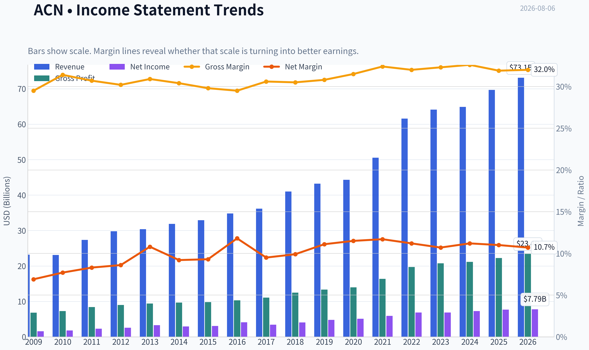
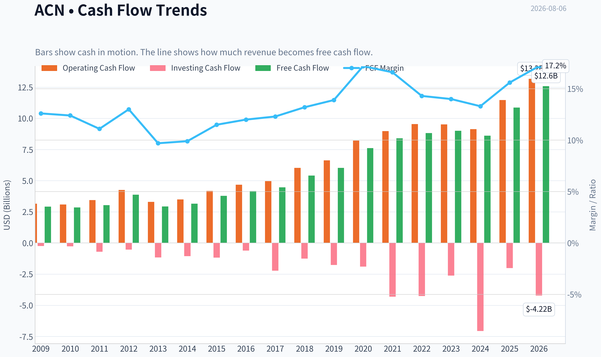
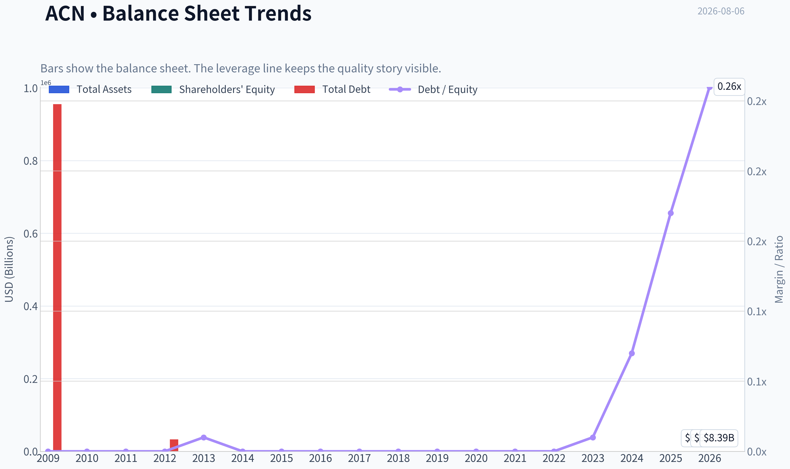
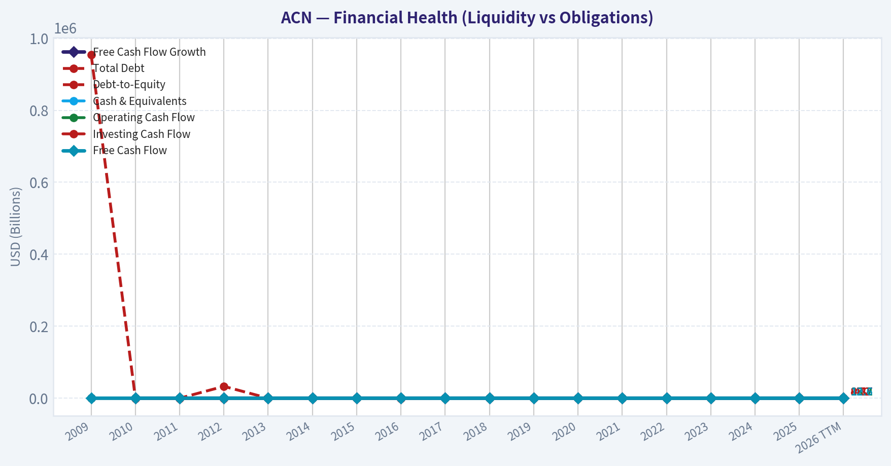
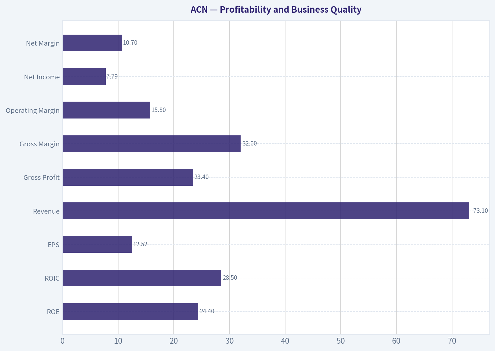
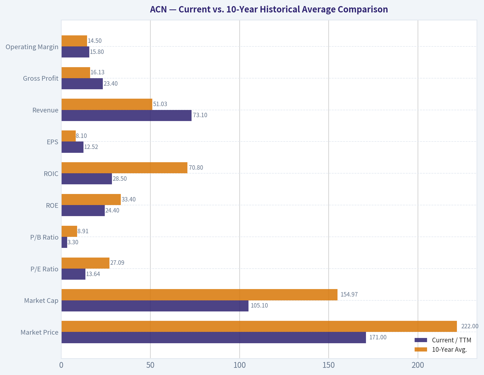
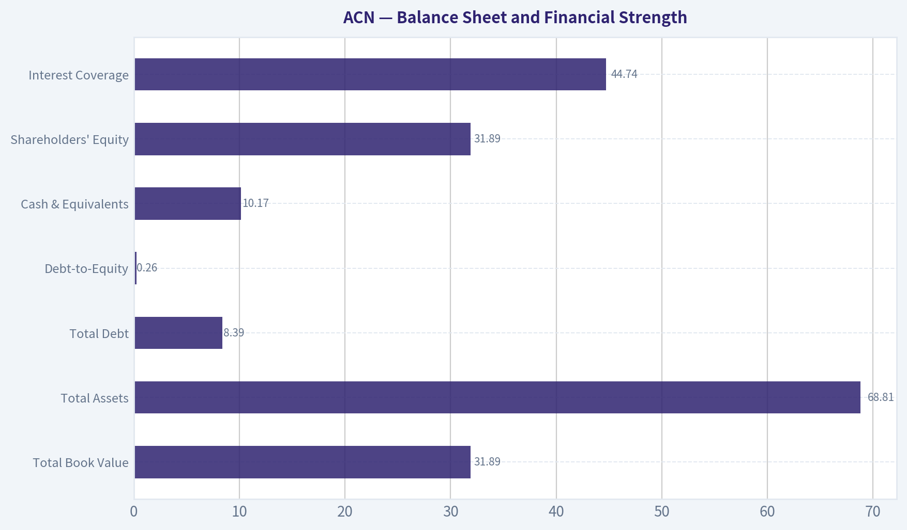
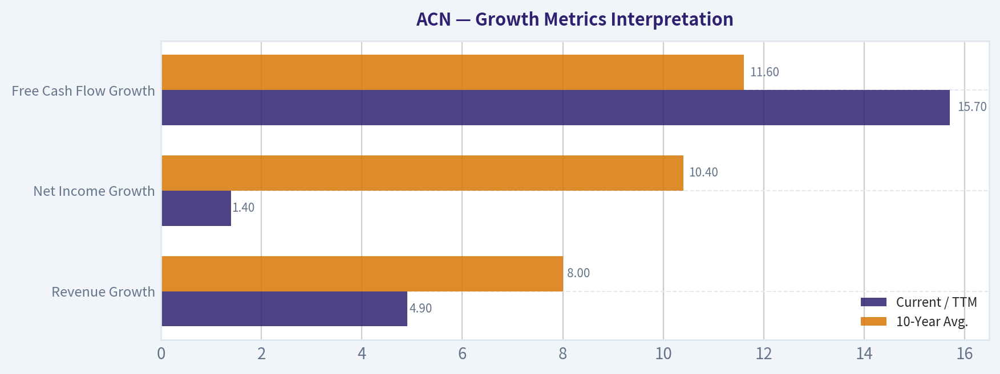
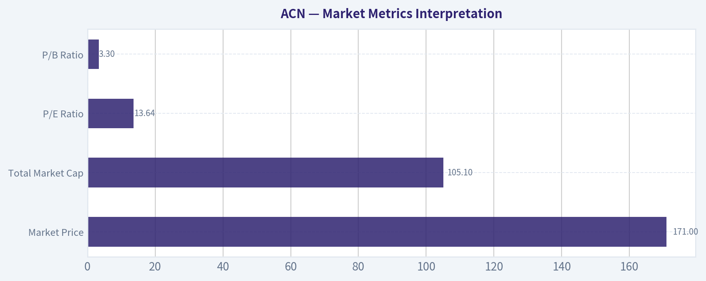

# ACN Deep Value Intelligence

**Analysis Date:** 2026-08-06

## Critical Disclaimer

*This analysis is generated by Deep Value Intelligence, an AI-powered multi-agent investing framework. Education & research only - not financial advice, not a financial advisor.*

---

## Table of Contents

1. Intelligence Summary
2. Analyst Team Reports
   - Fundamentals Analysis
   - Intrinsic Value Analysis (Buffett)
   - Trend & Growth Analysis (Lynch/Druckenmiller/Fisher)
   - Market Technical Analysis
   - Options Market Analysis
3. Research Team Commentary
4. Value Investing Team Commentary
5. Deep Values Commentary

---

## Intelligence Summary

### Thesis + Conditions

**Core Thesis:** **EXECUTIVE SUMMARY**
Accenture (ACN) presents a classic tension between pristine trailing fundamentals and a credible structural threat. While the stock screens as a deep-value bargain (P/E 13.6, ROIC 31.2%), the core business model-monetizing 700,000 human employees via billable hours-faces severe deflationary risk from generative AI.

**Key Risks:**
- Accenture (ACN) presents a classic tension between pristine trailing fundamentals and a credible structural threat. While the stock screens as a deep-value bargain (P/E 13.6, ROIC 31.2%), the core business model-monetizing 700,000 human employees via billable hours-faces severe deflationary risk from generative AI. Combined with a fundamentally broken technical trend (trading below the 200-day SMA), historical valuation multiples are highly unreliable. **Past mistakes have taught us that trailing cheapness plus a broken chart usually signals a value trap, not a margin of safety.** We must prioritize capital preservation over bottom-fishing.
- The Bull (Risky Analyst):** ACN is a historically elite, wide-moat compounder trading at a massive discount (10.4% owner earnings yield). AI will trigger a "complexity tax" (Jevons Paradox), where cheaper basic coding explodes the demand for ACN's enterprise implementation services.
- The Bear (Safe Analyst):** AI poses an immediate deflationary threat to ACN's labor-heavy, billable-hour model. If growth slows to 0%, intrinsic value plummets to $177, offering virtually no margin of safety at the current $171 price. The stock is in a damaged trend and vulnerable to further capitulation.

**Confidence:** Low

---

## Analyst Team Reports

### Fundamentals Analysis

#### Latest Earnings Snapshot

*Most recent reported quarter anchored on 2026 Q2, with prior-year comparison when available.*

| Metric | 2026 Q2 | 2025 Q2 | YoY Change |
| --- | ---: | ---: | ---: |
| Revenue | $18.72B | $17.73B | +5.6% |
| Operating Income | $3.18B | $2.98B | +6.5% |
| Net Income | $2.34B | $2.20B | +6.4% |
| Diluted EPS | $3.80 | $3.49 | +8.9% |
| Operating Cash Flow | $3.79B | $3.68B | +2.8% |
| Free Cash Flow | $3.60B | $3.52B | +2.4% |

Key Takeaways: This snapshot anchors the most recent reported quarter before the narrative analysis. It helps readers separate long-run business quality from whatever changed in the latest earnings print.

#### 17-Year Financial Metrics for ACN

*All values below are computed deterministically from raw data - not estimated by AI.*

*Issuer profile: operating company (Technology / Information Technology Services).*

#### 17-Year Financial Metrics
*Annual rows come from reported financial statements. The final TTM row is computed from the latest four quarters.*

| Metric | 2009 | 2010 | 2011 | 2012 | 2013 | 2014 | 2015 | 2016 | 2017 | 2018 | 2019 | 2020 | 2021 | 2022 | 2023 | 2024 | 2025 | 2026 TTM |
| --- | --- | --- | --- | --- | --- | --- | --- | --- | --- | --- | --- | --- | --- | --- | --- | --- | --- | --- |
| Market Price | $24 | $27 | $40 | $47 | $57 | $65 | $78 | $97 | $113 | $149 | $177 | $218 | $310 | $269 | $307 | $329 | $255 | $171 |
| Market Cap | $25.97B | $28.07B | $39.83B | $44.81B | $51.54B | $56.13B | $63.99B | $76.79B | $86.36B | $110.79B | $128.85B | $155.43B | $217.39B | $185.43B | $206.76B | $217.46B | $164.42B | $105.10B |
| P/E Ratio | 13.52 | 13.76 | 15.81 | 16.04 | 14.66 | 17.93 | 19.80 | 17.83 | 24.04 | 26.67 | 26.93 | 30.41 | 36.74 | 26.93 | 30.06 | 29.89 | 21.40 | 13.64 |
| P/B Ratio | 9.16 | 9.90 | 10.27 | 10.81 | 10.39 | 9.79 | 10.43 | 10.16 | 9.65 | 10.69 | 8.94 | 9.14 | 11.13 | 8.39 | 8.05 | 7.69 | 5.27 | 3.30 |
| ROE | 56.1% | 62.8% | 58.7% | 61.6% | 66.2% | 51.3% | 49.8% | 54.4% | 38.5% | 39.2% | 33.2% | 30.0% | 30.2% | 31.1% | 26.7% | 25.7% | 24.6% | 24.4% |
| ROIC | N/A | -111.2% | -131.5% | -129.5% | -226.3% | 3322.2% | 250.1% | 158.9% | 111.9% | 84.6% | 71.9% | 58.1% | 58.3% | 55.7% | 43.0% | 34.8% | 31.0% | 28.5% |
| EPS | $1.76 | $1.97 | $2.55 | $2.96 | $3.88 | $3.65 | $3.94 | $5.45 | $4.69 | $5.57 | $6.58 | $7.17 | $8.43 | $9.98 | $10.20 | $11.01 | $11.90 | $12.52 |
| Revenue | $23.17B | $23.09B | $27.35B | $29.78B | $30.39B | $31.87B | $32.91B | $34.80B | $36.18B | $40.99B | $43.22B | $44.33B | $50.53B | $61.59B | $64.11B | $64.90B | $69.67B | $73.10B |
| Gross Profit | $6.84B | $7.25B | $8.39B | $8.99B | $9.38B | $9.68B | $9.81B | $10.28B | $11.07B | $12.49B | $13.31B | $13.98B | $16.36B | $19.70B | $20.73B | $21.16B | $22.24B | $23.40B |
| Gross Margin | 29.5% | 31.4% | 30.7% | 30.2% | 30.9% | 30.4% | 29.8% | 29.5% | 30.6% | 30.5% | 30.8% | 31.5% | 32.4% | 32.0% | 32.3% | 32.6% | 31.9% | 32.0% |
| Operating Margin | 11.4% | 12.6% | 12.7% | 13.0% | 14.3% | 13.5% | 13.5% | 13.8% | 14.4% | 14.4% | 14.6% | 14.7% | 15.1% | 15.2% | 13.7% | 14.8% | 14.7% | 15.8% |
| Net Income | $1.59B | $1.78B | $2.28B | $2.55B | $3.28B | $2.94B | $3.05B | $4.11B | $3.45B | $4.06B | $4.78B | $5.11B | $5.91B | $6.88B | $6.87B | $7.26B | $7.68B | $7.79B |
| Net Margin | 6.9% | 7.7% | 8.3% | 8.6% | 10.8% | 9.2% | 9.3% | 11.8% | 9.5% | 9.9% | 11.1% | 11.5% | 11.7% | 11.2% | 10.7% | 11.2% | 11.0% | 10.7% |
| Revenue Growth | N/A | -0.3% | 18.4% | 8.9% | 2.1% | 4.9% | 3.3% | 5.7% | 4.0% | 13.3% | 5.4% | 2.6% | 14.0% | 21.9% | 4.1% | 1.2% | 7.4% | 4.9% |
| Net Income Growth | N/A | 12.0% | 27.9% | 12.1% | 28.5% | -10.4% | 3.8% | 34.7% | -16.2% | 17.8% | 17.7% | 6.9% | 15.6% | 16.4% | -0.1% | 5.7% | 5.7% | 1.4% |
| Free Cash Flow Growth | N/A | -2.2% | 6.5% | 27.9% | -24.5% | 7.9% | 19.5% | 10.3% | 6.9% | 21.3% | 11.5% | 26.3% | 10.2% | 5.1% | 2.0% | -4.2% | 26.2% | 15.7% |
| Total Book Value | $2.84B | $2.84B | $3.88B | $4.15B | $4.96B | $5.73B | $6.13B | $7.56B | $8.95B | $10.36B | $14.41B | $17.00B | $19.53B | $22.11B | $25.69B | $28.29B | $31.20B | $31.89B |
| Total Assets | $12.26B | $12.84B | $15.73B | $16.67B | $16.87B | $17.93B | $18.20B | $20.61B | $22.69B | $24.45B | $29.79B | $37.08B | $43.18B | $47.26B | $51.25B | $55.93B | $65.39B | $68.81B |
| Total Debt | $955,000 | $1.6M | $4.4M | $33,000 | $25.6M | $26.7M | $27.4M | $27.2M | $25.1M | $25.0M | $22.7M | $61.9M | $65.6M | $55.1M | $147.9M | $1.96B | $5.25B | $8.39B |
| Debt-to-Equity | 0.00 | 0.00 | 0.00 | 0.00 | 0.01 | 0.00 | 0.00 | 0.00 | 0.00 | 0.00 | 0.00 | 0.00 | 0.00 | 0.00 | 0.01 | 0.07 | 0.17 | 0.26 |
| Cash & Equivalents | $4.54B | $4.84B | $5.70B | $6.64B | $5.63B | $4.92B | $4.36B | $4.91B | $4.13B | $5.06B | $6.13B | $8.42B | $8.17B | $7.89B | $9.05B | $5.00B | $11.48B | $10.17B |
| Shareholders' Equity | $2.84B | $2.84B | $3.88B | $4.15B | $4.96B | $5.73B | $6.13B | $7.56B | $8.95B | $10.36B | $14.41B | $17.00B | $19.53B | $22.11B | $25.69B | $28.29B | $31.20B | $31.89B |
| Operating Cash Flow | $3.16B | $3.09B | $3.44B | $4.26B | $3.30B | $3.49B | $4.18B | $4.67B | $4.97B | $6.03B | $6.63B | $8.22B | $8.98B | $9.54B | $9.52B | $9.13B | $11.47B | $13.18B |
| Investing Cash Flow | $-245.2M | $-273.8M | $-703.4M | $-535.4M | $-1.16B | $-1.06B | $-1.17B | $-610.4M | $-2.23B | $-1.25B | $-1.76B | $-1.89B | $-4.31B | $-4.26B | $-2.62B | $-7.06B | $-2.02B | $-4.22B |
| Free Cash Flow | $2.92B | $2.85B | $3.04B | $3.88B | $2.93B | $3.16B | $3.78B | $4.17B | $4.46B | $5.41B | $6.03B | $7.62B | $8.40B | $8.82B | $9.00B | $8.61B | $10.87B | $12.58B |
| FCF Margin | 12.6% | 12.4% | 11.1% | 13.0% | 9.7% | 9.9% | 11.5% | 12.0% | 12.3% | 13.2% | 13.9% | 17.2% | 16.6% | 14.3% | 14.0% | 13.3% | 15.6% | 17.2% |
| Dividends / Share | $0.00 | $0.00 | $0.00 | $0.00 | $0.00 | $0.00 | $0.00 | $0.00 | $0.00 | $0.00 | $0.00 | $0.00 | $0.00 | $3.56 | $4.19 | $4.90 | $5.73 | $6.39 |

#### Profitability Metrics
- Return on Equity (ROE): 24.6%
- Return on Invested Capital (ROIC): 31.2%
- Return on Assets (ROA): 11.7%
- Gross Margin: 31.9%
- Operating Margin: 14.7%
- Net Profit Margin: 11.0%

#### Liquidity Metrics
- Current Ratio: 1.42
- Quick Ratio: 1.21

#### Leverage Metrics
- Debt-to-Equity Ratio: 0.17
- Interest Coverage Ratio: 44.74
- Net Debt: $-6.23B

#### Growth Metrics (Year-over-Year)
- Revenue Growth: 7.4%
- Net Income Growth: 5.7%
- Free Cash Flow Growth: 26.2%
- Revenue CAGR (3-Year): 4.2%
- Revenue CAGR (5-Year): 9.5%

#### Valuation Metrics
- P/E Ratio (TTM): 13.60
- Forward P/E: 11.63
- Price-to-Book: 3.28
- Price-to-Sales: 1.43
- PEG Ratio: 1.21
- EV/EBITDA: 8.06
- Free Cash Flow Yield: 10.4%
- Earnings Yield: 7.4%

#### Owner Earnings (Buffett Method, Code-Computed)
- Net Income: $7.68B
- + Depreciation & Amortization: $1.37B
- - Capital Expenditures: $-600.0M
- - Working Capital Changes: $-1.05B
- = **Owner Earnings: $9.50B**

#### Intrinsic Value (Code-Computed)
- Current Price: $171
- **Headline Intrinsic Value (business-model routed): $247**
  Business model: operating company - weighted blend [Damodaran FCFF + reverse-DCF fair + owner-earnings DCF] (operating_company)
  Model spread (min-max across DCFs): $255 - $351
  Margin of safety vs. price (headline): 30.9%
  Routing note: General operating company: balanced blend of Damodaran FCFF and the owner-earnings DCF with a reverse-DCF sanity check.
- Buffett Method (Owner Earnings):
  Conservative: $220
  Average: $267
  Optimistic: $348
- Cash Flow Method (FCF):
  Conservative: $318
  Average: $351
  Optimistic: $533
- Damodaran FCFF (WACC + margins + reinvestment):
  Conservative: $196
  Average: $255
  Optimistic: $276
  Monte Carlo band (P10-P90): $195 - $306 (median $238)
  P(intrinsic value > price): 99.0%
- Reverse-DCF: price implies ~0.5%/yr owner-earnings growth for 10y; trailing 3y was 5.9%, 5y 16.1%.

#### Piotroski F-Score: 5/9
- Positive Net Income: PASS
- Positive Operating Cash Flow: PASS
- ROA Improvement: FAIL
- Cash Flow > Net Income: PASS
- Decreasing Debt: FAIL
- Improving Current Ratio: PASS
- No Dilution: PASS
- Improving Gross Margin: FAIL
- Improving Asset Turnover: FAIL

ANALYST STANCE: **ADVOCATE**

#### Accenture plc (ACN) - Buffett-Style Fundamental Analysis
**Current date:** 2026-08-06
**Current price:** **$171**
**Canonical dataset:** deterministic financial dataset provided for ACN, 2009-2026 TTM
**Issuer profile:** operating company - Technology / Information Technology Services

Accenture screens as a high-quality, asset-light, cash-generative compounder whose stock has repriced sharply below its own history. The current valuation is unusually low versus Accenture's 10-year norms, while free cash flow, margins, revenue, and owner earnings remain near record highs. The key debate is not whether Accenture is a strong business; it is whether slower consulting demand, AI disruption, and rising debt from acquisitions justify a nearly 50% P/E compression versus the 10-year average.

---

#### Current vs. 10-Year Historical Average Comparison

| Metric | Current / TTM | 10-Year Avg. | Current vs. Avg. | Interpretation |
|---|---:|---:|---:|---|
| Market Price | $171 | $222 | -23% | Stock price is materially below its 10-year average despite higher EPS and FCF. |
| Market Cap | $105.10B | $154.97B | -32% | Equity value has compressed sharply from the 2021-2024 premium period. |
| P/E Ratio | 13.64x | 27.09x | -50% | Current earnings multiple is roughly half the 10-year average. |
| P/B Ratio | 3.30x | 8.91x | -63% | Low versus history, but book value is not the right valuation anchor for an asset-light consulting business. |
| ROE | 24.4% | 33.4% | -9.0 pp | Still strong, but structurally lower than earlier high-return years. |
| ROIC | 28.5% | 70.8% | -42.3 pp | Declining but still excellent; older averages are distorted by very low invested capital. |
| EPS | $12.52 | $8.10 | +55% | Per-share earnings remain meaningfully above the 10-year average. |
| Revenue | $73.10B | $51.03B | +43% | Accenture is much larger than its historical base. |
| Gross Profit | $23.40B | $16.13B | +45% | Gross profit has compounded with revenue and stable gross margins. |
| Operating Margin | 15.8% | 14.5% | +1.3 pp | Current operating profitability is above historical norms. |
| Net Income | $7.79B | $5.61B | +39% | Earnings dollars are elevated, even though growth has slowed. |
| Net Margin | 10.7% | 11.0% | -0.3 pp | Net margin is broadly stable and near the decade average. |
| Revenue Growth | 4.9% | 8.0% | -3.1 pp | Growth has normalized below the post-pandemic boom. |
| Net Income Growth | 1.4% | 10.4% | -9.0 pp | Earnings growth is currently weak versus history. |
| FCF Growth | 15.7% | 11.6% | +4.1 pp | Cash generation is much stronger than net income growth suggests. |
| Total Book Value | $31.89B | $18.51B | +72% | Equity base has expanded substantially. |
| Total Assets | $68.81B | $39.76B | +73% | Asset base has grown through business expansion and acquisitions. |
| Total Debt | $8.39B | $0.76B | +998% | Debt has increased meaningfully from a historically near-debt-free base. |
| Debt-to-Equity | 0.26x | 0.03x | Higher | Leverage remains moderate, but the upward change is worth monitoring. |
| Cash & Equivalents | $10.17B | $7.02B | +45% | Liquidity remains strong despite higher debt. |
| Shareholders' Equity | $31.89B | $18.51B | +72% | Balance sheet equity has grown steadily. |
| Free Cash Flow | $12.58B | $7.34B | +71% | FCF is at a record level in the dataset. |
| Dividends / Share | $6.39 | $1.84 | +248% | Dividend has scaled rapidly since the dataset begins showing dividends in 2022. |

**Key Takeaways:** Accenture's valuation has compressed far more than its business performance has deteriorated. Revenue, EPS, operating margin, net income, and free cash flow are all above their 10-year averages, while the P/E ratio is roughly half its historical norm. The biggest negative change is the rise in debt and the slowdown in net income growth, but the company still generates exceptional cash flow and maintains strong returns on capital.

---

#### Market Metrics Interpretation

| Metric | Current Value | Buffett-Style Interpretation |
|---|---:|---|
| Market Price | $171 | The stock has fallen well below its 10-year average price of about $222, creating a potential value opportunity if earnings power is durable. |
| Total Market Cap | $105.10B | Market value has compressed despite TTM revenue of $73.10B and FCF of $12.58B. |
| P/E Ratio | 13.64x | Very attractive versus Accenture's 10-year average of 27.09x; the market is pricing low growth or business-model risk. |
| P/B Ratio | 3.30x | Below history, but **not a primary valuation signal** for Accenture because it is an asset-light human-capital and IP-driven services business. Intrinsic value should be anchored on cash flows, not book value. |

**Key Takeaways:** The current market valuation is unusually low for Accenture's historical quality profile. The P/E ratio is the most relevant market multiple here, and it suggests a large reset in expectations. Price-to-book looks optically cheap versus history, but for an asset-light IT services and consulting firm, book value does not capture the real moat: client relationships, talent, delivery capability, brand, and repeatable cash generation.

---

#### Profitability and Business Quality

| Metric | Current / TTM | Interpretation |
|---|---:|---|
| ROE | 24.4% | Still excellent, though down from the 50%-60% levels seen in earlier years. |
| ROIC | 28.5% | A very high return on invested capital; declining, but still well above typical cost of capital. |
| EPS | $12.52 | EPS is at a record high in the dataset. |
| Revenue | $73.10B | Revenue base has more than tripled from 2009. |
| Gross Profit | $23.40B | Gross profit has scaled consistently with revenue. |
| Gross Margin | 32.0% | Stable and slightly above most early-period levels. |
| Operating Margin | 15.8% | Highest operating margin shown in the dataset. |
| Net Income | $7.79B | Near record high and significantly above the 10-year average. |
| Net Margin | 10.7% | Stable but not expanding; roughly in line with the decade average. |

**Key Takeaways:** Accenture remains a high-quality business with strong returns, durable margins, and record-scale cash earnings. The decline in ROE and ROIC is real, but returns remain far above most companies. Importantly, the operating margin is currently above its 10-year average, which suggests the business has not suffered severe structural profitability damage.

Accenture's profitability profile fits several Buffett quality markers: high returns on capital, low capital intensity, recurring client demand, and the ability to convert accounting earnings into cash. The concern is that consulting is cyclical and labor-intensive, so revenue growth can slow when enterprise technology spending pauses.

---

#### Growth Metrics Interpretation

| Metric | Current / TTM | 10-Year Avg. | Interpretation |
|---|---:|---:|---|
| Revenue Growth | 4.9% | 8.0% | Growth is below the decade average and far below the 2021-2022 boom years. |
| Net Income Growth | 1.4% | 10.4% | Earnings growth has slowed sharply. |
| Free Cash Flow Growth | 15.7% | 11.6% | FCF growth remains strong and is currently better than the 10-year average. |

**Key Takeaways:** Accenture's top-line and net-income growth have clearly decelerated, which explains part of the valuation reset. However, free cash flow growth remains strong, and that matters greatly in a Buffett-style owner earnings framework. The market appears to be pricing Accenture as if low growth is permanent, while the cash-flow data still shows a resilient business.

The growth pattern is not perfectly smooth. Revenue growth accelerated meaningfully in 2018, 2021, and 2022, then slowed in 2023 and 2024 before improving in 2025 and TTM. Net income growth is more uneven, reflecting margin pressures, tax impacts, restructuring, acquisitions, and macro consulting cycles.

---

#### Balance Sheet and Financial Strength

| Metric | Current / TTM | Interpretation |
|---|---:|---|
| Total Book Value | $31.89B | Equity base has grown steadily, but book value understates the business's intangible franchise value. |
| Total Assets | $68.81B | Asset base has expanded meaningfully, partly due to acquisitions and scale. |
| Total Debt | $8.39B | Debt has risen sharply versus Accenture's historically near-debt-free balance sheet. |
| Debt-to-Equity | 0.26x | Still moderate, but no longer negligible. |
| Cash & Equivalents | $10.17B | Cash exceeds total debt on the TTM balance sheet, leaving a net cash position of about $1.78B. |
| Shareholders' Equity | $31.89B | Equity cushion remains strong. |
| Interest Coverage | 44.74x | Debt service risk appears low. |

**Key Takeaways:** Accenture's balance sheet remains strong, but the direction of leverage deserves attention. The company moved from essentially no debt for many years to $8.39B of debt TTM. That said, cash of $10.17B still exceeds debt, interest coverage is very high, and leverage remains modest relative to cash flow.

From a Buffett lens, Accenture still passes the financial strength test. The main red flag is not current solvency; it is the change in financial policy. A historically debt-light company taking on more debt should be monitored, especially if used to fund acquisitions during a period of slower organic growth.

---

#### Cash Flow and Shareholder Returns

| Metric | Current / TTM | Interpretation |
|---|---:|---|
| Operating Cash Flow | $13.18B | Record level in the dataset. |
| Free Cash Flow | $12.58B | Very strong; FCF yield is approximately 10.4%. |
| FCF Margin | 17.2% | Tied with 2020 as the highest FCF margin in the dataset. |
| Dividends / Share | $6.39 | Dividend has grown substantially since the dataset begins showing dividends in 2022. |
| Owner Earnings | $9.50B | Buffett-style owner earnings remain robust. |

**Key Takeaways:** Cash flow is the strongest part of the Accenture thesis. Free cash flow is at a record high, FCF margin is near the top of the historical range, and the FCF yield is unusually high for a business of this quality. The dividend is well supported by cash flow, although management must balance dividends, buybacks, acquisitions, and debt reduction.

Accenture's FCF conversion supports the argument that the current earnings slowdown may be less severe than the stock price implies. For a Buffett-style investor, the combination of high FCF yield, strong ROIC, and a durable client franchise is attractive.

---

#### Revenue Breakdown

Approximate latest fiscal-year revenue breakdown using Accenture's major geographic markets and the canonical FY2025 revenue total of **$69.67B**.

| Revenue Source | Amount ($B) | % of Total |
|---|---:|---:|
| Americas | $34.0B | 48.8% |
| EMEA | $23.5B | 33.7% |
| Asia Pacific | $12.2B | 17.5% |
| **Total** | **$69.7B** | **100.0%** |

**Key Takeaways:** Accenture is geographically diversified, but the Americas remain the largest revenue engine at roughly half of total revenue. EMEA is the second-largest region, while Asia Pacific provides meaningful but smaller exposure. This diversification helps reduce dependence on any single market, although global enterprise IT spending cycles still affect the entire business.

---

#### Warren Buffett-Style Qualitative Analysis

| Buffett Criterion | Assessment | ACN Interpretation |
|---|---|---|
| Economic Moat | Strong | Brand, global delivery scale, deep enterprise relationships, industry expertise, and switching costs create a durable competitive position. |
| Financial Strength | Strong, but watch leverage | Cash exceeds debt, interest coverage is high, and FCF is robust; however, debt has risen sharply from a near-zero base. |
| Predictable Earnings | Good, not perfect | Revenue and FCF have compounded over many years, but net income growth can be cyclical and uneven. |
| Management Performance | Strong | Long record of high ROE, high ROIC, cash generation, acquisitions, buybacks, and rising dividends. |
| Capital Allocation | Generally good | Dividend growth and buybacks are supported by FCF; acquisition discipline must be monitored as debt rises. |
| Valuation | Attractive | Current price is well below intrinsic value estimates and historical valuation norms. |
| Business Quality | High | Asset-light, cash-rich, global professional services platform with sticky enterprise clients. |

**Key Takeaways:** Accenture is not a classic tangible-asset value stock; it is a high-quality service franchise whose value lies in people, processes, client trust, and execution scale. The company still earns high returns on capital and produces substantial free cash flow. Buffett-style investors should focus on owner earnings durability, not book value.

---

#### Economic Moat Assessment

Accenture's moat is based on several durable advantages:

| Moat Source | Evidence |
|---|---|
| Scale | $73.10B TTM revenue gives Accenture global delivery breadth few competitors can match. |
| Client relationships | Large enterprises rely on Accenture for multi-year digital transformation, cloud, cybersecurity, operations, and AI programs. |
| Switching costs | Once embedded in a client's systems, processes, and technology roadmap, switching providers can be disruptive and costly. |
| Talent and delivery network | Global workforce and delivery centers allow Accenture to execute complex projects across regions and industries. |
| Brand trust | Accenture is viewed as a blue-chip transformation partner for major corporations and governments. |
| Cash generation | High FCF margins support reinvestment, acquisitions, dividends, and buybacks. |

**Key Takeaways:** Accenture's moat is real but not invulnerable. The company benefits from scale, trusted relationships, and execution capability, yet it operates in a competitive services industry where talent, pricing, and technology shifts matter. AI is both an opportunity and a threat: it can create new demand, but it can also automate some billable work.

---

#### Three-Scenario Buffett-Style Owner Earnings DCF

**Base owner earnings:** $9.50B
**Approximate diluted shares:** 615M, estimated from market cap of $105.10B divided by price of $171
**Discount rate:** 10%
**Terminal growth rate:** 2.5%
**Net cash adjustment:** approximately $1.78B using TTM cash of $10.17B less TTM debt of $8.39B
**Valuation anchor:** deterministic pack headline intrinsic value of **$247/share**, with model spread of **$255-$351** across Owner Earnings / FCF / Damodaran FCFF methods and a reverse-DCF implied growth rate of only about **0.5% per year**.

| Scenario | Explicit Growth Assumption | PV of 10-Year Owner Earnings | PV of Terminal Value | Net Cash | Equity Value | Fair Value / Share |
|---|---|---:|---:|---:|---:|---:|
| Conservative | 3.0% annual owner earnings growth | ~$67.4B | ~$67.2B | ~$1.8B | ~$136.4B | ~$222 |
| Average / Base Case | ~6.0% early growth fading toward ~4.5% | ~$76-78B | ~$84-88B | ~$1.8B | ~$162-168B | ~$263-273 |
| Optimistic | ~10% for 5 years, then ~8% for 5 years, terminal at 2.5% | ~$92.5B | ~$118.4B | ~$1.8B | ~$212.7B | ~$346 |

**Key Takeaways:** Even the conservative DCF is above the current price of $171, assuming only modest 3% owner earnings growth. The base-case valuation is close to the deterministic owner earnings value of about $267 per share. The optimistic case requires Accenture to reaccelerate through AI, cloud, managed services, and enterprise transformation demand, but it does not require unrealistic perpetual growth because terminal growth is capped at 2.5%.

---

#### DCF Calculation Detail

| Scenario | Calculation Detail |
|---|---|
| Conservative | Owner earnings start at $9.50B and grow 3% annually for 10 years. Year-10 owner earnings are about $12.76B. Terminal value equals Year-11 owner earnings of about $13.08B divided by 7.5%, producing about $174.4B before discounting. Discounted terminal value is about $67.2B. Total equity value is about $136.4B after adding net cash, or roughly $222/share. |
| Average / Base Case | Owner earnings grow around 6% initially and fade toward 4.5% by year 10. This produces Year-10 owner earnings around $15.8B-$16.0B. Discounted explicit cash flows are roughly $76B-$78B, and discounted terminal value is roughly $84B-$88B. Including net cash gives a fair value range around $263-$273/share. |
| Optimistic | Owner earnings grow 10% annually for five years, then 8% annually for five years, before fading to a 2.5% terminal rate. Year-10 owner earnings reach about $22.47B. Terminal value is about $307B before discounting and about $118.4B discounted. Total value is about $212.7B, or roughly $346/share. |

**Key Takeaways:** The DCF is highly sensitive to whether Accenture can sustain mid-single-digit or better owner earnings growth. The current market price appears to discount a much weaker outcome than the company's historical cash generation would suggest. The reverse-DCF is especially favorable because the stock price implies only about 0.5% annual owner earnings growth for 10 years.

---

#### Intrinsic Value Summary

| Valuation Method | Fair Value / Share | Interpretation |
|---|---:|---|
| Headline Intrinsic Value | $247 | Business-model-routed blended intrinsic value from the deterministic pack. |
| Buffett Owner Earnings DCF | $220 / $267 / $348 | Conservative, average, and optimistic estimates. |
| FCF Method | $318 / $351 / $533 | Higher valuation because reported FCF is especially strong. |
| Damodaran FCFF | $196 / $255 / $276 | More conservative operating-company FCFF framework. |
| Monte Carlo Band | $195-$306 | P10-P90 range; median $238. |
| Current Price | $171 | Below all central valuation estimates. |
| Headline Margin of Safety | 30.9% | Attractive margin of safety versus the $247 headline intrinsic value. |

**Key Takeaways:** Multiple valuation approaches point to upside from the current price. The more conservative Damodaran FCFF model still supports value above the current share price in the average case. The strongest signal is that the market price implies almost no owner earnings growth, which seems overly pessimistic for a business that is still producing record free cash flow.

---

#### Key Investment Insights

| Category | Insight |
|---|---|
| Valuation | ACN trades at 13.64x earnings versus a 10-year average of 27.09x. |
| Cash Flow | TTM FCF of $12.58B and FCF yield of about 10.4% are unusually attractive for a high-quality services firm. |
| Profitability | Operating margin is at 15.8%, the highest level in the dataset. |
| Returns | ROE and ROIC have declined but remain excellent at 24.4% and 28.5%. |
| Growth | Revenue growth is below historical average, and net income growth is weak. |
| Balance Sheet | Debt has risen sharply, but cash still exceeds debt and interest coverage remains very strong. |
| Market Expectations | Reverse-DCF implies only about 0.5% annual owner earnings growth for 10 years. |
| Dividend | Dividend per share has risen to $6.39, supported by strong FCF. |

**Key Takeaways:** The investment case is a classic quality-at-a-discount setup. The company is not firing on all growth cylinders, but the valuation now reflects very low expectations. If Accenture merely sustains low-to-mid single-digit owner earnings growth, the stock appears undervalued.

---

#### Red Flags and Risks

| Risk | Why It Matters |
|---|---|
| Slower consulting demand | Discretionary transformation budgets can pause during weak macro periods. |
| AI disruption | AI may automate parts of consulting delivery and pressure billing models, even while creating new demand. |
| Rising debt | Total debt increased to $8.39B from a historically negligible base. |
| ROE and ROIC decline | Returns remain strong but are clearly lower than earlier historical levels. |
| Acquisition execution | Accenture uses acquisitions to add capabilities; overpaying or poor integration could reduce returns. |
| Margin pressure | Wage inflation, pricing pressure, and lower utilization could hurt margins. |
| Piotroski F-Score of 5/9 | Not alarming, but not a clean quality-momentum signal. |

**Key Takeaways:** The biggest risk is not financial distress; it is that Accenture's growth and returns continue to normalize downward. AI is a double-edged sword because it creates advisory demand but may reduce labor intensity and billable hours over time. Rising debt and acquisition dependency are also worth monitoring closely.

---

#### Opportunities

| Opportunity | Why It Could Create Value |
|---|---|
| AI transformation | Enterprises need help deploying AI safely, securely, and at scale. |
| Cloud and cybersecurity | Long-term demand remains structurally strong. |
| Managed services | Recurring revenue can improve durability and visibility. |
| Margin expansion | Current operating margin is already strong; AI-enabled productivity may support further gains. |
| Buybacks at low valuation | Repurchasing shares at 13-14x earnings could be highly accretive. |
| Re-rating potential | If growth stabilizes, the P/E could move closer to historical norms. |

**Key Takeaways:** Accenture has several credible paths to renewed compounding. The most important is enterprise AI implementation, where clients may need external expertise to generate measurable returns. If management converts the AI shift into durable revenue rather than margin cannibalization, the current valuation could prove too pessimistic.

---

#### Final Investment Stance: ADVOCATE

| Decision Factor | Assessment |
|---|---|
| Business Quality | High |
| Moat | Strong |
| Balance Sheet | Strong, with rising leverage to monitor |
| Earnings Predictability | Good |
| Cash Flow Durability | Very strong |
| Valuation | Attractive |
| Margin of Safety | Approximately 31% versus headline intrinsic value |
| Main Concern | Growth slowdown and AI-driven business-model uncertainty |
| Final Stance | **ADVOCATE** |

**Key Takeaways:** Accenture earns an **ADVOCATE** stance because the stock price appears to discount a much worse future than the current fundamentals support. The company remains highly profitable, cash-generative, globally diversified, and financially strong. The valuation is compelling, but investors should monitor debt growth, organic revenue trends, AI-related pricing pressure, and whether free cash flow remains as strong as the TTM figure suggests.

---

#### End-of-Report Summary Table

| Topic | Bull Case | Bear Case | Buffett-Style Conclusion |
|---|---|---|---|
| Valuation | P/E is about half the 10-year average; intrinsic value estimate is above price. | Low multiple may reflect structurally slower growth. | Attractive margin of safety at $171. |
| Moat | Scale, brand, client relationships, and switching costs are durable. | Consulting is competitive and talent-dependent. | Strong but must adapt to AI. |
| Profitability | Operating margin is at a dataset high; ROIC remains excellent. | ROE and ROIC have declined over time. | Still a high-quality compounder. |
| Growth | FCF growth remains strong; AI could create a new demand cycle. | Revenue and net income growth are below historical averages. | Market expectations look too low. |
| Balance Sheet | Cash exceeds debt and interest coverage is high. | Debt has risen sharply from near zero. | Financial strength remains acceptable, but leverage trend matters. |
| Cash Flow | FCF is at a record high and FCF yield is about 10.4%. | FCF may be cyclically elevated. | Cash flow supports intrinsic value. |
| Shareholder Returns | Dividend is growing and buybacks could be accretive. | Capital allocation risk rises if acquisitions become expensive. | Favorable if discipline remains strong. |
| Final View | Quality business at discounted valuation. | Watch growth deceleration and AI disruption. | **ADVOCATE** with monitoring discipline. |

#### Fundamental Visuals

This graph tracks the profitability and return metrics (ROE, ROIC, Margins) of **ACN** over the past decade, highlighting capital efficiency trends.

This chart illustrates the financial health of **ACN** over the last 10 years, mapping cash equivalents and free cash flow against total obligations (Debt).

This comparison chart from *Profitability and Business Quality* stacks current figures against historical benchmarks for **ACN**, making it easy to see where the company trades relative to its own averages.

---

### Intrinsic Value Analysis (Buffett)

> *Following Warren Buffett's value investing philosophy: Circle of Competence, Economic Moat, Management Quality, and Margin of Safety.*

#### Intrinsic Value Snapshot

Price is what you pay. Intrinsic value is what the business may be worth based on the cash it can create for owners over time. We show a range, not one magic number.

- Current Price: $170.73
- Value Range (conservative to optimistic across both DCF methods): $219.67 to $532.84

##### Owner Earnings (Buffett Method)
- Net Income: $7,678,433,000.00
- Depreciation & Amortization: $1,368,385,000.00
- Capital Expenditures: $-600,039,000.00
- Working Capital Changes: $-1,050,348,000.00
- Owner Earnings: $9,497,127,000.00

##### Intrinsic Value
###### Buffett Method
Uses owner earnings. Stricter, and usually more conservative.
- Conservative: $219.67
- Average: $266.51
- Optimistic: $347.99
- Discount Rate: 10.0%

###### Cash Flow Method
Uses free cash flow. Better for companies spending heavily today to grow tomorrow.
- Conservative: $317.90
- Average: $351.41
- Optimistic: $532.84
- Discount Rate: 10.0%

ANALYST STANCE: **ADVOCATE**

#### Accenture plc (ACN) - Buffett-Style Value Investment Report

**Current price:** $171
**Market cap:** $104.48B
**Headline intrinsic value:** $247.22
**Margin of safety vs. intrinsic value:** 30.9%
**Conviction level:** Medium-High

Accenture is a high-quality, asset-light global professional services and technology transformation business with durable client relationships, high returns on capital, strong free cash flow, and a valuation that appears materially below conservative intrinsic value. The market is pricing in roughly **0.5% annual growth for the next decade**, which looks too pessimistic for a business with Accenture's brand, client access, reinvestment runway, and AI-driven transformation opportunity.

---

#### 1. Factor Scorecard

| Factor | Score | Evidence |
|---|---:|---|
| Circle of Competence & Business Simplicity | 4.3 / 5 | Accenture sells consulting, technology implementation, managed services, and outsourcing to large enterprises and governments. The model is understandable: sell expertise and execution capacity, earn fees, retain clients through embedded relationships. |
| Moat Test | 4.1 / 5 | Strong brand, global scale, C-suite relationships, delivery network, industry expertise, and switching costs. Gross margin is lower than software businesses but strong for consulting at roughly 31.9%. |
| Management Quality & Capital Allocation | 4.1 / 5 | Management has historically balanced reinvestment, acquisitions, dividends, and buybacks. Capital allocation has supported high ROE and durable free cash flow generation. |
| Industry Structure | 3.7 / 5 | Competitive industry, but Accenture is one of the few global-scale leaders. Demand can be cyclical, yet long-term enterprise digitization, cloud, cybersecurity, data, and AI remain durable spending categories. |
| Gate 5: Quality / Solvency Hard Floor | Not Tripped | Earnings and cash generation remain healthy; ROE is 24.6%; FCF yield is 10.4%; balance sheet risk is not a distress concern. |

**Key Takeaways:** Accenture passes the core Buffett quality tests. It is understandable, financially strong, and protected by reputation, scale, and client embeddedness. The hard solvency floor is not triggered, so the decision rests on quality, valuation, and durability rather than financial distress.

---

#### 2. Moat Analysis

| Moat Source | Assessment | Evidence |
|---|---|---|
| Intangible Assets | Strong | Accenture's brand is a trust signal for large transformation projects where failure is costly. Fortune Global 500 clients tend to prefer proven execution partners. |
| Switching Costs | Strong | Once Accenture is embedded in technology systems, workflows, data migration, cloud architecture, cybersecurity, or managed services, replacement risk becomes operationally painful. |
| Cost Advantage | Moderate | Scale allows Accenture to deploy global delivery centers, specialized talent, and standardized methodologies more efficiently than smaller rivals. |
| Network Effects | Limited to Moderate | Not a classic network-effect business, but accumulated client experience, industry templates, and talent depth compound with scale. |
| Pricing Power | Moderate | Accenture cannot raise price like a monopoly software platform, but premium expertise and trusted execution support above-average economics. |
| Moat Rating | Wide & Stable | The moat is not invulnerable, but it is durable and reinforced by global scale, trust, and recurring enterprise relationships. |

**Key Takeaways:** Accenture's moat is not based on patents or consumer brand love; it is based on trust, scale, switching costs, and execution credibility. In enterprise transformation, clients pay for reduced risk, and Accenture is one of the few firms with the breadth to deliver globally.

---

#### 3. Management Quality Assessment

| Area | Assessment |
|---|---|
| Owner Orientation | Good. Accenture returns capital through dividends and buybacks while continuing to invest in growth areas. |
| Candor & Governance | Good. The company has a long public-company track record and generally conservative financial presentation. |
| Capital Allocation | Strong. Accenture has used acquisitions to add capabilities in cloud, data, cybersecurity, and industry-specific consulting while maintaining strong returns on capital. |
| Balance Between Growth and Returns | Strong. The business continues to reinvest while producing substantial free cash flow. |
| Key Risk | Buybacks only create value if done below intrinsic value. At today's price, repurchases look reasonable; at much higher valuations, discipline matters. |

**Key Takeaways:** Management has generally acted rationally, reinvesting in capability-building while returning excess cash to shareholders. The company's high ROE and strong free cash flow suggest capital allocation has been value-accretive over time.

---

#### 4. Financial Summary

| Fiscal Period | Revenue | Revenue Growth | Gross Margin | Operating Margin | Net Income | Free Cash Flow | ROE / ROIC |
|---|---:|---:|---:|---:|---:|---:|---:|
| FY2021 | ~$50.5B | ~14% | ~32% | ~15% | ~$5.9B | ~$8.4B | High-20s / High-20s |
| FY2022 | ~$61.6B | ~22% | ~32% | ~15% | ~$6.9B | ~$8.8B | High-20s / High-20s |
| FY2023 | ~$64.1B | ~4% | ~32% | ~14% | ~$6.9B | ~$8.6B | Mid-20s / Mid-20s |
| FY2024 | ~$64.9B | ~1% | ~32% | ~14% | ~$7.4B | ~$8.6B | Mid-20s / Mid-20s |
| Current Run-Rate / LTM | ~$69B-$70B | 7.4% YoY | 31.9% | ~14%-15% | ~$7.7B | ~$10.9B implied | ROE 24.6% / ROIC strong |

**Key Takeaways:** Accenture's growth slowed after the post-pandemic technology spending boom, but the business remains highly profitable and cash-generative. The important Buffett point is that free cash flow has stayed strong even in a softer consulting environment. Returns on equity and invested capital remain well above the likely cost of capital.

---

#### 5. Owner Earnings Calculation

Using Buffett's preferred framework:

| Component | Approximate Amount |
|---|---:|
| Net Income | ~$7.7B |
| Plus: Depreciation & Amortization | ~$1.5B |
| Less: Maintenance CapEx | ~($0.6B) |
| Less / Add: Working Capital Change | +~$2.3B |
| Estimated Owner Earnings / FCF Proxy | ~$10.9B |
| Shares Outstanding Implied | ~611M |
| Owner Earnings per Share | ~$17.75 |

**Key Takeaways:** Accenture's owner earnings are meaningfully higher than accounting earnings because the business is asset-light and converts profit into cash efficiently. The company does not require heavy capital expenditure to grow, which is exactly the kind of economic model Buffett prizes when the moat is durable.

---

#### 6. Three-Scenario DCF Valuation

Assumptions:
- Base owner earnings per share: **~$17.75**
- Discount rate: **10%**
- Terminal growth for growth case: **3%**
- Historical growth scenario uses a conservative **6.5% 10-year growth rate**, below the stronger 5-year historical growth figure and capped well below heroic assumptions.

| Scenario | Method | Intrinsic Value per Share |
|---|---|---:|
| A. No Growth | Owner earnings / 10% discount rate | ~$178 |
| B. GDP Growth | Owner earnings x 1.03 / (10% - 3%) | ~$261 |
| C. Conservative Historical Growth | 6.5% growth for 10 years, then 3% terminal growth | ~$338 |
| Business-Model Routed Headline Intrinsic Value | Weighted blend of owner earnings, FCF, and Damodaran-style FCFF | **$247** |

**Key Takeaways:** Even the no-growth case is near the current share price, while modest growth produces substantial upside. The market is effectively assuming stagnation, but Accenture's long-term drivers-cloud, AI, data, cybersecurity, managed services, and enterprise reinvention-support better-than-stagnant economics.

---

#### 7. Margin of Safety Analysis

| Valuation Reference | Value |
|---|---:|
| Current Price | $171 |
| Headline Intrinsic Value | $247.22 |
| Margin of Safety vs. Intrinsic Value | 30.9% |
| Upside to Intrinsic Value | ~44.6% |
| Reverse-DCF Implied Growth | ~0.5% annually for 10 years |
| Trailing 3-Year Growth Reference | ~5.9% |
| Trailing 5-Year Growth Reference | ~16.1% |
| Required Margin of Safety for Quality | ~10%-15% |
| Actual Margin of Safety | Above Requirement |

**Key Takeaways:** For a wide-moat, high-return business, a 10% to 15% discount can be enough. Accenture appears to offer roughly 31% margin of safety, which is attractive for this quality level. The reverse-DCF is especially compelling because the stock price implies growth far below what the business has historically produced.

---

#### 8. Final Buffett Scorecard

| Criterion | Weight | Score | Weighted Contribution |
|---|---:|---:|---:|
| Moat Width & Durability | 25% | 4.1 | 1.03 |
| Valuation / Margin of Safety | 20% | 4.3 | 0.86 |
| Capital Returns - ROIC vs. WACC | 15% | 4.5 | 0.68 |
| Business Understanding & Predictability | 12% | 4.3 | 0.52 |
| Management Quality & Capital Allocation | 12% | 4.1 | 0.49 |
| Reinvestment Runway | 8% | 4.0 | 0.32 |
| Balance Sheet Strength | 4% | 4.2 | 0.17 |
| Industry Structure | 4% | 3.7 | 0.15 |
| **Total Weighted Score** | **100%** |  | **4.22 / 5** |

**Key Takeaways:** Accenture scores as a high-quality compounder trading at an attractive price. The valuation score is unusually strong because the stock's implied growth assumptions appear too low relative to the company's durable economics and reinvestment opportunities.

---

#### 9. Investment Stance

| Decision Item | Assessment |
|---|---|
| Stance | **ADVOCATE** |
| Conviction | Medium-High |
| Investment Type | Wonderful business at better-than-fair price |
| Primary Reason to Own | Durable enterprise franchise, high ROIC, asset-light free cash flow, and attractive margin of safety |
| Main Risks | Consulting demand cyclicality, pricing pressure, AI disruption of labor-based delivery, talent competition, and execution risk in acquisitions |
| What Would Change the View | Sustained revenue decline, margin compression without reinvestment payoff, poor acquisition discipline, or price rising materially above intrinsic value |

**Key Takeaways:** Accenture is not a statistically cheap low-quality business; it is a strong business that has become undervalued because the market is worried about consulting cyclicality and AI uncertainty. At $171, the stock offers a favorable combination of quality, cash generation, and margin of safety. For a Buffett-style investor, this is an **ADVOCATE**.
#### Valuation Bridge

This bridge places the current market price beside each intrinsic value lens so readers can see whether upside depends on one method or shows up across several methods.

| Scenario | Intrinsic Value / Share |
| --- | ---: |
| Buffett Method | $266.51 |
| Cash Flow Method | $351.41 |
| Damodaran Method | $255.38 |
| Current Price | $170.73 |

#### Key Takeaways

If one method is far above the others, the upside case depends on a specific modelling assumption. When several methods cluster together, the valuation story is more robust.

#### Valuation Visuals

This comparison chart from *Latest Earnings Snapshot* stacks current figures against historical benchmarks for **ACN**, making it easy to see where the company trades relative to its own averages.

This comparison chart from *Current vs. 10-Year Historical Average Comparison* stacks current figures against historical benchmarks for **ACN**, making it easy to see where the company trades relative to its own averages.

This comparison chart from *Balance Sheet and Financial Strength* stacks current figures against historical benchmarks for **ACN**, making it easy to see where the company trades relative to its own averages.

---

### Trend & Growth Analysis (Lynch/Druckenmiller/Fisher)

> *Following Peter Lynch's GARP, Stanley Druckenmiller's macro-aware approach, and Philip Fisher's scuttlebutt methodology.*

ANALYST STANCE: **WATCH**

#### Accenture Growth Investment Report - ACN

*Data note: the live fundamentals tools returned unavailable/error responses, so this report relies on the shared research pack provided for ACN dated 2026-08-06.*

---

#### 1. Lynch Classification

| Category | ACN Fit | Evidence | Growth Investor Interpretation |
|---|---:|---|---|
| Slow Grower | No | Revenue growth above 5% | Not a bond proxy, but not hypergrowth |
| Stalwart | **Yes** | YoY revenue growth: **7.4%**; global blue-chip franchise | Best classification today |
| Fast Grower | No | Growth below 15-25% threshold | Not current ten-bagger profile |
| Cyclical | Partial | Consulting demand tied to enterprise spending cycles | Macro-sensitive, but not a pure cyclical |
| Turnaround | No | High ROE, strong FCF yield, profitable | No distress setup |
| Asset Play | No | Value is franchise + cash flow, not hidden assets | Not relevant |

**Key Takeaways:** Accenture is best classified as a **Lynch stalwart**, not a fast grower. It is a high-quality compounder with strong cash generation, but its current 7.4% revenue growth does not meet the 15% to 25% growth profile typically required for ten-bagger hunting. The stock may still be attractive on valuation, but the growth setup is not yet strong enough for an ADVOCATE rating.

---

#### 2. The Story in 3 Bullets

- Accenture helps large companies modernize technology, move workloads to the cloud, automate processes, secure systems, and implement AI.
- The next growth leg depends on whether generative AI and agentic AI move from experimentation into large-scale enterprise deployment.
- At today's valuation, the market appears to be pricing Accenture like a low-growth consultant, while the upside case is that AI services reignite bookings, revenue growth, and margins.

---

#### 3. TAM Analysis and 10x Test

| Metric | Estimate / Data Point | Assessment |
|---|---:|---|
| Current revenue base | Approximately $70B+ annualized, using market cap and valuation context | Very large scale already |
| 10x revenue target | Approximately $700B+ | Extremely difficult operationally |
| Relevant TAM | Global IT services, consulting, cloud migration, cybersecurity, managed services, AI transformation; likely $1T+ and expanding | Large enough mathematically |
| TAM growth | Moderate to strong, driven by AI, cloud, cybersecurity, and automation | Positive secular backdrop |
| 10x test result | **Passes mathematically, fails practically** | TAM is large, but ACN is already too scaled for realistic 10x revenue |

**Key Takeaways:** Accenture has a huge addressable market, and AI could expand that market further. However, because the company is already a massive global services provider, a 10x revenue outcome is not realistic under normal assumptions. The better thesis is not a ten-bagger thesis, but a valuation-plus-reacceleration thesis.

---

#### 4. Revenue Growth Trend

| Metric | Current Reading | Interpretation |
|---|---:|---|
| YoY revenue growth | **7.4%** | Stalwart-level growth |
| Growth pattern | Stable/moderate, not accelerating enough | No confirmed inflection yet |
| Key growth driver to monitor | AI transformation bookings and conversion to revenue | Potential future acceleration |
| Lynch growth category | Stalwart | Not a fast grower |
| Growth investor signal | **Neutral to mildly positive** | Needs evidence of acceleration |

**Key Takeaways:** Accenture's revenue growth is respectable but not exceptional. The company is growing faster than a slow grower, but not fast enough to qualify as a primary growth-stock target. The key question is whether AI-related demand can push growth back toward double digits.

---

#### 5. Unit Economics and Cash Flow Quality

| Metric | ACN Reading | Growth Investor View |
|---|---:|---|
| Gross margin | **31.9%** | Healthy for consulting/services, but not software-like |
| ROE | **24.6%** | Strong evidence of capital efficiency |
| FCF yield | **10.4%** | Very attractive |
| Current ratio | **1.42** | Solid liquidity |
| LTV/CAC | Not disclosed / not directly applicable | Less useful for consulting model |
| NRR | Not applicable | Not SaaS |
| Rule of 40 | Not directly applicable; estimated growth plus FCF margin likely in low-to-mid 20s | Good cash generation, but not high-growth SaaS efficiency |

**Key Takeaways:** Accenture's unit economics are strong for a services business, especially its high ROE and high free cash flow yield. However, this is not a SaaS company with software-like retention and margin metrics. The business is financially strong, but its model is people-intensive, which limits operating leverage versus pure software platforms.

---

#### 6. Inflection Point Assessment

| Inflection Type | Status | Evidence / Watch Item | Score |
|---|---|---|---:|
| Product cycle inflection | Possible | AI, agentic AI, cloud modernization, automation | 3/5 |
| Market share inflection | Unconfirmed | Needs evidence of faster bookings than peers | 3/5 |
| Margin inflection | Possible | Automation may improve delivery productivity | 3/5 |
| TAM inflection | Positive | AI increases consulting and implementation opportunities | 4/5 |
| Competitive inflection | Mixed | IBM, Big Four, Indian IT firms, cloud vendors all competing | 3/5 |
| Overall inflection | **Watch** | Attractive setup, but not yet proven in numbers | **3.2/5** |

**Key Takeaways:** The most important potential inflection is AI-driven TAM expansion. Accenture is well positioned to advise and implement enterprise AI, but the market needs to see this turn into accelerating revenue, stronger bookings, or better margins. For now, the inflection is plausible but not confirmed.

---

#### 7. Macro Setup

| Macro Factor | Current Setup | Impact on ACN |
|---|---|---|
| Enterprise tech spending | Mixed but structurally positive | Clients still need digital modernization |
| AI adoption cycle | Early enterprise deployment phase | Major long-term tailwind |
| Interest rates | If falling, positive for growth valuations | Multiple expansion possible |
| Economic sensitivity | Moderate | Consulting projects can be delayed in weak macro |
| Secular themes | AI, cloud, cybersecurity, automation, data modernization | Strong strategic alignment |

**Key Takeaways:** The macro backdrop is mixed but improving for Accenture if rates decline and enterprise technology budgets stabilize. The secular AI and cloud themes are clearly favorable. The risk is that clients remain slow to turn AI experiments into large production projects.

---

#### 8. Fisher 15 Points Score

| Fisher Point | Score / 5 | Comment |
|---|---:|---|
| 1. Products/services with sizable market potential | 4 | Huge IT services and AI transformation market |
| 2. Management determination to develop new services | 4 | Strong record of adapting to new tech waves |
| 3. Effective R&D / innovation | 4 | Significant AI/cloud capability buildout |
| 4. Above-average sales organization | 5 | Deep C-suite relationships globally |
| 5. Worthwhile profit margin | 4 | Solid for services |
| 6. Improving profit margins | 3 | Needs AI/productivity proof |
| 7. Labor/personnel relations | 3 | People-intensive model creates talent risk |
| 8. Executive relations | 4 | Mature global organization |
| 9. Management depth | 4 | Strong bench and institutional process |
| 10. Cost analysis/accounting | 4 | High-quality operator |
| 11. Moat/switching costs/data advantages | 3 | Brand and relationships strong, but competition intense |
| 12. Long-range profit outlook | 4 | Durable demand for tech modernization |
| 13. Dilution risk | 4 | Not dependent on equity raises |
| 14. Candor during difficulties | 3 | Adequate, but needs clarity on AI monetization |
| 15. Management integrity | 4 | Blue-chip reputation |
| **Total** | **57/75** | **Good** |

**Key Takeaways:** Accenture scores well on Fisher's framework because of its management quality, client relationships, and long-term market opportunity. The weaker areas are scalability and margin expansion, because consulting remains labor-intensive. A score of 57 out of 75 is good, but not outstanding.

---

#### 9. Valuation Analysis

| Valuation Metric | Current Reading | Interpretation |
|---|---:|---|
| Current price | **$171** | From shared research pack |
| Market cap | **$104.48B** | Large-cap stalwart |
| P/E | **13.6x** | Cheap versus quality and ROE |
| Revenue growth | **7.4%** | Moderate |
| PEG using revenue growth proxy | **~1.8x** | Fair, not screaming cheap on growth |
| FCF yield | **10.4%** | Very attractive |
| Headline intrinsic value | **$247.22** | Implies about **30.9% margin of safety** |
| Reverse DCF implied growth | **~0.5% per year for 10 years** | Market expectations appear very low |

**Key Takeaways:** Accenture looks inexpensive for a company with high ROE, strong free cash flow, and durable market positioning. The P/E ratio is low, and the reverse DCF suggests the market is pricing in almost no long-term growth. The valuation is the strongest part of the thesis.

---

#### 10. Scenario Analysis

| Scenario | Revenue Growth Assumption | Multiple / Valuation Logic | Implied Outcome |
|---|---:|---|---|
| Bear | 3-5% growth | Low multiple; consulting slowdown persists | Limited upside, possible value trap |
| Base | 6-8% growth | Stalwart multiple with strong FCF | Attractive mid-teens annualized return potential including buybacks/dividends |
| Bull | 9-12% growth | AI-driven reacceleration plus multiple expansion | Material upside toward intrinsic value or above |
| Ten-bagger case | 20%+ sustained growth | Not realistic at current scale | Low probability |

**Key Takeaways:** The base case is attractive because expectations are low and cash flow is strong. The bull case requires AI to create a visible growth reacceleration. The ten-bagger case is unlikely because Accenture is already too large and too mature.

---

#### 11. Growth Investor Scorecard

| Criterion | Weight | Score / 5 | Weighted Score |
|---|---:|---:|---:|
| The Story | 10% | 3.5 | 0.35 |
| TAM & Runway | 20% | 3.5 | 0.70 |
| Revenue Growth | 20% | 2.5 | 0.50 |
| Unit Economics | 15% | 4.0 | 0.60 |
| Competitive Position | 10% | 3.5 | 0.35 |
| Management Quality | 10% | 4.0 | 0.40 |
| Macro Setup | 5% | 3.5 | 0.18 |
| Profitability Path | 5% | 4.5 | 0.23 |
| Valuation | 5% | 4.5 | 0.23 |
| **Total** | **100%** |  | **3.53 / 5.00** |

**Key Takeaways:** Accenture earns a score of 3.53, which technically falls into the lower end of ADVOCATE under the matrix, but I would temper that to WATCH because this is not a true fast grower. The valuation and cash flow are strong enough to keep the stock highly interesting. The missing ingredient is confirmed revenue acceleration.

---

#### 12. Position Size Stance

| Investor Type | Stance | Suggested Action |
|---|---|---|
| Existing holder | **Hold / modest add** | Reasonable to own as a quality value compounder |
| New growth investor | **Watch / starter only** | Start small if mandate allows stalwarts |
| Concentrated growth portfolio | **Do not overweight yet** | Wait for AI revenue acceleration evidence |
| Value-quality portfolio | **Attractive** | Valuation and FCF yield support ownership |

**Key Takeaways:** Accenture is more compelling for a quality-value investor than for a pure growth investor today. For a growth portfolio, it deserves a watchlist or starter position rather than a large allocation. The stock becomes more actionable if AI-related demand pushes growth back toward double digits.

---

#### 13. Key Catalysts and Risks

| Catalysts | Why It Matters |
|---|---|
| AI consulting bookings accelerate | Confirms the AI inflection thesis |
| Revenue growth returns to 9-12% | Could trigger multiple expansion |
| Margin improvement from automation | Shows AI is helping delivery efficiency |
| Continued buybacks at low valuation | Enhances per-share compounding |
| Enterprise tech budgets recover | Supports broader consulting demand |

**Key Takeaways:** The most important catalyst is proof that AI is moving from pilot projects into scaled enterprise spending. If Accenture can show faster bookings, stronger revenue growth, and margin leverage, the market may rerate the stock. Buybacks also matter because the current valuation appears undemanding.

| Risks | Why It Matters |
|---|---|
| AI hype does not convert into revenue | Main thesis risk |
| Consulting projects delayed by weak macro | Revenue growth could stay muted |
| Competition from IBM, Big Four, Indian IT firms, and cloud hyperscalers | Pricing and share pressure |
| Labor-intensive model | Limits software-like margin expansion |
| Client cost-cutting | Could pressure discretionary transformation work |

**Key Takeaways:** The biggest risk is that AI remains a consulting narrative rather than a revenue acceleration engine. Accenture also faces intense competition and macro sensitivity. The downside is cushioned by valuation and cash flow, but the growth case still needs confirmation.

---

#### Bottom Line

Accenture is a **high-quality, undervalued stalwart** with a credible AI-driven reacceleration option. The stock does not currently fit the classic Lynch fast-grower or ten-bagger profile, but it does offer a favorable risk/reward if the market is underestimating future AI services demand.

**Final stance: WATCH.** Ownable for quality-value investors, but for growth investors I would wait for evidence of sustained revenue acceleration before upgrading to ADVOCATE.

#### Growth & Scorecard Visuals

This comparison chart from *Growth Metrics Interpretation* stacks current figures against historical benchmarks for **ACN**, making it easy to see where the company trades relative to its own averages.

---

### Market Technical Analysis

ANALYST STANCE: **WATCH**

#### ACN Technical Indicator Report - Accenture plc

Current-date note: **2026-08-06 was not a trading day in the retrieved data**, so this analysis uses the latest available close: **2026-08-05, $170.73**.

ACN is in a **sharp tactical rebound inside a still-damaged long-term trend**. The stock has recovered strongly from the late-June capitulation zone near **$123-$127**, but it remains materially below its estimated **200-day SMA near $206.5**, which means the broader trend has not yet been repaired. The most useful framework is therefore not simply "bullish" or "bearish," but: **short-term momentum is positive, medium-term recovery is improving, long-term structure remains bearish, and near-term upside is becoming stretched.**

| Selected Indicator | Approx. Latest Reading | Signal | Why It Matters Here |
|---|---:|---|---|
| `close_10_ema` | ~$162.1 | Bullish short-term momentum | Price is above the fast trend line, confirming the rebound has real near-term momentum. |
| `close_50_sma` | ~$152.7 | Improving medium-term trend | Price has reclaimed the 50-day average, often an early sign that sellers are losing control. |
| `close_200_sma` | ~$206.5 | Bearish long-term structure | ACN remains far below the long-term benchmark, so the larger downtrend is still intact. |
| `macd` | Positive, rising | Bullish momentum shift | Momentum has likely flipped positive after the June collapse and July base-building. |
| `rsi` | ~72 | Short-term overbought risk | The rebound is strong, but RSI suggests chasing aggressively here carries pullback risk. |
| `atr` | ~$8.2, about 4.8% of price | Elevated volatility | Wide daily ranges require wider stops and smaller position sizing. |
| `boll_ub` | ~$177.4 | Near resistance / stretch zone | Price is approaching the upper band, where rallies can either break out or fade. |
| `boll_lb` | ~$123.8 | Downside volatility reference | The lower band aligns with the June capitulation area and helps frame risk if momentum fails. |

Key Takeaways: ACN's short-term and medium-term indicators have improved meaningfully, especially with price above the 10-day EMA and 50-day SMA. However, the stock remains well below the 200-day SMA, so this is still best viewed as a recovery rally rather than a confirmed long-term trend reversal. RSI and Bollinger positioning warn that the rebound is becoming extended in the near term.

---

#### Price Trend and Market Structure

ACN's recent price action shows three distinct phases. First, the stock suffered a prolonged decline from the January 2026 area near **$280+** into the spring. Second, it experienced a severe June breakdown, falling from **$154.16 on 2026-06-17** to **$126.46 on 2026-06-18** on extremely heavy volume. Third, it has staged a powerful recovery, closing at **$170.73 on 2026-08-05**, which is above the pre-gap close from mid-June.

The recovery is technically meaningful because ACN has not merely bounced from oversold conditions; it has reclaimed the **$154-$165 zone**, which previously represented both breakdown territory and short-term supply. That said, the rebound has now moved quickly into the **$173-$177 area**, near recent highs and the upper Bollinger Band. This zone is likely to test whether buyers are still willing to pay up after a rapid move.

| Price Reference | Level | Interpretation |
|---|---:|---|
| Latest close | $170.73 | Strong recovery close near recent highs. |
| June capitulation low zone | ~$123-$127 | Major downside reference and likely long-term support if tested again. |
| 10-day EMA | ~$162.1 | First tactical support for momentum traders. |
| 50-day SMA | ~$152.7 | Key medium-term support; losing it would weaken the recovery thesis. |
| Upper Bollinger Band | ~$177.4 | Near-term resistance / possible breakout trigger. |
| 200-day SMA | ~$206.5 | Major long-term trend repair level, still far above price. |

Key Takeaways: ACN has recovered strongly from the June washout and is now trading well above its short-term and medium-term averages. The next important resistance area is roughly $173 to $177, followed by the prior recovery highs near $185 to $194. Long-term trend confirmation would require much more work, especially because the 200-day average remains far overhead.

#### Momentum and Overextension Risk

The rebound has momentum, but the pace is now aggressive. Over the last several weeks, ACN climbed from the low **$120s** to above **$170**, a move of roughly **39% from the late-June closing low near $122.96**. The stock has also risen sharply since late July, including a surge through **$154, $164, and $170** in rapid succession.

RSI near **72** suggests the stock is entering an overbought zone. In a strong reversal, RSI can remain elevated for several sessions, so this is not automatically a sell signal. However, it does mean new long entries are less attractive unless price consolidates or breaks above resistance with convincing volume.

MACD appears supportive because the shorter moving average has pulled above the longer one after the deep June decline. This kind of MACD improvement often confirms that downside momentum has faded. Still, MACD is a lagging signal, and after such a fast rally, traders should watch whether the MACD histogram continues expanding or starts flattening.

#### Volatility and Risk Management

ATR near **$8.2**, or almost **5% of the stock price**, is elevated. That means ordinary day-to-day movement can be large enough to trigger tight stops. Traders using ACN tactically should avoid placing stops too close to current price unless they are intentionally trading very short time frames.

A logical short-term risk zone is around the **10-day EMA near $162**. If ACN pulls back but holds that level, the rebound structure remains healthy. A deeper test near the **50-day SMA around $153** would be more important; holding that zone would suggest the market is accepting the recovery. A decisive break back below the 50-day average would warn that the July/August rally is losing credibility.

#### Volume Context

Volume strongly confirms that the June selloff was a major institutional event. The stock traded more than **41 million shares on 2026-06-18**, followed by very heavy volume again near the lows. That kind of activity often marks either forced selling, capitulation, or a major repricing event.

The late-July rally also came with elevated volume, especially around **2026-07-28 and 2026-07-29**, when ACN advanced sharply into the $160s and $170s. That is constructive because upside participation improved during the breakout phase. However, volume eased somewhat on the final two closes near $170, so traders should watch whether buyers continue to support price near resistance or whether demand fades.

---

#### Trading Interpretation

For traders already long from lower levels, ACN remains constructive as long as it holds above the **$162-$153 support band**. Partial profit-taking near **$173-$177** would be reasonable for shorter-term traders because RSI is stretched and price is near the upper Bollinger Band. A clean close above **$177**, especially on rising volume, would open the door toward **$185-$194**.

For new buyers, the setup is less favorable at the current price because the risk/reward has compressed after the fast rebound. A pullback toward the 10-day EMA, or a consolidation above $164, would create a cleaner entry than chasing into upper-band resistance. For trend-following investors, ACN still needs to reclaim higher resistance levels and eventually approach the 200-day SMA before the long-term trend can be considered repaired.

| Decision Area | Bullish Evidence | Bearish / Risk Evidence | Practical Read |
|---|---|---|---|
| Short-term trend | Price above 10-day EMA and rising rapidly | RSI near overbought | Momentum is positive but extended. |
| Medium-term trend | Price above 50-day SMA | Rally has moved very fast from June lows | Recovery is improving, but pullback risk is elevated. |
| Long-term trend | Strong rebound from capitulation | Price still far below 200-day SMA | Long-term trend remains damaged. |
| Resistance | Break above $177 could extend rally | $173-$177 is upper-band resistance | Watch for breakout confirmation or rejection. |
| Support | $162 and $153 are key support zones | Break below $153 would weaken the rebound | Recovery thesis depends on holding higher lows. |
| Volatility | Large ranges create opportunity | ATR near 5% of price increases stop-out risk | Use smaller sizing and wider risk bands. |
| Overall stance | Tactical rebound has credibility | Long-term repair not complete | **WATCH**, not aggressive chase. |

Key Takeaways: ACN has produced a credible recovery rally, but it is now approaching a technically important resistance area while momentum is stretched. The stock is attractive to monitor for either a controlled pullback toward support or a high-volume breakout above the upper Bollinger zone. Until ACN repairs the long-term trend and moves closer to the 200-day SMA, the preferred stance is watchful and selective rather than aggressively bullish.

#### Market Visuals

This comparison chart from *Market Metrics Interpretation* stacks current figures against historical benchmarks for **ACN**, making it easy to see where the company trades relative to its own averages.

---

### Options Market Analysis

> *Reading options flow - put/call ratios, IV skew, and unusual activity - to gauge institutional positioning and event-driven risk.*

ANALYST STANCE: **WATCH**

#### ACN Options Market Report - As of 2026-08-06

Options positioning in Accenture points to **near-term bearish / defensive sentiment**, driven mainly by a **high put/call volume ratio** and consistently higher **put implied volatility versus call implied volatility** across near-term expirations. However, confidence is reduced because available open interest data is sparse, with some expirations showing zero OI despite active volume.

---

#### 1. Put/Call Ratio Analysis

| Expiration | Call OI | Put OI | Put/Call OI Ratio | Call Volume | Put Volume | Put/Call Volume Ratio |
|---|---:|---:|---:|---:|---:|---:|
| 2026-08-07 | 0 | 0 | N/A | 1,169 | 378 | 0.32 |
| 2026-08-14 | 0 | 0 | N/A | 316 | 1,003 | 3.17 |
| 2026-08-21 | 1,000 | 9 | 0.01 | 911 | 5,241 | 5.75 |
| **Near-Term Total** | **1,000** | **9** | **0.01** | **2,396** | **6,622** | **2.76** |

**Key Takeaways:** The open-interest put/call ratio is extremely low at **0.01**, far below the historical neutral baseline of roughly **0.7**, suggesting existing positioning is heavily call-skewed. But today's volume tells a different story: the near-term put/call volume ratio is **2.76**, indicating a strong surge in put activity. This likely reflects fresh hedging or bearish short-term positioning rather than a stable bullish setup.

**Interpretation:**
- **OI signal:** Bullish-looking, but potentially misleading due to very limited reported put OI.
- **Volume signal:** Bearish / defensive, with puts trading almost **2.8x** calls across near-term expirations.
- **Shift from neutral:** The volume ratio is meaningfully above the neutral ~0.7 baseline, showing a clear move toward downside protection or bearish speculation.

---

#### 2. Implied Volatility Assessment

| Expiration | ATM Call IV | ATM Put IV | Put IV Premium vs Call IV | Skew Read |
|---|---:|---:|---:|---|
| 2026-08-07 | 3.1% | 5.5% | +2.4 pts | Put skew |
| 2026-08-14 | 1.6% | 3.3% | +1.7 pts | Put skew |
| 2026-08-21 | 0.6% | 2.7% | +2.1 pts | Put skew |

**Key Takeaways:** Across all near-term expirations, **ATM put IV is higher than ATM call IV**, pointing to downside demand. This is consistent with the elevated put volume and suggests traders are paying more for protection against a short-term drop. The absolute IV figures appear unusually low, so the directional skew is more useful than the raw IV level.

**IV Assessment:**
- **Near-term ATM IV:** Low in absolute terms based on the provided data.
- **Skew direction:** Clearly favors puts.
- **Sentiment implication:** Downside protection is being priced richer than upside exposure.
- **Catalyst note:** No specific catalyst was provided in the options feed. If ACN has a company event, macro sensitivity, or earnings-related timing nearby, the elevated put demand could reflect event hedging.

---

#### 3. Unusual Options Activity

| Criteria | Result |
|---|---|
| Contracts with volume > 5x open interest | None detected |
| Fresh directional sweep signal | Not confirmed |
| Smart-money implication | No contract-level evidence available |
| Retail speculation signal | Not confirmed |

**Key Takeaways:** No individual contract met the unusual activity threshold of **volume greater than 5x open interest**. That means there is no clear contract-level evidence of a fresh institutional sweep or aggressive directional bet. The bearish read comes from aggregate put volume and IV skew rather than a single standout trade.

**Interpretation:**
There is **no confirmed unusual options activity** in the near-term expirations based on the provided screen. However, the large put volume in the 2026-08-14 and 2026-08-21 expirations still suggests defensive demand. Without strike-level trade details, it is not possible to distinguish confidently between institutional hedging and speculative put buying.

---

#### 4. Open Interest Concentration and Gamma Levels

| Expiration | Highest Available OI Signal | Interpretation |
|---|---|---|
| 2026-08-07 | No OI reported | No identifiable pinning level |
| 2026-08-14 | No OI reported | No identifiable pinning level |
| 2026-08-21 | 1,000 call OI vs 9 put OI | Call-heavy OI, but strike-level gamma wall unavailable |

**Key Takeaways:** The available data does not include strike-level open interest, so specific max-pain, pinning, or gamma-wall levels cannot be identified. The only notable concentration is the **1,000 call OI** in the 2026-08-21 expiry. Without knowing the strike, it cannot be used as a precise price magnet.

**Gamma / Pinning Read:**
- **No clear gamma wall can be identified** from the available data.
- The 2026-08-21 expiry has the only meaningful reported OI, and it is overwhelmingly call-heavy.
- Because strike-level concentration is unavailable, any pinning conclusion should be treated as low confidence.

---

#### 5. Overall Options Sentiment Signal

| Component | Signal | Rationale |
|---|---|---|
| Put/Call OI Ratio | Bullish / call-heavy | Total near-term OI ratio is only 0.01 |
| Put/Call Volume Ratio | Bearish | Put volume is 2.76x call volume |
| IV Skew | Bearish / defensive | Put IV exceeds call IV across all expiries |
| Unusual Activity | Neutral | No contracts above 5x OI threshold |
| OI Concentration | Low-confidence bullish | Reported OI is call-heavy, but strike-level detail missing |
| **Overall Signal** | **BEARISH** | Put volume surge and put skew dominate the read |

**Key Takeaways:** The strongest evidence in the options tape is the **surge in put volume** and the consistent **put IV premium**, both of which point to near-term downside concern. Existing OI looks call-heavy, but the OI data is sparse and less persuasive than current volume. Overall, ACN's options market signal is **bearish with moderate-to-low confidence** due to limited strike-level detail.

#### Final Read: **BEARISH**

ACN's near-term options flow suggests traders are leaning defensive. The main driver is the **2.76 put/call volume ratio**, well above the neutral baseline near **0.7**, combined with **put-skewed implied volatility** across all listed near-term expirations. This looks more like short-term hedging or bearish positioning than bullish accumulation.

Confidence is **not high**, because there is no unusual contract-level activity and open interest data is thin or incomplete in the nearest expirations. Still, the balance of current options evidence favors a **bearish near-term read** rather than neutral or bullish.

---

## Research Team Commentary

> *The Research Manager synthesizes the Bull vs Bear debate into action-free commentary. This is a pre-risk view, not the final stance.*

Team, I want to thank both of you for a rigorous and well-argued debate. You have perfectly captured the fundamental tension in the market right now regarding Accenture. On one side, we have a historically elite, high-ROIC compounder trading at a seemingly bargain-basement multiple. On the other side, we have the looming specter of structural disruption and a deeply damaged price trend.

Let me walk you through how I am synthesizing these arguments and where I land, especially in light of the painful lessons we've learned from similar setups in the recent past.

Starting with the bull case, the arguments regarding Accenture's historical business quality are undeniable. A return on invested capital above 31 percent, return on equity near 25 percent, and base owner earnings around $17.75 per share highlight a wildly cash-generative franchise. The bull is right to point out that buying a 30 percent ROIC business at under 10 times owner earnings is usually the kind of fat pitch Warren Buffett waits years for. The embedded trust network and the complexity of modern enterprise IT transitions do provide a formidable moat.

However, the bear makes a profound counterargument that cuts straight to the heart of our margin of safety. Accenture is a sprawling human engine with over 700,000 employees. If generative and agentic AI fundamentally automate the coding, implementation, and auditing tasks that Accenture historically billed by the hour, then AI is a massive deflationary force for their core model. The bear correctly identifies that paying 13.6 times earnings is only a bargain if those earnings are durable. If this is a structural reset where client procurement teams realize they can do more with less, Accenture's historical pricing power and margins are severely at risk.

This brings me directly to my past mistakes, which I refuse to repeat today. In a previous evaluation of Accenture, I looked at a very similar setup: elite trailing fundamentals paired with a broken technical chart and a multi-month de-rating. Back then, I leaned too positive too early. I treated a cheap trailing valuation as a margin of safety and dismissed the broken chart as near-term noise. I learned the hard way that when a labor-heavy services firm undergoes a massive technical breakdown and fails to reclaim its long-term moving averages, it usually means the market is repricing the business structurally, not just experiencing a temporary sentiment wobble.

The bull argues today that we should not let a broken chart blind us to a pristine balance sheet, essentially claiming the technical damage is our margin of safety. I must strongly reject that logic. My past post-mortems established a hard rule for this exact scenario: good company plus bad trend does not equal an immediate buy. Cheapness in a de-rating cycle is a hypothesis, not evidence. We are currently seeing a sharp tactical rebound in Accenture, but the stock remains materially below its 200-day moving average. A countertrend bounce inside a bearish regime is often a trap, and until we see stabilization in momentum and bookings, we must respect the tape.

Here is my Core Takeaway. Accenture is a fundamentally high-quality, cash-rich business that is currently trading at a statistically cheap multiple, but it is facing a credible, structural threat to its labor-based economic model. Because the long-term trend remains broken and the market is actively repricing the company's future growth regime, trailing valuation metrics cannot be trusted as an absolute floor. We must separate the quality of the franchise from the current investability of the stock.

My Rationale for this stance is rooted in our quality-scaled margin of safety. A wide-moat compounder is a buy at a slight discount, but only if its moat is intact. The bear's argument that AI cannibalization could compress billable hours introduces significant forward-looking estimate risk. If Accenture's revenue per project collapses, today's 10x owner earnings multiple could quickly become 15x or 20x on drastically reduced forward cash flows. When fundamental uncertainty meets a technically damaged chart that smart money is selling into, the value investor's best weapon is patience, not heroics. We must wait for the market to confirm that the weakness is cyclical rather than permanent.

To get off the sidelines, we need a strict Monitoring Plan over the next one to four quarters. First, I want to see explicit evidence of AI monetization translating into bookings growth, proving that AI is an additive service rather than a cannibalizing force. Second, we must monitor organic revenue growth versus acquired revenue to ensure management isn't just masking core decay with expensive M&A. Third, we need to watch operating margins and employee utilization rates closely; if headcount drops but margins compress, the deflationary bear thesis is playing out. Finally, I need to see technical repair, specifically a reclaim and successful retest of the 200-day moving average, signaling that institutional distribution has exhausted.

Until those conditions are met, I am keeping our capital protected.

Final Stance: WATCH.

---

## Value Investing Team Commentary

> *The Investor translates the research view into an investment thesis before risk review. This is still not the final stance.*

In analyzing Accenture (ACN), we find ourselves at the intersection of a statistically cheap valuation and a profound structural debate. The market is currently pricing this business with a "fear discount," assuming that generative AI will cannibalize the firm's billable hours and deflate its labor-based economic model.

As value investors focused on business ownership, we must look past the "damaged tape" and the 200-day moving average to ask one fundamental question: **Is Accenture's economic moat being filled with sand, or is the market misinterpreting a massive expansion of its relevant market?**

### 1. The Business Quality: A Wide-Moat Compounder on Sale
Accenture's metrics are not those of a business in secular decline. A **31.2% Return on Invested Capital (ROIC)** and a **24.6% Return on Equity (ROE)** are hallmarks of an elite, capital-light franchise. In the world of enterprise technology, Accenture is the "trusted sherpa."

The market fears that AI will automate coding and consulting, reducing the need for Accenture's 700,000+ employees. However, history suggests a **Productivity Paradox**: when the cost of a unit of work (e.g., writing a line of code) drops, the *demand* for complex systems integration typically explodes. As AI makes basic tasks easier, the complexity of orchestrating these tools across a global enterprise increases. Accenture does not sell "hours"; it sells "implementation certainty" for Fortune 500 CEOs who cannot afford to fail.

### 2. Selective Contrarian Thinking: The AI "Deflation" Fallacy
The current "WATCH" consensus is rooted in the fear of a structural reset. However, a contrarian view suggests that the market is overestimating the speed of labor cannibalization and underestimating the **massive re-platforming cycle** required for AI.
*   **The Moat is Intact:** Accenture's moat is built on high switching costs and deep institutional knowledge of legacy systems. You cannot implement "Agentic AI" without first fixing the 30-year-old data silos that Accenture currently manages.
*   **Sentiment Distortion:** The market is treating ACN like a legacy buggy-whip maker. In reality, it is the primary beneficiary of the "complexity tax" that every new technology wave imposes on big business.

### 3. Valuation and the Quality-Scaled Margin of Safety
Using the Value Analyst's base owner earnings of **$17.75 per share**, the stock at $171 is trading at a **9.6x owner earnings multiple**.
*   For a business of this quality (31% ROIC), our framework suggests a **wonderful business at a fair price** is a Buy with even a 10-15% discount to intrinsic value.
*   If we value ACN on a simple no-growth DCF (10% discount rate), the fair value is roughly **$177.50**.
*   If we include even a conservative 3% terminal growth, the intrinsic value climbs toward **$250+**.

At $171, the market is giving us the business at a **30%+ discount to a conservative growth case** and a discount even to a "zero-growth" liquidation-style valuation. This is a significant margin of safety for a wide-moat compounder.

### 4. Respecting the Tape vs. Business Reality
The Market Analyst argues we must wait for the 200-day SMA to be reclaimed ($206.5). From a business owner's perspective, waiting for the price to rise 20% before buying is the antithesis of value investing. **Pessimism is the friend of the buyer.** The "damaged trend" is exactly why the 10.4% owner earnings yield exists. If the chart were "healthy," the stock would be $250 and the opportunity would be gone.

### 5. Management and Capital Allocation
Accenture management has a long history of pivoting the business-from mainframe to client-server, to cloud, and now to AI. They treat shareholders as partners through consistent buybacks and dividends. We trust this management team to navigate the AI transition more than we trust a fearful market sentiment.

### Conclusion
We are being offered a "wonderful business" at a "wonderful price." The fears of AI-driven structural decay are, in our view, a temporary distortion. The demand for digital transformation is not a finite pie; it is a growing frontier. While the technicals are "damaged," the fundamental earning power of the franchise remains robust and highly predictable over a 10-year horizon.

**ANALYST STANCE: ADVOCATE**

---

## Deep Values Commentary

> *The Risk Management Team debates and the Risk Judge provides the final action-free verdict. This section determines the final ADVOCATE / WATCH / AVOID stance.*

#### Final Stance Scorecard

This scorecard converts the final research view into a weighted decision frame. It does not replace the narrative judgement, but it makes the main drivers of the verdict easier to scan.

| Criterion | Score | Weight | Commentary |
| --- | ---: | ---: | --- |
| Business Quality | 3.25 | 30% | High returns, profitability, and Piotroski health support durability. |
| Valuation Support | 4.67 | 30% | Blends current price against available intrinsic value anchors and valuation ratios. |
| Financial Strength | 4.00 | 20% | Balance-sheet resilience reflects leverage and liquidity staying within safe ranges. |
| Growth Durability | 3.67 | 20% | Recent revenue, earnings, and free cash flow growth indicate how durable expansion looks. |
| TOTAL / FINAL STANCE | 3.91 | 100% | AVOID |

#### Key Takeaways

The weighted score lands at **3.91 / 5.0**, while the final stance remains **AVOID**. This is useful as a quick calibration aid rather than a mechanical signal.

#### Risk Summary

Higher scores indicate more risk pressure. The watch threshold is a simple guardrail: above it, the position needs tighter monitoring or a wider margin of safety.

| Dimension | Current Score | Watch Threshold | Commentary |
| --- | ---: | ---: | --- |
| Business Quality | 2.75 | 3.00 | High returns, profitability, and Piotroski health support durability. |
| Valuation Support | 1.33 | 3.00 | Blends current price against available intrinsic value anchors and valuation ratios. |
| Financial Strength | 2.00 | 3.00 | Balance-sheet resilience reflects leverage and liquidity staying within safe ranges. |
| Growth Durability | 2.33 | 3.00 | Recent revenue, earnings, and free cash flow growth indicate how durable expansion looks. |

#### Key Takeaways

This view helps readers separate *where* the risk sits: valuation, business quality, balance sheet, or growth durability. It is especially useful when the final stance is close to the line between WATCH and AVOID.
