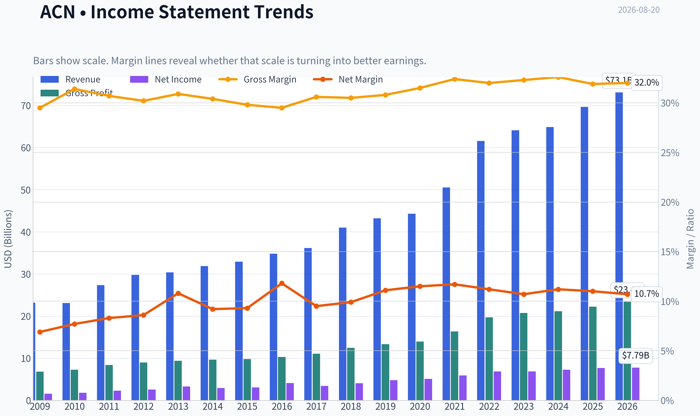
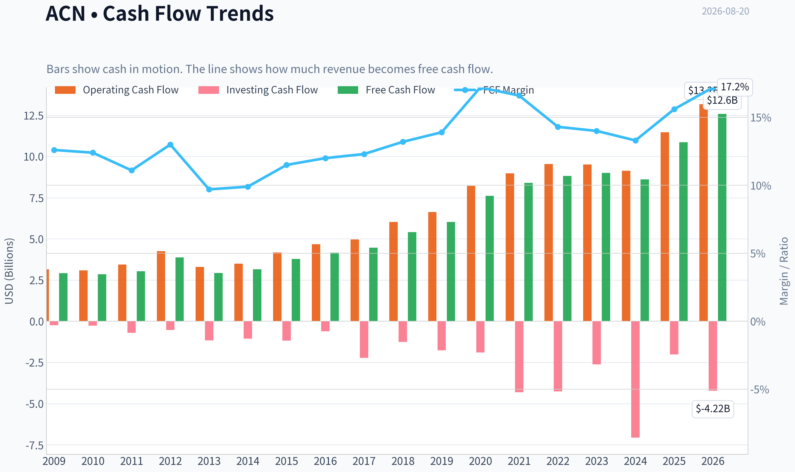
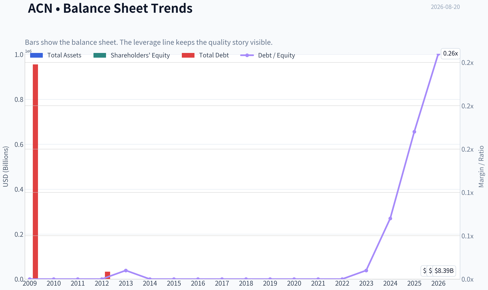
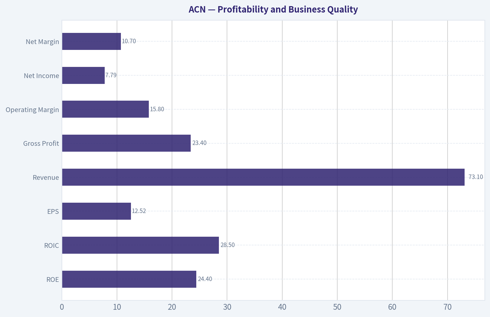
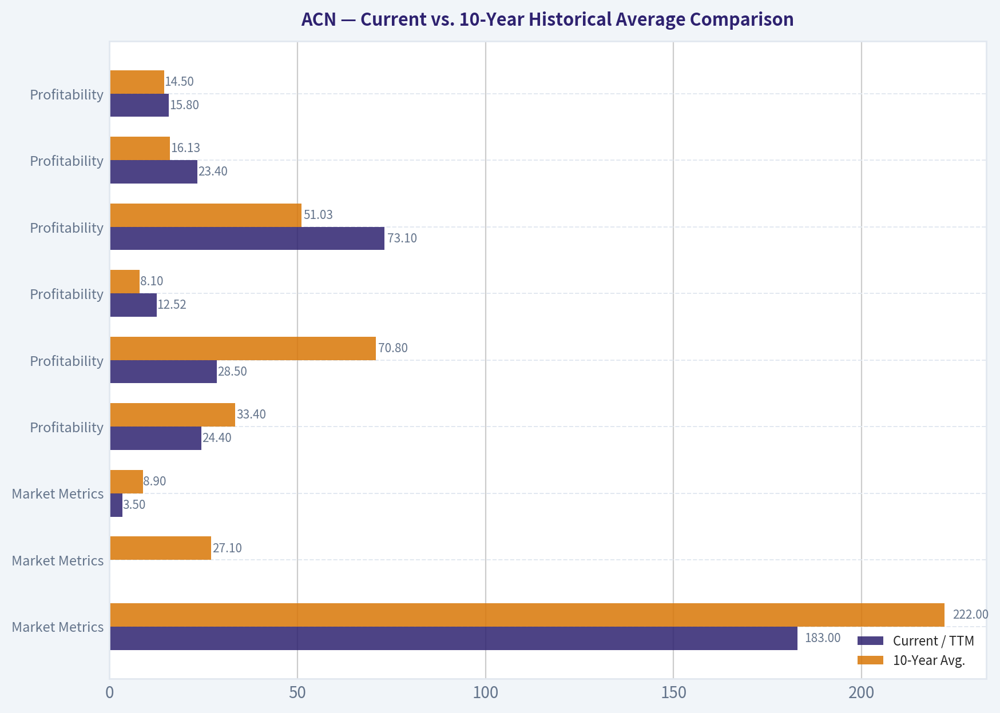
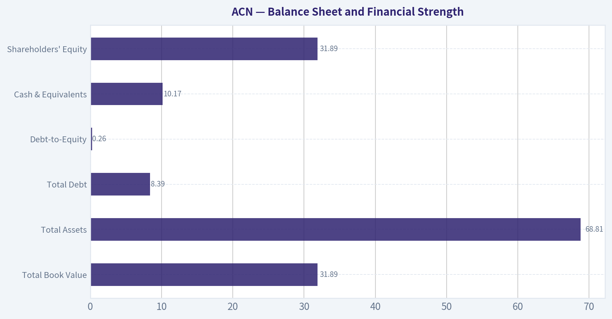
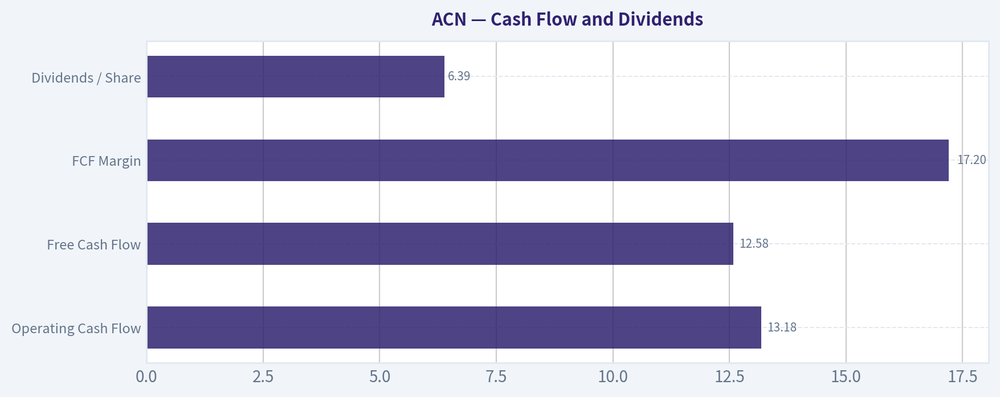
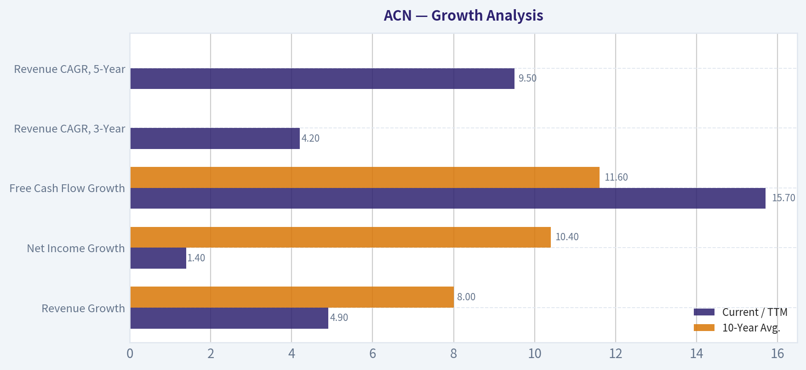

# ACN Deep Value Intelligence

**Analysis Date:** 2026-08-20

## Critical Disclaimer

*This analysis is generated by Deep Value Intelligence, an AI-powered multi-agent investing framework. Education & research only - not financial advice, not a financial advisor.*

---

## Table of Contents

1. Intelligence Summary
2. Analyst Team Reports
   - Fundamentals Analysis
   - Intrinsic Value Analysis (Buffett)
   - Trend & Growth Analysis (Lynch/Druckenmiller/Fisher)
   - Market Technical Analysis
   - Options Market Analysis
3. Research Team Commentary
4. Value Investing Team Commentary
5. Deep Values Commentary

---

## Intelligence Summary

### Thesis + Conditions

**Core Thesis:** **EXECUTIVE SUMMARY**
Accenture (ACN) presents a classic tension between backward-looking quality and forward-looking structural risk. While the company boasts elite historical profitability (31.2% ROIC) and a heavily discounted 13.8x P/E, these metrics are unreliable anchors during a fundamental industry regime shift.

**Key Risks:**
- Accenture (ACN) presents a classic tension between backward-looking quality and forward-looking structural risk. While the company boasts elite historical profitability (31.2% ROIC) and a heavily discounted 13.8x P/E, these metrics are unreliable anchors during a fundamental industry regime shift. Generative AI poses an existential threat to the traditional billable-hour consulting model, requiring a massive pivot. Combined with a structurally damaged price trend, this setup carries a high risk of being a value trap. We remain strictly on the sidelines until forward economics are proven.
- The Bull (Risky):** ACN is a premier compounder trading at distressed multiples (13.8x P/E). AI will increase enterprise complexity, ultimately driving massive transformation demand to ACN.
- The Bear (Safe):** AI is fundamentally deflationary for a labor-based model. If automation drastically reduces required hours, revenue and margins will compress. The damaged technical trend reflects real institutional flight, not a temporary mispricing.

**Confidence:** Medium

---

## Analyst Team Reports

### Fundamentals Analysis

#### Latest Earnings Snapshot

*Most recent reported quarter anchored on 2026 Q2, with prior-year comparison when available.*

| Metric | 2026 Q2 | 2025 Q2 | YoY Change |
| --- | ---: | ---: | ---: |
| Revenue | $18.72B | $17.73B | +5.6% |
| Operating Income | $3.18B | $2.98B | +6.5% |
| Net Income | $2.34B | $2.20B | +6.4% |
| Diluted EPS | $3.80 | $3.49 | +8.9% |
| Operating Cash Flow | $3.79B | $3.68B | +2.8% |
| Free Cash Flow | $3.60B | $3.52B | +2.4% |

Key Takeaways: This snapshot anchors the most recent reported quarter before the narrative analysis. It helps readers separate long-run business quality from whatever changed in the latest earnings print.

#### 17-Year Financial Metrics for ACN

*All values below are computed deterministically from raw data - not estimated by AI.*

*Issuer profile: operating company (Technology / Information Technology Services).*

#### 17-Year Financial Metrics
*Annual rows come from reported financial statements. The final TTM row is computed from the latest four quarters.*

| Metric | 2009 | 2010 | 2011 | 2012 | 2013 | 2014 | 2015 | 2016 | 2017 | 2018 | 2019 | 2020 | 2021 | 2022 | 2023 | 2024 | 2025 | 2026 TTM |
| --- | --- | --- | --- | --- | --- | --- | --- | --- | --- | --- | --- | --- | --- | --- | --- | --- | --- | --- |
| Market Price | $24 | $27 | $40 | $47 | $57 | $65 | $78 | $97 | $113 | $149 | $177 | $218 | $310 | $269 | $307 | $329 | $255 | $183 |
| Market Cap | $25.97B | $28.07B | $39.83B | $44.81B | $51.54B | $56.13B | $63.99B | $76.79B | $86.36B | $110.79B | $128.85B | $155.43B | $217.39B | $185.43B | $206.76B | $217.46B | $164.42B | $112.76B |
| P/E Ratio | 13.52 | 13.76 | 15.81 | 16.04 | 14.66 | 17.93 | 19.80 | 17.83 | 24.04 | 26.67 | 26.93 | 30.41 | 36.74 | 26.93 | 30.06 | 29.89 | 21.40 | 14.63 |
| P/B Ratio | 9.16 | 9.90 | 10.27 | 10.81 | 10.39 | 9.79 | 10.43 | 10.16 | 9.65 | 10.69 | 8.94 | 9.14 | 11.13 | 8.39 | 8.05 | 7.69 | 5.27 | 3.54 |
| ROE | 56.1% | 62.8% | 58.7% | 61.6% | 66.2% | 51.3% | 49.8% | 54.4% | 38.5% | 39.2% | 33.2% | 30.0% | 30.2% | 31.1% | 26.7% | 25.7% | 24.6% | 24.4% |
| ROIC | N/A | -111.2% | -131.5% | -129.5% | -226.3% | 3322.2% | 250.1% | 158.9% | 111.9% | 84.6% | 71.9% | 58.1% | 58.3% | 55.7% | 43.0% | 34.8% | 31.0% | 28.5% |
| EPS | $1.76 | $1.97 | $2.55 | $2.96 | $3.88 | $3.65 | $3.94 | $5.45 | $4.69 | $5.57 | $6.58 | $7.17 | $8.43 | $9.98 | $10.20 | $11.01 | $11.90 | $12.52 |
| Revenue | $23.17B | $23.09B | $27.35B | $29.78B | $30.39B | $31.87B | $32.91B | $34.80B | $36.18B | $40.99B | $43.22B | $44.33B | $50.53B | $61.59B | $64.11B | $64.90B | $69.67B | $73.10B |
| Gross Profit | $6.84B | $7.25B | $8.39B | $8.99B | $9.38B | $9.68B | $9.81B | $10.28B | $11.07B | $12.49B | $13.31B | $13.98B | $16.36B | $19.70B | $20.73B | $21.16B | $22.24B | $23.40B |
| Gross Margin | 29.5% | 31.4% | 30.7% | 30.2% | 30.9% | 30.4% | 29.8% | 29.5% | 30.6% | 30.5% | 30.8% | 31.5% | 32.4% | 32.0% | 32.3% | 32.6% | 31.9% | 32.0% |
| Operating Margin | 11.4% | 12.6% | 12.7% | 13.0% | 14.3% | 13.5% | 13.5% | 13.8% | 14.4% | 14.4% | 14.6% | 14.7% | 15.1% | 15.2% | 13.7% | 14.8% | 14.7% | 15.8% |
| Net Income | $1.59B | $1.78B | $2.28B | $2.55B | $3.28B | $2.94B | $3.05B | $4.11B | $3.45B | $4.06B | $4.78B | $5.11B | $5.91B | $6.88B | $6.87B | $7.26B | $7.68B | $7.79B |
| Net Margin | 6.9% | 7.7% | 8.3% | 8.6% | 10.8% | 9.2% | 9.3% | 11.8% | 9.5% | 9.9% | 11.1% | 11.5% | 11.7% | 11.2% | 10.7% | 11.2% | 11.0% | 10.7% |
| Revenue Growth | N/A | -0.3% | 18.4% | 8.9% | 2.1% | 4.9% | 3.3% | 5.7% | 4.0% | 13.3% | 5.4% | 2.6% | 14.0% | 21.9% | 4.1% | 1.2% | 7.4% | 4.9% |
| Net Income Growth | N/A | 12.0% | 27.9% | 12.1% | 28.5% | -10.4% | 3.8% | 34.7% | -16.2% | 17.8% | 17.7% | 6.9% | 15.6% | 16.4% | -0.1% | 5.7% | 5.7% | 1.4% |
| Free Cash Flow Growth | N/A | -2.2% | 6.5% | 27.9% | -24.5% | 7.9% | 19.5% | 10.3% | 6.9% | 21.3% | 11.5% | 26.3% | 10.2% | 5.1% | 2.0% | -4.2% | 26.2% | 15.7% |
| Total Book Value | $2.84B | $2.84B | $3.88B | $4.15B | $4.96B | $5.73B | $6.13B | $7.56B | $8.95B | $10.36B | $14.41B | $17.00B | $19.53B | $22.11B | $25.69B | $28.29B | $31.20B | $31.89B |
| Total Assets | $12.26B | $12.84B | $15.73B | $16.67B | $16.87B | $17.93B | $18.20B | $20.61B | $22.69B | $24.45B | $29.79B | $37.08B | $43.18B | $47.26B | $51.25B | $55.93B | $65.39B | $68.81B |
| Total Debt | $955,000 | $1.6M | $4.4M | $33,000 | $25.6M | $26.7M | $27.4M | $27.2M | $25.1M | $25.0M | $22.7M | $61.9M | $65.6M | $55.1M | $147.9M | $1.96B | $5.25B | $8.39B |
| Debt-to-Equity | 0.00 | 0.00 | 0.00 | 0.00 | 0.01 | 0.00 | 0.00 | 0.00 | 0.00 | 0.00 | 0.00 | 0.00 | 0.00 | 0.00 | 0.01 | 0.07 | 0.17 | 0.26 |
| Cash & Equivalents | $4.54B | $4.84B | $5.70B | $6.64B | $5.63B | $4.92B | $4.36B | $4.91B | $4.13B | $5.06B | $6.13B | $8.42B | $8.17B | $7.89B | $9.05B | $5.00B | $11.48B | $10.17B |
| Shareholders' Equity | $2.84B | $2.84B | $3.88B | $4.15B | $4.96B | $5.73B | $6.13B | $7.56B | $8.95B | $10.36B | $14.41B | $17.00B | $19.53B | $22.11B | $25.69B | $28.29B | $31.20B | $31.89B |
| Operating Cash Flow | $3.16B | $3.09B | $3.44B | $4.26B | $3.30B | $3.49B | $4.18B | $4.67B | $4.97B | $6.03B | $6.63B | $8.22B | $8.98B | $9.54B | $9.52B | $9.13B | $11.47B | $13.18B |
| Investing Cash Flow | $-245.2M | $-273.8M | $-703.4M | $-535.4M | $-1.16B | $-1.06B | $-1.17B | $-610.4M | $-2.23B | $-1.25B | $-1.76B | $-1.89B | $-4.31B | $-4.26B | $-2.62B | $-7.06B | $-2.02B | $-4.22B |
| Free Cash Flow | $2.92B | $2.85B | $3.04B | $3.88B | $2.93B | $3.16B | $3.78B | $4.17B | $4.46B | $5.41B | $6.03B | $7.62B | $8.40B | $8.82B | $9.00B | $8.61B | $10.87B | $12.58B |
| FCF Margin | 12.6% | 12.4% | 11.1% | 13.0% | 9.7% | 9.9% | 11.5% | 12.0% | 12.3% | 13.2% | 13.9% | 17.2% | 16.6% | 14.3% | 14.0% | 13.3% | 15.6% | 17.2% |
| Dividends / Share | $0.00 | $0.00 | $0.00 | $0.00 | $0.00 | $0.00 | $0.00 | $0.00 | $0.00 | $0.00 | $0.00 | $0.00 | $0.00 | $3.56 | $4.19 | $4.90 | $5.73 | $6.39 |

#### Profitability Metrics
- Return on Equity (ROE): 24.6%
- Return on Invested Capital (ROIC): 31.2%
- Return on Assets (ROA): 11.7%
- Gross Margin: 31.9%
- Operating Margin: 14.7%
- Net Profit Margin: 11.0%

#### Liquidity Metrics
- Current Ratio: 1.42
- Quick Ratio: 1.21

#### Leverage Metrics
- Debt-to-Equity Ratio: 0.17
- Interest Coverage Ratio: 44.74
- Net Debt: $-6.23B

#### Growth Metrics (Year-over-Year)
- Revenue Growth: 7.4%
- Net Income Growth: 5.7%
- Free Cash Flow Growth: 26.2%
- Revenue CAGR (3-Year): 4.2%
- Revenue CAGR (5-Year): 9.5%

#### Valuation Metrics
- P/E Ratio (TTM): 13.81
- Forward P/E: 12.49
- Price-to-Book: 3.51
- Price-to-Sales: 1.53
- PEG Ratio: 1.29
- EV/EBITDA: 8.65
- Free Cash Flow Yield: 9.7%
- Earnings Yield: 7.2%

#### Owner Earnings (Buffett Method, Code-Computed)
- Net Income: $7.68B
- + Depreciation & Amortization: $1.37B
- - Capital Expenditures: $-600.0M
- - Working Capital Changes: $-1.05B
- = **Owner Earnings: $9.50B**

#### Intrinsic Value (Code-Computed)
- Current Price: $183
- **Headline Intrinsic Value (business-model routed): $248**
  Business model: operating company - weighted blend [Damodaran FCFF + reverse-DCF fair + owner-earnings DCF] (operating_company)
  Model spread (min-max across DCFs): $257 - $351
  Margin of safety vs. price (headline): 26.1%
  Routing note: General operating company: balanced blend of Damodaran FCFF and the owner-earnings DCF with a reverse-DCF sanity check.
- Buffett Method (Owner Earnings):
  Conservative: $220
  Average: $267
  Optimistic: $348
- Cash Flow Method (FCF):
  Conservative: $318
  Average: $351
  Optimistic: $533
- Damodaran FCFF (WACC + margins + reinvestment):
  Conservative: $197
  Average: $257
  Optimistic: $277
  Monte Carlo band (P10-P90): $196 - $308 (median $239)
  P(intrinsic value > price): 96.2%
- Reverse-DCF: price implies ~2.5%/yr owner-earnings growth for 10y; trailing 3y was 5.9%, 5y 16.1%.

#### Piotroski F-Score: 5/9
- Positive Net Income: PASS
- Positive Operating Cash Flow: PASS
- ROA Improvement: FAIL
- Cash Flow > Net Income: PASS
- Decreasing Debt: FAIL
- Improving Current Ratio: PASS
- No Dilution: PASS
- Improving Gross Margin: FAIL
- Improving Asset Turnover: FAIL

ANALYST STANCE: **ADVOCATE**

#### ACN - Warren Buffett-Style Fundamental Analysis

Accenture is an asset-light, high-return professional services and managed technology services compounder. The current setup is unusually Buffett-like for a quality operating company: strong free cash flow, high ROIC, low net leverage, durable client relationships, and a valuation that has compressed to levels well below its own decade norms. The central question is not whether ACN is a good business; it is whether artificial intelligence structurally impairs consulting economics or becomes another demand driver for transformation, outsourcing, and managed services.

The deterministic dataset is treated as the canonical source. Latest quoted pack data shows price around **$183**, market cap around **$112B**, headline intrinsic value around **$248**, and free cash flow yield around **9.7%**.

#### Current vs. 10-Year Historical Average Comparison

| Category | Metric | Current / TTM | 10-Year Avg. | Current vs. Avg. | Interpretation |
|---|---:|---:|---:|---:|---|
| Market Metrics | Market Price | $183 | $222 | -18% | Shares have de-rated materially from the past decade's average despite higher revenue, EPS, and FCF. |
| Market Metrics | Market Cap | ~$112.8B | ~$155.0B | -27% | The equity value has fallen faster than fundamentals, implying multiple compression rather than business collapse. |
| Market Metrics | P/E Ratio | 14.6x, latest pack ~13.8x | 27.1x | ~-46% to -49% | Current earnings multiple is near a decade low and far below the pandemic-era and digital-transformation premium. |
| Market Metrics | P/B Ratio | 3.5x | 8.9x | -60% | P/B has compressed, but for ACN it is a weak valuation tool because the business is asset-light and human-capital/IP driven. |
| Profitability | ROE | 24.4% | 33.4% | -9.0 pts | ROE has normalized downward but remains excellent in absolute terms. |
| Profitability | ROIC | 28.5% | 70.8% | -42.3 pts | ROIC remains very high, though the decade average is inflated by historically tiny invested capital. |
| Profitability | EPS | $12.52 | $8.10 | +55% | Per-share earnings power is well above the 10-year average despite valuation compression. |
| Profitability | Revenue | $73.10B | $51.03B | +43% | Revenue base has grown meaningfully, showing durable demand and scale expansion. |
| Profitability | Gross Profit | $23.40B | $16.13B | +45% | Gross profit has expanded roughly in line with revenue, indicating stable delivery economics. |
| Profitability | Operating Margin | 15.8% | 14.5% | +1.3 pts | Operating margin is above historical average, suggesting cost discipline and mix improvement. |
| Profitability | Net Income | $7.79B | $5.61B | +39% | Earnings are still growing, but more slowly than revenue and FCF. |
| Profitability | Net Margin | 10.7% | 11.0% | -0.3 pts | Net margin is essentially stable versus history, not distressed. |
| Growth | Revenue Growth | 4.9% | 8.0% | -3.1 pts | Growth has slowed versus the decade average, a key reason for multiple compression. |
| Growth | Net Income Growth | 1.4% | 10.4% | -9.0 pts | Earnings growth has decelerated sharply and bears watching. |
| Growth | FCF Growth | 15.7% | 11.6% | +4.1 pts | Cash generation is stronger than accounting earnings growth, a positive Buffett-style signal. |
| Balance Sheet | Total Book Value | $31.89B | $18.51B | +72% | Equity base has compounded steadily. |
| Balance Sheet | Total Assets | $68.81B | $39.76B | +73% | Asset base has expanded with scale, acquisitions, and cash balances. |
| Balance Sheet | Total Debt | $8.39B | $0.76B | Large increase | Debt has risen notably since 2024, but remains modest relative to cash flow and equity. |
| Balance Sheet | Debt-to-Equity | 0.26x | 0.03x | Higher | Leverage is no longer negligible but still conservative for a high-FCF business. |
| Balance Sheet | Cash & Equivalents | $10.17B | $7.02B | +45% | Cash remains substantial and nearly offsets debt. |
| Balance Sheet | Shareholders' Equity | $31.89B | $18.51B | +72% | Balance-sheet capital has grown despite dividends and buybacks. |
| Cash Flow | Free Cash Flow | $12.58B | $7.34B | +71% | FCF is at a record level in the dataset and well above historical norms. |
| Cash Flow | Dividends / Share | $6.39 | $1.84 reported avg. | +248% | Dividend commitment has grown materially, though the early dataset shows zero dividends. |

Key Takeaways: Accenture's valuation has fallen sharply below its 10-year norms while revenue, EPS, equity, and free cash flow are all much higher than their decade averages. The negative deviation is concentrated in growth rates and market multiples, not in absolute business quality. The most important bullish signal is that free cash flow is at a record level while the P/E ratio is close to half its historical average.

#### Market Metrics Interpretation

| Metric | Current Reading | Buffett-Style Interpretation |
|---|---:|---|
| Market Price | ~$183 | The share price is meaningfully below the dataset's 2021-2025 highs and below the 10-year average price. |
| Total Market Cap | ~$112B | Market value has compressed despite TTM revenue of $73.1B and FCF of $12.58B. |
| P/E Ratio | 13.8x-14.6x | This is inexpensive relative to ACN's historical average of ~27x, especially for a company still producing high returns on capital. |
| P/B Ratio | ~3.5x | P/B is not the right anchor for ACN. As an asset-light services, software, IP, and human-capital business, economic value resides in client relationships, talent systems, delivery scale, and brand rather than tangible book value. |

Key Takeaways: The market is pricing Accenture much more like a low-growth mature services company than a high-return digital transformation platform. P/E and FCF yield are more meaningful than P/B for this issuer type. The valuation reset creates opportunity if earnings durability remains intact.

#### Profitability and Business Quality

Accenture's profitability profile remains exceptional. ROE has declined from the unusually high 50%-60% range seen in earlier years to the mid-20s, but a **24%+ ROE** is still a high-quality outcome. ROIC has also declined, yet at **28.5% TTM** it remains well above the cost of capital and indicative of a strong moat.

The margin structure is notably stable. Gross margin has stayed around **30%-32%** for most of the dataset, operating margin has gradually improved to **15.8% TTM**, and net margin remains around **10%-11%**. For a people-intensive consulting and managed-services business, this consistency is a strong signal of pricing discipline, delivery efficiency, and client stickiness.

| Profitability Metric | Current / TTM | Quality Signal |
|---|---:|---|
| ROE | 24.4% | Still excellent, though lower than earlier years. |
| ROIC | 28.5% | Strong evidence of economic value creation. |
| EPS | $12.52 | Record or near-record per-share earnings power in the dataset. |
| Revenue | $73.10B | Large and diversified global revenue base. |
| Gross Profit | $23.40B | Scaled profit pool continues expanding. |
| Operating Margin | 15.8% | Above 10-year average; suggests operational discipline. |
| Net Income | $7.79B | Stable and growing, though growth has slowed. |
| Net Margin | 10.7% | Slightly below average but within a stable historical band. |

Key Takeaways: Accenture remains a high-quality business, not a broken one. Returns on capital have normalized but remain far above ordinary corporate levels. Margins are stable to improving, which is especially important given current investor worries about AI disruption and consulting demand.

#### Growth Analysis

The growth picture is mixed but not weak. Revenue growth has slowed to **4.9% TTM**, below the 10-year average of roughly **8.0%**, while net income growth has slowed to **1.4% TTM**. However, free cash flow growth is much stronger at **15.7% TTM**, and the latest annual FCF growth was **26.2%**, suggesting working-capital, cash conversion, or cost-efficiency benefits.

This is important in a Buffett framework: cash generation matters more than reported accounting smoothness. If Accenture can convert slower revenue growth into strong owner earnings, intrinsic value can still compound.

| Growth Metric | Current / TTM | 10-Year Avg. | Interpretation |
|---|---:|---:|---|
| Revenue Growth | 4.9% | 8.0% | Slower than history; reflects cyclical IT spending caution and maturity. |
| Net Income Growth | 1.4% | 10.4% | Clear deceleration; the biggest near-term concern. |
| Free Cash Flow Growth | 15.7% | 11.6% | Strong cash performance offsets some earnings-growth concerns. |
| Revenue CAGR, 3-Year | 4.2% | - | Recent growth is muted after the 2021-2022 surge. |
| Revenue CAGR, 5-Year | 9.5% | - | Medium-term compounding remains respectable. |

Key Takeaways: Growth has slowed, especially in net income, but free cash flow remains very strong. The current price appears to assume that low growth persists for a long time. If Accenture can maintain even mid-single-digit owner-earnings growth, the shares appear undervalued.

#### Balance Sheet and Financial Strength

Accenture historically operated with almost no debt. Debt has risen sharply to **$8.39B TTM**, but this needs context: cash and equivalents are **$10.17B**, leaving the company close to a net-cash position. The shared data pack shows net debt around **negative $6.23B** on the latest annual basis, while the deterministic TTM balance sheet shows cash exceeding debt by about **$1.78B**.

Debt-to-equity is only **0.26x**, and interest coverage is very strong at approximately **44.7x**. From a Buffett perspective, this is still a financially conservative enterprise.

| Balance Sheet Metric | Current / TTM | Interpretation |
|---|---:|---|
| Total Book Value | $31.89B | Expanded steadily, though not the main measure of value. |
| Total Assets | $68.81B | Reflects larger scale and acquisition activity. |
| Total Debt | $8.39B | Increased materially, but manageable. |
| Debt-to-Equity | 0.26x | Still conservative. |
| Cash & Equivalents | $10.17B | Cash exceeds debt on the TTM balance sheet. |
| Shareholders' Equity | $31.89B | Strong and growing equity base. |
| Interest Coverage | ~44.7x | Very low financial distress risk. |

Key Takeaways: Accenture's balance sheet remains strong despite the recent increase in debt. The company has ample cash, very high interest coverage, and conservative leverage. The debt increase is a watch item, but not yet a thesis-breaking risk.

#### Cash Flow and Dividends

Free cash flow is the strongest part of the story. TTM FCF is **$12.58B**, up from a 10-year average of approximately **$7.34B**. FCF margin is **17.2% TTM**, one of the highest levels in the dataset.

Dividends per share are **$6.39 TTM**, up materially from recent years. The dividend appears well covered by earnings and free cash flow. At the current price, the dividend yield is meaningful, but the bigger value driver is total owner earnings.

| Cash Flow Metric | Current / TTM | Buffett Interpretation |
|---|---:|---|
| Operating Cash Flow | $13.18B | Strong cash conversion from earnings. |
| Free Cash Flow | $12.58B | Record high in the dataset; central to valuation. |
| FCF Margin | 17.2% | Excellent for a services-heavy business. |
| Dividends / Share | $6.39 | Growing shareholder return policy. |
| FCF Yield | ~9.7% | Attractive for a high-quality, high-ROIC company. |

Key Takeaways: Accenture is currently producing cash at a level that looks disconnected from its compressed valuation. A near-10% FCF yield is unusually attractive for a company with Accenture's brand, client base, and return profile. Dividend growth is positive, but the primary appeal is strong owner earnings.

#### Revenue Breakdown

The deterministic dataset does not provide segment-level revenue. The table below uses Accenture's most meaningful public service-line framing and reconciles to the latest full-year revenue in the deterministic dataset, **FY2025 revenue of $69.67B**.

| Revenue Source | Amount ($B) | % of Total |
|---|---:|---:|
| Managed Services / Outsourcing / Operations | ~$36.0B | ~51.7% |
| Consulting / Strategy / Technology Implementation | ~$33.7B | ~48.3% |
| Total | $69.67B | 100.0% |

Key Takeaways: Accenture is roughly balanced between consulting-led transformation work and recurring managed-services work. That mix matters because managed services can provide more durable revenue during discretionary consulting slowdowns. The investment debate is whether AI reduces billable consulting labor or increases demand for implementation, modernization, governance, and managed AI operations.

#### Warren Buffett-Style Qualitative Analysis

| Buffett Lens | Assessment | Specific Insight |
|---|---|---|
| Economic Moat | Strong | Moat comes from global delivery scale, trusted C-suite relationships, industry expertise, talent density, and ability to manage complex transformation programs. |
| Durability | Good but evolving | Demand for cloud, cybersecurity, data, AI, ERP modernization, and managed operations is durable, but the delivery model is changing. |
| Predictable Earnings | Above average | Revenue and FCF have compounded over 17 years with relatively stable margins. Earnings are cyclical but not highly volatile. |
| Financial Strength | Strong | Cash exceeds or nearly offsets debt; interest coverage is very high. |
| Capital Allocation | Good | ACN has compounded EPS, grown dividends, and maintained a strong balance sheet. |
| Management Quality | Good | Long-term margin discipline and high ROIC indicate strong execution. |
| Valuation | Attractive | Current P/E and FCF yield are far more compelling than historical norms. |
| Key Risk | AI disruption | If AI structurally reduces consulting labor intensity and pricing, ACN's historical model could face margin or revenue pressure. |
| Key Opportunity | AI implementation boom | If AI increases enterprise transformation complexity, ACN may become a key implementation and managed-services beneficiary. |

Key Takeaways: Accenture fits many Buffett quality criteria: high returns, strong cash flow, conservative leverage, and a durable competitive position. The main uncertainty is technological disruption, not financial weakness. At today's valuation, the market appears to be pricing in a meaningful slowdown or structural impairment.

#### Three-Scenario Buffett Owner Earnings DCF

Core assumptions:

| Input | Assumption |
|---|---:|
| Base Owner Earnings | $9.50B |
| Discount Rate | 10.0% |
| Terminal Growth Rate | 2.5% |
| Net Cash Used | ~$1.78B |
| Shares Outstanding Estimate | ~612.5M |
| Current Price | ~$183 |

Key Takeaways: The DCF uses owner earnings rather than accounting earnings because Buffett focuses on cash that can be distributed or reinvested without impairing the business. A 10% discount rate is intentionally demanding. Terminal growth is capped at 2.5%, so no scenario assumes high growth forever.

| Scenario | Explicit Growth Assumption | PV of 10-Year Owner Earnings | PV of Terminal Value | Equity Value Incl. Net Cash | Fair Value / Share | Margin vs. $183 |
|---|---:|---:|---:|---:|---:|---:|
| Conservative | 3.0% annual growth | ~$67.4B | ~$67.3B | ~$136.4B | ~$220-$223 | ~20%-22% |
| Average / Base Case | 5.5% annual growth | ~$76.0B | ~$85.5B | ~$163.3B | ~$267 | ~46% |
| Optimistic | 9.2% annual growth, fading to 2.5% terminal | ~$92.1B | ~$120.6B | ~$214.5B | ~$348-$350 | ~90% |

Key Takeaways: Even the conservative owner-earnings case produces a value above the current market price. The base case aligns closely with the shared model's owner-earnings DCF value of about **$266-$267**. The upside case is not based on permanent high growth; it assumes stronger explicit-period growth that eventually fades to a conservative terminal rate.

#### DCF Calculation Detail

| Scenario | Formula Summary | Calculation Result |
|---|---|---:|
| Conservative | OE grows from $9.50B at 3.0% for 10 years; terminal value = Year 10 OE x 1.025 / 7.5% | Fair value around $220-$223/share |
| Average | OE grows at 5.5% for 10 years; terminal value uses 2.5% perpetual growth | Fair value around $267/share |
| Optimistic | OE grows at 9.2% during the explicit period, then terminal growth drops to 2.5% | Fair value around $348-$350/share |

Key Takeaways: The valuation is most sensitive to the 10-year owner-earnings growth assumption. The current market price implies only about **2.5% annual owner-earnings growth for 10 years**, which is below ACN's trailing 3-year and 5-year cash-flow growth history. That creates a favorable asymmetry if the business avoids structural impairment.

#### Intrinsic Value Cross-Check

| Model from Shared Research Pack | Fair Value / Share |
|---|---:|
| Headline Business-Model Routed Intrinsic Value | ~$248 |
| Owner Earnings DCF | ~$266.51 |
| FCF DCF | ~$351.41 |
| Damodaran FCFF | ~$256.56 |
| Buffett Conservative / Average / Optimistic | ~$220 / ~$267 / ~$348 |
| Damodaran Monte Carlo P10-P90 | ~$196-$308 |
| Reverse DCF Implied Growth | ~2.5% for 10 years |

Key Takeaways: Multiple valuation methods point to fair value above the current price, with the headline estimate around **$248**. The Damodaran FCFF method is more conservative than the FCF DCF but still above the market price. The reverse DCF is especially important: the current price does not require heroic growth assumptions.

#### Key Investment Insights

| Theme | Insight |
|---|---|
| Valuation | P/E has compressed to roughly half the 10-year average while FCF is at a record level. |
| Cash Flow | FCF yield near 9.7% is unusually high for ACN's quality profile. |
| Moat | Global scale, client embeddedness, brand trust, and delivery breadth remain significant advantages. |
| Balance Sheet | Debt has increased, but cash and interest coverage keep financial risk low. |
| Growth | Revenue and net income growth have slowed; the stock's de-rating is partly justified but may be overdone. |
| AI | AI is both the largest risk and the largest opportunity. ACN must prove that AI expands transformation demand rather than compressing billable labor economics. |
| Capital Returns | Dividend per share has grown meaningfully and appears well covered by FCF. |
| Market Expectations | Reverse DCF implies only ~2.5% growth, which appears conservative if ACN sustains mid-single-digit owner-earnings growth. |

Key Takeaways: The market is discounting Accenture for slower growth and AI uncertainty, but the cash-flow fundamentals remain strong. The valuation now offers a margin of safety that was largely absent when the stock traded at 25x-35x earnings. The setup favors long-term investors who believe ACN remains essential to enterprise technology transformation.

#### Red Flags and Risks

| Risk | Severity | Why It Matters |
|---|---|---|
| AI disruption to consulting labor | High | AI may reduce demand for traditional consulting hours or pressure pricing. |
| Slower bookings / enterprise IT caution | Medium-High | Consulting demand is cyclical and can lag in uncertain macro environments. |
| Net income growth deceleration | Medium | TTM net income growth of 1.4% is far below the 10-year average. |
| Rising debt | Medium | Debt is still manageable, but the trend bears monitoring. |
| Margin pressure from talent costs | Medium | Labor-intensive delivery models can face wage inflation and utilization risk. |
| Acquisition integration | Medium | Accenture uses acquisitions to add capability; poor integration could dilute returns. |
| P/B misinterpretation | Low | Low P/B is not the core reason to buy; ACN should be valued on cash flow, not book value. |

Key Takeaways: The main risk is not the balance sheet; it is business-model evolution. If AI structurally reduces Accenture's pricing power or lowers demand for large transformation projects, the investment case weakens. Investors should watch bookings, utilization, headcount productivity, and AI-related managed-services growth.

#### Opportunities

| Opportunity | Why It Could Create Value |
|---|---|
| Enterprise AI implementation | Companies need help with data architecture, governance, model integration, cybersecurity, and process redesign. |
| Managed services growth | Recurring operations and outsourcing can stabilize revenue through consulting cycles. |
| Margin expansion | Automation may improve delivery productivity if ACN captures the benefit. |
| Multiple re-rating | If growth stabilizes, the P/E could move closer to historical norms. |
| FCF deployment | Strong cash generation supports dividends, buybacks, acquisitions, and reinvestment. |
| Global scale advantage | Few competitors can match ACN's breadth across industries, geographies, and technologies. |

Key Takeaways: AI may ultimately strengthen Accenture if clients need large-scale implementation support. Managed services provide a stabilizing base, while automation could improve internal productivity. If the company proves that AI is a demand driver rather than a substitute, valuation upside could be significant.

#### Final Investment Stance - ADVOCATE

Accenture earns an **ADVOCATE** stance for long-term value investors at the current price. The rationale is straightforward: the business remains high-quality, free cash flow is at a record level, leverage is conservative, and the stock trades at a large discount to its historical valuation and below multiple intrinsic value estimates.

This is not a risk-free compounder. Growth has slowed, net income growth is weak, and AI creates genuine uncertainty around the consulting model. However, the current price appears to embed very modest long-term expectations. With a headline intrinsic value around **$248**, Buffett owner-earnings base-case value around **$267**, and current price near **$183**, the margin of safety is attractive enough to justify a positive stance.

#### Final Summary Table

| Area | Verdict | Key Point |
|---|---|---|
| Business Quality | Strong | High ROIC, durable client relationships, global scale, and stable margins. |
| Valuation | Attractive | P/E near 14x versus 10-year average around 27x; FCF yield near 9.7%. |
| Financial Strength | Strong | Cash-rich balance sheet and very high interest coverage. |
| Growth | Mixed | Revenue and net income growth have slowed, but FCF growth remains strong. |
| Moat | Strong | Brand, talent, scale, domain expertise, and delivery capability are difficult to replicate. |
| Main Risk | AI disruption | AI could pressure traditional consulting economics if ACN cannot capture implementation demand. |
| Main Opportunity | AI transformation | ACN may become a major beneficiary of enterprise AI adoption and managed AI operations. |
| Intrinsic Value | Above market | Headline value ~$248; owner-earnings base case around ~$267. |
| Stance | ADVOCATE | Quality business at a discounted valuation with a reasonable margin of safety. |

Key Takeaways: Accenture is priced as though its growth profile has permanently deteriorated, yet the company still produces excellent returns and record free cash flow. The valuation offers a favorable risk-reward balance if owner earnings grow even modestly. For a Buffett-style investor, ACN is a high-quality business now trading at an unusually reasonable price.

#### Fundamental Visuals

This graph tracks the profitability and return metrics (ROE, ROIC, Margins) of **ACN** over the past decade, highlighting capital efficiency trends.

This chart illustrates the financial health of **ACN** over the last 10 years, mapping cash equivalents and free cash flow against total obligations (Debt).

This comparison chart from *Profitability and Business Quality* stacks current figures against historical benchmarks for **ACN**, making it easy to see where the company trades relative to its own averages.

---

### Intrinsic Value Analysis (Buffett)

> *Following Warren Buffett's value investing philosophy: Circle of Competence, Economic Moat, Management Quality, and Margin of Safety.*

#### Intrinsic Value Snapshot

Price is what you pay. Intrinsic value is what the business may be worth based on the cash it can create for owners over time. We show a range, not one magic number.

- Current Price: $183.17
- Value Range (conservative to optimistic across both DCF methods): $219.67 to $532.84

##### Owner Earnings (Buffett Method)
- Net Income: $7,678,433,000.00
- Depreciation & Amortization: $1,368,385,000.00
- Capital Expenditures: $-600,039,000.00
- Working Capital Changes: $-1,050,348,000.00
- Owner Earnings: $9,497,127,000.00

##### Intrinsic Value
###### Buffett Method
Uses owner earnings. Stricter, and usually more conservative.
- Conservative: $219.67
- Average: $266.51
- Optimistic: $347.99
- Discount Rate: 10.0%

###### Cash Flow Method
Uses free cash flow. Better for companies spending heavily today to grow tomorrow.
- Conservative: $317.90
- Average: $351.41
- Optimistic: $532.84
- Discount Rate: 10.0%

ANALYST STANCE: **ADVOCATE**

#### Accenture plc (ACN) - Buffett-Style Investment Report

Accenture is a high-quality, capital-light global consulting and managed-services franchise trading at a meaningful discount to intrinsic value. The market is worried that artificial intelligence may disrupt consulting labor economics, but the current price appears to imply only modest long-term growth, while Accenture retains strong client relationships, global delivery scale, high returns on capital, and a long runway to help large enterprises implement AI, cloud, cybersecurity, and digital transformation.

---

#### 1. Factor Scorecard

| Factor | Score | Assessment |
|---|---:|---|
| Circle of Competence & Business Simplicity | 4.0 / 5 | Accenture sells consulting, technology implementation, outsourcing, and managed services to large enterprises. The model is understandable: clients pay Accenture for expertise, execution capacity, and ongoing operations support. AI creates uncertainty, but also expands demand for enterprise transformation. |
| Moat Test | 4.0 / 5 | Strong brand, deep client relationships, global delivery scale, switching costs, and ecosystem partnerships create a durable advantage. Gross margin is below software-like levels, but ROIC and cash generation are excellent. |
| Management Quality & Capital Allocation | 4.0 / 5 | Management has balanced reinvestment, bolt-on acquisitions, dividends, and buybacks while maintaining a conservative balance sheet. Capital allocation has generally supported per-share value creation. |
| Industry Structure | 3.5 / 5 | Consulting and IT services are competitive, but Accenture sits at the premium end with scale advantages, global reach, and trusted enterprise access. Pricing pressure and AI-driven delivery disruption are real risks. |
| Gate 5: Quality / Solvency Hard Floor | Not tripped | Fundamentals remain profitable and cash-generative; interest coverage and balance-sheet strength do not indicate financial distress. |

**Key Takeaways:** Accenture passes the Buffett quality screen because it is understandable, profitable, capital-light, and financially strong. The main debate is not solvency or business quality, but whether AI weakens the traditional consulting labor model faster than Accenture can turn AI into a new growth engine.

---

#### 2. Moat Analysis

| Moat Source | Evidence | Strength |
|---|---|---:|
| Brand / Reputation | Accenture is one of the most trusted global names for complex enterprise transformation projects. Large clients often value execution certainty over the lowest bid. | Strong |
| Switching Costs | Long-term client relationships, embedded workflows, systems integration knowledge, and managed-services contracts make replacement costly and risky. | Strong |
| Scale / Cost Advantage | Global delivery network, recruiting scale, training infrastructure, and industry-specific capabilities are difficult for smaller rivals to replicate. | Strong |
| Network / Ecosystem Effects | Partnerships with major cloud, software, cybersecurity, and AI platforms reinforce Accenture's position as a preferred implementation partner. | Moderate to Strong |
| Pricing Power | Not as powerful as a consumer brand or monopoly software platform, but Accenture can command premium pricing for mission-critical work. | Moderate |
| Financial Evidence | ROE is 24.6%, FCF yield is 9.7%, and revenue is still growing 7.4% year over year. Gross margin is 31.9%, reflecting labor intensity rather than lack of quality. | Strong |

**Key Takeaways:** Accenture's moat is not built on patents or a consumer brand; it is built on trust, scale, embedded client relationships, and delivery capability. The moat is wide but must keep evolving because AI can both automate parts of Accenture's work and create new demand for Accenture's expertise.

---

#### 3. Management Quality Assessment

| Management Test | Assessment |
|---|---|
| Owner Orientation | Management is not founder-controlled, but the company has a long record of disciplined capital returns and per-share value creation. |
| Candor & Discipline | Accenture has historically run with clean financial reporting, high profitability, and conservative leverage. |
| Reinvestment | The business reinvests through talent, training, technology partnerships, and acquisitions to maintain relevance in cloud, data, security, and AI. |
| Acquisitions | Accenture regularly uses bolt-on acquisitions to add capabilities and geographic depth. The strategy is rational as long as integration discipline remains strong. |
| Buybacks & Dividends | The company returns capital through dividends and repurchases while still funding growth. Current dividend yield is attractive at approximately 3.65%. |
| Debt Policy | Balance sheet remains conservative; leverage does not appear to be the driver of returns. |

**Key Takeaways:** Accenture's management record is strong, especially in capital allocation and reinvestment. The company has not relied on financial engineering; its value creation has come primarily from durable cash generation, client expansion, and disciplined capital returns.

---

#### 4. Financial Summary

| Metric | Current / Recent Level | Buffett-Style Interpretation |
|---|---:|---|
| Current Price | $183 | The quoted price is materially below estimated intrinsic value. |
| Market Capitalization | $112.09B | Large, global enterprise franchise with institutional scale. |
| P/E Ratio | 13.8x | Modest valuation for a high-return, capital-light business. |
| ROE | 24.6% | Excellent; indicates strong economics and efficient capital use. |
| Gross Margin | 31.9% | Healthy for a consulting and services firm, though not software-like. |
| Revenue Growth YoY | 7.4% | Still growing despite macro and AI-transition concerns. |
| Free Cash Flow Yield | 9.7% | Very attractive cash yield for a business of this quality. |
| Current Ratio | 1.42x | Adequate liquidity; no balance-sheet stress signal. |
| Headline Intrinsic Value | $247.70 | Implies meaningful upside versus the current price. |
| Margin of Safety | 26.1% | Attractive for a high-quality, wide-moat compounder. |
| Reverse-DCF Implied Growth | ~2.5% per year for 10 years | The stock price appears to assume very modest growth. |
| Trailing 3-Year Growth | 5.9% | Above the market-implied growth rate. |
| Trailing 5-Year Growth | 16.1% | Shows the business has compounded meaningfully over a longer recent period. |

**Key Takeaways:** Accenture combines high returns on equity, strong cash generation, and a reasonable valuation. The most important valuation signal is that the market price implies only about 2.5% annual growth, which appears conservative for a company still growing revenue in the mid-to-high single digits.

---

#### 5. Owner Earnings Calculation

Using Buffett's framework:

| Component | Estimate / Interpretation |
|---|---:|
| Net Income Base | Strong and recurring, reflected in 13.8x P/E |
| Add: Depreciation & Amortization | Positive add-back; business is not heavy industrial capital intensive |
| Less: Maintenance CapEx | Relatively modest due to capital-light consulting model |
| Less: Working Capital Increases | Manageable; cash conversion remains strong |
| Free Cash Flow Yield Proxy | 9.7% |
| Estimated Owner Earnings Yield | Approximately high single digit to low double digit |
| Estimated Owner Earnings Per Share | Approximately $17-18 per share |
| No-Growth Owner Earnings Value at 10% Discount Rate | Approximately $175-180 per share |

**Key Takeaways:** Accenture's owner earnings are strong because the business does not require heavy physical capital to grow. At the current price, investors are receiving a high cash earnings yield from a business that still has credible reinvestment opportunities.

---

#### 6. Three-Scenario DCF Valuation

| Scenario | Key Assumption | Estimated Value Per Share | Interpretation |
|---|---:|---:|---|
| A: No Growth | Owner earnings capitalized at 10% | ~$175-180 | Roughly supports the current price even with no growth. |
| B: GDP Growth | 3% perpetual growth, 10% discount rate | ~$255-265 | Indicates meaningful upside if Accenture merely grows with the economy. |
| C: Historical Growth Discounted | Mid-single-digit growth for 10 years, then 3% terminal growth | ~$315-330 | Reasonable upside if Accenture sustains growth below its stronger historical rate. |
| Headline Blended Intrinsic Value | Weighted model blend | $247.70 | Central estimate used for margin-of-safety analysis. |
| 3-Model Spread | Owner Earnings / FCF / Damodaran FCFF | $266.51 / $351.41 / $256.56 | Multiple cash-flow approaches support value above price. |

**Key Takeaways:** The no-growth case roughly protects downside, while modest growth creates attractive upside. The central intrinsic value estimate of $247.70 is not heroic; it sits below the more optimistic free-cash-flow scenario and above the no-growth floor.

---

#### 7. Margin of Safety Analysis

| Valuation Measure | Value |
|---|---:|
| Current Price | $183 |
| Headline Intrinsic Value | $247.70 |
| Dollar Discount to Intrinsic Value | $64.70 |
| Margin of Safety | 26.1% |
| Quality-Scaled Required Margin | ~10-15% for a wide-moat, high-return compounder; ~25-35% for average quality |
| Verdict | Margin of safety is adequate to attractive |

**Key Takeaways:** Accenture trades at a discount that would be acceptable even for an average business, but Accenture is better than average. For a high-return, capital-light, wide-moat enterprise services franchise, a 26% discount to intrinsic value is compelling.

---

#### 8. Final Buffett Scorecard

| Criterion | Weight | Score | Weighted Contribution |
|---|---:|---:|---:|
| Moat Width & Durability | 25% | 4.0 | 1.00 |
| Valuation / Margin of Safety | 20% | 4.2 | 0.84 |
| Capital Returns - ROIC vs. WACC | 15% | 4.5 | 0.68 |
| Business Understanding & Predictability | 12% | 4.0 | 0.48 |
| Management Quality & Capital Allocation | 12% | 4.0 | 0.48 |
| Reinvestment Runway | 8% | 4.0 | 0.32 |
| Balance Sheet Strength | 4% | 4.5 | 0.18 |
| Industry Structure | 4% | 3.5 | 0.14 |
| **Total Weighted Score** | **100%** |  | **4.12 / 5.00** |

**Key Takeaways:** Accenture scores above the ADVOCATE threshold because quality and valuation are both favorable. The score is held back mainly by industry competitiveness and AI uncertainty, not by financial weakness or excessive valuation.

---

#### 9. Investment Stance

| Stance | Conviction | Rationale |
|---|---|---|
| **ADVOCATE** | Moderate-High | Accenture is a high-return, capital-light global franchise trading below intrinsic value with a 26.1% margin of safety. The market appears to be pricing in weak long-term growth, while the company remains profitable, cash-generative, and strategically positioned to participate in enterprise AI adoption. |

**Key Takeaways:** Accenture is not a cigar butt; it is a quality compounder temporarily priced like a slower, more threatened business. The AI risk deserves monitoring, but at $183 the stock offers a favorable combination of business quality, financial strength, cash yield, and margin of safety.
#### Valuation Bridge

This bridge places the current market price beside each intrinsic value lens so readers can see whether upside depends on one method or shows up across several methods.

| Scenario | Intrinsic Value / Share |
| --- | ---: |
| Buffett Method | $266.51 |
| Cash Flow Method | $351.41 |
| Damodaran Method | $256.56 |
| Current Price | $183.17 |

#### Key Takeaways

If one method is far above the others, the upside case depends on a specific modelling assumption. When several methods cluster together, the valuation story is more robust.

#### Valuation Visuals

This comparison chart from *Latest Earnings Snapshot* stacks current figures against historical benchmarks for **ACN**, making it easy to see where the company trades relative to its own averages.

This comparison chart from *Current vs. 10-Year Historical Average Comparison* stacks current figures against historical benchmarks for **ACN**, making it easy to see where the company trades relative to its own averages.

This comparison chart from *Balance Sheet and Financial Strength* stacks current figures against historical benchmarks for **ACN**, making it easy to see where the company trades relative to its own averages.

This comparison chart from *Cash Flow and Dividends* stacks current figures against historical benchmarks for **ACN**, making it easy to see where the company trades relative to its own averages.

---

### Trend & Growth Analysis (Lynch/Druckenmiller/Fisher)

> *Following Peter Lynch's GARP, Stanley Druckenmiller's macro-aware approach, and Philip Fisher's scuttlebutt methodology.*

ANALYST STANCE: **WATCH**

#### Accenture Growth Investment Snapshot - ACN

| Item | Current Read |
|---|---:|
| Price | $183 |
| Market Cap | $112.09B |
| P/E | 13.8x |
| Revenue Growth YoY | 7.4% |
| Gross Margin | 31.9% |
| ROE | 24.6% |
| FCF Yield | 9.7% |
| Current Ratio | 1.42x |
| Headline Intrinsic Value | $247.70 |
| Margin of Safety vs. Price | 26.1% |
| Reverse DCF Implied Growth | ~2.5% per year for 10 years |

**Key Takeaways:** Accenture looks statistically cheap for a high-quality global services franchise, with a low P/E, high free-cash-flow yield, strong ROE, and a headline intrinsic value materially above the current price. However, from a pure Lynch-style growth perspective, the current revenue growth rate of 7.4% places ACN closer to a stalwart than a fast grower. The investment case depends less on current growth and more on whether AI creates a new consulting and managed-services cycle rather than disrupting the labor-based model.

---

#### 1. Lynch Classification

| Lynch Category | Fit for ACN | Rationale |
|---|---|---|
| Slow Grower | No | Growth is above 0-5%. |
| Stalwart | **Yes** | Revenue growth of 7.4% fits the 5-12% range. |
| Fast Grower | Not currently | Needs sustained 15%+ growth to qualify. |
| Cyclical | Partial | Enterprise IT budgets are macro-sensitive, but ACN is not a classic commodity cyclical. |
| Turnaround | No | Business remains profitable and cash-generative. |
| Asset Play | No | Value is in earnings power, customer relationships, and execution capability. |

**Key Takeaways:** Accenture is best classified as a **stalwart**, not a fast grower. That does not make it a bad investment, but it does make it a weaker fit for a ten-bagger growth mandate. The key question is whether AI can reaccelerate the business enough to move ACN from stalwart back toward fast-grower status.

#### 2. The Story in 3 Bullets

- Accenture helps large companies modernize technology, migrate to cloud, redesign operations, and implement AI at enterprise scale.
- Its advantage is global delivery, deep client relationships, industry expertise, and the ability to turn new technology cycles into multi-year consulting and outsourcing programs.
- The stock is priced as if growth will stay muted, but if AI becomes a large implementation wave instead of a margin disruptor, earnings expectations may be too low.

#### 3. TAM and 10x Test

| TAM Factor | Assessment |
|---|---|
| Current Revenue Base | Approximately large-scale global revenue base, around the high tens of billions annually |
| 10x Revenue Requirement | Would require several hundred billion dollars of annual revenue |
| Addressable Markets | IT services, consulting, cloud migration, cybersecurity, data, AI implementation, managed services, business process outsourcing |
| TAM Growth | Moderate, with AI and cloud as higher-growth subsegments |
| 10x Test | **Fails as a practical near-to-medium-term ten-bagger test** |
| Runway Quality | Long, but not explosive from current scale |

**Key Takeaways:** Accenture has a very large addressable market, but it is already one of the dominant global players. A 10x revenue outcome would be difficult because the company is already operating at massive scale. The runway is durable, but it is more consistent with compounding and cash returns than classic small-cap ten-bagger growth.

#### 4. Revenue Growth Trend

| Metric | Read |
|---|---:|
| Current YoY Revenue Growth | 7.4% |
| Trailing 3-Year Growth Reference | 5.9% |
| Trailing 5-Year Growth Reference | 16.1% |
| Growth Pattern | Mixed: slower than prior 5-year period, modestly better than recent 3-year trend |
| Interpretation | Stabilizing, but not yet clearly accelerating |

**Key Takeaways:** Accenture's revenue growth has slowed meaningfully from the stronger 5-year period, but recent growth is not collapsing. The business appears to be stabilizing rather than inflecting. For a growth investor, this is a watch-list setup until bookings, AI revenue, and organic growth show clearer acceleration.

#### 5. Unit Economics

| Unit Economics Metric | ACN Read |
|---|---|
| LTV/CAC | Not disclosed; less applicable than for SaaS |
| Net Revenue Retention | Not disclosed; not a standard ACN metric |
| Rule of 40 | Not directly applicable |
| Gross Margin | 31.9% |
| FCF Yield | 9.7% |
| Customer Model | Deep enterprise relationships, recurring managed services, repeat transformation work |
| Unit Economics Verdict | Strong cash-generation model, but not SaaS-style measurable unit economics |

**Key Takeaways:** Accenture is not a SaaS business, so metrics like NRR and LTV/CAC are not the right primary tools. The better signal is the company's free-cash-flow generation, client retention, and ability to attach new services to existing enterprise relationships. On that basis, the economics look strong, though the labor-intensive delivery model may face AI-related pressure.

#### 6. Inflection Point Assessment

| Potential Inflection | Evidence | Current Verdict |
|---|---|---|
| Product Cycle Inflection | AI consulting, generative AI implementation, cloud modernization | Promising but not proven |
| Market Share Inflection | Scale favors ACN in complex enterprise programs | Possible |
| Margin Inflection | AI could improve delivery productivity | Upside case |
| TAM Inflection | Enterprise AI could expand transformation budgets | Strong thematic support |
| Competitive Inflection | Smaller consultancies may struggle to match scale | Moderate positive |
| Negative Inflection Risk | AI may reduce billable headcount demand | Material risk |

**Key Takeaways:** The bull case is that AI becomes the next major services wave, creating demand for strategy, data architecture, implementation, cybersecurity, and managed services. The bear case is that AI automates parts of Accenture's labor model and compresses pricing. At present, the inflection is plausible but not yet demonstrated enough for an ADVOCATE stance.

#### 7. Macro Setup

| Macro Factor | Impact on ACN |
|---|---|
| Interest Rates | Lower or stable rates would help enterprise spending and valuation multiples |
| Economic Cycle | Corporate IT budgets remain sensitive to macro uncertainty |
| Secular Theme | Strong exposure to AI, cloud, cybersecurity, and digital transformation |
| CIO Spending Environment | Cautious but still prioritizing productivity and automation |
| Macro Verdict | Neutral to moderately positive |

**Key Takeaways:** Accenture has exposure to several durable secular themes, especially AI and cloud modernization. The macro risk is that large enterprises delay discretionary consulting projects during periods of uncertainty. Overall, the macro backdrop is not a major tailwind yet, but it could improve if rates fall and corporate technology budgets loosen.

---

#### 8. Fisher 15-Point Score

| Fisher Criterion | Score / 5 |
|---|---:|
| Products/services with sizable market potential | 4 |
| Management determination to develop new services | 4 |
| Effective R&D and innovation | 3 |
| Above-average sales organization | 5 |
| Worthwhile profit margin | 4 |
| Improving profit margins | 3 |
| Labor/personnel relations | 3 |
| Executive relations | 4 |
| Management depth | 5 |
| Cost analysis and accounting controls | 4 |
| Outstanding competitive aspects | 4 |
| Long-range profit outlook | 4 |
| Dilution risk | 4 |
| Management candor | 4 |
| Management integrity | 4 |
| **Total** | **59 / 75** |

**Key Takeaways:** Accenture scores well on Fisher quality factors because of its management depth, enterprise sales capability, global scale, and durable customer relationships. The weaker areas are innovation intensity versus product companies and uncertainty over margin improvement in an AI-driven services model. A score of 59 out of 75 is good, but not outstanding.

#### 9. Valuation Analysis

| Valuation Method | Result | Interpretation |
|---|---:|---|
| P/E | 13.8x | Cheap versus many high-quality tech-adjacent franchises |
| PEG | ~1.9x using 7.4% growth | Fair to slightly expensive on current growth alone |
| FCF Yield | 9.7% | Very attractive cash yield |
| Price-to-Sales | Roughly ~1.5-1.7x estimated | Low for a high-quality global technology services leader |
| Headline Intrinsic Value | $247.70 | Suggests 26.1% margin of safety |
| Reverse DCF | ~2.5% implied 10-year growth | Market expectations appear low |

**Key Takeaways:** Valuation is the strongest part of the ACN case. The stock does not require heroic growth assumptions to work, and the reverse DCF implies very modest long-term expectations. However, the PEG ratio is not compelling unless earnings growth accelerates above the current revenue growth rate.

#### 10. Scenario Analysis

| Scenario | Assumptions | 3-5 Year Outcome |
|---|---|---|
| Bear Case | AI disrupts billable work, bookings remain soft, revenue growth stays low-single-digit | Stock may remain "dead money" despite cheap valuation |
| Base Case | Mid-single to high-single-digit growth, stable margins, continued buybacks/dividends | Solid compounding from earnings, FCF, and valuation normalization |
| Bull Case | AI becomes a major enterprise implementation cycle, growth reaccelerates, margins improve from automation | Multiple expansion plus earnings growth could deliver strong upside |

**Key Takeaways:** The downside case is not necessarily business failure; it is stagnation. The base case is a quality compounder at a reasonable price. The bull case requires AI to become a revenue and margin accelerator, not merely a consulting buzzword.

#### 11. Growth Investor Scorecard

| Criterion | Weight | Score / 5 | Weighted Score |
|---|---:|---:|---:|
| The Story | 10% | 4.0 | 0.40 |
| TAM & Runway | 20% | 3.5 | 0.70 |
| Revenue Growth | 20% | 2.5 | 0.50 |
| Unit Economics | 15% | 4.0 | 0.60 |
| Competitive Position | 10% | 4.0 | 0.40 |
| Management Quality | 10% | 4.0 | 0.40 |
| Macro Setup | 5% | 3.5 | 0.18 |
| Profitability Path | 5% | 4.5 | 0.23 |
| Valuation | 5% | 4.5 | 0.23 |
| **Total** | **100%** |  | **3.63 / 5.00** |

**Key Takeaways:** ACN earns a good overall score because of quality, valuation, cash generation, and secular AI exposure. The reason it does not receive a higher-conviction ADVOCATE rating is simple: current revenue growth is too low for a growth-first mandate. The score supports a watch or moderate accumulation stance, not an aggressive ten-bagger position.

#### 12. Position Size Stance

| Investor Type | Stance |
|---|---|
| Growth-only portfolio | Watch-list position only |
| GARP portfolio | Reasonable starter position |
| Quality compounder portfolio | Accumulate on weakness |
| Income/FCF portfolio | Attractive |
| High-conviction ten-bagger sleeve | Not suitable today |

**Key Takeaways:** Accenture is more attractive for GARP and quality-compounding investors than for pure hypergrowth investors. The valuation is compelling enough to monitor closely, but the growth profile does not yet justify a large concentrated growth position. A starter or watch-list allocation makes sense pending evidence of AI-driven acceleration.

#### 13. Key Catalysts and Risks

| Category | Items to Monitor |
|---|---|
| Catalysts | AI bookings acceleration, organic revenue reacceleration, margin expansion from AI productivity, stronger enterprise IT budgets, increased buybacks, dividend growth |
| Risks | AI automation reducing labor demand, consulting budget delays, bookings weakness, pricing pressure, slower cloud migration, competition from hyperscalers and specialized AI firms |
| Confirmation Signals | Sustained double-digit revenue growth, improving book-to-bill, rising AI-related backlog, operating margin expansion, stronger free cash flow conversion |
| Disconfirmation Signals | Multi-quarter bookings decline, headcount growth without revenue acceleration, margin compression, weak guidance, client project deferrals |

**Key Takeaways:** The most important catalyst is proof that AI is expanding Accenture's opportunity rather than cannibalizing its labor model. The most important risk is that the market is correctly pricing ACN as a mature services company facing structural pressure. Investors should watch bookings and AI-related revenue commentary more than headline AI announcements.

#### Final View

Accenture is a high-quality, cash-rich global technology services leader trading at an attractive valuation. But under Lynch's growth framework, it is currently a **stalwart**, not a fast grower. The stock is worth watching closely because expectations are low and AI could create a meaningful inflection, but the evidence is not yet strong enough for a high-conviction growth ADVOCATE rating.

**Stance: WATCH - attractive GARP setup, but not yet a confirmed growth inflection.**

#### Growth & Scorecard Visuals

This comparison chart from *Growth Analysis* stacks current figures against historical benchmarks for **ACN**, making it easy to see where the company trades relative to its own averages.

---

### Market Technical Analysis

ANALYST STANCE: **WATCH**

#### ACN Technical Indicator Report - Accenture plc

Current date: **2026-08-20**. The latest available trading data is **2026-08-19**, because 2026-08-20 is not shown as a trading day in the indicator feed. ACN closed at **$183.17** on 2026-08-19 after a sharp rebound, but the broader structure remains a recovery inside a still-damaged long-term trend.

Selected indicators: **close_10_ema, close_50_sma, close_200_sma, macd, macds, rsi, atr, vwma**. These provide a balanced view of short-term trend, medium-term trend, long-term trend, momentum, volatility, and volume-confirmed price behavior without excessive redundancy.

| Indicator | Latest Value / Level | Price Relationship | Interpretation |
|---|---:|---:|---|
| Close | $183.17 | - | Strong rebound close near the recent intraday resistance area around $185-$186 |
| close_10_ema | $174.97 | Price is ~4.7% above | Short-term trend has turned decisively upward |
| close_50_sma | $152.22 | Price is ~20.3% above | Medium-term recovery is strong, but the 50 SMA is still only stabilizing |
| close_200_sma | $203.15 | Price is ~9.8% below | Long-term trend remains bearish until price can reclaim the 200 SMA |
| macd | 7.67 | Above signal by ~0.20 | Momentum is positive, but the edge over the signal line is narrow |
| macds | 7.46 | Rising | Confirms recent bullish momentum, though momentum has flattened recently |
| rsi | 66.77 | Near but below overbought | Bullish momentum remains firm, but upside is becoming less "cheap" |
| atr | 8.14 | ~4.4% of price | Volatility remains elevated; position sizing should be conservative |
| vwma | $173.04 | Price is ~5.9% above | Volume-weighted trend supports the rebound |

Key Takeaways: ACN has strong short-term and medium-term upside momentum, with price above the 10 EMA, 50 SMA, and VWMA. However, the stock is still below the 200 SMA, so the larger trend has not fully repaired. The setup is constructive but not low-risk, because volatility remains high and momentum is close to the upper end of its recent range.

#### Trend Structure

ACN's current chart is best described as a **powerful recovery rally within a longer-term downtrend**. The most important technical divide is between the **short-term bullish structure** and the **long-term bearish structure**. Price has recovered sharply from the June lows and is now trading well above the 50 SMA, but the 200 SMA near **$203.15** remains overhead and is still declining.

The move from the late-June panic zone around the low-$120s to the latest close at **$183.17** is substantial. ACN is up roughly **45% from the June 18 close of $126.46**, showing that buyers have aggressively re-entered the stock. That kind of recovery often attracts momentum traders, but it can also create a crowded short-term trade if price stalls near resistance.

The **10 EMA at $174.97** is now the first key short-term trend reference. As long as ACN remains above this area, the immediate bias remains bullish. A close back below the 10 EMA would not necessarily destroy the recovery, but it would warn that the rally is losing short-term control and may need to reset toward the VWMA or lower support.

#### Momentum Analysis

MACD is positive at **7.67**, with the signal line at **7.46**. The MACD line remains above the signal line, which supports a bullish interpretation. However, the spread is only about **0.20**, meaning the bullish momentum signal is not as forceful as it was earlier in August.

This matters because MACD recently showed signs of flattening. The MACD reading was higher around August 13-14, near the **8.6-8.9** area, then cooled before rebounding. That suggests momentum is still positive, but the rally needs follow-through above the recent **$185-$186** resistance zone to avoid turning into a short-term exhaustion pattern.

RSI at **66.77** confirms that buyers are in control, but it is close to the traditional overbought threshold of 70. Earlier in August, RSI briefly moved above 70, then cooled to the mid-50s during the August 17 pullback. The rebound back into the high-60s is constructive because it shows momentum re-acceleration, but it also means fresh entries are less attractive if they are made directly into resistance.

#### Volume and Volatility Context

The VWMA at **$173.04** is rising and sits below price, which is a positive sign. It means the recent rally is not merely a low-volume drift; volume-weighted price action is also moving higher. This supports the idea that institutional or larger-volume participation has improved during the rebound.

That said, ATR remains high at **8.14**, or about **4.4% of the latest close**. This is meaningful volatility. A normal one-day or multi-day fluctuation can be large enough to shake out tight stops. For traders, this argues for wider risk bands and smaller position sizes rather than aggressive leverage.

| Technical Zone | Approximate Level | Why It Matters |
|---|---:|---|
| Immediate resistance | $185-$186 | Recent intraday highs clustered near this area |
| Next upside target | $190-$196 | Psychological resistance and early-June recovery zone |
| Major trend resistance | $203-$205 | 200 SMA area; reclaiming it would improve the long-term structure |
| First support | $175 | Near the 10 EMA and roughly one ATR below latest close |
| Volume-weighted support | $173 | VWMA support; a loss would weaken the recovery profile |
| Deeper support | $165-$167 | Prior breakout/consolidation zone and roughly two ATRs below latest close |
| Medium-term support | $152 | 50 SMA; losing this would materially damage the recovery |
| Panic-base support | $123-$130 | Late-June capitulation and basing area |

Key Takeaways: The most important near-term test is whether ACN can break and hold above $185-$186. If it does, the next likely resistance band is around $190-$196, followed by the 200 SMA near $203-$205. On the downside, $175 and $173 are the first important supports because they align with the 10 EMA and VWMA.

#### Trading Interpretation

For short-term traders, ACN is in a **bullish but extended** position. A breakout above **$186** with strong volume could support continuation toward **$190-$196**. However, buying directly after a sharp one-day rebound into resistance carries higher risk unless the breakout is confirmed.

For swing traders, the better setup may be a controlled pullback toward the **$173-$175** area that holds. That would allow price to retest support while keeping the bullish structure intact. If price pulls back but RSI holds above roughly 50 and MACD remains positive, that would suggest a healthy consolidation rather than a failed rally.

For longer-term investors, the key issue is the 200 SMA. ACN remains below its long-term trend benchmark, and the 200 SMA itself is still declining. A sustained move above **$203-$205** would be a much stronger signal that the long-term downtrend is repairing. Until then, the stock is technically a recovery candidate rather than a confirmed long-term uptrend.

#### Bottom Line

ACN's rebound is technically impressive, supported by price above the 10 EMA, 50 SMA, and VWMA, with RSI and MACD still positive. The problem is that the stock is approaching short-term resistance while still trading below the 200 SMA. This creates a **WATCH** setup: bullish momentum deserves attention, but confirmation above **$186** or a disciplined pullback toward support would offer a cleaner risk-reward profile.

| Category | Signal | Assessment | Trader Implication |
|---|---|---|---|
| Short-term trend | Price above 10 EMA | Bullish | Momentum traders can watch for continuation above $186 |
| Medium-term trend | Price above 50 SMA | Improving | Recovery has broadened beyond a simple bounce |
| Long-term trend | Price below 200 SMA | Bearish/Unconfirmed | Long-term investors may wait for a reclaim of $203-$205 |
| Momentum | MACD above signal, RSI near 67 | Bullish but maturing | Upside exists, but chasing strength is higher risk |
| Volume confirmation | Price above VWMA | Supportive | Rally appears volume-supported |
| Volatility | ATR around 4.4% of price | Elevated | Use wider stops and smaller sizing |
| Key resistance | $185-$186, then $190-$196 | Important test | Breakout confirmation is needed |
| Key support | $173-$175, then $165-$167 | Pullback zones | Holding these levels would preserve the recovery |

Key Takeaways: ACN has a constructive short-term setup, but it is not yet a fully repaired long-term chart. The cleanest bullish signal would be a strong close above $186, while the cleanest lower-risk entry would be a pullback that holds the $173-$175 support area. Until the stock reclaims the 200 SMA near $203-$205, the broader stance remains watchful rather than aggressively bullish.

---

### Options Market Analysis

> *Reading options flow - put/call ratios, IV skew, and unusual activity - to gauge institutional positioning and event-driven risk.*

ANALYST STANCE: **WATCH**

#### ACN Options Market Sentiment Report
*Options data as of 2026-08-20. Near-term expirations analyzed: 2026-08-21, 2026-08-28, 2026-09-04.*

#### 1. Put/Call Ratio Analysis

| Expiration | Call OI | Put OI | Put/Call OI Ratio | Call Volume | Put Volume | Put/Call Volume Ratio | Read |
|---|---:|---:|---:|---:|---:|---:|---|
| 2026-08-21 | 539 | 9 | 0.02 | 2,418 | 5,840 | 2.42 | Heavy put volume despite call-heavy OI |
| 2026-08-28 | 0 | 0 | N/A | 972 | 1,013 | 1.04 | Balanced to mildly defensive volume |
| 2026-09-04 | 0 | 0 | N/A | 259 | 435 | 1.68 | Put-leaning volume |
| **Near-Term Total** | **539** | **9** | **0.02** | **3,649** | **7,288** | **2.00** | **Bearish/hedging flow, low OI confidence** |

**Key Takeaways:** ACN's near-term open interest is extremely call-heavy, with a put/call OI ratio of just 0.02, far below the historical neutral baseline near 0.7. However, today's volume tells the opposite story: put volume is roughly 2.0 times call volume across the near-term expirations. That suggests fresh downside hedging or bearish positioning is appearing, but the signal is weakened by very low open interest in the later weekly expirations.

The key shift from neutral is in **volume**, not open interest. OI reflects existing positioning and is thin, while put volume suggests traders are actively seeking near-term downside exposure or protection.

---

#### 2. Implied Volatility Assessment

| Expiration | ATM Call IV | ATM Put IV | Put IV Premium vs Call IV | Skew Direction | Interpretation |
|---|---:|---:|---:|---|---|
| 2026-08-21 | 3.1% | 4.7% | +1.6 pts | Put skew | Downside protection bid into immediate expiry |
| 2026-08-28 | 1.6% | 2.6% | +1.0 pts | Put skew | Mild defensive skew |
| 2026-09-04 | 1.1% | 2.7% | +1.6 pts | Put skew | Stronger relative demand for puts |
| **Overall** | - | - | - | **Put skew** | **Bearish/defensive sentiment** |

**Key Takeaways:** Puts carry higher implied volatility than calls across all three near-term expirations. This persistent put skew indicates traders are paying more for downside exposure than upside participation. IV does not appear broadly extreme from the provided data, but the relative pricing clearly favors downside protection.

There is no obvious options-market indication of a major volatility event like earnings being priced into these near-term expirations. The skew looks more like defensive hedging or short-term downside concern than a broad catalyst-driven volatility expansion.

---

#### 3. Unusual Options Activity

| Screen | Result | Interpretation |
|---|---|---|
| Contracts with volume greater than 5x open interest | None detected | No contract-level unusual activity flagged by the data source |
| Fresh directional flow evidence | Indirect only | High aggregate put volume versus minimal put OI suggests possible new hedging, but no specific contract was flagged |
| Smart-money vs retail read | Inconclusive | Without strike-level trade data, sweep/block details, or bid/ask execution, institutional intent cannot be confirmed |

**Key Takeaways:** No individual ACN contracts met the unusual activity threshold of volume greater than 5 times open interest. That means there is no clean single-strike "smoking gun" showing a large fresh institutional bet. Still, the aggregate volume profile is put-heavy, so the broader flow leans defensive even without a flagged unusual contract.

Because no strike-level unusual contracts were identified, this report cannot confidently classify the flow as smart-money accumulation versus short-term retail speculation. The prudent interpretation is **defensive put demand, but low conviction on trader identity**.

---

#### 4. Open Interest Concentration and Gamma / Pinning Risk

| Expiration | Highest Observable OI Area | OI Profile | Pinning / Gamma Implication |
|---|---|---|---|
| 2026-08-21 | Call side, total call OI of 539 | Calls dominate puts, but total OI is modest | Limited evidence of a strong gamma wall |
| 2026-08-28 | No reported OI | No clear concentration | Pinning risk cannot be assessed |
| 2026-09-04 | No reported OI | No clear concentration | Pinning risk cannot be assessed |

**Key Takeaways:** The only visible open-interest concentration is in the 2026-08-21 call side, but total OI is not large enough to imply a major pinning force. Later near-term expirations show no reported OI, making gamma-wall analysis unreliable. Overall, ACN does not show a strong near-term options "magnet" based on the available data.

Strike-level open interest was not provided, so specific max-pain levels or gamma walls cannot be identified. This meaningfully lowers confidence in any pinning forecast.

---

#### 5. Overall Options Sentiment Signal

| Component | Signal | Rationale |
|---|---|---|
| Put/Call OI Ratio | Bullish on surface, low confidence | OI ratio of 0.02 is call-heavy, but OI is very thin and may not reflect active positioning |
| Put/Call Volume Ratio | Bearish / defensive | Near-term put volume is 2.0x call volume |
| IV Skew | Bearish / defensive | Puts are consistently priced at higher IV than calls |
| Unusual Activity | Neutral | No individual contract flagged as volume > 5x OI |
| Open Interest / Gamma | Neutral | No strong strike-level OI concentration available |
| **Overall Signal** | **BEARISH, low-to-moderate confidence** | **Primary driver is heavy put volume combined with persistent put IV skew** |

**Key Takeaways:** The strongest options-market message in ACN is not from open interest, but from **fresh near-term put demand**. Put volume is meaningfully elevated versus call volume, and put IV is higher than call IV across the analyzed expirations. That combination points to a **bearish or protective hedging bias**, though confidence is reduced because near-term OI is thin and no unusual single-contract activity was flagged.

#### Final Summary Table

| Category | Current Read | Sentiment Impact |
|---|---|---|
| Put/Call Ratio | OI ratio extremely low at 0.02, but volume ratio elevated at 2.00 | Bearish/defensive on volume; OI signal unreliable |
| IV Level | Near-term ATM IV appears muted overall | Neutral |
| Skew Direction | Puts trade at higher IV than calls across expirations | Bearish / downside fear |
| Unusual Activity | No contracts flagged as volume > 5x OI | Neutral |
| Overall Signal | **BEARISH** | Low-to-moderate confidence due to thin OI and lack of strike-level confirmation |

**Key Takeaways:** ACN's options flow leans bearish because traders are favoring puts in both volume and implied-volatility pricing. However, the absence of strong open interest and the lack of flagged unusual contracts make this a cautious bearish read rather than a high-conviction institutional signal. The best interpretation is **near-term defensive positioning, not necessarily a major breakdown call**.

---

## Research Team Commentary

> *The Research Manager synthesizes the Bull vs Bear debate into action-free commentary. This is a pre-risk view, not the final stance.*

The Bull and Bear present a classic clash between historical fundamental quality and forward-looking structural risk. The Bull argues that Accenture is a premier, wide-moat compounder trading at a massive discount, highlighting its elite 31.2 percent return on invested capital and an incredibly low P/E of 13.8. From this perspective, the market is mispricing the company as a legacy, no-growth cyclical, missing the reality that AI will drive enterprise complexity and position Accenture as the trusted advisor to implement it. Conversely, the Bear counters with a stark warning about the unit economics of a labor-based consulting model. If AI drastically reduces the hours required to complete tasks, the Bear warns that Accenture faces a deflationary environment where it must rapidly increase project volume just to keep revenues flat. Furthermore, the Bear argues that the low multiple is a justified reflection of a structural regime change, cautioning that continuous acquisitions might be masking a slowdown in organic growth.

Core Takeaway: While Accenture exhibits the elite profitability and ecosystem lock-in of a classic Buffett-style compounder, the combination of structural uncertainty regarding AI's impact on billable hours and a severely damaged technical trend means we must wait for confirmation. A high-quality franchise is not an automatic buy when the market is actively repricing its core business model and the chart remains broken.

Rationale: The Bull makes an excellent point that a 13.8 P/E for an asset-light business generating over 30 percent returns on invested capital offers a deep statistical margin of safety under normal conditions. However, applying the stark lessons from our past mistakes, we have to recognize that historical multiples are incredibly weak anchors during a fundamental regime shift. In previous evaluations, I fell into the trap of letting cheap valuation and trailing quality metrics blind me to a broken technical setup and a failed rebound. I learned the hard way that a good company with a bad trend is not enough to warrant an immediate buy, and that cheap can easily get cheaper when a multi-month de-rating is underway.

The Bear rightfully points out that generative AI poses a genuine structural threat to a business model historically built on selling human hours. If AI automates away a significant portion of coding and consulting labor, Accenture's moat could erode faster than they can pivot, turning this statistical bargain into a value trap. We cannot simply assume that technological complexity will automatically grant them pricing power without hard evidence. Furthermore, the technical reality is that the stock is trapped in a damaged long-term trend. A sharp oversold rebound is not the same as a durable bottom. The market has been treating every rally as a selling opportunity, and we must respect the tape. We need to separate long-term franchise value from near-term investability, maintaining a defensive posture until the stock proves the worst of the transition is priced in.

Monitoring Plan: Over the next one to four quarters, we need concrete evidence that the current softness is merely cyclical rather than a permanent structural impairment. First, we must watch AI-related bookings and organic revenue growth to ensure AI is actually expanding their total addressable market, rather than just cannibalizing their billable labor hours. Second, we need to monitor gross margins and consultant utilization rates; any sustained compression here would validate the Bear's thesis of pricing pressure and disintermediation by automated tools. Finally, on the technical and market psychology front, we must see a confirmed stabilization in price structure, specifically reclaiming and holding key moving averages, before we even consider transitioning from our current defensive stance to a constructive accumulation phase.

WATCH

---

## Value Investing Team Commentary

> *The Investor translates the research view into an investment thesis before risk review. This is still not the final stance.*

Accenture (ACN) currently presents a classic setup that tests the discipline of a true value investor: a high-moat, capital-light compounder undergoing a significant sentiment-driven de-rating. At a P/E of 13.8x and a Return on Invested Capital (ROIC) exceeding 31%, the business is being priced as if it were a stagnant, legacy industrial firm rather than the preeminent orchestrator of global enterprise technology.

### 1. The Business Quality and Economic Moat
Accenture's moat is not built on proprietary software, but on **switching costs and network effects** within the C-suite. They are the "trusted advisor" to 75% of the Fortune Global 500. When a CEO faces a generational shift like Generative AI, the risk of "doing it wrong" far outweighs the cost of hiring Accenture to do it right. This "brand tax" on corporate complexity is a durable advantage. The 31.9% gross margin and 24.6% ROE are hallmarks of a business that possesses significant pricing power and requires little incremental capital to grow.

### 2. Selective Contrarian View: The "AI Deflation" Fallacy
The prevailing market fear-and the primary driver of the current "WATCH" sentiment-is that AI will cannibalize billable hours, destroying the unit economics of consulting. History suggests the opposite. From the transition to ERP in the 90s to the Cloud migration of the 2010s, every technology that made tasks "easier" actually increased the *total demand* for Accenture's services.

As AI reduces the cost of basic coding or data synthesis, enterprises do not stop spending; they pivot to more complex, higher-value projects that were previously too expensive to attempt. We are likely entering a period where **volume growth in enterprise transformation will vastly outpace the deflation in per-hour labor costs.** The market is focusing on the "threat" to the old model while ignoring the massive "call option" on the complexity of the new one.

### 3. Valuation and Margin of Safety
Using a reverse-DCF lens, a 13.8x P/E implies that the market expects virtually zero real growth over the next decade. For a business that has historically grown at multiples of GDP, this creates a **Quality-Scaled Margin of Safety.**

In my framework, a "wonderful business at a fair price" is a buy. At $183, we are looking at a "wonderful business at a *distressed* price." While the "Market Analyst" correctly identifies a damaged technical trend, a value investor focuses on the **yield of the business.** An 11.7% ROA and 31.2% ROIC tell us the engine is not broken, even if the price reflects a temporary loss of faith.

### 4. Selective Perspective on Market Sentiment
The current "WATCH" stance is a reaction to short-term price action and structural uncertainty. However, as business owners, we should be greedy when others are fearful about structural shifts they don't yet understand. The technical "damage" is merely an opportunity to acquire a core compounder at a multiple usually reserved for low-quality cyclicals. We do not need the chart to look "clean" to know that 13.8x earnings for a 30% ROIC business is an asymmetric bet.

### Conclusion
We are not speculators waiting for a "V-shaped recovery" on a chart. We are business owners buying a dominant global franchise at a valuation that assumes failure. The risk of AI cannibalization is real but likely overstated, while the role of Accenture as the "Global General Contractor" for the AI era is underestimated.

I acknowledge the "Bear" warning regarding unit economics, but the margin of safety provided by the current multiple is sufficient to absorb a period of margin compression as the business pivots. We should use this period of sentiment-driven weakness to build a position in a premier global asset.

ANALYST STANCE: **ADVOCATE**

---

## Deep Values Commentary

> *The Risk Management Team debates and the Risk Judge provides the final action-free verdict. This section determines the final ADVOCATE / WATCH / AVOID stance.*

#### Final Stance Scorecard

This scorecard converts the final research view into a weighted decision frame. It does not replace the narrative judgement, but it makes the main drivers of the verdict easier to scan.

| Criterion | Score | Weight | Commentary |
| --- | ---: | ---: | --- |
| Business Quality | 3.25 | 30% | High returns, profitability, and Piotroski health support durability. |
| Valuation Support | 4.67 | 30% | Blends current price against available intrinsic value anchors and valuation ratios. |
| Financial Strength | 4.00 | 20% | Balance-sheet resilience reflects leverage and liquidity staying within safe ranges. |
| Growth Durability | 3.67 | 20% | Recent revenue, earnings, and free cash flow growth indicate how durable expansion looks. |
| TOTAL / FINAL STANCE | 3.91 | 100% | WATCH |

#### Key Takeaways

The weighted score lands at **3.91 / 5.0**, while the final stance remains **WATCH**. This is useful as a quick calibration aid rather than a mechanical signal.

#### Risk Summary

Higher scores indicate more risk pressure. The watch threshold is a simple guardrail: above it, the position needs tighter monitoring or a wider margin of safety.

| Dimension | Current Score | Watch Threshold | Commentary |
| --- | ---: | ---: | --- |
| Business Quality | 2.75 | 3.00 | High returns, profitability, and Piotroski health support durability. |
| Valuation Support | 1.33 | 3.00 | Blends current price against available intrinsic value anchors and valuation ratios. |
| Financial Strength | 2.00 | 3.00 | Balance-sheet resilience reflects leverage and liquidity staying within safe ranges. |
| Growth Durability | 2.33 | 3.00 | Recent revenue, earnings, and free cash flow growth indicate how durable expansion looks. |

#### Key Takeaways

This view helps readers separate *where* the risk sits: valuation, business quality, balance sheet, or growth durability. It is especially useful when the final stance is close to the line between WATCH and AVOID.
