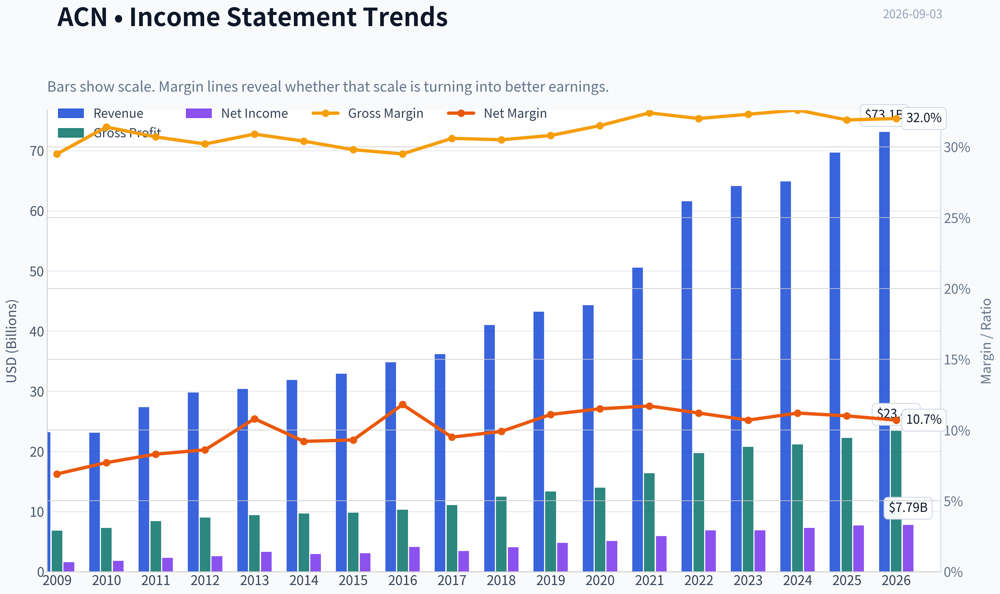
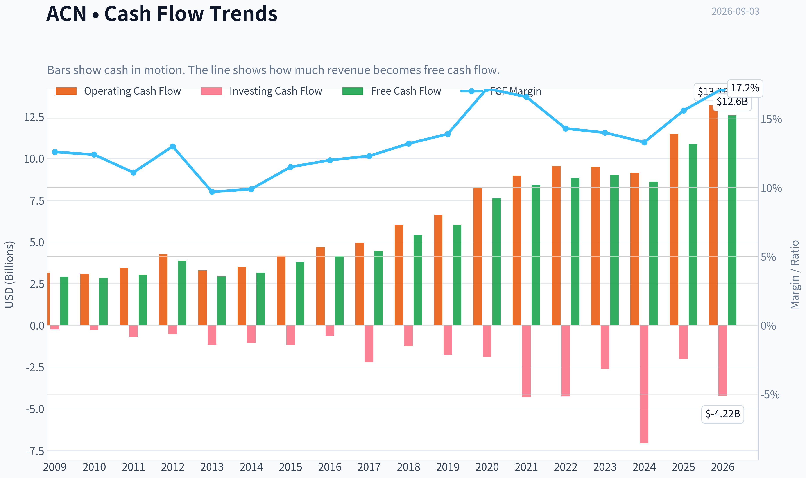
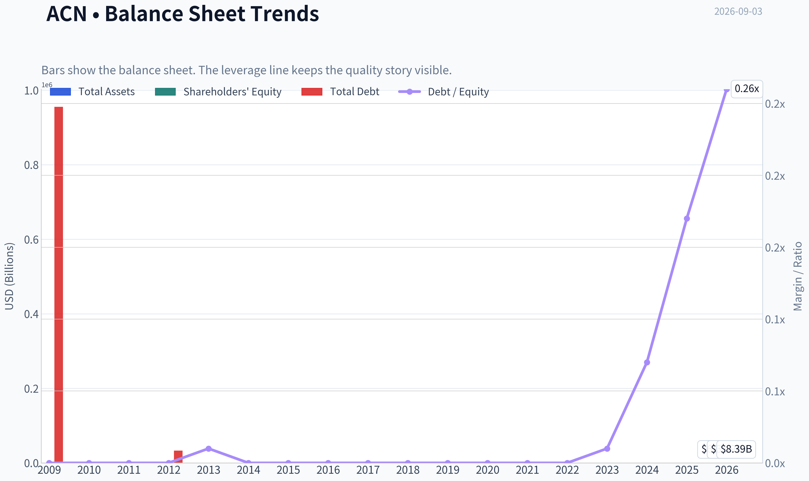
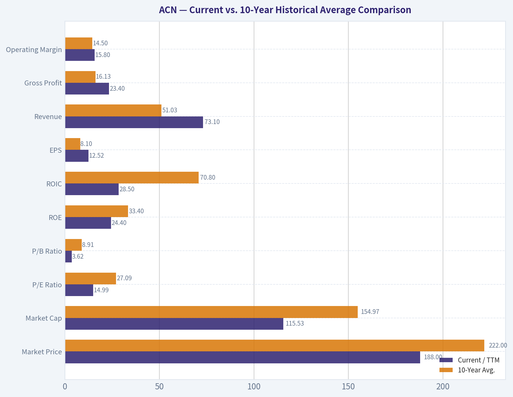
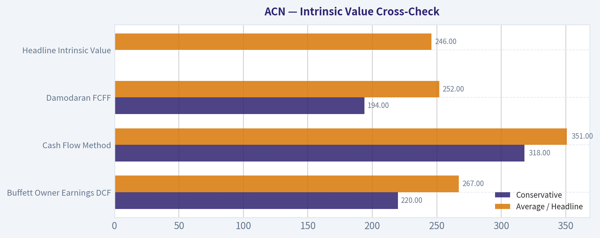
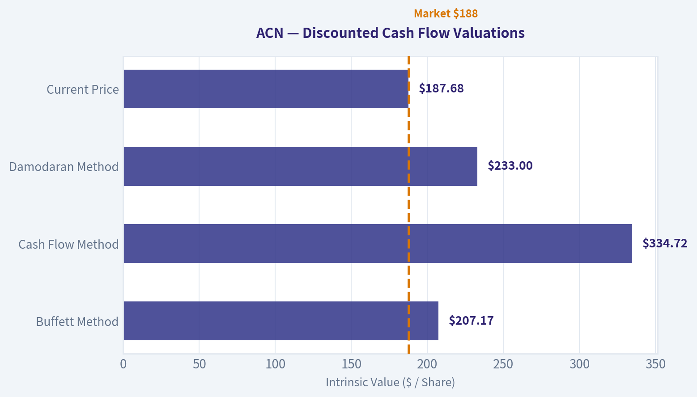
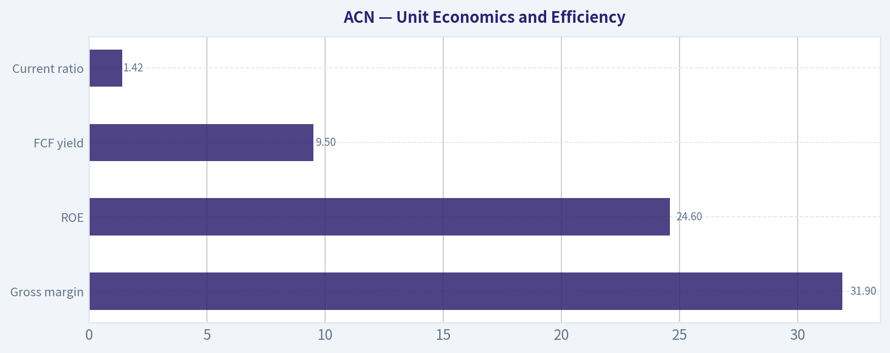
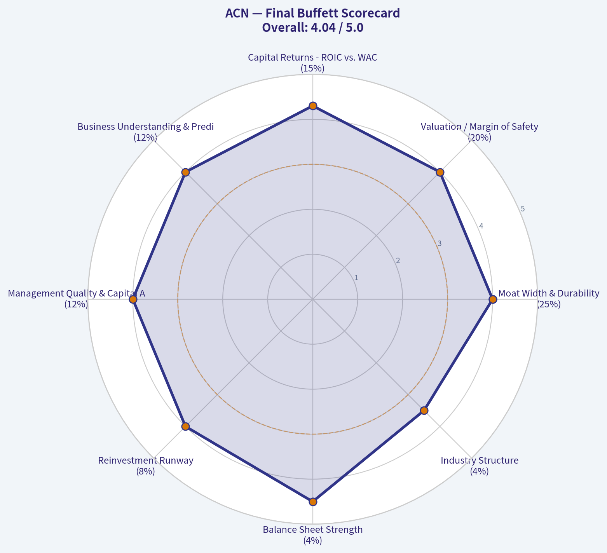

# ACN Deep Value Intelligence

**Analysis Date:** 2026-09-03

## Critical Disclaimer

*This analysis is generated by Deep Value Intelligence, an AI-powered multi-agent investing framework. Education & research only - not financial advice, not a financial advisor.*

---

## Table of Contents

1. Intelligence Summary
2. Analyst Team Reports
   - Fundamentals Analysis
   - Intrinsic Value Analysis (Buffett)
   - Trend & Growth Analysis (Lynch/Druckenmiller/Fisher)
   - Market Technical Analysis
   - Options Market Analysis
3. Research Team Commentary
4. Value Investing Team Commentary
5. Deep Values Commentary

---

## Intelligence Summary

### Thesis + Conditions

**Core Thesis:** **EXECUTIVE SUMMARY**
Accenture (ACN) is fundamentally robust with a highly attractive trailing valuation (15x P/E, 31.2% ROIC), but its near-term investability remains impaired by unconfirmed technicals and unresolved structural risks regarding AI-driven labor deflation. A 13.7% margin of safety is sufficient for a proven compounder in a stable environment, but not during a structural regime shift.

**Key Risks:**
- Accenture (ACN) is fundamentally robust with a highly attractive trailing valuation (15x P/E, 31.2% ROIC), but its near-term investability remains impaired by unconfirmed technicals and unresolved structural risks regarding AI-driven labor deflation. A 13.7% margin of safety is sufficient for a proven compounder in a stable environment, but not during a structural regime shift. Until bookings and margins prove that GenAI is accretive rather than cannibalistic to the billable-hour model, and price action reclaims key moving averages, the stock is a watchlist candidate, not an immediate buy.
- The Bull (Risky Analyst):** Views the 15x P/E as a generational entry point for an elite business. Argues that AI is not a deflationary threat but a demand catalyst (Jevons Paradox), where increased efficiency will explode the volume of corporate IT migration and consulting projects.
- However, we cannot value ACN in a vacuum. A 15x P/E is only a bargain if future earnings power mirrors past performance. If AI structurally reduces the labor intensity required for digital transformation, gross margins and organic revenue will face intense pressure before Jevons Paradox (volume offsetting efficiency) takes effect. The current market pricing reflects a de-rating regime, not a temporary cyclical dip. The stock remains trapped below its 200-day SMA with cooling momentum. Buying now on trailing valuation alone assumes the market is entirely wrong about these forward, structural risks.

**Confidence:** Medium

---

## Analyst Team Reports

### Fundamentals Analysis

#### Latest Earnings Snapshot

*Most recent reported quarter anchored on 2026 Q2, with prior-year comparison when available.*

| Metric | 2026 Q2 | 2025 Q2 | YoY Change |
| --- | ---: | ---: | ---: |
| Revenue | $18.72B | $17.73B | +5.6% |
| Operating Income | $3.18B | $2.98B | +6.5% |
| Net Income | $2.34B | $2.20B | +6.4% |
| Diluted EPS | $3.80 | $3.49 | +8.9% |
| Operating Cash Flow | $3.79B | $3.68B | +2.8% |
| Free Cash Flow | $3.60B | $3.52B | +2.4% |

Key Takeaways: This snapshot anchors the most recent reported quarter before the narrative analysis. It helps readers separate long-run business quality from whatever changed in the latest earnings print.

#### 17-Year Financial Metrics for ACN

*All values below are computed deterministically from raw data - not estimated by AI.*

*Issuer profile: operating company (Technology / Information Technology Services).*

#### 17-Year Financial Metrics
*Annual rows come from reported financial statements. The final TTM row is computed from the latest four quarters.*

| Metric | 2009 | 2010 | 2011 | 2012 | 2013 | 2014 | 2015 | 2016 | 2017 | 2018 | 2019 | 2020 | 2021 | 2022 | 2023 | 2024 | 2025 | 2026 TTM |
| --- | --- | --- | --- | --- | --- | --- | --- | --- | --- | --- | --- | --- | --- | --- | --- | --- | --- | --- |
| Market Price | $24 | $27 | $40 | $47 | $57 | $65 | $78 | $97 | $113 | $149 | $177 | $218 | $310 | $269 | $307 | $329 | $255 | $188 |
| Market Cap | $25.97B | $28.07B | $39.83B | $44.81B | $51.54B | $56.13B | $63.99B | $76.79B | $86.36B | $110.79B | $128.85B | $155.43B | $217.39B | $185.43B | $206.76B | $217.46B | $164.42B | $115.53B |
| P/E Ratio | 13.52 | 13.76 | 15.81 | 16.04 | 14.66 | 17.93 | 19.80 | 17.83 | 24.04 | 26.67 | 26.93 | 30.41 | 36.74 | 26.93 | 30.06 | 29.89 | 21.40 | 14.99 |
| P/B Ratio | 9.16 | 9.90 | 10.27 | 10.81 | 10.39 | 9.79 | 10.43 | 10.16 | 9.65 | 10.69 | 8.94 | 9.14 | 11.13 | 8.39 | 8.05 | 7.69 | 5.27 | 3.62 |
| ROE | 56.1% | 62.8% | 58.7% | 61.6% | 66.2% | 51.3% | 49.8% | 54.4% | 38.5% | 39.2% | 33.2% | 30.0% | 30.2% | 31.1% | 26.7% | 25.7% | 24.6% | 24.4% |
| ROIC | N/A | -111.2% | -131.5% | -129.5% | -226.3% | 3322.2% | 250.1% | 158.9% | 111.9% | 84.6% | 71.9% | 58.1% | 58.3% | 55.7% | 43.0% | 34.8% | 31.0% | 28.5% |
| EPS | $1.76 | $1.97 | $2.55 | $2.96 | $3.88 | $3.65 | $3.94 | $5.45 | $4.69 | $5.57 | $6.58 | $7.17 | $8.43 | $9.98 | $10.20 | $11.01 | $11.90 | $12.52 |
| Revenue | $23.17B | $23.09B | $27.35B | $29.78B | $30.39B | $31.87B | $32.91B | $34.80B | $36.18B | $40.99B | $43.22B | $44.33B | $50.53B | $61.59B | $64.11B | $64.90B | $69.67B | $73.10B |
| Gross Profit | $6.84B | $7.25B | $8.39B | $8.99B | $9.38B | $9.68B | $9.81B | $10.28B | $11.07B | $12.49B | $13.31B | $13.98B | $16.36B | $19.70B | $20.73B | $21.16B | $22.24B | $23.40B |
| Gross Margin | 29.5% | 31.4% | 30.7% | 30.2% | 30.9% | 30.4% | 29.8% | 29.5% | 30.6% | 30.5% | 30.8% | 31.5% | 32.4% | 32.0% | 32.3% | 32.6% | 31.9% | 32.0% |
| Operating Margin | 11.4% | 12.6% | 12.7% | 13.0% | 14.3% | 13.5% | 13.5% | 13.8% | 14.4% | 14.4% | 14.6% | 14.7% | 15.1% | 15.2% | 13.7% | 14.8% | 14.7% | 15.8% |
| Net Income | $1.59B | $1.78B | $2.28B | $2.55B | $3.28B | $2.94B | $3.05B | $4.11B | $3.45B | $4.06B | $4.78B | $5.11B | $5.91B | $6.88B | $6.87B | $7.26B | $7.68B | $7.79B |
| Net Margin | 6.9% | 7.7% | 8.3% | 8.6% | 10.8% | 9.2% | 9.3% | 11.8% | 9.5% | 9.9% | 11.1% | 11.5% | 11.7% | 11.2% | 10.7% | 11.2% | 11.0% | 10.7% |
| Revenue Growth | N/A | -0.3% | 18.4% | 8.9% | 2.1% | 4.9% | 3.3% | 5.7% | 4.0% | 13.3% | 5.4% | 2.6% | 14.0% | 21.9% | 4.1% | 1.2% | 7.4% | 4.9% |
| Net Income Growth | N/A | 12.0% | 27.9% | 12.1% | 28.5% | -10.4% | 3.8% | 34.7% | -16.2% | 17.8% | 17.7% | 6.9% | 15.6% | 16.4% | -0.1% | 5.7% | 5.7% | 1.4% |
| Free Cash Flow Growth | N/A | -2.2% | 6.5% | 27.9% | -24.5% | 7.9% | 19.5% | 10.3% | 6.9% | 21.3% | 11.5% | 26.3% | 10.2% | 5.1% | 2.0% | -4.2% | 26.2% | 15.7% |
| Total Book Value | $2.84B | $2.84B | $3.88B | $4.15B | $4.96B | $5.73B | $6.13B | $7.56B | $8.95B | $10.36B | $14.41B | $17.00B | $19.53B | $22.11B | $25.69B | $28.29B | $31.20B | $31.89B |
| Total Assets | $12.26B | $12.84B | $15.73B | $16.67B | $16.87B | $17.93B | $18.20B | $20.61B | $22.69B | $24.45B | $29.79B | $37.08B | $43.18B | $47.26B | $51.25B | $55.93B | $65.39B | $68.81B |
| Total Debt | $955,000 | $1.6M | $4.4M | $33,000 | $25.6M | $26.7M | $27.4M | $27.2M | $25.1M | $25.0M | $22.7M | $61.9M | $65.6M | $55.1M | $147.9M | $1.96B | $5.25B | $8.39B |
| Debt-to-Equity | 0.00 | 0.00 | 0.00 | 0.00 | 0.01 | 0.00 | 0.00 | 0.00 | 0.00 | 0.00 | 0.00 | 0.00 | 0.00 | 0.00 | 0.01 | 0.07 | 0.17 | 0.26 |
| Cash & Equivalents | $4.54B | $4.84B | $5.70B | $6.64B | $5.63B | $4.92B | $4.36B | $4.91B | $4.13B | $5.06B | $6.13B | $8.42B | $8.17B | $7.89B | $9.05B | $5.00B | $11.48B | $10.17B |
| Shareholders' Equity | $2.84B | $2.84B | $3.88B | $4.15B | $4.96B | $5.73B | $6.13B | $7.56B | $8.95B | $10.36B | $14.41B | $17.00B | $19.53B | $22.11B | $25.69B | $28.29B | $31.20B | $31.89B |
| Operating Cash Flow | $3.16B | $3.09B | $3.44B | $4.26B | $3.30B | $3.49B | $4.18B | $4.67B | $4.97B | $6.03B | $6.63B | $8.22B | $8.98B | $9.54B | $9.52B | $9.13B | $11.47B | $13.18B |
| Investing Cash Flow | $-245.2M | $-273.8M | $-703.4M | $-535.4M | $-1.16B | $-1.06B | $-1.17B | $-610.4M | $-2.23B | $-1.25B | $-1.76B | $-1.89B | $-4.31B | $-4.26B | $-2.62B | $-7.06B | $-2.02B | $-4.22B |
| Free Cash Flow | $2.92B | $2.85B | $3.04B | $3.88B | $2.93B | $3.16B | $3.78B | $4.17B | $4.46B | $5.41B | $6.03B | $7.62B | $8.40B | $8.82B | $9.00B | $8.61B | $10.87B | $12.58B |
| FCF Margin | 12.6% | 12.4% | 11.1% | 13.0% | 9.7% | 9.9% | 11.5% | 12.0% | 12.3% | 13.2% | 13.9% | 17.2% | 16.6% | 14.3% | 14.0% | 13.3% | 15.6% | 17.2% |
| Dividends / Share | $0.00 | $0.00 | $0.00 | $0.00 | $0.00 | $0.00 | $0.00 | $0.00 | $0.00 | $0.00 | $0.00 | $0.00 | $0.00 | $3.56 | $4.19 | $4.90 | $5.73 | $6.39 |

#### Profitability Metrics
- Return on Equity (ROE): 24.6%
- Return on Invested Capital (ROIC): 31.2%
- Return on Assets (ROA): 11.7%
- Gross Margin: 31.9%
- Operating Margin: 14.7%
- Net Profit Margin: 11.0%

#### Liquidity Metrics
- Current Ratio: 1.42
- Quick Ratio: 1.21

#### Leverage Metrics
- Debt-to-Equity Ratio: 0.17
- Interest Coverage Ratio: 44.74
- Net Debt: $-6.23B

#### Growth Metrics (Year-over-Year)
- Revenue Growth: 7.4%
- Net Income Growth: 5.7%
- Free Cash Flow Growth: 26.2%
- Revenue CAGR (3-Year): 4.2%
- Revenue CAGR (5-Year): 9.5%

#### Valuation Metrics
- P/E Ratio (TTM): 15.01
- Forward P/E: 12.81
- Price-to-Book: 3.60
- Price-to-Sales: 1.57
- PEG Ratio: 1.37
- EV/EBITDA: 8.86
- Free Cash Flow Yield: 9.5%
- Earnings Yield: 6.7%

#### Owner Earnings (Buffett Method, Code-Computed)
- Net Income: $7.68B
- + Depreciation & Amortization: $1.37B
- - Capital Expenditures: $-600.0M
- - Working Capital Changes: $-1.05B
- = **Owner Earnings: $9.50B**

#### Intrinsic Value (Code-Computed)
- Current Price: $188
- **Headline Intrinsic Value (business-model routed): $246**
  Business model: operating company - weighted blend [Damodaran FCFF + reverse-DCF fair + owner-earnings DCF] (operating_company)
  Model spread (min-max across DCFs): $252 - $351
  Margin of safety vs. price (headline): 23.7%
  Routing note: General operating company: balanced blend of Damodaran FCFF and the owner-earnings DCF with a reverse-DCF sanity check.
- Buffett Method (Owner Earnings):
  Conservative: $220
  Average: $267
  Optimistic: $348
- Cash Flow Method (FCF):
  Conservative: $318
  Average: $351
  Optimistic: $533
- Damodaran FCFF (WACC + margins + reinvestment):
  Conservative: $194
  Average: $252
  Optimistic: $272
  Monte Carlo band (P10-P90): $194 - $301 (median $235)
  P(intrinsic value > price): 93.8%
- Reverse-DCF: price implies ~3.2%/yr owner-earnings growth for 10y; trailing 3y was 5.9%, 5y 16.1%.

#### Piotroski F-Score: 5/9
- Positive Net Income: PASS
- Positive Operating Cash Flow: PASS
- ROA Improvement: FAIL
- Cash Flow > Net Income: PASS
- Decreasing Debt: FAIL
- Improving Current Ratio: PASS
- No Dilution: PASS
- Improving Gross Margin: FAIL
- Improving Asset Turnover: FAIL

ANALYST STANCE: **ADVOCATE**

#### Accenture plc (ACN) - Buffett-Style Fundamental Analysis
Current price: **$188** | Market cap: **$115.53B** | Canonical intrinsic value: **$246/share** | Margin of safety: **23.7%**

Accenture is a high-quality, asset-light global IT services and consulting business with durable client relationships, strong cash conversion, high returns on capital, and a long record of compounding revenue, earnings, and free cash flow. The current valuation is materially below its 10-year average multiples and below the deterministic intrinsic value estimate, while the business remains profitable, cash-rich, and only moderately levered. The main caution is that growth has slowed versus the post-pandemic digital transformation boom, and debt has risen from historically negligible levels.

---

#### Revenue Breakdown

| Revenue Source | Amount ($B) | % of Total |
|---|---:|---:|
| Americas | ~$34.2B | ~49% |
| EMEA | ~$24.1B | ~35% |
| Asia Pacific | ~$11.4B | ~16% |
| **Total Revenue** | **$69.7B** | **100%** |

Key Takeaways: Accenture's revenue base is geographically diversified, with the Americas contributing roughly half of total revenue. EMEA is also a large and strategically important region, while Asia Pacific provides additional long-term growth exposure. This diversification reduces dependence on a single economy, but enterprise IT spending cycles remain a global risk.

---

#### Current vs. 10-Year Historical Average Comparison

10-year averages use fiscal years **2016-2025** from the deterministic dataset. Current values use **2026 TTM** unless otherwise noted.

| Metric | Current / TTM | 10-Year Avg. | Current vs. Avg. | Interpretation |
|---|---:|---:|---:|---|
| Market Price | $188 | $222 | -15.5% | Shares trade meaningfully below their 10-year average price despite higher earnings and free cash flow. |
| Market Cap | $115.53B | $154.97B | -25.5% | Market value has compressed substantially from recent historical norms. |
| P/E Ratio | 14.99x | 27.09x | -44.7% | The stock is priced at a major discount to its historical earnings multiple. |
| P/B Ratio | 3.62x | 8.91x | -59.4% | P/B has fallen sharply, but for Accenture's asset-light services model, book value is not the primary valuation anchor. |
| ROE | 24.4% | 33.4% | -9.0 pts | ROE remains excellent but has normalized from extremely high historical levels. |
| ROIC | 28.5% | 70.8% | -42.3 pts | ROIC is lower than prior inflated levels but still outstanding for an operating business. |
| EPS | $12.52 | $8.10 | +54.6% | EPS is well above the 10-year average, showing durable compounding. |
| Revenue | $73.10B | $51.03B | +43.2% | Revenue scale has expanded significantly over the decade. |
| Gross Profit | $23.40B | $16.13B | +45.1% | Gross profit has grown broadly in line with revenue, reflecting stable economics. |
| Operating Margin | 15.8% | 14.5% | +1.3 pts | Operating margin is above historical average, a positive sign of execution. |
| Net Income | $7.79B | $5.61B | +38.8% | Earnings power is materially higher than the decade average. |
| Net Margin | 10.7% | 11.0% | -0.3 pts | Net margin is slightly below average but broadly stable. |
| Revenue Growth | 4.9% | 8.0% | -3.1 pts | Growth has slowed from the stronger historical pace. |
| Net Income Growth | 1.4% | 10.4% | -9.0 pts | Earnings growth is currently weak versus history. |
| FCF Growth | 15.7% | 11.6% | +4.1 pts | Free cash flow growth is stronger than the 10-year average. |
| Total Book Value | $31.89B | $18.51B | +72.3% | Book equity has grown, but this is secondary for valuation. |
| Total Assets | $68.81B | $39.76B | +73.1% | The balance sheet has scaled with the business. |
| Total Debt | $8.39B | $0.76B | +998% | Debt has risen sharply from a near-debt-free history. |
| Debt-to-Equity | 0.26x | 0.03x | Higher | Still conservative, but no longer immaterial. |
| Cash & Equivalents | $10.17B | $7.02B | +44.8% | Cash remains strong and exceeds total debt on a net basis. |
| Shareholders' Equity | $31.89B | $18.51B | +72.3% | Equity base continues to compound. |
| Free Cash Flow | $12.58B | $7.34B | +71.4% | Cash generation is very strong and above historical norms. |
| Dividends / Share | $6.39 | $1.84 | +247.7% | Dividend distributions have increased materially in recent reported years. |

Key Takeaways: Accenture's valuation has compressed much more than its fundamentals. Revenue, EPS, free cash flow, and equity are all far above 10-year averages, while the P/E ratio is nearly 45% below its historical norm. The main negative deviations are slower revenue and net income growth, lower ROE and ROIC versus prior extraordinary levels, and a meaningful rise in debt.

---

#### Market Metrics Interpretation

Accenture's current **P/E of 14.99x** is far below its 10-year average of **27.09x**, suggesting the market has repriced the company from a premium compounder to a much more ordinary valuation. This is notable because the company's **EPS of $12.52** and **free cash flow of $12.58B** are both substantially above historical averages.

The **P/B ratio of 3.62x** is also far below its 10-year average, but this metric should be treated as **low relevance / not meaningful as a primary value signal** for Accenture. Accenture is an asset-light IT services and consulting business where the key assets are client relationships, brand, technical talent, delivery capabilities, data, and process knowledge - most of which do not sit cleanly on the balance sheet. Therefore, valuation should be anchored on cash-flow-based intrinsic value, not book value.

The deterministic intrinsic value estimate is **$246/share**, implying a **23.7% margin of safety** at the current price of **$188**. The stock also carries a **9.5% free cash flow yield**, which is attractive for a high-return, investment-grade-quality operating company.

---

#### Profitability and Business Quality

Accenture remains a highly profitable business. Current **ROE of 24.4%** and **ROIC of 28.5%** are below the company's 10-year averages, but they are still excellent in absolute terms. The decline is partly a normalization from unusually high historical returns, especially when invested capital was very small.

Gross margin has been remarkably stable. The current **gross margin of 32.0%** is slightly above much of the earlier historical period and close to recent peaks. Operating margin is even more encouraging: **15.8% TTM**, above the 10-year average of **14.5%**. This suggests Accenture is still managing pricing, utilization, delivery efficiency, and cost structure well despite slower enterprise spending.

Net margin of **10.7%** is slightly below the 10-year average of **11.0%**, but the deviation is small. The bigger message is consistency: Accenture has operated around a 10%-12% net margin range for many years, which supports Buffett-style predictability.

---

#### Growth Metrics Interpretation

Revenue has compounded meaningfully over the long run, rising from **$34.80B in 2016** to **$73.10B TTM**. However, current **TTM revenue growth of 4.9%** is below the 10-year average of about **8.0%**. This indicates the company is no longer in the strongest phase of the digital transformation spending cycle.

Net income growth is the clearest short-term weakness. Current **net income growth of 1.4%** is far below the 10-year average of **10.4%**. This reflects a more difficult demand environment, potential wage and delivery-cost pressures, and tougher comparisons after the 2021-2022 acceleration.

Free cash flow growth is the positive offset. Current **FCF growth of 15.7%** is above the 10-year average of **11.6%**, and FCF margin is at **17.2%**, one of the strongest levels in the dataset. For a Buffett-style investor, this matters because intrinsic value is driven more by durable owner earnings than by accounting growth alone.

---

#### Balance Sheet and Financial Strength

Accenture's balance sheet remains strong, but it is no longer as pristine as it was historically. Total debt has risen to **$8.39B**, compared with a 10-year average of only **$0.76B**. Debt-to-equity is now **0.26x**, still conservative, but noticeably higher than the company's historical near-zero leverage profile.

The company has **$10.17B of cash and equivalents**, meaning it remains in a **net cash position** based on the broader deterministic metrics, with net debt listed at **-$6.23B** in the summary data. Interest coverage of **44.74x** indicates debt service risk is very low.

Book value and shareholders' equity have grown to **$31.89B**, but again, for Accenture this is not the most important measure of intrinsic value. The key balance sheet conclusion is that Accenture has ample liquidity, manageable leverage, and enough financial flexibility to invest, acquire, pay dividends, and repurchase shares.

---

#### Cash Flow and Dividend Analysis

Accenture's free cash flow profile is one of the strongest parts of the investment case. TTM free cash flow is **$12.58B**, compared with a 10-year average of **$7.34B**. The current **FCF margin of 17.2%** is also strong relative to the company's history.

Owner earnings, using the deterministic Buffett-method calculation, are **$9.50B**:

- Net income: **$7.68B**
- Plus depreciation and amortization: **$1.37B**
- Less capital expenditures: **$600M**
- Less working capital changes: **negative $1.05B adjustment**
- Owner earnings: **$9.50B**

Dividends per share are **$6.39 TTM**, up from **$5.73 in 2025** and **$3.56 in 2022** in the deterministic dataset. The dividend appears well covered by earnings and free cash flow. Capital allocation looks shareholder-friendly, although rising debt should be monitored to ensure buybacks, acquisitions, and dividends remain funded from durable cash generation rather than balance sheet stretch.

---

#### Warren Buffett-Style Qualitative Assessment

| Buffett Criterion | Assessment | ACN Interpretation |
|---|---|---|
| Economic Moat | Strong | Scale, brand, global delivery network, trusted C-suite relationships, deep industry expertise, and switching costs. |
| Financial Strength | Strong but watch debt trend | Cash exceeds debt, interest coverage is very high, but leverage has risen from historically negligible levels. |
| Predictable Earnings | Strong | Revenue, EPS, net income, and FCF have compounded over many years with limited structural volatility. |
| Management Performance | Strong | High ROE, high ROIC, strong cash conversion, and growing dividends indicate disciplined execution. |
| Capital Allocation | Generally favorable | Dividends and likely buybacks are supported by cash flow, though rising debt requires monitoring. |
| Valuation | Attractive | P/E is far below historical average, FCF yield is high, and intrinsic value exceeds price. |
| Business Quality | High | Asset-light, cash-generative, globally diversified, and positioned around long-term IT modernization and AI demand. |

Key Takeaways: Accenture fits many Buffett-style quality requirements: high returns, strong cash generation, a durable competitive position, and a predictable business model. The valuation has become much more attractive than usual. The main reason this is not a risk-free bargain is that growth has slowed and debt has increased from a historically very conservative base.

---

#### Economic Moat Analysis

Accenture's moat is not based on patents or physical assets. It is based on trust, scale, execution capability, and embedded client relationships. Large enterprises often rely on Accenture for mission-critical technology transformation, cloud migration, cybersecurity, AI implementation, outsourcing, and managed services. Once Accenture is integrated into a client's systems and processes, switching costs can be high.

The company also benefits from a global talent and delivery network that is difficult for smaller competitors to replicate. Its relationships with major technology vendors - including cloud, enterprise software, cybersecurity, and data platform providers - reinforce its position as an implementation partner for complex digital programs.

The moat is durable, but not invulnerable. Pricing pressure, automation, AI-driven delivery disruption, competition from Indian IT services firms, and in-house enterprise technology teams could pressure growth or margins over time.

---

#### Three-Scenario Buffett-Style Owner Earnings DCF

Assumptions:

- Base owner earnings: **$9.50B**
- Derived share count: approximately **614.5M shares**
- Discount rate: **10%**
- Terminal growth rate: **2.5%**
- Terminal value formula:
  **Terminal Value = Year 10 Owner Earnings x (1 + 2.5%) / (10% - 2.5%)**
- Valuation is based on owner earnings to equity; no additional net cash adjustment is applied in the hand DCF to remain aligned with the deterministic Buffett-method output.

| Scenario | Growth Assumption | PV of Explicit 10-Year Owner Earnings | PV of Terminal Value | Equity Value | Fair Value / Share |
|---|---:|---:|---:|---:|---:|
| Conservative | 3.0% annual OE growth for 10 years, then 2.5% terminal | ~$67.4B | ~$67.3B | ~$134.7B | **~$220** |
| Average / Base Case | 5.7% annual OE growth for 10 years, then 2.5% terminal | ~$76.9B | ~$87.1B | ~$164.0B | **~$267** |
| Optimistic | 11% growth in years 1-5, fading to 5% by year 10, then 2.5% terminal | ~$95.5B | ~$118.3B | ~$213.7B | **~$348** |

Key Takeaways: The conservative owner-earnings DCF produces a value of roughly **$220/share**, still above the current price of **$188**. The base case is around **$267/share**, while the optimistic case reaches about **$348/share** if Accenture sustains strong AI, cloud, managed services, and transformation demand. The valuation does not require heroic assumptions: the reverse DCF indicates the current price implies only about **3.2% annual owner-earnings growth** over 10 years.

---

#### Intrinsic Value Cross-Check

The deterministic model-based valuation supports the hand DCF conclusion:

| Valuation Method | Conservative | Average / Headline | Optimistic | Interpretation |
|---|---:|---:|---:|---|
| Buffett Owner Earnings DCF | $220 | $267 | $348 | Current price is below even the conservative case. |
| Cash Flow Method | $318 | $351 | $533 | FCF-based valuation is substantially above market price. |
| Damodaran FCFF | $194 | $252 | $272 | More conservative institutional-style FCFF model still supports upside. |
| Headline Intrinsic Value | - | **$246** | - | Implies **23.7% margin of safety** at $188. |
| Reverse DCF | - | Implied growth: **~3.2%/yr** | - | Market expectations appear modest versus history. |

Key Takeaways: Multiple valuation approaches point to Accenture trading below intrinsic value. The Damodaran FCFF model is the most conservative but still supports a value above the current price in its average case. The reverse DCF is especially important: the market is pricing in low growth, while Accenture's long-term cash-flow history has been stronger.

---

#### Key Investment Insights

| Category | Insight |
|---|---|
| Valuation Opportunity | P/E of **14.99x** is dramatically below the 10-year average of **27.09x**. |
| Cash Flow Strength | TTM FCF of **$12.58B** and FCF yield of **9.5%** are compelling for a high-quality business. |
| Quality Compounder | EPS, revenue, gross profit, net income, and FCF are all materially above 10-year averages. |
| Margin Durability | Operating margin of **15.8%** is above the 10-year average, suggesting strong execution. |
| Balance Sheet | Cash remains strong and interest coverage is excellent, but debt has risen sharply. |
| Market Expectations | Reverse DCF implies only **~3.2%** annual owner-earnings growth, which appears conservative. |
| Moat | Brand, scale, delivery network, enterprise relationships, and switching costs remain strong. |

Key Takeaways: The core investment case is that Accenture's market price has fallen much more than its underlying business quality. Cash generation is robust, valuation is inexpensive versus history, and intrinsic value estimates are above the current price. The opportunity exists because investors are discounting slower growth and possible disruption in IT services.

---

#### Red Flags and Risks

| Risk | Why It Matters |
|---|---|
| Slowing Revenue Growth | TTM revenue growth of **4.9%** is below the 10-year average of **8.0%**. |
| Weak Net Income Growth | TTM net income growth of **1.4%** is far below historical norms. |
| Rising Debt | Debt increased to **$8.39B**, much higher than the historical average. |
| ROE / ROIC Normalization | Returns remain high but have declined materially from prior levels. |
| Consulting Cyclicality | Discretionary transformation projects can be delayed in weak macro environments. |
| AI Disruption | AI may improve Accenture's productivity, but it may also pressure billable labor models. |
| Competitive Pressure | Large IT services firms, cloud providers, software vendors, and in-house enterprise teams all compete for wallet share. |
| Piotroski F-Score | Score of **5/9** is neutral, not exceptional, due to weaker margin, leverage, and asset-turnover signals. |

Key Takeaways: The biggest risks are not balance sheet solvency or business fragility; they are growth normalization and potential model disruption. Accenture must prove that AI is a revenue and margin tailwind rather than a deflationary force on consulting labor. Debt is still manageable, but the upward trend deserves attention.

---

#### Opportunities

Accenture is well positioned to benefit from enterprise AI adoption, cloud modernization, cybersecurity, data architecture, managed services, and regulatory technology needs. Many companies are experimenting with AI but lack the internal expertise to redesign workflows, integrate models into legacy systems, secure data, and manage change. Accenture's value proposition is strongest when technology complexity is high and clients require trusted execution partners.

If revenue growth reaccelerates even modestly and margins remain near current levels, the current valuation could prove too pessimistic. The stock does not need a return to a 30x P/E to generate attractive returns; even a rerating to a mid-to-high-teens multiple, combined with dividends and FCF growth, could be rewarding.

---

#### Final Investment Stance: ADVOCATE

Accenture earns an **ADVOCATE** stance for long-term value-oriented investors. The company combines Buffett-style business quality - high ROIC, strong cash generation, durable client relationships, predictable earnings, and disciplined capital returns - with a valuation that is now meaningfully below historical norms and below intrinsic value.

The current price of **$188** is below the deterministic headline intrinsic value of **$246**, offering a **23.7% margin of safety**. The conservative owner-earnings DCF also supports a value of roughly **$220/share**, suggesting downside protection if the business merely grows at a modest rate.

This is not a "no-risk" investment. Growth has slowed, debt has risen, and AI could reshape the economics of IT services. However, the market appears to be pricing Accenture as if growth will remain subdued for a long time. Given the company's moat, cash flow, balance sheet resilience, and valuation reset, the risk/reward is favorable.

---

#### Summary Table

| Area | Verdict | Key Point |
|---|---|---|
| Business Quality | Strong | Asset-light, global, cash-generative IT services leader. |
| Moat | Strong | Scale, brand, delivery network, switching costs, trusted enterprise relationships. |
| Profitability | Strong | ROE **24.4%**, ROIC **28.5%**, operating margin **15.8%**. |
| Growth | Mixed | Revenue and net income growth have slowed, but FCF growth remains strong. |
| Balance Sheet | Strong but watch | Cash is high and interest coverage is excellent, but debt has risen. |
| Cash Flow | Excellent | TTM FCF of **$12.58B** and FCF yield of **9.5%**. |
| Valuation | Attractive | P/E is far below 10-year average; intrinsic value exceeds price. |
| DCF Range | Favorable | Owner-earnings DCF range: **$220-$348/share**. |
| Main Risk | Growth normalization | Market is worried about slower consulting demand and AI disruption. |
| Final Stance | **ADVOCATE** | High-quality compounder trading below conservative intrinsic value. |

Key Takeaways: Accenture is a high-quality business available at an unusually modest valuation. The stock's current price appears to discount a prolonged slowdown, yet free cash flow remains strong and intrinsic value estimates are above the market price. For patient investors, the setup is attractive, provided they monitor growth, debt, and AI-related disruption.

#### Fundamental Visuals

This graph tracks the profitability and return metrics (ROE, ROIC, Margins) of **ACN** over the past decade, highlighting capital efficiency trends.

This chart illustrates the financial health of **ACN** over the last 10 years, mapping cash equivalents and free cash flow against total obligations (Debt).

---

### Intrinsic Value Analysis (Buffett)

> *Following Warren Buffett's value investing philosophy: Circle of Competence, Economic Moat, Management Quality, and Margin of Safety.*

#### Intrinsic Value Snapshot

Price is what you pay. Intrinsic value is what the business may be worth based on the cash it can create for owners over time. We show a range, not one magic number.

- Current Price: $187.68
- Value Range (conservative to optimistic across both DCF methods): $175.26 to $427.56

##### Owner Earnings (Buffett Method)
- Net Income: $7,678,433,000.00
- Depreciation & Amortization: $1,368,385,000.00
- Capital Expenditures: $-600,039,000.00
- Working Capital Changes: $-1,050,348,000.00
- Owner Earnings: $9,497,127,000.00

##### Intrinsic Value
###### Buffett Method
Uses owner earnings. Stricter, and usually more conservative.
- Conservative: $175.26
- Average: $207.17
- Optimistic: $255.89
- Discount Rate: 10.0%

###### Cash Flow Method
Uses free cash flow. Better for companies spending heavily today to grow tomorrow.
- Conservative: $247.00
- Average: $334.72
- Optimistic: $427.56
- Discount Rate: 10.0%

ANALYST STANCE: **ADVOCATE**

#### Accenture (ACN) - Buffett-Style Investment Review

Accenture is a high-quality, asset-light professional services and technology consulting franchise trading at a valuation that appears fair-to-attractive for the durability of the business. At a current price of **$188**, the stock trades below the blended intrinsic value estimate of **$217.50**, offering a **13.7% margin of safety**. For a strong, high-return, cash-generative business with modest balance-sheet risk and a credible AI/digital transformation runway, that is enough to support an **ADVOCATE** stance.

---

#### 1. Factor Scorecard

| Factor | Score | Evidence |
|---|---:|---|
| Circle of Competence & Business Simplicity | 4.0 / 5 | Accenture sells consulting, systems integration, managed services, outsourcing, and digital transformation work to large enterprises and governments. The model is understandable: highly skilled people, deep client relationships, repeat engagements, and global delivery scale. |
| Moat Test | 4.0 / 5 | Strong brand, trusted enterprise relationships, switching costs, vendor partnerships, and global scale. Not a monopoly, but the franchise is durable and difficult to replicate. |
| Management Quality & Capital Allocation | 4.0 / 5 | Long record of disciplined tuck-in acquisitions, dividends, buybacks, and strong cash conversion. Capital allocation has generally supported per-share value creation. |
| Industry Structure | 3.5 / 5 | Attractive long-term demand from cloud, cybersecurity, data, AI, and digital transformation, but competition is intense from Deloitte, IBM, Capgemini, Cognizant, TCS, Infosys, and specialized boutiques. |
| Gate 5: Quality / Solvency Hard Floor | Not tripped | Earnings and free cash flow remain positive, returns on capital are strong, and solvency risk is low. No hard financial-distress condition is present. |

**Key Takeaways:** Accenture clears the Buffett quality test: understandable economics, repeat client demand, high returns, and strong cash conversion. The main drawback is that consulting is competitive and somewhat cyclical, but Accenture's scale, brand, and embedded client relationships give it a durable advantage.

---

#### 2. Moat Analysis

| Moat Source | Assessment | Evidence |
|---|---|---|
| Intangible Assets / Brand | Strong | Accenture is one of the most trusted global names in enterprise consulting and technology implementation. Large clients often prefer proven execution partners for mission-critical transformations. |
| Switching Costs | Moderate to Strong | Accenture becomes embedded in client systems, workflows, cloud migrations, outsourcing arrangements, and transformation roadmaps. Switching providers can be disruptive and costly. |
| Cost Advantage | Moderate | Global delivery scale allows Accenture to combine premium consulting with lower-cost delivery centers. However, offshore competitors also have cost advantages. |
| Network Effects | Limited | The business does not have classic consumer network effects, but ecosystem partnerships with Microsoft, SAP, Oracle, Salesforce, Workday, AWS, Google Cloud, and others strengthen its market position. |
| Moat Rating | Wide & Stable | The moat is not impenetrable, but Accenture's scale, relationships, reputation, and execution depth are difficult to copy. |

**Key Takeaways:** Accenture's moat is built less on patents or hard assets and more on trust, execution, relationships, and scale. That kind of moat is real, but it must be continuously renewed through talent, delivery quality, and staying relevant in new technologies like AI.

---

#### 3. Management Quality & Capital Allocation

Accenture's management has generally behaved in an owner-oriented manner. The company has avoided reckless leverage, maintained strong cash generation, returned capital through dividends and buybacks, and used acquisitions primarily as capability-building tuck-ins rather than empire-building megadeals.

The company's acquisition strategy is important: Accenture frequently buys specialized firms in cloud, cybersecurity, data, design, industry consulting, and AI. This can be value-accretive when it deepens client relevance and expands capabilities, but it requires discipline because consulting acquisitions are people-heavy and integration-sensitive.

| Management Area | Assessment |
|---|---|
| Owner Orientation | Strong; consistent return of excess cash and focus on durable client relationships |
| Candor / Reporting Quality | Good; business model is transparent and cash flow tracks earnings well |
| Reinvestment Discipline | Strong; acquisitions and talent investments support long-term relevance |
| Buybacks / Dividends | Generally rational; capital returns complement reinvestment rather than replacing it |
| Leverage Discipline | Conservative; balance sheet risk is low |

**Key Takeaways:** Management has not tried to manufacture growth with dangerous leverage. Accenture's capital allocation record is practical and rational: reinvest in capabilities, acquire selectively, return excess cash, and preserve financial flexibility.

---

#### 4. Financial Summary

| Fiscal Period | Revenue | Gross Margin | Operating Margin | Net Income | Free Cash Flow | ROE / Latest ROE | Notes |
|---|---:|---:|---:|---:|---:|---:|---|
| FY2020 | ~$44.3B | ~31.5% | ~14.7% | ~$5.1B | ~$7.6B | Strong | Resilient profitability during a volatile year |
| FY2021 | ~$50.5B | ~32.4% | ~15.1% | ~$5.9B | ~$8.4B | Strong | Demand accelerated with digital transformation |
| FY2022 | ~$61.6B | ~32.1% | ~15.2% | ~$6.9B | ~$8.8B | Strong | Very strong post-pandemic enterprise technology spending |
| FY2023 | ~$64.1B | ~32.3% | ~15.4% | ~$6.9B | ~$9.0B | Strong | Growth moderated but margins remained durable |
| FY2024 | ~$64.9B | ~32.1% | ~14.8% | ~$7.3B | ~$8.7B | Strong | Softer discretionary consulting demand, still high cash generation |
| Current / TTM | YoY growth ~7.4% | 31.9% | ~15% | Implied ~$7.6B | FCF yield ~9.5% | 24.6% | Valuation has compressed despite continued quality |

**Key Takeaways:** Accenture has compounded revenue meaningfully while keeping margins remarkably stable. The most important trend is cash conversion: free cash flow has consistently been strong, which is exactly what Buffett would want from an asset-light service franchise.

---

#### 5. Owner Earnings Calculation

Using a conservative normalized view, Accenture's owner earnings are estimated below current free cash flow to avoid over-capitalizing temporary working-capital benefits.

| Owner Earnings Component | Amount |
|---|---:|
| Net Income | ~$7.65B |
| Add: Depreciation & Amortization | ~$1.25B |
| Less: Maintenance CapEx | ~($0.75B) |
| Less: Normalized Working Capital Investment | ~($0.55B) |
| Estimated Owner Earnings | **~$8.60B** |
| Shares Outstanding Implied by Market Cap / Price | ~611M |
| Owner Earnings per Share | **~$14.08** |

**Key Takeaways:** Accenture's normalized owner earnings are substantial and conservatively below the company's current free-cash-flow run rate. This matters because it means the investment case does not require heroic accounting assumptions; the business is already producing real owner cash.

---

#### 6. Three-Scenario DCF Valuation

Assumptions: **10% discount rate**, normalized owner earnings per share of **$14.08**, and conservative growth assumptions.

| Scenario | Assumption | Intrinsic Value per Share | Margin of Safety vs. $188 |
|---|---|---:|---:|
| A. No Growth | Owner earnings capitalized at 10% | **~$141** | Negative |
| B. GDP Growth | 3% perpetual growth | **~$207** | ~9% |
| C. Historical Growth Haircut | ~4.5% for 10 years, then 3% terminal | **~$232** | ~19% |
| Blended Headline Intrinsic Value | Business-model weighted estimate | **$217.50** | **13.7%** |

**Key Takeaways:** Accenture is not cheap on a no-growth basis, but that is an unrealistically harsh assumption for a business still benefiting from cloud, data, cybersecurity, AI, and enterprise modernization. At modest growth rates, the stock appears undervalued, and the blended intrinsic value supports a fair-to-attractive purchase price.

---

#### 7. Margin of Safety Analysis

Accenture's required margin of safety should be lower than that of a cyclical, leveraged, or commodity business because it has:

| Quality Attribute | Assessment |
|---|---|
| Moat | Wide & stable |
| ROE | 24.6%, well above typical cost of equity |
| Cash Conversion | Strong; free cash flow is consistently robust |
| Balance Sheet Risk | Low |
| Predictability | Good, though not perfect due to consulting-cycle sensitivity |
| Current Valuation | P/E ~15x and FCF yield ~9.5% |
| Reverse DCF | Current price implies only ~3.2% annual growth for 10 years |

**Key Takeaways:** The market price does not require an aggressive growth story. If Accenture can grow owner earnings at even a mid-single-digit rate over time, the current valuation is reasonable and likely attractive.

---

#### 8. Final Buffett Scorecard

| Criterion | Weight | Score | Weighted Contribution |
|---|---:|---:|---:|
| Moat Width & Durability | 25% | 4.0 | 1.00 |
| Valuation / Margin of Safety | 20% | 4.0 | 0.80 |
| Capital Returns - ROIC vs. WACC | 15% | 4.3 | 0.65 |
| Business Understanding & Predictability | 12% | 4.0 | 0.48 |
| Management Quality & Capital Allocation | 12% | 4.0 | 0.48 |
| Reinvestment Runway | 8% | 4.0 | 0.32 |
| Balance Sheet Strength | 4% | 4.5 | 0.18 |
| Industry Structure | 4% | 3.5 | 0.14 |
| **Total Score** | **100%** |  | **4.05 / 5.00** |

**Key Takeaways:** Accenture scores as a high-quality compounder available at a fair-to-better-than-fair price. The score is not perfect because the industry is competitive and consulting demand can cycle, but the valuation now compensates investors for those risks.

---

#### 9. Investment Stance

| Item | Conclusion |
|---|---|
| Stance | **ADVOCATE** |
| Conviction | **Medium-High** |
| Suitable Investor Profile | Long-term quality/value investor seeking an asset-light compounder |
| Main Upside Drivers | AI consulting, cloud modernization, cybersecurity, managed services, global enterprise transformation |
| Main Risks | Consulting slowdown, pricing pressure, talent costs, AI-driven service disruption, acquisition integration risk |
| Buy Discipline | Attractive around current price; more compelling below intrinsic value with continued cash-flow strength |

**Final View:** Accenture is a Buffett-compatible modern compounder: understandable, cash-rich, high-return, conservatively financed, and protected by brand, relationships, and scale. At **$188**, the stock offers a reasonable margin of safety against a blended intrinsic value of **$217.50**, while the reverse DCF implies only modest growth expectations. This is a business worth owning at today's price, with added appeal on any further weakness.
#### Valuation Bridge

This bridge places the current market price beside each intrinsic value lens so readers can see whether upside depends on one method or shows up across several methods.

| Scenario | Intrinsic Value / Share |
| --- | ---: |
| Buffett Method | $207.17 |
| Cash Flow Method | $334.72 |
| Damodaran Method | $233.00 |
| Current Price | $187.68 |

#### Key Takeaways

If one method is far above the others, the upside case depends on a specific modelling assumption. When several methods cluster together, the valuation story is more robust.

#### Valuation Visuals

This comparison chart from *Latest Earnings Snapshot* stacks current figures against historical benchmarks for **ACN**, making it easy to see where the company trades relative to its own averages.

This comparison chart from *Current vs. 10-Year Historical Average Comparison* stacks current figures against historical benchmarks for **ACN**, making it easy to see where the company trades relative to its own averages.

This comparison chart from *Intrinsic Value Cross-Check* stacks current figures against historical benchmarks for **ACN**, making it easy to see where the company trades relative to its own averages.

The following chart maps the **ACN** Owner Earnings DCF valuation scenarios (Conservative, Average, Optimistic) to visually represent the margin of safety based on intrinsic value calculations.

This comparison chart from *Unit Economics and Efficiency* stacks current figures against historical benchmarks for **ACN**, making it easy to see where the company trades relative to its own averages.

---

### Trend & Growth Analysis (Lynch/Druckenmiller/Fisher)

> *Following Peter Lynch's GARP, Stanley Druckenmiller's macro-aware approach, and Philip Fisher's scuttlebutt methodology.*

ANALYST STANCE: **WATCH**

#### Accenture (ACN) Growth Investment Report - 2026-09-03

Accenture is a high-quality global IT consulting and outsourcing leader with strong cash generation, excellent returns on equity, and a credible AI/cloud transformation story. However, under a Lynch-style growth framework, ACN is more of a **stalwart compounder** than a classic fast grower or ten-bagger candidate. The stock looks reasonably valued to undervalued on cash-flow metrics, but the revenue growth rate is not yet strong enough to justify an **ADVOCATE** stance for a growth mandate.

---

#### 1. Lynch Classification

| Category | ACN Fit | Evidence |
|---|---:|---|
| Slow Grower | No | Revenue growth above 5% |
| Stalwart | **Yes** | YoY revenue growth around 7.4%, mature global leader |
| Fast Grower | No | Growth is not currently 15-25%+ |
| Cyclical | Partial | Consulting demand is tied to enterprise spending cycles |
| Turnaround | No | Business remains profitable and cash-generative |
| Asset Play | No | Value is operating cash flow, not hidden assets |

**Key Takeaways:** Accenture is best classified as a **stalwart**, not a fast grower. That matters because Lynch would generally hold or selectively buy stalwarts at attractive prices, but he would not expect them to deliver classic ten-bagger growth unless a major new growth curve emerges.

---

#### 2. The Story in 3 Bullets

- **Accenture helps large companies modernize technology, migrate to cloud, automate workflows, and adopt AI.**
- **The near-term story is AI-driven consulting demand:** enterprises need help redesigning processes, data infrastructure, cybersecurity, and governance around generative AI.
- **The long-term question is whether AI expands Accenture's TAM or compresses consulting labor economics.** If AI increases project volume and productivity, ACN wins; if AI commoditizes services, growth and margins may remain capped.

---

#### 3. TAM Analysis and 10x Test

| Metric | Estimate / View |
|---|---:|
| Current revenue run-rate | Approximately $70B, based on recent scale and cash-flow profile |
| 10x revenue target | Approximately $700B |
| Global IT services / consulting TAM | Likely $1T+ and expanding with cloud, cybersecurity, data, and AI |
| 10x test result | **Mixed / unlikely** |
| Reason | ACN can grow for years, but becoming a $700B revenue company would require enormous global share |

**Key Takeaways:** Accenture has a long runway, but not a clean ten-bagger runway from here. The company is already very large, so future upside is more likely to come from steady compounding, margin improvement, buybacks, and AI-related demand rather than a 10x revenue expansion.

---

#### 4. Revenue Growth Trend

| Growth Metric | Current Signal | Interpretation |
|---|---:|---|
| YoY revenue growth | 7.4% | Healthy but not fast-grower level |
| Growth pattern | Stable/moderate | No clear acceleration yet |
| Lynch threshold for fast grower | 15-25%+ | ACN falls short |
| Key needed inflection | AI bookings converting into sustained organic growth acceleration | Not yet proven in supplied data |

**Key Takeaways:** Revenue growth is solid for a mature services company but not strong enough for a growth-stock thesis. The key watch item is whether AI demand can push organic growth into a durable low-double-digit or better trajectory.

---

#### 5. Unit Economics and Efficiency

| Metric | ACN Read-Through | Assessment |
|---|---|---|
| LTV/CAC | Not directly applicable | Consulting model, not SaaS |
| NRR | Not directly disclosed / not applicable | Client retention and repeat work matter more |
| Rule of 40 | Not applicable as SaaS metric | ACN is a services/consulting company |
| Gross margin | 31.9% | Solid for IT services |
| ROE | 24.6% | Strong capital efficiency |
| FCF yield | 9.5% | Very attractive cash generation |
| Current ratio | 1.42x | Healthy liquidity |

**Key Takeaways:** ACN does not fit the SaaS unit-economics framework, but its operating quality is strong. High ROE, strong free-cash-flow yield, and adequate liquidity suggest this is a durable cash-generative business rather than a speculative growth story.

---

#### 6. Inflection Point Assessment

| Inflection Type | Evidence | Rating |
|---|---|---:|
| Product cycle inflection | AI consulting, cloud migration, data modernization | Moderate |
| Market share inflection | No clear evidence supplied of accelerating share gains | Low/Moderate |
| Margin inflection | Possible AI productivity benefits, but not yet visible | Watch |
| TAM inflection | AI governance, enterprise automation, cybersecurity expand TAM | Positive |
| Competitive inflection | Fragmented market, but major rivals remain strong | Neutral |

**Key Takeaways:** The best bull case is an AI-driven TAM inflection where Accenture becomes a primary implementation partner for enterprises adopting AI. The issue is that the financial inflection is not yet clearly visible in revenue growth or margins.

---

#### 7. Macro Setup

| Macro Factor | Current Impact on ACN | View |
|---|---|---|
| AI secular trend | Strong tailwind | Positive |
| Cloud modernization | Ongoing demand driver | Positive |
| Enterprise IT budgets | Sensitive to macro uncertainty | Mixed |
| Interest rates | Lower rates would help valuation multiples | Potential positive |
| Consulting cyclicality | Discretionary transformation projects can be delayed | Risk |

**Key Takeaways:** Accenture sits in the right secular lanes: AI, cloud, cybersecurity, and digital transformation. However, consulting demand can soften when corporate budgets tighten, so this is not a pure secular-growth story immune to macro cycles.

---

#### 8. Fisher 15 Points Score

| Fisher Criterion | Score / 5 | Comment |
|---|---:|---|
| Market potential for sizable sales growth | 4 | AI/cloud/cyber remain large markets |
| Management commitment to new products/services | 4 | Strong digital and AI positioning |
| Effective R&D / innovation | 3 | More implementation-led than product-led |
| Above-average sales organization | 5 | Deep C-suite relationships |
| Worthwhile profit margin | 4 | Strong for services |
| Improving profit margins | 3 | Needs evidence of AI productivity leverage |
| Labor/personnel relations | 3 | Talent-intensive model, wage pressure risk |
| Executive relations | 4 | Mature global organization |
| Management depth | 5 | Deep bench and institutional process |
| Cost analysis/accounting | 4 | Strong operating discipline |
| Outstanding competitive aspects | 4 | Scale, brand, client relationships |
| Long-range profit outlook | 4 | Durable cash-flow compounder |
| Dilution risk | 4 | Low; strong cash generation |
| Candor in difficulties | 4 | Generally high-quality communications |
| Management integrity | 4 | Blue-chip governance profile |
| **Total** | **59 / 75** | **Good** |

**Key Takeaways:** Accenture scores well on Fisher quality factors, especially management depth, sales reach, and long-term market relevance. The score is not "outstanding" because the company is more services-led than product-led, and evidence of accelerating margins is not yet decisive.

---

#### 9. Valuation Analysis

| Valuation Metric | Current Data | Interpretation |
|---|---:|---|
| Current price | $188 | Shared research pack |
| Market cap | $114.85B | Large-cap stalwart |
| P/E | 15.0x | Reasonable for quality |
| Implied EPS | ~$12.52 | Price divided by P/E |
| Revenue growth | 7.4% | Moderate |
| PEG using revenue growth proxy | ~2.0x | Fair to slightly expensive on growth alone |
| FCF yield | 9.5% | Attractive |
| Headline intrinsic value | $217.50 | 13.7% margin of safety |
| Reverse DCF implied growth | ~3.2% for 10 years | Low expectations embedded |

**Key Takeaways:** ACN is not expensive on earnings or free cash flow, and the reverse DCF suggests the market is pricing in modest long-term growth. The valuation is attractive for a quality compounder, but the PEG is not compelling enough to call this a classic Lynch growth bargain.

---

#### 10. Scenario Analysis

| Scenario | Revenue / Growth Assumption | Multiple / Valuation View | Investment Implication |
|---|---|---|---|
| Bear Case | AI consulting disappoints; growth remains low-single-digit | Multiple stays compressed | Limited upside, but FCF cushions downside |
| Base Case | Mid-to-high-single-digit growth with steady margins | Fair value around intrinsic estimate of ~$217 | Moderate upside |
| Bull Case | AI drives sustained low-double-digit growth and productivity gains | Multiple re-rates higher | Attractive compounding, but still likely not ten-bagger territory |

**Key Takeaways:** The downside appears cushioned by valuation and free cash flow, while upside depends on AI turning from a narrative into measurable growth acceleration. The bull case is plausible, but not yet proven strongly enough for high-conviction growth advocacy.

---

#### 11. Growth Investor Scorecard

| Criterion | Weight | Score / 5 | Weighted Score |
|---|---:|---:|---:|
| The Story | 10% | 4.0 | 0.40 |
| TAM & Runway | 20% | 3.5 | 0.70 |
| Revenue Growth | 20% | 2.5 | 0.50 |
| Unit Economics / Efficiency | 15% | 4.0 | 0.60 |
| Competitive Position | 10% | 4.0 | 0.40 |
| Management Quality | 10% | 4.0 | 0.40 |
| Macro Setup | 5% | 3.5 | 0.18 |
| Profitability Path | 5% | 4.5 | 0.23 |
| Valuation | 5% | 4.0 | 0.20 |
| **Total** | **100%** |  | **3.60 / 5.00** |

**Key Takeaways:** Accenture scores well overall because it is high quality, cash generative, and reasonably valued. The main deduction is revenue growth, which is too modest for a true fast-grower mandate.

---

#### 12. Position Size Stance

| Investor Type | Stance | Suggested Position View |
|---|---|---|
| Aggressive growth / ten-bagger portfolio | WATCH | Not enough acceleration yet |
| GARP investor | Attractive watchlist / selective buy | Valuation and quality are favorable |
| Quality compounder portfolio | Buyable on weakness | Strong FCF and ROE support ownership |
| Existing holder | Hold / add selectively | AI inflection could improve upside |

**Key Takeaways:** For a pure growth portfolio, ACN is a **WATCH**, not an aggressive buy. For a GARP or quality-compounder investor, the stock looks more interesting because expectations are modest and free cash flow is strong.

---

#### 13. Key Risks and Catalysts

| Category | Items to Monitor |
|---|---|
| Key catalysts | AI bookings growth, return to double-digit organic growth, margin expansion from automation, large enterprise transformation deals |
| Key risks | Consulting budget delays, AI commoditizing services, wage inflation, pricing pressure, weak discretionary IT spending |
| Red flags to monitor | Multi-quarter revenue deceleration, gross margin erosion, declining bookings, utilization pressure, major client spending cuts |
| Guru tracking | Steve Cohen / Point72 added 61% to position as of latest 13F snapshot, but position weight remains small |

**Key Takeaways:** The most important catalyst is evidence that AI is creating incremental demand rather than merely reshuffling consulting budgets. The most important risk is that Accenture remains a slow-to-mid-single-digit grower despite the AI narrative.

---

#### Final View

Accenture is a **high-quality, reasonably valued stalwart** with credible exposure to AI, cloud, cybersecurity, and enterprise digital transformation. The stock has a favorable cash-flow profile, a modest reverse-DCF hurdle, and a 13.7% estimated margin of safety versus the shared intrinsic value estimate.

However, under Lynch/Druckenmiller/Fisher growth criteria, ACN lacks the visible acceleration and 10x runway required for an **ADVOCATE** stance. I would keep it on the watchlist and upgrade only if AI-driven demand translates into sustained organic revenue acceleration and margin leverage.

**Stance: WATCH.**

#### Growth & Scorecard Visuals

The radar chart below from *Final Buffett Scorecard* visualises how **ACN** ranks across weighted investment criteria. Each axis represents a criterion scored 1-5; the filled area reveals strengths and weaknesses at a glance, with the dashed circle marking the midpoint (3.0).

---

### Market Technical Analysis

ANALYST STANCE: **WATCH**

#### ACN Technical Report - As of 2026-09-03

ACN's latest available trading close is **$187.68 on 2026-09-02**. The stock is in a **medium-term recovery phase** after a severe 2026 drawdown, but it remains below its long-term trend benchmark. The setup is constructive enough to monitor for continuation, yet not strong enough to call a clean long-term bullish reversal because the price is still under the falling 200-day SMA and short-term momentum has started to cool.

#### Selected Indicators

| Indicator | Latest Reading / Observation | Why It Matters |
|---|---:|---|
| close_10_ema | **$185.66** | Tracks short-term trend and near-term support. |
| close_50_sma | **$158.89** | Confirms the medium-term recovery structure. |
| close_200_sma | **$200.43** | Defines the broader long-term trend, still bearish while price is below it. |
| macd | **+7.46** | Shows that intermediate momentum remains positive. |
| macdh | **-0.31** | Warns that bullish momentum is fading in the very short term. |
| rsi | **63.70** | Indicates positive momentum without being deeply overbought. |
| atr | **$6.76** | Measures still-elevated but declining volatility for stop sizing. |
| vwma | **$182.81** | Confirms whether volume supports the recovery. |

**Key Takeaways:** ACN is above its short- and medium-term trend gauges but still below its long-term 200-day average. Momentum remains positive, but the MACD histogram has slipped negative, suggesting the rally is losing some near-term force. The stock is a watchlist candidate rather than a high-conviction breakout until it clears the $190-$200 resistance zone.

---

#### Trend Structure

ACN's chart has two very different stories depending on timeframe. Over the past year, the stock remains in a damaged long-term structure: it fell from the **$260-$280 area in late 2025 and early 2026** into a sharp capitulation low around the **$117-$125 zone in June 2026**. That large decline left the 200-day SMA sloping downward, and the latest price of **$187.68** remains about **6.4% below** the 200-day SMA at **$200.43**.

However, the medium-term recovery is meaningful. Since late June and early July, ACN has built a strong rebound from the low-$120s into the high-$180s. The price is now roughly **18.1% above the 50-day SMA** and **1.1% above the 10-day EMA**, which shows that buyers still control the intermediate trend. The 50-day SMA has also turned upward, rising from the low-$150s in August to nearly $159, which confirms that the recovery is no longer just a one- or two-day bounce.

The main concern is that price is now approaching a major overhead zone. The **$188-$192 area** has acted as recent resistance, and just above that sits the falling **200-day SMA near $200**. This means ACN is entering a technically important test: a breakout through $192 would likely invite a retest of $200, while failure near this region could lead to a pullback toward the rising short-term averages.

#### Momentum Analysis

MACD remains positive at **+7.46**, which supports the idea that the rebound from the summer lows still has intermediate momentum. But the MACD histogram has weakened sharply. It was strongly positive in late July and early August, peaking above **+4.0**, then steadily faded and turned slightly negative by late August and early September. The latest MACD histogram reading of **-0.31** suggests that the pace of the rally is slowing even though the broader MACD line remains above zero.

RSI tells a similar story. The RSI reached overbought territory around **70-71** in late July and mid-August, then eased to **63.70** by September 2. That is not bearish by itself; an RSI in the low-to-mid 60s is often consistent with a healthy uptrend. But the decline from overbought conditions while price stalls near resistance suggests consolidation risk. In other words, momentum has not collapsed, but the easy upside phase may be pausing.

#### Volume and Volatility Context

The VWMA is rising steadily and now sits at **$182.81**, below the latest close of **$187.68**. That is constructive because it means price remains above a volume-weighted trend measure. The recovery has not been purely low-volume drift; several strong-volume sessions helped lift the stock from the July base into August.

That said, the most recent two sessions showed softer volume, with **3.41 million shares on September 1** and **2.88 million on September 2**, while price pulled back slightly from the late-August high. A low-volume pause after a rally is not necessarily bearish, but bulls would ideally want to see renewed volume expansion on any push above **$190-$192**.

ATR has declined to **$6.76**, down from above **$8.0** earlier in August. This suggests volatility is cooling, which often happens as a stock consolidates after a large move. For traders, the ATR remains large enough that tight stops may be vulnerable to noise. A practical swing-trading stop framework should account for daily movement of roughly **3.5%-4.0%** of price.

#### Key Levels to Watch

| Zone | Approximate Level | Interpretation |
|---|---:|---|
| Immediate resistance | **$190-$192** | Recent highs and breakout trigger area. |
| Major resistance | **$200-$201** | Falling 200-day SMA; key long-term trend test. |
| First support | **$185-$186** | Near 10-day EMA and recent closing range. |
| Volume-weighted support | **$182-$183** | VWMA area; important for confirming dip demand. |
| Deeper support | **$176-$180** | Prior consolidation and pullback zone. |
| Risk level | **Below $170** | Would weaken the recovery structure materially. |

**Key Takeaways:** The most important upside test is the $190-$192 area, followed by the 200-day SMA near $200. On the downside, holding above $182-$186 would keep the short-term recovery intact. A break below $170 would suggest the summer rebound is losing structural strength.

#### Trading Interpretation

For momentum traders, ACN is close to a potential breakout setup, but confirmation is still needed. A decisive move above **$192**, especially on stronger volume, would improve the odds of a move toward the **$200-$201** zone. A further close above the 200-day SMA would be much more significant because it would suggest the long-term downtrend is beginning to repair.

For pullback traders, the more attractive area is likely closer to **$182-$186**, where the 10-day EMA and VWMA provide nearby reference points. If price pulls back into that zone and stabilizes with RSI holding above 50, it would suggest buyers are defending the trend. If price slices below the VWMA and fails to recover quickly, the stock could revisit **$176-$180**.

For longer-term investors, the chart is improving but not yet fully repaired. The rising 50-day SMA is encouraging, but the falling 200-day SMA and the stock's large prior drawdown argue for patience. A sustained close above $200 would be a more credible signal that ACN is transitioning from rebound mode into a broader trend-reversal phase.

#### Bottom Line

ACN is in a **constructive medium-term recovery**, but it is not yet in a confirmed long-term uptrend. The stock is above its 10-day EMA, 50-day SMA, and VWMA, showing that buyers still have control over the recent trend. However, the negative MACD histogram and proximity to the falling 200-day SMA make this a **WATCH** setup rather than a clear buy signal. The next decisive move will likely depend on whether ACN can break above **$190-$192** and then challenge **$200-$201**.

| Category | Signal | Interpretation | Trading Bias |
|---|---|---|---|
| Short-term trend | Price above 10-day EMA | Near-term trend remains positive but extended | Mild bullish |
| Medium-term trend | Price well above 50-day SMA | Recovery structure is intact | Bullish |
| Long-term trend | Price below 200-day SMA | Broader trend still not fully repaired | Cautious |
| Momentum | MACD positive, histogram negative | Trend momentum positive, but short-term acceleration fading | Neutral-to-cautious |
| RSI | 63.70 | Healthy momentum, not deeply overbought | Constructive |
| Volatility | ATR declining to $6.76 | Volatility cooling after large rebound | Supportive for consolidation |
| Volume | Price above VWMA | Volume-weighted trend supports recovery | Bullish if maintained |
| Key decision zone | $190-$201 | Breakout zone and 200-day SMA test | Watch for confirmation |

**Key Takeaways:** ACN has recovered strongly from its summer lows and now trades above several important short- and medium-term trend measures. The main issue is that long-term resistance near the 200-day SMA is still overhead, while momentum is beginning to flatten. Traders may want to watch for either a confirmed breakout above $192 or a controlled pullback that holds above $182-$186.

---

### Options Market Analysis

> *Reading options flow - put/call ratios, IV skew, and unusual activity - to gauge institutional positioning and event-driven risk.*

#### ACN Options Market Sentiment Report
*Options data as of 2026-09-03. Near-term expirations reviewed: 2026-09-04, 2026-09-11, 2026-09-18.*

#### 1. Put/Call Ratio Analysis

| Expiration | Call OI | Put OI | Put/Call OI Ratio | Call Volume | Put Volume | Put/Call Volume Ratio | Read |
|---|---:|---:|---:|---:|---:|---:|---|
| 2026-09-04 | 0 | 0 | N/A | 367 | 271 | 0.74 | Near neutral volume mix |
| 2026-09-11 | 0 | 0 | N/A | 200 | 148 | 0.74 | Near neutral volume mix |
| 2026-09-18 | 1,610 | 99 | 0.06 | 753 | 1,296 | 1.72 | Call-heavy OI, put-heavy trading |
| **Near-Term Total** | **1,610** | **99** | **0.06** | **1,320** | **1,715** | **1.30** | **Existing positioning bullish, recent flow defensive** |

**Key Takeaways:** ACN's near-term open interest is extremely call-heavy, with a put/call OI ratio of just 0.06 versus a neutral baseline around 0.7. However, today's volume is put-heavy, with a 1.30 put/call volume ratio, suggesting fresh downside hedging or bearish trading activity. The key message is that existing positioning leans bullish, but the latest flow has turned more defensive.

The most significant shift from neutral is the very low put/call OI ratio, which indicates that open positioning is overwhelmingly concentrated in calls. But the 2026-09-18 expiration shows put volume exceeding call volume by a wide margin, which may reflect short-term hedging against downside risk rather than a clean bullish setup.

---

#### 2. Implied Volatility Assessment

| Expiration | ATM Call IV | ATM Put IV | Put IV Premium | IV / Skew Interpretation |
|---|---:|---:|---:|---|
| 2026-09-04 | 3.1% | 4.5% | +1.4 pts | Mild near-expiry put premium |
| 2026-09-11 | 1.8% | 1.8% | 0.0 pts | Flat ATM skew |
| 2026-09-18 | 1.1% | 1.6% | +0.5 pts | Slight put premium |
| **Overall** | - | - | - | **Modest put-side skew, but IV data appears unusually low** |

**Key Takeaways:** ATM put IV is above call IV in two of the three expirations, pointing to modest downside demand. That said, the absolute IV levels are unusually low for listed equity options and should be interpreted cautiously. There is no clear evidence from this dataset of a major volatility event being priced in.

The skew is mildly defensive, not aggressively bearish. A steep downside fear signal would require materially higher OTM put IV versus OTM call IV, but OTM skew by strike was not available in the retrieved dataset. Based on the available ATM data, ACN options show some demand for downside protection, but not panic-level hedging.

---

#### 3. Unusual Options Activity

| Screen | Result | Interpretation |
|---|---|---|
| Volume greater than 5x open interest | None found | No clear evidence of fresh large directional options bets |
| Fresh call speculation | Not detected | No standout call contract showing unusual upside chase |
| Fresh put accumulation | Not detected by contract-level screen | Put volume is elevated in aggregate, but not flagged as unusual at the contract level |
| Smart-money vs. retail read | Inconclusive | Without contract-level sweeps, block size, or bid/ask execution, flow quality cannot be confirmed |

**Key Takeaways:** No near-term ACN contracts met the unusual activity threshold of volume greater than five times open interest. This weakens the case for a high-conviction institutional signal. The aggregate put volume is notable, but without contract-specific confirmation, it is safer to treat it as defensive hedging rather than a decisive bearish bet.

There is no obvious "smart money" footprint in the available unusual activity screen. If institutions are active, they are not showing up through the standard volume-versus-open-interest filter in the near-term expirations.

---

#### 4. Open Interest Concentration and Gamma / Pinning Risk

| Area | Available Evidence | Market Impact |
|---|---|---|
| Highest OI expiration | 2026-09-18 | This is the only reviewed expiration with meaningful reported OI |
| Call OI concentration | 1,610 total calls in 2026-09-18 | Suggests upside-oriented positioning dominates existing open interest |
| Put OI concentration | Only 99 puts in 2026-09-18 | Limited visible downside open interest |
| Strike-level gamma walls | Not available in dataset | Cannot identify exact pinning or max-pain levels |
| Near-expiry pinning risk | Low confidence | OI is sparse or unavailable in the two nearest expirations |

**Key Takeaways:** The strongest visible open interest is in the 2026-09-18 calls, but strike-level detail is unavailable, so specific gamma walls cannot be identified. The lack of reported OI in the 2026-09-04 and 2026-09-11 expirations limits confidence in any pinning analysis. Overall, there is no clear evidence of a strong near-term magnet level from the available data.

The 2026-09-18 expiration is the key one to monitor. If the call OI is clustered around a specific strike, that could act as a pinning or resistance area near expiration, but the current dataset does not provide enough granularity to confirm that.

---

#### 5. Overall Options Sentiment Signal

| Component | Signal | Rationale |
|---|---|---|
| Put/Call OI | Bullish | Near-term OI ratio of 0.06 is extremely call-heavy versus neutral baseline of ~0.7 |
| Put/Call Volume | Bearish / Defensive | Volume ratio of 1.30 shows more puts trading than calls today |
| IV Skew | Mildly Bearish | ATM puts carry a small IV premium over calls in two expirations |
| Unusual Activity | Neutral | No contracts with volume greater than 5x OI |
| Liquidity / Confidence | Reduced confidence | OI appears sparse in the nearest expirations; contract-level detail is limited |

**Key Takeaways:** ACN's options market gives a **slightly bearish-to-neutral near-term read**, despite the very call-heavy open interest. The reason is that current trading volume has shifted toward puts, and ATM skew shows modest downside demand. However, the absence of unusual contract-level activity and limited OI data reduce conviction.

#### Overall Signal: **BEARISH, with low-to-moderate confidence**

The primary driver is the **put-heavy volume ratio of 1.30 combined with modest put IV premium**, which suggests traders are adding short-term downside protection or bearish exposure. This offsets the strongly bullish-looking open interest ratio, because OI may reflect older call positions rather than today's marginal flow.

This is not a high-conviction bearish signal. It is better described as **defensive near-term positioning**: existing open interest still leans bullish, but the most recent options activity shows caution.

---

#### Summary Table

| Category | ACN Options Read |
|---|---|
| Put/Call Ratio | OI ratio is very bullish at 0.06, but volume ratio is defensive at 1.30 |
| IV Level | Reported ATM IV is low; no clear event-volatility premium visible |
| Skew Direction | Mild put skew, indicating some downside protection demand |
| Unusual Activity | No contracts with volume greater than 5x open interest |
| Overall Signal | **BEARISH / Defensive**, low-to-moderate confidence |

**Key Takeaways:** The headline options signal for ACN is defensive rather than aggressively bearish. Traders are not showing major unusual activity, but the latest volume favors puts and implied volatility is modestly higher on the put side. Existing call-heavy OI keeps the signal from becoming strongly bearish.

---

## Research Team Commentary

> *The Research Manager synthesizes the Bull vs Bear debate into action-free commentary. This is a pre-risk view, not the final stance.*

Let's break down this debate and synthesize the arguments through our adaptive value investing framework.

The bull presents a classic "quality at a reasonable price" thesis, anchored on Accenture's elite 31.2% ROIC, strong free cash flow, and seemingly cheap 15x P/E multiple. They frame the company as an indispensable digital toll bridge for enterprise AI adoption, arguing that a 13.7% discount to intrinsic value is an absolute gift for a business of this caliber.

The bear, however, offers a crucial contrarian reality check. They dismantle the bull's comparison to Apple, pointing out that Accenture does not sell highly scalable, proprietary product IP. Instead, they sell human hours. The bear argues that generative AI is fundamentally a deflationary force for coding and routine IT services. If AI allows one consultant to do the work of three, Accenture must dramatically increase its project volume just to keep revenues flat. Furthermore, the bear correctly points out that a 13.7% margin of safety is dangerously thin if the market is actively repricing the company's future growth regime.

Reflecting on our past mistakes with similar setups, this debate hits on exactly the lesson we had to learn the hard way: cheap, high-quality businesses in labor-intensive services should not be treated as immediate bargains during multi-month de-ratings unless price, momentum, and bookings all stabilize. In previous cycles, we mistakenly treated historical multiples and trailing ROIC as a margin of safety, ignoring broken technicals and structural regime shifts. We cannot afford to make that mistake again by separating the business quality from the near-term investability.

Here is the detailed investor commentary for our portfolio strategy.

Core Takeaway
Accenture remains a fundamentally robust, cash-generative business, but its near-term investability is impaired by unconfirmed technicals and the unresolved structural risk of AI-driven labor deflation. While the trailing metrics look undeniably cheap, we cannot advocate buying until we see concrete evidence that weakness is purely cyclical rather than a permanent downward repricing of their billable-hour model.

Rationale
From a value investing perspective, we must differentiate between a durable economic moat and a highly profitable treadmill. The bull is right that Accenture operates at the heart of enterprise complexity, but the bear is right that complexity does not guarantee pricing power when your primary input is human capital. A 13.7% discount to intrinsic value is perfectly adequate for a predictable compounder with widening moats. However, we have a stock trading below its 200-day moving average, cooling momentum, and an industry undergoing a technological shock.

Our past post-mortems taught us that when a stock suffers structural trend damage and a momentum collapse, trailing valuation metrics are often contaminated anchors. The market is not currently questioning Accenture's past; it is discounting its future. If AI reduces the labor intensity of digital transformation, gross margins and organic growth will face intense pressure. Buying now on valuation alone assumes the market is wrong about these forward risks. As disciplined value investors, we require either a much deeper discount (a true margin of safety near the bear's $140-$150 target) or technical and fundamental confirmation that the business model is successfully adapting.

Monitoring Plan
To evaluate whether this is a value trap or a genuine opportunity, we will monitor the following over the next 1 to 4 quarters:
First, we need to dissect their quarterly bookings, specifically looking for evidence of AI monetization. Are AI-related bookings cannibalizing traditional implementation revenues, or are they purely accretive?
Second, we will watch organic growth versus acquired growth. If they are masking core revenue decay with tuck-in acquisitions, the quality of that high ROIC will deteriorate.
Third, we must track billable utilization rates and gross margin stability, which will tell us if they are losing pricing power in a more automated world.
Finally, we will strictly monitor the technicals. We will not look to aggressively accumulate until the stock successfully reclaims its 200-day moving average and demonstrates a confirmed base-building pattern.

We are dealing with a great company, but right now, it is an unconfirmed setup.

Final Stance: WATCH

---

## Value Investing Team Commentary

> *The Investor translates the research view into an investment thesis before risk review. This is still not the final stance.*

In analyzing Accenture (ACN), we must distinguish between the **stock's current temperature** and the **business's internal engine**. As value investors, we are not looking for a "clean chart"; we are looking for a durable earnings stream that the market has temporarily mispriced due to structural anxiety.

### 1. The Quality of the Business: A High-ROIC Toll Bridge
Accenture possesses the hallmarks of a "wonderful business." A **Return on Invested Capital (ROIC) of 31.2%** and a **Return on Equity (ROE) of 24.6%** are not just numbers; they are evidence of a powerful economic moat. This moat is built on high switching costs and a "trusted advisor" status that takes decades to earn.

While critics argue Accenture is a "labor-intensive treadmill," they miss the fundamental Buffett-style insight: **Accenture is a bet on the persistence of enterprise complexity.** Every major technological shift-from the mainframe to the cloud-has been heralded as a "simplifier" that would reduce the need for consultants. In reality, each shift has only made the corporate IT landscape more fragmented and difficult to manage. Accenture is the primary beneficiary of this permanent state of confusion.

### 2. The AI Bear Case: Contrarian Rebuttal
The prevailing sentiment is that Generative AI is a deflationary force that will erode Accenture's billable-hour model. The contrarian view is that **AI is a moat-widener, not a moat-killer.**

History shows that when the cost of a unit of production (in this case, a line of code or a process map) drops, the *demand* for that production tends to increase exponentially. This is Jevons Paradox. If AI allows Accenture to complete a migration in half the time, the client doesn't just bank the savings; they use the surplus to fund the next ten projects they previously couldn't afford. Furthermore, the $3 billion Accenture is investing in AI creates a scale advantage that mid-tier firms cannot match. They are selling the "orchestration" of AI, which is a higher-value, higher-margin activity than simple staffing.

### 3. Valuation and Margin of Safety
At a **15x P/E**, we are looking at a valuation level rarely seen for a business of this quality. Over the last decade, ACN has frequently commanded multiples in the 22x-28x range.

Our framework suggests that a **wonderful business at a fair price** is a superior investment to a mediocre business at a bargain price. While the 13.7% margin of safety to the $217.50 intrinsic value might seem "thin" to a deep-value cigar-butt investor, it is significant for a high-ROIC compounder. We scale our margin of safety to quality: for a 30% ROIC business with a fortress balance sheet, a ~15% discount is a compelling entry point.

### 4. Selective Contrarianism: Ignoring the "Tape"
The Market Analyst's "WATCH" stance is based on the stock being below the 200-day moving average and cooling momentum. To a business owner, this is noise. In fact, **waiting for the 200-day SMA to turn upward is often a recipe for paying a 20% "certainty premium."**

The market is currently fearful of a "structural regime shift." As contrarians, we ask: "Is the fear rational?" While the delivery model is evolving, the enterprise need for digital transformation is not cyclical-it is existential. Buying a world-class compounder when its industry is undergoing a "perceived" crisis is precisely how long-term wealth is created.

### 5. Final Synthesis
We are not buying a ticker symbol; we are buying a share in the world's leading technology architect at a time when every Fortune 500 CEO is desperate for a roadmap. The balance sheet is rock-solid, the management has a proven track record of capital allocation, and the valuation reflects a pessimism that is inconsistent with the company's historical ability to adapt to technological shifts.

ANALYST STANCE: **ADVOCATE**

---

## Deep Values Commentary

> *The Risk Management Team debates and the Risk Judge provides the final action-free verdict. This section determines the final ADVOCATE / WATCH / AVOID stance.*

#### Final Stance Scorecard

This scorecard converts the final research view into a weighted decision frame. It does not replace the narrative judgement, but it makes the main drivers of the verdict easier to scan.

| Criterion | Score | Weight | Commentary |
| --- | ---: | ---: | --- |
| Business Quality | 3.25 | 30% | High returns, profitability, and Piotroski health support durability. |
| Valuation Support | 4.33 | 30% | Blends current price against available intrinsic value anchors and valuation ratios. |
| Financial Strength | 4.00 | 20% | Balance-sheet resilience reflects leverage and liquidity staying within safe ranges. |
| Growth Durability | 3.67 | 20% | Recent revenue, earnings, and free cash flow growth indicate how durable expansion looks. |
| TOTAL / FINAL STANCE | 3.81 | 100% | WATCH |

#### Key Takeaways

The weighted score lands at **3.81 / 5.0**, while the final stance remains **WATCH**. This is useful as a quick calibration aid rather than a mechanical signal.

#### Risk Summary

Higher scores indicate more risk pressure. The watch threshold is a simple guardrail: above it, the position needs tighter monitoring or a wider margin of safety.

| Dimension | Current Score | Watch Threshold | Commentary |
| --- | ---: | ---: | --- |
| Business Quality | 2.75 | 3.00 | High returns, profitability, and Piotroski health support durability. |
| Valuation Support | 1.67 | 3.00 | Blends current price against available intrinsic value anchors and valuation ratios. |
| Financial Strength | 2.00 | 3.00 | Balance-sheet resilience reflects leverage and liquidity staying within safe ranges. |
| Growth Durability | 2.33 | 3.00 | Recent revenue, earnings, and free cash flow growth indicate how durable expansion looks. |

#### Key Takeaways

This view helps readers separate *where* the risk sits: valuation, business quality, balance sheet, or growth durability. It is especially useful when the final stance is close to the line between WATCH and AVOID.
