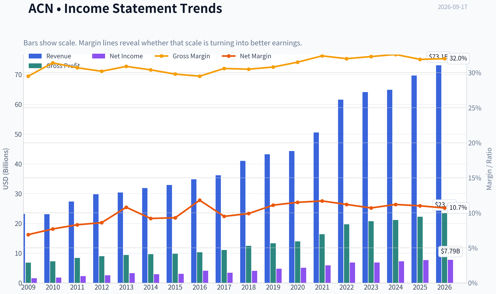
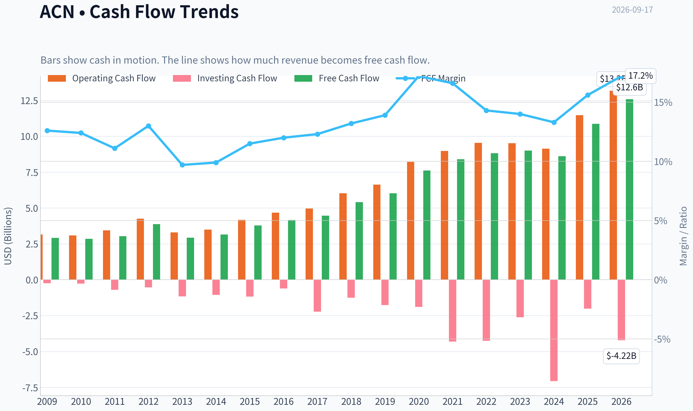
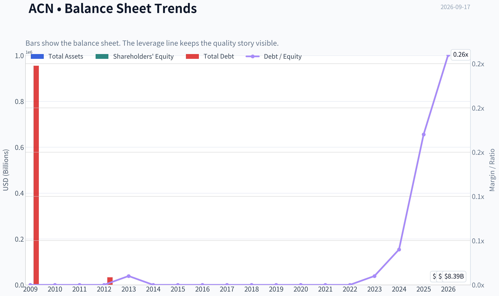
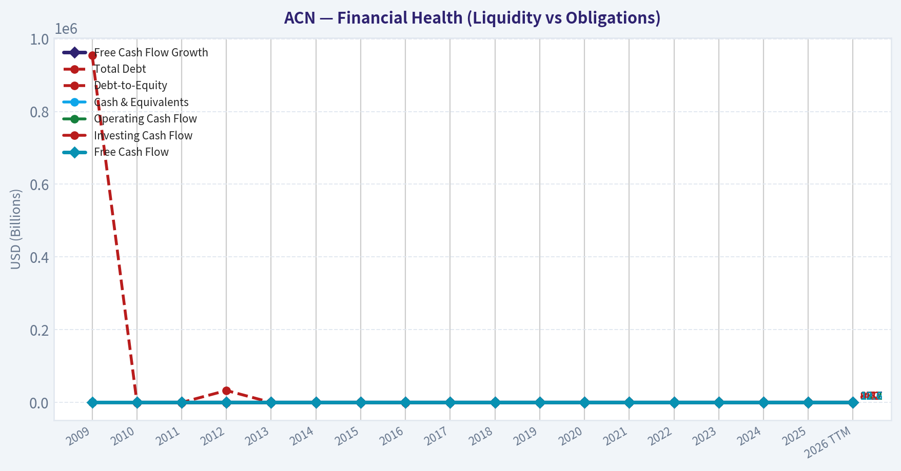
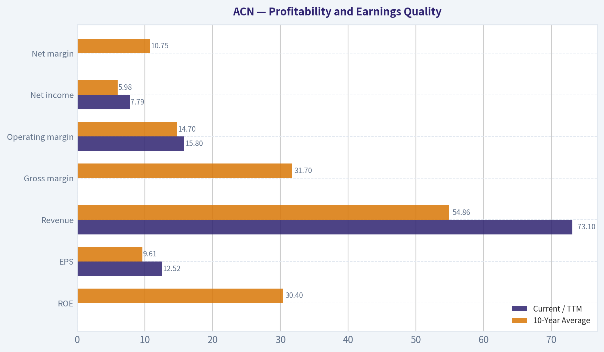
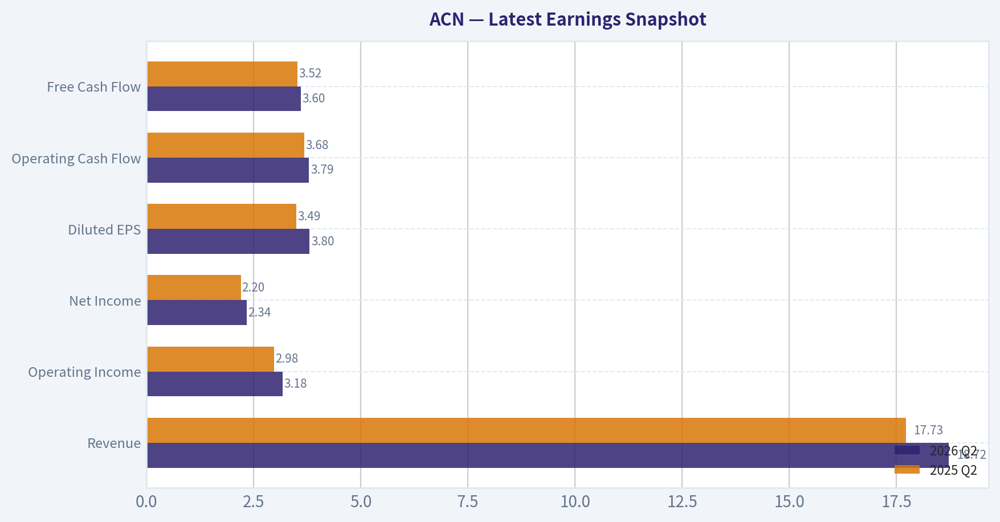
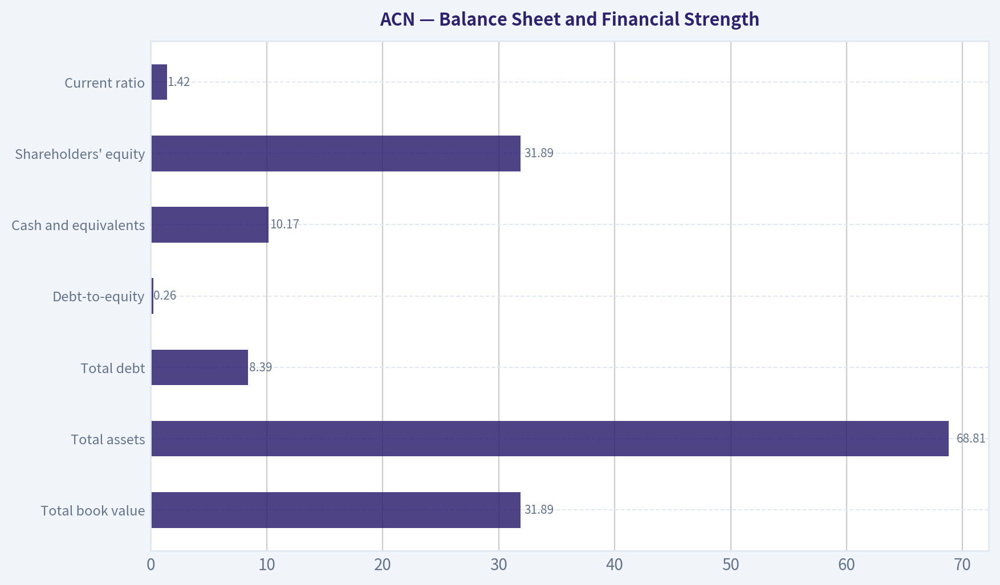
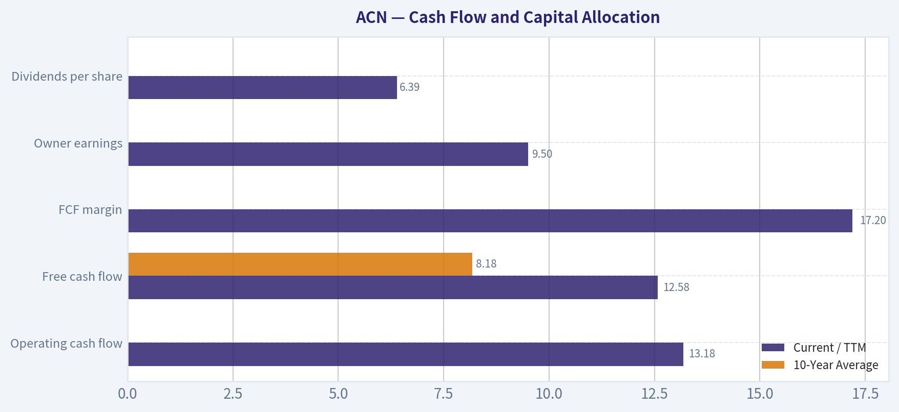
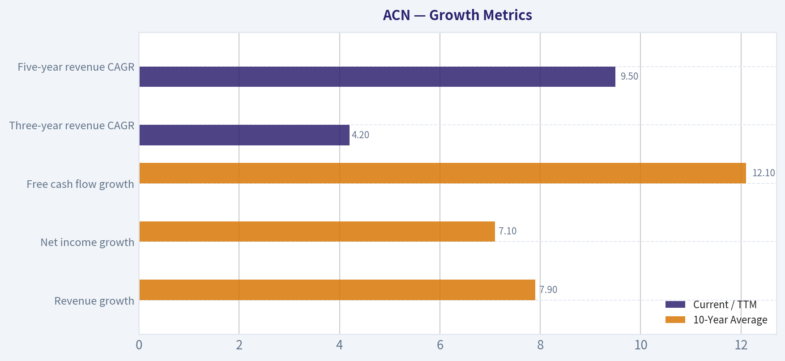
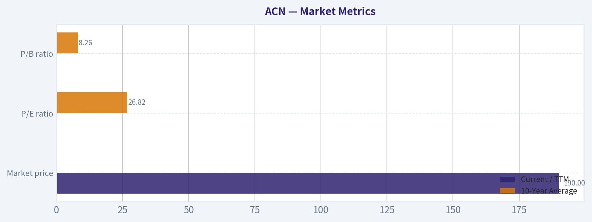

# ACN Deep Value Intelligence

**Analysis Date:** 2026-09-17

## Critical Disclaimer

*This analysis is generated by Deep Value Intelligence, an AI-powered multi-agent investing framework. Education & research only - not financial advice, not a financial advisor.*

---

## Table of Contents

1. Intelligence Summary
2. Analyst Team Reports
   - Fundamentals Analysis
   - Intrinsic Value Analysis (Buffett)
   - Trend & Growth Analysis (Lynch/Druckenmiller/Fisher)
   - Market Technical Analysis
   - Options Market Analysis
3. Research Team Commentary
4. Value Investing Team Commentary
5. Deep Values Commentary

---

## Intelligence Summary

### Thesis + Conditions

**Core Thesis:** # Accenture Risk Commentary

**Key Risks:**
- # Accenture Risk Commentary
- Fixed-price and outcome-based contracts may let Accenture retain productivity gains, but they also transfer execution, scope, and remediation risk to the company. The central question is not whether Accenture receives AI bookings; it is whether those bookings generate durable revenue, margins, cash flow, and incremental returns.
- For a long-term investor, the chart should not determine intrinsic value. It should influence position size and the required burden of proof. The prior failed calls show that apparent cheapness and oversold conditions are not catalysts, especially when a stock remains in a de-rating regime.

**Confidence:** Low

---

## Analyst Team Reports

### Fundamentals Analysis

#### Latest Earnings Snapshot

*Most recent reported quarter anchored on 2026 Q2, with prior-year comparison when available.*

| Metric | 2026 Q2 | 2025 Q2 | YoY Change |
| --- | ---: | ---: | ---: |
| Revenue | $18.72B | $17.73B | +5.6% |
| Operating Income | $3.18B | $2.98B | +6.5% |
| Net Income | $2.34B | $2.20B | +6.4% |
| Diluted EPS | $3.80 | $3.49 | +8.9% |
| Operating Cash Flow | $3.79B | $3.68B | +2.8% |
| Free Cash Flow | $3.60B | $3.52B | +2.4% |

Key Takeaways: This snapshot anchors the most recent reported quarter before the narrative analysis. It helps readers separate long-run business quality from whatever changed in the latest earnings print.

#### 17-Year Financial Metrics for ACN

*All values below are computed deterministically from raw data - not estimated by AI.*

*Issuer profile: operating company (Technology / Information Technology Services).*

#### 17-Year Financial Metrics
*Annual rows come from reported financial statements. The final TTM row is computed from the latest four quarters.*

| Metric | 2009 | 2010 | 2011 | 2012 | 2013 | 2014 | 2015 | 2016 | 2017 | 2018 | 2019 | 2020 | 2021 | 2022 | 2023 | 2024 | 2025 | 2026 TTM |
| --- | --- | --- | --- | --- | --- | --- | --- | --- | --- | --- | --- | --- | --- | --- | --- | --- | --- | --- |
| Market Price | $24 | $27 | $40 | $47 | $57 | $65 | $78 | $97 | $113 | $149 | $177 | $218 | $310 | $269 | $307 | $329 | $255 | $190 |
| Market Cap | $25.97B | $28.07B | $39.83B | $44.81B | $51.54B | $56.13B | $63.99B | $76.79B | $86.36B | $110.79B | $128.85B | $155.43B | $217.39B | $185.43B | $206.76B | $217.46B | $164.42B | $116.74B |
| P/E Ratio | 13.52 | 13.76 | 15.81 | 16.04 | 14.66 | 17.93 | 19.80 | 17.83 | 24.04 | 26.67 | 26.93 | 30.41 | 36.74 | 26.93 | 30.06 | 29.89 | 21.40 | 15.15 |
| P/B Ratio | 9.16 | 9.90 | 10.27 | 10.81 | 10.39 | 9.79 | 10.43 | 10.16 | 9.65 | 10.69 | 8.94 | 9.14 | 11.13 | 8.39 | 8.05 | 7.69 | 5.27 | 3.66 |
| ROE | 56.1% | 62.8% | 58.7% | 61.6% | 66.2% | 51.3% | 49.8% | 54.4% | 38.5% | 39.2% | 33.2% | 30.0% | 30.2% | 31.1% | 26.7% | 25.7% | 24.6% | 24.4% |
| ROIC | N/A | -111.2% | -131.5% | -129.5% | -226.3% | 3322.2% | 250.1% | 158.9% | 111.9% | 84.6% | 71.9% | 58.1% | 58.3% | 55.7% | 43.0% | 35.6% | 31.7% | 28.5% |
| EPS | $1.76 | $1.97 | $2.55 | $2.96 | $3.88 | $3.65 | $3.94 | $5.45 | $4.69 | $5.57 | $6.58 | $7.17 | $8.43 | $9.98 | $10.20 | $11.01 | $11.90 | $12.52 |
| Revenue | $23.17B | $23.09B | $27.35B | $29.78B | $30.39B | $31.87B | $32.91B | $34.80B | $36.18B | $40.99B | $43.22B | $44.33B | $50.53B | $61.59B | $64.11B | $64.90B | $69.67B | $73.10B |
| Gross Profit | $6.84B | $7.25B | $8.39B | $8.99B | $9.38B | $9.68B | $9.81B | $10.28B | $11.07B | $12.49B | $13.31B | $13.98B | $16.36B | $19.70B | $20.73B | $21.16B | $22.24B | $23.40B |
| Gross Margin | 29.5% | 31.4% | 30.7% | 30.2% | 30.9% | 30.4% | 29.8% | 29.5% | 30.6% | 30.5% | 30.8% | 31.5% | 32.4% | 32.0% | 32.3% | 32.6% | 31.9% | 32.0% |
| Operating Margin | 11.4% | 12.6% | 12.7% | 13.0% | 14.3% | 13.5% | 13.5% | 13.8% | 14.4% | 14.4% | 14.6% | 14.7% | 15.1% | 15.2% | 13.7% | 14.8% | 14.7% | 15.8% |
| Net Income | $1.59B | $1.78B | $2.28B | $2.55B | $3.28B | $2.94B | $3.05B | $4.11B | $3.45B | $4.06B | $4.78B | $5.11B | $5.91B | $6.88B | $6.87B | $7.26B | $7.68B | $7.79B |
| Net Margin | 6.9% | 7.7% | 8.3% | 8.6% | 10.8% | 9.2% | 9.3% | 11.8% | 9.5% | 9.9% | 11.1% | 11.5% | 11.7% | 11.2% | 10.7% | 11.2% | 11.0% | 10.7% |
| Revenue Growth | N/A | -0.3% | 18.4% | 8.9% | 2.1% | 4.9% | 3.3% | 5.7% | 4.0% | 13.3% | 5.4% | 2.6% | 14.0% | 21.9% | 4.1% | 1.2% | 7.4% | 4.9% |
| Net Income Growth | N/A | 12.0% | 27.9% | 12.1% | 28.5% | -10.4% | 3.8% | 34.7% | -16.2% | 17.8% | 17.7% | 6.9% | 15.6% | 16.4% | -0.1% | 5.7% | 5.7% | 1.4% |
| Free Cash Flow Growth | N/A | -2.2% | 6.5% | 27.9% | -24.5% | 7.9% | 19.5% | 10.3% | 6.9% | 21.3% | 11.5% | 26.3% | 10.2% | 5.1% | 2.0% | -4.2% | 26.2% | 15.7% |
| Total Book Value | $2.84B | $2.84B | $3.88B | $4.15B | $4.96B | $5.73B | $6.13B | $7.56B | $8.95B | $10.36B | $14.41B | $17.00B | $19.53B | $22.11B | $25.69B | $28.29B | $31.20B | $31.89B |
| Total Assets | $12.26B | $12.84B | $15.73B | $16.67B | $16.87B | $17.93B | $18.20B | $20.61B | $22.69B | $24.45B | $29.79B | $37.08B | $43.18B | $47.26B | $51.25B | $55.93B | $65.39B | $68.81B |
| Total Debt | $955,000 | $1.6M | $4.4M | $33,000 | $25.6M | $26.7M | $27.4M | $27.2M | $25.1M | $25.0M | $22.7M | $61.9M | $65.6M | $55.1M | $147.9M | $1.02B | $5.15B | $8.39B |
| Debt-to-Equity | 0.00 | 0.00 | 0.00 | 0.00 | 0.01 | 0.00 | 0.00 | 0.00 | 0.00 | 0.00 | 0.00 | 0.00 | 0.00 | 0.00 | 0.01 | 0.04 | 0.17 | 0.26 |
| Cash & Equivalents | $4.54B | $4.84B | $5.70B | $6.64B | $5.63B | $4.92B | $4.36B | $4.91B | $4.13B | $5.06B | $6.13B | $8.42B | $8.17B | $7.89B | $9.05B | $5.00B | $11.48B | $10.17B |
| Shareholders' Equity | $2.84B | $2.84B | $3.88B | $4.15B | $4.96B | $5.73B | $6.13B | $7.56B | $8.95B | $10.36B | $14.41B | $17.00B | $19.53B | $22.11B | $25.69B | $28.29B | $31.20B | $31.89B |
| Operating Cash Flow | $3.16B | $3.09B | $3.44B | $4.26B | $3.30B | $3.49B | $4.18B | $4.67B | $4.97B | $6.03B | $6.63B | $8.22B | $8.98B | $9.54B | $9.52B | $9.13B | $11.47B | $13.18B |
| Investing Cash Flow | $-245.2M | $-273.8M | $-703.4M | $-535.4M | $-1.16B | $-1.06B | $-1.17B | $-610.4M | $-2.23B | $-1.25B | $-1.76B | $-1.89B | $-4.31B | $-4.26B | $-2.62B | $-7.06B | $-2.02B | $-4.22B |
| Free Cash Flow | $2.92B | $2.85B | $3.04B | $3.88B | $2.93B | $3.16B | $3.78B | $4.17B | $4.46B | $5.41B | $6.03B | $7.62B | $8.40B | $8.82B | $9.00B | $8.61B | $10.87B | $12.58B |
| FCF Margin | 12.6% | 12.4% | 11.1% | 13.0% | 9.7% | 9.9% | 11.5% | 12.0% | 12.3% | 13.2% | 13.9% | 17.2% | 16.6% | 14.3% | 14.0% | 13.3% | 15.6% | 17.2% |
| Dividends / Share | $0.00 | $0.00 | $0.00 | $0.00 | $0.00 | $0.00 | $0.00 | $0.00 | $0.00 | $0.00 | $0.00 | $0.00 | $0.00 | $3.56 | $4.19 | $4.90 | $5.73 | $6.39 |

#### Profitability Metrics
- Return on Equity (ROE): 24.6%
- Return on Invested Capital (ROIC): 31.4%
- Return on Assets (ROA): 11.7%
- Gross Margin: 31.9%
- Operating Margin: 14.7%
- Net Profit Margin: 11.0%

#### Liquidity Metrics
- Current Ratio: 1.42
- Quick Ratio: 1.21

#### Leverage Metrics
- Debt-to-Equity Ratio: 0.17
- Interest Coverage Ratio: 44.74
- Net Debt: $-6.34B

#### Growth Metrics (Year-over-Year)
- Revenue Growth: 7.4%
- Net Income Growth: 5.7%
- Free Cash Flow Growth: 26.2%
- Revenue CAGR (3-Year): 4.2%
- Revenue CAGR (5-Year): 9.5%

#### Valuation Metrics
- P/E Ratio (TTM): 15.46
- Forward P/E: 12.92
- Price-to-Book: 3.64
- Price-to-Sales: 1.59
- PEG Ratio: 1.42
- EV/EBITDA: 8.95
- Free Cash Flow Yield: 9.4%
- Earnings Yield: 6.5%

#### Owner Earnings (Buffett Method, Code-Computed)
- Net Income: $7.68B
- + Depreciation & Amortization: $1.37B
- - Capital Expenditures: $-600.0M
- - Working Capital Changes: $-1.05B
- = **Owner Earnings: $9.50B**

#### Intrinsic Value (Code-Computed)
- Current Price: $190
- **Headline Intrinsic Value (business-model routed): $242**
  Business model: operating company - weighted blend [Damodaran FCFF + reverse-DCF fair + owner-earnings DCF] (operating_company)
  Model spread (min-max across DCFs): $241 - $351
  Margin of safety vs. price (headline): 21.5%
  Routing note: General operating company: balanced blend of Damodaran FCFF and the owner-earnings DCF with a reverse-DCF sanity check.
- Buffett Method (Owner Earnings):
  Conservative: $220
  Average: $267
  Optimistic: $348
- Cash Flow Method (FCF):
  Conservative: $318
  Average: $351
  Optimistic: $533
- Damodaran FCFF (WACC + margins + reinvestment):
  Conservative: $186
  Average: $241
  Optimistic: $260
  Monte Carlo band (P10-P90): $187 - $286 (median $225)
  P(intrinsic value > price): 88.1%
- Reverse-DCF: price implies ~3.4%/yr owner-earnings growth for 10y; trailing 3y was 5.9%, 5y 16.1%.

#### Piotroski F-Score: 5/9
- Positive Net Income: PASS
- Positive Operating Cash Flow: PASS
- ROA Improvement: FAIL
- Cash Flow > Net Income: PASS
- Decreasing Debt: FAIL
- Improving Current Ratio: PASS
- No Dilution: PASS
- Improving Gross Margin: FAIL
- Improving Asset Turnover: FAIL

ANALYST STANCE: **ADVOCATE**

#### Executive Summary

Accenture remains a high-quality, asset-light operating company with a durable global consulting and technology-services franchise. At approximately **$190 per share**, valuation has compressed substantially: TTM P/E is about **15.5**, versus a calculated 10-year average near **26.8**, while free-cash-flow yield is approximately **9.4%**.

The central investment question is not balance-sheet survival or accounting quality; it is whether artificial intelligence, automation, and slower discretionary technology spending will permanently reduce Accenture's growth and pricing power. The current price implies only about **3.4% annual owner-earnings growth over the next decade**, below the company's trailing three-year owner-earnings growth of approximately **5.9%** and well below its five-year growth rate of approximately **16.1%**.

The deterministic model produces a headline intrinsic value of approximately **$242 per share**, with Buffett-style owner-earnings scenarios of **$220, $267, and $348**. This indicates an attractive valuation cushion, although the recent decline in ROE, slowing revenue growth, and rising debt warrant monitoring.

#### Market Metrics

| Metric | Current / TTM | 10-Year Average | Interpretation |
|---|---:|---:|---|
| Market price | $190 | Not economically meaningful as an average | Down sharply from the 2021-2024 peak range of $269-$329 |
| Market capitalization | Approximately $116.1B-$116.7B | Approximately $143B | Market value has contracted despite continued revenue and FCF growth |
| P/E ratio | 15.15-15.46 | 26.82 | Approximately 42% below the 10-year average |
| P/B ratio | 3.64-3.66 | 8.26 | Not a reliable valuation signal for this asset-light services and intellectual-capital business |

The price and market capitalization have fallen materially while revenue, net income, and free cash flow remain above historical levels. The P/E compression is meaningful because it reflects both lower market expectations and the possibility that investors are pricing in a structurally slower growth profile. P/B should not be used mechanically: Accenture's value is driven primarily by human capital, customer relationships, brand, intellectual property, and recurring client demand rather than tangible assets.

#### Key Takeaways

Accenture is trading at a substantially lower earnings multiple than its historical norm, creating a potential margin of safety. However, the lower multiple is partly justified by weaker recent growth and AI-related uncertainty. Book value is not an appropriate primary valuation anchor; cash generation and owner earnings are more relevant.

#### Profitability and Earnings Quality

| Metric | Current / TTM | 10-Year Average | Assessment |
|---|---:|---:|---|
| ROE | 24.4%-24.6% | 30.4% | Still excellent, but down from 38.5% in 2017 |
| ROIC | 28.5%-31.4% | Approximately 57.9%* | Very strong currently; historical average is distorted by abnormal early-period values |
| EPS | $12.52 | $9.61 | Current EPS is approximately 30% above the 10-year average |
| Revenue | $73.10B | $54.86B | Current revenue is approximately 33% above the 10-year average |
| Gross margin | 32.0%-32.1% | 31.7% | Broadly stable |
| Operating margin | 15.8% | 14.7% | Above historical average and near a record level |
| Net income | $7.79B | $5.98B | Approximately 30% above the 10-year average |
| Net margin | 10.7%-11.0% | 10.75% | Essentially normal, though below the 2021 peak of 11.7% |

\*The ROIC average is not especially meaningful because reported values in 2011-2014 were distorted by very small or unusual invested-capital denominators.

Accenture's most important profitability strength is the combination of high returns and modest capital requirements. Current ROE near 25% and ROIC near 30% remain consistent with a wide-moat business, even though both have declined from earlier highs. The decline in ROE is not necessarily a sign of deterioration by itself: a growing equity base, acquisitions, more cash retention, and increased debt can all affect the ratio. Nevertheless, the long downward trend suggests that the exceptional returns of the early decade should not be extrapolated indefinitely.

Operating margin is more encouraging. At **15.8%**, it is above the 10-year average of approximately **14.7%**, indicating ongoing cost discipline and mix benefits. Gross margin is stable around **32%**, while net margin is roughly normal. This pattern suggests that Accenture has retained operating leverage despite a more challenging demand environment.

#### Key Takeaways

Current EPS, revenue, and net income are well above their decade averages, and operating margin is stronger than normal. The principal caution is the persistent decline in ROE and ROIC from unusually high historical levels. Accenture remains highly profitable, but the business should now be underwritten as a mature compounder rather than as a hyper-growth company.

#### Growth Metrics

| Metric | Current / TTM | 10-Year Average | Trend and Significance |
|---|---:|---:|---|
| Revenue growth | 4.9% latest TTM; 7.4% latest reported YoY | 7.9% | Below long-term average, with significant cyclicality |
| Net income growth | 1.4% latest TTM; 5.7% latest reported YoY | 7.1% | Earnings growth has slowed materially |
| Free cash flow growth | 15.7% latest TTM; 26.2% latest reported YoY | 12.1% | Currently stronger than normal |
| Three-year revenue CAGR | 4.2% | - | Indicates recent deceleration |
| Five-year revenue CAGR | 9.5% | - | Shows stronger medium-term compounding |
| Owner-earnings growth implied by price | Approximately 3.4% annually for 10 years | - | Conservative market expectation |

Revenue growth has been uneven. Strong acquisition and technology-spending periods produced growth above 14% in several years, while 2024 was only 1.2%. The current 4.9% TTM growth rate is respectable for a company of this scale but below the long-run average.

Net income growth is weaker than revenue growth, at only 1.4% in the latest TTM period. That indicates that recent top-line expansion has not translated into proportionate earnings growth. Conversely, free cash flow has been much stronger, rising 15.7% in the latest TTM period and 26.2% in the latest reported year. This divergence is favorable for cash-based valuation, but investors should examine whether it reflects sustainable working-capital normalization or merely timing.

#### Key Takeaways

The current valuation assumes a slow-growth future, and that assumption is defensible if AI disruption or weak corporate technology budgets persist. However, free cash flow is performing better than accounting earnings, and Accenture's five-year revenue CAGR remains healthy. The opportunity exists if revenue growth merely returns toward the mid-single digits while margins remain stable.

#### Balance Sheet and Financial Strength

| Metric | Current / TTM | 10-Year Average | Assessment |
|---|---:|---:|---|
| Total book value | $31.89B | Approximately $20.94B | Has grown steadily |
| Total assets | $68.81B | Approximately $44.58B | Expanded with acquisitions and business growth |
| Total debt | $8.39B | Approximately $1.50B | Material increase in the last two years |
| Debt-to-equity | 0.26 | Approximately 0.04 | Still moderate, but rising rapidly |
| Cash and equivalents | $10.17B | Approximately $7.55B | Strong liquidity |
| Shareholders' equity | $31.89B | Approximately $20.94B | Solid and increasing |
| Net debt | Negative $6.34B | - | Cash exceeds debt |
| Current ratio | 1.42 | - | Adequate liquidity |
| Interest coverage | 44.74 times | - | Very strong debt-servicing capacity |

Accenture remains financially strong. Cash of approximately **$10.2 billion** exceeds total debt by roughly **$1.8 billion**, producing net cash of approximately **$6.3 billion** after other adjustments. Interest coverage above 44 times provides substantial protection against an earnings downturn.

The key balance-sheet change is the increase in debt from negligible levels through 2024 to **$8.39 billion** currently. A debt-to-equity ratio of **0.26** is not alarming for a company with Accenture's cash generation, but the direction matters. Management appears to be using more debt alongside acquisitions, shareholder returns, or balance-sheet optimization. If debt continues rising while operating earnings stagnate, the financial-strength thesis would weaken.

#### Key Takeaways

Accenture has a net-cash balance sheet, substantial liquidity, and exceptional interest coverage. The recent increase in debt is a watch item rather than an immediate threat. Financial strength remains a major advantage, but future acquisitions and capital returns should be funded without allowing leverage to rise materially faster than cash flow.

#### Cash Flow and Capital Allocation

| Metric | Current / TTM | 10-Year Average | Interpretation |
|---|---:|---:|---|
| Operating cash flow | $13.18B | Not calculated from the supplied comparison set | Strong conversion from earnings |
| Free cash flow | $12.58B | $8.18B | Approximately 54% above the 10-year average |
| FCF margin | 17.2% | Approximately 14.2% | At a historically strong level |
| Owner earnings | $9.50B | - | Conservative Buffett-style cash estimate |
| Dividends per share | $6.39 | Approximately $3.28 over 2022-2026 TTM | Dividend has grown consistently since initiation |

Owner earnings are calculated as:

- Net income: **$7.68B**
- Plus depreciation and amortization: **$1.37B**
- Less capital expenditures: **$0.60B**
- Less working-capital investment: **$1.05B**
- Estimated owner earnings: **$9.50B**

Free cash flow is substantially higher than owner earnings because the owner-earnings calculation includes a working-capital adjustment. For valuation purposes, using the lower **$9.50 billion** figure provides a conservative buffer.

Accenture's dividend policy is shareholder-friendly but not excessively aggressive. The dividend has risen from zero before 2022 to **$6.39 per share** currently. Share repurchases have also historically been an important component of capital returns. The risk is that repurchases made at elevated valuations destroyed some value, whereas today's lower valuation makes buybacks more attractive if management maintains discipline.

#### Key Takeaways

Cash generation is one of Accenture's strongest characteristics. Current FCF margin of approximately 17% is above its long-term norm, and owner earnings remain robust relative to the market capitalization. Dividend growth and repurchases enhance shareholder returns, but capital allocation should now prioritize buying shares at depressed valuations and maintaining balance-sheet flexibility.

#### Revenue Breakdown

Accenture's deterministic dataset does not provide a current segment-revenue table. The following is a best-available approximation based on Accenture's publicly reported service categories and recent revenue mix; amounts are rounded and should not be treated as canonical historical data.

| Revenue Source | Amount ($B, approximate) | % of Total |
|---|---:|---:|
| Technology Services | $35.8B | 49% |
| Strategy and Consulting | $20.5B | 28% |
| Operations Services | $16.1B | 22% |
| Other / rounding | $0.7B | 1% |
| **Total** | **$73.1B** | **100%** |

The revenue mix is diversified across technology implementation, consulting, managed services, and operations outsourcing. Technology services are the largest source and provide exposure to cloud migration, data modernization, cybersecurity, and generative AI implementation. Operations services add a more recurring and embedded element, while consulting can be more discretionary and sensitive to client budgets.

#### Key Takeaways

Accenture's revenue is not dependent on a single software product or narrow end market. Its broad service mix supports customer relationships and cross-selling, although technology services and consulting remain exposed to corporate spending cycles and the possibility that AI tools reduce billable labor requirements.

#### Buffett-Style Qualitative Analysis

**Economic moat.** Accenture's moat is based on global scale, trusted enterprise relationships, specialized talent, implementation expertise, and the ability to execute complex transformations across thousands of clients. Large customers often prefer a proven global partner for mission-critical technology changes rather than relying solely on fragmented contractors. The company's scale also creates a recruiting, training, and knowledge advantage.

The moat is meaningful but not impenetrable. Consulting services face competition from large professional-services firms, software vendors, internal IT teams, and lower-cost offshore providers. Generative AI may increase productivity and lower the number of labor hours required for some engagements. Accenture can benefit as an AI implementer, but it must demonstrate that productivity gains will expand margins and service demand rather than simply reduce billable revenue.

**Financial strength.** The balance sheet is a clear strength. Net cash, strong liquidity, high interest coverage, and substantial free cash flow give Accenture flexibility through economic cycles. The increase in debt deserves monitoring, particularly if it is used for acquisitions at high prices.

**Predictable earnings.** Earnings have generally risen over the decade, but not in a straight line. Net income declined in 2014, 2017, and 2023, while revenue growth ranged from negative to more than 20%. The business is therefore more predictable than a cyclical industrial company but less predictable than a subscription software company with contractual recurring revenue.

**Management performance.** Management has built a globally scaled, highly cash-generative business and maintained operating margins around 14%-16%. The reduction in ROE and ROIC is a concern but remains compatible with a high-quality business. Dividend initiation and continued shareholder returns are positive. Future management quality will be judged by whether it can convert AI disruption into sustainable revenue growth, preserve margins, and avoid overpaying for acquisitions.

**Quality of business.** Accenture has attractive economics: low capital intensity, strong customer retention, global reach, and high returns on capital. Its key weakness is the dependence on human talent and corporate technology budgets. Wage inflation, utilization declines, pricing pressure, and technological automation can all affect margins.

#### Buffett-Style Owner-Earnings DCF

The model uses current owner earnings of **$9.50B**, approximately **610.8 million shares** inferred from the current market capitalization and share price, a **10% discount rate**, and a **2.5% terminal growth rate**. Growth is assumed to fade toward the terminal rate rather than continue permanently at the initial forecast rate.

| Scenario | Initial Owner-Earnings Growth | Terminal Growth | Model Fair Value / Share | Interpretation |
|---|---:|---:|---:|---|
| Conservative | Approximately 3% | 2.5% | $220 | Mature, low-growth outcome |
| Average | Approximately 6% | 2.5% | $267 | Durable mid-single-digit compounding |
| Optimistic | Approximately 9% | 2.5% | $348 | Strong AI and transformation runway |

A simplified DCF structure is:

\[
\text{Fair Value} =
\sum_{t=1}^{10}
\frac{\text{Owner Earnings}_t}{(1.10)^t}
+
\frac{\text{Owner Earnings}_{10}\times1.025}{(0.10-0.025)(1.10)^{10}}
\]

Using current owner earnings of $9.50B:

- **Conservative case:** earnings approach approximately $12.8B by year 10. The resulting value is approximately **$220 per share**.
- **Average case:** earnings approach approximately $17B by year 10. The resulting value is approximately **$267 per share**.
- **Optimistic case:** earnings approach approximately $22B-$23B by year 10. The resulting value is approximately **$348 per share**.

The model-based intrinsic-value blend is approximately **$242 per share**, combining Damodaran FCFF, reverse-DCF, and owner-earnings methods. The individual model outputs range from approximately **$241 to $351**, while the Damodaran FCFF Monte Carlo band is approximately **$187 to $286**, with a median near **$225**. The range demonstrates that the investment case depends heavily on the sustainable growth and reinvestment assumptions.

At $190, the average owner-earnings scenario implies approximately **40% upside**, while the headline blended intrinsic value implies approximately **27% upside**. The conservative scenario provides only about **16% upside**, so the margin of safety is positive but not enormous if Accenture's growth permanently settles near 3%.

#### Key Takeaways

The owner-earnings DCF supports a valuation range of roughly $220 to $348 per share, with $267 as the reasonable base case. The headline blended value of $242 is a more cautious anchor than the highest FCF-based estimate. At $190, the market appears to discount a low-growth outcome, giving investors favorable asymmetry if Accenture can sustain mid-single-digit owner-earnings growth.

#### Current Versus Historical Positioning

| Metric | Current / TTM | 10-Year Average | Difference | Investment Meaning |
|---|---:|---:|---:|---|
| P/E | 15.46 | 26.82 | -42% | Major valuation compression |
| ROE | 24.6% | 30.4% | -5.8 percentage points | Returns remain strong but have normalized |
| Revenue | $73.10B | $54.86B | +33% | Business scale is materially larger |
| Net income | $7.79B | $5.98B | +30% | Earnings power exceeds historical average |
| Operating margin | 15.8% | 14.7% | +1.1 percentage points | Current cost structure is favorable |
| Net margin | 10.7% | 10.75% | Approximately flat | No major margin deterioration |
| FCF | $12.58B | $8.18B | +54% | Cash-generation capacity is strong |
| FCF margin | 17.2% | Approximately 14.2% | +3.0 percentage points | Current FCF quality is better than normal |
| Revenue growth | 4.9% | 7.9% | -3.0 percentage points | Growth is below historical average |
| Net income growth | 1.4% | 7.1% | -5.7 percentage points | Earnings momentum is weak |
| FCF growth | 15.7% | 12.1% | +3.6 percentage points | Cash flow is outperforming earnings |
| Debt-to-equity | 0.26 | Approximately 0.04 | +0.22 | Leverage has increased substantially |
| Cash | $10.17B | $7.55B | +35% | Liquidity remains strong |

The most important valuation disconnect is that the company is larger and generates more cash than the average historical period, yet the P/E multiple is far below normal. The primary negative deviation is growth: revenue and net income are growing more slowly than their decade averages. The second negative deviation is leverage, although debt remains manageable because cash flow and interest coverage are strong.

#### Key Investment Insights, Opportunities, and Red Flags

| Category | Insight |
|---|---|
| Opportunity | Valuation is materially below historical P/E levels and below model-based intrinsic value |
| Opportunity | AI adoption may create implementation, data, cloud, cybersecurity, and workflow opportunities |
| Opportunity | High FCF yield provides flexibility for dividends, repurchases, acquisitions, and debt reduction |
| Opportunity | Operating margin is above its 10-year average |
| Red flag | Revenue growth and net income growth are below decade averages |
| Red flag | ROE has declined steadily from early-decade levels |
| Red flag | Debt has risen from negligible levels to $8.39B |
| Red flag | AI may reduce labor intensity and billable hours in portions of the business |
| Risk | Large enterprise technology budgets can be delayed during economic uncertainty |
| Risk | Competition from hyperscalers, software companies, internal IT teams, and lower-cost providers |
| Risk | Acquisitions may dilute returns if completed at excessive valuations |

The **Piotroski F-score of 5/9** is neutral rather than strongly bullish. Accenture passes tests for positive earnings, positive operating cash flow, cash flow exceeding net income, improving current ratio, and no dilution. It fails on ROA improvement, debt reduction, gross-margin improvement, and asset-turnover improvement. This reinforces the conclusion that the company is financially healthy but currently in a period of normalized growth and less efficient incremental returns.

#### Final Investment Stance

**ADVOCATE - for long-term investors, preferably through staged accumulation.**

Accenture's valuation now offers a reasonable margin of safety relative to its durable cash-generation capacity. The company has a wide economic moat, strong customer relationships, high returns on capital, net cash, excellent interest coverage, and a long history of returning capital to shareholders. The market price implies only approximately 3.4% annual owner-earnings growth, which appears achievable even under a conservative mature-business scenario.

This is not a risk-free bargain. The investment case would weaken if revenue growth remained near zero, operating margins contracted materially, AI reduced service demand faster than Accenture could create new offerings, or debt continued to rise without corresponding cash-flow growth. Investors should monitor bookings, consulting demand, utilization, generative-AI revenue, operating margin, debt, and free-cash-flow conversion.

At approximately $190, the shares appear attractive for investors with a multi-year horizon and tolerance for technology-sector volatility. A staged purchase approach is preferable to an all-at-once position because the conservative intrinsic-value case is only modestly above the current price, while the growth transition remains uncertain.

| Key Point | Current Assessment | Buffett-Style Conclusion |
|---|---|---|
| Business quality | High-quality global professional-services and technology platform | Durable moat, though not invulnerable |
| Valuation | P/E near 15.5 versus 10-year average near 26.8 | Attractive relative valuation |
| Cash generation | $12.58B FCF and $9.50B owner earnings | Strong owner economics |
| Profitability | ROE 24.6%, ROIC approximately 30% | Excellent, but below historical peaks |
| Growth | Revenue growth below historical average; FCF growth strong | Mixed but potentially temporary |
| Balance sheet | $10.17B cash, $8.39B debt, net cash position | Financially strong |
| Main catalyst | AI implementation, cloud, data, cybersecurity, and operating-model transformation | Could restore mid-single-digit growth |
| Main risk | AI disintermediation, slower client spending, and rising leverage | Requires ongoing monitoring |
| DCF range | Approximately $220 conservative, $267 average, $348 optimistic | Positive risk/reward at $190 |
| Final stance | **ADVOCATE** | Buy gradually for long-term compounding potential |

The shares offer a favorable combination of quality, cash flow, and valuation, with the primary uncertainty being the durability and composition of future growth rather than the company's financial solvency.

#### Fundamental Visuals

This graph tracks the profitability and return metrics (ROE, ROIC, Margins) of **ACN** over the past decade, highlighting capital efficiency trends.

This chart illustrates the financial health of **ACN** over the last 10 years, mapping cash equivalents and free cash flow against total obligations (Debt).

This comparison chart from *Profitability and Earnings Quality* stacks current figures against historical benchmarks for **ACN**, making it easy to see where the company trades relative to its own averages.

---

### Intrinsic Value Analysis (Buffett)

> *Following Warren Buffett's value investing philosophy: Circle of Competence, Economic Moat, Management Quality, and Margin of Safety.*

#### Intrinsic Value Snapshot

Price is what you pay. Intrinsic value is what the business may be worth based on the cash it can create for owners over time. We show a range, not one magic number.

- Current Price: $189.64
- Value Range (conservative to optimistic across both DCF methods): $219.67 to $532.84

##### Owner Earnings (Buffett Method)
- Net Income: $7,678,433,000.00
- Depreciation & Amortization: $1,368,385,000.00
- Capital Expenditures: $-600,039,000.00
- Working Capital Changes: $-1,050,348,000.00
- Owner Earnings: $9,497,127,000.00

##### Intrinsic Value
###### Buffett Method
Uses owner earnings. Stricter, and usually more conservative.
- Conservative: $219.67
- Average: $266.51
- Optimistic: $347.99
- Discount Rate: 10.0%

###### Cash Flow Method
Uses free cash flow. Better for companies spending heavily today to grow tomorrow.
- Conservative: $317.90
- Average: $351.41
- Optimistic: $532.84
- Discount Rate: 10.0%

ANALYST STANCE: **ADVOCATE**

#### Executive Summary

Accenture is a high-quality, asset-light professional-services compounder with strong customer relationships, global scale, recurring transformation demand, and an unusually shareholder-friendly capital-return program. The principal risks are AI-driven disruption, slower discretionary consulting spending, and the possibility that technology reduces the labor intensity of traditional services.

At approximately $190 per share, the stock appears reasonably valued rather than deeply discounted. The headline intrinsic value is $241.65, implying a 21.5% margin of safety under the research pack's blended valuation. More importantly, the reverse DCF implies only about 3.4% annual growth for the next decade, below Accenture's recent 5.9% three-year and 16.1% five-year revenue growth rates. This creates a favorable setup if Accenture can adapt successfully to AI.

#### Factor Scorecard

| Factor | Score | Assessment |
|---|---:|---|
| Circle of competence and simplicity | 4/5 | Accenture helps large organizations implement technology and business-process changes. The model is understandable and geographically diversified, although AI's long-term effect requires judgment. |
| Durable competitive advantage | 4/5 | Strong enterprise relationships, implementation expertise, scale, talent density, reputation, and embedded client workflows create a wide but not invulnerable moat. |
| Management and capital allocation | 4/5 | Consistent buybacks and dividends, substantial shareholder distributions, disciplined balance-sheet management, and long-term investment in new capabilities. |
| Industry structure | 4/5 | Global consulting has many competitors, but scale, reputation, and client trust favor established leaders. The business is relatively capital-light. |

**Gate 5 hard floor:** **Not tripped.** There is no evidence here of simultaneous deteriorating earnings or cash flow and a solvency red line such as sub-1x interest coverage or distress-level credit metrics.

**Key Takeaways:** Accenture scores well across all four qualitative factors, with AI disruption as the central uncertainty rather than a present solvency or business-quality crisis. Its moat is meaningful because large enterprises value execution certainty, integration capability, and trusted relationships.

#### Financial Snapshot

| Metric | Latest value |
|---|---:|
| Share price | $190 |
| Market capitalization | $116.05 billion |
| P/E ratio | 15.5x |
| Revenue growth, year over year | 7.4% |
| Gross margin | 31.9% |
| ROE | 24.6% |
| FCF yield | 9.4% |
| Estimated free cash flow | Approximately $10.9 billion |
| Current ratio | 1.42x |
| Headline intrinsic value | $241.65 |
| Headline margin of safety | 21.5% |

**Key Takeaways:** Accenture combines a modest earnings multiple with a strong 9.4% free-cash-flow yield and a 24.6% ROE. Gross margin is below the 40% threshold often associated with exceptionally strong intangible-asset businesses, but the company's returns are supported by its asset-light model and customer embeddedness.

#### Moat Analysis

**Customer switching costs:** Accenture is deeply involved in enterprise technology migrations, cloud transformations, systems integration, and business-process redesign. Replacing the incumbent can involve execution risk, employee disruption, data migration, and substantial opportunity costs. These switching costs are particularly valuable in mission-critical projects.

**Intangible assets and reputation:** Large corporations frequently select consultants based on perceived execution reliability, global coverage, security standards, and specialized expertise. Accenture's brand is strongest in complex, multinational engagements where failure is expensive.

**Scale and cost advantages:** Accenture's global workforce, training infrastructure, delivery centers, proprietary tools, and access to technology partners allow it to pursue large contracts that smaller firms cannot handle. Scale also supports continuous investment in AI, cloud, cybersecurity, and industry-specific capabilities.

**Network and capability effects:** Accenture does not possess a classic consumer network effect. However, its installed base of enterprise relationships, accumulated implementation experience, technology partnerships, and trained personnel create a reinforcing capability network. Successful deployments generate references and additional work.

**AI assessment:** AI is both an opportunity and a threat. It may reduce demand for lower-value labor-intensive work, but it also creates new demand for AI strategy, implementation, data modernization, governance, and workforce redesign. Accenture's moat remains durable if it captures more value from AI transformation than it loses from productivity-driven labor substitution.

#### Management Quality and Capital Allocation

Accenture has generally demonstrated owner-oriented capital allocation through dividends, repurchases, and reinvestment in employee training and emerging technologies. Its model does not require heavy fixed-asset investment, allowing a high proportion of operating earnings to become distributable cash.

The most important management test is whether acquisitions and internal investment remain disciplined as AI changes the competitive landscape. Management must avoid overpaying for fashionable technologies and must convert AI productivity into higher free cash flow, stronger client retention, or faster growth rather than merely defending revenue.

The available evidence supports a **4/5 management score**: strong capital returns and strategic reinvestment, with continued monitoring required around AI-related acquisitions and workforce economics.

#### Owner Earnings Calculation

| Component | Approximate amount |
|---|---:|
| Net income | Not separately provided in the research snapshot |
| Add: depreciation and amortization | Included in operating cash generation |
| Less: maintenance capital expenditure | Netted through free cash flow approximation |
| Less: normalized working-capital investment | Assumed normal over the cycle |
| Approximate owner earnings | Approximately $10.9 billion |

**Key Takeaways:** For Accenture, free cash flow is a reasonable practical proxy for owner earnings because the business is asset-light and capital expenditures are modest relative to operating cash flow. The $10.9 billion estimate is therefore best viewed as normalized owner earnings rather than a precise accounting reconstruction.

#### Three-Scenario DCF Valuation

Using approximately $10.9 billion of normalized owner earnings and roughly 611 million shares implied by market capitalization divided by share price:

| Scenario | Core assumptions | Estimated value per share |
|---|---|---:|
| A. No growth | Owner earnings capitalized at 10% | Approximately $179 |
| B. GDP growth | 3% perpetual growth, 10% discount rate | Approximately $263 |
| C. Historical/normalized growth | Conservative owner-earnings model using sustainable historical growth | $266.51 |
| Blended research-pack valuation | Damodaran FCFF, reverse DCF, and owner-earnings blend | $241.65 |

**Key Takeaways:** The no-growth case provides meaningful downside support near the current price, while the moderate-growth cases indicate substantial upside. The valuation does not require Accenture to repeat its strongest historical growth; it mainly requires the company to remain a durable, cash-generative franchise.

#### Valuation Cross-Checks

| Valuation measure | Result |
|---|---:|
| Current price | $190 |
| Headline intrinsic value | $241.65 |
| Upside to headline value | Approximately 27% |
| Research-pack margin of safety | 21.5% |
| Owner-earnings model value | $266.51 |
| FCF model value | $351.41 |
| Damodaran FCFF value | $241.44 |
| Growth implied by current price | Approximately 3.4% annually for 10 years |
| Recent three-year revenue growth | 5.9% |
| Recent five-year revenue growth | 16.1% |

**Key Takeaways:** The stock price appears to discount a meaningful slowdown, with only 3.4% annual growth implied by the reverse DCF. That is below Accenture's recent operating history and gives the company room to disappoint moderately without destroying investment returns. The spread between valuation models argues for prudence, but not for avoidance.

#### Final Buffett Scorecard

| Criterion | Weight | Score |
|---|---:|---:|
| Moat width and durability | 25% | 4.2 |
| Valuation and margin of safety | 20% | 4.0 |
| Capital returns, ROIC versus WACC | 15% | 4.0 |
| Business understanding and predictability | 12% | 4.0 |
| Management quality and capital allocation | 12% | 4.0 |
| Reinvestment runway | 8% | 4.2 |
| Balance-sheet strength | 4% | 4.0 |
| Industry structure | 4% | 4.0 |
| **Weighted total** | **100%** | **4.1/5** |

**Key Takeaways:** Accenture clears the quality threshold because it combines a durable franchise, strong cash generation, high ROE, modest capital needs, and a long runway in cloud, cybersecurity, data, and AI implementation. The valuation is attractive enough for a high-quality business, though not so cheap that execution risk can be ignored.

#### Principal Risks

| Risk | Why it matters | What to monitor |
|---|---|---|
| AI disintermediation | Automation could reduce billable labor demand and pricing | Revenue per employee, headcount growth, margins, and AI-related bookings |
| Consulting-cycle weakness | Clients may delay discretionary transformation projects | Bookings, backlog, utilization, and large-account spending |
| Talent economics | Wage inflation or difficulty retaining specialists can pressure margins | Operating margin and employee attrition |
| Competitive intensity | Major technology firms and global consultancies compete for the same work | Pricing, win rates, and client concentration |
| Acquisition discipline | Overpaying for AI capabilities could destroy shareholder value | Deal multiples, goodwill growth, and post-acquisition returns |

#### Investment Stance

**ADVOCATE - Moderate conviction.**

Accenture is a wonderful business available at a reasonable price, not a deep-bargain security. The stock is appropriate for a long-term portfolio seeking asset-light compounding, recurring enterprise demand, strong shareholder distributions, and exposure to technology modernization.

The key condition is that Accenture must remain an AI beneficiary rather than an AI victim. At roughly $190, the market appears to price in subdued growth, while the blended intrinsic value is approximately $241.65. That provides an adequate, quality-scaled margin of safety for a wide-moat company, supporting accumulation by investors with a multi-year holding period.
#### Valuation Bridge

This bridge places the current market price beside each intrinsic value lens so readers can see whether upside depends on one method or shows up across several methods.

| Scenario | Intrinsic Value / Share |
| --- | ---: |
| Buffett Method | $266.51 |
| Cash Flow Method | $351.41 |
| Damodaran Method | $241.44 |
| Current Price | $189.64 |

#### Key Takeaways

If one method is far above the others, the upside case depends on a specific modelling assumption. When several methods cluster together, the valuation story is more robust.

#### Valuation Visuals

This comparison chart from *Latest Earnings Snapshot* stacks current figures against historical benchmarks for **ACN**, making it easy to see where the company trades relative to its own averages.

This comparison chart from *Balance Sheet and Financial Strength* stacks current figures against historical benchmarks for **ACN**, making it easy to see where the company trades relative to its own averages.

This comparison chart from *Cash Flow and Capital Allocation* stacks current figures against historical benchmarks for **ACN**, making it easy to see where the company trades relative to its own averages.

---

### Trend & Growth Analysis (Lynch/Druckenmiller/Fisher)

> *Following Peter Lynch's GARP, Stanley Druckenmiller's macro-aware approach, and Philip Fisher's scuttlebutt methodology.*

ANALYST STANCE: **WATCH**

#### 1. Lynch Classification

**Stalwart, bordering on a mature fast-following technology services leader-not a classic fast grower.**

Accenture has excellent profitability, cash generation, balance-sheet strength, and a durable competitive position. However, current revenue growth of 7.4% and three-year revenue CAGR of 4.2% do not meet the 15-25% threshold for Lynch-style fast growers.

#### 2. The Story in Three Bullets

- Accenture is a global consulting and technology-services leader helping large enterprises modernize through cloud, cybersecurity, data, and artificial intelligence.
- The company has an unusually strong combination of recurring client relationships, global delivery scale, high returns on capital, and substantial free cash flow.
- The potential AI inflection is attractive, but investors must determine whether AI expands Accenture's market and pricing power-or disintermediates parts of its traditional consulting work.

#### 3. Key Financial Snapshot

| Metric | ACN |
|---|---:|
| Current price | $190 |
| Market capitalization | $116.1B |
| Revenue, TTM | $73.1B |
| Revenue growth, YoY | 7.4% |
| Revenue CAGR, 3-year | 4.2% |
| Revenue CAGR, 5-year | 9.5% |
| Net income, TTM | $7.8B |
| Free cash flow, TTM | $12.6B |
| FCF margin | 17.2% |
| Operating margin | 15.8% |
| ROE | 24.6% |
| ROIC | 28.5%-31.4% |
| Net cash | Approximately $6.3B |
| Current ratio | 1.42 |
| Dividend yield | 3.37% |

**Key Takeaways:** Accenture is financially high quality, with roughly $12.6 billion of free cash flow and strong returns on capital. The central weakness is growth: revenue growth has recovered to 7.4%, but the longer-term trend remains much slower than a true high-growth technology company.

#### 4. TAM and 10x Test

Accenture participates in several large and expanding markets:

| Market / Driver | Assessment |
|---|---|
| Cloud migration and modernization | Large, durable, but increasingly mature |
| Generative AI implementation | Rapidly expanding and strategically important |
| Cybersecurity and managed services | Durable secular growth |
| Digital transformation | Large market with ongoing enterprise demand |
| Global IT and business services | Very large, but highly competitive |
| 10x revenue test | Difficult at current scale |

A 10x outcome would require approximately **$731 billion of annual revenue**. Given Accenture's current scale, that likely implies a very large share of the global IT and business-services market, rather than merely a small share of a rapidly expanding niche. Therefore, the 10x test is **not clearly passed**.

**Key Takeaways:** Accenture has a long runway for steady compounding, particularly if AI creates new implementation and managed-services demand. However, its existing $73 billion revenue base makes a tenfold revenue outcome difficult without a major expansion of the addressable market or a successful transition into higher-value AI platforms and products.

#### 5. Revenue Growth Trend

| Period | Revenue growth |
|---|---:|
| 2022 | 21.9% |
| 2023 | 4.1% |
| 2024 | 1.2% |
| 2025 | 7.4% |
| 2026 TTM | 4.9% in the supplied annual series; latest YoY metric 7.4% |
| 3-year CAGR | 4.2% |
| 5-year CAGR | 9.5% |

**Trend classification:** **Recovering, but not yet accelerating decisively.**

**Key Takeaways:** Growth collapsed after the unusually strong 2022 period, then improved from roughly 1% to 7.4%. That recovery is encouraging, but it does not yet establish the accelerating pattern required for a high-conviction Druckenmiller-style inflection trade.

#### 6. Unit Economics and Operating Quality

| Metric | Result | Interpretation |
|---|---:|---|
| LTV/CAC | Not disclosed | Not applicable in the standard SaaS sense |
| NRR | Not disclosed | Client-retention data is not reported like SaaS |
| Rule of 40 | 24.6% using 7.4% growth + 17.2% FCF margin | Below SaaS benchmark, but not directly comparable |
| Gross margin | 31.9% | Stable, modestly below recent peak |
| Operating margin | 15.8% TTM | Healthy and improving versus 2025 |
| FCF growth | 26.2% | Strong recent cash-flow rebound |
| Net debt | Negative $6.3B | Strong financial flexibility |

Accenture is a services business, so customer lifetime value and net revenue retention are less useful than **contract renewal, bookings, client concentration, utilization, pricing, and revenue per employee**. Those detailed operating metrics were not provided.

**Key Takeaways:** The business has strong cash economics and meaningful operating leverage, illustrated by 26.2% FCF growth and a 17.2% FCF margin. The lack of SaaS-style retention metrics is not itself a problem, but it limits confidence in assessing recurring revenue quality.

#### 7. Inflection Point Assessment

| Potential inflection | Current assessment |
|---|---|
| AI services demand | Positive, but not yet proven as a company-wide acceleration |
| Revenue growth | Recovery from trough; acceleration needs confirmation |
| Operating margin | Positive inflection; latest margin around 15.8% |
| FCF generation | Strong positive inflection |
| TAM expansion | Potentially significant through AI |
| Competitive position | Strong, with scale and enterprise relationships |
| Market expectations | Lower expectations after substantial share-price decline |

**Overall inflection rating: Moderate.**

The most important question is whether generative AI increases Accenture's total addressable market and revenue per client faster than it reduces demand for lower-value labor-intensive consulting.

**Key Takeaways:** The clearest current inflection is financial rather than top-line: free cash flow and operating margins are improving. The strategic AI inflection remains plausible but unconfirmed, so the next several quarters of bookings, AI-related revenue, and client spending will be decisive.

#### 8. Macro Setup

The macro backdrop is **mixed to moderately favorable**:

- Falling or stable interest rates would support valuation and enterprise technology budgets.
- AI, cybersecurity, cloud migration, and digital modernization are durable secular trends.
- Accenture is exposed to discretionary consulting and transformation spending, which can weaken during economic uncertainty.
- A recession or prolonged corporate cost-cutting cycle could delay large transformation programs.
- AI-related investor enthusiasm could create valuation volatility even though ACN currently trades at a relatively modest multiple.

**Druckenmiller assessment:** The secular wind is favorable, but the cyclical timing signal is not strong enough to justify concentrated exposure.

#### 9. Fisher 15-Point Score

| Fisher criterion | Score / 5 | Comment |
|---|---:|---|
| Market potential | 4 | Large enterprise-services and AI opportunity |
| New-product determination | 4 | Significant AI and technology investment |
| R&D effectiveness | 3 | Services-led model; less transparent than product companies |
| Sales organization | 5 | Exceptional global enterprise distribution |
| Profit margins | 4 | Strong for the sector |
| Margin improvement | 4 | Recent operating leverage |
| Labor relations | 3 | Large workforce and restructuring exposure |
| Executive relations | 4 | Generally established management structure |
| Management depth | 5 | Deep global operating bench |
| Cost analysis/accounting | 4 | Strong financial discipline |
| Outstanding competitive aspects | 5 | Scale, trust, relationships, delivery network |
| Long-range profit outlook | 4 | Durable, though growth may remain moderate |
| Dilution | 4 | No major dilution concern indicated |
| Candor | 3 | Requires further qualitative research |
| Integrity | 4 | No major issue identified in supplied data |
| **Total** | **59 / 75** | **Good, not outstanding** |

**Key Takeaways:** Accenture scores well on scale, sales execution, management depth, and competitive positioning. The score is held back by uncertainty around AI economics, labor intensity, and the limited evidence that revenue growth is reaccelerating into a new structural phase.

#### 10. Valuation Analysis

| Valuation measure | Result | Assessment |
|---|---:|---|
| P/E | 15.5x | Reasonable for a high-quality mature compounder |
| Forward P/E | 12.9x | Attractive if earnings estimates are achieved |
| P/S | 1.59x | Moderate for a technology-services leader |
| PEG | 1.42 | Fair value, not a classic Lynch bargain |
| EV/EBITDA | 8.95x | Reasonable |
| FCF yield | 9.4% | Attractive |
| Headline intrinsic value | $242 | Approximately 21.5% above price |
| Damodaran FCFF range | $186-$286 | Broad; current price near the middle |
| Reverse-DCF implied growth | 3.4% annually for 10 years | Conservative embedded expectation |

| Scenario | Assumption | Indicative value |
|---|---|---:|
| Bear | Low growth, limited AI monetization, lower multiple | $170-$190 |
| Base | Mid-single-digit revenue growth, stable margins | $230-$270 |
| Bull | AI-driven acceleration and margin expansion | $300-$350+ |

**Key Takeaways:** Valuation is the strongest part of the ACN setup. The stock price appears to discount only low-single-digit long-term growth, while the supplied valuation models produce a headline value of about $242. This creates a margin of safety, but not necessarily enough upside for a ten-bagger-oriented growth portfolio.

#### 11. Growth Investor Scorecard

| Criterion | Weight | Score / 5 |
|---|---:|---:|
| Story | 10% | 3.8 |
| TAM and runway | 20% | 3.2 |
| Revenue growth | 20% | 2.8 |
| Unit economics | 15% | 3.7 |
| Competitive position | 10% | 4.5 |
| Management quality | 10% | 4.0 |
| Macro setup | 5% | 3.3 |
| Profitability path | 5% | 4.5 |
| Valuation | 5% | 4.2 |
| **Weighted score** | **100%** | **3.5 / 5** |

**Key Takeaways:** ACN qualifies as a good setup, but not a high-conviction fast-growth opportunity. Its score is supported by valuation, profitability, cash generation, and competitive strength, while slower revenue growth prevents an Advocate rating.

#### 12. Position Size Stance

- **New position:** 1%-2% starter position, only for investors seeking quality and value within technology services.
- **Existing holder:** Hold and monitor; a modest increase may be justified if growth reaccelerates.
- **High-growth or ten-bagger portfolio:** Keep exposure small until sustained revenue acceleration is demonstrated.
- **Concentration:** Not appropriate today because the AI thesis remains unproven and the business is already very large.

#### 13. Key Catalysts and Risks

| Catalysts | Risks |
|---|---|
| AI bookings and revenue materially accelerate | AI reduces demand for traditional consulting labor |
| Revenue growth returns to 10%-15% | Enterprise IT budgets remain constrained |
| Operating margin expands above 16% | Large workforce creates restructuring and wage pressure |
| Strong managed-services and cloud demand | Competitive pressure from hyperscalers and global integrators |
| Continued buybacks and dividend growth | Growth remains stuck in the mid-single digits |
| Multiple re-rating from depressed expectations | Client concentration and project delays |

**Bottom line:** Accenture is a high-quality, fairly valued-to-undervalued stalwart with a credible AI option, strong cash generation, and an excellent competitive position. It is **not yet a proven fast grower or ten-bagger candidate**. The appropriate stance is **WATCH**, with an upgrade to **ADVOCATE** if AI-driven bookings and revenue growth accelerate for multiple quarters without sacrificing margins.

#### Growth & Scorecard Visuals

This comparison chart from *Growth Metrics* stacks current figures against historical benchmarks for **ACN**, making it easy to see where the company trades relative to its own averages.

---

### Market Technical Analysis

ANALYST STANCE: **WATCH**

#### ACN Technical Market Report

**Data basis:** The latest available trading session is September 16, 2026, with a closing price of **$189.64**. September 17 is not shown as a trading session in the retrieved data.

ACN is in a **medium-term recovery but remains below its long-term trend benchmark**. The stock has rebounded substantially from the June collapse near $123-$126 and is now well above its rising 50-day SMA. However, the price remains below the declining 200-day SMA, indicating that the broader long-term trend has not yet fully turned bullish.

#### Selected Indicators

The eight selected indicators are:

- **close_10_ema**
- **close_50_sma**
- **close_200_sma**
- **macd**
- **macds**
- **macdh**
- **rsi**
- **atr**

These indicators combine short-, medium-, and long-term trend analysis with momentum, momentum acceleration, and volatility-based risk management. The three MACD measures are retained because the MACD line, signal line, and histogram provide distinct information about momentum direction, crossover status, and the rate of momentum change.

#### Trend Structure

ACN closed at **$189.64**, above its 10-day EMA of **$187.17** and its 50-day SMA of **$169.05**. This is constructive for the short and intermediate term. The 10-day EMA has risen from approximately $173.15 on August 18 to $187.17, while the 50-day SMA has climbed from approximately $152.00 to $169.05. Both averages therefore confirm that the recent rebound has produced a meaningful improvement in price structure rather than merely a one- or two-day bounce.

The price is approximately **7.0% above the 50-day SMA**, showing strong intermediate-term separation. That strength is useful confirmation of the recovery, but it also means the stock has moved considerably away from its medium-term average and could become more sensitive to profit-taking if momentum fades.

The long-term picture is less favorable. The 200-day SMA is approximately **$198.02**, placing the stock about **4.2% below** that level. The 200-day SMA has declined steadily from roughly $203.46 in mid-August to $198.02, so the long-term trend is still downward. A sustained move above the $198-$200 region would be important evidence that ACN is transitioning from a recovery rally into a more durable primary uptrend.

#### Momentum Conditions

The MACD is positive at **4.77**, but it remains below its signal line at **5.24**. This produces a negative histogram reading of approximately **-0.48**. On the surface, that is a bearish momentum configuration: the stock's underlying EMA spread is positive, but recent momentum has not yet regained enough strength to produce a bullish MACD crossover.

There is, however, an important improvement in momentum quality. The histogram has narrowed from approximately **-1.94 on September 11** to **-0.48 on September 16**. This indicates that bearish momentum is losing force. The improvement is consistent with the rebound from the September 9 low near $175.80 and the sharp advance to $195.00 on September 14.

This is best interpreted as **early momentum repair rather than a confirmed bullish reversal**. A bullish signal would be stronger if the MACD line moved back above the signal line and the histogram turned positive, particularly while price holds above the 10-day EMA.

#### RSI Interpretation

The RSI is **57.66**, up from **47.33 on September 9** but down from **63.49 on September 14**. This places RSI in a neutral-to-constructive range. It is not overbought, so there is no technical requirement for an immediate reversal based solely on momentum exhaustion. At the same time, RSI is below the 60-70 area often associated with sustained strong upside momentum.

The recent RSI pattern suggests that buyers regained control during the rebound, but momentum has moderated after the sharp move into the mid-$190s. If RSI can hold above 50 while ACN remains above its 10-day EMA, the recovery structure remains viable. A decline back below 50 would weaken that interpretation and suggest that the recent rebound is losing traction.

#### Volatility and Risk

ATR is approximately **$6.93**, equivalent to roughly **3.7% of the latest closing price**. This is material daily volatility for a large-cap services company. A one-ATR move from the latest close would place the approximate range between **$182.71 and $196.57**, although actual trading ranges can exceed ATR during news-driven sessions.

The ATR has eased from above $8 in late August to about $6.93, indicating some reduction in volatility. Nevertheless, the stock experienced unusually large price movements during the June breakdown and July recovery, so traders should avoid using tight stops that are likely to be triggered by normal fluctuations.

#### Key Price Levels and Scenarios

The **$187 area** is an important near-term reference because it is close to the 10-day EMA and the September 16 closing level. Holding above this zone would preserve the short-term recovery structure. Below it, the September 11-10 area around **$178-$184** becomes a more relevant support region.

On the upside, the first meaningful resistance zone is approximately **$193-$197**, based on recent highs and the September 14-16 trading range. The more important technical threshold is the **$198-$200 region**, where the 200-day SMA is located. A decisive close above that area, ideally accompanied by improving MACD and sustained RSI above 60, would strengthen the case for a broader trend reversal.

If ACN fails near $193-$200 and closes decisively below $187, the recovery could retrace toward the upper-$170s or the rising 50-day SMA. A break below the 50-day SMA would be more damaging because it would undermine the intermediate-term recovery that has been developing since June.

#### Trading Interpretation

The evidence is balanced but leans toward **cautious observation rather than aggressive entry**. Short- and medium-term trend signals are positive, RSI is constructive without being overextended, and the MACD histogram is improving. However, the price remains beneath the falling 200-day SMA, and the MACD line is still below its signal line.

For bullish traders, confirmation would improve if ACN holds above approximately $187, breaks through $197-$200, and produces a positive MACD histogram. For defensive traders, a failure at the $193-$200 resistance zone followed by a close below $187 would favor waiting for a better setup. Position sizing should account for the approximately $6.93 ATR, and any stop distance should be evaluated relative to that volatility rather than placed arbitrarily close to the entry.

| Indicator | Latest reading | Technical interpretation | Practical significance |
|---|---:|---|---|
| Close | $189.64 | Above short- and medium-term averages, below long-term average | Recovery remains incomplete |
| 10-day EMA | $187.17 | Rising and currently below price | Near-term support and trend gauge |
| 50-day SMA | $169.05 | Rising strongly | Confirms medium-term recovery |
| 200-day SMA | $198.02 | Declining and above price | Major resistance; long-term trend remains unconfirmed |
| MACD | 4.77 | Positive, but below signal line | Underlying trend improvement with incomplete momentum confirmation |
| MACD Signal | 5.24 | Above MACD | Current crossover condition remains bearish |
| MACD Histogram | -0.48 | Negative but improving sharply | Bearish momentum is weakening |
| RSI | 57.66 | Neutral-to-constructive | Buyers have regained control without overbought conditions |
| ATR | $6.93 | About 3.7% of price | Volatility remains high enough to require wider risk controls |

**Key Takeaways:** ACN's rebound is technically credible because the stock is above a rising 10-day EMA and 50-day SMA, but it remains below the declining 200-day SMA near $198. Momentum is improving, although the MACD has not yet produced a bullish crossover. The most important near-term test is whether ACN can hold above approximately $187 and then break through the $193-$200 resistance zone.

#### Market Visuals

This comparison chart from *Market Metrics* stacks current figures against historical benchmarks for **ACN**, making it easy to see where the company trades relative to its own averages.

---

### Options Market Analysis

> *Reading options flow - put/call ratios, IV skew, and unusual activity - to gauge institutional positioning and event-driven risk.*

ANALYST STANCE: **NEUTRAL**

#### ACN Options Market Overview

The available data covers expirations from September 18 through October 2, 2026. The September 18 expiration contains nearly all reported open interest, while the September 25 and October 2 chains show zero open interest despite recorded trading volume. This makes the signal less reliable and suggests that the data may be incomplete or that liquidity is very thin in those maturities.

| Expiration | Call OI | Put OI | Call Volume | Put Volume | Put/Call Volume Ratio | ATM Call IV | ATM Put IV |
|---|---:|---:|---:|---:|---:|---:|---:|
| Sep. 18, 2026 | 738 | 99 | 986 | 1,375 | 1.39 | 4.6% | 3.1% |
| Sep. 25, 2026 | 0 | 0 | 245 | 163 | 0.67 | 1.8% | 1.8% |
| Oct. 2, 2026 | 0 | 0 | 132 | 963 | 7.30 | 1.6% | 1.1% |
| **Aggregate** | **738** | **99** | **1,363** | **2,501** | **1.83** | - | - |

**Key Takeaways:** ACN's aggregate put/call open-interest ratio is only 0.13, well below the approximately 0.70 neutral baseline, indicating a call-heavy existing position structure. However, put volume is almost twice call volume overall, driven especially by October 2 activity, suggesting near-term hedging or bearish speculation. Because two expirations report zero open interest, the volume-based signal should be treated cautiously.

#### Put/Call Ratio Analysis

The overall put/call OI ratio of 0.13 is strongly below neutral. This generally reflects more call positioning than put protection and can indicate bullish exposure, covered calls, or a lack of demand for downside insurance.

The volume picture is less constructive. The aggregate put/call volume ratio is 1.83, meaning substantially more puts traded than calls during the measured period. The September 18 ratio is moderately put-heavy at 1.39, while October 2 is extremely put-heavy at 7.30. This divergence suggests that traders may be adding short-dated downside protection even though the existing open-interest structure remains call-dominant.

#### Implied Volatility and Skew

| Expiration | Call ATM IV | Put ATM IV | Put Minus Call IV | Interpretation |
|---|---:|---:|---:|---|
| Sep. 18, 2026 | 4.6% | 3.1% | -1.5 percentage points | Call IV premium |
| Sep. 25, 2026 | 1.8% | 1.8% | 0.0 points | Balanced |
| Oct. 2, 2026 | 1.6% | 1.1% | -0.5 points | Call IV premium |

**Key Takeaways:** Reported ATM implied volatility is very low, particularly beyond the nearest expiration. Puts do not carry an IV premium; calls actually have higher ATM IV in the September 18 and October 2 expirations. This is not the pattern of pronounced downside fear, although the dataset does not provide true out-of-the-money skew, so a complete skew analysis is unavailable.

The near-term September 18 ATM IV is 4.6% for calls and 3.1% for puts. These levels appear unusually low in absolute terms, but the data does not include historical IV percentiles or a confirmed upcoming catalyst. There is therefore no clear evidence of elevated event premium in the supplied chain.

#### Unusual Options Activity

| Finding | Result |
|---|---|
| Contracts meeting volume greater than five times open interest | None identified |
| Fresh directional institutional-style bets | No confirmed examples |
| Contract-level strike data | Not provided |
| Current ACN share price | Not provided |

**Key Takeaways:** No contract met the supplied unusual-activity threshold, so there is no confirmed high-conviction sweep or fresh institutional directional bet. The absence of unusual activity lowers confidence in both the bullish open-interest signal and the bearish put-volume signal. Strike and price data were not supplied, preventing ITM, ATM, or OTM classification.

Because the data contains no qualifying contracts, it is not possible to distinguish smart-money positioning from retail speculation on a contract-by-contract basis. The elevated put volume may represent hedging, spread activity, or closing transactions rather than outright bearish bets.

#### Open Interest Concentration and Gamma Levels

| Expiration | Highest Reported OI Concentration | Gamma-Wall Assessment |
|---|---|---|
| Sep. 18, 2026 | 738 call OI versus 99 put OI in aggregate | Call-side concentration is evident, but exact strike walls unavailable |
| Sep. 25, 2026 | No reported OI | Cannot assess |
| Oct. 2, 2026 | No reported OI | Cannot assess |

**Key Takeaways:** Open interest is concentrated in the September 18 expiration and is heavily skewed toward calls. This could create a call-side pinning or support effect near major strikes, but the actual strikes are unavailable. No reliable max-pain or gamma-wall calculation can be made from the supplied data.

The call-heavy structure is directionally supportive, but it may also reflect covered-call writing rather than outright bullish exposure. Since strike-level open interest and option deltas are missing, the magnitude and direction of any gamma effect remain uncertain.

#### Overall Options Sentiment

| Component | Assessment | Signal |
|---|---|---|
| Put/Call OI ratio | 0.13, strongly below the 0.70 neutral baseline | Bullish structural bias |
| Put/Call volume ratio | 1.83, with especially heavy October 2 put volume | Bearish/defensive near-term flow |
| ATM IV | Very low across reported expirations | Low conviction; limited event premium |
| IV skew | Call IV above put IV where data is available | No meaningful downside fear |
| Unusual activity | No contracts above the 5-times-volume-to-OI threshold | No confirmed high-conviction bet |
| Liquidity/data quality | Zero OI reported for two expirations and no strike data | Confidence reduced |
| **Overall signal** | **Structural call bias offset by put-heavy recent volume** | **NEUTRAL** |

**Key Takeaways:** The final signal is **NEUTRAL**. The strongest positive factor is the very low 0.13 put/call open-interest ratio, while the strongest negative factor is put-heavy trading volume, particularly in the October 2 expiration. Very low IV and the lack of unusual contract activity indicate limited conviction, and incomplete strike-level data materially reduces confidence.

---

## Research Team Commentary

> *The Research Manager synthesizes the Bull vs Bear debate into action-free commentary. This is a pre-risk view, not the final stance.*

Core takeaway: Accenture is a high-quality, capital-light enterprise-services franchise trading at a defensible price, but the evidence is not yet strong enough to call the apparent discount a dependable margin of safety. At roughly $190, the risk-reward is balanced: the market appears to require only modest long-term growth, yet uncertainty about AI's effect on project economics and Accenture's incomplete long-term trend recovery argues against aggressive buying. My stance is WATCH.

The strongest bull argument is the quality of the underlying franchise. Accenture's 31.4% ROIC, 24.6% ROE, global delivery network, extensive client relationships, and exposure to cloud, cybersecurity, data, and AI implementation are meaningful advantages. Its moat is not a proprietary-platform moat, but it does benefit from reputation, execution credibility, institutional knowledge, and switching costs during complex transformations. Large enterprises generally cannot deploy AI securely across legacy systems simply by purchasing access to a model.

Valuation is also reasonable. A 15.46 times earnings multiple equates to roughly a 6.5% earnings yield, which is not demanding for a financially sound, high-return business. The research pack's $241.65 intrinsic-value estimate implies a 21.4% discount to intrinsic value. If Accenture is genuinely a predictable, wide-moat compounder, that would exceed the 10-15% discount normally required for a wonderful business. The reverse-DCF framing is similarly constructive: current pricing appears to require only low- to perhaps mid-single-digit owner-earnings growth, not AI dominance or a return to unusually high multiples.

The strongest bear argument is that the valuation conclusion depends on current earnings being a durable owner-earnings base. The underlying DCF assumptions, cash-flow normalization, acquisition requirements, dilution, and balance-sheet adjustments have not been provided. A 21% discount to a point estimate can disappear quickly if normalized cash flow is 10-15% below reported earnings or if the appropriate terminal multiple is lower.

For example, a 15% reduction in the $241.65 valuation would lower intrinsic value to about $205, leaving only a roughly 7% discount at $190. Likewise, a 10% earnings reset followed by a 15 times multiple would indicate a value around $166. Those are not predictions, but they show that the headline margin of safety is less robust than the simple arithmetic suggests.

AI is the central unresolved issue. Accenture should participate in enterprise AI spending, but participation does not guarantee that it captures the economics. AI can increase project volume while reducing billable hours, project duration, and revenue per engagement. Competitive procurement may force Accenture to pass productivity savings to clients. The bull thesis therefore requires evidence that higher project volume, fixed-price work, managed services, or outcome-based pricing can offset labor deflation and preserve margins.

The moat should consequently be treated as meaningful but not yet unquestionably wide. Accenture is embedded during projects, but clients can rebid subsequent work, split contracts among multiple vendors, build internal capabilities, or purchase more directly from software and cloud providers. High historical ROIC validates past business quality; it does not by itself establish that incremental returns will remain above 30% through a change in the delivery model.

Management also deserves a provisional rather than definitive positive assessment. The return profile suggests strong historical execution, but the bundle lacks enough detail on acquisition returns, stock-based compensation, repurchases, debt, and free-cash-flow conversion to conclude that capital allocation is unquestionably shareholder-oriented. There is no evidence of financial distress, so an AVOID rating would be excessive. There is simply insufficient evidence for a full ADVOCATE rating.

The market setup reinforces that restraint. ACN is reportedly in a medium-term recovery but remains below its long-term trend benchmark. This is no longer the same capitulation setup in which extreme oversold conditions might justify buying a reflex rebound. Nor should the chart override a ten-year valuation thesis. It should instead influence position sizing and the burden of proof.

The key lesson from the prior mistakes is to separate a good business, an attractive valuation, and a good entry. Previously, cheap trailing metrics were given too much weight while a damaged trend and possible structural reset were underweighted. The correction is not to wait for a perfect chart or reject value whenever momentum is weak. It is to demand operating confirmation before treating historical quality as durable. At $190, Accenture is interesting enough to follow closely, but not cheap enough to make uncertainty irrelevant.

Over the next one to four quarters, I would focus first on organic revenue growth and bookings. An upgrade would require stabilization or acceleration in consulting demand, preferably supported by book-to-bill strength rather than acquisitions. Continued low growth, shrinking deal sizes, or weaker discretionary consulting bookings would support the bear case.

Second, I would track the conversion of generative-AI bookings into recognized revenue and cash flow. Announced bookings alone are not sufficient. Evidence that AI projects are expanding into broader implementation, data modernization, cybersecurity, and recurring managed services would strengthen the thesis.

Third, operating margin, utilization, pricing, and revenue per employee should reveal who is capturing AI productivity. Stable or rising margins alongside healthy growth would suggest Accenture is retaining part of the efficiency benefit. Falling revenue per project, weak utilization, and margin compression would indicate that clients or technology vendors are capturing more of the value.

Fourth, free-cash-flow conversion needs to validate reported earnings. I would examine restructuring costs, acquisition spending, stock-based compensation, dilution, and working-capital movements. Persistent cash conversion near or above normalized net income would make the reverse-DCF argument more credible.

Fifth, I would monitor the managed-services mix, client retention, and large-contract wins. Growth in recurring or outcome-based work would reduce dependence on traditional billable-hour economics. Repeated rebids, pricing concessions, or market-share losses would weaken the moat assessment.

Finally, I would watch incremental ROIC and the stock's relative strength against both the broader market and IT-services peers. Technical repair is not necessary to establish intrinsic value, but a sustained recovery above the long-term trend accompanied by improving estimates would indicate that the market is seeing fundamental stabilization. Another failed recovery combined with earnings cuts would suggest that $190 is a value trap rather than a bargain.

Accenture is neither clearly overvalued nor financially impaired, so AVOID is too harsh. But the unverified valuation assumptions, uncertain AI unit economics, and incomplete trend repair make ADVOCATE premature. Evidence that AI demand is converting into organic growth, resilient margins, and strong free cash flow would justify an upgrade; an earnings reset or structural margin erosion would justify a downgrade.

Final stance: WATCH.

---

## Value Investing Team Commentary

> *The Investor translates the research view into an investment thesis before risk review. This is still not the final stance.*

### Investment Commentary

At approximately **$190**, Accenture presents a credible long-term value proposition: an excellent, capital-light business is available at a reasonable price because the market is uncertain whether artificial intelligence will strengthen or weaken its economics. That uncertainty is legitimate, but the current valuation appears to compensate investors for a meaningful portion of it.

### Business quality and moat

Accenture's reported **31.4% ROIC**, **24.6% ROE**, and **31.9% gross margin** indicate a business that has historically required relatively little incremental capital to generate attractive returns. Its advantages include:

- Deep relationships with large enterprises and governments
- Global delivery capacity and a large pool of specialized talent
- Experience integrating cloud, data, cybersecurity, and legacy systems
- Institutional knowledge accumulated through long-duration client relationships
- Reputation and execution credibility for complex, mission-critical projects
- Switching costs once large transformation programs are underway

This is not an impregnable proprietary-platform moat. Clients can rebid projects, use multiple vendors, hire internally, or work more directly with cloud and software providers. Nevertheless, enterprise technology transformation is difficult and risky. Access to an AI model does not give a company clean data, secure architecture, regulatory compliance, redesigned workflows, or organization-wide adoption. Accenture can remain valuable as the integrator between new technology and complicated enterprises.

I would classify the moat as **meaningful and potentially wide**, but its durability must now be tested under an AI-driven delivery model.

### AI: opportunity and disruption

The market's central concern is rational. AI could reduce the labor hours required for software development, analysis, testing, migration, and documentation. If Accenture continues charging primarily for labor inputs, greater productivity could reduce revenue per project and intensify price competition.

But the bearish interpretation may be too linear. Lower implementation costs can expand the number of economically viable projects. AI adoption also creates demand for data modernization, cybersecurity, governance, workflow redesign, model integration, employee training, and managed services. Large clients are likely to need more orchestration even if individual tasks require fewer hours.

The decisive issue is therefore not whether AI reduces labor requirements-it almost certainly will. The question is **who retains the productivity benefit**:

- If clients capture nearly all the savings through lower prices, Accenture's economics weaken.
- If Accenture uses fixed-price, managed-service, or outcome-based contracts, it may retain part of the efficiency gain.
- If lower costs materially expand project volume, total revenue and earnings can grow despite fewer hours per engagement.
- If cloud and software vendors move directly into implementation, Accenture could lose part of its role in the value chain.

The proper response is not to assume either disruption or windfall. Investors should demand evidence from organic growth, margins, contract structure, and cash flow.

### Valuation and margin of safety

The reported **15.46 times earnings multiple** implies an earnings yield of approximately **6.5%**. That is a defensible starting yield for a financially sound, high-return enterprise franchise, particularly if earnings can compound at even a moderate rate.

The research pack's intrinsic value of **$241.65** implies:

- Approximately **21% discount to intrinsic value**
- Approximately **27% upside from price to estimated value**

For a wonderful business, the required discount need not be 30-40%. A discount of roughly 10-15% can be sufficient when the moat, balance sheet, and earnings durability are strong. On the headline estimate, Accenture clears that threshold.

The estimate is not robust enough to justify maximum conviction, however. Applying valuation haircuts illustrates the sensitivity:

| Scenario | Estimated Value | Discount at $190 |
|---|---:|---:|
| Reported central estimate | $241.65 | 21.4% |
| 10% valuation haircut | $217.49 | 12.6% |
| 15% valuation haircut | $205.40 | 7.5% |
| 20% valuation haircut | $193.32 | 1.7% |

A moderate 10% haircut still leaves Accenture within the fair-price range for a high-quality compounder. A 15-20% haircut largely removes the margin of safety. This means the opportunity depends less on multiple expansion than on whether present earnings are a durable owner-earnings base.

A simple reverse-valuation check is constructive but not conclusive. At 15.46 times earnings, the market does not appear to require extraordinary growth. Low- to mid-single-digit long-term earnings growth could produce satisfactory returns if cash conversion remains strong and the valuation does not compress materially. Conversely, if earnings reset by 10-15% and long-term margins decline, the shares may only be fairly valued.

### Selective contrarian interpretation

Sentiment appears to be treating AI as both an opportunity and a potential structural threat. That tension is precisely why the shares command a much lower valuation than a clearly protected software platform.

The contrarian opportunity is that investors may be underestimating the complexity of enterprise AI adoption. Large organizations rarely transform themselves merely by purchasing software. They need integration, security, governance, data preparation, and operational redesign-the areas where Accenture has relevant scale and credibility. If AI bookings convert into broader implementation and recurring managed services, today's valuation could prove undemanding.

The contrarian risk is equally important: "AI exposure" can sound attractive while concealing deteriorating unit economics. Rapid bookings growth would mean little if projects become shorter, pricing falls, utilization weakens, or revenue per employee declines faster than costs. The crowd would be right to apply a structurally lower multiple if AI turns consulting expertise into a more standardized and competitively priced service.

The proper contrarian position is therefore not blind optimism. It is to recognize that the market may be pricing substantial impairment before such impairment is visible in the supplied profitability metrics.

### Management and capital allocation

Accenture's historical return profile suggests capable execution, but the handoff does not provide enough information to give management an unqualified endorsement. Further diligence should examine:

- Free-cash-flow conversion relative to net income
- Acquisition spending and post-acquisition returns
- Stock-based compensation and dilution
- Repurchases relative to intrinsic value
- Restructuring costs and whether they are genuinely nonrecurring
- Incremental ROIC rather than only historical average ROIC

High historical ROIC is persuasive evidence of past quality, but the important question is whether management can preserve high incremental returns as AI changes delivery economics.

### Market trend and entry strategy

The medium-term recovery alongside a price below the long-term trend benchmark should affect position sizing, not determine the ten-year investment thesis. Waiting for perfect technical confirmation can mean repurchasing a quality business only after the market has already recognized the improvement.

At the same time, the prior failed rebound experience argues against treating valuation as automatic price support. A reasonable approach is **measured accumulation rather than an all-at-once purchase**:

1. Initiate a partial long-term position around the current valuation.
2. Add if operating results confirm stable organic growth, margins, and cash conversion.
3. Add more aggressively if price declines without corresponding deterioration in normalized earnings power.
4. Do not average down mechanically if estimates, margins, or the competitive position deteriorate.

### Evidence that would strengthen the thesis

An upgrade in conviction would require several of the following:

- Improving organic revenue growth and book-to-bill
- AI bookings converting into recognized revenue and free cash flow
- Expansion from AI pilots into implementation and managed services
- Stable or improving operating margins
- Strong utilization without damaging employee turnover
- Durable client retention and large-contract wins
- Free-cash-flow conversion consistent with reported earnings
- Stable or rising incremental ROIC
- Greater use of recurring, fixed-price, or outcome-based contracts

Warning signs would include persistent earnings revisions, declining revenue per project without offsetting volume, margin compression, weak utilization, substantial dilution, acquisition-dependent growth, or evidence that cloud and software vendors are disintermediating Accenture.

### Investment conclusion

Accenture appears to be a high-return, capital-light franchise facing a genuine but manageable strategic uncertainty. At **15.46 times earnings**, the price does not require AI dominance or rapid growth. The central intrinsic-value estimate offers a meaningful discount, while a moderate haircut still leaves the shares near a fair price for a business of this quality.

The lack of complete cash-flow and capital-allocation data limits conviction, but it does not justify remaining entirely on the sidelines. Buffett-style investing does not require certainty; it requires a favorable relationship between price, quality, and durable earning power. At $190, that relationship is sufficiently favorable for a measured long-term commitment, provided investors monitor AI unit economics rather than relying on AI-related bookings or headlines alone.

**ANALYST STANCE: ADVOCATE** - Accenture merits a partial, long-term position at approximately $190. The business quality and undemanding valuation outweigh the unresolved AI risks, but the position should be built gradually and expanded only as organic growth, margins, and free-cash-flow conversion validate the thesis.

---

## Deep Values Commentary

> *The Risk Management Team debates and the Risk Judge provides the final action-free verdict. This section determines the final ADVOCATE / WATCH / AVOID stance.*

#### Final Stance Scorecard

This scorecard converts the final research view into a weighted decision frame. It does not replace the narrative judgement, but it makes the main drivers of the verdict easier to scan.

| Criterion | Score | Weight | Commentary |
| --- | ---: | ---: | --- |
| Business Quality | 3.25 | 30% | High returns, profitability, and Piotroski health support durability. |
| Valuation Support | 4.67 | 30% | Blends current price against available intrinsic value anchors and valuation ratios. |
| Financial Strength | 4.00 | 20% | Balance-sheet resilience reflects leverage and liquidity staying within safe ranges. |
| Growth Durability | 3.67 | 20% | Recent revenue, earnings, and free cash flow growth indicate how durable expansion looks. |
| TOTAL / FINAL STANCE | 3.91 | 100% | WATCH |

#### Key Takeaways

The weighted score lands at **3.91 / 5.0**, while the final stance remains **WATCH**. This is useful as a quick calibration aid rather than a mechanical signal.

#### Risk Summary

Higher scores indicate more risk pressure. The watch threshold is a simple guardrail: above it, the position needs tighter monitoring or a wider margin of safety.

| Dimension | Current Score | Watch Threshold | Commentary |
| --- | ---: | ---: | --- |
| Business Quality | 2.75 | 3.00 | High returns, profitability, and Piotroski health support durability. |
| Valuation Support | 1.33 | 3.00 | Blends current price against available intrinsic value anchors and valuation ratios. |
| Financial Strength | 2.00 | 3.00 | Balance-sheet resilience reflects leverage and liquidity staying within safe ranges. |
| Growth Durability | 2.33 | 3.00 | Recent revenue, earnings, and free cash flow growth indicate how durable expansion looks. |

#### Key Takeaways

This view helps readers separate *where* the risk sits: valuation, business quality, balance sheet, or growth durability. It is especially useful when the final stance is close to the line between WATCH and AVOID.
