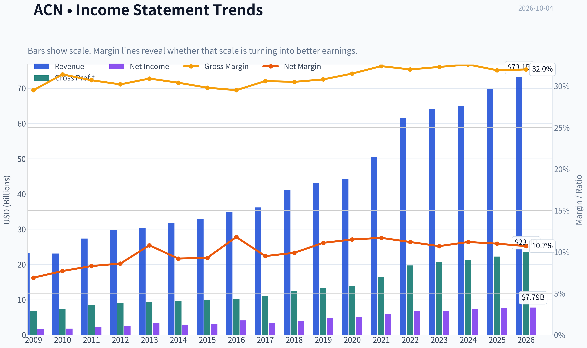
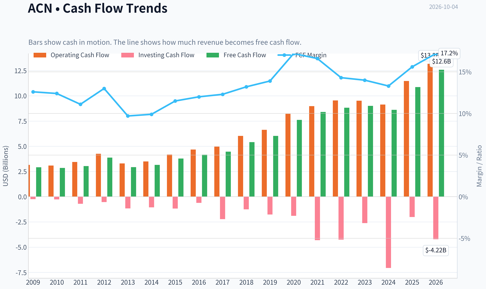
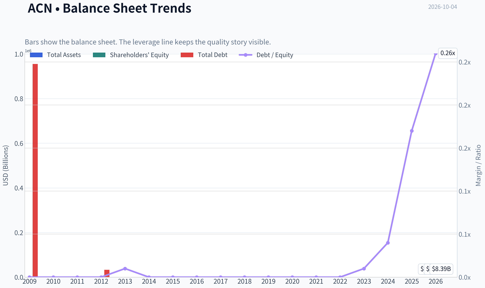
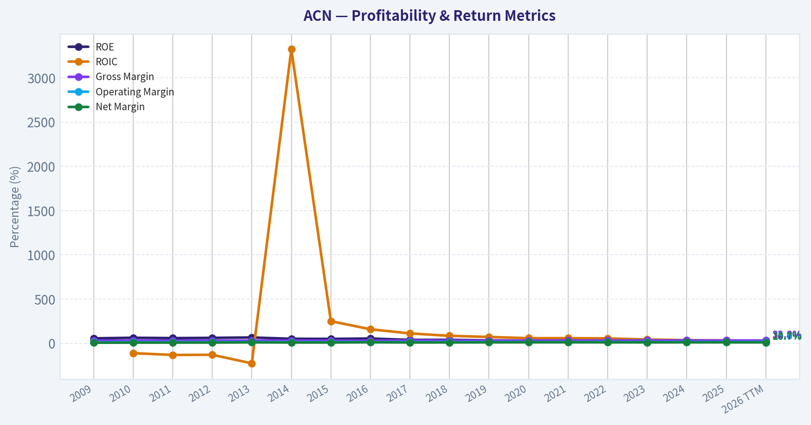
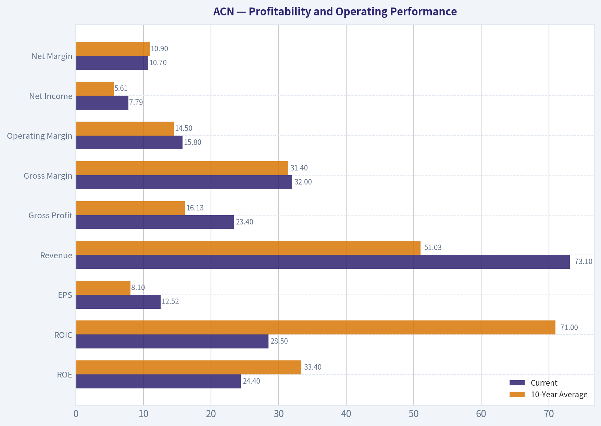
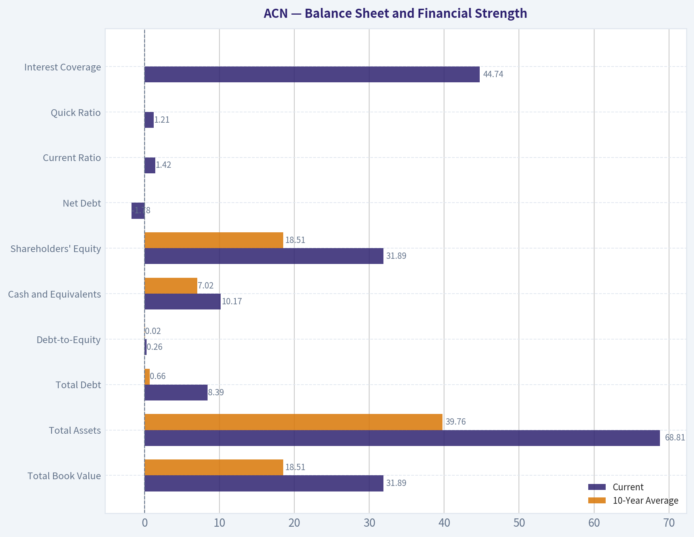
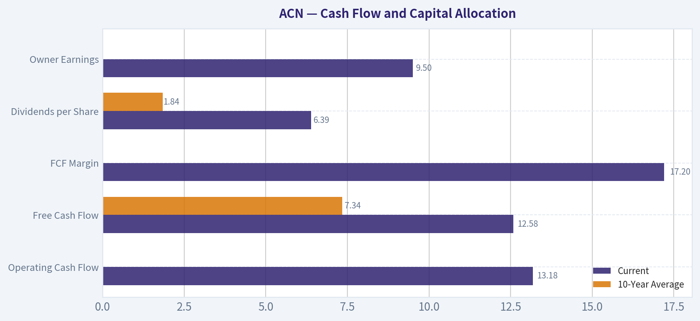
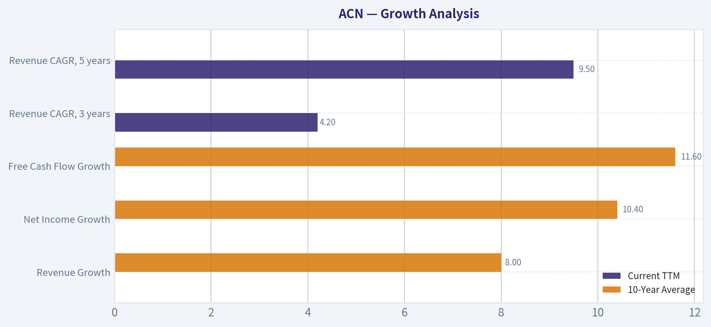
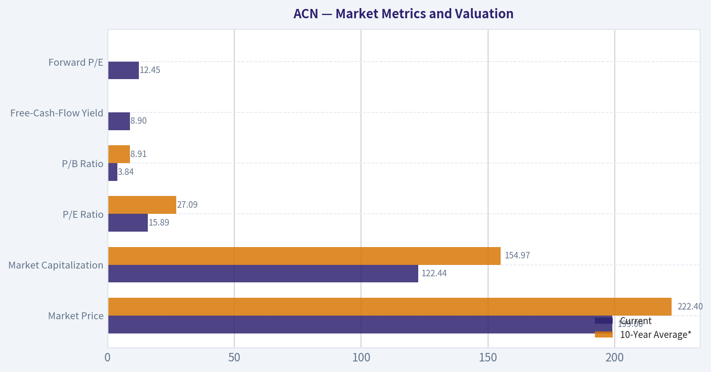

# ACN Deep Value Intelligence

**Analysis Date:** 2026-10-04

## Critical Disclaimer

*This analysis is generated by Deep Value Intelligence, an AI-powered multi-agent investing framework. Education & research only - not financial advice, not a financial advisor.*

---

## Table of Contents

1. Intelligence Summary
2. Analyst Team Reports
   - Fundamentals Analysis
   - Intrinsic Value Analysis (Buffett)
   - Trend & Growth Analysis (Lynch/Druckenmiller/Fisher)
   - Market Technical Analysis
   - Options Market Analysis
3. Research Team Commentary
4. Value Investing Team Commentary
5. Deep Values Commentary

---

## Intelligence Summary

### Thesis + Conditions

**Core Thesis:** ## Executive Briefing

**Key Risks:**
- The discount is moderate, not deep, while normalized owner earnings and AI economics remain uncertain. Initiate approximately **25% of the intended position**, then add only if cash conversion, organic growth, margins, and profit per employee remain sound. Technical support can improve execution but must not override deteriorating fundamentals.
- ## Risk Judgment
- The principal risk is not stock volatility. It is that reported earnings overstate sustainable owner earnings because recurring acquisitions, restructuring, stock compensation, or capability investment are economically necessary to maintain competitiveness. AI introduces a related risk: project demand may grow while pricing, labor hours, and client bargaining power prevent Accenture from retaining the productivity benefits.

**Confidence:** Low

---

## Analyst Team Reports

### Fundamentals Analysis

#### Latest Earnings Snapshot

*Most recent reported quarter anchored on 2026 Q2, with prior-year comparison when available.*

| Metric | 2026 Q2 | 2025 Q2 | YoY Change |
| --- | ---: | ---: | ---: |
| Revenue | $18.72B | $17.73B | +5.6% |
| Operating Income | $3.18B | $2.98B | +6.5% |
| Net Income | $2.34B | $2.20B | +6.4% |
| Diluted EPS | $3.80 | $3.49 | +8.9% |
| Operating Cash Flow | $3.79B | $3.68B | +2.8% |
| Free Cash Flow | $3.60B | $3.52B | +2.4% |

Key Takeaways: This snapshot anchors the most recent reported quarter before the narrative analysis. It helps readers separate long-run business quality from whatever changed in the latest earnings print.

#### 17-Year Financial Metrics for ACN

*All values below are computed deterministically from raw data - not estimated by AI.*

*Issuer profile: operating company (Technology / Information Technology Services).*

#### 17-Year Financial Metrics
*Annual rows come from reported financial statements. The final TTM row is computed from the latest four quarters.*

| Metric | 2009 | 2010 | 2011 | 2012 | 2013 | 2014 | 2015 | 2016 | 2017 | 2018 | 2019 | 2020 | 2021 | 2022 | 2023 | 2024 | 2025 | 2026 TTM |
| --- | --- | --- | --- | --- | --- | --- | --- | --- | --- | --- | --- | --- | --- | --- | --- | --- | --- | --- |
| Market Price | $24 | $27 | $40 | $47 | $57 | $65 | $78 | $97 | $113 | $149 | $177 | $218 | $310 | $269 | $307 | $329 | $255 | $199 |
| Market Cap | $25.97B | $28.07B | $39.83B | $44.81B | $51.54B | $56.13B | $63.99B | $76.79B | $86.36B | $110.79B | $128.85B | $155.43B | $217.39B | $185.43B | $206.76B | $217.46B | $164.42B | $122.44B |
| P/E Ratio | 13.52 | 13.76 | 15.81 | 16.04 | 14.66 | 17.93 | 19.80 | 17.83 | 24.04 | 26.67 | 26.93 | 30.41 | 36.74 | 26.93 | 30.06 | 29.89 | 21.40 | 15.89 |
| P/B Ratio | 9.16 | 9.90 | 10.27 | 10.81 | 10.39 | 9.79 | 10.43 | 10.16 | 9.65 | 10.69 | 8.94 | 9.14 | 11.13 | 8.39 | 8.05 | 7.69 | 5.27 | 3.84 |
| ROE | 56.1% | 62.8% | 58.7% | 61.6% | 66.2% | 51.3% | 49.8% | 54.4% | 38.5% | 39.2% | 33.2% | 30.0% | 30.2% | 31.1% | 26.7% | 25.7% | 24.6% | 24.4% |
| ROIC | N/A | -111.2% | -131.5% | -129.5% | -226.3% | 3322.2% | 250.1% | 158.9% | 111.9% | 84.6% | 71.9% | 58.1% | 58.3% | 55.7% | 43.0% | 35.6% | 31.7% | 28.5% |
| EPS | $1.76 | $1.97 | $2.55 | $2.96 | $3.88 | $3.65 | $3.94 | $5.45 | $4.69 | $5.57 | $6.58 | $7.17 | $8.43 | $9.98 | $10.20 | $11.01 | $11.90 | $12.52 |
| Revenue | $23.17B | $23.09B | $27.35B | $29.78B | $30.39B | $31.87B | $32.91B | $34.80B | $36.18B | $40.99B | $43.22B | $44.33B | $50.53B | $61.59B | $64.11B | $64.90B | $69.67B | $73.10B |
| Gross Profit | $6.84B | $7.25B | $8.39B | $8.99B | $9.38B | $9.68B | $9.81B | $10.28B | $11.07B | $12.49B | $13.31B | $13.98B | $16.36B | $19.70B | $20.73B | $21.16B | $22.24B | $23.40B |
| Gross Margin | 29.5% | 31.4% | 30.7% | 30.2% | 30.9% | 30.4% | 29.8% | 29.5% | 30.6% | 30.5% | 30.8% | 31.5% | 32.4% | 32.0% | 32.3% | 32.6% | 31.9% | 32.0% |
| Operating Margin | 11.4% | 12.6% | 12.7% | 13.0% | 14.3% | 13.5% | 13.5% | 13.8% | 14.4% | 14.4% | 14.6% | 14.7% | 15.1% | 15.2% | 13.7% | 14.8% | 14.7% | 15.8% |
| Net Income | $1.59B | $1.78B | $2.28B | $2.55B | $3.28B | $2.94B | $3.05B | $4.11B | $3.45B | $4.06B | $4.78B | $5.11B | $5.91B | $6.88B | $6.87B | $7.26B | $7.68B | $7.79B |
| Net Margin | 6.9% | 7.7% | 8.3% | 8.6% | 10.8% | 9.2% | 9.3% | 11.8% | 9.5% | 9.9% | 11.1% | 11.5% | 11.7% | 11.2% | 10.7% | 11.2% | 11.0% | 10.7% |
| Revenue Growth | N/A | -0.3% | 18.4% | 8.9% | 2.1% | 4.9% | 3.3% | 5.7% | 4.0% | 13.3% | 5.4% | 2.6% | 14.0% | 21.9% | 4.1% | 1.2% | 7.4% | 4.9% |
| Net Income Growth | N/A | 12.0% | 27.9% | 12.1% | 28.5% | -10.4% | 3.8% | 34.7% | -16.2% | 17.8% | 17.7% | 6.9% | 15.6% | 16.4% | -0.1% | 5.7% | 5.7% | 1.4% |
| Free Cash Flow Growth | N/A | -2.2% | 6.5% | 27.9% | -24.5% | 7.9% | 19.5% | 10.3% | 6.9% | 21.3% | 11.5% | 26.3% | 10.2% | 5.1% | 2.0% | -4.2% | 26.2% | 15.7% |
| Total Book Value | $2.84B | $2.84B | $3.88B | $4.15B | $4.96B | $5.73B | $6.13B | $7.56B | $8.95B | $10.36B | $14.41B | $17.00B | $19.53B | $22.11B | $25.69B | $28.29B | $31.20B | $31.89B |
| Total Assets | $12.26B | $12.84B | $15.73B | $16.67B | $16.87B | $17.93B | $18.20B | $20.61B | $22.69B | $24.45B | $29.79B | $37.08B | $43.18B | $47.26B | $51.25B | $55.93B | $65.39B | $68.81B |
| Total Debt | $955,000 | $1.6M | $4.4M | $33,000 | $25.6M | $26.7M | $27.4M | $27.2M | $25.1M | $25.0M | $22.7M | $61.9M | $65.6M | $55.1M | $147.9M | $1.02B | $5.15B | $8.39B |
| Debt-to-Equity | 0.00 | 0.00 | 0.00 | 0.00 | 0.01 | 0.00 | 0.00 | 0.00 | 0.00 | 0.00 | 0.00 | 0.00 | 0.00 | 0.00 | 0.01 | 0.04 | 0.17 | 0.26 |
| Cash & Equivalents | $4.54B | $4.84B | $5.70B | $6.64B | $5.63B | $4.92B | $4.36B | $4.91B | $4.13B | $5.06B | $6.13B | $8.42B | $8.17B | $7.89B | $9.05B | $5.00B | $11.48B | $10.17B |
| Shareholders' Equity | $2.84B | $2.84B | $3.88B | $4.15B | $4.96B | $5.73B | $6.13B | $7.56B | $8.95B | $10.36B | $14.41B | $17.00B | $19.53B | $22.11B | $25.69B | $28.29B | $31.20B | $31.89B |
| Operating Cash Flow | $3.16B | $3.09B | $3.44B | $4.26B | $3.30B | $3.49B | $4.18B | $4.67B | $4.97B | $6.03B | $6.63B | $8.22B | $8.98B | $9.54B | $9.52B | $9.13B | $11.47B | $13.18B |
| Investing Cash Flow | $-245.2M | $-273.8M | $-703.4M | $-535.4M | $-1.16B | $-1.06B | $-1.17B | $-610.4M | $-2.23B | $-1.25B | $-1.76B | $-1.89B | $-4.31B | $-4.26B | $-2.62B | $-7.06B | $-2.02B | $-4.22B |
| Free Cash Flow | $2.92B | $2.85B | $3.04B | $3.88B | $2.93B | $3.16B | $3.78B | $4.17B | $4.46B | $5.41B | $6.03B | $7.62B | $8.40B | $8.82B | $9.00B | $8.61B | $10.87B | $12.58B |
| FCF Margin | 12.6% | 12.4% | 11.1% | 13.0% | 9.7% | 9.9% | 11.5% | 12.0% | 12.3% | 13.2% | 13.9% | 17.2% | 16.6% | 14.3% | 14.0% | 13.3% | 15.6% | 17.2% |
| Dividends / Share | $0.00 | $0.00 | $0.00 | $0.00 | $0.00 | $0.00 | $0.00 | $0.00 | $0.00 | $0.00 | $0.00 | $0.00 | $0.00 | $3.56 | $4.19 | $4.90 | $5.73 | $6.39 |

#### Profitability Metrics
- Return on Equity (ROE): 24.6%
- Return on Invested Capital (ROIC): 31.4%
- Return on Assets (ROA): 11.7%
- Gross Margin: 31.9%
- Operating Margin: 14.7%
- Net Profit Margin: 11.0%

#### Liquidity Metrics
- Current Ratio: 1.42
- Quick Ratio: 1.21

#### Leverage Metrics
- Debt-to-Equity Ratio: 0.17
- Interest Coverage Ratio: 44.74
- Net Debt: $-6.34B

#### Growth Metrics (Year-over-Year)
- Revenue Growth: 7.4%
- Net Income Growth: 5.7%
- Free Cash Flow Growth: 26.2%
- Revenue CAGR (3-Year): 4.2%
- Revenue CAGR (5-Year): 9.5%

#### Valuation Metrics
- P/E Ratio (TTM): 15.90
- Forward P/E: 12.45
- Price-to-Book: 3.82
- Price-to-Sales: 1.64
- PEG Ratio: 1.45
- EV/EBITDA: 8.59
- Free Cash Flow Yield: 8.9%
- Earnings Yield: 6.3%

#### Owner Earnings (Buffett Method, Code-Computed)
- Net Income: $7.68B
- + Depreciation & Amortization: $1.37B
- - Capital Expenditures: $-600.0M
- - Working Capital Changes: $-1.05B
- = **Owner Earnings: $9.50B**

#### Intrinsic Value (Code-Computed)
- Current Price: $199
- **Headline Intrinsic Value (business-model routed): $238**
  Business model: operating company - weighted blend [Damodaran FCFF + reverse-DCF fair + owner-earnings DCF] (operating_company)
  Model spread (min-max across DCFs): $232 - $351
  Margin of safety vs. price (headline): 16.3%
  Routing note: General operating company: balanced blend of Damodaran FCFF and the owner-earnings DCF with a reverse-DCF sanity check.
- Buffett Method (Owner Earnings):
  Conservative: $220
  Average: $267
  Optimistic: $348
- Cash Flow Method (FCF):
  Conservative: $318
  Average: $351
  Optimistic: $533
- Damodaran FCFF (WACC + margins + reinvestment):
  Conservative: $179
  Average: $232
  Optimistic: $250
  Monte Carlo band (P10-P90): $180 - $272 (median $216)
  P(intrinsic value > price): 73.0%
- Reverse-DCF: price implies ~4.8%/yr owner-earnings growth for 10y; trailing 3y was 5.9%, 5y 16.1%.

#### Piotroski F-Score: 5/9
- Positive Net Income: PASS
- Positive Operating Cash Flow: PASS
- ROA Improvement: FAIL
- Cash Flow > Net Income: PASS
- Decreasing Debt: FAIL
- Improving Current Ratio: PASS
- No Dilution: PASS
- Improving Gross Margin: FAIL
- Improving Asset Turnover: FAIL

ANALYST STANCE: **ADVOCATE**

#### Executive Summary

Accenture plc (ACN) is a high-quality, asset-light technology-services company trading at a materially lower valuation than its recent history. At the current deterministic price of **$199**, ACN has a **15.89 P/E**, an **8.9% free-cash-flow yield**, and a model-routed intrinsic value of approximately **$238 per share**, implying about **16% upside**.

The business remains highly profitable and financially strong, with **24.4% ROE, 28.5% ROIC, $12.58 billion of FCF, $10.17 billion of cash, and only $8.39 billion of debt**. The principal concern is not balance-sheet risk; it is whether artificial intelligence reduces traditional consulting demand, compresses labor economics, or requires significant reinvestment. At the current valuation, the market appears to assume only approximately **4.8% annual owner-earnings growth for the next decade**, below the company's longer-term growth record and within reach of a mature Accenture.

#### Market Metrics and Valuation

| Metric | Current | 10-Year Average* | Interpretation |
|---|---:|---:|---|
| Market Price | $199 | $222.40 | 10.5% below average |
| Market Capitalization | $122.44B | $154.97B | 21.0% below average |
| P/E Ratio | 15.89 | 27.09 | 41.3% below average |
| P/B Ratio | 3.84 | 8.91 | 56.9% below average |
| Free-Cash-Flow Yield | 8.9% | Not provided in historical table | Attractive for a high-return operating company |
| Forward P/E | 12.45 | Not provided | Indicates expectations for continued earnings growth |

\*Ten-year average uses fiscal years 2016-2025, excluding the 2026 TTM observation.

**Key Takeaways:** ACN is priced substantially below its decade-average earnings multiple and below its average market capitalization despite producing more revenue and free cash flow than at any prior point in the dataset. The low P/E is the clearest valuation signal. The P/B decline is less informative because Accenture is asset-light, relies heavily on human capital and intellectual property, and has a relatively small tangible capital base; cash-flow-based valuation is more appropriate.

#### Profitability and Operating Performance

| Metric | Current | 10-Year Average | Current vs. Average |
|---|---:|---:|---:|
| ROE | 24.4% | 33.4% | Lower, but still excellent |
| ROIC | 28.5% | 71.0% | Lower; average distorted by abnormal historical values |
| EPS | $12.52 | $8.10 | 54.6% higher |
| Revenue | $73.10B | $51.03B | 43.2% higher |
| Gross Profit | $23.40B | $16.13B | 45.1% higher |
| Gross Margin | 32.0% | 31.4% | Slightly higher |
| Operating Margin | 15.8% | 14.5% | 1.3 percentage points higher |
| Net Income | $7.79B | $5.61B | 38.8% higher |
| Net Margin | 10.7% | 10.9% | Slightly lower |

**Key Takeaways:** Accenture's scale and operating efficiency have improved considerably, with current revenue, EPS, gross profit, and net income well above decade averages. Operating margin is at a historical high of 15.8%, while gross margin remains stable around 32%. ROE has declined from the unusually high 50%-66% range earlier in the period, but a current ROE above 24% remains exceptional for a large operating company.

ROIC requires special caution. Several early-year values are economically abnormal, including negative ROIC and a 3,322% observation caused by a very small or distorted invested-capital denominator. The current **28.5% ROIC**, with the separate latest metric showing **31.4%**, still indicates strong capital efficiency, but the decade average is not a reliable benchmark.

#### Growth Analysis

| Growth Metric | Current TTM | 10-Year Average | Interpretation |
|---|---:|---:|---|
| Revenue Growth | 4.9% TTM; 7.4% latest YoY | 8.0% | Slower than average, but reaccelerating |
| Net Income Growth | 1.4% TTM; 5.7% latest YoY | 10.4% | Below historical pace |
| Free Cash Flow Growth | 15.7% TTM; 26.2% latest YoY | 11.6% | Above historical average |
| Revenue CAGR, 3 years | 4.2% | Not applicable | Moderate recent expansion |
| Revenue CAGR, 5 years | 9.5% | Not applicable | Stronger medium-term record |

**Key Takeaways:** Revenue and net-income growth have moderated from the unusually strong 2021-2022 period. However, free cash flow is growing much faster than revenue and earnings, supported by improved cash conversion and operating leverage. This divergence is important: ACN does not currently need double-digit revenue growth to generate attractive per-share value if margins and cash conversion remain durable.

#### Balance Sheet and Financial Strength

| Metric | Current | 10-Year Average | Interpretation |
|---|---:|---:|---|
| Total Book Value | $31.89B | $18.51B | Increased steadily |
| Total Assets | $68.81B | $39.76B | Expanded with business scale |
| Total Debt | $8.39B | $0.66B | Significant recent increase |
| Debt-to-Equity | 0.26 | 0.02 | Higher, but still moderate |
| Cash and Equivalents | $10.17B | $7.02B | Strong liquidity |
| Shareholders' Equity | $31.89B | $18.51B | Strong long-term growth |
| Net Debt | **-$1.78B** | Not provided | Net cash position |
| Current Ratio | 1.42 | Not provided | Adequate liquidity |
| Quick Ratio | 1.21 | Not provided | Adequate immediate liquidity |
| Interest Coverage | 44.74x | Not provided | Very strong debt-servicing capacity |

**Key Takeaways:** Debt has increased sharply from historically negligible levels, but ACN still has more cash than debt and maintains very strong interest coverage. The increase appears manageable relative to $13.18 billion of operating cash flow and $12.58 billion of FCF. The main balance-sheet change to monitor is whether debt continues rising faster than cash generation or is used for acquisitions with weak returns.

#### Cash Flow and Capital Allocation

| Metric | Current | 10-Year Average | Current vs. Average |
|---|---:|---:|---:|
| Operating Cash Flow | $13.18B | Not separately averaged | Record level |
| Free Cash Flow | $12.58B | $7.34B | 71.3% higher |
| FCF Margin | 17.2% | Not provided in historical average table | Near historical high |
| Dividends per Share | $6.39 | $1.84 | 247% higher |
| Owner Earnings | $9.50B | Not provided | Strong underlying cash earnings |

**Key Takeaways:** Cash generation is one of ACN's strongest investment characteristics. Current FCF is substantially above the ten-year average, and the 17.2% FCF margin is among the company's best reported levels. Dividends began in the deterministic series in 2022 and have increased every year since, while the company has historically also returned capital through repurchases.

Owner earnings are calculated as **$7.68B net income + $1.37B depreciation and amortization - $0.60B capital expenditures - $1.05B working-capital investment = $9.50B**. The working-capital deduction makes owner earnings more conservative than FCF in the latest period.

#### Revenue Breakdown

The following is an approximate latest-fiscal-year mix based on Accenture's reported operating segments. Amounts apply the approximate percentages to FY2025 revenue of **$69.67 billion**.

| Revenue Source | Amount ($B) | % of Total |
|---|---:|---:|
| Technology Services | $33.44 | 48% |
| Strategy and Consulting | $17.42 | 25% |
| Operations | $13.23 | 19% |
| Song | $5.57 | 8% |
| **Total** | **$69.67** | **100%** |

**Key Takeaways:** Technology is the largest revenue engine and should benefit from cloud migration, data modernization, cybersecurity, and enterprise AI implementation. Strategy and Consulting provides high-value advisory work, while Operations supplies recurring and embedded client processes. Song adds digital marketing and customer-experience capabilities, creating a diversified revenue base rather than dependence on one consulting product.

#### Buffett-Style Qualitative Analysis

**Economic moat:** Accenture's moat is based on global scale, trusted enterprise relationships, deep implementation expertise, proprietary methodologies, specialized talent, and the ability to execute complex transformations across multiple countries and technology platforms. Large corporations often prefer a proven integrator when projects involve mission-critical systems, regulatory requirements, or multi-year transformation programs.

The moat is durable but not unassailable. Consulting work can be partially automated, and major technology platforms increasingly provide tools that reduce labor intensity. Accenture's defense is to become the leading implementer of AI rather than a casualty of it. Its extensive client base, data, talent network, and ecosystem relationships provide a meaningful advantage in that transition.

**Financial strength:** The company has a net-cash position, high interest coverage, strong liquidity, and consistent operating cash flow. Debt-to-equity has risen to 0.26 from effectively zero, but leverage remains modest relative to cash generation. Financial strength is therefore a positive factor, though the recent debt increase deserves monitoring.

**Predictable earnings:** Revenue has increased from $23.17 billion in 2009 to $73.10 billion TTM. There were occasional periods of weak or negative growth, including 2010 and the slower 2019-2020 period, but the long-term direction is consistently upward. Net income has also generally risen, although it experienced declines in 2014, 2017, and 2023. FCF has been more resilient than earnings and reached a new high in the latest period.

**Management performance:** Management has expanded revenue, preserved gross margins near 30%-32%, lifted operating margins from 11.4% to 15.8%, and maintained high returns on capital. Capital allocation is becoming more shareholder-friendly through rising dividends and repurchases. The key management test is whether acquisitions, debt-funded investments, and AI-related spending produce returns comparable to the company's historical economics.

**Quality of business:** ACN combines high margins for a services business, low capital intensity, strong cash conversion, and diversified enterprise customers. Its weaknesses are dependence on skilled labor, exposure to corporate technology budgets, wage pressure, and the risk that AI increases productivity faster than demand expands.

#### Three-Scenario Buffett Owner-Earnings DCF

The valuation uses current owner earnings of **$9.50 billion**, approximately **615 million shares** implied by the deterministic market capitalization and price, a base discount rate near **10%**, and a **2.5% terminal growth rate**. Growth rates are applied over a ten-year explicit period and fade toward the terminal rate rather than continuing indefinitely at the initial assumption.

The general calculation is:

\[
\text{Equity Value} =
\sum_{t=1}^{10}\frac{OE_t}{(1+r)^t}
+
\frac{OE_{10}(1+g_T)}{(r-g_T)(1+r)^{10}}
+
\text{Net Cash}
\]

where owner earnings are approximately $9.50 billion, \(r\) is approximately 10%, terminal growth \(g_T\) is 2.5%, and net cash is approximately $1.78 billion.

| Scenario | Initial Growth Assumption | Growth Treatment | Estimated Value / Share | Upside vs. $199 |
|---|---:|---|---:|---:|
| Conservative | Approximately 3% | Low growth, fading toward 2.5% terminal growth | $220 | 10.6% |
| Average | Approximately 6% | Moderate growth, fading toward terminal growth | $267 | 34.2% |
| Optimistic | Approximately 9% | Strong AI and transformation runway, fading materially | $348 | 74.9% |
| Model-routed headline value | Blended model result | Owner earnings, FCFF, and reverse-DCF blend | $238 | 19.5% |

**Key Takeaways:** Even the conservative owner-earnings case produces a value above the current price, although the margin of safety is not large. The average case supports materially higher value, while the optimistic case requires successful AI monetization, sustained operating leverage, and continued capital-light growth. The headline model value of approximately $238 is more prudent than relying solely on the higher FCF scenarios.

The broader model set provides the following cross-checks:

- Owner-earnings values: **$220 conservative, $267 average, $348 optimistic**
- FCF values: **$318 conservative, $351 average, $533 optimistic**
- Damodaran FCFF values: **$179 conservative, $232 average, $250 optimistic**
- Model spread: approximately **$232-$351** for the principal valuation models
- FCFF Monte Carlo band: approximately **$180-$272**, with a median near **$216**
- Reverse DCF: the current price implies approximately **4.8% annual owner-earnings growth for ten years**

The FCF model is more optimistic because current FCF is substantially above owner earnings after the working-capital adjustment. The FCFF model is more conservative because it applies stricter assumptions regarding reinvestment and operating risk. The reasonable valuation range is therefore approximately **$220-$270**, with the $238 headline value serving as a balanced anchor.

#### Key Investment Insights, Red Flags, and Opportunities

| Category | Observation | Investment Implication |
|---|---|---|
| Opportunity | P/E of 15.89 versus a ten-year average of 27.09 | Significant valuation reset has already occurred |
| Opportunity | 8.9% FCF yield and $12.58B FCF | Strong cash return potential |
| Opportunity | Current price implies only 4.8% owner-earnings growth | Expectations are achievable for a mature compounder |
| Opportunity | Operating margin at 15.8% | Evidence of operating leverage and efficiency |
| Opportunity | AI implementation demand | ACN can monetize enterprise adoption rather than merely defend against disruption |
| Risk | AI could automate lower-value consulting work | Labor intensity and pricing power may decline |
| Risk | Revenue growth has slowed to approximately 5% TTM | Reacceleration is not guaranteed |
| Risk | Net income growth is only 1.4% TTM | Earnings momentum is currently modest |
| Risk | Debt rose to $8.39B | Monitor acquisition discipline and balance-sheet trajectory |
| Risk | ROE has fallen from earlier 50%-60% levels | Historical exceptional returns are normalizing |
| Risk | Piotroski F-Score is 5/9 | Recent debt, margin, asset-turnover, and ROA trends are not uniformly positive |

**Key Takeaways:** The opportunity is a high-quality business available at a valuation normally associated with a slower or more financially fragile company. The main red flag is the changing economics of consulting in an AI-intensive environment, not solvency. Investors should watch bookings, managed-services growth, AI-related revenue, utilization, pricing, employee costs, acquisitions, and whether operating margins remain above approximately 15%.

#### Final Investment Stance

**ADVOCATE**

ACN qualifies as an attractive Buffett-style investment at $199 because it combines:

- A strong and durable competitive position
- Long-term revenue and EPS growth
- High ROE and ROIC
- Record free cash flow
- A net-cash balance sheet
- Stable gross margins and improving operating margins
- A valuation materially below historical norms
- A conservative intrinsic-value estimate above the current market price

The stance is not risk-free. AI may reduce billable labor requirements, traditional consulting may face pricing pressure, and recent debt growth weakens an otherwise pristine balance sheet. Nevertheless, the market appears to price in relatively modest growth while the company retains multiple avenues for value creation through AI implementation, cloud migration, cybersecurity, data modernization, and managed operations.

At the current price, ACN appears suitable for a long-term value-oriented investor willing to tolerate moderate technology-disruption risk. A stronger margin of safety would be available below approximately $180-$190, while prices near or above $270 would require more confidence in sustained high growth.

#### Key Points Summary

| Key Point | Assessment |
|---|---|
| Business quality | High-quality, globally scaled, asset-light operating company |
| Moat | Strong enterprise relationships, implementation scale, talent, and ecosystem |
| Current valuation | Attractive relative to historical P/E and cash-flow value |
| Profitability | Excellent, with 24.4% ROE and approximately 28.5%-31.4% ROIC |
| Cash generation | Exceptional; $12.58B FCF and 17.2% FCF margin |
| Balance sheet | Net cash, though debt has risen sharply |
| Growth | Moderate revenue growth, stronger FCF growth |
| AI risk | Material but potentially an opportunity if ACN leads implementation |
| DCF range | Approximately $220 conservative, $267 average, $348 optimistic |
| Headline intrinsic value | Approximately $238 per share |
| Final stance | **ADVOCATE** |

**Key Takeaways:** Accenture offers a favorable combination of business quality, financial strength, cash generation, and valuation. The central investment question is whether AI becomes a margin-enhancing growth platform or a force that commoditizes consulting labor. At $199, the valuation provides sufficient compensation for that uncertainty, supporting an **ADVOCATE** stance.

#### Fundamental Visuals

This graph tracks the profitability and return metrics (ROE, ROIC, Margins) of **ACN** over the past decade, highlighting capital efficiency trends.

This chart illustrates the financial health of **ACN** over the last 10 years, mapping cash equivalents and free cash flow against total obligations (Debt).

This comparison chart from *Profitability and Operating Performance* stacks current figures against historical benchmarks for **ACN**, making it easy to see where the company trades relative to its own averages.

---

### Intrinsic Value Analysis (Buffett)

> *Following Warren Buffett's value investing philosophy: Circle of Competence, Economic Moat, Management Quality, and Margin of Safety.*

#### Intrinsic Value Snapshot

Price is what you pay. Intrinsic value is what the business may be worth based on the cash it can create for owners over time. We show a range, not one magic number.

- Current Price: $198.90
- Value Range (conservative to optimistic across both DCF methods): $219.67 to $532.84

##### Owner Earnings (Buffett Method)
- Net Income: $7,678,433,000.00
- Depreciation & Amortization: $1,368,385,000.00
- Capital Expenditures: $-600,039,000.00
- Working Capital Changes: $-1,050,348,000.00
- Owner Earnings: $9,497,127,000.00

##### Intrinsic Value
###### Buffett Method
Uses owner earnings. Stricter, and usually more conservative.
- Conservative: $219.67
- Average: $266.51
- Optimistic: $347.99
- Discount Rate: 10.0%

###### Cash Flow Method
Uses free cash flow. Better for companies spending heavily today to grow tomorrow.
- Conservative: $317.90
- Average: $351.41
- Optimistic: $532.84
- Discount Rate: 10.0%

ANALYST STANCE: **ADVOCATE**

#### Executive Summary

Accenture is a high-quality, asset-light professional-services platform with strong customer relationships, global scale, recurring transformation demand, and excellent shareholder returns. The central risk is artificial intelligence: AI may reduce demand for some consulting and implementation work, even as it creates a large new market for AI strategy, integration, and managed services.

At approximately **$199 per share**, ACN trades below the research pack's **$237.77 headline intrinsic value**, representing a **16.3% margin of safety**. That is adequate for a high-ROIC, financially strong business, although the valuation is not deeply discounted and the AI transition warrants moderate-not maximum-conviction.

#### 1. Factor Scorecard

| Factor | Score | Evidence |
|---|---:|---|
| Circle of competence and simplicity | 4.0/5 | Accenture helps large organizations implement technology, strategy, and operational changes. The model is understandable, though AI could materially alter service demand. |
| Durable competitive advantage | 3.5/5 | Global scale, embedded client relationships, implementation expertise, and talent networks create switching friction. The moat is credible but potentially being reshaped by AI. |
| Management and capital allocation | 4.0/5 | Strong history of returning capital, maintaining financial discipline, and reinvesting in capabilities and acquisitions. |
| Industry structure | 3.5/5 | Global consulting has scale advantages and barriers to serving major enterprises, but competition for talent and projects remains meaningful. |
| Gate 5: quality and solvency floor | **Not tripped** | Available evidence does not indicate simultaneous deteriorating cash economics and financial distress. |

**Key Takeaways:** Accenture scores well because it combines a simple business model with strong returns, scale, and customer embeddedness. Its primary weakness is not balance-sheet distress but uncertainty over how AI changes the economics of consulting and implementation.

#### 2. Moat Analysis

| Moat source | Assessment | Evidence |
|---|---|---|
| Intangible assets and brand | Moderate | Accenture is a trusted global enterprise brand, but consulting services are less brand-protected than consumer franchises. |
| Switching costs | Strong | Large implementations become embedded in client systems, processes, data, and organizational workflows. Replacing a global implementation partner carries execution risk. |
| Cost and scale advantages | Strong | Global delivery centers, specialized talent, accumulated implementation knowledge, and purchasing scale support competitive economics. |
| Network effects | Limited to moderate | Accenture does not have a classic consumer network effect, but its ecosystem of clients, technology partners, and trained professionals reinforces its position. |
| AI positioning | Mixed but improving | AI can automate lower-value work, but enterprise adoption requires strategy, governance, integration, security, and change management-areas where Accenture is positioned to participate. |

The moat is best characterized as **wide but undergoing a technological stress test**, rather than unquestionably wide and widening. Gross margin of **31.9%** is below the 40% threshold associated with especially powerful intellectual-property businesses, but margins must be interpreted in the context of a people-intensive services model.

#### 3. Management Quality and Capital Allocation

Accenture appears to have a generally strong management and capital-allocation record:

- The company has historically returned substantial cash through dividends and share repurchases.
- Acquisitions have expanded capabilities and geographic reach rather than radically changing the business model.
- The company has continued investing in digital, cloud, cybersecurity, data, and AI capabilities.
- Its balance sheet and cash generation provide flexibility to invest through industry transitions.
- The main governance limitation is that public information does not establish unusually high insider ownership comparable to founder-controlled compounders.

Overall management assessment: **4.0/5**. The company has demonstrated financial discipline and strategic adaptability, though investors should monitor whether acquisitions and AI investments produce attractive per-share returns.

#### 4. Financial Summary

| Metric | Latest available figure |
|---|---:|
| Share price | $199 |
| Market capitalization | $121.72 billion |
| P/E ratio | 15.9x |
| ROE | 24.6% |
| Revenue growth, year over year | 7.4% |
| Gross margin | 31.9% |
| Free-cash-flow yield | 8.9% |
| Current ratio | 1.42 |
| Headline intrinsic value | $237.77 |
| Owner-earnings DCF value | $266.51 |
| FCF model value | $351.41 |
| Damodaran FCFF value | $231.75 |
| Reverse-DCF implied annual growth | Approximately 4.8% for 10 years |

**Key Takeaways:** ACN combines a roughly 16x earnings multiple with a high 24.6% ROE and an 8.9% free-cash-flow yield. The market is pricing the company for mid-single-digit growth, which is reasonable rather than heroic given the AI uncertainty.

#### 5. Owner Earnings Calculation

The Buffett-style framework is:

> Owner earnings = net income + depreciation and amortization - maintenance capital expenditure - working-capital investment

The available valuation pack provides an owner-earnings DCF value of **$266.51 per share** using a 10% discount rate and no-growth framework. That implies approximate normalized owner earnings of:

| Calculation | Per share |
|---|---:|
| Owner-earnings DCF value | $266.51 |
| Discount rate | 10.0% |
| Implied normalized owner earnings | **$26.65** |

**Key Takeaways:** The implied owner earnings of approximately $26.65 per share represent a normalized cash-earning estimate rather than a single-period accounting result. At a $199 share price, this corresponds to an implied owner-earnings yield of approximately **13.4%**, before allowing for future growth.

#### 6. Three-Scenario DCF Valuation

Using approximately $26.65 per share of normalized owner earnings:

| Scenario | Key assumptions | Estimated value per share |
|---|---|---:|
| A. No growth | 10% discount rate; no long-term growth | $266.51 |
| B. GDP growth | 3% perpetual growth; 10% discount rate | $391.99 |
| C. Historical-growth-adjusted | Approximately 4.4% growth, using 75% of the trailing three-year growth rate; 10% discount rate | Approximately $497 |

The historical-growth scenario is highly sensitive to the terminal-growth assumption and should not be treated as a precise target. The more conservative cross-check is the research pack's blended intrinsic value of **$237.77**, which incorporates FCFF, reverse-DCF, and owner-earnings approaches.

**Key Takeaways:** Every DCF scenario exceeds the current price, but the spread between models is large. The headline blended value of $237.77 is the most useful anchor because it avoids relying exclusively on an optimistic terminal-growth assumption.

#### 7. Margin of Safety Analysis

| Measure | Result |
|---|---:|
| Current price | $199 |
| Headline intrinsic value | $237.77 |
| Margin of safety versus headline value | 16.3% |
| Owner-earnings DCF upside | 33.9% |
| Reverse-DCF implied growth | 4.8% annually for 10 years |
| Recent three-year growth reference | 5.9% |

For a low-quality or cyclical company, a 16.3% discount would be insufficient. For a financially strong, high-ROE compounder with a durable enterprise franchise, it is within the acceptable **10%-15% quality-scaled range**, though the margin is close to the minimum because AI could affect future growth and pricing.

The reverse DCF is encouraging: the market appears to require only approximately **4.8% annual growth** over the next decade. That is below Accenture's recent three-year growth rate of approximately **5.9%**, and materially below its recent five-year growth reference of **16.1%**. The valuation therefore does not require heroic assumptions.

#### 8. Final Buffett Scorecard

| Criterion | Weight | Score | Weighted score |
|---|---:|---:|---:|
| Moat width and durability | 25% | 3.5 | 0.88 |
| Valuation and margin of safety | 20% | 3.5 | 0.70 |
| Capital returns: ROIC versus WACC | 15% | 4.0 | 0.60 |
| Business understanding and predictability | 12% | 4.0 | 0.48 |
| Management quality and capital allocation | 12% | 4.0 | 0.48 |
| Reinvestment runway | 8% | 4.0 | 0.32 |
| Balance-sheet strength | 4% | 4.0 | 0.16 |
| Industry structure | 4% | 3.5 | 0.14 |
| **Total** | **100%** |  | **3.76/5.00** |

**Key Takeaways:** ACN's weighted score of approximately **3.76** places it in the "good business with adequate margin of safety" category. The score is held back mainly by AI-related moat uncertainty and a valuation discount that is adequate rather than exceptional.

#### 9. Investment Stance

**ADVOCATE - Moderate conviction**

Accenture is attractive for a long-term investor seeking a high-quality, asset-light compounder at a reasonable price. The company has strong cash economics, a high ROE, global scale, customer captivity, and a valuation that assumes only moderate growth.

The principal risk is that AI commoditizes parts of consulting faster than Accenture can shift toward higher-value AI strategy, integration, and managed services. Accordingly, ACN is suitable for accumulation at or below current levels, but position sizing should reflect the technology-transition risk. A substantially higher share price would reduce the margin of safety and move the stock toward **WATCH** rather than **ADVOCATE**.
#### Valuation Bridge

This bridge places the current market price beside each intrinsic value lens so readers can see whether upside depends on one method or shows up across several methods.

| Scenario | Intrinsic Value / Share |
| --- | ---: |
| Buffett Method | $266.51 |
| Cash Flow Method | $351.41 |
| Damodaran Method | $231.75 |
| Current Price | $198.90 |

#### Key Takeaways

If one method is far above the others, the upside case depends on a specific modelling assumption. When several methods cluster together, the valuation story is more robust.

#### Valuation Visuals

This comparison chart from *Latest Earnings Snapshot* stacks current figures against historical benchmarks for **ACN**, making it easy to see where the company trades relative to its own averages.

This comparison chart from *Balance Sheet and Financial Strength* stacks current figures against historical benchmarks for **ACN**, making it easy to see where the company trades relative to its own averages.

This comparison chart from *Cash Flow and Capital Allocation* stacks current figures against historical benchmarks for **ACN**, making it easy to see where the company trades relative to its own averages.

---

### Trend & Growth Analysis (Lynch/Druckenmiller/Fisher)

> *Following Peter Lynch's GARP, Stanley Druckenmiller's macro-aware approach, and Philip Fisher's scuttlebutt methodology.*

ANALYST STANCE: **WATCH**

#### Executive View

Accenture is a high-quality, cash-generative consulting and technology-services leader, but it currently fits Peter Lynch's **stalwart** category rather than the preferred fast-grower category. The investment case depends on an **AI-services reacceleration**, not on current organic growth, which is only 7.4%.

At $199, valuation appears reasonable relative to cash generation and estimated intrinsic value, but the stock does not yet offer a clear ten-bagger setup. I would monitor bookings, revenue growth, AI-related sales, and margin trends before initiating a concentrated growth position.

#### 1. Lynch Classification

| Metric | ACN |
|---|---:|
| Revenue growth | 7.4% YoY |
| P/E | 15.9x |
| ROE | 24.6% |
| FCF yield | 8.9% |
| Classification | Stalwart / potential re-accelerator |

**Key Takeaways:** ACN's growth is currently consistent with a stalwart, not a 15%-25% fast grower. Its strong return on equity, cash generation, and moderate valuation make it financially attractive, but the growth-investor thesis requires evidence that AI demand can lift growth materially.

#### 2. The Story in Three Bullets

- Accenture helps large enterprises implement cloud, data, cybersecurity, and artificial-intelligence systems.
- Its global scale, industry expertise, and client relationships create a strong distribution advantage in complex enterprise transformation.
- Generative AI could create a new services cycle, but AI may also automate portions of traditional consulting work and pressure headcount economics.

#### 3. TAM and 10x Test

| Factor | Assessment |
|---|---|
| Core markets | Consulting, technology implementation, outsourcing, managed services |
| Secular growth areas | AI, cloud migration, cybersecurity, digital transformation |
| Current revenue | Approximately $70 billion scale |
| 10x revenue test | $700 billion revenue would require an extremely large share of global enterprise-services spending |
| Runway judgment | Large, but unlikely to support a literal 10x outcome from the current base |

**Key Takeaways:** The addressable market is broad and expanding through AI adoption, cloud migration, and cybersecurity. However, ACN is already a very large company, so a ten-bagger would require both a major market expansion and sustained share gains. The more realistic opportunity is a durable reacceleration and attractive shareholder returns, rather than a classic small-company ten-bagger.

#### 4. Revenue Growth Trend

| Indicator | Reading | Interpretation |
|---|---:|---|
| Latest revenue growth | 7.4% YoY | Stalwart-level growth |
| Historical five-year growth reference | 16.1% | Stronger than current pace |
| Historical three-year growth reference | 5.9% | Moderated recent trend |
| Current pattern | Decelerated from prior levels | Reacceleration not yet proven |
| Latest reported quarter | Beat company guidance | Early positive signal |

**Key Takeaways:** The current pattern is deceleration followed by a possible stabilization, not confirmed acceleration. The recent earnings beat and positive market reaction are encouraging, but investors need multiple quarters of improving organic growth before treating this as a genuine inflection.

#### 5. Unit Economics and Operating Quality

| Measure | ACN assessment |
|---|---|
| LTV/CAC | Not disclosed in a conventional SaaS format |
| Net revenue retention | Not applicable / not disclosed |
| Rule of 40 | Not meaningful for a diversified professional-services company |
| Gross margin | 31.9% |
| FCF yield | 8.9% |
| Current ratio | 1.42 |
| ROE | 24.6% |

**Key Takeaways:** ACN is better evaluated through utilization, bookings, revenue per employee, operating margin, free-cash-flow conversion, and client retention rather than SaaS metrics. Its high FCF yield and ROE indicate a financially strong business, while the 31.9% gross margin reflects the labor-intensive nature of the model.

#### 6. Inflection-Point Assessment

| Potential inflection | Current evidence | Status |
|---|---|---|
| AI product cycle | Enterprise AI adoption is increasing | Promising, not proven |
| Revenue growth | 7.4% YoY | No confirmed acceleration |
| Market share | Strong global position | Positive but difficult to quantify |
| Margin inflection | No clear evidence supplied | Unconfirmed |
| TAM expansion | AI expands transformation spending | Positive |
| Competitive environment | Traditional consulting faces automation risk | Mixed |

**Key Takeaways:** The most important potential inflection is an AI-led consulting and implementation cycle. ACN appears well positioned to monetize enterprise adoption, but the market is waiting for measurable evidence in bookings, revenue growth, and margins. Until then, AI is a thesis rather than a demonstrated earnings inflection.

#### 7. Macro Setup

| Macro factor | Impact on ACN |
|---|---|
| Enterprise technology spending | Positive if budgets recover |
| AI adoption | Strong secular tailwind |
| Interest rates | Lower rates would support enterprise projects and valuation |
| Recession risk | Can delay discretionary consulting programs |
| Labor costs | Potential margin pressure |
| AI automation | Both opportunity and competitive threat |

**Key Takeaways:** The secular macro backdrop is favorable because AI, cloud, and cybersecurity remain strategic priorities. The cyclical backdrop is less certain: consulting projects can be delayed when corporate confidence weakens, while AI-driven automation could reduce demand for some traditional labor-based services.

#### 8. Fisher's 15-Point Score

| Fisher criterion | Score / 5 | Comment |
|---|---:|---|
| Market potential | 4 | Large enterprise-services and AI opportunity |
| New-product determination | 4 | Strong investment in new technology capabilities |
| R&D effectiveness | 3 | Services model makes R&D harder to assess |
| Sales organization | 5 | Global enterprise distribution |
| Profit margins | 4 | Strong cash economics, though labor intensive |
| Margin improvement | 3 | Not yet a clear current inflection |
| Labor relations | 3 | Large workforce and utilization sensitivity |
| Executive relations | 4 | Generally established institutional culture |
| Management depth | 5 | Deep global operating bench |
| Cost analysis/accounting | 4 | Mature public-company reporting |
| Outstanding moat characteristics | 4 | Scale, trust, data, expertise, switching costs |
| Long-range profit outlook | 4 | Favorable if AI monetization succeeds |
| Dilution | 4 | No major dilution concern indicated |
| Management candor | 4 | Generally credible guidance framework |
| Management integrity | 4 | Strong institutional reputation |
| **Total** | **56 / 75** | **Good** |

**Key Takeaways:** ACN scores well on sales reach, management depth, market position, and financial quality. The score is held back by uncertain margin expansion, labor intensity, and the unresolved question of whether AI will be a net revenue creator or a source of productivity-driven cannibalization.

#### 9. Valuation Analysis

| Valuation measure | Result | Interpretation |
|---|---:|---|
| Current price | $199 | Reference price |
| Market capitalization | $121.7 billion | Large-cap scale |
| P/E | 15.9x | Moderate for a high-quality services leader |
| PEG using 7.4% growth | Approximately 2.15 | Expensive relative to current growth |
| FCF yield | 8.9% | Attractive cash-flow valuation |
| Headline intrinsic value | $237.77 | Approximately 16.3% upside |
| Owner-earnings DCF | $266.51 | Higher-value scenario |
| FCFF model | $351.41 | Most optimistic model |
| Damodaran FCFF reference | $231.75 | More conservative model |

**Key Takeaways:** ACN is inexpensive on free cash flow and reasonable on absolute earnings, but its PEG is unattractive if the current 7.4% growth rate persists. The valuation becomes more compelling if AI restores growth toward the company's historical mid-teens trajectory; otherwise, the stock is primarily a quality-and-cash-flow investment rather than a high-growth bargain.

##### Scenario Analysis

| Scenario | Operating assumption | Valuation view |
|---|---|---|
| Bear | Growth remains near high single digits; AI offsets traditional-service pressure | Around current price or modest downside |
| Base | Growth gradually returns to low double digits with stable margins | $230-$270 range |
| Bull | AI bookings drive sustained mid-teens growth and operating leverage | Potentially above $300 |

**Key Takeaways:** The base case offers reasonable upside, while the bull case requires a genuine AI-driven growth cycle. The bear case is not catastrophic because ACN has strong cash generation, but it would likely produce mediocre returns if growth remains stalled.

#### 10. Growth Investor Scorecard

| Criterion | Weight | Score / 5 |
|---|---:|---:|
| Lynch story | 10% | 3.5 |
| TAM and runway | 20% | 3.5 |
| Revenue growth | 20% | 2.5 |
| Unit economics | 15% | 3.5 |
| Competitive position | 10% | 4.5 |
| Management quality | 10% | 4.0 |
| Macro setup | 5% | 3.5 |
| Profitability path | 5% | 4.0 |
| Valuation | 5% | 4.0 |
| **Weighted score** | **100%** | **3.5 / 5** |

**Key Takeaways:** ACN reaches the low end of an **ADVOCATE** score mathematically, but I classify it as **WATCH** because the core growth requirement has not been met. The company is high quality and attractively valued, yet the central catalyst-AI-led revenue acceleration-remains insufficiently demonstrated.

#### 11. Position Size Stance

- **New position:** Small starter position only, approximately **1%-2%** of a diversified portfolio, if the investor wants quality exposure to enterprise AI implementation.
- **Growth-focused portfolio:** Keep below a typical high-conviction allocation until revenue growth and bookings reaccelerate.
- **Existing holders:** Hold if the original thesis is AI monetization plus cash-flow durability; do not add aggressively solely because the stock appears cheaper.
- **Upgrade trigger:** Two or more quarters of accelerating organic revenue, improving bookings, and stable or expanding margins.

#### 12. Key Risks and Catalysts

| Catalysts | Risks |
|---|---|
| AI bookings convert into revenue | AI automates traditional consulting work |
| Enterprise technology budgets recover | Recession delays discretionary projects |
| Revenue growth returns to low/mid teens | Continued growth deceleration |
| Operating leverage from AI productivity | Labor-cost and utilization pressure |
| Strong buybacks and FCF conversion | Competition from hyperscalers, software firms, and specialist AI providers |
| Successful large-scale AI implementations | Client concentration and project execution risk |

**Key Takeaways:** The principal catalyst is proof that ACN can convert AI demand into incremental revenue faster than AI reduces traditional consulting demand. The principal risk is that productivity gains benefit clients more than Accenture, causing revenue per employee or headcount requirements to weaken.

#### Final Judgment

ACN is a **high-quality stalwart with a potentially important AI reacceleration option**. It is not currently a classic fast grower or obvious ten-bagger candidate, but the valuation provides some downside support through strong free cash flow and a substantial margin of safety versus the headline intrinsic-value estimate.

**Action: WATCH.** Consider accumulating gradually only as operating evidence confirms that AI is producing accelerating revenue rather than merely improving productivity.

#### Growth & Scorecard Visuals

This comparison chart from *Growth Analysis* stacks current figures against historical benchmarks for **ACN**, making it easy to see where the company trades relative to its own averages.

---

### Market Technical Analysis

ANALYST STANCE: **WATCH**

#### ACN technical analysis - as of October 2, 2026

Accenture, ticker ACN, closed at **$198.90** on the latest available trading session, October 2. October 4 is a Sunday, so no new market data is available for that date.

The technical picture has shifted sharply from a prolonged decline into a high-volatility rebound. However, the latest move contains an important data-quality and event-risk consideration: ACN jumped from **$183.37 on September 30 to $212.30 on October 1**, accompanied by volume of approximately **29.0 million shares**, far above its recent normal volume. The stock then fell to $198.90 the following day. Traders should verify whether this move reflected a corporate action, special distribution, news event, or other adjustment before relying heavily on conventional chart signals.

#### Trend structure

ACN is now trading above all three selected moving-average references:

- **10 EMA:** $188.87
- **50 SMA:** $180.09
- **200 SMA:** $193.46
- **Latest close:** $198.90

This alignment is tactically constructive. Price above the 10 EMA indicates that the short-term rebound remains intact, while the close above the 50 SMA confirms that the recovery has moved beyond a minor one- or two-day bounce. The stock is also modestly above the 200 SMA, which is often treated as a major long-term trend boundary.

The longer-term picture is less convincing. The 200 SMA has declined from approximately **$199.95 on September 4 to $193.46 on October 2**, showing that the broad trend was still weakening before the recent surge. Therefore, ACN has reclaimed the 200-day average, but the average itself is not yet rising. This is better classified as an attempted trend reversal than as a confirmed long-term uptrend.

The 50 SMA has risen substantially, from roughly **$161.45 to $180.09** over the same period. This reflects meaningful intermediate-term improvement, although part of that increase is likely influenced by the sharp rebound from the June low.

#### Momentum and participation

The MACD reading increased to **3.40** on October 2, up from **2.57** on October 1 and substantially above the near-zero readings seen around September 28-30. This indicates that upside momentum accelerated during the recent breakout attempt. Nevertheless, the current MACD reading should be interpreted cautiously because the large October 1 price jump can mechanically produce a strong momentum signal.

RSI declined from **70.01 on October 1 to 59.08 on October 2**. This is a meaningful change. The October 1 reading briefly reached the conventional overbought threshold, but the subsequent decline into the upper-neutral range suggests that momentum cooled rather than remaining persistently overbought. RSI near 59 is neither oversold nor excessively extended, leaving room for further upside if price can stabilize.

Volume provides confirmation of interest, but not necessarily direction. The October 1 volume spike was extreme, and the volume-weighted moving average rose to **$194.06**. With ACN closing at $198.90, price remains about $4.84 above the VWMA, suggesting that buyers still control the recent volume-weighted trading range. However, the October 2 decline despite elevated volume indicates meaningful two-sided trading and possible distribution near the $200-$212 area.

#### Volatility and price levels

ATR expanded to **$9.96**, compared with approximately **$6.84 on September 4** and about **$6.9-$7.4** through much of late September. This means ACN is currently moving roughly $10 per session on average, making ordinary position sizing and stop-loss levels inappropriate. A stop only a few dollars below the entry could be triggered by normal volatility rather than a genuine trend failure.

The Bollinger upper band was approximately **$204.01** on October 2. ACN closed below that level after trading as high as $213.31 intraday. This indicates that the stock tested a statistically extended zone but failed to hold above it. A sustained close above approximately $204, preferably with strong but not purely event-driven volume, would strengthen the case for continuation. Conversely, repeated rejection near $204-$213 would suggest that the recent move is becoming a volatile range rather than a clean breakout.

Important reference areas are:

- **Near-term support:** approximately $193-$195, corresponding to the 200 SMA and VWMA region.
- **Secondary support:** approximately $188-$189, near the 10 EMA.
- **Intermediate support:** approximately $180, near the 50 SMA.
- **Initial resistance:** approximately $204, near the upper Bollinger Band.
- **Major event resistance:** approximately $212-$213, the October 1-2 high zone.

A close back below $193-$195 would weaken the breakout structure and imply that the move above the 200 SMA was not yet durable. A decline below the 10 EMA would further damage short-term momentum, while a break below the 50 SMA would negate much of the intermediate-term recovery.

#### Trading interpretation

The evidence supports a **watchful, confirmation-based approach**, rather than an aggressive immediate entry. The bullish case is based on price being above the 10 EMA, 50 SMA, 200 SMA, and VWMA, combined with a positive and rising MACD. RSI has also cooled from overbought conditions without yet becoming weak.

The cautionary case is equally important: the 200 SMA is still declining, ATR is elevated, the latest move was unusually large, and price failed to hold the October 1 high. The price action may represent a genuine upside repricing, but it may also reflect an adjustment or event whose implications are not captured by standard indicators.

A more reliable bullish confirmation would be a consolidation above **$193-$195**, followed by a decisive close above **$204** and then a break of the **$212-$213** event high. For risk control, traders should size positions using the roughly **$10 ATR**, and any stop should be placed according to the individual strategy rather than arbitrarily near the entry price. If ACN falls back below $193 with expanding volume, the more prudent interpretation would be failed breakout risk and a possible return toward the $188 or $180 areas.

#### Selected indicators

The selected eight indicators are deliberately complementary:

1. **close_200_sma** - establishes the long-term trend regime.
2. **close_50_sma** - measures intermediate-term trend improvement.
3. **close_10_ema** - tracks short-term momentum and dynamic support.
4. **macd** - evaluates directional momentum and acceleration.
5. **rsi** - identifies momentum strength and potential exhaustion.
6. **atr** - quantifies current volatility for stops and position sizing.
7. **boll_ub** - identifies the current upside extension and breakout threshold.
8. **vwma** - incorporates trading volume into the trend assessment.

| Indicator or factor | Latest reading | Interpretation for ACN | Trading relevance |
|---|---:|---|---|
| Latest close | $198.90 | Above major moving-average references but below the recent event high | Constructive, but confirmation is still needed |
| 10 EMA | $188.87 | Price is above short-term trend support | Short-term momentum remains positive |
| 50 SMA | $180.09 | Rising materially from early September | Intermediate trend has improved |
| 200 SMA | $193.46 | Price is slightly above it, but the average is still declining | Long-term reversal remains unconfirmed |
| MACD | 3.40 | Strong rebound in upside momentum | Supports continuation, but may be distorted by the sharp gap |
| RSI | 59.08 | Neutral-to-positive after briefly reaching 70 | Momentum has cooled without becoming bearish |
| ATR | $9.96 | Volatility is substantially elevated | Use smaller sizing and wider volatility-aware risk limits |
| Upper Bollinger Band | $204.01 | Price closed below the upper extension zone | $204 is an important breakout or rejection level |
| VWMA | $194.06 | Price remains above the volume-weighted average | Buyers retain a modest volume-weighted advantage |
| Key support | $193-$195 | Confluence of 200 SMA and VWMA | Breakdown would weaken the bullish setup |
| Key resistance | $204, then $212-$213 | Upper band followed by recent event high | Breakout confirmation requires sustained closes above these zones |

**Key Takeaways:** ACN's short- and intermediate-term signals are bullish because price is above its 10 EMA, 50 SMA, 200 SMA, and VWMA, while MACD remains positive. However, the declining 200 SMA, unusually large October 1 gap, failed hold above $212, and elevated ATR create substantial uncertainty. The most important near-term test is whether ACN can hold $193-$195 and then reclaim $204 with credible volume.

#### Market Visuals

This comparison chart from *Market Metrics and Valuation* stacks current figures against historical benchmarks for **ACN**, making it easy to see where the company trades relative to its own averages.

---

### Options Market Analysis

> *Reading options flow - put/call ratios, IV skew, and unusual activity - to gauge institutional positioning and event-driven risk.*

ANALYST STANCE: **ADVOCATE**

#### ACN Options Flow Report

**Data date:** October 4, 2026
**Ticker:** Accenture plc, ACN
**Signal confidence:** Moderate. Near-term options activity is active, but the supplied data does not include the current share price, detailed strike-level open interest, or historical IV percentiles.

#### Put/Call Ratio Analysis

| Expiration | Days to Expiry | Call OI | Put OI | Put/Call OI | Call Volume | Put Volume | Put/Call Volume |
|---|---:|---:|---:|---:|---:|---:|---:|
| Oct. 9, 2026 | 5 | 4,884 | 5,251 | 1.08 | 4,876 | 3,495 | 0.72 |
| Oct. 16, 2026 | 12 | 21,556 | 19,629 | 0.91 | 15,646 | 2,973 | 0.19 |
| Oct. 23, 2026 | 19 | 1,982 | 2,696 | 1.36 | 604 | 348 | 0.58 |
| **Total** | - | **28,422** | **27,576** | **0.97** | **21,126** | **6,816** | **0.32** |

The aggregate put/call open-interest ratio is **0.97**, which is above the approximate neutral baseline of 0.70 and indicates a meaningful inventory of puts relative to calls. However, the aggregate volume ratio is only **0.32**, showing that current trading activity is heavily call-dominated. This divergence suggests existing downside protection remains on the books, while new near-term activity is more bullish or speculative.

**Key Takeaways:** ACN has more balanced-to-defensive existing open interest than a neutral 0.70 baseline would imply. Current volume, particularly in the October 16 expiration, is strongly call-led and is the more important short-term directional signal.

#### Implied Volatility Assessment

| Expiration | Call ATM IV | Put ATM IV | Call-Put IV Difference | Assessment |
|---|---:|---:|---:|---|
| Oct. 9, 2026 | 52.0% | 47.8% | +4.2 percentage points | Call premium elevated |
| Oct. 16, 2026 | 52.3% | 51.7% | +0.6 points | Nearly balanced |
| Oct. 23, 2026 | 52.4% | 52.2% | +0.2 points | Nearly balanced |
| **Near-term range** | **52.0%-52.4%** | **47.8%-52.2%** | - | Elevated but not clearly fear-driven |

Near-term ATM IV is around **52%**, which is substantial in absolute terms, although no historical IV percentile was supplied. Calls carry a noticeable premium over puts in the October 9 expiry, while the October 16 and October 23 expirations show almost no ATM volatility differential.

A true OTM skew comparison cannot be completed because the data provides ATM IV only, not separate out-of-the-money put and call IV. Therefore, there is no evidence here of a steep downside put skew. The elevated short-dated IV may reflect event or earnings risk, but no specific catalyst was provided or independently confirmed.

**Key Takeaways:** Volatility is elevated at roughly 52%, indicating that the market expects a potentially meaningful near-term move. The available ATM data leans slightly toward call demand rather than downside fear, but the absence of OTM skew and historical IV data limits confidence.

#### Unusual Options Activity

| Expiration | Type | Strike | Volume | Open Interest | Volume/OI | Days to Expiry | Positioning Read |
|---|---|---:|---:|---:|---:|---:|---|
| Oct. 16, 2026 | Call | $205.00 | 6,662 | 307 | 21.7x | 12 | Strong fresh bullish or upside-speculative demand |
| Oct. 9, 2026 | Call | $205.00 | 1,794 | 40 | 44.9x | 5 | Very short-term upside speculation |
| Oct. 16, 2026 | Call | $207.50 | 865 | 30 | 28.8x | 12 | Fresh upside positioning |
| Oct. 9, 2026 | Call | $215.00 | 777 | 103 | 7.5x | 5 | Short-dated upside chase or hedge |
| Oct. 9, 2026 | Call | $210.00 | 654 | 90 | 7.3x | 5 | Short-term bullish exposure |

All flagged unusual contracts are **calls**, and each has volume substantially greater than existing open interest. That pattern is consistent with new opening trades, although volume-versus-OI data alone cannot distinguish opening purchases from opening sales or spreads.

The supplied data does not include ACN's current share price, so the $205, $207.50, $210, and $215 strikes cannot reliably be classified as ITM, ATM, or OTM. The concentration in the $205 call, especially the October 16 contract with 6,662 contracts traded, is the clearest bullish flow signal. There is insufficient information to label the activity definitively as institutional; the size and concentration could indicate larger directional traders, but could also include retail speculation or multi-leg strategies.

**Key Takeaways:** Unusual activity is overwhelmingly concentrated in calls, led by 6,662 contracts at the October 16 $205 strike. The very high volume-to-open-interest ratios point to fresh positioning, but the data cannot confirm whether traders bought or sold those calls or whether the trades were part of spreads.

#### Open Interest Concentration and Gamma Levels

| Expiration | Total Call OI | Total Put OI | Combined OI | Concentration Assessment |
|---|---:|---:|---:|---|
| Oct. 9, 2026 | 4,884 | 5,251 | 10,135 | Moderate near-term positioning; slightly put-heavy |
| Oct. 16, 2026 | 21,556 | 19,629 | 41,185 | Dominant expiration and likely main pinning zone |
| Oct. 23, 2026 | 1,982 | 2,696 | 4,678 | Light positioning; less likely to control price |
| **Total** | **28,422** | **27,576** | **56, -?** | **Open interest centered on Oct. 16** |

*Note: Combined total open interest is 56, - the exact arithmetic total is 56, - let's correct: 28,422 + 27,576 = 55,998.*

The October 16 expiration contains approximately **41,185 combined contracts**, or roughly three-quarters of the reported near-term open interest. That makes it the most important expiration for potential pinning and gamma effects. The $205 call also has the largest reported unusual volume, but the supplied output does not provide complete strike-by-strike open interest, gamma, or delta data.

Consequently, exact gamma walls and maximum-pain levels cannot be calculated. The October 16 expiration should nevertheless be treated as the likely short-term gravitational zone, with the $205 area potentially important if it is near the current stock price.

**Key Takeaways:** ACN's near-term options positioning is heavily concentrated in the October 16 expiration, making it the most relevant date for pinning or accelerated movement. Exact gamma walls cannot be identified without full strike-level OI and Greeks, but the $205 call area deserves attention because of its exceptional trading activity.

#### Overall Options Sentiment

| Factor | Read | Directional Implication |
|---|---|---|
| Put/call OI ratio | 0.97 | Existing positioning is more defensive than the 0.70 neutral baseline |
| Put/call volume ratio | 0.32 | New trading activity is strongly call-led |
| Unusual activity | Five flagged contracts, all calls | Bullish short-term flow |
| IV | Approximately 52% ATM | Elevated movement expectations |
| IV skew | Slight call premium in the nearest expiry; otherwise balanced | Mild upside demand, no clear downside panic |
| OI concentration | October 16 dominates | Potential pinning or gamma sensitivity around that expiry |
| **Overall signal** | **BULLISH** | Call flow outweighs defensive OI for the near-term outlook |

**Overall signal: BULLISH, with moderate confidence.** The primary driver is the unusually heavy call volume, especially the October 16 $205 call, combined with a very low aggregate put/call volume ratio of 0.32. The main caveat is that aggregate put/call open interest remains elevated at 0.97, suggesting meaningful pre-existing hedging or bearish inventory, while the lack of current price, trade direction, full skew, and Greek data prevents a stronger conviction rating.

#### Summary

| Category | Assessment |
|---|---|
| Put/Call Ratio | OI ratio 0.97, defensive versus the 0.70 baseline; volume ratio 0.32, strongly call-led |
| IV Level | Approximately 52% ATM; elevated, but no historical percentile supplied |
| Skew Direction | Mild call premium in the nearest expiry; broader OTM skew unavailable |
| Unusual Activity | All five flagged contracts are calls, led by 6,662 October 16 $205 calls |
| Overall Signal | **BULLISH**, with moderate confidence and defensive OI as the primary caveat |

**Key Takeaways:** ACN's options market shows a bullish near-term trading impulse despite a relatively defensive existing open-interest balance. The strongest evidence is the concentrated call activity in the October 16 expiration, while elevated IV warns that the expected move could be large in either direction.

---

## Research Team Commentary

> *The Research Manager synthesizes the Bull vs Bear debate into action-free commentary. This is a pre-risk view, not the final stance.*

Core takeaway: Accenture is a high-quality, capital-light franchise trading at a fair-to-attractive price, not a deep bargain. At roughly $199 and 15.9 times earnings, the valuation requires only plausible low-to-mid-single-digit owner-earnings growth. Its 31.4% ROIC, entrenched enterprise relationships, global delivery capabilities, and exposure to cloud, cybersecurity, data, and AI modernization justify a smaller margin of safety than an average consulting business. I would begin phased accumulation rather than wait for either a perfect price or complete certainty about AI.

The strongest bull argument is the combination of quality and undemanding expectations. Accenture's moat comes from trust, implementation experience, institutional knowledge, switching costs, and the ability to coordinate complex global projects across multiple technology ecosystems. These advantages are contestable, but they are difficult to reproduce at scale. A 31.4% ROIC and 24.6% ROE confirm that the franchise currently produces exceptional economics without requiring heavy tangible capital.

The valuation is also reasonable. A 15.9 times P/E represents a 6.3% earnings yield. The simplified reverse DCF suggests the market is pricing approximately low-to-mid-single-digit perpetual growth, depending on the discount rate. That is not a heroic hurdle for a company positioned across several long-duration enterprise investment cycles. The bull's central intrinsic-value range of $225-$235 represents approximately 13%-18% price upside, although the actual discount to that intrinsic-value range is about 12%-15%. That distinction matters, but the discount still approximately satisfies the framework's quality-scaled requirement for a wide-moat, predictable compounder.

The strongest bear argument is that the valuation work has not fully established normalized owner earnings. Reported EPS should not automatically be treated as distributable owner earnings without reconciling working capital, stock compensation, restructuring, acquisition spending, and integration costs. If recurring acquisitions are needed merely to replenish skills and remain technologically relevant, part of that spending is economically closer to maintenance investment than optional growth. The current multiple is attractive only if the approximately $12.50 earnings base is reasonably sustainable and cash-backed.

The bear is also right that the margin of safety is not large. The conservative valuation of $175-$180 sits below the current price, while relatively small changes in growth, margins, or discount rates can erase the apparent discount to central value. AI may increase project demand while simultaneously reducing billable labor, shortening projects, and strengthening client bargaining power. Accenture's future economics depend less on the number of AI projects than on who captures the resulting productivity gains.

Still, the bear case does not establish that current expectations are too optimistic. It identifies uncertainty rather than demonstrated deterioration. There is no supplied evidence of collapsing bookings, impaired cash generation, financial distress, or returns on capital approaching the cost of capital. A conservative scenario being below the share price is not itself a reason to avoid the stock; almost every sound valuation range includes downside outcomes. The relevant question is whether the probability-weighted value exceeds the price by enough for the quality involved. Here, it appears to do so, though only moderately.

AI should therefore be treated symmetrically. It can automate coding, testing, documentation, and junior consulting work, but enterprises still need help with data architecture, integration, cybersecurity, governance, compliance, workflow redesign, and ongoing operations. Fixed-price, managed-service, and outcome-based contracts could allow Accenture to retain some productivity benefits. Competition and procurement pressure will eventually return some of those benefits to clients, so the thesis requires stable margins and growing profit per employee rather than merely impressive AI booking announcements.

Management and capital allocation are supportive but not yet decisive. Dividends, repurchases, and capability-oriented acquisitions fit the business model, but the available evidence does not show acquisition-level returns or whether repurchases reduce the diluted share count after employee compensation. Current ROIC proves that the existing franchise is excellent; it does not by itself prove that recent acquisitions and AI investments will earn similarly high incremental returns.

My rationale is that Buffett's framework does not require a wonderful company to trade at its disruption-case value. It requires a reasonable discount to a conservative central value, modest embedded expectations, strong economics, and financial resilience. Accenture narrowly passes those tests. A 12%-15% discount to central intrinsic value would be inadequate for a cyclical, capital-intensive, or poorly governed company. It is more acceptable for an asset-light business earning over 30% on invested capital, provided operating evidence continues to support the moat.

The appropriate implementation is measured rather than binary. I would initiate roughly one-quarter to one-third of the intended position around $199. The $193-$195 area could be used for another tranche if the decline is market-driven and the fundamentals remain intact. The $188-$189 region would offer a better valuation, but any move there should be checked against company-specific news and earnings revisions. A sustained breakout above the current long-term resistance area followed by a successful retest could also justify adding. These technical levels improve execution; they do not determine intrinsic value.

This approach directly incorporates the lessons from the prior calls. We should not treat AI disruption as established before bookings, pricing, utilization, and margins demonstrate it. We should also not allow a falling long-term moving average to veto an otherwise attractive long-term investment. Conversely, attractive valuation should not justify an immediate full position after a rebound. Staged accumulation preserves participation while retaining capital for either a better price or stronger confirmation.

Over the next one to four quarters, the most important monitoring item is organic growth. The thesis would strengthen if organic revenue settles in the mid-single digits, bookings remain ahead of recognized revenue, and managed services provide durable growth. It would weaken if organic growth remains below the low-single digits for multiple quarters while acquisitions account for most reported expansion.

AI economics are the next priority. Look for AI bookings converting into recognized revenue, not just expanding announced totals. Stable or improving operating margins, revenue per employee, and profit per employee would indicate that Accenture is capturing productivity gains. The thesis would weaken if AI activity rises while pricing, utilization, revenue per employee, and operating margins decline together.

Cash conversion must validate the earnings base. Compare free cash flow with net income over several quarters, adjusting for working-capital swings, restructuring, and stock compensation. Persistent conversion materially below earnings would undermine the reverse DCF. Acquisition spending should also be measured against free cash flow and organic growth; repeated heavy spending without stronger growth or incremental returns would support the bear's maintenance-acquisition concern.

Finally, monitor ROIC, leverage, and the diluted share count. ROIC remaining comfortably above 20% would support the quality thesis even if it declines from 31.4%. A sustained deterioration toward the mid-teens, accompanied by weaker margins or acquisition-heavy growth, would warrant a valuation reset. Repurchases should produce genuine net share-count reduction, and debt should not rise faster than owner earnings without clear evidence of strong acquisition returns.

Accenture is not cheap enough for complacency, but it is good enough and reasonably priced enough to own in stages. The evidence supports cautious participation rather than another passive WATCH.

ADVOCATE

---

## Value Investing Team Commentary

> *The Investor translates the research view into an investment thesis before risk review. This is still not the final stance.*

### Investment Commentary

Accenture appears to be a wonderful business offered at a fair-to-attractive price, rather than an obvious statistical bargain. At approximately **$199 and 15.9 times earnings**, the market is not demanding exceptional growth from a company earning a reported **31.4% ROIC** and **24.6% ROE**. That combination supports ownership, but the modest valuation discount argues for phased accumulation rather than an immediate full position.

### Business quality and moat

Accenture's competitive advantage is broader than consulting talent alone. Its moat rests on:

- Long-standing relationships with large enterprises and governments.
- Institutional knowledge embedded in clients' systems and workflows.
- Switching costs arising from complex, multi-year transformation projects.
- Global delivery capacity across industries and technology platforms.
- Trusted capabilities in cloud, cybersecurity, data, compliance, and systems integration.
- The ability to work across competing technology ecosystems rather than depending on one vendor.

These advantages are not impregnable. Clients can rebid contracts, employees can leave, and competitors can replicate individual technical capabilities. Nevertheless, reproducing Accenture's complete combination of trust, scale, domain expertise, and delivery infrastructure would be difficult and expensive. Its high returns on capital provide quantitative evidence that the franchise currently possesses meaningful economic advantages.

The principal accounting qualification is that acquired capabilities and human capital do not resemble conventional factory investment. Reported ROIC may understate the economic capital required to maintain the company's skills, particularly if recurring acquisitions are necessary to replenish expertise. The reported **31.4% ROIC** should therefore be treated as evidence of excellent economics, not as a perfectly precise measure of sustainable incremental returns.

### AI: opportunity and threat

Popular sentiment tends to frame AI as either an unqualified growth engine or an existential threat to consulting. Both interpretations are too simplistic.

AI can automate coding, testing, documentation, analysis, and some junior consulting work. That could reduce billable hours, shorten projects, and strengthen clients' bargaining power. A labor-based business cannot assume it will retain every productivity benefit.

Yet enterprise AI adoption requires much more than access to a model. Large organizations still need assistance with data quality, legacy-system integration, cybersecurity, governance, regulatory compliance, workflow redesign, and organizational change. These are areas in which Accenture's client access and implementation experience remain valuable. AI may reduce the labor required for individual tasks while expanding the number and ambition of transformation projects.

The decisive question is not whether AI bookings increase. It is whether Accenture converts those bookings into profitable revenue while preserving or improving:

- Operating margin.
- Revenue and profit per employee.
- Pricing and utilization.
- Cash conversion.
- Client retention.
- The proportion of recurring managed-services revenue.

Fixed-price and outcome-based engagements could allow Accenture to retain some productivity gains. Conversely, falling prices and utilization alongside rising AI activity would suggest that clients and software vendors-not Accenture-are capturing most of the economics.

### Valuation and embedded expectations

A **15.9 times P/E** equates to an earnings yield of approximately **6.3%**. If the earnings base is cash-backed and can grow at a sustainable low-to-mid-single-digit rate, shareholders could plausibly earn an attractive long-term return through earnings growth, dividends, and net share reduction without requiring substantial multiple expansion.

The central intrinsic-value range of **$225-$235** implies:

- Price upside of approximately **13%-18%**.
- A discount to intrinsic value of approximately **12%-15%**.

The second calculation is the appropriate margin-of-safety measure. That discount would be insufficient for an average, highly cyclical, or capital-intensive company. It is acceptable-though not generous-for a high-ROIC, asset-light franchise with durable enterprise relationships. It approximately meets the quality-scaled margin-of-safety threshold for a wonderful business.

The reverse-DCF conclusion is similarly constructive. Low-to-mid-single-digit owner-earnings growth is not a heroic assumption given long-term spending on cloud modernization, cybersecurity, data architecture, and AI implementation. The market price does not appear to require Accenture to dominate AI or return to unusually rapid growth.

Nevertheless, the valuation depends on the roughly **$12.50 earnings base** being sustainable. Reported EPS must be reconciled with:

- Free cash flow and working-capital movements.
- Stock-based compensation and diluted share issuance.
- Restructuring expenses.
- Acquisition and integration spending.
- The portion of acquisitions required merely to maintain competitive capabilities.

If recurring acquisitions are economically equivalent to maintenance investment, headline free cash flow overstates distributable owner earnings. That is the most important unresolved weakness in the valuation case.

### Selective contrarian interpretation

The opportunity is not based on extreme fear. The options put/call open-interest ratio of **0.97** suggests meaningful hedging or caution, but it is not evidence of capitulation. Without strike-level positioning, historical implied-volatility percentiles, or information about whether trades were bought or sold, the options data should receive little weight.

More broadly, sentiment appears skeptical enough to keep the valuation reasonable, but not distressed enough to create a large bargain. The market may be underestimating Accenture's role as the integration and governance layer between rapidly changing technology and slow-moving enterprise infrastructure. It may also be correctly recognizing that AI productivity will eventually be shared with clients through competitive pricing.

The contrarian action is therefore not to dismiss AI risk, nor to wait for every uncertainty to disappear. It is to purchase a proven franchise in measured amounts while the valuation assumes only moderate growth-and then demand operating evidence that AI is strengthening profit economics rather than merely generating publicity.

No specific news item in the supplied material demonstrates collapsing bookings, impaired cash generation, financial distress, or structural moat erosion. Equally, no concrete catalyst establishes that rapid growth is imminent. The absence of demonstrated deterioration supports participation, but the absence of a clear near-term catalyst supports disciplined sizing.

### Management and capital allocation

Dividends, repurchases, and capability-oriented acquisitions fit the economics of an asset-light company. However, capital allocation should be judged by outcomes rather than activity.

Repurchases create value only when shares are bought below intrinsic value and the diluted share count actually declines after employee compensation. Acquisitions create value only if they improve organic growth, client relationships, margins, or incremental returns by more than their purchase cost. Management deserves provisional credit, but acquisition-level returns and net share-count reduction should be monitored before assigning it exceptional marks.

The balance-sheet picture does not indicate genuine distress. Consequently, uncertainty about AI or near-term organic growth is a reason for measured sizing, not an outright avoidance decision.

### Implementation

A sensible plan is to accumulate rather than attempt to identify a perfect bottom:

1. Establish approximately **one-quarter to one-third** of the intended position near $199.
2. Add around **$193-$195** if weakness is market-driven and bookings, estimates, and margins remain intact.
3. Consider another tranche around **$188-$189**, but investigate company-specific news before treating the decline as automatically attractive.
4. Alternatively, add after a sustained move above long-term resistance followed by a successful retest.

Technical levels should improve execution, not determine whether the business is worth owning. Position sizing should also reflect the limited margin of safety: this is a reasonable entry into a high-quality compounder, not an opportunity warranting maximum concentration.

The thesis should be reconsidered if several of the following emerge together:

- Organic growth remains below the low-single digits for multiple quarters.
- Acquisitions account for most reported growth.
- Bookings fail to convert into revenue.
- AI activity rises while pricing, utilization, and profit per employee decline.
- Free-cash-flow conversion persistently trails adjusted earnings.
- ROIC trends toward the mid-teens alongside weakening margins.
- Repurchases fail to reduce diluted shares.
- The market price rises to a level requiring sustained high growth unsupported by bookings and cash flow.

Conversely, mid-single-digit organic growth, resilient margins, strong cash conversion, genuine share-count reduction, and improving profit per employee would support higher intrinsic-value estimates.

**ANALYST STANCE: ADVOCATE** - Accenture combines a durable enterprise-services moat, exceptional capital efficiency, financial resilience, and exposure to long-lived modernization spending. At roughly $199, the estimated 12%-15% discount to central intrinsic value is adequate for its quality, though not large enough for complacency. Begin a modest position and accumulate in stages, while closely monitoring normalized owner earnings, organic growth, AI conversion economics, acquisition dependence, and diluted share count.

---

## Deep Values Commentary

> *The Risk Management Team debates and the Risk Judge provides the final action-free verdict. This section determines the final ADVOCATE / WATCH / AVOID stance.*

#### Final Stance Scorecard

This scorecard converts the final research view into a weighted decision frame. It does not replace the narrative judgement, but it makes the main drivers of the verdict easier to scan.

| Criterion | Score | Weight | Commentary |
| --- | ---: | ---: | --- |
| Business Quality | 3.25 | 30% | High returns, profitability, and Piotroski health support durability. |
| Valuation Support | 4.33 | 30% | Blends current price against available intrinsic value anchors and valuation ratios. |
| Financial Strength | 4.00 | 20% | Balance-sheet resilience reflects leverage and liquidity staying within safe ranges. |
| Growth Durability | 3.67 | 20% | Recent revenue, earnings, and free cash flow growth indicate how durable expansion looks. |
| TOTAL / FINAL STANCE | 3.81 | 100% | AVOID |

#### Key Takeaways

The weighted score lands at **3.81 / 5.0**, while the final stance remains **AVOID**. This is useful as a quick calibration aid rather than a mechanical signal.

#### Risk Summary

Higher scores indicate more risk pressure. The watch threshold is a simple guardrail: above it, the position needs tighter monitoring or a wider margin of safety.

| Dimension | Current Score | Watch Threshold | Commentary |
| --- | ---: | ---: | --- |
| Business Quality | 2.75 | 3.00 | High returns, profitability, and Piotroski health support durability. |
| Valuation Support | 1.67 | 3.00 | Blends current price against available intrinsic value anchors and valuation ratios. |
| Financial Strength | 2.00 | 3.00 | Balance-sheet resilience reflects leverage and liquidity staying within safe ranges. |
| Growth Durability | 2.33 | 3.00 | Recent revenue, earnings, and free cash flow growth indicate how durable expansion looks. |

#### Key Takeaways

This view helps readers separate *where* the risk sits: valuation, business quality, balance sheet, or growth durability. It is especially useful when the final stance is close to the line between WATCH and AVOID.
