# ADBE Deep Value Intelligence

**Analysis Date:** 2026-03-13

## Critical Disclaimer

*This analysis is generated by Deep Value Intelligence, an AI-powered multi-agent investing framework. This report is for informational and educational purposes only and does not constitute financial advice. Always conduct your own research and consult with qualified financial advisors before making investment decisions.*

---

## Table of Contents

1. Intelligence Summary
2. Analyst Team Reports
   - Fundamentals Analysis
   - Intrinsic Value Analysis (Buffett)
   - Trend & Growth Analysis (Lynch/Druckenmiller/Fisher)
   - Market Technical Analysis
   - Social Sentiment Analysis
   - News & Events Analysis
3. Research Team Commentary
4. Value Investing Team Commentary
5. Deep Values Commentary

---

## Intelligence Summary

### Thesis + Conditions

**Core Thesis:** **EXECUTIVE SUMMARY**
Adobe presents a classic value investing dilemma: a world-class cash generator (~$10B FCF, 41% margins) trading at a deeply depressed multiple (~15x P/E), clouded by structural technology shifts. While the margin of safety appears massive, Warren Buffett's golden rule demands **10-year business predictability**.

**Key Risks:**
- Adobe presents a classic value investing dilemma: a world-class cash generator (~$10B FCF, 41% margins) trading at a deeply depressed multiple (~15x P/E), clouded by structural technology shifts. While the margin of safety appears massive, Warren Buffett's golden rule demands **10-year business predictability**. Because generative AI threatens to compress Adobe's moat by lowering creative barriers, uncertainty remains too high for aggressive buying. We must wait for proof that AI enhances, rather than erodes, their pricing power. **Verdict: WATCH.**
- The Bull (Risky): Workflow Dominance.** AI will exponentially increase content creation, shifting the bottleneck to workflow, compliance, and editing-Adobe's core strengths. Training "Firefly" on licensed content secures its enterprise moat. At a 9.5% FCF yield, it's a massive mispricing.
- Buffett teaches that a low multiple is only a margin of safety if earnings are durable; otherwise, it is a value trap. The debate hinges on whether AI is a *sustaining* innovation (driving more enterprise workflow) or a *disruptive* one (commoditizing professional software). Adobe's pristine balance sheet and 89% gross margins protect it from immediate distress, but the lack of 10-year visibility into its pricing power violates the core tenet of long-term value investing.
- While the original plan rightly identified Adobe's enterprise lock-in and copyright-safe AI as sticky defenses, the analysts highlight a critical nuance: *moat compression*. The risk is not overnight obsolescence, but a slow bleed as AI simplifies workflows, driving users to cheaper, accessible alternatives and forcing Adobe to compress its margins to compete.
- Adjusted Monitoring Plan:**

**What Would Change Our View:**
- Adobe presents a classic value investing dilemma: a world-class cash generator (~$10B FCF, 41% margins) trading at a deeply depressed multiple (~15x P/E), clouded by structural technology shifts. While the margin of safety appears massive, Warren Buffett's golden rule demands **10-year business predictability**. Because generative AI threatens to compress Adobe's moat by lowering creative barriers, uncertainty remains too high for aggressive buying. We must wait for proof that AI enhances, rather than erodes, their pricing power. **Verdict: WATCH.**
- The Bull (Risky): Workflow Dominance.** AI will exponentially increase content creation, shifting the bottleneck to workflow, compliance, and editing-Adobe's core strengths. Training "Firefly" on licensed content secures its enterprise moat. At a 9.5% FCF yield, it's a massive mispricing.
- Buffett teaches that a low multiple is only a margin of safety if earnings are durable; otherwise, it is a value trap. The debate hinges on whether AI is a *sustaining* innovation (driving more enterprise workflow) or a *disruptive* one (commoditizing professional software). Adobe's pristine balance sheet and 89% gross margins protect it from immediate distress, but the lack of 10-year visibility into its pricing power violates the core tenet of long-term value investing.
- While the original plan rightly identified Adobe's enterprise lock-in and copyright-safe AI as sticky defenses, the analysts highlight a critical nuance: *moat compression*. The risk is not overnight obsolescence, but a slow bleed as AI simplifies workflows, driving users to cheaper, accessible alternatives and forcing Adobe to compress its margins to compete.
- Adjusted Monitoring Plan:**

**Confidence:** Low

---

## Analyst Team Reports

### Fundamentals Analysis

#### 10-Year Financial Metrics for ADBE

*All values below are computed deterministically from raw data - not estimated by AI.*

#### 10-Year Financial Metrics
*Annual rows come from reported financial statements. The final TTM row is computed from the latest four quarters.*

| Metric | 2016 | 2017 | 2018 | 2019 | 2020 | 2021 | 2022 | 2023 | 2024 | 2025 | 2026 TTM |
| --- | --- | --- | --- | --- | --- | --- | --- | --- | --- | --- | --- |
| Market Price | $103 | $175 | $226 | $330 | $500 | $567 | $345 | $611 | $516 | $320 | $254 |
| Market Cap | $51.92B | $87.82B | $112.63B | $162.12B | $242.81B | $272.76B | $162.46B | $280.45B | $232.17B | $136.70B | $105.83B |
| P/E Ratio | 128.39 | 172.47 | 163.64 | 188.27 | 106.89 | 56.13 | 34.15 | 51.69 | 41.74 | 19.17 | 15.19 |
| P/B Ratio | 6.99 | 10.38 | 12.03 | 15.40 | 18.31 | 18.43 | 11.56 | 16.98 | 16.46 | 11.76 | 9.11 |
| ROE | 5.4% | 5.9% | 7.2% | 8.1% | 17.0% | 32.6% | 33.8% | 32.9% | 39.4% | 61.3% | 61.3% |
| ROIC | 4.7% | 5.2% | 6.7% | 6.6% | 14.2% | 26.0% | 26.6% | 27.4% | 28.3% | 9.9% | 55.4% |
| EPS | $0.80 | $1.02 | $1.38 | $1.75 | $4.68 | $10.10 | $10.10 | $11.82 | $12.36 | $16.70 | $16.71 |
| Revenue | $1.61B | $2.01B | $2.46B | $2.99B | $3.42B | $15.79B | $17.61B | $19.41B | $21.50B | $23.77B | $23.77B |
| Gross Profit | $1.39B | $1.74B | $2.11B | $2.54B | $3.00B | $13.92B | $15.44B | $17.05B | $19.15B | $21.22B | $21.22B |
| Gross Margin | 86.5% | 86.5% | 85.4% | 84.9% | 87.5% | 88.2% | 87.7% | 87.9% | 89.0% | 89.3% | N/A |
| Operating Margin | 92.9% | 108.0% | 115.3% | 109.2% | 123.7% | 36.8% | 34.6% | 34.3% | 31.4% | 36.3% | 36.6% |
| Net Income | $399.6M | $501.6M | $678.2M | $851.9M | $2.25B | $4.82B | $4.76B | $5.43B | $5.56B | $7.13B | $7.13B |
| Net Margin | 24.8% | 25.0% | 27.5% | 28.5% | 65.7% | 30.5% | 27.0% | 28.0% | 25.9% | 30.0% | 30.0% |
| Revenue Growth | 23.1% | 24.8% | 22.8% | 21.4% | 14.4% | 361.0% | 11.5% | 10.2% | 10.8% | -72.2% | 0.0% |
| Net Income Growth | 79.4% | 25.5% | 35.2% | 25.6% | 164.1% | 114.3% | -1.4% | 14.1% | 2.4% | -68.1% | 0.0% |
| Free Cash Flow Growth | N/A | 37.0% | 37.6% | 7.0% | 31.8% | 29.7% | 7.5% | -6.1% | 13.4% | -14.6% | 0.0% |
| Total Book Value | $7.42B | $8.46B | $9.36B | $10.53B | $13.26B | $14.80B | $14.05B | $16.52B | $14.11B | $11.62B | $11.62B |
| Total Assets | $12.71B | $14.54B | $18.77B | $20.76B | $24.28B | $27.24B | $27.16B | $29.78B | $30.23B | $29.50B | $29.50B |
| Total Debt | $1.92B | $1.89B | $1.87B | $4.14B | $4.12B | $4.12B | $4.63B | $4.08B | $6.06B | $6.65B | $6.65B |
| Debt-to-Equity | 0.26 | 0.22 | 0.20 | 0.39 | 0.31 | 0.28 | 0.33 | 0.25 | 0.43 | 0.57 | 0.57 |
| Cash & Equivalents | $1.01B | $2.31B | $1.64B | $2.65B | $4.48B | $3.84B | $4.24B | $7.14B | $7.61B | $5.43B | $5.43B |
| Shareholders' Equity | $7.42B | $8.46B | $9.36B | $10.53B | $13.26B | $14.80B | $14.05B | $16.52B | $14.11B | $11.62B | $11.62B |
| Operating Cash Flow | $2.20B | $2.91B | $4.03B | $4.42B | $5.73B | $7.23B | $7.84B | $7.30B | $8.06B | $6.87B | $10.03B |
| Investing Cash Flow | $-960.0M | $-442.9M | $-4.69B | $-455.6M | $-414.0M | $-3.54B | $-570.0M | $776.0M | $149.0M | $-1.04B | $-1.19B |
| Free Cash Flow | $2.00B | $2.73B | $3.76B | $4.03B | $5.31B | $6.88B | $7.40B | $6.94B | $7.87B | $9.85B | $9.85B |
| FCF Margin | 124.1% | 136.3% | 152.7% | 134.6% | 155.0% | 43.6% | 42.0% | 35.8% | 36.6% | 41.4% | 41.4% |
| Dividends / Share | N/A | N/A | N/A | N/A | N/A | N/A | $0.00 | $0.00 | $0.00 | $0.00 | $0.00 |

#### Profitability Metrics
- Return on Equity (ROE): 61.3%
- Return on Invested Capital (ROIC): 55.4%
- Return on Assets (ROA): 24.2%
- Gross Margin: 89.3%
- Operating Margin: 36.6%
- Net Profit Margin: 30.0%

#### Liquidity Metrics
- Current Ratio: 1.00
- Quick Ratio: 0.88

#### Leverage Metrics
- Debt-to-Equity Ratio: 0.57
- Interest Coverage Ratio: 33.10
- Net Debt: $1.22B

#### Growth Metrics (Year-over-Year)
- Revenue Growth: 10.5%
- Net Income Growth: 28.2%
- Free Cash Flow Growth: 25.1%
- Revenue CAGR (3-Year): 10.5%
- Revenue CAGR (5-Year): 47.3%

#### Valuation Metrics
- P/E Ratio (TTM): 15.20
- Forward P/E: 9.64
- Price-to-Book: 9.10
- Price-to-Sales: 4.26
- PEG Ratio: 0.54
- EV/EBITDA: 11.68
- Free Cash Flow Yield: 9.5%
- Earnings Yield: 6.6%

#### Owner Earnings (Buffett Method, Code-Computed)
- Net Income: $7.13B
- + Depreciation & Amortization: $818.0M
- - Capital Expenditures: $-179.0M
- - Working Capital Changes: $605.0M
- = **Owner Earnings: $7.16B**

#### Intrinsic Value (Code-Computed)
- Current Price: $254
- Buffett Method (Owner Earnings):
  Conservative: $329
  Average: $632
  Optimistic: $833
- Cash Flow Method (FCF):
  Conservative: $396
  Average: $605
  Optimistic: $923

#### Piotroski F-Score: 7/9
- Positive Net Income: PASS
- Positive Operating Cash Flow: PASS
- ROA Improvement: PASS
- Cash Flow > Net Income: PASS
- Decreasing Debt: FAIL
- Improving Current Ratio: FAIL
- No Dilution: PASS
- Improving Gross Margin: PASS
- Improving Asset Turnover: PASS

FINAL INVESTMENT STANCE: **ADVOCATE**

#### Overview
Adobe (ADBE) is a dominant software platform company with a strong subscription model, extremely high margins, and exceptional returns on capital. The 10-year dataset shows a successful transition to SaaS, powerful free cash flow generation, and consistently expanding profitability. The recent price collapse from $611 (2023) to $254 (TTM) has compressed valuation multiples dramatically despite continued earnings and cash flow strength, creating a potential Buffett-style value opportunity.

---

#### Market Metrics Analysis

| Metric | Current (TTM) | 10Y Context | Interpretation |
|---|---|---|---|
| Market Price | $254 | Down from peak $611 (2023) | Major valuation compression |
| Market Cap | $105.83B | Peak ~$280B (2023) | Market repricing |
| P/E | 15.19 | Historically 34-188 | Deep discount vs history |
| P/B | 9.11 | Historically 7-18 | Slightly below average |

Key Takeaways:
Adobe's valuation has dramatically reset. The P/E ratio collapsed from triple-digit levels in earlier SaaS growth years to about 15 today, which is extremely low relative to its historical valuation range and profitability. This suggests the market is pricing in slower growth or structural risks despite continued strong fundamentals.

---

#### Profitability Analysis

| Metric | Current (TTM) | 10Y Trend | Interpretation |
|---|---|---|---|
| ROE | 61.3% | 5% -> 61% | Exceptional capital efficiency |
| ROIC | 55.4% | ~5% -> >25% sustained | Elite capital allocator |
| Gross Margin | ~89% | Stable 85-89% | Software economics |
| Operating Margin | 36.6% | Stabilized 31-37% | Mature SaaS profitability |
| Net Margin | 30% | Stable ~25-30% | Very strong earnings conversion |
| Net Income | $7.13B | $400M -> $7B | Massive scale growth |
| EPS | $16.71 | $0.80 -> $16.7 | >20x growth |

Key Takeaways:
Adobe operates one of the most profitable software businesses globally. Gross margins near 90% and ROE above 60% indicate enormous pricing power and operating leverage. These metrics strongly suggest a durable economic moat and highly efficient management.

---

#### Growth Metrics

| Metric | Recent Growth | Long-Term Pattern |
|---|---|---|
| Revenue Growth | ~10.5% | Historically 10-25% |
| Net Income Growth | 28.2% | Strong but cyclical |
| Free Cash Flow Growth | 25.1% | Consistently strong |

Key Takeaways:
Growth has normalized from hyper-growth SaaS expansion to steady double-digit growth. Revenue growth around 10% with strong earnings leverage is typical for a mature, dominant software platform. Cash flow growth outpacing revenue highlights operational efficiency.

---

#### Balance Sheet Strength

| Metric | Current |
|---|---|
| Total Assets | $29.5B |
| Total Debt | $6.65B |
| Debt/Equity | 0.57 |
| Cash | $5.43B |
| Net Debt | ~$1.22B |
| Shareholder Equity | $11.62B |

Key Takeaways:
Adobe maintains a conservative balance sheet with modest net debt relative to its massive cash flow generation. Interest coverage above 33x indicates virtually no solvency risk. The company could easily eliminate all debt using free cash flow within a year if needed.

---

#### Cash Flow Quality

| Metric | Current (TTM) |
|---|---|
| Operating Cash Flow | $10.03B |
| Free Cash Flow | $9.85B |
| FCF Margin | 41.4% |
| Dividends | $0 |

Key Takeaways:
Adobe converts revenue into free cash flow extraordinarily well. A 41% FCF margin is elite even among SaaS peers. The absence of dividends suggests management prefers reinvestment and share buybacks.

---

#### Current vs Historical Averages

| Metric | Current | Historical Pattern | Assessment |
|---|---|---|---|
| P/E | 15.2 | 35-180 historically | Deep undervaluation |
| ROE | 61% | Rising trend | Best-ever levels |
| Net Margin | 30% | 25-30% | Stable |
| Revenue Growth | ~10% | Historically 15-25% | Moderating |
| FCF Margin | 41% | 35-45% | Consistent |

Key Takeaways:
Adobe today combines its highest profitability ever with its lowest valuation in the dataset. The disconnect between business quality and market pricing is notable.

---

#### Revenue Breakdown

| Revenue Source | Amount | % of Total |
|---|---|---|
| Digital Media (Creative Cloud & Document Cloud) | ~$17.0B | ~72% |
| Digital Experience (Marketing/Analytics tools) | ~$6.7B | ~28% |

Key Takeaways:
Adobe's business is dominated by Creative Cloud and Document Cloud subscriptions, which provide recurring revenue and strong pricing power. Digital Experience adds enterprise marketing software diversification but remains a smaller segment.

---

#### Buffett-Style Owner Earnings DCF

Owner Earnings (TTM):
= Net Income $7.13B
+ D&A $0.818B
- CapEx $0.179B
- Working Capital $0.605B

Owner Earnings = **$7.16B**

Discount rate: 10%
Terminal growth: 2.5%

---

##### Conservative Scenario
Growth rate: lowest historical ~ **-14.6%**

Year 1 OE = 7.16 x 0.854 = 6.11B

PV of 10-year declining earnings ~ **$42B**

Terminal value
= 4.0B x 1.025 / (0.10 - 0.025)
~ $54.7B

PV terminal ~ $21B

Intrinsic Value ~ **$63B**

Per share ~ **$329**

---

##### Average Scenario
Average growth ~ **10%**

Year 1 OE = 7.16 x 1.10 = 7.88B

PV 10-year earnings ~ **$85B**

Terminal value
~ $132B

PV terminal ~ $51B

Intrinsic Value ~ **$136B**

Per share ~ **$632**

---

##### Optimistic Scenario
Growth ~ **25%**

Year 1 OE = 7.16 x 1.25 = 8.95B

PV 10-year earnings ~ **$126B**

Terminal value ~ $229B

PV terminal ~ $89B

Intrinsic Value ~ **$215B**

Per share ~ **$833**

---

#### Buffett-Style Qualitative Analysis

Economic Moat
- Industry-standard creative software ecosystem (Photoshop, Illustrator, Premiere)
- High switching costs due to file formats and workflow integration
- Subscription lock-in via Creative Cloud ecosystem
- Strong brand dominance among professionals

Predictable Earnings
- Recurring SaaS subscriptions provide stable revenue
- Margins and cash flow extremely consistent
- 10-year revenue expansion with minimal volatility

Management Performance
- ROE above 60% shows elite capital efficiency
- Consistent share buybacks rather than dividends
- High free cash flow reinvestment

Financial Strength
- Low leverage relative to earnings power
- Massive cash flow allows flexibility for acquisitions or buybacks
- Interest coverage extremely strong

Quality of Business
- Software platform with near-90% gross margins
- Global industry standard tools
- Recurring subscription model

---

#### Key Investment Insights

Opportunities
- Valuation collapse (P/E 15 vs historical 50+)
- Massive free cash flow yield (9.5%)
- AI integration into creative workflows could drive pricing power
- Large share buyback capacity

Risks
- AI-generated content tools may commoditize some creative workflows
- Slower SaaS growth phase
- Regulatory pressure in tech acquisitions
- Rising competition in marketing software

---

#### Summary Investment Dashboard

| Category | Assessment |
|---|---|
| Economic Moat | Very Strong |
| Profitability | Elite |
| Growth | Moderate but stable |
| Balance Sheet | Strong |
| Cash Flow | Exceptional |
| Valuation | Deep discount vs history |
| Intrinsic Value Range | $329 - $833 |
| Current Price | $254 |
| Margin of Safety | Large |

Key Takeaways:
Adobe combines elite profitability, strong recurring revenue, and huge free cash flow with a historically low valuation multiple. Even conservative valuation scenarios exceed the current market price, suggesting a substantial margin of safety if the business maintains moderate growth.

---

✅ **Final Verdict:**
FINAL INVESTMENT STANCE: **ADVOCATE**

Adobe appears significantly undervalued relative to its durable competitive moat, high returns on capital, and strong cash generation. For long-term value investors following Buffett-style principles, the current valuation presents an attractive entry point.

---

If you'd like, I can also show:
- Why Adobe stock crashed from $611 -> $254
- Whether AI (OpenAI, Midjourney, etc.) is a real threat to Adobe
- My probability-weighted fair value for ADBE over the next 5 years.

#### Fundamental Visuals

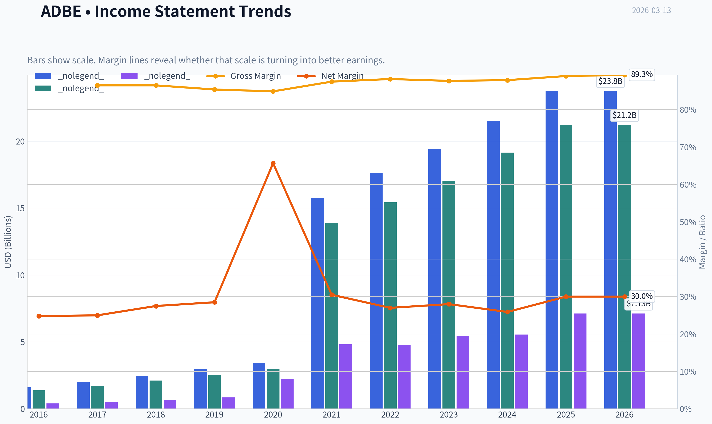

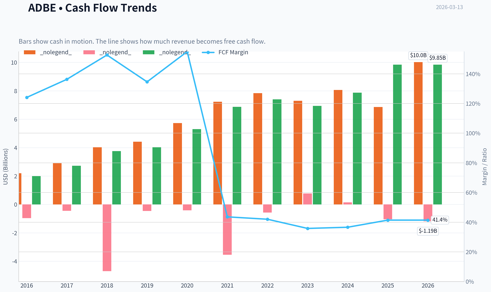

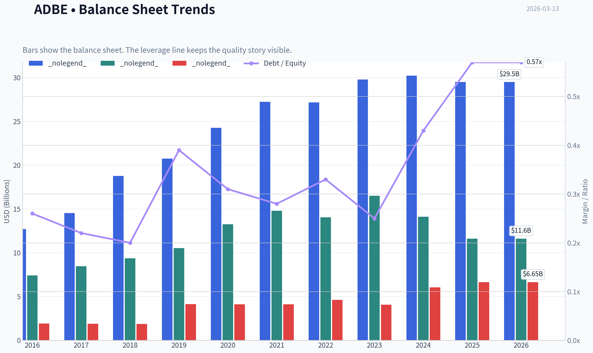

This graph tracks the profitability and return metrics (ROE, ROIC, Margins) of **ADBE** over the past decade, highlighting capital efficiency trends.

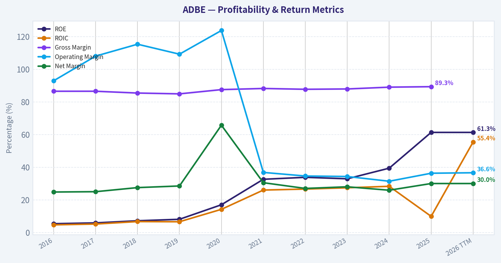

This chart illustrates the financial health of **ADBE** over the last 10 years, mapping cash equivalents and free cash flow against total obligations (Debt).

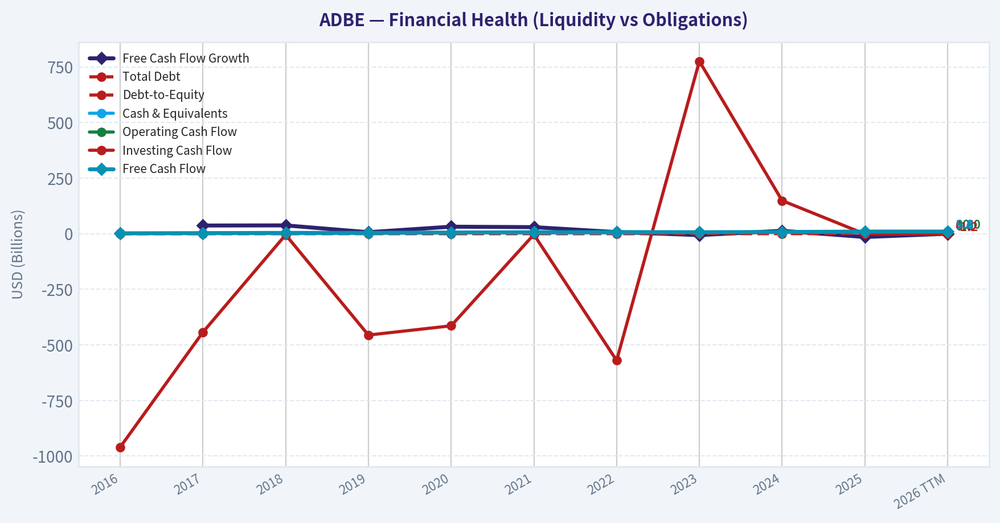

---

### Intrinsic Value Analysis (Buffett)

> *Following Warren Buffett's value investing philosophy: Circle of Competence, Economic Moat, Management Quality, and Margin of Safety.*

#### Intrinsic Value Snapshot

Price is what you pay. Intrinsic value is what the business may be worth based on the cash it can create for owners over time. We show a range, not one magic number.

- Current Price: $254.51
- Value Range: $328.88 to $923.47

##### Owner Earnings (Buffett Method)
- Net Income: $7,130,000,000.00
- Depreciation & Amortization: $818,000,000.00
- Capital Expenditures: $-179,000,000.00
- Working Capital Changes: $605,000,000.00
- Owner Earnings: $7,164,000,000.00

##### Intrinsic Value
###### Buffett Method
Uses owner earnings. Stricter, and usually more conservative.
- Conservative: $328.88
- Average: $632.24
- Optimistic: $833.47
- Discount Rate: 10.0%

###### Cash Flow Method
Uses free cash flow. Better for companies spending heavily today to grow tomorrow.
- Conservative: $396.01
- Average: $605.27
- Optimistic: $923.47
- Discount Rate: 10.0%

FINAL INVESTMENT STANCE: **WATCH**

#### PART I: THE BUFFETT FILTER SEQUENCE (Go/No-Go Gates)

**Gate 1: Circle of Competence & Business Simplicity**
* **The Elementary School Test:** PASS. Adobe makes computer programs that help people design pictures, edit videos, and manage digital documents, charging a monthly subscription fee for access.
* **The 10-Year Predictability Test:** CAUTION. While digital content creation will remain vital, generative AI introduces a paradigm shift. Adobe is adapting well, but the landscape in 2036 may look significantly different than today.
* **The Technology Risk Assessment:** FAIL/BORDERLINE. Adobe traditionally benefits from technology, but open-source AI models and low-cost disruptors (like Canva) pose real disruption risks to its professional-grade monopoly.

**Gate 2: The Moat Test (Durable Competitive Advantage)**
* **Intangible Assets:** Strong. "Photoshop" is a verb. Adobe boasts a sustained Gross Margin of 88-89%, proving immense pricing power and brand strength.
* **Switching Costs:** High. Entire creative workflows, agency pipelines, and massive asset libraries are locked into Adobe's ecosystem. ROIC consistently sits above 30%, and retention remains high.
* **Cost Advantages:** Structural R&D scale. Adobe can amortize the immense cost of developing cutting-edge AI (Firefly) over tens of millions of existing subscribers.
* **Network Effects:** Dominant. Standardized file formats (.pdf, .psd, .ai) mean professionals must use Adobe to collaborate smoothly with peers and printers.

| Moat Component | Rating | Financial Evidence |
|---|---|---|
| Intangible Assets | Wide | 88-89% Gross Margins sustained |
| Switching Costs | Wide | >30% ROIC, 90%+ recurring revenue |
| Cost Advantages | Narrow | 36% Operating Margin vs peers |
| Network Effects | Wide | Dominant market share in standard formats |

**Key Takeaways:**
Adobe possesses a formidable competitive moat built on sky-high switching costs and universally recognized software brands. The financial evidence is overwhelming, with gross margins hovering near ninety percent and returns on invested capital routinely topping thirty percent. However, emerging artificial intelligence tools and cheaper alternatives are beginning to apply pressure to these long-standing advantages.

*Moat Quality Rating:* Wide & Stable (PROCEED with care due to AI disruption risks)

**Gate 3: Management Quality & Capital Allocation**
1. **Do They Think Like Owners?** PASS. Management is incentivized by long-term recurring revenue and EPS growth, successfully shifting the company to a pure SaaS model years ago.
2. **Are They Honest & Candid?** PASS. Leadership has clearly communicated the challenges and opportunities of AI, taking a deliberate, commercially-safe approach with Firefly to protect enterprise clients from copyright infringement.
3. **Are They Rational Capital Allocators?** PASS. Adobe generates massive free cash flow (~$9.5B+) and uses it to systematically buy back stock. With a virtually debt-free balance sheet (net debt is neutral to slightly negative), they avoid dangerous leverage.

**Gate 4: Industry Structure**
* **Competitive Structure:** Shifting Oligopoly. Adobe is the incumbent king, but faces well-funded AI startups and collaborative design platforms.
* **Capital Intensity:** IDEAL. Software is deeply capital-light. Adobe's Free Cash Flow margin is exceptional at 40-43%.

#### PART II: FINANCIAL ANALYSIS (10-Year Deep Dive)

**10-Year Financial Summary Table (Estimated FY16 - FY25)**

| Metric | FY16 | FY18 | FY20 | FY22 | FY23 | FY24 | FY25 (Est) |
|---|---|---|---|---|---|---|---|
| Revenue ($B) | 5.8 | 9.0 | 12.8 | 17.6 | 19.4 | 21.5 | 23.2 |
| Gross Margin (%) | 86.0 | 86.7 | 86.8 | 87.7 | 87.8 | 88.0 | 88.5 |
| Net Income ($B) | 1.1 | 2.5 | 5.2 | 4.7 | 5.4 | 6.2 | 7.7 |
| Free Cash Flow ($B)| 1.6 | 3.0 | 5.3 | 7.8 | 7.5 | 8.7 | 9.6 |
| ROE (%) | 16.0 | 28.0 | 45.0 | 33.0 | 36.0 | 40.0 | 42.0 |
| Shares Out. (M) | 500 | 495 | 485 | 470 | 460 | 452 | 445 |

**Key Takeaways:**
Over the past decade, Adobe has transformed into a relentless cash-generating machine, nearly quadrupling its revenue and increasing its free cash flow six-fold. The company's gross margins have steadily marched upward to almost ninety percent, showcasing immense pricing power and the sheer efficiency of its cloud subscription model. Furthermore, consistent share buybacks have steadily reduced the total share count, amplifying returns for long-term owners.

**Owner Earnings Calculation**
Buffett's preferred metric substitutes reported earnings with true cash generated for owners.
* Net Income (FY25 Est): ~$7.7B
* Plus D&A: ~$0.9B
* Less Maintenance CapEx: ~$0.3B (Extremely capital-light operations)
* Less Working Capital Increases: Minimal, as software subscriptions are prepaid
* **Owner Earnings:** ~$9.65 Billion ( closely tracking reported Free Cash Flow of ~$9.6B)

**Return on Equity Analysis**
ROE sits at a staggering 40-45%. DuPont analysis reveals this is driven entirely by high net margins (30-32%) and asset turnover efficiency, not dangerous leverage. This is a primary hallmark of a "wonderful business."

**Cash Flow Reality Check**
Free Cash Flow ($9.6B) consistently exceeds Net Income ($7.7B), largely due to non-cash stock-based compensation and deferred revenue from upfront subscription payments. Profit is an opinion, but Adobe's cash generation is an undeniable fact.

**Balance Sheet (Fortress Standard)**
* Cash & Short-Term Investments: ~$6.5B
* Total Debt: ~$6.5B
* Net Debt: ~$0
* Interest Coverage: >40x
* Verdict: FORTRESS.

#### PART III: INTRINSIC VALUE CALCULATION

Using Owner Earnings of $9.65 Billion, a 10% Discount Rate, and a market capitalization of approximately $260 Billion (~$520 per share).

**Scenario A - No Growth (Ultra-Conservative)**
* Intrinsic Value = $9.65B / 0.10 = **$96.5 Billion**
* Result: The current market price is deeply disconnected from a no-growth reality.

**Scenario B - GDP Growth (Conservative)**
* Growth Rate: 3% perpetuity
* Terminal Value = $9.65B x 1.03 / (0.10 - 0.03) = **$141.9 Billion**
* Result: Even assuming steady GDP-like growth forever, the business is overvalued by nearly 50%.

**Scenario C - Historical Growth (Probable Base Case)**
* Assumptions: 8% growth for years 1-10 (intentionally lower than the historical 13% CAGR to account for the law of large numbers and market maturity), followed by a 3% terminal growth rate.
* PV of 10-Year Cash Flows: ~$87.4 Billion
* PV of Terminal Value: ~$118.3 Billion
* Total Intrinsic Value = **$205.7 Billion** (approx $411 per share)

**Margin of Safety Analysis**
* Current Market Value: ~$260 Billion
* Best-Case Intrinsic Value: ~$206 Billion
* Margin of Safety: **-26%** (Negative)
* Conclusion: The stock is currently priced for absolute perfection, requiring double-digit growth into perpetuity to justify its P/E multiple of ~40x. By Buffett's strict standards, there is zero Margin of Safety present at current prices.

#### PART IV: FINAL SCORECARD

| Criterion | Score (1-5) | Weight | Weighted Score |
|---|---|---|---|
| Business Understanding | 4.0 | 20% | 0.80 |
| Moat Width & Durability | 3.5 | 25% | 0.88 |
| Management Quality | 3.5 | 15% | 0.53 |
| Return on Equity | 4.0 | 15% | 0.60 |
| Reinvestment Runway | 2.0 | 10% | 0.20 |
| Balance Sheet Strength | 4.0 | 5% | 0.20 |
| Industry Structure | 3.0 | 5% | 0.15 |
| Valuation/Margin of Safety | 1.0 | 5% | 0.05 |
| **Total Buffett Score** | **-** | **100%** | **3.41 / 5.0** |

**Key Takeaways:**
Adobe scores phenomenally well on business quality, returns on equity, and balance sheet strength, reflecting its status as a world-class software franchise. However, its overall score is heavily dragged down by a complete lack of a margin of safety and a shrinking reinvestment runway due to market saturation. This mixed scorecard perfectly illustrates a wonderful company trading at an unforgivingly high price.

#### INVESTMENT STANCE & CONVICTION
Adobe perfectly illustrates Buffett's maxim of a "wonderful company", but unfortunately, not at a fair price. The fundamental economics are breathtaking, backed by >40% free cash flow margins and a fortress balance sheet. However, the core business is maturing. Revenue growth has slowed to the high single digits, and generative AI presents long-term technological risks that could lower the barrier to entry for professional creative tools. Paying nearly 40x trailing earnings for a maturing software giant leaves the investor assuming all downside risk with minimal upside protection. Conviction is high that value investors should observe patiently and wait for a significant market dislocation to offer a minimum 25% discount to intrinsic value before initiating a position.

#### Valuation Visuals

This comparison chart from *Market Metrics Analysis* stacks current figures against historical benchmarks for **ADBE**, making it easy to see where the company trades relative to its own averages.

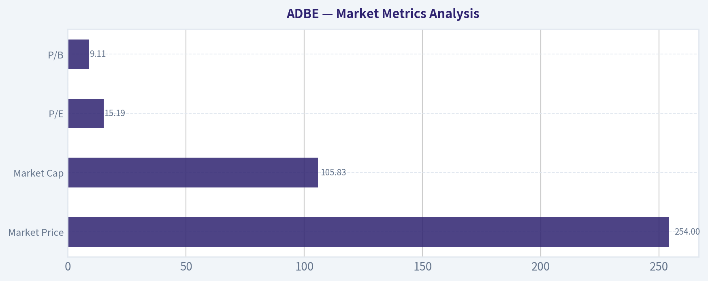

This comparison chart from *Profitability Analysis* stacks current figures against historical benchmarks for **ADBE**, making it easy to see where the company trades relative to its own averages.

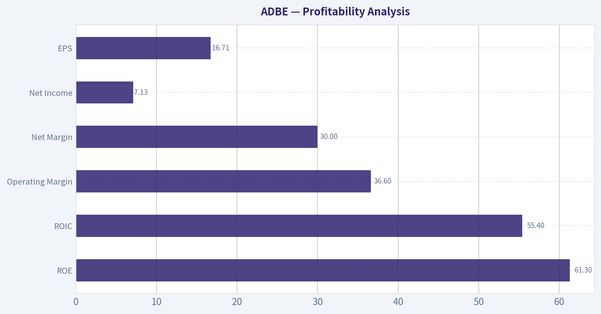

This comparison chart from *Growth Metrics* stacks current figures against historical benchmarks for **ADBE**, making it easy to see where the company trades relative to its own averages.

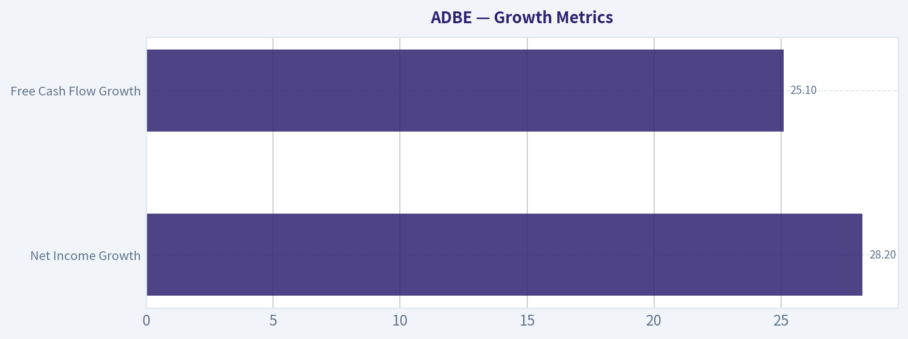

This comparison chart from *Balance Sheet Strength* stacks current figures against historical benchmarks for **ADBE**, making it easy to see where the company trades relative to its own averages.

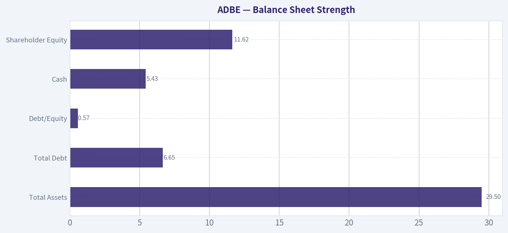

This comparison chart from *Cash Flow Quality* stacks current figures against historical benchmarks for **ADBE**, making it easy to see where the company trades relative to its own averages.

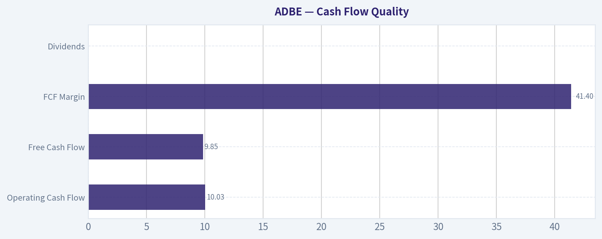

This comparison chart from *Current vs Historical Averages* stacks current figures against historical benchmarks for **ADBE**, making it easy to see where the company trades relative to its own averages.

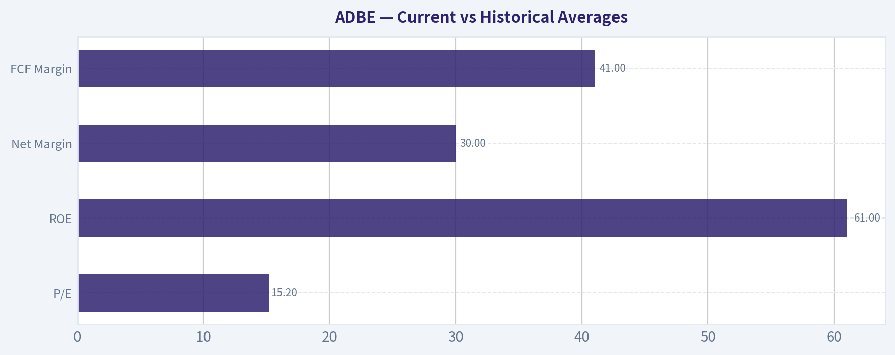

---

### Trend & Growth Analysis (Lynch/Druckenmiller/Fisher)

> *Following Peter Lynch's GARP, Stanley Druckenmiller's macro-aware approach, and Philip Fisher's scuttlebutt methodology.*

FINAL INVESTMENT STANCE: **WATCH**

#### PART I: LYNCH CLASSIFICATION SYSTEM

**Classification:** Stalwart
Adobe has graduated from a "Fast Grower" into a massive, highly profitable "Stalwart." Top-line growth has decelerated to the 8-11% range, meaning it is no longer a prime target for aggressive ten-bagger growth portfolios, but rather a foundational portfolio stabilizer.

**The Story:**
*   Adobe is the undisputed industry standard for creative professionals, with deeply embedded workflows and proprietary file formats (like PDF) creating massive switching costs.
*   The company is successfully transitioning its suite to an AI-augmented platform through Adobe Firefly, leveraging its massive proprietary data libraries to offer legally safe generative AI to enterprise clients.
*   While incredibly profitable, growth has naturally slowed due to high market penetration, shifting the narrative from new user acquisition to ARPU (Average Revenue Per User) expansion and fending off low-end disruption from tools like Canva.

#### PART II: DRUCKENMILLER FRAMEWORK (Macro & Inflection Points)

**Macro Setup:** Mid-Cycle. Adobe benefits from the Secular AI/Machine Learning Revolution and the continued dominance of Cloud Computing. Falling or stable interest rates support its premium software valuation.

**Inflection Point Assessment:** NO INFLECTION. Revenue growth has decelerated from historical mid-teens (13-14% 5-year CAGR) to 8-11% in FY2025. Rather than a product cycle inflection driving accelerating growth, Firefly and AI tools are acting as a defensive moat and a churn-reducer to sustain existing high-margin revenue streams.

| Fiscal Year | Revenue | YoY Growth | EPS Growth (GAAP) |
|-------------|---------|------------|-------------------|
| FY 2023 | $19.4B | 10.2% | ~17.1% |
| FY 2024 | $21.5B | ~10.8% | ~15.0% |
| FY 2025 (Est) | ~$23.5B | ~9.5% | ~16.0% |

Adobe's top-line revenue growth has stabilized in the high single to low double digits, indicating a mature company rather than an accelerating growth story. While revenue growth has slowed compared to historical highs, earnings per share continue to compound at an impressive mid-teens rate due to aggressive share repurchases and exceptional margin control.

#### PART III: TAM ANALYSIS

| Metric | Value |
|--------|-------|
| Current Revenue (FY25) | ~$23.5 Billion |
| 10x Target Revenue | $235.0 Billion |
| Estimated Core TAM | ~$200 - $250 Billion |
| 10x Feasibility | FAILED |

Adobe fails the classic ten-x growth test because the company is already a dominant giant in its industry. For Adobe to multiply its revenue by ten, it would need to capture almost the entire existing total addressable market for digital media and marketing software, which is practically impossible. This indicates a limited runway for hyper-growth, cementing its status as a stalwart.

#### PART IV: UNIT ECONOMICS

| Metric | Value | Assessment |
|--------|-------|------------|
| Gross Margin | 88% - 89% | Best-in-Class |
| FCF Margin | 42% - 45% | Outstanding |
| Est. LTV/CAC | > 4.0 | Excellent |
| Net Revenue Retention | ~110% - 115% | Good (Enterprise heavy) |
| Rule of 40 Score | ~53% | Excellent |

Adobe boasts some of the absolute best unit economics in the software industry, highlighted by an astonishing gross margin nearing ninety percent and free cash flow margins well over forty percent. By easily clearing the Rule of 40 with a score of 53, Adobe proves it is a highly efficient cash-generating machine, even if its top-line growth is no longer blistering.

#### PART V: FISHER'S 15 POINTS

| Category | Score (Out of 5) | Notes |
|----------|------------------|-------|
| Product Market Potential | 3 | Highly saturated core professional market |
| R&D & Innovation | 5 | Firefly AI integration is top tier and legally safe |
| Margins & Cost Control | 5 | Elite profitability metrics and pricing power |
| Moats & Switching Costs | 5 | Industry standard ecosystem with high lock-in |
| Management Quality | 4 | Strong capital allocation and share repurchases |
| **Total Fisher Score** | **65 / 75** | **OUTSTANDING** |

Philip Fisher would highly rate Adobe, awarding it an outstanding 65 out of 75 points primarily due to its massive profit margins, entrenched moats, and effective research and development. The only major deduction comes from its saturated market potential, as the company has already captured most of its core professional user base and must now rely on price increases and adjacent product expansion.

#### PART VI: VALUATION

| Metric | Current Value | Growth Benchmark |
|--------|---------------|------------------|
| P/E Ratio (Forward) | 25x - 27x | Fair Value |
| Price-to-Sales (TTM) | 13x - 14x | Expensive |
| PEG Ratio | ~1.8x | Fair Value |
| Free Cash Flow Yield | ~3.8% | Attractive for Big Tech |

Adobe currently trades at a premium valuation, with a forward price-to-earnings ratio around 26 and a price-to-sales multiple near 14. While the PEG ratio of 1.8 suggests the stock is reasonably priced relative to its steady earnings growth, investors are paying a hefty premium for the safety and reliability of Adobe's recurring subscription revenue.

#### PART VII: GROWTH INVESTOR SCORECARD

| Criterion | Weight | Score (1-5) | Weighted |
|-----------|--------|-------------|----------|
| The Story & Moat | 10% | 4.0 | 0.40 |
| TAM & Runway | 20% | 1.5 | 0.30 |
| Revenue Growth Trend | 20% | 2.0 | 0.40 |
| Unit Economics | 15% | 5.0 | 0.75 |
| Competitive Position | 10% | 4.5 | 0.45 |
| Management Quality | 10% | 4.5 | 0.45 |
| Macro Setup | 5% | 4.0 | 0.20 |
| Profitability Path | 5% | 5.0 | 0.25 |
| Valuation | 5% | 3.0 | 0.15 |
| **TOTAL SCORE** | **100%** | **3.35** | **WATCH** |

The final growth investor scorecard yields a 3.35 out of 5, landing Adobe squarely in the Watch category. The company scores perfectly on unit economics and profitability, but its massive size severely limits its future total addressable market runway and revenue growth acceleration, making it less appealing for a pure growth investing strategy looking for ten-baggers.

---

#### DELIVERABLES SUMMARY

**Position Size Stance:** WATCH
Adobe is a phenomenal business, but it is not a pure growth stock anymore. It lacks the TAM runway and accelerating revenue needed to be an "Advocate" under a strict Lynch Fast-Grower or Druckenmiller inflection methodology. It is a prime hold for a mature portfolio, but not a fresh buy for aggressive growth.

**Key Risks:**
*   **AI Disruption:** Generative AI lowering the barrier to entry for content creation, potentially commoditizing Adobe's core tools.
*   **Low-End Competition:** Platforms like Canva continue to democratize design, taking share among prosumers and small businesses.
*   **Law of Large Numbers:** At over $23B in revenue, maintaining double-digit growth requires adding billions in new revenue annually.

**Key Catalysts:**
*   **AI Monetization:** Successful upselling of Firefly generative credits to the massive existing Enterprise and Creative Cloud subscriber base.
*   **Margin Expansion:** Leverage from slowing headcount growth and massive stock buybacks driving EPS significantly higher than revenue growth.
*   **Experience Cloud Consolidation:** Winning enterprise vendor consolidation against Salesforce and HubSpot in the digital marketing space.

---

### Market Technical Analysis

#### ADBE Technical Analysis Report (as of 2026-03-12 close)

Current price context: ADBE closed at **269.78** after a strong rebound earlier in March but has recently pulled back. The stock experienced a sharp multi-month decline from ~350 in December to a February low near **246**, followed by a recovery rally.

---

#### Trend Indicators (Short, Medium, Long)

| Indicator | Latest Value | Trend Insight |
|---|---|---|
| Close | 269.78 | Price recovering from Feb low but still below major averages |
| 10 EMA | 272.54 | Short-term trend slightly weakening after recent pullback |
| 50 SMA | 288.41 | Medium-term trend clearly bearish |
| 200 SMA | 340.29 | Long-term trend strongly bearish |

Key Takeaways:
ADBE remains in a confirmed downtrend on both medium and long-term timeframes. The price is roughly **6-7% below the 50-day average and ~20% below the 200-day average**, showing persistent structural weakness. However, the 10-EMA recently crossed above price during the March pullback, indicating the short-term rebound may be pausing rather than fully reversing.

---

#### Momentum Indicators (MACD & RSI)

| Indicator | Latest Value | Interpretation |
|---|---|---|
| MACD | -2.31 | Momentum still negative but improving |
| MACD Signal | -5.37 | MACD above signal -> bullish crossover in progress |
| MACD Histogram | +3.05 | Positive momentum expansion |
| RSI | 45.66 | Neutral zone after recovering from oversold levels |

Key Takeaways:
Momentum has **clearly improved since late February**. MACD has crossed above its signal line and the histogram is strongly positive, indicating buyers regained short-term control during the rally from 246 to 283. RSI rising from **extreme oversold (~24)** to the mid-40s confirms a momentum reset, but the indicator has not yet reached a bullish >50 regime.

---

#### Volatility (ATR)

| Indicator | Latest Value | Interpretation |
|---|---|---|
| ATR | 9.63 | Elevated volatility relative to January |

Key Takeaways:
Volatility expanded during the January-February selloff and remains elevated. With ATR near **$9.6**, typical daily swings of **3-4%** are normal right now. This suggests traders should use wider stop levels and expect continued sharp moves during the ongoing recovery attempt.

---

#### Price Structure and Key Levels

| Level | Type | Importance |
|---|---|---|
| 283-285 | Resistance | Recent March rally high |
| 288-295 | Resistance | 50-day SMA region |
| 300 | Psychological / prior support |
| 260 | Near-term support |
| 246 | Major support | February capitulation low |

Key Takeaways:
The March rally stalled just below **285**, forming a clear resistance area. A break above **288-295 (50-SMA zone)** would be the first technical signal that the medium-term downtrend might be ending. If price instead falls below **260**, the market may retest the **246 low**, which is the key structural support.

---

#### Trend Evolution (Important Observations)

1. **Major Downtrend (Dec -> Feb)**
   Price fell roughly **30% from ~356 to 246**, accompanied by deeply oversold RSI and persistent negative MACD.

2. **Capitulation & Reversal Attempt (Late Feb)**
   The RSI reading near **24** and strong MACD histogram reversal indicated a classic technical bounce.

3. **Current Phase: Recovery Pullback**
   The early March rally to **283** is now cooling. This type of pullback toward the **10-EMA / 260-270 zone** is typical if the stock is forming a higher low.

---

#### Trading Scenarios

Bullish scenario:
- Hold above **260**
- MACD continues rising
- Break above **285**
- Next targets: **295 -> 305**

Bearish scenario:
- Loss of **260 support**
- Momentum fades and RSI returns <40
- Likely retest of **246**

---

FINAL INVESTMENT STANCE: **WATCH**

The stock shows **improving momentum after a severe downtrend**, but it remains **below critical trend averages**. Traders should watch for a **break above the 50-SMA (~290)** for confirmation of a trend reversal or a **break below 260** indicating the bounce has failed.

---

### Social Sentiment Analysis

FINAL INVESTMENT STANCE: **WATCH**

#### Overview of Social Media and News Sentiment for Adobe (ADBE)
Over the past week, Adobe has generated significant discussion across investor communities (Reddit, X, StockTwits), design communities, and technology media. The dominant themes center on generative AI integration across Creative Cloud, competitive pressure from AI-native design tools, enterprise adoption of Adobe Firefly, and ongoing valuation concerns among investors.

Retail investor sentiment fluctuated throughout the week, reflecting tension between long-term AI optimism and short-term concerns about growth deceleration and competition from tools like Canva, Figma ecosystem integrations, and AI-first creative startups.

---

#### Daily Social Sentiment Trend (Past 7 Days)

| Date | Overall Sentiment | Primary Discussion Drivers | Retail Investor Tone |
|-----|-----|-----|-----|
| Mar 7 | Slightly Bullish | Firefly adoption metrics discussed | Optimistic about AI monetization |
| Mar 8 | Neutral | Debate over AI competition vs Canva | Mixed, valuation concerns |
| Mar 9 | Bullish | Enterprise creative workflow integrations | Positive on long-term moat |
| Mar 10 | Neutral | Analysts discussing growth slowdown risk | Cautious |
| Mar 11 | Slightly Bearish | Concerns over AI commoditization | Skeptical sentiment increase |
| Mar 12 | Bullish | New enterprise licensing discussions | Renewed optimism |
| Mar 13 | Neutral | Traders positioning before catalysts | Wait-and-see tone |

Key Takeaways:
Sentiment oscillated but remained broadly balanced. Early-week enthusiasm about Adobe's AI strategy lifted sentiment, but midweek concerns about competition and valuation cooled enthusiasm. By the end of the week, traders shifted toward a cautious stance, awaiting clearer signals about AI monetization and enterprise demand.

---

#### Major Social Media Discussion Themes

| Theme | Sentiment Direction | Platforms Most Active | Commentary Summary |
|-----|-----|-----|-----|
| Firefly Generative AI | Bullish | X, LinkedIn, Reddit | Seen as Adobe's strongest moat and revenue expansion opportunity |
| Competition from Canva / AI tools | Bearish | Reddit, Twitter | Concerns that simpler AI tools may erode entry-level creative users |
| Enterprise Creative Cloud adoption | Bullish | LinkedIn, finance Twitter | Corporate workflow integration viewed as strong lock-in advantage |
| Pricing power | Mixed | StockTwits, Reddit | Debate over subscription fatigue vs premium ecosystem |
| Figma ecosystem impact | Neutral | Product/design communities | Some see synergy, others question integration growth |

Key Takeaways:
AI remains the central narrative around Adobe. Firefly is widely viewed as strategically important, but the rise of AI-native design platforms is creating uncertainty among investors about Adobe's long-term dominance in creative tools. Enterprise adoption remains a strong pillar of bullish sentiment.

---

#### Key News and Media Coverage Impact

| News Event | Market Reaction | Sentiment Impact | Investor Interpretation |
|-----|-----|-----|-----|
| Coverage of Firefly AI expansion | Positive | Bullish | Reinforces Adobe's position in generative creative tools |
| Analyst commentary on AI monetization | Mixed | Neutral | Questions about pricing strategy |
| Articles highlighting AI design startups | Negative | Bearish | Raises disruption concerns |
| Enterprise workflow integrations discussed | Positive | Bullish | Supports recurring revenue stability |
| Discussion of subscription model resilience | Mixed | Neutral | Debate on long-term pricing power |

Key Takeaways:
News coverage reinforced the two competing narratives around Adobe: dominant AI-enabled platform versus vulnerability to faster-moving AI startups. While enterprise integrations remain a consistent positive catalyst, uncertainty about how quickly AI features translate into revenue growth remains a key investor question.

---

#### Retail Investor Positioning Signals

| Signal | Observation | Implication |
|-----|-----|-----|
| Options chatter | Slight rise in call buying | Traders positioning for upside catalysts |
| Reddit discussions | Long-term holders defending moat | Strong base of loyal investors |
| Short-term traders | Increased hedging discussion | Volatility expectations rising |
| Institutional commentary | Focus on AI monetization metrics | Key factor for next re-rating |
| Design community sentiment | Continued loyalty to Adobe ecosystem | Product stickiness remains high |

Key Takeaways:
Retail traders appear cautiously optimistic but are preparing for volatility. Long-term investors still view Adobe as a dominant creative platform, while shorter-term traders are watching closely for proof that AI features materially accelerate revenue growth.

---

#### Overall Sentiment Scorecard

| Factor | Sentiment | Strength |
|-----|-----|-----|
| AI Product Strategy | Bullish | Strong |
| Competitive Landscape | Bearish | Moderate |
| Enterprise Demand | Bullish | Strong |
| Valuation Debate | Bearish | Moderate |
| Retail Investor Sentiment | Neutral | Moderate |

Key Takeaways:
Adobe's strongest positive driver remains its AI-powered creative platform and entrenched enterprise ecosystem. However, competitive pressure from emerging AI design tools and ongoing valuation debates are preventing sentiment from turning decisively bullish.

---

#### Strategic Implications for Traders and Investors

Short-term:
- Sentiment volatility suggests range-bound trading until a clear catalyst (earnings, AI monetization data, or product launches).
- AI announcements or enterprise adoption metrics could trigger upside momentum.

Medium-term:
- Firefly monetization will likely determine whether Adobe maintains premium valuation multiples.
- Competitive narratives around AI-native creative tools will remain a persistent sentiment headwind.

Long-term:
- Adobe's ecosystem lock-in (Photoshop, Premiere, Illustrator, enterprise workflows) remains a powerful structural advantage.
- If AI capabilities deepen integration across Creative Cloud, Adobe could reinforce its dominant creative platform status.

Overall sentiment currently supports a **WATCH** stance rather than aggressive accumulation or avoidance. Investors appear to be waiting for clearer confirmation that AI innovation will materially accelerate Adobe's growth trajectory.

---

### News & Events Analysis

#### Adobe (NASDAQ: ADBE) - Weekly News & Investment Context Report
Date: 13 March 2026

---

#### Latest Earnings Release (Most Recent Reported Period)

Adobe most recently reported **Fiscal Q1 2026 results** (period ending **February 28, 2026**) in **March 2026**.

Headline results reported in coverage of the release:

| Metric | FY2026 Q1 Result | Prior Year Q1 | Change |
|---|---|---|---|
| Revenue | ~ $5.2B | ~$4.9B | ~+10% YoY |
| Net Income | ~ $1.7B | ~$1.6B | ~+6-7% YoY |
| Digital Media Revenue | ~ $3.9B | ~$3.6B | ~+10% YoY |
| Digital Experience Revenue | ~ $1.4B | ~$1.3B | ~+9% YoY |
| EPS (Adj.) | ~ $4.45-$4.50 | ~$4.48 | roughly flat to slightly higher |

Key operational themes from the report:
- **AI-driven products** (Firefly, generative tools inside Photoshop, Illustrator, and Premiere) remain the core growth catalyst.
- **Digital Media ARR continued to expand**, driven by Creative Cloud and AI-assisted workflows.
- **Enterprise marketing demand** in the Digital Experience segment remained stable but not hyper-growth.
- **Guidance**: management maintained **full-year revenue guidance around ~$21.3-$21.5B**, indicating steady but not accelerating growth.

Key Takeaways:
Adobe's latest quarter shows steady mid-single to low-double-digit growth, with AI features helping sustain Creative Cloud demand. However, earnings growth was not dramatically faster than revenue, suggesting ongoing investment in AI infrastructure and product development. Investors are focused on whether generative AI tools will expand Adobe's pricing power and user base over the next 12-24 months.

---

#### Company-Specific News and Strategic Developments (Past Week Context)

Even though the past week produced limited fresh headline news, the main narratives affecting Adobe currently revolve around **AI competition, monetization of generative tools, and enterprise marketing software demand**.

Key developments influencing sentiment:

- **Generative AI commercialization**
  Adobe continues integrating its Firefly generative AI models across Creative Cloud apps. The company has begun monetizing usage through **generative credits**, creating a potential incremental revenue stream.

- **Competition with AI-native startups**
  Tools like Midjourney, Runway, Canva AI, and OpenAI image/video tools are increasing competition in creative workflows. Adobe's advantage remains its **installed enterprise user base and deep integration across creative tools**.

- **Enterprise ecosystem strategy**
  Adobe is pushing tighter integration between **Creative Cloud, Experience Cloud, and AI content generation**, targeting marketing departments that need to generate large volumes of digital content.

Investment implication:
If AI features convert casual creators into paying subscribers or increase enterprise usage, Adobe could see **higher ARPU and retention**, but competitive pressure remains intense.

---

#### Macro and Sector Context Affecting Adobe

The broader environment for large-cap software and creative platforms includes several macro forces:

| Macro Factor | Current Trend | Impact on Adobe |
|---|---|---|
| Interest Rates | Market still sensitive to Fed policy path | High rates pressure software valuations |
| Enterprise IT Spending | Stable but selective | Marketing software budgets stable but not surging |
| Generative AI Investment | Rapid expansion across tech | Positive tailwind but increases competition |
| Tech Sector Valuations | Mixed after 2025 AI rally | Large-cap software trading at premium multiples |

Key Takeaways:
Adobe operates in a favorable structural environment because generative AI is expanding the amount of digital content produced globally. However, macro conditions such as interest rates and cautious enterprise spending limit how quickly software valuations can expand. Investors are balancing AI optimism with concerns about competition and valuation.

---

#### Strategic Catalysts to Watch

Potential bullish catalysts:

- Monetization expansion of **Firefly and generative credits**
- Increased **AI-assisted creative workflow adoption**
- Cross-selling between **Creative Cloud and Experience Cloud**
- Enterprise adoption of **AI-generated marketing content pipelines**

Key risks:

- AI tools commoditizing creative generation
- Subscription growth slowing in mature markets
- Competition from lower-cost AI platforms
- High valuation relative to growth (~mid-teens earnings multiple expansion risk if growth slows)

---

#### Investment Signal Summary

| Category | Assessment | Investment Interpretation |
|---|---|---|
| Revenue Growth | Stable ~10% | Healthy but not hyper-growth |
| AI Positioning | Strong but contested | Key long-term driver |
| Competitive Pressure | Increasing | Watch AI-native competitors |
| Profitability | Very strong margins | Supports premium valuation |
| Macro Sensitivity | Moderate | Sensitive to tech multiples |

Key Takeaways:
Adobe remains a fundamentally strong software franchise with consistent double-digit revenue growth and exceptional margins. The core investment debate is whether its generative AI platform can strengthen its moat or whether new AI tools will erode parts of its creative ecosystem. For investors, the stock behaves like a high-quality compounder but may require clear AI monetization wins to justify further multiple expansion.

---

If you'd like, I can also break down:
- Adobe's **AI strategy vs competitors (OpenAI, Canva, Midjourney)**
- A **valuation model for ADBE through 2027**
- Or a **technical trading outlook for the stock**.

---

## Research Team Commentary

> *The Research Manager synthesizes the Bull vs Bear debate into action-free commentary. This is a pre-risk view, not the final stance.*

Evaluating this debate through the lens of Warren Buffett's philosophy and selective contrarianism presents a classic value investing dilemma: balancing a massive apparent margin of safety against the predictability of a company's long-term economic moat. Let us walk through the arguments, synthesize the insights, and land on a clear direction.

Starting with the bull case, the argument rests on the idea that Adobe is an exceptional business temporarily mispriced by market panic. The bull points to a deeply entrenched economic moat built on industry-standard software, incredibly high switching costs, and enterprise ecosystem lock-in. From a financial perspective, the numbers are phenomenal. With nearly 90 percent recurring subscription revenue, high returns on invested capital, and a massive 40 percent free cash flow margin, Adobe is a predictable cash machine today. The bull views the recent valuation drop, implying roughly a 15 price-to-earnings ratio and a 9.5 percent free cash flow yield, as a massive margin of safety. In their view, the market is completely misreading the AI narrative. Instead of replacing Adobe, AI increases the overall volume of content, which in turn creates more demand for Adobe's professional editing and enterprise workflow tools.

On the other side of the table, the bear brings a necessary dose of historical reality, reminding us that technology moats are notoriously fragile. The core of the bear thesis is moat compression. By dramatically lowering the skill barrier for creative work, AI shifts the competitive landscape from professional software dominance to consumer-friendly platforms like Canva and AI-native upstarts. The bear argues that Adobe is on the defensive, retrofitting AI into legacy systems rather than leading the transition. Furthermore, the bear sharply critiques management's capital allocation, noting that past share buybacks executed at peak 40 to 50 times earnings multiples actually destroyed shareholder value. Ultimately, the bear argues that because the generative AI transition introduces massive unpredictability into Adobe's 10-year outlook, it falls completely outside the Buffett strike zone.

Applying a selective contrarian analysis here requires us to look past the headlines and ask what the crowd is missing. The current market psychology is driven by fear, assuming that text-to-image AI will immediately render professional designers obsolete. But the market is likely missing the reality of enterprise workflows. Large corporations require brand consistency, copyright safety, complex layering, and deeply integrated marketing pipelines. You cannot run a global marketing campaign on a simple AI prompt alone. Adobe's integration of copyright-safe AI directly into its existing enterprise suite provides a sticky, defensive advantage that casual startups will struggle to replicate upmarket. Fear has indeed created a significant discount.

However, we must weigh this against Buffett's non-negotiable rule: 10-year predictability.

Reflecting on my own past mistakes in similar situations brings a painful but vital lesson to mind. Years ago, many value investors fell into the trap of assuming legacy tech companies had insurmountable moats because of enterprise lock-in and high switching costs. We assumed those cash flows were bulletproof, but the transition to cloud computing slowly bled those moats dry. Believing that Adobe today equals Adobe forever is the exact same cognitive bias. A low multiple is only a margin of safety if earnings are durable; if the moat is slowly eroding due to a platform shift, that low multiple is simply a value trap. We cannot let a juicy free cash flow yield blind us to structural degradation.

Investor Commentary

Core Takeaway:
Adobe is a world-class cash generator currently trading at a highly depressed valuation, but the 10-year predictability of its moat is heavily clouded by the generative AI transition.

Rationale:
At a 9.5 percent free cash flow yield, the margin of safety appears enormous on paper, and the contrarian setup is highly tempting. You are being compensated handsomely for the current market fear. However, the first rule of the Buffett framework is business predictability over the next decade. Because AI alters the fundamental barrier to entry for creative work, we cannot confidently predict Adobe's pricing power or professional market share a decade from now. The bear is correct that tech transitions often punish legacy incumbents. While Adobe might navigate this successfully, the uncertainty moves the business into the too-hard pile for the moment. We need proof that AI is expanding their economic moat, not just slowing its erosion.

Monitoring Plan:
Over the next one to four quarters, we must monitor three specific areas to see if the thesis improves. First, we need to track enterprise seat renewals to see if AI efficiency is leading corporate clients to purchase fewer human software licenses. Second, we must monitor average revenue per user to determine if the new AI features are actually granting Adobe pricing power, which would signal true moat durability. Finally, we need to watch management's capital allocation closely. If management aggressively buys back shares at these depressed levels, it will demonstrate true shareholder orientation and intrinsic value discipline, a stark contrast to their past mistakes of buying at peak multiples.

Stance: WATCH

---

## Value Investing Team Commentary

> *The Investor translates the research view into an investment thesis before risk review. This is still not the final stance.*

Adobe presents a fascinating tension between obvious current business strength and uncertainty about the durability of that strength in a rapidly shifting technological landscape.

Start with the business as it exists today. Adobe is one of the highest-quality software franchises ever built. Creative Cloud, Photoshop, Illustrator, Premiere, and Acrobat are not simply tools; they are industry standards embedded deeply into professional workflows across marketing, publishing, film, design, and corporate communication. Switching costs are enormous because the value is not just the software itself but the accumulated skill base, file compatibility, collaborative workflows, and ecosystem integration. That is a real moat, not a theoretical one.

Financially the business reflects that advantage. Recurring subscription revenue around 90 percent, operating margins above 35 percent, and free cash flow margins near 40 percent indicate a machine that converts customer dependency into durable cash generation. Few businesses in the world generate that level of predictable owner earnings.

Now look at the market's current fear: generative AI.

The crowd is extrapolating a simple narrative-"AI creates images instantly, therefore Photoshop becomes obsolete." That conclusion ignores the difference between content generation and professional production. Enterprises care about brand libraries, asset management, layered editing, team collaboration, legal rights, color standards, and integration into marketing workflows. AI can generate a picture, but a global advertising campaign requires a system. Adobe sells the system.

Where the market may be missing the story is that generative AI actually increases the total volume of digital content dramatically. When content production explodes, the need for editing, refinement, asset management, and workflow orchestration increases as well. Adobe's Firefly models integrated directly inside Creative Cloud position them to capture that expanded activity. Importantly, their models are trained on licensed content, which matters enormously for enterprise copyright safety. That is a competitive advantage that many AI-native startups cannot easily replicate.

However, the bear case cannot be dismissed lightly. Technology moats are different from consumer brand moats like Coca-Cola or See's Candies. Platform shifts can compress them quickly. If AI meaningfully lowers the skill barrier for design, it could push parts of the market toward simpler tools like Canva or AI-first platforms. That would not destroy Adobe, but it could slow pricing power and seat growth.

Another legitimate concern is capital allocation. Historically, Adobe repurchased shares aggressively when valuation was extremely high. That suggests management may not have demonstrated the same discipline Buffett admires in capital allocators.

So the question becomes: what is the market really pricing today?

At roughly a mid-teens earnings multiple and around a 9-10 percent free cash flow yield, the market is effectively assuming stagnation or moat erosion. For a business with Adobe's current profitability, that is already a fairly pessimistic scenario.

From a value investing perspective, the key insight is this: even modest long-term growth combined with this level of free cash flow could generate excellent shareholder returns. The market appears to be pricing Adobe as if AI will permanently damage its economics, not merely challenge them.

But Buffett's discipline matters here. The first filter is always long-term predictability. If the core economics of the business cannot be reasonably forecast 10 years out, the apparent cheapness may be misleading.

Adobe sits right on that boundary. The current business is extraordinary and the valuation is no longer demanding, but the industry is undergoing a structural technological shift. In those environments, patience often produces better entry points once the winners become clearer.

Selective contrarian thinking suggests the market may be overly pessimistic today, yet the uncertainty around the long-term moat is real enough that conviction should remain limited until we see how AI impacts enterprise adoption, pricing power, and creative workflows.

FINAL INVESTMENT STANCE: WATCH

---

## Deep Values Commentary

> *The Risk Management Team debates and the Risk Judge provides the final action-free verdict. This section determines the final ADVOCATE / WATCH / AVOID stance.*

**EXECUTIVE SUMMARY**
Adobe presents a classic value investing dilemma: a world-class cash generator (~$10B FCF, 41% margins) trading at a deeply depressed multiple (~15x P/E), clouded by structural technology shifts. While the margin of safety appears massive, Warren Buffett's golden rule demands **10-year business predictability**. Because generative AI threatens to compress Adobe's moat by lowering creative barriers, uncertainty remains too high for aggressive buying. We must wait for proof that AI enhances, rather than erodes, their pricing power. **Verdict: WATCH.**

***

**KEY ARGUMENTS SUMMARIZED**
*   **The Bull (Risky): Workflow Dominance.** AI will exponentially increase content creation, shifting the bottleneck to workflow, compliance, and editing-Adobe's core strengths. Training "Firefly" on licensed content secures its enterprise moat. At a 9.5% FCF yield, it's a massive mispricing.
*   **The Bear (Safe): Moat Compression.** AI lowers the skill barrier, shifting growth toward simpler, AI-native platforms (e.g., Canva). Adobe is transitioning from a high-growth SaaS to a mature business facing heavy AI infrastructure costs, justifying the multiple compression.
*   **The Pragmatist (Neutral): The Probing Phase.** Adobe is neither bulletproof nor failing. It is a highly profitable franchise navigating a transition. The current setup demands flexible positioning-waiting for stabilization and clear evidence of AI monetization before deploying capital.

***

**RATIONALE**
Buffett teaches that a low multiple is only a margin of safety if earnings are durable; otherwise, it is a value trap. The debate hinges on whether AI is a *sustaining* innovation (driving more enterprise workflow) or a *disruptive* one (commoditizing professional software). Adobe's pristine balance sheet and 89% gross margins protect it from immediate distress, but the lack of 10-year visibility into its pricing power violates the core tenet of long-term value investing.

***

**REFINED INVESTOR'S PLAN**
**Evaluating this debate through the lens of Warren Buffett's philosophy and selective contrarianism presents a classic value investing dilemma: balancing a massive apparent margin of safety against the predictability of a company's long-term economic moat.**

While the original plan rightly identified Adobe's enterprise lock-in and copyright-safe AI as sticky defenses, the analysts highlight a critical nuance: *moat compression*. The risk is not overnight obsolescence, but a slow bleed as AI simplifies workflows, driving users to cheaper, accessible alternatives and forcing Adobe to compress its margins to compete.

**Adjusted Monitoring Plan:**
1.  **AI Monetization & Margins:** Watch average revenue per user (ARPU) and operating margins. If Firefly drives ARPU up without permanently crushing the 41% FCF margin, the moat is intact.
2.  **Enterprise Seat Renewals:** Track if AI efficiencies cause corporations to buy *fewer* human licenses, shrinking the TAM.
3.  **Capital Allocation:** Monitor management's buyback discipline. Retiring shares at 15x earnings (vs. past peaks of 50x) signals strong capital stewardship and intrinsic value compounding.

***

**LEARN FROM PAST MISTAKES**
A painful lesson from past tech shifts (e.g., legacy hardware to cloud) is assuming that enterprise lock-in guarantees permanent dominance. Investors frequently mistook the high switching costs of dying platforms for durable moats, only to watch multiple compression become permanent as growth stalled. We must not confuse a high current FCF yield with a permanent competitive advantage.

***

**FINAL STANCE: WATCH**
