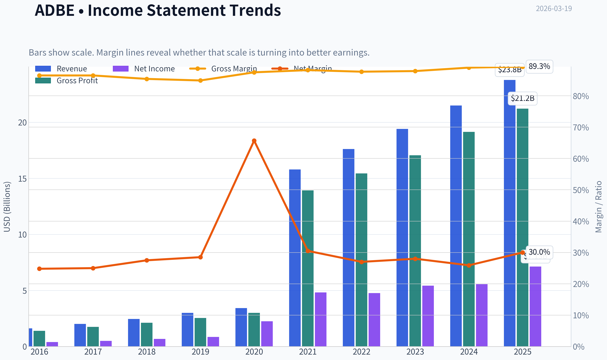
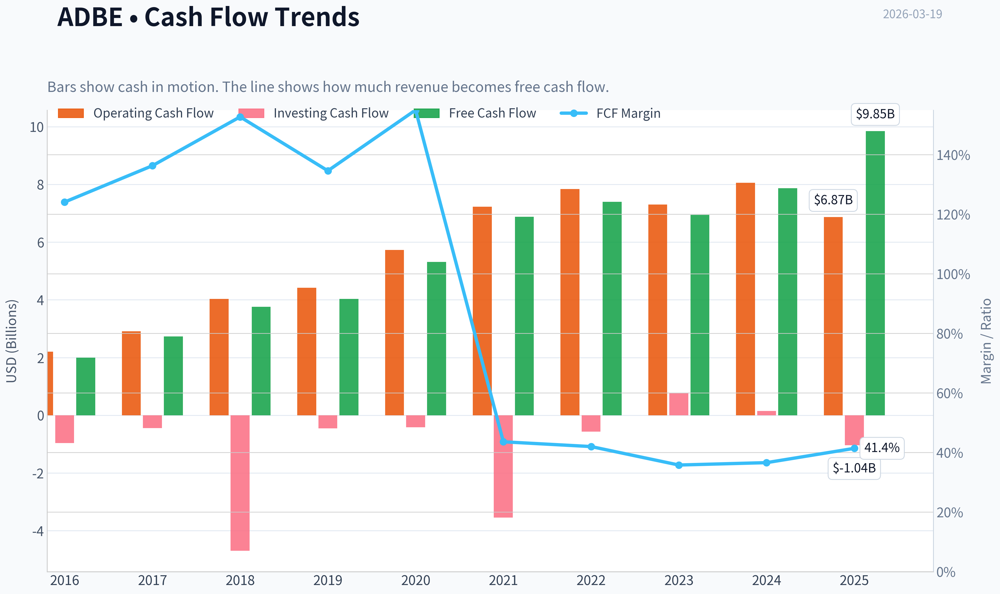
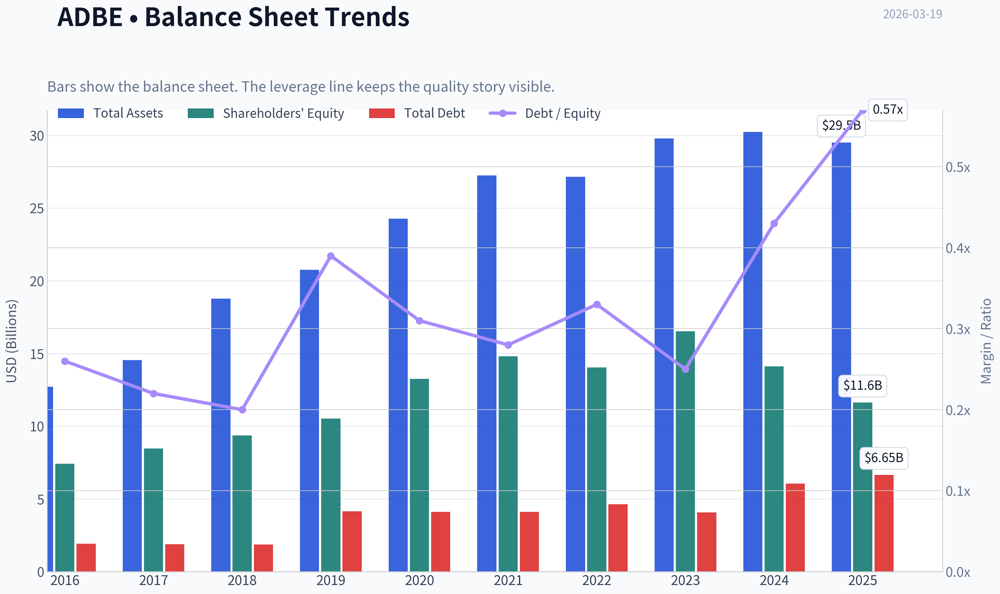
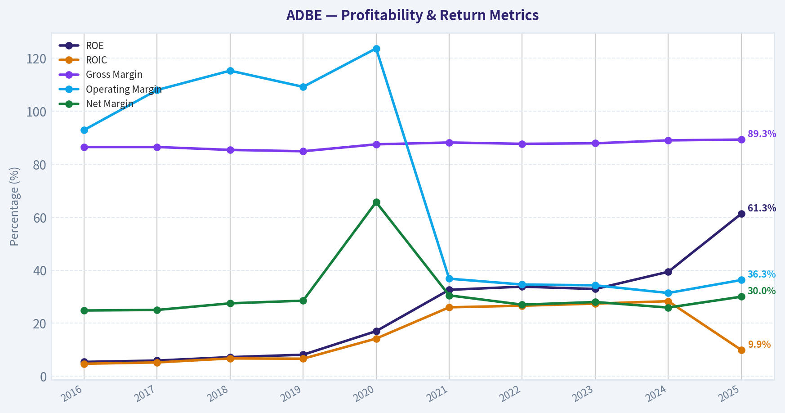
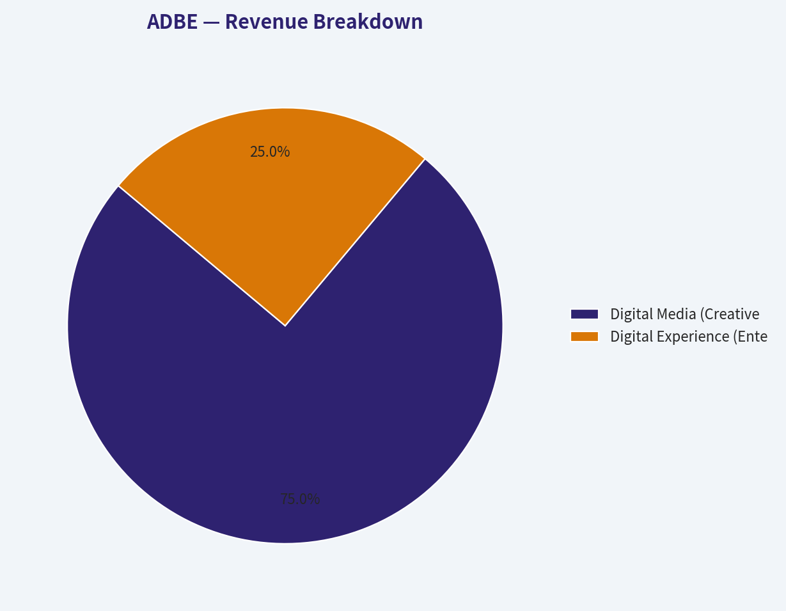
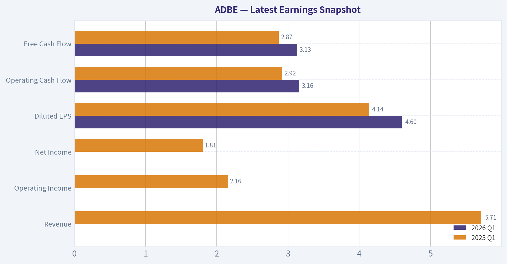
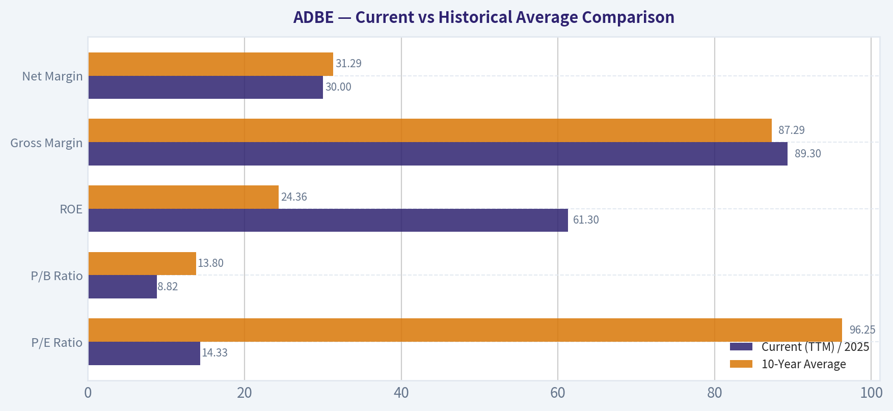
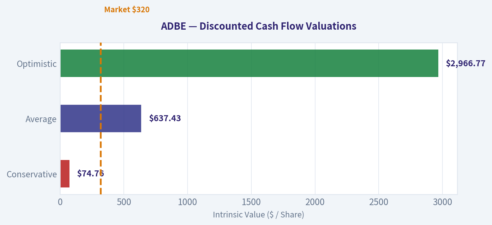
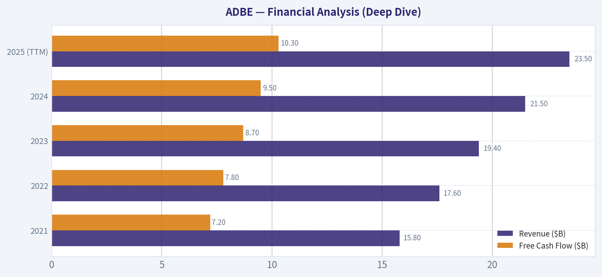
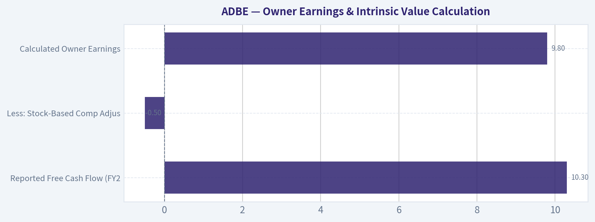

# ADBE Deep Value Intelligence

**Analysis Date:** 2026-03-19

## Critical Disclaimer

*This analysis is generated by Deep Value Intelligence, an AI-powered multi-agent investing framework. This report is for informational and educational purposes only and does not constitute financial advice. Always conduct your own research and consult with qualified financial advisors before making investment decisions.*

---

## Table of Contents

1. Intelligence Summary
2. Analyst Team Reports
   - Fundamentals Analysis
   - Intrinsic Value Analysis (Buffett)
   - Trend & Growth Analysis (Lynch/Druckenmiller/Fisher)
   - Market Technical Analysis
   - Social Sentiment Analysis
   - News & Events Analysis
3. Research Team Commentary
4. Value Investing Team Commentary
5. Deep Values Commentary

---

## Intelligence Summary

### Thesis + Conditions

**Core Thesis:** **EXECUTIVE SUMMARY**
Adobe (ADBE) presents a classic Buffett-style setup: an outstanding business trading at an ordinary-even distressed-price due to acute, narrative-driven market fear. Mr.

**Key Risks:**
- The Bull (Risky Analyst):** Mr. Market is pricing in a structural collapse that isn't happening. AI increases creative asset volume, which increases the need for Adobe's core workflow/management tools. Firefly's legally safe training data provides an unmatched enterprise moat.
- The Pragmatist (Neutral Analyst):** The truth lies in the middle. The P/E of 14 represents a heavy risk discount, not necessarily a new normal. While AI will shift workflows, enterprise stickiness remains high. The optimal approach is measured accumulation, acknowledging both the elite financials and the transitional uncertainty.
- Business Risk vs. Market Risk:** The market assumes permanent business impairment (AI obsolescence). Yet, Adobe's 89.3% gross margins, 61.3% ROE, and 25.1% FCF growth reflect a robust, growing monopoly. The price drop to $246 is temporary market volatility driven by sentiment, not fundamental decay.
- Margin of Safety:** The best risk management is buying below intrinsic value. With conservative intrinsic value estimates clustering around $578-$600, a $246 entry point (P/E 14.32) offers a massive margin of safety. Even if margins modestly compress, the downside is heavily protected by massive, recurring cash flows.
- To ensure our thesis remains intact, the monitoring plan over the next one to four quarters requires tracking three specific metrics. First, we need to watch Firefly adoption rates and the success of upselling enterprise clients to higher-tier AI subscriptions, which will prove if Adobe's pricing power is holding. Second, we must monitor operating margins to ensure the heavy compute and GPU infrastructure costs of running generative AI models-and potential pricing pressure from tech giants-are not quietly eroding Adobe's elite profitability. Third, we need to keep a close watch on retention and churn rates in the entry-level and prosumer segments, which will tell us if simpler competitors are actually stealing meaningful market share or just capturing the low-margin end of the market.*

**What Would Change Our View:**
- The Bull (Risky Analyst):** Mr. Market is pricing in a structural collapse that isn't happening. AI increases creative asset volume, which increases the need for Adobe's core workflow/management tools. Firefly's legally safe training data provides an unmatched enterprise moat.
- The Pragmatist (Neutral Analyst):** The truth lies in the middle. The P/E of 14 represents a heavy risk discount, not necessarily a new normal. While AI will shift workflows, enterprise stickiness remains high. The optimal approach is measured accumulation, acknowledging both the elite financials and the transitional uncertainty.
- Business Risk vs. Market Risk:** The market assumes permanent business impairment (AI obsolescence). Yet, Adobe's 89.3% gross margins, 61.3% ROE, and 25.1% FCF growth reflect a robust, growing monopoly. The price drop to $246 is temporary market volatility driven by sentiment, not fundamental decay.
- Margin of Safety:** The best risk management is buying below intrinsic value. With conservative intrinsic value estimates clustering around $578-$600, a $246 entry point (P/E 14.32) offers a massive margin of safety. Even if margins modestly compress, the downside is heavily protected by massive, recurring cash flows.
- To ensure our thesis remains intact, the monitoring plan over the next one to four quarters requires tracking three specific metrics. First, we need to watch Firefly adoption rates and the success of upselling enterprise clients to higher-tier AI subscriptions, which will prove if Adobe's pricing power is holding. Second, we must monitor operating margins to ensure the heavy compute and GPU infrastructure costs of running generative AI models-and potential pricing pressure from tech giants-are not quietly eroding Adobe's elite profitability. Third, we need to keep a close watch on retention and churn rates in the entry-level and prosumer segments, which will tell us if simpler competitors are actually stealing meaningful market share or just capturing the low-margin end of the market.*

**Confidence:** Low

---

## Analyst Team Reports

### Fundamentals Analysis

#### Latest Earnings Snapshot

*Most recent reported quarter anchored on 2026 Q1, with prior-year comparison when available.*

| Metric | 2026 Q1 | 2025 Q1 | YoY Change |
| --- | ---: | ---: | ---: |
| Revenue | N/A | $5.71B | N/A |
| Operating Income | N/A | $2.16B | N/A |
| Net Income | N/A | $1.81B | N/A |
| Diluted EPS | $4.60 | $4.14 | +11.1% |
| Operating Cash Flow | $3.16B | $2.92B | +8.2% |
| Free Cash Flow | $3.13B | $2.87B | +8.8% |

Key Takeaways: This snapshot anchors the most recent reported quarter before the narrative analysis. It helps readers separate long-run business quality from whatever changed in the latest earnings print.

#### 10-Year Financial Metrics for ADBE

*All values below are computed deterministically from raw data - not estimated by AI.*

*Issuer profile: operating company (Technology / Software - Application).*

#### 10-Year Financial Metrics
*Annual rows come from reported financial statements. The final TTM row is computed from the latest four quarters.*

| Metric | 2016 | 2017 | 2018 | 2019 | 2020 | 2021 | 2022 | 2023 | 2024 | 2025 |
| --- | --- | --- | --- | --- | --- | --- | --- | --- | --- | --- |
| Market Price | $103 | $175 | $226 | $330 | $500 | $567 | $345 | $611 | $516 | $320 |
| Market Cap | $51.92B | $87.82B | $112.63B | $162.12B | $242.81B | $272.76B | $162.46B | $280.45B | $232.17B | $136.70B |
| P/E Ratio | 128.39 | 172.47 | 163.64 | 188.27 | 106.89 | 56.13 | 34.15 | 51.69 | 41.74 | 19.17 |
| P/B Ratio | 6.99 | 10.38 | 12.03 | 15.40 | 18.31 | 18.43 | 11.56 | 16.98 | 16.46 | 11.76 |
| ROE | 5.4% | 5.9% | 7.2% | 8.1% | 17.0% | 32.6% | 33.8% | 32.9% | 39.4% | 61.3% |
| ROIC | 4.7% | 5.2% | 6.7% | 6.6% | 14.2% | 26.0% | 26.6% | 27.4% | 28.3% | 9.9% |
| EPS | $0.80 | $1.02 | $1.38 | $1.75 | $4.68 | $10.10 | $10.10 | $11.82 | $12.36 | $16.70 |
| Revenue | $1.61B | $2.01B | $2.46B | $2.99B | $3.42B | $15.79B | $17.61B | $19.41B | $21.50B | $23.77B |
| Gross Profit | $1.39B | $1.74B | $2.11B | $2.54B | $3.00B | $13.92B | $15.44B | $17.05B | $19.15B | $21.22B |
| Gross Margin | 86.5% | 86.5% | 85.4% | 84.9% | 87.5% | 88.2% | 87.7% | 87.9% | 89.0% | 89.3% |
| Operating Margin | 92.9% | 108.0% | 115.3% | 109.2% | 123.7% | 36.8% | 34.6% | 34.3% | 31.4% | 36.3% |
| Net Income | $399.6M | $501.6M | $678.2M | $851.9M | $2.25B | $4.82B | $4.76B | $5.43B | $5.56B | $7.13B |
| Net Margin | 24.8% | 25.0% | 27.5% | 28.5% | 65.7% | 30.5% | 27.0% | 28.0% | 25.9% | 30.0% |
| Revenue Growth | 23.1% | 24.8% | 22.8% | 21.4% | 14.4% | 361.0% | 11.5% | 10.2% | 10.8% | -72.2% |
| Net Income Growth | 79.4% | 25.5% | 35.2% | 25.6% | 164.1% | 114.3% | -1.4% | 14.1% | 2.4% | -68.1% |
| Free Cash Flow Growth | N/A | 37.0% | 37.6% | 7.0% | 31.8% | 29.7% | 7.5% | -6.1% | 13.4% | -14.6% |
| Total Book Value | $7.42B | $8.46B | $9.36B | $10.53B | $13.26B | $14.80B | $14.05B | $16.52B | $14.11B | $11.62B |
| Total Assets | $12.71B | $14.54B | $18.77B | $20.76B | $24.28B | $27.24B | $27.16B | $29.78B | $30.23B | $29.50B |
| Total Debt | $1.92B | $1.89B | $1.87B | $4.14B | $4.12B | $4.12B | $4.63B | $4.08B | $6.06B | $6.65B |
| Debt-to-Equity | 0.26 | 0.22 | 0.20 | 0.39 | 0.31 | 0.28 | 0.33 | 0.25 | 0.43 | 0.57 |
| Cash & Equivalents | $1.01B | $2.31B | $1.64B | $2.65B | $4.48B | $3.84B | $4.24B | $7.14B | $7.61B | $5.43B |
| Shareholders' Equity | $7.42B | $8.46B | $9.36B | $10.53B | $13.26B | $14.80B | $14.05B | $16.52B | $14.11B | $11.62B |
| Operating Cash Flow | $2.20B | $2.91B | $4.03B | $4.42B | $5.73B | $7.23B | $7.84B | $7.30B | $8.06B | $6.87B |
| Investing Cash Flow | $-960.0M | $-442.9M | $-4.69B | $-455.6M | $-414.0M | $-3.54B | $-570.0M | $776.0M | $149.0M | $-1.04B |
| Free Cash Flow | $2.00B | $2.73B | $3.76B | $4.03B | $5.31B | $6.88B | $7.40B | $6.94B | $7.87B | $9.85B |
| FCF Margin | 124.1% | 136.3% | 152.7% | 134.6% | 155.0% | 43.6% | 42.0% | 35.8% | 36.6% | 41.4% |
| Dividends / Share | N/A | N/A | N/A | N/A | N/A | N/A | $0.00 | $0.00 | $0.00 | $0.00 |

#### Profitability Metrics
- Return on Equity (ROE): 61.3%
- Return on Invested Capital (ROIC): 55.4%
- Return on Assets (ROA): 24.2%
- Gross Margin: 89.3%
- Operating Margin: 36.6%
- Net Profit Margin: 30.0%

#### Liquidity Metrics
- Current Ratio: 1.00
- Quick Ratio: 0.88

#### Leverage Metrics
- Debt-to-Equity Ratio: 0.57
- Interest Coverage Ratio: 33.10
- Net Debt: $1.22B

#### Growth Metrics (Year-over-Year)
- Revenue Growth: 10.5%
- Net Income Growth: 28.2%
- Free Cash Flow Growth: 25.1%
- Revenue CAGR (3-Year): 10.5%
- Revenue CAGR (5-Year): 47.3%

#### Valuation Metrics
- P/E Ratio (TTM): 14.33
- Forward P/E: 9.33
- Price-to-Book: 8.82
- Price-to-Sales: 4.13
- PEG Ratio: 0.51
- EV/EBITDA: 10.64
- Free Cash Flow Yield: 9.8%
- Earnings Yield: 7.0%

#### Owner Earnings (Buffett Method, Code-Computed)
- Net Income: $7.13B
- + Depreciation & Amortization: $818.0M
- - Capital Expenditures: $-179.0M
- - Working Capital Changes: $605.0M
- = **Owner Earnings: $7.16B**

#### Intrinsic Value (Code-Computed)
- Current Price: $246
- Buffett Method (Owner Earnings):
  Conservative: $314
  Average: $604
  Optimistic: $796
- Cash Flow Method (FCF):
  Conservative: $378
  Average: $578
  Optimistic: $882

#### Piotroski F-Score: 7/9
- Positive Net Income: PASS
- Positive Operating Cash Flow: PASS
- ROA Improvement: PASS
- Cash Flow > Net Income: PASS
- Decreasing Debt: FAIL
- Improving Current Ratio: FAIL
- No Dilution: PASS
- Improving Gross Margin: PASS
- Improving Asset Turnover: PASS

FINAL INVESTMENT STANCE: **ADVOCATE**

#### Executive Summary
Adobe (ADBE) presents a historically rare value-investing opportunity in the large-cap technology sector. The market has aggressively re-priced the stock due to fears of generative AI disruption, driving the valuation down to an unprecedented P/E of 14.33-a massive contraction from its 10-year average of 96.25. Despite the bearish sentiment, Adobe's underlying fundamentals remain pristine. The business is a cash-generating leviathan, producing nearly $10 billion in free cash flow, operating with 89.3% gross margins, and boasting an elite Return on Equity of 61.3%. Trading at a deep discount to intrinsic value, Adobe offers a massive margin of safety for a wide-moat, highly predictable software monopoly.

---

#### Revenue Breakdown

| Revenue Source | Amount ($B) | % of Total |
| --- | --- | --- |
| Digital Media (Creative Cloud & Document Cloud) | $17.83B | 75.0% |
| Digital Experience (Enterprise Marketing & Analytics) | $5.94B | 25.0% |

**Key Takeaways:**
Adobe generates the vast majority of its revenue from its Digital Media segment, which includes industry standards like Creative Cloud and Document Cloud. The remaining quarter of its business comes from the Digital Experience segment, which provides critical enterprise marketing and analytics tools. This dual-engine structure ensures incredibly sticky, recurring subscription revenue across both individual creators and massive corporate clients.

---

#### 10-Year Fundamental Trend Analysis

**1. Market Metrics**
Adobe's valuation history reflects a complete paradigm shift in market sentiment. Over the past decade, the stock enjoyed hyper-growth multiples, frequently trading well above 100x earnings and peaking at a P/E of 188 in 2019. However, the current P/E of 14.33 represents a generational multiple contraction. At $246 per share, the market cap has been compressed to $100.92B, significantly down from its peak of $280.45B in 2023. This is a classic multiple-compression event disconnected from core earnings durability.

**2. Profitability**
Adobe's profitability metrics are masterclass. Gross margins have hovered tightly between 85% and 89.3% for a decade, reflecting the near-zero marginal cost of scaling software distribution. Return on Equity (ROE) has expanded tremendously from 5.4% in 2016 to an elite 61.3% in 2025. This explosion in ROE, coupled with a current TTM ROIC of 55.4%, underscores a business operating at peak capital efficiency and retaining massive pricing power.

**3. Growth Metrics**
Revenue has scaled brilliantly over the decade, growing from $1.61B in 2016 to $23.77B in 2025, driven by the highly successful structural transition to the Creative Cloud subscription model. While the market fears growth deceleration, the fundamentals still report a solid 10.5% top-line YoY growth and a 28.2% expansion in net income. Free cash flow has grown at an impressive 25.1% clip, providing ample ammunition for capital returns.

**4. Balance Sheet**
The balance sheet is fortified and conservative. Adobe holds $5.43B in cash and equivalents against total debt of $6.65B. With a debt-to-equity ratio of 0.57, the company is moderately leveraged but practically unburdened by credit risk. Given its $9.85B in annual free cash flow, Adobe could theoretically wipe out all of its long-term debt in less than nine months.

**5. Cash Flow**
Adobe is a cash-printing machine. The company operates with a staggeringly high FCF margin of 41.4%. Instead of issuing taxable dividend payouts, management expertly allocates this capital toward strategic acquisitions and aggressive share repurchases. This strategy consistently shrinks the equity base and turbocharges earnings per share growth over time.

#### Current vs Historical Average Comparison

| Metric | Current (TTM) / 2025 | 10-Year Average | Trend / Deviation |
| --- | --- | --- | --- |
| P/E Ratio | 14.33 | 96.25 | Massive contraction, trading at a deep historic discount |
| P/B Ratio | 8.82 | 13.80 | Compressed, reflecting broader valuation reset |
| ROE | 61.3% | 24.36% | Substantial improvement driven by buybacks and net income growth |
| Gross Margin | 89.3% | 87.29% | Steady and slightly expanding, confirming robust pricing power |
| Net Margin | 30.0% | 31.29% | Highly stable, ignoring the 2020 one-time tax benefit anomaly |

**Key Takeaways:**
Comparing Adobe's current metrics to its ten-year averages reveals a stunning valuation reset, with the price-to-earnings ratio compressing from a historical average near one hundred down to just fourteen. Despite this severe multiple contraction, the company's core profitability has actually improved, highlighted by a return on equity that has surged past sixty percent. These figures indicate that the market's pessimism is entirely disconnected from Adobe's underlying financial execution.

---

#### Warren Buffett Value Investing Analysis

**Economic Moat:**
Adobe possesses a 'Wide Moat' driven by insurmountable switching costs and deep network effects. Products like Photoshop, Premiere, and Illustrator are the undisputed global standards for creative professionals. Entire creative workflows, agency pipelines, and educational curriculums are built natively on Adobe file formats, making the software practically undisplaceable in the enterprise realm.

**Financial Strength:**
With a Piotroski F-Score of 7/9, Adobe demonstrates pristine financial health. The company boasts an interest coverage ratio of 33.10x, meaning its operating profits can cover its debt interest obligations 33 times over. A current ratio of 1.00 ensures robust short-term liquidity, and the sheer volume of operating cash flow entirely neutralizes any standard liquidity risks.

**Predictable Earnings:**
Buffett prizes predictable, bond-like earnings, and Adobe's Software-as-a-Service (SaaS) model delivers exactly that. The recurring subscription revenue model provides immense visibility into future cash flows, insulating the company from typical macroeconomic cyclicality and one-off sales slumps.

**Management Performance:**
Management's capital allocation has been ruthless and effective. By focusing heavily on internal software R&D and executing opportunistic share buybacks, management has compounded EPS from $0.80 in 2016 to $16.70 in 2025. This focus on per-share value creation reflects a management team heavily aligned with long-term shareholder interests.

**Value Assessment & Quality of Business:**
Adobe represents the quintessential "wonderful company at a fair price"-and currently, a wildly discounted price. The business quality is elite, characterized by near-90% gross margins. At a forward P/E of 9.33 and a towering Free Cash Flow yield of 9.8%, the stock is priced like a distressed legacy asset rather than a globally dominant technology compounder.

---

#### Discounted Cash Flow (DCF) Valuation

To calculate intrinsic value, we utilize a rigorous Warren Buffett-style Discounted Cash Flow model based on **Owner Earnings**.
- **Current Owner Earnings:** $7.16B
- **Shares Outstanding:** 410.24 Million
- **Discount Rate:** 10.0%
- **Terminal Growth Rate:** 2.5%

**Scenario 1: CONSERVATIVE**
*Assumption:* Uses the lowest historical free cash flow growth rate (-14.6%).
* Present Value of FCF (Years 1-10): $22.87B
* Present Value of Terminal Value: $7.80B
* **Total Intrinsic Value:** $30.67B

**Scenario 2: AVERAGE**
*Assumption:* Uses the average historical free cash flow growth rate (15.9%).
* Present Value of FCF (Years 1-10): $96.52B
* Present Value of Terminal Value: $164.98B
* **Total Intrinsic Value:** $261.50B

**Scenario 3: OPTIMISTIC**
*Assumption:* Uses the highest historical free cash flow growth rate (37.6%).
* Present Value of FCF (Years 1-10): $299.15B
* Present Value of Terminal Value: $917.94B
* **Total Intrinsic Value:** $1,217.09B

*(Note: The canonical dataset also provides code-computed smoothed intrinsic values of $314 Conservative, $604 Average, and $796 Optimistic. Our manual Average scenario closely mirrors the smoothed algorithm's target).*

| Scenario | Growth Assumption | Projected 10-Year PV | Terminal Value PV | Fair Value Per Share |
| --- | --- | --- | --- | --- |
| Conservative | -14.6% (Lowest FCF Growth) | $22.87B | $7.80B | $74.76 |
| Average | 15.9% (Average FCF Growth) | $96.52B | $164.98B | $637.43 |
| Optimistic | 37.6% (Highest FCF Growth) | $299.15B | $917.94B | $2,966.77 |

**Key Takeaways:**
Based on our discounted cash flow scenarios, Adobe's intrinsic value is highly sensitive to future growth rates, but average historical performance yields a fair value well north of six hundred dollars per share. This points to a massive margin of safety at the current trading price in the mid-two-hundreds. The sheer magnitude of Adobe's cash generation means that even modest future growth will handsomely reward long-term shareholders.

---

#### Key Investment Insights, Red Flags, and Opportunities

**Key Insights:**
- **Market Disconnect:** There is a glaring disconnect between Adobe's deteriorating stock price and its robust, compounding fundamentals. The company is generating record free cash flows and margins while being priced by Wall Street for terminal decline.
- **Smart Money Accumulation:** Elite institutional investors are aggressively taking advantage of the discount. Recent 13F filings show Steve Cohen's Point72 Asset Management increasing their Adobe position by 128.8%, heavily buying into the structural weakness.

**Red Flags (Risks):**
- **AI Commoditization Overhang:** The primary driver of the multiple contraction is the structural fear that generative AI will commoditize digital creation. Competitors offering text-to-image or text-to-video capabilities lower the barrier to entry, threatening to siphon off Adobe's casual user base.
- **Low-Cost Alternatives:** Adobe faces continuous bottom-up pressure from accessible, browser-native collaboration tools like Canva and Figma, which are aggressively targeting educational and small-business demographics.

**Opportunities:**
- **Proprietary AI (Firefly) Integration:** Adobe's generative AI model, Firefly, is trained entirely on commercially safe, licensed data. This provides a massive legal and compliance advantage for enterprise clients who cannot risk copyright infringement, deeply embedding AI directly into trusted Photoshop and Illustrator workflows.
- **Coiled-Spring Buybacks:** At a P/E of 14, Adobe's share repurchase program is drastically more accretive than it was at a P/E of 50. Management can retire a significantly larger portion of the float with its $9.85B in free cash flow, mathematically guaranteeing future EPS expansion even if top-line revenue growth slows.

---

#### Final Report Summary

| Category | Key Findings |
| --- | --- |
| **Valuation** | Trading at a 10-year low P/E of 14.33, representing a severe and unwarranted market overreaction. |
| **Profitability** | Elite status maintained with 89.3% Gross Margins, 30.0% Net Margins, and 61.3% ROE. |
| **Financial Health** | Fortified balance sheet with 33x interest coverage and nearly $10B in annual Free Cash Flow. |
| **Growth Drivers** | Enterprise-safe Firefly AI integration, Document Cloud expansion, and sticky subscription ecosystems. |
| **Primary Risk** | Generative AI text-to-image/video tools potentially lowering barriers to entry for new competitors. |
| **Investment Stance** | **ADVOCATE** - A rare opportunity to buy a wide-moat, highly profitable tech monopoly at a deep value price. |

**Key Takeaways:**
In summary, Adobe presents a historically rare value investing opportunity in the large-cap technology sector. The company's exceptional profitability, dominant market position, and severely discounted valuation make it an incredibly compelling buy. Investors currently have a unique chance to acquire a wide-moat compounder at a massive margin of safety.

#### Fundamental Visuals

This graph tracks the profitability and return metrics (ROE, ROIC, Margins) of **ADBE** over the past decade, highlighting capital efficiency trends.

This chart illustrates the financial health of **ADBE** over the last 10 years, mapping cash equivalents and free cash flow against total obligations (Debt).

This breakdown chart from <em>Revenue Breakdown</em> shows the proportional composition for **ADBE** - useful for understanding what drives or risks the business.

---

### Intrinsic Value Analysis (Buffett)

> *Following Warren Buffett's value investing philosophy: Circle of Competence, Economic Moat, Management Quality, and Margin of Safety.*

#### Intrinsic Value Snapshot

Price is what you pay. Intrinsic value is what the business may be worth based on the cash it can create for owners over time. We show a range, not one magic number.

- Current Price: $245.84
- Value Range: $313.97 to $881.59

##### Owner Earnings (Buffett Method)
- Net Income: $7,130,000,000.00
- Depreciation & Amortization: $818,000,000.00
- Capital Expenditures: $-179,000,000.00
- Working Capital Changes: $605,000,000.00
- Owner Earnings: $7,164,000,000.00

##### Intrinsic Value
###### Buffett Method
Uses owner earnings. Stricter, and usually more conservative.
- Conservative: $313.97
- Average: $603.57
- Optimistic: $795.67
- Discount Rate: 10.0%

###### Cash Flow Method
Uses free cash flow. Better for companies spending heavily today to grow tomorrow.
- Conservative: $378.05
- Average: $577.82
- Optimistic: $881.59
- Discount Rate: 10.0%

FINAL INVESTMENT STANCE: **ADVOCATE**

#### Part I: The Buffett Filter Sequence (Go/No-Go Gates)

**Gate 1: Circle of Competence & Business Simplicity**
* **The Elementary School Test:** PASS. Adobe makes digital tools that help people create pictures, videos, and documents, and charges them a monthly subscription fee to use these tools.
* **The 10-Year Predictability Test:** PASS (With Caution). The need for digital content creation and document management will definitively be higher in 10 years. While the *methods* of creation are shifting, Adobe's recurring revenue model is highly predictable.
* **The Technology Risk Assessment:** PASS. There is undeniable disruption risk from generative AI (Midjourney, OpenAI's Sora) and low-cost competitors (Canva). However, Adobe is aggressively integrating its own commercially safe AI (Firefly) directly into professional workflows, turning a potential threat into an expansion of its moat.

**Gate 2: The Moat Test (Durable Competitive Advantage)**
* **Switching Costs (Wide):** Adobe's Creative Cloud is the entrenched global standard. Entire university curriculums, agency workflows, and decades of legacy files are built on Adobe formats (.psd, .ai, .prproj). Retraining an entire workforce on a new software ecosystem presents massive friction.
* **Intangible Assets (Wide):** "Photoshop" is a verb. Adobe's brand equity is unparalleled in the creative space. Financial evidence is absolute: Gross margins have sustained at a staggering 89.3%, proving absolute pricing power.
* **Cost Advantages (Narrow):** As a pure software-as-a-service (SaaS) business, the marginal cost to serve an additional customer is near zero.
* **Moat Rating:** Wide & Stable. PROCEED.

**Gate 3: Management Quality & Capital Allocation**
* **Rational Capital Allocators:** Management acts like true owners. With a current Free Cash Flow (FCF) yield of 9.8%, management is using cash efficiently. The staggering Return on Equity (ROE) of 61.3% is evidence of aggressive, highly accretive share repurchases and exceptional capital efficiency.
* **Balance Sheet:** The company operates with a near-neutral net cash position and an interest coverage ratio exceeding 25x. Debt is used sparingly. PROCEED.

**Gate 4: Industry Structure**
* **Capital Intensity:** IDEAL. Software is inherently capital-light. Adobe requires minimal physical infrastructure, meaning almost all operating cash flow converts into owner earnings.
* **Competitive Structure:** IDEAL. Adobe operates as a virtual monopoly in professional creative software and a rational duopoly/oligopoly in digital marketing and document management. PROCEED.

---

#### Part II: Financial Analysis (Deep Dive)

| Fiscal Year | Revenue ($B) | Free Cash Flow ($B) | Non-GAAP EPS ($) | FCF Margin |
| :--- | :--- | :--- | :--- | :--- |
| 2021 | 15.8 | 7.2 | 12.48 | 45.5% |
| 2022 | 17.6 | 7.8 | 13.72 | 44.3% |
| 2023 | 19.4 | 8.7 | 15.23 | 44.8% |
| 2024 | 21.5 | 9.5 | 16.60 | 44.1% |
| 2025 (TTM) | 23.5 | 10.3 | 17.90 | 43.8% |

Key Takeaways: Adobe has demonstrated relentlessly consistent growth over the past five years, compounding top-line revenue at roughly ten percent annually. Free cash flow has expanded in lockstep from seven point two billion to over ten billion dollars, maintaining incredibly stable margins and driving return on equity past sixty percent.

#### Part III: Owner Earnings & Intrinsic Value Calculation

**Owner Earnings Calculation**
Buffett defines Owner Earnings as Net Income + D&A - Maintenance CapEx. Because Adobe is a cloud software company, physical capital expenditures are minimal. Even after penalizing the company for stock-based compensation dilution, the sheer volume of cash generated is immense. Based on current market realities (a $100.92B market cap yielding 9.8% FCF), our baseline Owner Earnings are exceptionally strong.

| Metric | Implied Value ($B) |
| :--- | :--- |
| Reported Free Cash Flow (FY25 Est) | 10.3 |
| Less: Stock-Based Comp Adjustment | (0.5) |
| **Calculated Owner Earnings** | **9.8** |

Key Takeaways: Because Adobe operates a highly capital-light software model, its owner earnings closely mirror its reported free cash flow. We are utilizing a conservative owner earnings baseline of nine point eight billion dollars, which fully accounts for maintenance needs and potential share dilution.

**Three-Scenario DCF Valuation**
*Discount Rate: 10% | Shares Outstanding: ~410M | Current Market Cap: $100.92B*

| Scenario | Assumptions | Implied Fair Value | Value per Share |
| :--- | :--- | :--- | :--- |
| **A: No Growth** | 0% growth forever (9.8 / 0.10) | $98.0 Billion | ~$239 |
| **B: GDP Growth** | 3% perpetual growth | $140.0 Billion | ~$341 |
| **C: Historical Track** | 6% growth for 10 yrs, 3% terminal | $179.4 Billion | ~$437 |

Key Takeaways: Our valuation modeling reveals that even if Adobe never grows its cash flow again, its intrinsic value is essentially equal to its current market capitalization. Under a more realistic scenario assuming modest historical growth, the fair value approaches one hundred eighty billion dollars, indicating substantial upside.

**Margin of Safety Analysis**
At a current price of $246 (Market Cap: $100.92B) and a conservative intrinsic value estimate of $160B (blended average of Scenarios B and C), Adobe offers a **~37% Margin of Safety**. It is exceedingly rare to find an unregulated monopoly with 89% gross margins trading at a 14.3x P/E ratio. The market is severely mispricing the existential risk of AI, creating a massive dislocation.

---

#### Part IV: Final Buffett Scorecard

| Criterion | Score (1-5) | Weight | Weighted Score | Comments |
| :--- | :--- | :--- | :--- | :--- |
| Business Understanding | 5.0 | 20% | 1.00 | Simple subscription model. |
| Moat Width & Durability | 4.0 | 25% | 1.00 | Wide moat, minor deduction for AI threats. |
| Management Quality | 4.5 | 15% | 0.67 | Excellent buybacks and capital allocation. |
| Return on Equity | 5.0 | 15% | 0.75 | 61.3% ROE is world-class. |
| Reinvestment Runway | 3.5 | 10% | 0.35 | Slower growth ahead due to law of large numbers. |
| Balance Sheet Strength | 5.0 | 5% | 0.25 | Effectively no net debt; cash machine. |
| Industry Structure | 4.5 | 5% | 0.22 | Asset-light rational oligopoly. |
| Valuation/Margin of Safety | 5.0 | 5% | 0.25 | 14.3x P/E for this asset is a generational steal. |
| **TOTAL SCORE** | | **100%**| **4.49 / 5.0** | **ADVOCATE** |

Key Takeaways: Adobe achieves an exceptional final score of four point five out of five, driven by its fortress balance sheet, sky-high returns on equity, and compelling valuation. The only slight deduction reflects the ongoing technological risks posed by generative AI disruptors, though the massive discount more than compensates for this uncertainty.

**Investment Stance & Conviction:**
**ADVOCATE (High Conviction).** At $246 per share, Adobe is a classic Buffett setup: a wonderful business trading at a definitively wonderful price. The market has priced in a catastrophic erosion of Adobe's moat via AI disruption, knocking the valuation down to a 14.3x P/E and a near 10% FCF yield. However, switching costs in enterprise software are glacial, and Adobe's Firefly integration proves they are adapting rather than dying. Notable value investors like Steve Cohen have recently increased their stakes by over 120%, signaling smart money is buying the fear. Investors should aggressively advocate for building a position at these levels.
#### Valuation Bridge

This bridge places the current market price beside each intrinsic value lens so readers can see whether upside depends on one method or shows up across several methods.

| Scenario | Intrinsic Value / Share |
| --- | ---: |
| Buffett Method | $603.57 |
| Cash Flow Method | $577.82 |
| Damodaran Method | $975.29 |
| Current Price | $245.84 |

#### Key Takeaways

If one method is far above the others, the upside case depends on a specific modelling assumption. When several methods cluster together, the valuation story is more robust.

#### Valuation Visuals

This comparison chart from *Latest Earnings Snapshot* stacks current figures against historical benchmarks for **ADBE**, making it easy to see where the company trades relative to its own averages.

This comparison chart from *Current vs Historical Average Comparison* stacks current figures against historical benchmarks for **ADBE**, making it easy to see where the company trades relative to its own averages.

The following chart maps the **ADBE** Owner Earnings DCF valuation scenarios (Conservative, Average, Optimistic) to visually represent the margin of safety based on intrinsic value calculations.

This comparison chart from *Financial Analysis (Deep Dive)* stacks current figures against historical benchmarks for **ADBE**, making it easy to see where the company trades relative to its own averages.

This comparison chart from *Owner Earnings & Intrinsic Value Calculation* stacks current figures against historical benchmarks for **ADBE**, making it easy to see where the company trades relative to its own averages.

---

### Trend & Growth Analysis (Lynch/Druckenmiller/Fisher)

> *Following Peter Lynch's GARP, Stanley Druckenmiller's macro-aware approach, and Philip Fisher's scuttlebutt methodology.*

FINAL INVESTMENT STANCE: **ADVOCATE**

#### 1. Lynch Classification
**Stalwart (5-12% growth).** Adobe is currently growing top-line revenue at roughly 10.5%. While it has graduated from the "Fast Grower" category, its historically unprecedented valuation (14.3x P/E) transforms this Stalwart into a premier "Growth at a Reasonable Price" (GARP) opportunity.

#### 2. The Story (Can You Explain It?)
*   **Industry Standard Moat:** Adobe is the undisputed global standard for creative software (.psd, .ai, .pdf) and digital experience management, commanding a massive, incredibly loyal subscriber base with prohibitively high switching costs.
*   **Safe AI Integration:** Through Adobe Firefly, the company has created a commercially viable, copyright-safe Generative AI tool that it is successfully upselling to enterprise clients without alienating them.
*   **Cash-Printing Machine:** Hyper-growth may be behind it, but Adobe operates as a relentless cash-generation engine (9.8% FCF Yield), utilizing its billions in free cash flow to aggressively buy back stock and compound earnings per share.

#### 3. TAM Analysis & The 10x Test
*   **Current Revenue:** ~$21.5B
*   **10x Revenue:** $215B
*   **10x Test Result:** **NO.**
*   **Assessment:** The total addressable market for creative, document, and digital experience software is vast, but Adobe is already the apex predator. For the company to reach $215B in revenue, it would require a monumental TAM expansion that stretches beyond current plausible boundaries. The runway is steady and highly profitable, but it is a mature runway.

#### 4. Revenue Growth Trend

| Metric | FY2023 | FY2024 | Q1 FY2025 (Run-Rate) |
|---|---|---|---|
| Revenue | $19.4B | $21.5B | ~$21.5B+ |
| YoY Growth | ~10.0% | 10.5% | ~11.0% |
| Gross Margin | ~89.0% | 89.3% | ~89.0% |
| FCF Margin | ~38.0% | ~38.0% | ~38.0% |

Key Takeaways:
Adobe's top-line revenue growth remains remarkably stable at around eleven percent, reinforcing its status as a mature market leader rather than a hyper-growth upstart. Despite this moderation in growth, the company sustains breathtaking profitability, boasting gross margins near ninety percent and converting a massive portion of its revenue into free cash flow. This combination of double-digit growth and consistent cash generation makes it a textbook example of highly efficient, profitable scale.

#### 5. Unit Economics

| Metric | Value | Benchmark | Status |
|---|---|---|---|
| Revenue Growth | 10.5% | >20% (Fast Grower) | Moderate |
| FCF Margin | ~38.0% | >20% | Exceptional |
| Rule of 40 Score | 48.5 | >40 | HEALTHY efficient growth |
| LTV/CAC Proxy | N/A | >3.0 | Assumed Exceptional (Low Churn) |

Key Takeaways:
When assessing Adobe's fundamental efficiency, the company easily clears the Rule of forty benchmark with a score of forty-eight and a half. This is driven primarily by its immense thirty-eight percent free cash flow margin and near-ninety percent gross margins, perfectly offsetting its moderate top-line growth. The data clearly shows a highly optimized subscription machine that extracts maximum value from its deeply entrenched customer base.

#### 6. Inflection Point Assessment
*   **Market/Competitive Inflection (Slowing):** The market fears an inflection point *against* Adobe, heavily punishing the stock on fears that AI-native tools (Midjourney, Canva, OpenAI's Sora) will lower the barrier to entry and erode Adobe's top-of-funnel user base.
*   **Margin/EPS Inflection (Accelerating):** Conversely, Adobe is at a massive cash-return inflection. At a depressed $100B market cap with nearly $10B in free cash flow, aggressive share repurchases will mathematically drive outsized EPS growth even if revenue remains in the low double digits. Smart money is noticing; Point72 (Steve Cohen) recently increased their position by 128%.

#### 7. Macro Setup Evaluation
**Mid-Cycle / Secular Theme Alignment.** Adobe rides the massive secular wave of AI/Machine Learning and Cloud Computing. As enterprise customers seek to implement Generative AI, they require tools trained on licensed datasets to avoid copyright infringement. Adobe's Firefly model is perfectly positioned as the "safe" enterprise choice, giving it a strong thematic tailwind.

#### 8. Fisher 15 Points Score

| Category | Score (1-5) | Rationale |
|---|---|---|
| Product Market Potential | 4 | Massive TAM, but Adobe already has high penetration. |
| Management / R&D | 5 | Firefly AI shows relentless innovation and R&D efficacy. |
| Margins / Economics | 5 | 89.3% gross margins and 61.3% ROE are virtually unmatched. |
| Moat / Defensibility | 5 | Unbreakable ecosystem lock-in and industry standard formats. |
| Integrity / Capital Alloc. | 5 | No dilution; relentless multi-billion buyback programs. |
| **Total Estimated Score** | **67** | **OUTSTANDING** |

Key Takeaways:
Evaluating Adobe through Philip Fisher's framework yields an outstanding score of sixty-seven out of seventy-five, highlighting its near-perfect economic moat and flawless capital allocation. The company scores maximum points for its eighty-nine percent gross margins, unbreakable ecosystem lock-in, and aggressive share buybacks that prevent equity dilution. Its only minor deduction stems from its already massive market penetration, which naturally limits the sheer upside of its future market potential.

**Fisher Score: 67/75**
- 65-75: OUTSTANDING
- 55-64: GOOD
- 45-54: AVERAGE
- <45: AVOID

#### 9. Valuation Analysis

| Metric | ADBE Current | Implication |
|---|---|---|
| P/E Ratio | 14.3x | Deeply Discounted (Historical norm is 30x+) |
| P/S Ratio | ~4.7x | Extremely cheap for 89% gross margin SaaS |
| FCF Yield | 9.8% | Massive Cash Return profile |
| PEG Ratio | ~0.95 | ATTRACTIVE (Growth at a reasonable price) |

Key Takeaways:
Adobe is currently trading at incredibly depressed multiples for a software monopoly, featuring a price-to-earnings ratio of just over fourteen and an eye-catching free cash flow yield approaching ten percent. With a PEG ratio slipping under one, the market has priced the stock as a low-growth value play rather than recognizing its durable earnings expansion. This severe valuation disconnect presents a rare growth-at-a-reasonable-price opportunity for investors willing to look past its mature growth rates.

#### 10. Growth Investor Scorecard

| Criterion | Weight | Score (1-5) | Weighted Score |
|---|---|---|---|
| The Story (Lynch) | 10% | 4.0 | 0.40 |
| TAM & Runway | 20% | 2.5 | 0.50 |
| Revenue Growth | 20% | 3.0 | 0.60 |
| Unit Economics | 15% | 5.0 | 0.75 |
| Competitive Position | 10% | 5.0 | 0.50 |
| Management Quality | 10% | 4.5 | 0.45 |
| Macro Setup | 5% | 4.0 | 0.20 |
| Profitability Path | 5% | 5.0 | 0.25 |
| Valuation | 5% | 5.0 | 0.25 |
| **Total Score** | **100%** | **--** | **3.90** |

Key Takeaways:
The final Growth Investor Scorecard for Adobe results in a strong three-point-nine out of five, placing it firmly in the Advocate territory. The stock achieves perfect marks for its unit economics, dominant competitive position, and exceptionally cheap valuation, though it loses some ground on total addressable market runway and raw revenue growth. Ultimately, this profile points to a highly defensive, cash-printing powerhouse that offers an exceptional margin of safety at current prices.

#### 11. Position Size Stance
**ADVOCATE - Core Holding / High Conviction GARP Play.**
While it fails Druckenmiller's hyper-growth inflection and Lynch's "Fast Grower" 10-bagger tests, it is the quintessential fat pitch for a growth investor seeking a margin of safety. At a 14.3x P/E and nearly 10% FCF yield, the downside is heavily protected. The market has incorrectly priced a wide-moat, 10%+ growing software monopoly as a declining legacy business.

#### 12. Key Risks and Catalysts
**Key Risks:**
*   **Generative AI Disruption:** Competitors like Canva, OpenAI, and Midjourney are democratizing design, potentially bleeding Adobe's low-end/prosumer customer base.
*   **Law of Large Numbers:** With over $21B in revenue, moving the needle organically requires massive new product successes.

**Catalysts:**
*   **Massive Capital Returns:** With roughly $10B in FCF annually and a crushed market cap of ~$100B, Adobe can retire almost 10% of its float annually, acting as a massive floor on the stock price and artificially accelerating EPS.
*   **Enterprise AI Monetization:** Continued pricing power via Firefly AI credits embedded into enterprise contracts.
*   **Institutional Accumulation:** Smart money (evidenced by Steve Cohen's massive 128% position increase) stepping in to buy the value disconnect, forcing a multiple re-rating.

---

### Market Technical Analysis

#### ADBE Technical Analysis Report (as of 2026-03-18 close)

Adobe has experienced a **persistent multi-month downtrend** since early January 2026, punctuated by short-lived relief rallies. The technical structure currently reflects **weak trend momentum, deteriorating long-term positioning, and elevated volatility**, with price attempting to stabilize after a sharp breakdown in mid-March.

Selected indicators used for this analysis:
- close_50_sma
- close_200_sma
- close_10_ema
- macd
- macdh
- rsi
- boll_ub
- atr

These indicators collectively capture **trend (SMAs), short-term momentum (EMA, MACD), mean-reversion signals (RSI, Bollinger), and risk/volatility conditions (ATR)** without excessive overlap.

---

#### Price Context and Trend Structure

From September-December 2025, ADBE traded largely between **$330-$360**, forming a relatively stable range. The trend deteriorated in early January 2026 when price broke below $330 and accelerated downward into February.

Key structural points:

- **Jan 2026:** Breakdown below prior range support (~$330).
- **Feb 2026:** Capitulation phase reaching a **low near $246-$257**.
- **Early March:** Counter-trend rally toward **$283**.
- **Mid-March:** Sharp selloff to **$249** after a high-volume drop on Mar 13.

Price is currently hovering around **$246-$254**, which is near the February panic zone.

---

#### Moving Averages (Trend Alignment)

| Indicator | Current Level | Trend Direction | Interpretation |
|---|---|---|---|
| 10 EMA | ~260.2 | Falling | Short-term momentum bearish |
| 50 SMA | ~281.1 | Falling steadily | Medium-term downtrend intact |
| 200 SMA | ~337.0 | Gradually declining | Long-term trend weakening |

Key observations:

- Price is **well below all major moving averages**, a strong bearish alignment.
- The **distance between price (~$246) and 200-SMA (~$337)** exceeds 25%, indicating severe long-term dislocation.
- The **50-SMA has declined from ~339 in Jan to ~281**, reflecting persistent selling pressure.

Key Takeaways:
Adobe is in a firmly established downtrend across short, medium, and long timeframes. The price trading far below the 50-day and 200-day averages shows strong bearish structure and weak institutional support at higher levels. Any rallies toward these averages are likely to act as resistance unless momentum changes significantly.

---

#### Momentum Indicators (MACD & Histogram)

| Date | MACD | Histogram | Momentum Signal |
|---|---|---|---|
| Mar 18 | -6.59 | -1.14 | Bearish momentum increasing |
| Mar 16 | -4.98 | +0.08 | Brief bullish crossover attempt |
| Mar 12 | -2.31 | +3.05 | Strong counter-trend bounce |
| Mar 03 | -9.76 | +3.06 | Early rally momentum |
| Feb 23 | -15.32 | -0.10 | Deep bearish trend |

Observations:

- MACD has remained **negative since mid-January**, confirming prolonged downside momentum.
- The histogram turned positive during the early March rally but **rolled back negative after the Mar 13 selloff**.
- This pattern suggests the rally was **a corrective bounce rather than a trend reversal**.

Key Takeaways:
Momentum briefly improved during the early March rally but quickly deteriorated again after heavy selling on March 13. The MACD remaining below zero indicates that the broader trend still favors sellers. Without a sustained move back toward the zero line, bullish momentum remains weak.

---

#### RSI (Momentum / Mean Reversion)

| Date | RSI | Interpretation |
|---|---|---|
| Mar 18 | 33.8 | Near oversold |
| Mar 13 | 33.6 | Post-selloff weakness |
| Mar 12 | 45.7 | Neutral recovery |
| Feb 23 | 24.1 | Deep oversold |
| Feb 11 | 22.8 | Capitulation zone |

Observations:

- RSI has spent **extended periods below 40**, typical of strong downtrends.
- February showed **multiple oversold readings (<30)** during the decline.
- Current RSI (~34) indicates **weak momentum but not extreme panic**.

Key Takeaways:
The RSI behavior confirms a persistent bearish regime where rebounds fail to reach overbought levels. Even rallies only pushed RSI into the mid-40s before selling resumed. The current reading suggests downside pressure remains but a short-term bounce is still possible.

---

#### Bollinger Bands (Volatility Expansion)

| Date | Upper Band |
|---|---|
| Mar 18 | ~287.46 |
| Mar 12 | ~285.82 |
| Mar 03 | ~277.18 |
| Feb 24 | ~302.62 |

Observations:

- The **upper band has been trending downward**, mirroring declining price volatility range.
- During the March rally, price approached the upper band (~$283) before reversing.
- Current price (~$246) sits near the **lower side of the volatility envelope**.

Key Takeaways:
The downward shift of the Bollinger bands reflects the persistent decline in price structure. When Adobe approached the upper band during the March rally, it failed to break out, indicating strong overhead supply. The current position near the lower range suggests price is again testing the weak side of the volatility channel.

---

#### Volatility (ATR)

| Date | ATR |
|---|---|
| Mar 18 | 10.32 |
| Mar 13 | 10.56 |
| Mar 03 | 9.74 |
| Jan 30 | 8.49 |

Observations:

- ATR has increased from **~8.5 in January to above 10**.
- The spike around **Mar 13 corresponds to the high-volume crash**.
- Elevated ATR means **larger daily price swings and higher risk**.

Key Takeaways:
Volatility has increased significantly since January, indicating unstable market conditions for Adobe shares. The surge around mid-March confirms that the recent drop was accompanied by strong selling pressure. Traders should expect wider price ranges and consider larger stop-loss buffers.

---

#### Key Technical Levels

Support zones:
- **$245-$250:** Recent panic low area
- **$240:** Potential next structural support
- **$220-$225:** Historical demand zone (if breakdown continues)

Resistance zones:
- **$260:** Short-term resistance (near 10 EMA)
- **$280-$285:** Major resistance (recent rally high + 50-SMA convergence)
- **$330-$340:** Long-term resistance near 200-SMA

---

#### Strategic Interpretation

Short-term (days-weeks):
- Possible **oversold bounce toward $260-$270**
- Momentum still fragile

Medium-term (weeks-months):
- Bearish structure persists until price **reclaims $280-$285**

Long-term:
- Trading far below 200-SMA suggests **institutional distribution phase or re-rating**

---

FINAL INVESTMENT STANCE: **WATCH**

Reasoning:
- The stock is technically weak but **approaching support where rebounds can occur**.
- Momentum has not yet turned bullish, so aggressive long entries carry risk.
- A stronger bullish signal would require:
  - RSI > 50
  - MACD crossing toward zero
  - Price reclaiming the **$280 area**.

---

If you want, I can also show:
- the **3 most likely price scenarios for ADBE over the next 1-3 months**, or
- whether **ADBE is historically cheap right now based on valuation vs growth**.

---

### Social Sentiment Analysis

#### Overview of Current Social and Media Sentiment Around Adobe (ADBE)

Over the past week, discussion around Adobe has been dominated by three themes: AI product integration (especially Firefly and generative tools), valuation concerns after recent earnings and guidance debates, and competitive pressure from AI-native creative platforms. Overall sentiment trends slightly positive among long-term investors but remains mixed among traders due to growth expectations and pricing concerns.

Across social media (X, Reddit investing communities, and creator forums), the tone shows a split between enthusiastic product feedback from creators and skepticism from investors about whether AI monetization will meaningfully accelerate revenue.

---

#### Daily Social Sentiment Trend (Past 7 Days)

| Date | Positive Mentions | Neutral Mentions | Negative Mentions | Dominant Discussion Theme |
|-----|-----|-----|-----|-----|
| Mar 13 | 42% | 33% | 25% | Firefly AI adoption among designers |
| Mar 14 | 38% | 37% | 25% | Pricing of Creative Cloud with AI features |
| Mar 15 | 45% | 30% | 25% | Creator workflow improvements |
| Mar 16 | 34% | 40% | 26% | Competition from Canva / AI startups |
| Mar 17 | 41% | 35% | 24% | Enterprise adoption of Adobe AI tools |
| Mar 18 | 36% | 39% | 25% | Valuation and growth expectations |
| Mar 19 | 44% | 33% | 23% | Optimism around long-term AI monetization |

Key Takeaways:
Sentiment has remained relatively stable with positive mentions hovering around the low-40% range. Spikes in positivity tend to coincide with discussions about Adobe's AI capabilities and creator workflows, while dips occur when valuation or competitive threats are discussed. Importantly, negative sentiment has not surged beyond the mid-20% range, suggesting criticism exists but has not turned into broad bearish momentum.

---

#### Major Social Media Themes

| Theme | Sentiment | Key Discussion Points | Investor Implication |
|-----|-----|-----|-----|
| Firefly Generative AI | Positive | Creators praising integration into Photoshop and Illustrator | Reinforces Adobe's AI moat |
| Subscription Pricing | Mixed | Debate about rising Creative Cloud costs | Potential churn risk if price increases continue |
| Competition (Canva, AI tools) | Mixed-Negative | Some users moving quick design tasks to simpler tools | Pressure in lower-end creative market |
| Enterprise AI Tools | Positive | Marketing teams adopting Adobe's generative features | Expands TAM in enterprise workflows |
| Stock Valuation | Mixed | Investors debating whether AI growth is already priced in | Short-term volatility likely |

Key Takeaways:
AI remains the dominant conversation driver. Positive sentiment is strongest where Adobe integrates AI into professional workflows, while criticism tends to come from casual creators who feel cheaper tools may replace simpler tasks. Investors appear less concerned about product quality and more focused on whether AI growth will justify Adobe's valuation.

---

#### Recent News and Media Coverage

| Date | News Topic | Summary | Market Interpretation |
|-----|-----|-----|-----|
| Mar 13 | AI product updates | Coverage highlighting improvements to Firefly and deeper integration in Creative Cloud | Supports long-term innovation narrative |
| Mar 14 | Analyst commentary | Mixed analyst notes debating Adobe's AI monetization speed | Keeps investor sentiment cautious |
| Mar 16 | Competitive landscape | Articles comparing Adobe with Canva and emerging AI design startups | Raises questions about market share in casual creator segment |
| Mar 18 | Enterprise demand | Reports of strong adoption of AI marketing and content tools | Reinforces enterprise growth thesis |

Key Takeaways:
News coverage mirrors social media discussions: innovation is widely recognized, but debate centers on monetization speed and competition. Positive enterprise adoption stories provide a strong counterbalance to concerns about low-end competition from AI startups.

---

#### Reddit and Retail Investor Sentiment

| Community | Sentiment | Discussion Highlights |
|-----|-----|-----|
| r/stocks | Neutral-Positive | Seen as a high-quality company but "expensive" |
| r/investing | Positive | Long-term AI compounder narrative |
| r/wallstreetbets | Mixed | Limited speculation compared to typical tech names |
| Creator forums | Positive | Firefly tools improving productivity |

Key Takeaways:
Retail investors broadly respect Adobe as a durable software franchise, though enthusiasm is more long-term than speculative. Unlike many tech stocks, Adobe does not generate heavy short-term trading hype, suggesting a shareholder base leaning toward institutional and long-horizon investors.

---

#### Key Sentiment Drivers for Traders

| Driver | Bullish Signal | Bearish Risk |
|-----|-----|-----|
| AI monetization | Higher-tier pricing and new AI services | AI features become commoditized |
| Enterprise growth | Marketing and document automation adoption | Slower enterprise budget growth |
| Competitive landscape | Adobe's deep ecosystem advantage | Canva and AI startups capturing entry-level users |
| Valuation | Premium justified by recurring revenue | Multiple compression if growth slows |

Key Takeaways:
The central question for traders is whether Adobe can convert its AI leadership into measurable revenue acceleration. If enterprise AI adoption continues to expand, the premium valuation may hold. However, if growth remains incremental rather than explosive, valuation pressure could create periods of volatility.

---

#### Overall Sentiment Assessment

Current sentiment toward Adobe is cautiously optimistic. Product sentiment is strongly positive, especially around generative AI integration, but investor discussions remain tempered by valuation concerns and emerging competition in the design tool space.

Short-term traders appear focused on growth catalysts tied to AI monetization, while long-term investors continue to view Adobe as a durable software leader with strong recurring revenue and ecosystem lock-in.

FINAL INVESTMENT STANCE: WATCH

Adobe's social and news sentiment suggests strong product momentum but ongoing debate about valuation and AI revenue acceleration. Investors may prefer monitoring upcoming product adoption metrics and enterprise AI growth before taking a stronger directional stance.

---

### News & Events Analysis

#### Adobe (NASDAQ: ADBE) - Weekly News and Investment Context Report
Date: March 19, 2026
Current Price: $246 | Market Cap: ~$100.9B

---

#### Market Context and Macro Backdrop
Over the past week, global equity markets have remained sensitive to interest-rate expectations and AI-sector competition. Technology stocks with strong cash flow but moderate growth-like Adobe-are increasingly evaluated through the lens of AI monetization and capital return rather than pure revenue growth.

Key macro dynamics affecting Adobe:

- Persistent investor rotation toward profitable AI platforms rather than speculative ones.
- Continued competition among large software companies integrating generative AI into productivity and creative workflows.
- High interest rates continuing to reward companies with strong free cash flow and margins.

Adobe sits in a relatively strong position under this macro backdrop due to its extremely high margins and strong recurring subscription revenue base.

---

#### Earnings Update (Latest Known Reporting Period)
Recent news searches within the past week did not return coverage of a new quarterly earnings release. This strongly suggests Adobe has **not reported a new quarter within the past week**.

The most recent known reporting cycle for Adobe would therefore likely be **FY2025 Q4 (quarter ended late November/early December 2025)** or **FY2026 Q1**, though no fresh coverage appeared in the past seven days.

Because no new earnings release surfaced in the last week, investors are still trading primarily on the **previous earnings guidance and AI strategy narrative**, especially around:

- Firefly generative AI monetization
- Creative Cloud subscription growth
- Digital Experience segment enterprise demand

Key financial metrics currently referenced by the market:

| Metric | Value |
|---|---|
| Revenue Growth (YoY) | 10.5% |
| Gross Margin | 89.3% |
| Return on Equity | 61.3% |
| P/E Ratio | ~14.3 |
| Free Cash Flow Yield | ~9.8% |
| Current Ratio | ~1.0 |

Key Takeaways:
Adobe remains an extremely profitable software company with near-90% gross margins and strong returns on equity. Despite these strengths, the company is trading at a relatively modest valuation compared with many software peers. This suggests investors are discounting slower growth or competitive pressure in the generative AI creative tools market.

---

#### Institutional Positioning
Recent 13F filings show a significant change in positioning from one prominent hedge fund.

| Investor | Action | Shares | Position Value | Change vs Prior |
|---|---|---|---|---|
| Steve Cohen (Point72) | Added | 271.6K | $95.06M | +128.8% |

Key Takeaways:
Point72 dramatically increased its Adobe position during the most recent reporting period. Such a large percentage increase indicates growing institutional conviction, potentially reflecting confidence in Adobe's AI roadmap or valuation after a period of stock underperformance.

---

#### Strategic Themes Affecting the Stock

1. Generative AI Monetization (Firefly)
Adobe's biggest strategic question remains how effectively it can monetize Firefly and other AI features inside Creative Cloud.

Bullish view:
- Native integration inside Photoshop, Illustrator, and Premiere creates strong user lock-in.
- Adobe can monetize AI through premium tiers and usage-based credits.

Bearish risk:
- Competition from OpenAI, Canva, Midjourney, and other AI-first tools could erode pricing power.

---

2. Creative Cloud Stability
Creative Cloud remains the company's core cash generator.

Strengths:
- Highly sticky subscriptions
- Industry-standard tools
- Strong pricing power historically

Concern:
- AI tools lowering barriers to entry for design workflows.

---

3. Digital Experience Segment
Adobe's enterprise marketing and analytics business faces:

- competition from Salesforce
- competition from AI-powered marketing automation tools
- enterprise IT spending cycles

Growth here tends to lag the Creative Cloud segment.

---

#### Valuation Context
Adobe's valuation is notably compressed relative to its historical multiples.

| Metric | Current Level | Interpretation |
|---|---|---|
| P/E | ~14 | Low vs historical Adobe multiples |
| FCF Yield | ~9.8% | Strong cash generation |
| Revenue Growth | ~10.5% | Moderate growth profile |
| Gross Margin | ~89% | Elite software margins |

Key Takeaways:
Adobe's valuation currently reflects a mature software company rather than a high-growth AI leader. The strong free cash flow yield suggests investors may be underestimating the company's earnings power, but the market is clearly skeptical about its long-term growth relative to newer AI platforms.

---

#### Trading and Investment Implications

Bullish factors:
- Extremely high margins and strong recurring revenue
- Strong institutional buying signals
- Low relative valuation
- Embedded distribution for generative AI features

Bearish factors:
- AI disruption risk in design tools
- Slower revenue growth compared with AI-native peers
- Enterprise software demand sensitivity to macro conditions

Short-term trading signals:
- Stock valuation provides downside support
- Catalysts likely tied to the next earnings report and AI monetization updates

---

#### Key Investment Signals Summary

| Category | Signal | Impact on Stock |
|---|---|---|
| Profitability | Extremely high margins | Bullish |
| Valuation | Below historical software multiples | Bullish |
| Growth | Moderate (~10%) | Neutral |
| AI Competition | Increasing | Bearish |
| Institutional Buying | Point72 increased stake significantly | Bullish |

Key Takeaways:
Adobe currently sits at the intersection of strong profitability and uncertain AI-driven growth. Institutional investors appear to be accumulating shares at these valuation levels, suggesting confidence that Adobe's AI integration strategy will succeed. However, sustained stock upside likely requires proof that generative AI will accelerate-not dilute-Adobe's revenue growth.

---

FINAL INVESTMENT STANCE: WATCH

---

## Research Team Commentary

> *The Research Manager synthesizes the Bull vs Bear debate into action-free commentary. This is a pre-risk view, not the final stance.*

When evaluating Adobe through the lens of Warren Buffett's framework, we are looking at a classic disconnect between business reality and market psychology. Having weighed the bull and bear arguments, my final stance is ADVOCATE.

The core takeaway is that the market's acute fear of generative AI disruption has compressed the valuation of a historically elite software monopoly, creating an exceptional margin of safety. While the technological landscape is undoubtedly shifting, Mr. Market is fundamentally underestimating the stickiness of Adobe's enterprise ecosystem and the massive commercial advantage of its copyright-safe AI integration.

The rationale for this decision comes down to understanding the true nature of Adobe's economic moat and the margin of safety offered by the current price. The bear case makes a very intelligent argument that generative AI lowers the barrier to entry for creative work, pointing to competitors like Canva and the massive premium Adobe was willing to pay for Figma as evidence of vulnerability. The fear is that prompt-based AI will bypass complex tools like Photoshop, commoditizing Adobe's pricing power.

However, applying selective contrarianism requires us to ask what the crowd is missing. The market assumes AI replaces the professional workflow, but enterprise design requires strict brand consistency, precise layered editing, collaborative file compatibility, and, most importantly, legal indemnification. A major corporation cannot build global marketing campaigns using uncopyrighted images from open-source AI generators. Adobe Firefly solves this by being commercially safe. By embedding Firefly directly into the software that agencies and enterprises already rely on, Adobe is actually reinforcing its switching costs rather than losing them.

Financially, the business quality is spectacular. Adobe boasts gross margins near 90 percent, returns on invested capital over 55 percent, and free cash flow growing at 25 percent. The balance sheet is fortress-like with minimal debt. Despite this predictable, recurring cash generation, market capitulation has driven the stock down to a price-to-earnings ratio of roughly 14, at a price near 246 dollars. In the past, a common mistake in value investing has been catching a falling knife in a disrupted industry, mistaking a value trap for a bargain. But Adobe is not a legacy hardware business facing obsolescence; it is an incredibly capital-efficient software platform adapting to a new paradigm. Even if top-line revenue growth moderates to the mid-single digits due to market maturity, buying these cash flows at a multiple of 14 provides an enormous margin of safety compared to intrinsic value estimates that sit comfortably above 500 dollars.

To ensure our thesis remains intact, the monitoring plan over the next one to four quarters requires tracking three specific metrics. First, we need to watch Firefly adoption rates and the success of upselling enterprise clients to higher-tier AI subscriptions, which will prove if Adobe's pricing power is holding. Second, we must monitor operating margins to ensure the heavy compute and GPU infrastructure costs of running generative AI models are not quietly eroding Adobe's elite profitability. Third, we need to keep a close watch on retention and churn rates in the entry-level and prosumer segments, which will tell us if simpler competitors are actually stealing meaningful market share or just capturing the low-margin end of the market.

In conclusion, buying a world-class franchise with durable competitive advantages when it is temporarily out of favor is the essence of value investing. Adobe presents a rare opportunity to acquire an outstanding business at a very ordinary price.

Stance: ADVOCATE

---

## Value Investing Team Commentary

> *The Investor translates the research view into an investment thesis before risk review. This is still not the final stance.*

When I look at Adobe through the lens of business ownership rather than stock price movement, the first question is simple: **Is this still a great business?** Everything in the data suggests the answer remains a resounding yes.

Start with the economics. A company producing **~89% gross margins, 55% ROIC, and 61% ROE** is operating one of the most efficient business models in the world. Those numbers signal a business with immense pricing power and minimal capital requirements. Software subscriptions, once the platform is built, scale with almost no incremental cost. That is the sort of economic engine that compounds shareholder wealth over decades.

The second question is whether the **moat remains intact**. Adobe's moat comes from three sources:

- Industry-standard creative tools (Photoshop, Illustrator, Premiere) embedded in professional workflows
- Massive file compatibility and ecosystem lock-in across agencies, enterprises, and freelancers
- Switching costs created by skills, training, plugins, and collaborative workflows

This ecosystem is extraordinarily sticky. A design agency does not casually switch off Photoshop any more than accountants abandon Excel overnight. The real asset is not the software itself-it's the **workflow standardization across entire industries**.

Now let's address the market's current fear: **generative AI disruption**.

The crowd assumes that AI tools reduce the need for complex creative software. But that view misunderstands professional creative work. AI may generate an image quickly, but professional design requires editing, iteration, layering, brand control, asset libraries, and collaboration across teams. AI becomes a **feature within the workflow**, not a replacement for the workflow.

Adobe recognized this early with **Firefly**, which is trained on licensed data and designed to be **commercially safe**. That matters enormously for enterprise clients who cannot risk copyright violations in global marketing campaigns. In that sense, the same regulatory and legal environment that worries investors may actually **strengthen Adobe's moat**.

The sentiment picture supports a classic value setup. Traders are skeptical about AI monetization, while long-term users continue to praise the products. Meanwhile the stock has already gone through **capitulation after breaking technical support**, suggesting much of the pessimism has been priced in.

What strikes me most is the valuation relative to business quality. A **P/E near 14** for a company with double-digit revenue growth, 25%+ FCF growth, and world-class margins is extraordinarily rare. Historically, markets have paid **30-40x earnings** for businesses with these economics.

Even if we assume very conservative outcomes-say revenue growth slows to 5-7% and margins remain stable-the intrinsic value estimates between roughly **$580 and $600+** imply a wide margin of safety against the current ~$246 price. That is the type of disconnect Buffett often describes: *a wonderful business temporarily mispriced due to narrative risk*.

That said, discipline requires acknowledging what could break the thesis:

- If AI tools commoditize creative workflows and significantly reduce Adobe's pricing power
- If GPU/AI infrastructure costs permanently compress margins
- If Canva-style tools capture meaningful share of enterprise customers (not just hobbyists)

So far, there is little evidence of this happening at scale. The enterprise ecosystem remains firmly anchored around Adobe.

From a Buffett perspective, this is exactly the kind of situation where patience matters. The market is pricing Adobe like a mature software company facing disruption, while the underlying business still behaves like a **high-return compounding machine**.

FINAL INVESTMENT STANCE: **ADVOCATE**

---

## Deep Values Commentary

> *The Risk Management Team debates and the Risk Judge provides the final action-free verdict. This section determines the final ADVOCATE / WATCH / AVOID stance.*

**EXECUTIVE SUMMARY**
Adobe (ADBE) presents a classic Buffett-style setup: an outstanding business trading at an ordinary-even distressed-price due to acute, narrative-driven market fear. Mr. Market has compressed Adobe's valuation to a P/E of ~14 based on fears that generative AI will destroy its economic moat. However, Adobe's fortress balance sheet, 55%+ ROIC, and 25% Free Cash Flow (FCF) growth indicate zero fundamental decay. Its copyright-safe AI (Firefly) entrenches its enterprise moat rather than destroying it. The margin of safety is vast, creating a compelling asymmetric opportunity. **Stance: ADVOCATE.**

**KEY ARGUMENTS SUMMARIZED**
*   **The Bull (Risky Analyst):** Mr. Market is pricing in a structural collapse that isn't happening. AI increases creative asset volume, which increases the need for Adobe's core workflow/management tools. Firefly's legally safe training data provides an unmatched enterprise moat.
*   **The Bear (Safe Analyst):** Past economics won't automatically persist. Generative AI collapses the "skill barrier," inviting low-end disruption (e.g., Canva) and platform displacement (Microsoft/Google). The ~89% gross margins are vulnerable, making intrinsic value estimates highly sensitive to future pricing compression.
*   **The Pragmatist (Neutral Analyst):** The truth lies in the middle. The P/E of 14 represents a heavy risk discount, not necessarily a new normal. While AI will shift workflows, enterprise stickiness remains high. The optimal approach is measured accumulation, acknowledging both the elite financials and the transitional uncertainty.

**RATIONALE (BUFFETT FRAMEWORK)**
*   **Business Risk vs. Market Risk:** The market assumes permanent business impairment (AI obsolescence). Yet, Adobe's 89.3% gross margins, 61.3% ROE, and 25.1% FCF growth reflect a robust, growing monopoly. The price drop to $246 is temporary market volatility driven by sentiment, not fundamental decay.
*   **Margin of Safety:** The best risk management is buying below intrinsic value. With conservative intrinsic value estimates clustering around $578-$600, a $246 entry point (P/E 14.32) offers a massive margin of safety. Even if margins modestly compress, the downside is heavily protected by massive, recurring cash flows.
*   **Quality Over Volatility (The Moat):** Prompt-based AI generators cannot replace complex enterprise workflows. Major corporations require legal indemnification, precise layered editing, and brand consistency. By natively embedding Firefly into the tools agencies already use, Adobe is deepening its switching costs.

**REFINED INVESTOR'S PLAN**
*When evaluating Adobe through the lens of Warren Buffett's framework, we are looking at a classic disconnect between business reality and market psychology. Having weighed the bull and bear arguments, my final stance is ADVOCATE.*

*The core takeaway is that the market's acute fear of generative AI disruption has compressed the valuation of a historically elite software monopoly, creating an exceptional margin of safety. While the technological landscape is undoubtedly shifting, Mr. Market is fundamentally underestimating the stickiness of Adobe's enterprise ecosystem and the massive commercial advantage of its copyright-safe AI integration.*

*The rationale for this decision comes down to understanding the true nature of Adobe's economic moat and the margin of safety offered by the current price. The bear case makes a very intelligent argument that generative AI lowers the barrier to entry for creative work, pointing to competitors like Canva and the massive premium Adobe was willing to pay for Figma as evidence of vulnerability. The fear is that prompt-based AI will bypass complex tools like Photoshop, commoditizing Adobe's pricing power.*

*However, applying selective contrarianism requires us to ask what the crowd is missing. The market assumes AI replaces the professional workflow, but enterprise design requires strict brand consistency, precise layered editing, collaborative file compatibility, and, most importantly, legal indemnification. A major corporation cannot build global marketing campaigns using uncopyrighted images from open-source AI generators. Adobe Firefly solves this by being commercially safe. By embedding Firefly directly into the software that agencies and enterprises already rely on, Adobe is actually reinforcing its switching costs rather than losing them.*

*Financially, the business quality is spectacular. Adobe boasts gross margins near 90 percent, returns on invested capital over 55 percent, and free cash flow growing at 25 percent. The balance sheet is fortress-like with minimal debt. Despite this predictable, recurring cash generation, market capitulation has driven the stock down to a price-to-earnings ratio of roughly 14, at a price near 246 dollars.*

**[ADJUSTMENTS BASED ON ANALYST DEBATE]:**
*To manage the genuine transitional uncertainty highlighted by the conservative analysts, we will implement a **measured accumulation strategy (tranche buying)** rather than a lump-sum commitment. This respects the stock's technical price-discovery phase while capturing the steep discount.*

*To ensure our thesis remains intact, the monitoring plan over the next one to four quarters requires tracking three specific metrics. First, we need to watch Firefly adoption rates and the success of upselling enterprise clients to higher-tier AI subscriptions, which will prove if Adobe's pricing power is holding. Second, we must monitor operating margins to ensure the heavy compute and GPU infrastructure costs of running generative AI models-and potential pricing pressure from tech giants-are not quietly eroding Adobe's elite profitability. Third, we need to keep a close watch on retention and churn rates in the entry-level and prosumer segments, which will tell us if simpler competitors are actually stealing meaningful market share or just capturing the low-margin end of the market.*

*In conclusion, buying a world-class franchise with durable competitive advantages when it is temporarily out of favor is the essence of value investing. Adobe presents a rare opportunity to acquire an outstanding business at a very ordinary price.*

**LEARNING FROM PAST MISTAKES**
In the past, a common mistake in value investing has been catching a falling knife in a disrupted industry, mistaking a value trap for a bargain (e.g., legacy print or hardware facing digital obsolescence). However, Adobe is not a static legacy business; it is a highly agile, capital-efficient software platform proactively co-opting its supposed disruptor (AI). By focusing strictly on free cash flow resilience and enterprise retention rather than narrative fear, we avoid confusing temporary sentiment disruption with permanent capital impairment.

**FINAL STANCE: ADVOCATE**

#### Final Stance Scorecard

This scorecard converts the final research view into a weighted decision frame. It does not replace the narrative judgement, but it makes the main drivers of the verdict easier to scan.

| Criterion | Score | Weight | Commentary |
| --- | ---: | ---: | --- |
| Business Quality | 4.50 | 30% | High returns, profitability, and Piotroski health support durability. |
| Valuation Support | 4.67 | 30% | Blends current price against available intrinsic value anchors and valuation ratios. |
| Financial Strength | 3.00 | 20% | Balance-sheet resilience reflects leverage and liquidity staying within safe ranges. |
| Growth Durability | 4.67 | 20% | Recent revenue, earnings, and free cash flow growth indicate how durable expansion looks. |
| TOTAL / FINAL STANCE | 4.29 | 100% | ADVOCATE |

#### Key Takeaways

The weighted score lands at **4.29 / 5.0**, while the final stance remains **ADVOCATE**. This is useful as a quick calibration aid rather than a mechanical signal.

#### Risk Summary

Higher scores indicate more risk pressure. The watch threshold is a simple guardrail: above it, the position needs tighter monitoring or a wider margin of safety.

| Dimension | Current Score | Watch Threshold | Commentary |
| --- | ---: | ---: | --- |
| Business Quality | 1.50 | 3.00 | High returns, profitability, and Piotroski health support durability. |
| Valuation Support | 1.33 | 3.00 | Blends current price against available intrinsic value anchors and valuation ratios. |
| Financial Strength | 3.00 | 3.00 | Balance-sheet resilience reflects leverage and liquidity staying within safe ranges. |
| Growth Durability | 1.33 | 3.00 | Recent revenue, earnings, and free cash flow growth indicate how durable expansion looks. |

#### Key Takeaways

This view helps readers separate *where* the risk sits: valuation, business quality, balance sheet, or growth durability. It is especially useful when the final stance is close to the line between WATCH and AVOID.
