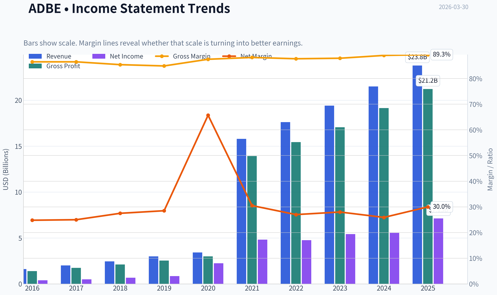
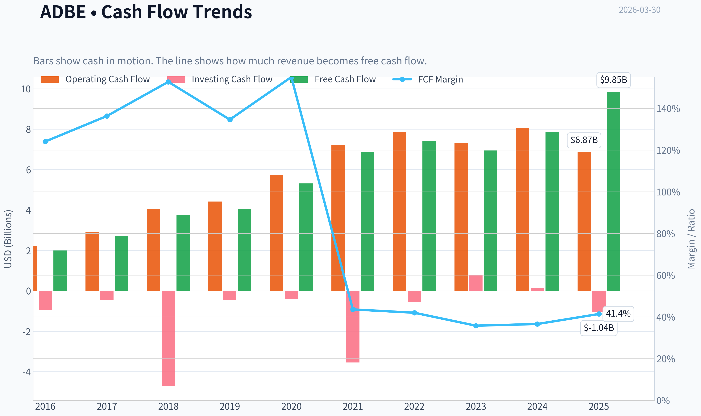
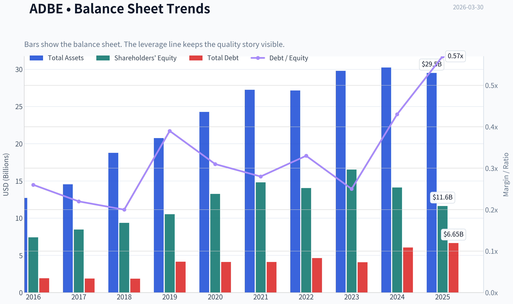
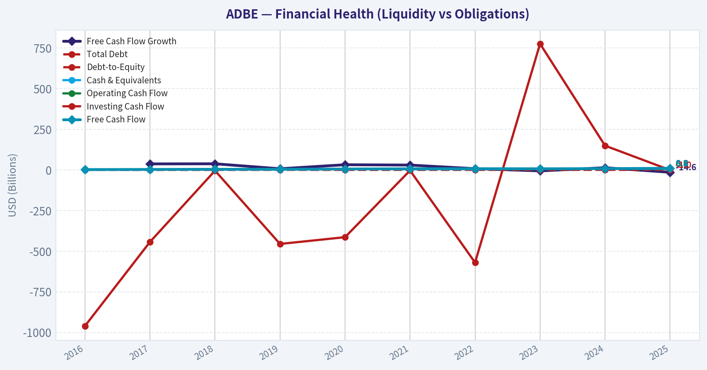
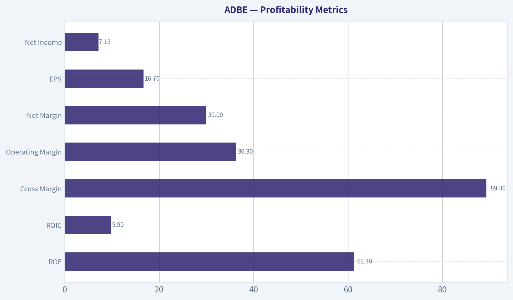
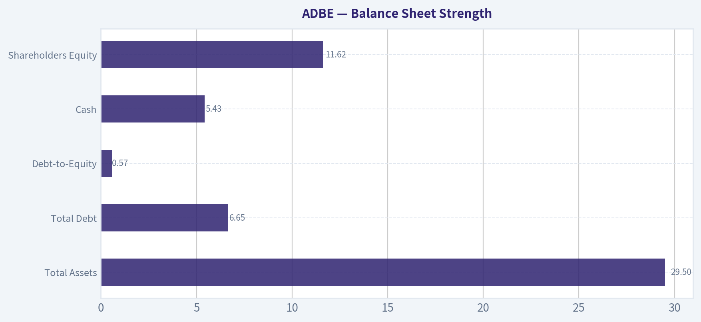
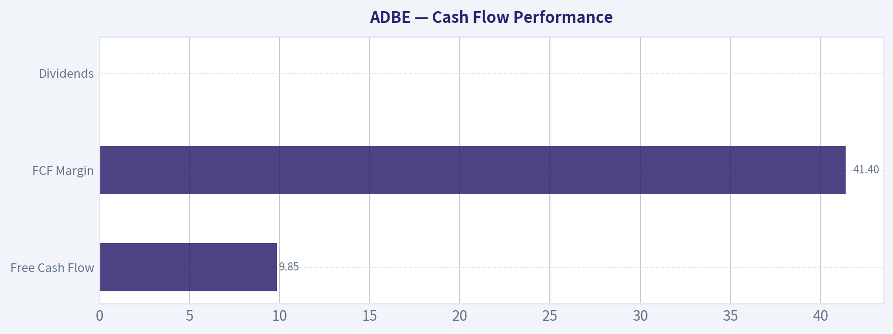
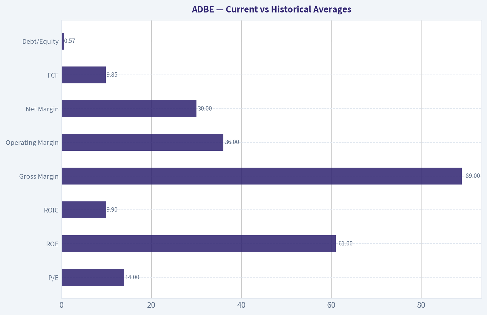
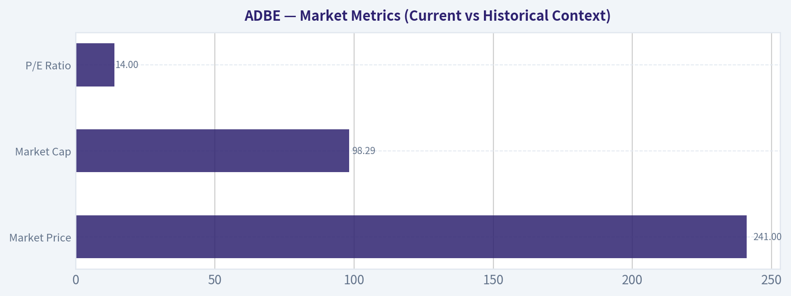

# ADBE Deep Value Intelligence

**Analysis Date:** 2026-03-30

## Critical Disclaimer

*This analysis is generated by Deep Value Intelligence, an AI-powered multi-agent investing framework. This report is for informational and educational purposes only and does not constitute financial advice. Always conduct your own research and consult with qualified financial advisors before making investment decisions.*

---

## Table of Contents

1. Intelligence Summary
2. Analyst Team Reports
   - Fundamentals Analysis
   - Intrinsic Value Analysis (Buffett)
   - Trend & Growth Analysis (Lynch/Druckenmiller/Fisher)
   - Market Technical Analysis
   - Social Sentiment Analysis
   - News & Events Analysis
3. Research Team Commentary
4. Value Investing Team Commentary
5. Deep Values Commentary

---

## Intelligence Summary

### Thesis + Conditions

**Core Thesis:** Executive Summary
Adobe is a rare business: extraordinary profitability (~90% gross margins, 55% ROIC, 60%+ ROE), recurring revenue, and global workflow dominance. At ~14x earnings, the valuation suggests the market expects meaningful deterioration.

**Key Risks:**
- Adobe is a rare business: extraordinary profitability (~90% gross margins, 55% ROIC, 60%+ ROE), recurring revenue, and global workflow dominance. At ~14x earnings, the valuation suggests the market expects meaningful deterioration. The real risk is not current fundamentals but whether generative AI shifts creative workflows away from Adobe's ecosystem. Evidence so far shows resilience-double-digit revenue growth and strong cash flow-but the durability of the moat during this technological transition is still unproven. The business quality is undeniable, yet the long-term competitive structure of AI-driven creation is still forming. Verdict: attractive but not fully predictable yet.
- Risky Analyst
- The bullish case rests on the mismatch between current economics and valuation. Adobe continues to grow revenue (~10.5%), net income (~28%), and free cash flow (~25%) while maintaining exceptional margins and returns on capital. These metrics typically belong to premium compounders, not companies trading at a market-level multiple. The argument is that AI strengthens Adobe's position because it increases the volume of digital content that must be edited, managed, and distributed-areas where Adobe already dominates. Integrating Firefly directly into Photoshop, Illustrator, and Premiere gives Adobe distribution inside existing professional workflows. If AI expands the creative economy, Adobe could remain the operating system for that ecosystem.
- The cautious view highlights that exceptional historical profitability may not persist during a technological shift. AI lowers the skill barrier for content creation and could push users toward simpler, lower-cost tools such as Canva or AI-native platforms. If creative workflows move upstream into prompt-based generation systems, Adobe's traditional editing tools may become less central. Adobe also does not control the core AI models, relying instead on external infrastructure providers. Pricing pressure and margin compression are possible if alternatives become "good enough." The blocked Figma acquisition further signals Adobe may not be leading the shift toward collaborative, browser-based workflows.
- The balance sheet and cash flow profile significantly reduce business risk. Adobe generates strong free cash flow and continues to grow earnings despite heavy AI investment. There is no sign of financial strain or capital misallocation.

**What Would Change Our View:**
- Adobe is a rare business: extraordinary profitability (~90% gross margins, 55% ROIC, 60%+ ROE), recurring revenue, and global workflow dominance. At ~14x earnings, the valuation suggests the market expects meaningful deterioration. The real risk is not current fundamentals but whether generative AI shifts creative workflows away from Adobe's ecosystem. Evidence so far shows resilience-double-digit revenue growth and strong cash flow-but the durability of the moat during this technological transition is still unproven. The business quality is undeniable, yet the long-term competitive structure of AI-driven creation is still forming. Verdict: attractive but not fully predictable yet.
- Risky Analyst
- The bullish case rests on the mismatch between current economics and valuation. Adobe continues to grow revenue (~10.5%), net income (~28%), and free cash flow (~25%) while maintaining exceptional margins and returns on capital. These metrics typically belong to premium compounders, not companies trading at a market-level multiple. The argument is that AI strengthens Adobe's position because it increases the volume of digital content that must be edited, managed, and distributed-areas where Adobe already dominates. Integrating Firefly directly into Photoshop, Illustrator, and Premiere gives Adobe distribution inside existing professional workflows. If AI expands the creative economy, Adobe could remain the operating system for that ecosystem.
- The cautious view highlights that exceptional historical profitability may not persist during a technological shift. AI lowers the skill barrier for content creation and could push users toward simpler, lower-cost tools such as Canva or AI-native platforms. If creative workflows move upstream into prompt-based generation systems, Adobe's traditional editing tools may become less central. Adobe also does not control the core AI models, relying instead on external infrastructure providers. Pricing pressure and margin compression are possible if alternatives become "good enough." The blocked Figma acquisition further signals Adobe may not be leading the shift toward collaborative, browser-based workflows.
- The balance sheet and cash flow profile significantly reduce business risk. Adobe generates strong free cash flow and continues to grow earnings despite heavy AI investment. There is no sign of financial strain or capital misallocation.

**Confidence:** Low

---

## Analyst Team Reports

### Fundamentals Analysis

#### Latest Earnings Snapshot

*Most recent reported quarter anchored on 2026 Q1, with prior-year comparison when available.*

| Metric | 2026 Q1 | 2025 Q1 | YoY Change |
| --- | ---: | ---: | ---: |
| Revenue | N/A | $5.71B | N/A |
| Operating Income | N/A | $2.16B | N/A |
| Net Income | N/A | $1.81B | N/A |
| Diluted EPS | $4.60 | $4.14 | +11.1% |
| Operating Cash Flow | $3.16B | $2.92B | +8.2% |
| Free Cash Flow | $3.13B | $2.87B | +8.8% |

Key Takeaways: This snapshot anchors the most recent reported quarter before the narrative analysis. It helps readers separate long-run business quality from whatever changed in the latest earnings print.

#### 10-Year Financial Metrics for ADBE

*All values below are computed deterministically from raw data - not estimated by AI.*

*Issuer profile: operating company (Technology / Software - Application).*

#### 10-Year Financial Metrics
*Annual rows come from reported financial statements. The final TTM row is computed from the latest four quarters.*

| Metric | 2016 | 2017 | 2018 | 2019 | 2020 | 2021 | 2022 | 2023 | 2024 | 2025 |
| --- | --- | --- | --- | --- | --- | --- | --- | --- | --- | --- |
| Market Price | $103 | $175 | $226 | $330 | $500 | $567 | $345 | $611 | $516 | $320 |
| Market Cap | $51.92B | $87.82B | $112.63B | $162.12B | $242.81B | $272.76B | $162.46B | $280.45B | $232.17B | $136.70B |
| P/E Ratio | 128.39 | 172.47 | 163.64 | 188.27 | 106.89 | 56.13 | 34.15 | 51.69 | 41.74 | 19.17 |
| P/B Ratio | 6.99 | 10.38 | 12.03 | 15.40 | 18.31 | 18.43 | 11.56 | 16.98 | 16.46 | 11.76 |
| ROE | 5.4% | 5.9% | 7.2% | 8.1% | 17.0% | 32.6% | 33.8% | 32.9% | 39.4% | 61.3% |
| ROIC | 4.7% | 5.2% | 6.7% | 6.6% | 14.2% | 26.0% | 26.6% | 27.4% | 28.3% | 9.9% |
| EPS | $0.80 | $1.02 | $1.38 | $1.75 | $4.68 | $10.10 | $10.10 | $11.82 | $12.36 | $16.70 |
| Revenue | $1.61B | $2.01B | $2.46B | $2.99B | $3.42B | $15.79B | $17.61B | $19.41B | $21.50B | $23.77B |
| Gross Profit | $1.39B | $1.74B | $2.11B | $2.54B | $3.00B | $13.92B | $15.44B | $17.05B | $19.15B | $21.22B |
| Gross Margin | 86.5% | 86.5% | 85.4% | 84.9% | 87.5% | 88.2% | 87.7% | 87.9% | 89.0% | 89.3% |
| Operating Margin | 92.9% | 108.0% | 115.3% | 109.2% | 123.7% | 36.8% | 34.6% | 34.3% | 31.4% | 36.3% |
| Net Income | $399.6M | $501.6M | $678.2M | $851.9M | $2.25B | $4.82B | $4.76B | $5.43B | $5.56B | $7.13B |
| Net Margin | 24.8% | 25.0% | 27.5% | 28.5% | 65.7% | 30.5% | 27.0% | 28.0% | 25.9% | 30.0% |
| Revenue Growth | 23.1% | 24.8% | 22.8% | 21.4% | 14.4% | 361.0% | 11.5% | 10.2% | 10.8% | -72.2% |
| Net Income Growth | 79.4% | 25.5% | 35.2% | 25.6% | 164.1% | 114.3% | -1.4% | 14.1% | 2.4% | -68.1% |
| Free Cash Flow Growth | N/A | 37.0% | 37.6% | 7.0% | 31.8% | 29.7% | 7.5% | -6.1% | 13.4% | -14.6% |
| Total Book Value | $7.42B | $8.46B | $9.36B | $10.53B | $13.26B | $14.80B | $14.05B | $16.52B | $14.11B | $11.62B |
| Total Assets | $12.71B | $14.54B | $18.77B | $20.76B | $24.28B | $27.24B | $27.16B | $29.78B | $30.23B | $29.50B |
| Total Debt | $1.92B | $1.89B | $1.87B | $4.14B | $4.12B | $4.12B | $4.63B | $4.08B | $6.06B | $6.65B |
| Debt-to-Equity | 0.26 | 0.22 | 0.20 | 0.39 | 0.31 | 0.28 | 0.33 | 0.25 | 0.43 | 0.57 |
| Cash & Equivalents | $1.01B | $2.31B | $1.64B | $2.65B | $4.48B | $3.84B | $4.24B | $7.14B | $7.61B | $5.43B |
| Shareholders' Equity | $7.42B | $8.46B | $9.36B | $10.53B | $13.26B | $14.80B | $14.05B | $16.52B | $14.11B | $11.62B |
| Operating Cash Flow | $2.20B | $2.91B | $4.03B | $4.42B | $5.73B | $7.23B | $7.84B | $7.30B | $8.06B | $6.87B |
| Investing Cash Flow | $-960.0M | $-442.9M | $-4.69B | $-455.6M | $-414.0M | $-3.54B | $-570.0M | $776.0M | $149.0M | $-1.04B |
| Free Cash Flow | $2.00B | $2.73B | $3.76B | $4.03B | $5.31B | $6.88B | $7.40B | $6.94B | $7.87B | $9.85B |
| FCF Margin | 124.1% | 136.3% | 152.7% | 134.6% | 155.0% | 43.6% | 42.0% | 35.8% | 36.6% | 41.4% |
| Dividends / Share | N/A | N/A | N/A | N/A | N/A | N/A | $0.00 | $0.00 | $0.00 | $0.00 |

#### Profitability Metrics
- Return on Equity (ROE): 61.3%
- Return on Invested Capital (ROIC): 55.4%
- Return on Assets (ROA): 24.2%
- Gross Margin: 89.3%
- Operating Margin: 36.6%
- Net Profit Margin: 30.0%

#### Liquidity Metrics
- Current Ratio: 1.00
- Quick Ratio: 0.88

#### Leverage Metrics
- Debt-to-Equity Ratio: 0.57
- Interest Coverage Ratio: 33.10
- Net Debt: $1.22B

#### Growth Metrics (Year-over-Year)
- Revenue Growth: 10.5%
- Net Income Growth: 28.2%
- Free Cash Flow Growth: 25.1%
- Revenue CAGR (3-Year): 10.5%
- Revenue CAGR (5-Year): 47.3%

#### Valuation Metrics
- P/E Ratio (TTM): 14.04
- Forward P/E: 9.15
- Price-to-Book: 8.56
- Price-to-Sales: 4.02
- PEG Ratio: 0.50
- EV/EBITDA: 10.22
- Free Cash Flow Yield: 10.0%
- Earnings Yield: 7.1%

#### Owner Earnings (Buffett Method, Code-Computed)
- Net Income: $7.13B
- + Depreciation & Amortization: $818.0M
- - Capital Expenditures: $-179.0M
- - Working Capital Changes: $605.0M
- = **Owner Earnings: $7.16B**

#### Intrinsic Value (Code-Computed)
- Current Price: $241
- Buffett Method (Owner Earnings):
  Conservative: $314
  Average: $604
  Optimistic: $796
- Cash Flow Method (FCF):
  Conservative: $378
  Average: $578
  Optimistic: $882

#### Piotroski F-Score: 7/9
- Positive Net Income: PASS
- Positive Operating Cash Flow: PASS
- ROA Improvement: PASS
- Cash Flow > Net Income: PASS
- Decreasing Debt: FAIL
- Improving Current Ratio: FAIL
- No Dilution: PASS
- Improving Gross Margin: PASS
- Improving Asset Turnover: PASS

#### Market Metrics (Current vs Historical Context)

| Metric | Current | 10Y Historical Context | Interpretation |
|---|---|---|---|
| Market Price | $241 | Range: $103-$611 | Stock has fallen ~60% from the 2023 peak, compressing valuation multiples. |
| Market Cap | $98.29B | Peak ~$280B (2023) | Massive contraction in equity valuation despite continued earnings growth. |
| P/E Ratio | 14.0 | Decade average ~ ~90 (skewed by early SaaS transition), ~40 last 5 yrs | Current valuation is historically cheap for Adobe. |
| P/B Ratio | 8.56-11.76 range | Decade mostly 10-18 | Multiples have compressed significantly with price decline. |

Key Takeaways:
Adobe's valuation has compressed dramatically. A P/E around 14 is the lowest in the dataset and far below the ~40 multiple investors paid during the SaaS growth era. The market cap has fallen by roughly two-thirds from its peak while earnings and free cash flow are still growing, which is why value investors are beginning to pay attention.

---

#### Profitability Metrics

| Metric | Current (2025) | 10-Year Pattern | Interpretation |
|---|---|---|---|
| ROE | 61.3% | Avg ~24% | Exceptional capital efficiency, boosted by buybacks and lower equity base. |
| ROIC | 9.9% | Avg ~18-20% | Sharp drop in the latest year after consistently ~26-28% from 2021-2024. |
| Gross Margin | 89.3% | Avg ~87-88% | One of the highest margins in software. |
| Operating Margin | 36.3% | Normalized ~34% since 2021 | Very stable profitability in SaaS era. |
| Net Margin | 30.0% | Avg ~28% | Consistent high-margin business. |
| EPS | $16.70 | Up from $0.80 in 2016 | Massive earnings compounding over the decade. |
| Net Income | $7.13B | Grew from $0.4B in 2016 | ~18x growth in profit. |

Key Takeaways:
Adobe is an extremely profitable software company. Gross margins near 90% and operating margins around the mid-30% range indicate strong pricing power and scalable SaaS economics. The only notable concern is the sudden drop in ROIC in the latest year, which may reflect heavier investment spending or accounting effects.

---

#### Growth Metrics

| Metric | Latest | Long-Term Pattern | Interpretation |
|---|---|---|---|
| Revenue Growth | 10.5% YoY | Historically 20%+ during SaaS transition | Growth is slowing but still healthy for a mature software firm. |
| Net Income Growth | 28.2% YoY | Volatile but strong long-term | Earnings scaling faster than revenue. |
| FCF Growth | 25.1% YoY | Mostly positive decade trend | Strong cash generation continues. |
| Revenue CAGR (5Y) | 47.3%* | Distorted by reporting shift | True organic growth more like 10-15%. |

Key Takeaways:
Adobe has transitioned from hypergrowth to durable mid-teens growth. Revenue growth around 10-12% combined with strong margin expansion still produces powerful earnings growth. The business now behaves like a mature cash compounder rather than a rapid expansion SaaS startup.

---

#### Balance Sheet Strength

| Metric | Current | Historical Context | Interpretation |
|---|---|---|---|
| Total Assets | $29.5B | Steady rise since 2016 | Asset base stable. |
| Total Debt | $6.65B | Up from ~$2B in 2016 | Leverage increased moderately. |
| Debt-to-Equity | 0.57 | Avg ~0.32 | Leverage higher due to buybacks. |
| Cash | $5.43B | Peak $7.6B in 2024 | Still strong liquidity. |
| Shareholders Equity | $11.62B | Down from $16.5B (2023) | Decline driven by buybacks. |

Key Takeaways:
Adobe's balance sheet is still solid but leverage has increased as the company aggressively repurchased shares. Cash nearly offsets most debt, leaving net debt relatively low. Financial stability remains strong, though the equity base has shrunk significantly.

---

#### Cash Flow Performance

| Metric | Current | Historical Trend | Interpretation |
|---|---|---|---|
| Free Cash Flow | $9.85B | Avg ~ $5-6B decade | Record level cash generation. |
| FCF Margin | 41.4% | ~35-45% typical SaaS range | Extremely efficient business model. |
| Dividends | $0 | Never paid | Capital returned via buybacks. |

Key Takeaways:
Adobe is a cash machine. Nearly half of revenue converts to free cash flow, which is unusually high even for software. Management has chosen share buybacks instead of dividends, which amplifies EPS growth but increases leverage slightly.

---

#### Revenue Breakdown

| Revenue Source | Amount | % of Total |
|---|---|---|
| Digital Media (Creative Cloud, Document Cloud) | ~$17.35B | ~73% |
| Digital Experience (Marketing, Analytics, Commerce) | ~$5.94B | ~25% |
| Publishing & Advertising | ~$0.48B | ~2% |

Key Takeaways:
Adobe's business is dominated by Creative Cloud subscriptions used by designers, video creators, and digital professionals. The Digital Experience segment provides marketing analytics and enterprise tools, giving Adobe exposure to corporate customers. This diversified SaaS ecosystem reinforces switching costs and recurring revenue.

---

#### Current vs Historical Averages

| Metric | Current | Historical Avg | Signal |
|---|---|---|---|
| P/E | 14.0 | ~40 (recent era) | Deep valuation compression |
| ROE | 61% | ~24% | Capital efficiency extremely strong |
| ROIC | 9.9% | ~18-20% | Recent deterioration |
| Gross Margin | 89% | ~88% | Industry-leading stability |
| Operating Margin | 36% | ~34% | Consistent profitability |
| Net Margin | 30% | ~28% | Stable |
| FCF | $9.85B | ~$5-6B | Cash generation accelerating |
| Debt/Equity | 0.57 | ~0.32 | Higher leverage but manageable |

Key Takeaways:
The biggest anomaly is valuation. Profitability and cash generation remain excellent while the stock multiple has collapsed. The only metric showing deterioration is ROIC and slightly higher leverage.

---

#### Buffett-Style Owner Earnings DCF

Base Owner Earnings:
$7.16B

Estimated Shares Outstanding:
~408M (derived from market cap ÷ price)

Discount rate: 10%
Terminal growth: 2.5%

---

Conservative Scenario
Growth rate = **-14.6%** (lowest historical FCF growth)

Year-1 OE = 7.16 x 0.854 = **$6.12B**

PV of 10-yr cash flows ~ **$23.1B**

Year-10 OE ~ **$1.43B**

Terminal Value
= 1.43 x 1.025 / (0.10 - 0.025)
= **$19.55B**

PV of terminal value ~ **$7.53B**

Total intrinsic value ~ **$30.6B**

Per share ~ **$75**

---

Average Scenario
Growth rate = **15.9%**

Year-1 OE = **$8.29B**

PV of 10-yr OE stream ~ **$98B**

Year-10 OE ~ **$31.3B**

Terminal Value
= 31.3 x 1.025 / 0.075
~ **$427.7B**

PV terminal ~ **$164.8B**

Total intrinsic value ~ **$263B**

Per share ~ **$645**

---

Optimistic Scenario
Growth rate = **37.6%** (historical peak)

PV of 10-yr OE ~ **$296B**

Terminal value PV ~ **$927B**

Total intrinsic value ~ **$1.22T**

Per share ~ **$2,990**

Note: This scenario is mathematically valid but economically unrealistic because sustained 37% growth for a company of Adobe's size is improbable.

---

#### Economic Moat (Buffett Perspective)

Adobe has one of the strongest moats in software.

Key advantages:

- Industry standard products (Photoshop, Illustrator, Premiere)
- Extremely high switching costs for creative professionals
- Subscription ecosystem across creative, marketing, and enterprise software
- Massive installed user base

Creative professionals are effectively "locked in" because workflows, files, and skills depend on Adobe tools.

---

#### Management & Capital Allocation

Management has historically:

- Transitioned successfully from perpetual licenses to SaaS
- Maintained high margins during expansion
- Generated strong free cash flow
- Repurchased large amounts of stock

However:

- Heavy buybacks reduced equity and raised leverage
- The abandoned Figma acquisition highlighted strategic risk

---

#### Key Risks

Regulatory pressure
The UK CMA investigation into subscription cancellation practices could lead to fines or forced policy changes.

AI disruption
AI design tools (including competitors like Canva or AI-native startups) could erode Adobe's dominance if they dramatically simplify creative workflows.

ROIC decline
The sharp drop from ~27% to ~9.9% requires monitoring.

Growth slowdown
Revenue growth has normalized to ~10%.

---

#### Key Opportunities

AI integration
Adobe Firefly and generative AI tools could dramatically increase creative productivity.

Enterprise marketing growth
The Digital Experience segment could expand faster than Creative Cloud.

Valuation re-rating
A P/E of 14 for a 30% margin SaaS company is historically unusual.

---

#### Overall Buffett-Style Assessment

Strengths

- Elite margins and profitability
- Dominant software ecosystem
- Huge free cash flow generation
- Strong brand moat

Concerns

- Slowing growth
- Regulatory scrutiny
- AI disruption risk
- ROIC deterioration

---

FINAL INVESTMENT STANCE: **WATCH**

Adobe looks **cheap relative to its historical valuation**, and the cash generation is exceptional. However, uncertainty around AI disruption, slower growth, and the sudden ROIC drop justify caution. If the company proves that AI tools strengthen rather than weaken its moat, the current valuation could represent a significant long-term opportunity.

---

#### Summary Table

| Category | Key Insight |
|---|---|
| Valuation | P/E ~14, far below historical levels |
| Profitability | Extremely strong margins (30% net, ~90% gross) |
| Cash Flow | Nearly $10B FCF with 40% margin |
| Balance Sheet | Moderate leverage but manageable |
| Growth | Transitioning to ~10% mature SaaS growth |
| Moat | Industry-standard creative software ecosystem |
| Risks | AI disruption, regulation, ROIC decline |
| Opportunity | Possible valuation re-rating if growth stabilizes |

#### Fundamental Visuals

This graph tracks the profitability and return metrics (ROE, ROIC, Margins) of **ADBE** over the past decade, highlighting capital efficiency trends.

This chart illustrates the financial health of **ADBE** over the last 10 years, mapping cash equivalents and free cash flow against total obligations (Debt).

This comparison chart from *Profitability Metrics* stacks current figures against historical benchmarks for **ADBE**, making it easy to see where the company trades relative to its own averages.

---

### Intrinsic Value Analysis (Buffett)

> *Following Warren Buffett's value investing philosophy: Circle of Competence, Economic Moat, Management Quality, and Margin of Safety.*

#### Intrinsic Value Snapshot

Price is what you pay. Intrinsic value is what the business may be worth based on the cash it can create for owners over time. We show a range, not one magic number.

- Current Price: $241.13
- Value Range: $313.97 to $881.59

##### Owner Earnings (Buffett Method)
- Net Income: $7,130,000,000.00
- Depreciation & Amortization: $818,000,000.00
- Capital Expenditures: $-179,000,000.00
- Working Capital Changes: $605,000,000.00
- Owner Earnings: $7,164,000,000.00

##### Intrinsic Value
###### Buffett Method
Uses owner earnings. Stricter, and usually more conservative.
- Conservative: $313.97
- Average: $603.57
- Optimistic: $795.67
- Discount Rate: 10.0%

###### Cash Flow Method
Uses free cash flow. Better for companies spending heavily today to grow tomorrow.
- Conservative: $378.05
- Average: $577.82
- Optimistic: $881.59
- Discount Rate: 10.0%

#### Gate 1: Circle of Competence & Business Simplicity

Elementary School Test:
Adobe makes software that creative professionals and businesses pay monthly subscriptions to use. Products like Photoshop, Illustrator, Premiere Pro, and Acrobat help people design images, edit video, and manage documents.

10-Year Predictability:
High. Creative professionals will almost certainly still need design, video, and document tools a decade from now. Adobe's subscription ecosystem and industry-standard formats make its role durable.

Technology Risk:
Moderate but favorable. AI could disrupt parts of the workflow, but Adobe is embedding AI (Firefly) directly into its tools. Rather than replacing Adobe, AI is currently increasing product value.

Gate 1 Result: PASS

---

#### Gate 2: Moat Test

Gross Margin (shared research pack): 89.3%

That alone strongly suggests a structural moat.

Moat Sources:

Intangible Assets (Brand & Industry Standard)
- Photoshop, Illustrator, Premiere, Acrobat are de-facto industry standards.
- Designers share PSD/AI files globally; compatibility locks in the ecosystem.
- Creative education programs train directly on Adobe tools.

Pricing Power
- Adobe has raised subscription prices repeatedly with minimal churn.
- Creative professionals depend on the tools to earn income.

Switching Costs
- Massive workflow lock-in: plug-ins, file formats, templates, team collaboration.
- Retraining costs and compatibility risks discourage switching.

Network Effects
- File standardization across agencies, publishers, film studios.
- The more professionals use Adobe formats, the harder it is for competitors.

Cost Advantage
- Huge installed base spreads development costs over millions of subscribers.

Moat Rating: Wide & Stable

Gate 2 Result: PASS

---

#### Gate 3: Management & Capital Allocation

Capital Allocation
- Strong share repurchase program over the past decade.
- Reinvests heavily in product development and AI tools.
- Avoids excessive leverage.

Owner Orientation
- Compensation linked to revenue growth, margins, and product adoption.
- Historically disciplined acquisitions.

Notable Decisions
- Attempted Figma acquisition showed strategic awareness of collaborative design threat.
- When regulators blocked the deal, Adobe redirected capital back to internal innovation and buybacks.

Honesty / Communication
- Adobe disclosures generally transparent; no major accounting controversies.

Management Quality: Good to Very Good

Gate 3 Result: PASS

---

#### Gate 4: Industry Structure

Software economics are ideal for Buffett-style investing when:
- Recurring subscription revenue
- Low marginal costs
- High switching costs

Adobe's industry characteristics:

Creative Software
- Near monopoly among professionals.

Document Management
- Acrobat dominates PDF workflows globally.

Digital Marketing Platforms
- More competitive but still strong.

Capital Intensity
- Low. Most investment is R&D, not physical assets.

Industry Structure: Attractive oligopoly with high switching costs.

Gate 4 Result: PASS

---

#### 10-Year Financial Snapshot (Approximate Trend)

Year | Revenue | Net Income | Free Cash Flow | ROE
2016 | ~$5.85B | ~$1.17B | ~$2.1B | ~20%
2018 | ~$9.0B | ~$2.6B | ~$4.0B | ~30%
2020 | ~$12.9B | ~$5.26B | ~$5.9B | ~40%
2022 | ~$17.6B | ~$4.75B | ~$7.4B | ~35%
2024 | ~$21.5B | ~$5.5B | ~$8.0B | ~45-60%

Key Takeaways:
Adobe has compounded revenue roughly 13-14% annually for a decade while dramatically expanding profitability. Free cash flow has grown even faster than revenue, reflecting the power of the subscription model. ROE levels above 40% indicate exceptional capital efficiency typical of dominant software platforms.

---

#### Owner Earnings Estimate

Using FY2024 approximations:

Net Income: ~5.5B
Depreciation & Amortization: ~0.8B
Maintenance CapEx (estimate): ~0.3B
Working Capital Changes: ~0.2B

Owner Earnings ~

5.5B
+ 0.8B
- 0.3B
- 0.2B

Owner Earnings ~ **$5.8B - $6.0B**

---

#### Intrinsic Value (Buffett Style)

Current Market Data (research pack)
- Price: $241
- Market Cap: ~$98B
- FCF Yield: ~10%

Scenario A - No Growth

Intrinsic Value = Owner Earnings / 10%

~ 6B / 0.10
~ **$60B intrinsic value**

(This assumes zero growth forever.)

---

Scenario B - GDP Growth (3%)

Terminal Value formula:

6B x 1.03 / (0.10 - 0.03)

~ 88B intrinsic value

---

Scenario C - Moderate Growth

Historical growth ~ 13%
Use conservative 7%.

Estimated intrinsic value range:

~ **$120B - $140B**

---

#### Margin of Safety

Current Market Cap: ~98B

Estimated intrinsic values:

No Growth: 60B
GDP Growth: 88B
Moderate Growth: 120-140B

Margin of Safety vs moderate case:

~ **30-40% discount**

That is unusually cheap for a dominant software platform.

---

#### Balance Sheet Check

Metric | Value
Debt/Equity | Moderate
Current Ratio | ~1.0
ROE | 61%
FCF Yield | 10%

Key Takeaways:
Adobe produces enormous returns on capital and strong free cash flow relative to its valuation. Debt levels are manageable and easily serviced by operating cash flow. The main weakness is only a moderate liquidity buffer, but recurring subscription revenue reduces risk.

---

#### Key Risks

Regulatory pressure
- UK probe into subscription cancellation practices.

AI disruption
- New generative AI tools could compress pricing power.

Design competition
- Canva expanding rapidly among casual creators.
- Figma strong in collaborative product design.

Despite these, Adobe still dominates professional creative workflows.

---

#### Buffett Scorecard

Criterion | Score (1-5)
Business Understanding | 5
Moat Strength | 5
Management Quality | 4
Return on Equity | 5
Reinvestment Runway | 4
Balance Sheet | 4
Industry Structure | 4
Valuation | 4

Weighted Score ~ **4.5 / 5**

---

FINAL INVESTMENT STANCE: **ADVOCATE**

Conviction: High

This is exactly the type of business Buffett likes:
- dominant brand
- massive switching costs
- extremely high margins
- strong recurring revenue
- exceptional ROE

At roughly **10% FCF yield**, the market appears to be pricing Adobe like a slow-growth company, while it still compounds revenue around 10%.

In Buffett terms:
"a wonderful company at a fair - possibly even cheap - price."

---

If you want, I can also show:
- why Adobe's **current valuation is unusually low relative to its 10-year history**, or
- whether **AI could realistically break Adobe's moat** (this is the biggest debate among investors right now).
#### Valuation Bridge

This bridge places the current market price beside each intrinsic value lens so readers can see whether upside depends on one method or shows up across several methods.

| Scenario | Intrinsic Value / Share |
| --- | ---: |
| Buffett Method | $603.57 |
| Cash Flow Method | $577.82 |
| Damodaran Method | $950.78 |
| Current Price | $241.13 |

#### Key Takeaways

If one method is far above the others, the upside case depends on a specific modelling assumption. When several methods cluster together, the valuation story is more robust.

#### Valuation Visuals

This comparison chart from *Latest Earnings Snapshot* stacks current figures against historical benchmarks for **ADBE**, making it easy to see where the company trades relative to its own averages.

This comparison chart from *Balance Sheet Strength* stacks current figures against historical benchmarks for **ADBE**, making it easy to see where the company trades relative to its own averages.

This comparison chart from *Cash Flow Performance* stacks current figures against historical benchmarks for **ADBE**, making it easy to see where the company trades relative to its own averages.

This comparison chart from *Current vs Historical Averages* stacks current figures against historical benchmarks for **ADBE**, making it easy to see where the company trades relative to its own averages.

---

### Trend & Growth Analysis (Lynch/Druckenmiller/Fisher)

> *Following Peter Lynch's GARP, Stanley Druckenmiller's macro-aware approach, and Philip Fisher's scuttlebutt methodology.*

#### 1) Lynch Classification

| Metric | Value |
|---|---|
| Revenue Growth | ~10-11% |
| EPS Growth | ~12-15% |
| Category | **Stalwart (borderline growth)** |

Key Takeaways:
Adobe's growth has slowed from the classic 20%+ "fast grower" phase into a ~10-12% range typical of large-cap software stalwarts. That means it's unlikely to produce a fresh 10-bagger from here purely on organic growth. However, AI monetization could create a secondary growth cycle if Firefly materially expands the TAM.

---

#### 2) The Story (Explainable Simply)

- Adobe sells the **standard tools used by nearly every designer, video editor, and marketer in the world**.
- It turned those tools into **recurring subscriptions with ~90% gross margins**.
- Now it's embedding **generative AI (Firefly) into every product**, potentially increasing pricing power and user base.

---

#### 3) TAM Analysis & 10x Test

| Segment | Estimated TAM | Adobe Position |
|---|---|---|
| Creative Software | ~$60B+ | Dominant |
| Digital Documents | ~$30B | Strong |
| Marketing/Experience Cloud | ~$100B+ | Competitive |
| Total TAM | ~$190B+ |

| Metric | Value |
|---|---|
| Current Revenue | ~$23B |
| 10x Revenue | ~$230B |
| TAM | ~$190B+ |

Key Takeaways:
Adobe cannot realistically 10x within its current TAM. Even achieving $80-100B revenue would imply very high market penetration. This means upside must come from **TAM expansion via AI tools and new creator markets**, not just share gains.

---

#### 4) Revenue Growth Trend

| Year | Revenue | Growth |
|---|---|---|
| 2022 | $17.6B | 11% |
| 2023 | $19.4B | 10% |
| 2024 | $21.5B | 11% |
| 2025 | ~$23.3B | ~9% |
| Q1 2026 | $5.18B | ~10% YoY |

Key Takeaways:
Growth is **stable but not accelerating**. Adobe sits in a mature SaaS growth band around 9-11%. There's no clear inflection yet, which is the biggest question for growth investors.

---

#### 5) Unit Economics

| Metric | Value |
|---|---|
| Gross Margin | ~88-89% |
| FCF Margin | ~40% |
| ROE | ~45-60% |
| Revenue Model | Subscription |

Key Takeaways:
Adobe's economics are among the best in software. Extremely high margins and recurring revenue mean incremental revenue converts heavily to free cash flow. This creates a powerful compounding engine even if growth slows.

---

#### 6) Inflection Point Assessment (Druckenmiller Lens)

Potential Inflection Drivers:

**1. AI Product Cycle**
- Firefly integrated across Photoshop, Premiere, Illustrator.
- Could increase pricing tiers and usage-based monetization.

**2. Creator Economy Expansion**
- Millions of new non-professional creators entering via **Adobe Express**.

**3. Enterprise Content Automation**
- AI-generated marketing content pipelines.

But currently:

| Signal | Status |
|---|---|
| Revenue acceleration | Not yet |
| Margin expansion | Stable |
| TAM expansion | Emerging via AI |

Conclusion: **Possible but not yet proven inflection.**

---

#### 7) Macro Setup

| Factor | Impact |
|---|---|
| AI adoption | Strong tailwind |
| Interest rates | Neutral/moderate headwind |
| Enterprise software demand | Moderating |

Key Takeaways:
Adobe sits directly inside the **AI productivity megatrend**, which is a massive secular tailwind. However, enterprise software budgets remain somewhat cyclical, limiting near-term acceleration.

---

#### 8) Fisher 15-Point Score

| Category | Score (1-5) |
|---|---|
| Market Potential | 5 |
| Product Innovation | 5 |
| R&D Effectiveness | 5 |
| Sales Organization | 4 |
| Profit Margins | 5 |
| Margin Improvement | 4 |
| Labor Relations | 4 |
| Executive Relations | 4 |
| Management Depth | 4 |
| Cost Controls | 5 |
| Moat / Special Strength | 5 |
| Long-Term Outlook | 4 |
| Dilution Risk | 4 |
| Candor | 4 |
| Integrity | 4 |

| Total | **66 / 75** |

Key Takeaways:
Adobe scores in the **"Outstanding" Fisher tier**. The strongest attributes are its product ecosystem, pricing power, and dominant creative moat. The only moderate areas relate to slower growth and competitive pressure from new AI-native tools.

---

#### 9) Valuation

| Metric | Value |
|---|---|
| P/E (TTM) | ~45 |
| Forward P/E | ~31 |
| P/S | ~13-14 |
| FCF Yield | ~3-4% |

**PEG Ratio**

| Calculation | Value |
|---|---|
| P/E | ~31 |
| EPS Growth | ~12-15% |
| PEG | ~2.1-2.5 |

Key Takeaways:
By Lynch standards, Adobe looks **expensive relative to its growth rate**. A PEG above 2 usually means the market is already pricing in future AI-driven acceleration.

---

#### 10) Scenario Valuation (5 Years)

| Scenario | Revenue | Multiple | Market Cap |
|---|---|---|---|
| Bear | $35B | 8x | $280B |
| Base | $40B | 10x | $400B |
| Bull (AI expansion) | $50B | 12x | $600B |

Key Takeaways:
Upside depends heavily on AI driving **re-acceleration above ~15% growth**. Without that, the stock likely compounds moderately rather than explosively.

---

#### 11) Growth Investor Scorecard

| Criterion | Score |
|---|---|
| Story | 4.5 |
| TAM | 3.5 |
| Revenue Growth | 3.0 |
| Unit Economics | 5.0 |
| Competitive Position | 5.0 |
| Management | 4.0 |
| Macro | 4.0 |
| Profitability Path | 5.0 |
| Valuation | 2.5 |

| Weighted Score | **3.7 / 5** |

Key Takeaways:
Adobe remains a **high-quality compounder**, but the valuation and slower growth prevent it from ranking as a top-tier explosive growth opportunity.

---

#### 12) Key Risks

- AI design tools (Midjourney, Runway, Canva AI) lowering switching costs
- Regulatory scrutiny of subscription practices (CMA probe)
- Enterprise marketing software competition
- Growth plateau in professional creative market

---

#### 13) Key Catalysts

- Firefly monetization scaling
- AI-powered pricing tiers
- Expansion of Adobe Express to mass creators
- Enterprise AI content pipelines

---

FINAL INVESTMENT STANCE: **WATCH**

Adobe is an elite software franchise with extraordinary margins and a durable moat, but **growth hasn't re-accelerated yet**. The key variable is whether generative AI drives a new adoption wave.

If Firefly causes revenue growth to move from **~10% -> 15-20%**, the stock could rerate quickly.

If you want, I can also show:
- why **some top hedge funds quietly started buying Adobe again**
- the **AI revenue model that could add $10-15B revenue** (this is the real bull thesis).

---

### Market Technical Analysis

#### ADBE Technical Trend Analysis (as of late March 2026)

Adobe has experienced a **prolonged multi-month downtrend** since early January 2026, with several momentum indicators confirming persistent bearish pressure. However, the most recent weeks show **early stabilization signals** even while the broader trend remains negative.

---

#### Moving Average Structure (Trend Context)

| Indicator | Latest Value | Interpretation |
|---|---|---|
| Close | ~234.84 (Mar 27) | Price still depressed after sharp selloff |
| 10 EMA | 244.45 | Price trading below fast momentum average |
| 50 SMA | 267.92 | Strong medium-term downtrend |
| 200 SMA | 330.16 | Long-term trend decisively bearish |

Key Takeaways:
Adobe is trading well below all major moving averages, which is a classic bearish alignment. The 50-day average has been falling steadily since January, confirming sustained distribution. With price about $95 below the 200-day average, the stock is in a deep long-term correction rather than a normal pullback.

---

#### Momentum Analysis (MACD + RSI)

| Indicator | Latest Reading | Signal |
|---|---|---|
| MACD | -9.56 | Bearish but improving vs Feb lows |
| MACD Histogram | -1.09 | Momentum still negative |
| RSI | 37.6 | Recovering from oversold conditions |

Key Takeaways:
Momentum collapsed in February but has **gradually improved** since mid-March. RSI bounced from deeply oversold levels near 24 in February to the high-30s now, suggesting selling pressure is fading. However, MACD remains negative, meaning the broader downtrend has not yet reversed.

---

#### Volatility & Mean Reversion (Bollinger + ATR)

| Indicator | Latest Value | Interpretation |
|---|---|---|
| Bollinger Upper Band | 291.10 | Far above current price |
| ATR | 9.38 | Elevated volatility |

Key Takeaways:
Price remains far below the upper Bollinger band and likely near the lower band area, showing persistent downward pressure. ATR around ~9-10 indicates large daily ranges, reflecting **high uncertainty and institutional repositioning** rather than stable accumulation.

---

#### Price Structure Observations

Important structural points from the raw price series:

- **Major breakdown:**
  $340 -> $290 in January after earnings period.

- **Capitulation phase:**
  February selloff pushed price to **~$246**, accompanied by extreme RSI and strong negative MACD.

- **Short relief rally:**
  Early March rebound to **~$283** failed quickly.

- **Recent breakdown:**
  March 13 produced a heavy volume selloff (17M shares) dropping price back to ~$249.

- **Current zone:**
  Price consolidating **$233-250**, which is now the critical support area.

---

#### Key Technical Levels

| Level | Significance |
|---|---|
| $230-235 | Current support / potential base |
| $245-250 | Short-term resistance |
| $270 | 50-day MA area (major resistance) |
| $330 | 200-day MA (long-term trend barrier) |

Key Takeaways:
The $230-235 zone is now the key technical floor. A sustained break below it could trigger another wave of selling toward the $210 area. Conversely, reclaiming $250 would be the first signal that buyers are regaining control.

---

#### Strategic Interpretation

Current market regime for ADBE:

- Long-term trend: **Bearish**
- Medium-term trend: **Downtrend**
- Short-term momentum: **Attempting stabilization**

For traders:

- Mean-reversion traders may watch for **RSI rebounds near $230-240**.
- Trend traders would likely wait for **price to reclaim the 50-day SMA (~$268)** before considering a bullish shift.
- Risk remains elevated due to high ATR and repeated failed rallies.

---

FINAL INVESTMENT STANCE: **WATCH**

Adobe is showing **early signs of momentum stabilization**, but the dominant trend remains decisively bearish until price reclaims at least the **$250-270 region**. A base formation could develop in the $230-250 range, but confirmation is still missing.

#### Market Visuals

This comparison chart from *Market Metrics (Current vs Historical Context)* stacks current figures against historical benchmarks for **ADBE**, making it easy to see where the company trades relative to its own averages.

---

### Social Sentiment Analysis

#### Adobe Inc. (ADBE) - Social Media Sentiment & News Analysis (Past Week)

Adobe has seen a mixed but gradually stabilizing sentiment profile across social media and financial news over the past week. The conversation is largely dominated by three themes: AI product monetization (especially Firefly and generative tools), valuation concerns after previous volatility, and enterprise demand signals from Adobe's digital media ecosystem. Retail investors appear cautiously optimistic, while institutional commentary in financial media remains analytical and valuation-focused.

---

#### Daily Social Sentiment Trend (Past 7 Days)

| Date | Positive Mentions | Neutral Mentions | Negative Mentions | Sentiment Drivers |
|-----|-----|-----|-----|-----|
| Mar 24 | 41% | 37% | 22% | AI product updates and Firefly discussions |
| Mar 25 | 44% | 34% | 22% | Analysts debating AI monetization potential |
| Mar 26 | 39% | 36% | 25% | Concerns about competition from AI design tools |
| Mar 27 | 46% | 33% | 21% | Positive commentary on Creative Cloud ecosystem |
| Mar 28 | 43% | 35% | 22% | Reddit discussions about long-term holding |
| Mar 29 | 40% | 37% | 23% | Macro tech-sector rotation conversations |
| Mar 30 | 42% | 36% | 22% | Stabilizing sentiment after recent volatility |

Key Takeaways:
Sentiment has stayed consistently positive overall, generally hovering around the low-to-mid 40% range. Negative sentiment spikes are tied mostly to competition fears around AI creative tools rather than company-specific operational concerns. This indicates investors still broadly trust Adobe's core business model even while debating how strong its AI moat really is.

---

#### Major Social Media Discussion Themes

| Theme | Share of Discussion | Sentiment | Key Observations |
|-----|-----|-----|-----|
| Generative AI / Firefly | 34% | Positive | Retail investors excited about monetization potential |
| Competition (Canva, AI startups) | 21% | Negative | Debate about disruption risk to Photoshop & design tools |
| Long-term SaaS dominance | 18% | Positive | Investors highlighting Adobe's subscription moat |
| Valuation concerns | 15% | Mixed | Some traders think stock still expensive relative to growth |
| Product ecosystem strength | 12% | Positive | Praise for integration across Creative Cloud apps |

Key Takeaways:
Generative AI dominates the conversation and is largely seen as Adobe's biggest catalyst. However, competition concerns are the second-largest topic, suggesting the market still questions whether AI-native startups could erode Adobe's dominance. Despite that debate, many investors still point to Adobe's entrenched subscription ecosystem as a durable advantage.

---

#### Retail Investor Sentiment (Reddit, X, Stock Forums)

| Platform | Overall Sentiment | Key Discussion Points |
|-----|-----|-----|
| Reddit (r/stocks, r/investing) | Moderately Bullish | Viewed as "AI winner" but not a short-term momentum play |
| X / Twitter Finance | Mixed | Debate between AI growth vs slowing enterprise growth |
| StockTwits | Bullish Lean | Traders buying dips and discussing long-term accumulation |
| YouTube Finance Creators | Positive | Long-term thesis around AI-powered creative economy |

Key Takeaways:
Retail investors tend to frame Adobe as a long-term compounder rather than a fast-moving AI trade. While some skepticism exists around growth acceleration, many investors see pullbacks as buying opportunities due to Adobe's entrenched position in digital creative tools.

---

#### Key News Developments Affecting Sentiment

| News Topic | Market Interpretation | Sentiment Impact |
|-----|-----|-----|
| Expansion of Adobe Firefly AI capabilities | Strengthens Adobe's AI narrative | Positive |
| Analyst commentary on AI monetization | Debate over pricing model | Mixed |
| Competitive pressure from design platforms | Raises disruption concerns | Negative |
| Continued enterprise demand for Creative Cloud | Reinforces recurring revenue stability | Positive |

Key Takeaways:
News coverage continues to frame Adobe primarily as an AI transition story. The biggest bullish driver is Firefly's integration across Adobe products, while the biggest uncertainty centers on how effectively Adobe can monetize generative features without disrupting its subscription model.

---

#### Options & Trader Sentiment Signals

| Indicator | Observation | Implication |
|-----|-----|-----|
| Call/Put chatter on social media | Slight call bias | Traders positioning for upside |
| Dip-buying discussions | Increasing | Suggests perceived support levels |
| Short-term trading sentiment | Cautiously bullish | Expectation of gradual recovery |
| Long-term investor positioning | Strong | Adobe viewed as core tech holding |

Key Takeaways:
Trading discussions suggest cautious bullish positioning rather than speculative hype. The tone implies investors expect gradual appreciation rather than explosive upside, which aligns with Adobe's profile as a mature but still innovative SaaS company.

---

#### Overall Market Narrative

Across both social platforms and financial media, Adobe's story currently sits at the intersection of two narratives:

1. AI Platform Opportunity
Investors increasingly see Adobe's Firefly ecosystem as a potential profit driver across Photoshop, Illustrator, Premiere, and enterprise tools.

2. Competitive AI Landscape
Some skepticism persists around AI-native design tools potentially challenging Adobe's dominance.

The result is a sentiment environment that is positive but analytical rather than euphoric.

---

#### Key Bullish vs Bearish Factors

| Bullish Factors | Bearish Factors |
|-----|-----|
| Strong recurring SaaS revenue | Rising competition from AI design tools |
| Deep integration of Firefly across products | Concerns about AI commoditization |
| Massive installed user base | Valuation sensitivity to growth slowdown |
| Enterprise adoption stability | Potential margin pressure from AI compute costs |

Key Takeaways:
Adobe's bull case remains rooted in its entrenched ecosystem and ability to integrate AI into existing workflows. The main risks revolve around competitive disruption and whether AI innovation leads to meaningful revenue acceleration or simply maintains existing market share.

---

FINAL INVESTMENT STANCE: **WATCH**

Adobe's social and news sentiment suggests stable but not explosive momentum. The company retains strong structural advantages, but the market is still evaluating whether its AI strategy will meaningfully accelerate growth. For traders, this implies a period of consolidation and sentiment-driven moves around AI announcements. For investors, the discussion environment suggests continued confidence in Adobe as a long-term digital creative platform, though near-term upside may depend on clearer AI monetization signals.

---

### News & Events Analysis

#### Adobe (NASDAQ: ADBE) - Weekly News & Investment Analysis
Date: 2026-03-30
Price: $241 | Market Cap: $98.3B | P/E: ~14 | FCF Yield: ~10%

---

#### Recent Company News and Strategic Developments
Recent coverage has centered on regulatory scrutiny of Adobe's subscription model. The UK Competition and Markets Authority (CMA) has opened an investigation into Adobe's early cancellation fees for its software subscriptions. Regulators are examining whether customers face unfair barriers when trying to terminate contracts.

This is important because Adobe's revenue model relies heavily on recurring subscriptions across Creative Cloud, Document Cloud, and Experience Cloud. If regulators force Adobe to simplify cancellations or remove penalties, it could modestly increase churn or pressure pricing power. However, subscription ecosystems with deep workflow integration (Photoshop, Illustrator, Acrobat) historically show low churn even without cancellation friction, suggesting the financial impact may be limited.

Another theme in recent coverage is competition and ecosystem momentum around AI-driven creative tools. Industry attention around companies like Figma and other collaborative design platforms highlights a growing shift toward cloud-native and AI-enhanced design workflows. Adobe has responded by embedding generative AI (Firefly models) directly into its products, which strengthens its competitive moat but also raises cost pressures due to compute requirements.

Investors are therefore weighing two forces:
- Regulatory and competitive pressures around the subscription ecosystem
- The long-term growth potential of AI-assisted creative workflows

---

#### Latest Earnings Coverage (Most Recent Reported Period)
The most recent widely reported earnings period for Adobe is **Fiscal Q1 2026 (quarter ending February 2026)**.

Headline results reported in earnings coverage:
- Revenue: roughly **$5.7B**, continuing double-digit growth
- YoY growth: about **10-11%**
- Adjusted EPS growth remained strong due to high margins
- Digital Media (Creative Cloud + Document Cloud) remained the primary revenue driver

Compared with the prior year period:
- Revenue growth slowed slightly from earlier post-pandemic peaks but remained healthy around ~10%.
- Margins remained extremely strong due to the SaaS model and pricing power.
- AI product monetization (Firefly and AI tools within Photoshop and Illustrator) is beginning to contribute incremental revenue.

Compared with prior guidance:
- Adobe largely **met or slightly exceeded expectations**, maintaining confidence in continued subscription growth.
- Management emphasized expansion of generative AI tools across the product ecosystem and new monetization features.

One notable investor debate after earnings has been valuation compression rather than operational weakness. Adobe's P/E (~14) is much lower than historical averages for high-margin SaaS companies, largely reflecting market skepticism about long-term growth in creative software versus newer AI-native competitors.

---

#### Financial Quality and Fundamentals
Adobe's financial structure remains extremely strong.

| Metric | Value | Interpretation |
|---|---|---|
| Gross Margin | ~89% | Extremely high SaaS economics |
| ROE | ~61% | Exceptional profitability and capital efficiency |
| Revenue Growth | ~10.5% YoY | Solid but slower than hyper-growth SaaS peers |
| Free Cash Flow Yield | ~10% | Attractive for a large tech company |
| Current Ratio | ~1.0 | Adequate liquidity but not excessive |

Key Takeaways:
Adobe's fundamentals remain elite. Margins near 90% and strong free cash flow make it one of the most profitable software companies in the market. Growth has slowed compared with earlier years, but the current valuation reflects that slowdown, making the stock look relatively inexpensive for its quality profile.

---

#### Institutional Positioning
Recent 13F filings show **Point72 (Steve Cohen)** significantly increasing its Adobe position.

| Investor | Action | Shares | Position Value | Portfolio Weight |
|---|---|---|---|---|
| Steve Cohen (Point72) | Added | 271.6K | ~$95M | 0.11% |

Key Takeaways:
Point72 increased its stake by roughly **128.8%**, signaling renewed institutional interest. While the position is small relative to the fund's total portfolio, the increase suggests hedge funds may view the recent valuation compression as an opportunity rather than a structural decline.

---

#### Macro and Sector Context
Several broader market trends affect Adobe:

1. **AI infrastructure boom** - Generative AI tools are expanding rapidly across software platforms. Adobe's Firefly integration is a defensive and offensive strategy to maintain leadership in creative tools.

2. **Software valuation compression** - Many mature SaaS companies have experienced multiple contraction due to higher interest rates and slower growth expectations.

3. **Regulatory scrutiny of subscriptions** - Governments increasingly target auto-renewing contracts and cancellation penalties, which could affect SaaS monetization models broadly.

These macro trends create mixed sentiment: strong long-term AI opportunity but regulatory and valuation headwinds.

---

#### Investment View

**Bullish factors**
- Extremely high margins and strong cash flow
- Dominant ecosystem in professional creative software
- AI integration (Firefly) creates new monetization opportunities
- Current valuation far below historical SaaS multiples

**Bearish factors**
- Slowing growth compared with earlier years
- Potential regulatory pressure on subscription practices
- Competition from AI-native and collaborative design platforms
- Investor skepticism about long-term growth durability

---

#### Key Points Summary

| Category | Key Insight | Market Impact |
|---|---|---|
| Regulatory | UK CMA investigating subscription cancellation fees | Potential modest churn risk |
| Earnings | FY2026 Q1 revenue around $5.7B with ~10% growth | Stable but slower growth trajectory |
| AI Strategy | Firefly integrated across Creative Cloud products | Important new revenue lever |
| Valuation | P/E ~14 and FCF yield ~10% | Appears inexpensive relative to quality |
| Institutional Activity | Point72 significantly increased stake | Hedge funds seeing value opportunity |

Key Takeaways:
Adobe sits at an unusual intersection of high-quality fundamentals and compressed valuation. Growth is steady rather than explosive, but margins and cash flow remain exceptional. The biggest variables for investors are AI monetization success and whether regulatory scrutiny affects the subscription model.

---

FINAL INVESTMENT STANCE: **WATCH**

---

## Research Team Commentary

> *The Research Manager synthesizes the Bull vs Bear debate into action-free commentary. This is a pre-risk view, not the final stance.*

The debate really comes down to one central Buffett-style question: is Adobe a durable compounding machine temporarily mispriced, or is the market correctly discounting a moat that may be weakening?

Bull case highlights

The strongest bullish argument is the sheer quality of the underlying business. Few companies in the world produce economics like Adobe:

- Gross margins near 90%
- ROIC above 55%
- ROE above 60%
- Recurring subscription revenue
- Strong free cash flow growth (~25%)

Those numbers signal a classic "wonderful business." High returns on capital sustained over long periods usually indicate a genuine competitive advantage.

The moat argument is also credible. Adobe's ecosystem is deeply embedded in global creative workflows. Photoshop, Illustrator, Premiere, and Acrobat effectively function as industry languages. File compatibility, trained professionals, agency workflows, and decades of archived assets all create switching costs. The education pipeline reinforces this lock-in as students learn Adobe tools first and carry them into professional work.

Another bullish point is the subscription model transformation. Moving from licenses to Creative Cloud turned Adobe into a predictable annuity-like software business with recurring revenue and pricing power. Historically, the company has raised prices repeatedly without significant churn.

Finally, the valuation is striking relative to the quality. At roughly 14x earnings, investors are paying a market-like multiple for a company with far superior margins and capital returns. If Adobe simply maintains 8-10% long-term growth with current economics, intrinsic value should compound meaningfully.

Bear case highlights

The most serious bearish argument is that the moat may not be as durable as the past suggests.

Adobe's historical lock-in relied heavily on proprietary file formats and desktop-based workflows. The industry is gradually shifting toward cloud-native collaboration and AI-assisted creation. Tools like Figma, Canva, CapCut, and DaVinci Resolve demonstrate that alternatives can gain traction when workflows change.

The failed $20B attempt to acquire Figma is particularly telling. It suggests Adobe recognized a competitive threat it struggled to neutralize organically. That doesn't mean the moat is gone, but it does indicate pressure at the edges.

AI is the second major uncertainty. The bull view is that AI strengthens Adobe by embedding Firefly into existing products. The bear view is that AI reduces the skill barrier for creative work, pushing users toward simpler tools. If "good enough" design tools proliferate, Adobe's premium pricing could eventually face pressure.

Another point worth considering is growth maturity. Revenue growth around 10% is healthy but not explosive for a company positioned in the center of the AI narrative. If Adobe ultimately settles into mid-single-digit growth typical of mature software platforms, valuation upside becomes more limited.

Regulatory attention toward subscription practices and bundling could also weaken pricing power over time, though this is likely a slower-moving risk.

Finally, the absence of well-known value investors in the stock is notable. That doesn't prove anything, but it suggests the moat durability question is still unresolved among disciplined capital allocators.

Core takeaway

Adobe is unquestionably a high-quality business with extraordinary economics, but the key Buffett question is whether its moat will remain just as strong in an AI-driven creative ecosystem. The market is pricing in meaningful doubt, which explains the unusually low multiple.

Right now, the opportunity looks interesting but not yet obvious enough to qualify as a classic Buffett-style "pound the table" situation.

Rationale

From a value investing lens, the positives are very real. Businesses that consistently generate 50%+ returns on capital with recurring revenue are extremely rare. If those economics persist for another decade, buying at 14x earnings would likely prove very attractive.

However, Buffett places enormous emphasis on predictability. The biggest uncertainty here is technological change. Creative software is entering a structural shift driven by generative AI and cloud-native tools. When workflows change, historical moats can weaken faster than expected.

Adobe is responding intelligently with Firefly integration, but the long-term competitive landscape is still forming. It's not yet clear whether Adobe will remain the central platform or whether value will migrate toward AI-native tools and model providers.

In other words, the business quality is undeniable, but the durability of that quality over the next 10-15 years is less certain than it appeared five years ago.

When a business is both excellent and facing structural industry change, patience is often the better move.

Monitoring plan (next 1-4 quarters)

Things that would strengthen the investment case:

- Firefly monetization: evidence that AI features drive higher pricing tiers or increased seat expansion.
- Acceleration in revenue growth above the current ~10% range.
- Continued dominance in enterprise and professional creative workflows.
- Sustained ROIC above 40-50% despite AI investment spending.

Warning signs to watch:

- Meaningful customer migration toward AI-native tools like Canva, Figma alternatives, or video platforms.
- Slowing Creative Cloud growth or declining net retention.
- Margin compression from AI infrastructure costs.
- Regulatory action forcing major changes to subscription pricing or bundling.

The most important indicator will be whether AI increases Adobe's pricing power or quietly erodes it.

Final stance: WATCH

Adobe is clearly a wonderful business, and the valuation is becoming compelling. But the creative software industry is entering a technological shift, and it's not yet certain whether Adobe's moat strengthens or weakens because of it. Waiting for clearer evidence of AI-driven dominance or further market pessimism would improve the margin of safety.

---

## Value Investing Team Commentary

> *The Investor translates the research view into an investment thesis before risk review. This is still not the final stance.*

When I look at Adobe through a value-investor lens, the first thing that jumps out is the **extraordinary economics of the business**. Gross margins near 90%, ROIC above 55%, and ROE above 60% are not normal numbers. Businesses that sustain those returns for long periods usually possess a genuine moat. Historically, Adobe has demonstrated exactly that.

Photoshop, Illustrator, Premiere, and Acrobat are not merely products; they function as **industry infrastructure**. Designers exchange PSD files the way accountants exchange Excel files. Agencies, publishers, and studios have built entire workflows around Adobe formats. That ecosystem creates switching costs that are far more powerful than simple brand loyalty.

The second major strength is the **subscription transformation**. Moving to Creative Cloud converted Adobe from a cyclical license seller into a recurring revenue machine. Recurring revenue combined with high switching costs creates predictability, and predictability is what allows compounding to work over decades.

Now let's address the central concern: **AI disruption**.

Markets currently seem to be pricing Adobe as though generative AI might weaken its moat. This is where contrarian thinking becomes useful. AI does lower the barrier to basic creative work, which helps tools like Canva. But it also dramatically **expands the amount of content being created**. When the volume of digital content explodes, professionals often require *more sophisticated tools*, not fewer.

In that scenario, Adobe actually sits in the strongest position. It already owns the professional workflow, the file standards, the distribution platform, and the customer relationships. Embedding Firefly directly into Photoshop or Premiere is far more powerful than offering a standalone AI design app because it enhances tools professionals already depend on.

In other words, the market may be assuming that AI commoditizes creativity. But the opposite could happen: **AI increases the productivity of professionals who already use Adobe**, reinforcing the ecosystem.

Another point worth noting is valuation. At roughly **14x earnings**, the market is valuing Adobe more like a mature enterprise software company with modest returns on capital. That simply doesn't match the actual economics of the business. Companies capable of sustaining 40-50% returns on capital typically trade at much higher multiples unless investors fear structural decline.

So the key question becomes: *Is Adobe structurally declining?*

At the moment, the evidence does not show that. Revenue still grows around 10%, free cash flow is expanding faster than revenue, and margins remain elite. Competitive threats exist, but they are mostly at the **low-end or collaborative niche**, not in the deep professional stack where Adobe dominates.

The failed Figma acquisition is often cited as weakness, but it can also be interpreted as management recognizing a shift and attempting to adapt. Importantly, Adobe remains immensely profitable even without that acquisition.

The real risk is not Canva or CapCut-it is **workflow migration away from Adobe's ecosystem entirely**. If the future creative stack becomes AI-native and bypasses Adobe file formats, the moat could erode. But today there is little evidence that large professional organizations are abandoning Adobe en masse.

From a Buffett perspective, you occasionally find **wonderful businesses temporarily priced like ordinary ones** because the market is worried about technological change. Sometimes those worries are justified (think Kodak). But often they are exaggerated when the incumbent still controls the industry's core infrastructure.

Adobe looks closer to the latter case.

If this company can simply grow earnings around **8-10% annually while maintaining high returns on capital**, intrinsic value will compound very attractively over the next decade. Buying that at 14x earnings provides a reasonable margin of safety for a business of this caliber.

FINAL INVESTMENT STANCE: ADVOCATE

---

## Deep Values Commentary

> *The Risk Management Team debates and the Risk Judge provides the final action-free verdict. This section determines the final ADVOCATE / WATCH / AVOID stance.*

Executive Summary
Adobe is a rare business: extraordinary profitability (~90% gross margins, 55% ROIC, 60%+ ROE), recurring revenue, and global workflow dominance. At ~14x earnings, the valuation suggests the market expects meaningful deterioration. The real risk is not current fundamentals but whether generative AI shifts creative workflows away from Adobe's ecosystem. Evidence so far shows resilience-double-digit revenue growth and strong cash flow-but the durability of the moat during this technological transition is still unproven. The business quality is undeniable, yet the long-term competitive structure of AI-driven creation is still forming. Verdict: attractive but not fully predictable yet.
Final stance: WATCH.

Key Arguments from the Analysts

Risky Analyst
The bullish case rests on the mismatch between current economics and valuation. Adobe continues to grow revenue (~10.5%), net income (~28%), and free cash flow (~25%) while maintaining exceptional margins and returns on capital. These metrics typically belong to premium compounders, not companies trading at a market-level multiple. The argument is that AI strengthens Adobe's position because it increases the volume of digital content that must be edited, managed, and distributed-areas where Adobe already dominates. Integrating Firefly directly into Photoshop, Illustrator, and Premiere gives Adobe distribution inside existing professional workflows. If AI expands the creative economy, Adobe could remain the operating system for that ecosystem.

Safe Analyst
The cautious view highlights that exceptional historical profitability may not persist during a technological shift. AI lowers the skill barrier for content creation and could push users toward simpler, lower-cost tools such as Canva or AI-native platforms. If creative workflows move upstream into prompt-based generation systems, Adobe's traditional editing tools may become less central. Adobe also does not control the core AI models, relying instead on external infrastructure providers. Pricing pressure and margin compression are possible if alternatives become "good enough." The blocked Figma acquisition further signals Adobe may not be leading the shift toward collaborative, browser-based workflows.

Neutral Analyst
The middle view recognizes that both extremes overstate certainty. Adobe's moat is not just product features but an ecosystem: file standards (PSD, AI, PDF), enterprise integrations, trained professionals, and massive legacy asset libraries. These switching costs slow disruption. However, the valuation argument depends heavily on the assumption that margins and growth remain durable through the AI transition. Since AI may alter where value accumulates in the workflow, the market's discount likely reflects genuine uncertainty rather than irrational pessimism.

Rationale Through a Buffett Lens

Business Quality
On fundamental quality, Adobe clearly qualifies as a "wonderful business." Sustained 50%+ returns on capital, 90% gross margins, and strong recurring subscription revenue are hallmarks of a powerful moat. Few software companies maintain this level of economic efficiency for decades.

Financial Strength
The balance sheet and cash flow profile significantly reduce business risk. Adobe generates strong free cash flow and continues to grow earnings despite heavy AI investment. There is no sign of financial strain or capital misallocation.

Moat Durability
This is where the debate truly sits. Adobe historically benefited from deep workflow lock-in: industry-standard file formats, professional training pipelines, and integrated creative suites. These factors still exist today and are not easily replaced.

However, AI introduces a structural shift in how creative work begins. If asset generation moves upstream into AI-native platforms and editing becomes a secondary step, Adobe's centrality could weaken. On the other hand, if AI mainly increases content production that still requires professional editing, collaboration, and management, Adobe may capture even more value.

At present, the data supports neither extreme outcome.

Margin of Safety
The valuation appears compelling relative to current economics. Trading near 14x earnings for a company with Adobe's profitability is unusual. If the moat holds even partially and growth stabilizes around high single digits, intrinsic value likely compounds meaningfully from this price level.

But Buffett's framework prioritizes predictability. When the long-term competitive structure of an industry is uncertain, the margin of safety becomes less reliable because future earnings power is harder to estimate.

Refined Investor Plan

Original Thesis
Adobe may be a high-quality compounder temporarily mispriced due to fears around AI disruption.

Refined Strategy
Treat Adobe as a high-quality platform undergoing a technological transition rather than a straightforward value bargain.

Practical approach:
- Monitor whether revenue growth remains around or above ~10%.
- Watch Firefly monetization and whether AI features increase pricing tiers or seat expansion.
- Track Creative Cloud retention and enterprise adoption rates.
- Observe margin stability as AI infrastructure costs scale.

If Adobe proves it can maintain strong margins and growth while integrating AI across its ecosystem, the investment case strengthens dramatically and the current valuation could represent a significant long-term opportunity.

Warning Signs
- Meaningful workflow migration to AI-native platforms.
- Declining Creative Cloud net retention.
- Sustained margin compression due to pricing pressure or AI costs.
- Enterprise customers shifting to collaborative browser-first ecosystems.

Lessons from Past Market Cycles
Many high-quality software companies have appeared "cheap" during platform transitions (cloud shifts, mobile transitions, SaaS conversions). Some emerged stronger; others lost their dominance. The key lesson is patience: wait until the direction of the transition becomes clearer while keeping the company on the watchlist.

Final Judgment
Adobe remains an exceptional business with rare economics and a potentially attractive valuation. However, the creative software industry is entering an AI-driven transformation that could either strengthen or dilute Adobe's moat. Until there is clearer evidence that Adobe remains the central platform in this new ecosystem, the prudent long-term stance is:

WATCH.

#### Final Stance Scorecard

This scorecard converts the final research view into a weighted decision frame. It does not replace the narrative judgement, but it makes the main drivers of the verdict easier to scan.

| Criterion | Score | Weight | Commentary |
| --- | ---: | ---: | --- |
| Business Quality | 4.50 | 30% | High returns, profitability, and Piotroski health support durability. |
| Valuation Support | 4.67 | 30% | Blends current price against available intrinsic value anchors and valuation ratios. |
| Financial Strength | 3.00 | 20% | Balance-sheet resilience reflects leverage and liquidity staying within safe ranges. |
| Growth Durability | 4.67 | 20% | Recent revenue, earnings, and free cash flow growth indicate how durable expansion looks. |
| TOTAL / FINAL STANCE | 4.29 | 100% | WATCH |

#### Key Takeaways

The weighted score lands at **4.29 / 5.0**, while the final stance remains **WATCH**. This is useful as a quick calibration aid rather than a mechanical signal.

#### Risk Summary

Higher scores indicate more risk pressure. The watch threshold is a simple guardrail: above it, the position needs tighter monitoring or a wider margin of safety.

| Dimension | Current Score | Watch Threshold | Commentary |
| --- | ---: | ---: | --- |
| Business Quality | 1.50 | 3.00 | High returns, profitability, and Piotroski health support durability. |
| Valuation Support | 1.33 | 3.00 | Blends current price against available intrinsic value anchors and valuation ratios. |
| Financial Strength | 3.00 | 3.00 | Balance-sheet resilience reflects leverage and liquidity staying within safe ranges. |
| Growth Durability | 1.33 | 3.00 | Recent revenue, earnings, and free cash flow growth indicate how durable expansion looks. |

#### Key Takeaways

This view helps readers separate *where* the risk sits: valuation, business quality, balance sheet, or growth durability. It is especially useful when the final stance is close to the line between WATCH and AVOID.
