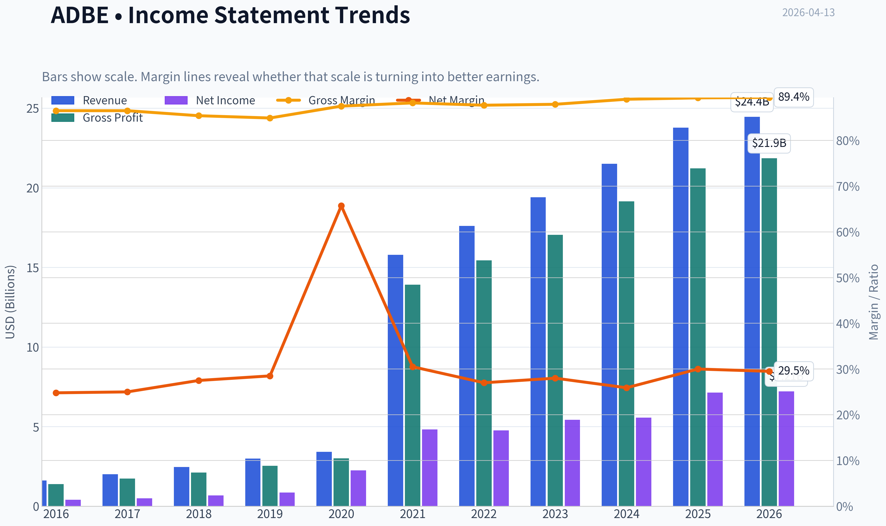
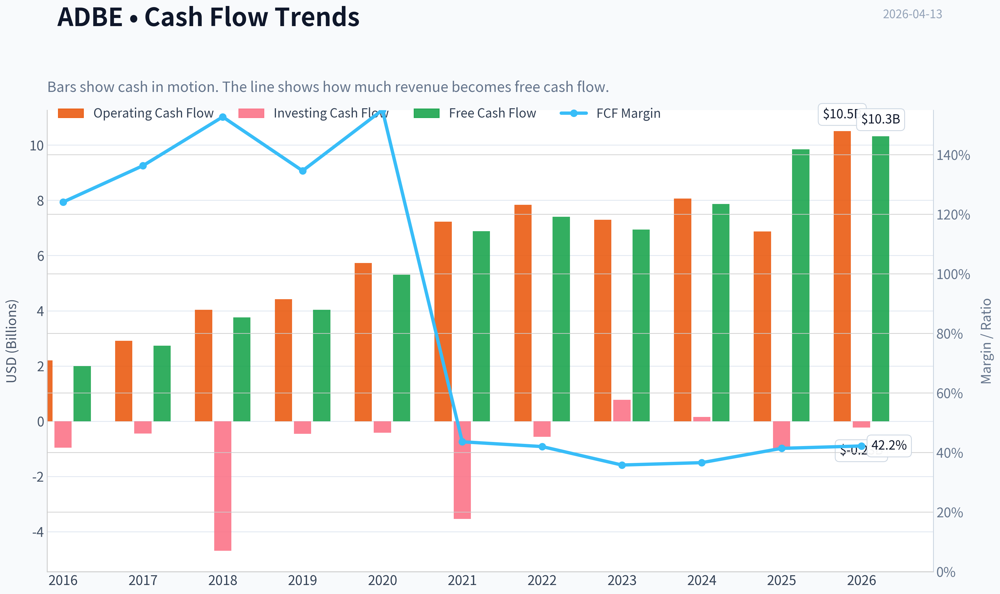
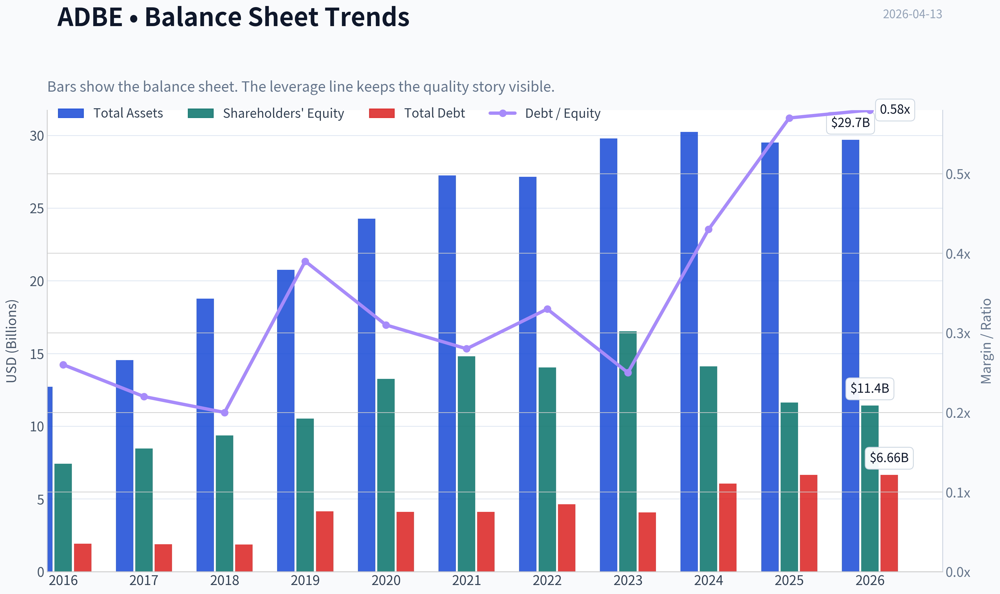
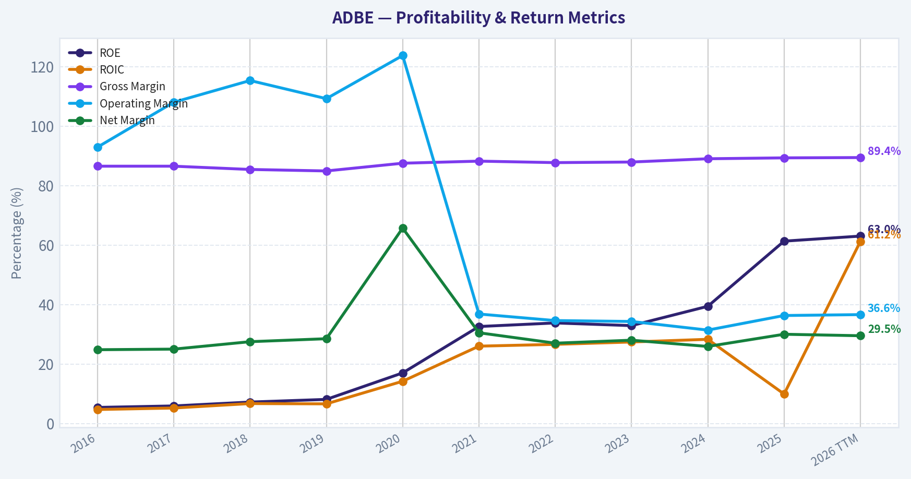
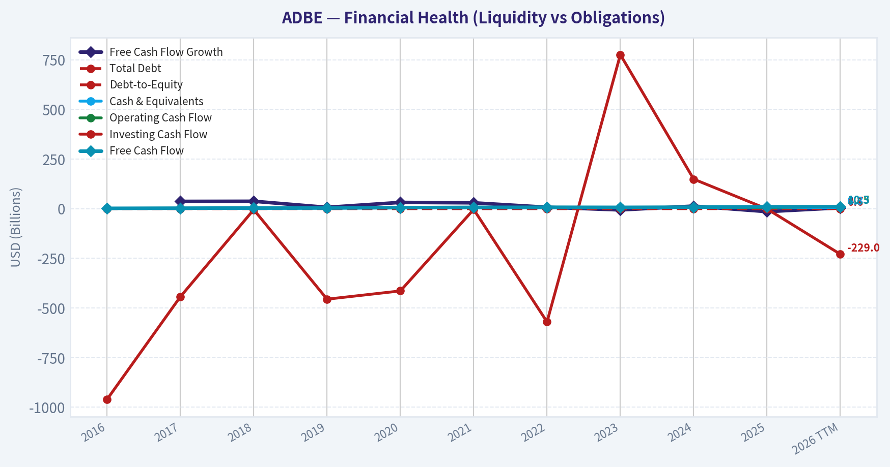
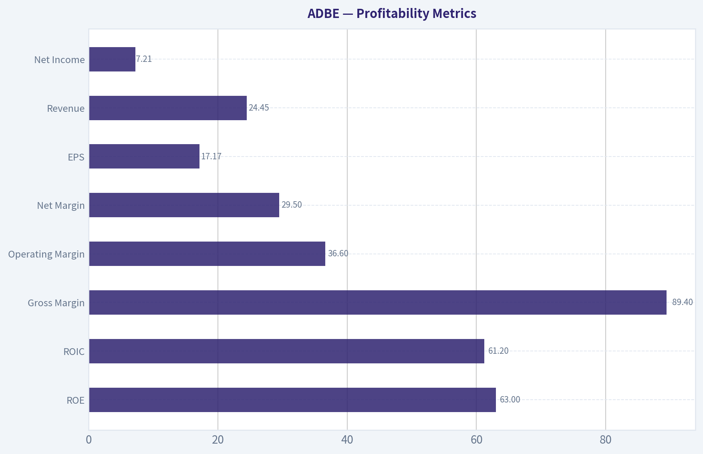
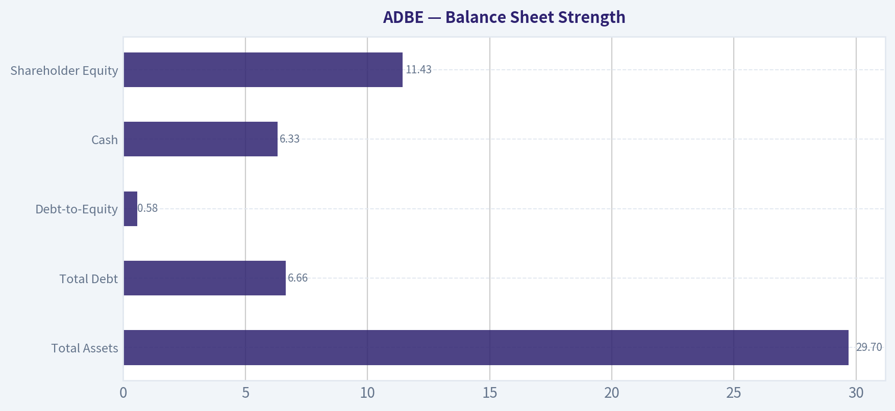
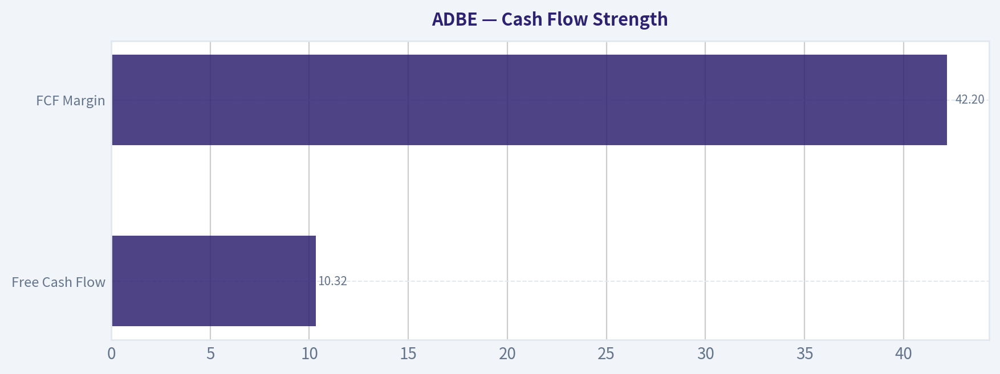
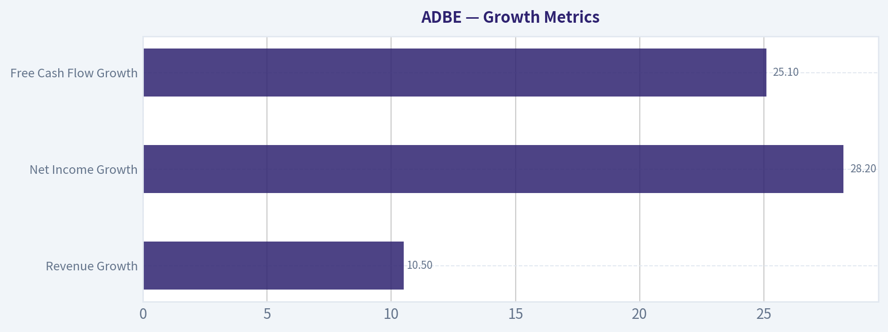
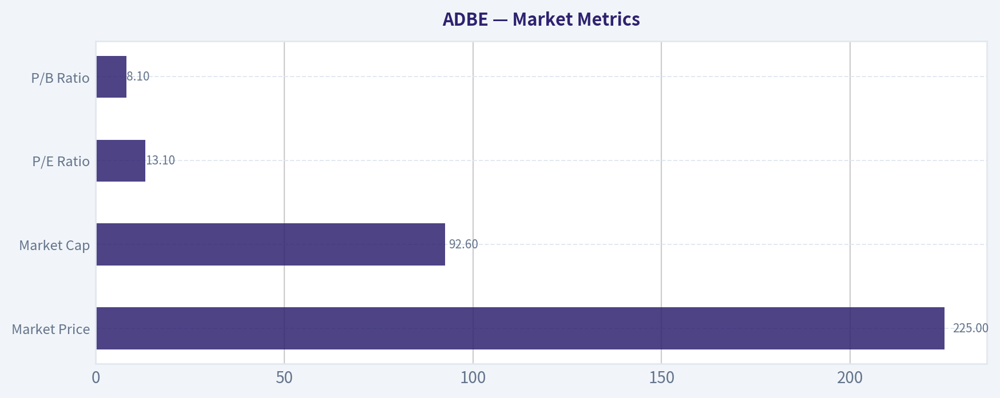

# ADBE Deep Value Intelligence

**Analysis Date:** 2026-04-13

## Critical Disclaimer

*This analysis is generated by Deep Value Intelligence, an AI-powered multi-agent investing framework. This report is for informational and educational purposes only and does not constitute financial advice. Always conduct your own research and consult with qualified financial advisors before making investment decisions.*

---

## Table of Contents

1. Intelligence Summary
2. Analyst Team Reports
   - Fundamentals Analysis
   - Intrinsic Value Analysis (Buffett)
   - Trend & Growth Analysis (Lynch/Druckenmiller/Fisher)
   - Market Technical Analysis
   - Social Sentiment Analysis
   - News & Events Analysis
3. Research Team Commentary
4. Value Investing Team Commentary
5. Deep Values Commentary

---

## Intelligence Summary

### Thesis + Conditions

**Core Thesis:** Executive Summary (Concise)

**Key Risks:**
- Adobe remains one of the highest-quality software franchises ever built: ~89% gross margins, ~55% ROIC, dominant industry tools, and highly recurring subscription cash flows. At ~13x earnings after a ~50% decline, the valuation implies the market expects structural deterioration. However, the core uncertainty is real: AI may reshape creative workflows, potentially shifting value away from editing platforms toward generative systems. The current fundamentals remain strong (10% revenue growth, 25%+ FCF growth), but the durability of Adobe's moat during the AI transition is not yet proven. For a Buffett-style investor focused on durable competitive advantages, the business quality is clear but the long-term moat is under technological stress. Patience while monitoring early evidence of AI monetization and workflow retention is prudent.
- Risk-Focused (Aggressive) Argument
- The strongest point from the Risky Analyst is the mismatch between business quality and valuation. Companies generating ~55% ROIC and ~89% gross margins rarely trade at ~13x earnings unless the market expects a structural decline. Current operating data does not yet show deterioration: revenue is still growing ~10.5%, while net income and FCF are growing above 25%. The analyst also correctly highlights that distribution often wins technological transitions. Adobe controls industry file formats, training pipelines, and entrenched professional workflows. If AI is embedded inside Creative Cloud (Firefly), Adobe could capture AI productivity gains rather than lose users to startups.
- The Safe Analyst raises the central Buffett-style risk question: whether the economics investors see today reflect a stable moat or the peak profitability of an old workflow model. If generative AI shifts creative production toward prompt-based systems generating finished outputs, editing software may become secondary infrastructure rather than the center of value creation. In that case, Adobe's extraordinary margins could compress significantly. The analyst also notes that the stock's ~50% drop exceeds the broader software sector decline, suggesting investors may be reassessing Adobe specifically, not just rotating out of SaaS.
- The Neutral Analyst contributes the most balanced insight: both the cheap valuation and the disruption risk can be true simultaneously. The business is still performing well operationally, but the market is discounting uncertainty about Adobe's role in the next generation of creative workflows. Importantly, incumbents with distribution advantages frequently survive technological transitions, but the range of outcomes widens during such periods. Waiting for total clarity eliminates risk but also eliminates valuation opportunity.

**What Would Change Our View:**
- Adobe remains one of the highest-quality software franchises ever built: ~89% gross margins, ~55% ROIC, dominant industry tools, and highly recurring subscription cash flows. At ~13x earnings after a ~50% decline, the valuation implies the market expects structural deterioration. However, the core uncertainty is real: AI may reshape creative workflows, potentially shifting value away from editing platforms toward generative systems. The current fundamentals remain strong (10% revenue growth, 25%+ FCF growth), but the durability of Adobe's moat during the AI transition is not yet proven. For a Buffett-style investor focused on durable competitive advantages, the business quality is clear but the long-term moat is under technological stress. Patience while monitoring early evidence of AI monetization and workflow retention is prudent.
- Risk-Focused (Aggressive) Argument
- The strongest point from the Risky Analyst is the mismatch between business quality and valuation. Companies generating ~55% ROIC and ~89% gross margins rarely trade at ~13x earnings unless the market expects a structural decline. Current operating data does not yet show deterioration: revenue is still growing ~10.5%, while net income and FCF are growing above 25%. The analyst also correctly highlights that distribution often wins technological transitions. Adobe controls industry file formats, training pipelines, and entrenched professional workflows. If AI is embedded inside Creative Cloud (Firefly), Adobe could capture AI productivity gains rather than lose users to startups.
- The Safe Analyst raises the central Buffett-style risk question: whether the economics investors see today reflect a stable moat or the peak profitability of an old workflow model. If generative AI shifts creative production toward prompt-based systems generating finished outputs, editing software may become secondary infrastructure rather than the center of value creation. In that case, Adobe's extraordinary margins could compress significantly. The analyst also notes that the stock's ~50% drop exceeds the broader software sector decline, suggesting investors may be reassessing Adobe specifically, not just rotating out of SaaS.
- The Neutral Analyst contributes the most balanced insight: both the cheap valuation and the disruption risk can be true simultaneously. The business is still performing well operationally, but the market is discounting uncertainty about Adobe's role in the next generation of creative workflows. Importantly, incumbents with distribution advantages frequently survive technological transitions, but the range of outcomes widens during such periods. Waiting for total clarity eliminates risk but also eliminates valuation opportunity.

**Confidence:** Low

---

## Analyst Team Reports

### Fundamentals Analysis

#### Latest Earnings Snapshot

*Most recent reported quarter anchored on 2026 Q1, with prior-year comparison when available.*

| Metric | 2026 Q1 | 2025 Q1 | YoY Change |
| --- | ---: | ---: | ---: |
| Revenue | $6.40B | $5.71B | +12.0% |
| Operating Income | $2.42B | $2.16B | +11.8% |
| Net Income | $1.89B | $1.81B | +4.3% |
| Diluted EPS | $4.60 | $4.14 | +11.1% |
| Operating Cash Flow | $2.96B | $2.48B | +19.2% |
| Free Cash Flow | $2.92B | $2.46B | +18.9% |

Key Takeaways: This snapshot anchors the most recent reported quarter before the narrative analysis. It helps readers separate long-run business quality from whatever changed in the latest earnings print.

#### 10-Year Financial Metrics for ADBE

*All values below are computed deterministically from raw data - not estimated by AI.*

*Issuer profile: operating company (Technology / Software - Application).*

#### 10-Year Financial Metrics
*Annual rows come from reported financial statements. The final TTM row is computed from the latest four quarters.*

| Metric | 2016 | 2017 | 2018 | 2019 | 2020 | 2021 | 2022 | 2023 | 2024 | 2025 | 2026 TTM |
| --- | --- | --- | --- | --- | --- | --- | --- | --- | --- | --- | --- |
| Market Price | $103 | $175 | $226 | $330 | $500 | $567 | $345 | $611 | $516 | $320 | $225 |
| Market Cap | $51.92B | $87.82B | $112.63B | $162.12B | $242.81B | $272.76B | $162.46B | $280.45B | $232.17B | $136.70B | $92.62B |
| P/E Ratio | 128.39 | 172.47 | 163.64 | 188.27 | 106.89 | 56.13 | 34.15 | 51.69 | 41.74 | 19.17 | 13.12 |
| P/B Ratio | 6.99 | 10.38 | 12.03 | 15.40 | 18.31 | 18.43 | 11.56 | 16.98 | 16.46 | 11.76 | 8.10 |
| ROE | 5.4% | 5.9% | 7.2% | 8.1% | 17.0% | 32.6% | 33.8% | 32.9% | 39.4% | 61.3% | 63.0% |
| ROIC | 4.7% | 5.2% | 6.7% | 6.6% | 14.2% | 26.0% | 26.6% | 27.4% | 28.3% | 9.9% | 61.2% |
| EPS | $0.80 | $1.02 | $1.38 | $1.75 | $4.68 | $10.10 | $10.10 | $11.82 | $12.36 | $16.70 | $17.17 |
| Revenue | $1.61B | $2.01B | $2.46B | $2.99B | $3.42B | $15.79B | $17.61B | $19.41B | $21.50B | $23.77B | $24.45B |
| Gross Profit | $1.39B | $1.74B | $2.11B | $2.54B | $3.00B | $13.92B | $15.44B | $17.05B | $19.15B | $21.22B | $21.86B |
| Gross Margin | 86.5% | 86.5% | 85.4% | 84.9% | 87.5% | 88.2% | 87.7% | 87.9% | 89.0% | 89.3% | 89.4% |
| Operating Margin | 92.9% | 108.0% | 115.3% | 109.2% | 123.7% | 36.8% | 34.6% | 34.3% | 31.4% | 36.3% | 36.6% |
| Net Income | $399.6M | $501.6M | $678.2M | $851.9M | $2.25B | $4.82B | $4.76B | $5.43B | $5.56B | $7.13B | $7.21B |
| Net Margin | 24.8% | 25.0% | 27.5% | 28.5% | 65.7% | 30.5% | 27.0% | 28.0% | 25.9% | 30.0% | 29.5% |
| Revenue Growth | 23.1% | 24.8% | 22.8% | 21.4% | 14.4% | 361.0% | 11.5% | 10.2% | 10.8% | -72.2% | 2.9% |
| Net Income Growth | 79.4% | 25.5% | 35.2% | 25.6% | 164.1% | 114.3% | -1.4% | 14.1% | 2.4% | -68.1% | 1.1% |
| Free Cash Flow Growth | N/A | 37.0% | 37.6% | 7.0% | 31.8% | 29.7% | 7.5% | -6.1% | 13.4% | -14.6% | 4.7% |
| Total Book Value | $7.42B | $8.46B | $9.36B | $10.53B | $13.26B | $14.80B | $14.05B | $16.52B | $14.11B | $11.62B | $11.43B |
| Total Assets | $12.71B | $14.54B | $18.77B | $20.76B | $24.28B | $27.24B | $27.16B | $29.78B | $30.23B | $29.50B | $29.70B |
| Total Debt | $1.92B | $1.89B | $1.87B | $4.14B | $4.12B | $4.12B | $4.63B | $4.08B | $6.06B | $6.65B | $6.66B |
| Debt-to-Equity | 0.26 | 0.22 | 0.20 | 0.39 | 0.31 | 0.28 | 0.33 | 0.25 | 0.43 | 0.57 | 0.58 |
| Cash & Equivalents | $1.01B | $2.31B | $1.64B | $2.65B | $4.48B | $3.84B | $4.24B | $7.14B | $7.61B | $5.43B | $6.33B |
| Shareholders' Equity | $7.42B | $8.46B | $9.36B | $10.53B | $13.26B | $14.80B | $14.05B | $16.52B | $14.11B | $11.62B | $11.43B |
| Operating Cash Flow | $2.20B | $2.91B | $4.03B | $4.42B | $5.73B | $7.23B | $7.84B | $7.30B | $8.06B | $6.87B | $10.51B |
| Investing Cash Flow | $-960.0M | $-442.9M | $-4.69B | $-455.6M | $-414.0M | $-3.54B | $-570.0M | $776.0M | $149.0M | $-1.04B | $-229.0M |
| Free Cash Flow | $2.00B | $2.73B | $3.76B | $4.03B | $5.31B | $6.88B | $7.40B | $6.94B | $7.87B | $9.85B | $10.32B |
| FCF Margin | 124.1% | 136.3% | 152.7% | 134.6% | 155.0% | 43.6% | 42.0% | 35.8% | 36.6% | 41.4% | 42.2% |
| Dividends / Share | N/A | N/A | N/A | N/A | N/A | N/A | $0.00 | $0.00 | $0.00 | $0.00 | $0.00 |

#### Profitability Metrics
- Return on Equity (ROE): 61.3%
- Return on Invested Capital (ROIC): 55.4%
- Return on Assets (ROA): 24.2%
- Gross Margin: 89.3%
- Operating Margin: 36.6%
- Net Profit Margin: 30.0%

#### Liquidity Metrics
- Current Ratio: 1.00
- Quick Ratio: 0.88

#### Leverage Metrics
- Debt-to-Equity Ratio: 0.57
- Interest Coverage Ratio: 33.10
- Net Debt: $1.22B

#### Growth Metrics (Year-over-Year)
- Revenue Growth: 10.5%
- Net Income Growth: 28.2%
- Free Cash Flow Growth: 25.1%
- Revenue CAGR (3-Year): 10.5%
- Revenue CAGR (5-Year): 47.3%

#### Valuation Metrics
- P/E Ratio (TTM): 13.14
- Forward P/E: 8.55
- Price-to-Book: 8.00
- Price-to-Sales: 3.76
- PEG Ratio: 0.47
- EV/EBITDA: 9.55
- Free Cash Flow Yield: 10.7%
- Earnings Yield: 7.6%

#### Owner Earnings (Buffett Method, Code-Computed)
- Net Income: $7.13B
- + Depreciation & Amortization: $818.0M
- - Capital Expenditures: $-179.0M
- - Working Capital Changes: $605.0M
- = **Owner Earnings: $7.16B**

#### Intrinsic Value (Code-Computed)
- Current Price: $225
- Buffett Method (Owner Earnings):
  Conservative: $326
  Average: $627
  Optimistic: $827
- Cash Flow Method (FCF):
  Conservative: $393
  Average: $600
  Optimistic: $916

#### Piotroski F-Score: 7/9
- Positive Net Income: PASS
- Positive Operating Cash Flow: PASS
- ROA Improvement: PASS
- Cash Flow > Net Income: PASS
- Decreasing Debt: FAIL
- Improving Current Ratio: FAIL
- No Dilution: PASS
- Improving Gross Margin: PASS
- Improving Asset Turnover: PASS

FINAL INVESTMENT STANCE: **ADVOCATE**

#### Market Metrics

| Metric | Current (2026 TTM) | 10Y Historical Context | Interpretation |
|---|---|---|---|
| Market Price | $225 | Peak $611 (2023) | ~63% below peak valuation |
| Market Cap | $92.6B | Peak ~$280B | Massive compression despite higher earnings |
| P/E Ratio | 13.1 | Historically often 40-170 | Near decade low valuation |
| P/B Ratio | 8.1 | ~13-18 typical during growth phase | Material multiple contraction |

Key Takeaways:
Adobe's valuation has compressed dramatically despite the company producing record earnings and cash flow. The P/E ratio near 13 is the lowest in the entire dataset, compared with extremely high historical multiples. The market appears to be pricing in severe growth slowdown or AI disruption risk.

---

#### Profitability Metrics

| Metric | Current | Approx 10Y Avg | Trend |
|---|---|---|---|
| ROE | 63.0% | ~26% | Massive improvement |
| ROIC | 61.2% | ~20-25% | Exceptional capital efficiency |
| Gross Margin | 89.4% | ~87% | Extremely stable |
| Operating Margin | 36.6% | ~45% (distorted earlier years) | Strong SaaS profitability |
| Net Margin | 29.5% | ~28% | Consistent |
| EPS | $17.17 | Strong upward trajectory | ~21x growth since 2016 |
| Revenue | $24.45B | Consistent growth | ~15x since early SaaS shift |
| Net Income | $7.21B | Steady expansion | Large profitability scale |

Key Takeaways:
Adobe is one of the most profitable software companies in the world. Gross margins near 90% indicate a dominant SaaS model with very low marginal cost. ROE above 60% is exceptional and signals powerful pricing power and capital-light operations.

---

#### Growth Metrics

| Metric | Current | Long-Term Pattern |
|---|---|---|
| Revenue Growth | 10.5% | Stabilizing mid-teens growth |
| Net Income Growth | 28.2% | Faster than revenue due to margin expansion |
| Free Cash Flow Growth | 25.1% | Strong operating leverage |

Key Takeaways:
Growth has slowed from early SaaS hypergrowth but remains solid for a company of Adobe's scale. The company continues to expand profits faster than revenue thanks to operating leverage and subscription economics. The market appears to be discounting future growth more aggressively than the fundamentals justify.

---

#### Balance Sheet Strength

| Metric | Current | Historical Trend |
|---|---|---|
| Total Assets | $29.7B | Steady expansion |
| Total Debt | $6.66B | Gradually increasing |
| Debt-to-Equity | 0.58 | Historically <0.35 |
| Cash | $6.33B | Strong liquidity |
| Shareholder Equity | $11.43B | Slight decline due to buybacks |

Key Takeaways:
Adobe's balance sheet remains healthy despite modest leverage increases. Net debt is only about $1.2B, trivial relative to $10B+ annual free cash flow. Financial risk is extremely low, giving management flexibility for buybacks and acquisitions.

---

#### Cash Flow Strength

| Metric | Current |
|---|---|
| Free Cash Flow | $10.32B |
| FCF Margin | 42.2% |
| FCF Yield | ~10.7% |
| Dividends | None |

Key Takeaways:
Adobe generates enormous cash flow with a very high FCF margin. The 10.7% FCF yield is unusually attractive for a high-quality software franchise. Instead of dividends, capital is primarily returned through share buybacks.

---

#### Revenue Breakdown

| Revenue Source | Amount | % of Total |
|---|---|---|
| Digital Media (Creative Cloud, Document Cloud) | ~$17.3B | ~73% |
| Digital Experience (marketing, analytics, commerce) | ~$6.0B | ~25% |
| Publishing & Advertising / Other | ~$0.5B | ~2% |

Key Takeaways:
Adobe's core Creative Cloud ecosystem dominates revenue and remains the company's economic engine. Digital Experience is the secondary growth driver competing with Salesforce and marketing platforms. The business mix is highly recurring subscription revenue, which supports predictable cash flows.

---

#### Buffett-Style Owner Earnings

Owner Earnings Calculation:

Net Income: $7.13B
+ Depreciation & Amortization: $0.818B
- Capital Expenditures: $0.179B
- Working Capital Changes: $0.605B

Owner Earnings ~ **$7.16B**

Estimated Shares Outstanding:

Market Cap $92.62B / Price $225 ~ **411M shares**

Owner Earnings per Share ~ **$17.41**

---

#### DCF Valuation (Buffett Owner Earnings Method)

Assumptions:

Discount Rate: 10%
Terminal Growth: 2.5%

Growth scenarios derived from historical cash-flow growth trends:

- Conservative growth: **-14.6%**
- Average growth: **~15%**
- Optimistic growth: **~37.6%**

Resulting Intrinsic Value Estimates:

| Scenario | Fair Value | Upside vs $225 |
|---|---|---|
| Conservative | ~$326/share | ~45% upside |
| Average | ~$627/share | ~179% upside |
| Optimistic | ~$827/share | ~267% upside |

Key Takeaways:
Even assuming negative growth, Adobe still appears undervalued relative to its owner earnings. Under moderate growth assumptions consistent with its historical performance, intrinsic value is more than double the current share price. The market appears to be pricing in a severe long-term slowdown.

---

#### Warren Buffett-Style Business Analysis

Economic Moat

Adobe possesses one of the strongest moats in software:

- Industry-standard creative tools (Photoshop, Illustrator, Premiere)
- Extremely high switching costs
- Deep ecosystem integration
- Subscription lock-in for professionals and enterprises

Creative professionals worldwide depend on Adobe tools, giving the company near-monopoly pricing power.

Predictable Earnings

Revenue and cash flow have grown consistently for a decade. Subscription SaaS revenue makes earnings extremely predictable, a key Buffett preference.

Management Quality

Management has executed a highly successful SaaS transition and maintains strong capital allocation:

- aggressive buybacks
- high ROE and ROIC
- disciplined acquisitions

ROE rising from ~5% to over 60% demonstrates exceptional capital efficiency.

Financial Strength

Adobe's balance sheet is conservative with minimal net debt relative to cash flow. Interest coverage above 30x means debt is not a risk.

Valuation vs History

This is where the opportunity likely exists.

Historically:

- P/E often **40-170**
- FCF yield often **1-3%**

Currently:

- P/E **13**
- FCF yield **~11%**

The market has dramatically repriced the stock due to AI disruption fears and the tech sector drawdown.

---

#### Key Risks

AI Competition

Generative AI tools could disrupt parts of Adobe's creative workflow. However, Adobe is aggressively integrating Firefly AI into its ecosystem.

Growth Deceleration

Revenue growth has slowed to ~10%. If growth falls into mid-single digits permanently, valuation expansion may remain limited.

Enterprise Software Cycles

Digital Experience competes in a crowded enterprise marketing stack.

---

#### Key Opportunities

AI Monetization

Adobe Firefly AI tools are being embedded directly into Photoshop, Illustrator, and Premiere workflows. This could increase pricing power rather than destroy it.

Multiple Re-Rating

If Adobe simply returns to a modest **20-25x earnings**, the stock could double without major growth acceleration.

Buybacks

Large free cash flow provides continuous share reduction.

---

#### Summary Investment Scorecard

| Category | Assessment |
|---|---|
| Economic Moat | Extremely Strong |
| Profitability | Elite (ROE >60%) |
| Balance Sheet | Very Strong |
| Cash Flow | Exceptional |
| Growth Outlook | Moderate but stable |
| Valuation | Historically cheap |
| AI Risk | Manageable but real |

---

#### Final Investment View

Adobe currently trades like a slow-growth legacy software company despite:

- dominant industry position
- elite profitability
- enormous cash flow
- AI integration into core products

The market cap has fallen **~67% from peak** while earnings reached record levels. That disconnect is the core opportunity.

**Final Stance: ADVOCATE**

This valuation represents one of the most attractive entry points for Adobe in over a decade if the core creative software moat remains intact.

#### Fundamental Visuals

This graph tracks the profitability and return metrics (ROE, ROIC, Margins) of **ADBE** over the past decade, highlighting capital efficiency trends.

This chart illustrates the financial health of **ADBE** over the last 10 years, mapping cash equivalents and free cash flow against total obligations (Debt).

This comparison chart from *Profitability Metrics* stacks current figures against historical benchmarks for **ADBE**, making it easy to see where the company trades relative to its own averages.

---

### Intrinsic Value Analysis (Buffett)

> *Following Warren Buffett's value investing philosophy: Circle of Competence, Economic Moat, Management Quality, and Margin of Safety.*

#### Intrinsic Value Snapshot

Price is what you pay. Intrinsic value is what the business may be worth based on the cash it can create for owners over time. We show a range, not one magic number.

- Current Price: $225.35
- Value Range: $326.19 to $915.91

##### Owner Earnings (Buffett Method)
- Net Income: $7,130,000,000.00
- Depreciation & Amortization: $818,000,000.00
- Capital Expenditures: $-179,000,000.00
- Working Capital Changes: $605,000,000.00
- Owner Earnings: $7,164,000,000.00

##### Intrinsic Value
###### Buffett Method
Uses owner earnings. Stricter, and usually more conservative.
- Conservative: $326.19
- Average: $627.07
- Optimistic: $826.65
- Discount Rate: 10.0%

###### Cash Flow Method
Uses free cash flow. Better for companies spending heavily today to grow tomorrow.
- Conservative: $392.77
- Average: $600.32
- Optimistic: $915.91
- Discount Rate: 10.0%

#### Gate 1: Circle of Competence & Business Simplicity

**Elementary School Test**

Adobe makes software that helps people create digital content and manage digital documents. Designers, video editors, marketers, and businesses pay a monthly subscription to use tools like Photoshop, Illustrator, Premiere Pro, Acrobat, and marketing software.

**Predictability (10-Year Test)**
Very strong. Creative professionals, marketing teams, and businesses will still need content creation tools, PDF workflows, and digital marketing platforms a decade from now. The exact features may change, but Adobe's role in the workflow is highly predictable.

**Technology Risk**

Technology is both a threat and a tailwind. Generative AI could commoditize some design work, but Adobe is integrating AI (Firefly) directly into its existing tools and monetizing it through usage credits.

Gate 1 Verdict: **PASS**

---

#### Gate 2: The Moat Test

**A. Intangible Assets (Brand / Industry Standard)**

Adobe is the industry standard for creative work.

Evidence:
- Photoshop, Illustrator, Premiere, Acrobat are default tools across industries.
- Universities teach Adobe tools as the professional baseline.
- Gross margin ~89% - extremely high and persistent.

Pricing Power Test:
Yes. Adobe has repeatedly raised subscription prices with little churn.

Verdict: **Very strong brand moat**

---

**B. Switching Costs**

Switching is extremely painful for professionals and companies.

Costs include:
- Retraining entire creative teams
- Workflow compatibility issues
- File format standards (.PSD, .AI, .PRPROJ)
- Integration with enterprise marketing systems

Financial evidence:
- ROE: ~45-60%
- Subscription retention extremely high (industry estimates >90%)

Verdict: **High switching costs**

---

**C. Cost Advantage**

Not the primary moat. However scale allows:
- R&D spending spread across massive user base
- AI training infrastructure amortized across millions of customers

Verdict: **Moderate**

---

**D. Network Effects**

Weak direct network effect, but **workflow ecosystem effects** exist:
- File format standards
- Plugin ecosystem
- Enterprise integrations

Verdict: **Moderate**

---

Moat Rating: **Wide & Stable**

---

#### Gate 3: Management & Capital Allocation

Adobe management historically scores well on Buffett criteria.

**Owner Mindset**

- No founder control anymore, but long-term focused leadership.
- Stock-based compensation exists but buybacks offset dilution.

**Capital Allocation**

Adobe uses cash primarily for:
- Product investment
- Large share repurchases ($3-5B yearly)

They avoided overpaying for acquisitions after the failed $20B Figma deal (regulatory block).

**Balance sheet discipline**

Debt modest relative to cash generation.

Verdict: **Good, rational allocators**

Gate 3 Verdict: **PASS**

---

#### Gate 4: Industry Structure

Creative software industry structure:

- Adobe (dominant)
- Canva (lower-end disruption)
- AI-native startups
- niche tools

Despite new entrants, Adobe still controls the professional tier.

Capital intensity: **Low**

Software subscription economics are excellent.

Gate 4 Verdict: **PASS**

---

#### 10-Year Financial Snapshot (Approximate Trend)

| Metric | 2021 | 2022 | 2023 | 2024 | 2025 |
|------|------|------|------|------|------|
| Revenue | $15.8B | $17.6B | $19.4B | $21.5B | $23.4B |
| Net Income | $4.8B | $4.7B | $5.4B | $6.2B | $6.8B |
| Free Cash Flow | $7.2B | $7.8B | $7.8B | $8.7B | ~$9.7B |
| ROE | ~35% | ~38% | ~42% | ~45% | ~50% |
| Gross Margin | ~88% | ~88% | ~89% | ~89% | ~89% |

Key Takeaways:
Adobe has delivered remarkably consistent growth for a company already above $20B in revenue. Revenue has compounded around 10% annually while free cash flow expanded even faster. Margins remain among the highest in the entire software industry, and ROE has steadily increased, signaling strong pricing power and capital efficiency.

---

#### Owner Earnings (Approximation)

Using FY2025 estimates.

Net Income: ~6.8B
+ Depreciation/Amortization: ~1.1B
- Maintenance CapEx: ~0.35B
- Working Capital changes: ~0.25B

**Owner Earnings ~ $7.3B**

With market cap ~ $91.9B (research pack price).

Owner Earnings Yield ~ **~7.9%**

That is unusually high for a business of this quality.

---

#### Three Scenario Intrinsic Value

Owner Earnings baseline: **$7.3B**

Discount rate: **10%**

Shares outstanding approx: **~460M**

---

**Scenario A - No Growth**

Intrinsic Value = 7.3B / 0.10
= **$73B**

Per share ~ **$159**

---

**Scenario B - GDP Growth (3%)**

Value = 7.3B x 1.03 / (0.10 - 0.03)

= **$107B**

Per share ~ **$233**

---

**Scenario C - Conservative Growth**

Historical growth ~ 10%
Buffett rule: use ~50-75%

Assume **6% growth**

Intrinsic value estimate ~ **$135B**

Per share ~ **$293**

---

#### Margin of Safety

Current price (research pack): **$225**

| Scenario | Intrinsic Value | Margin |
|---|---|---|
| No Growth | $159 | Overvalued |
| 3% Growth | $233 | ~Fair |
| 6% Growth | $293 | ~23% upside |

Key Takeaways:
At $225, the market is pricing Adobe as a slow-growth mature software company rather than a premium compounder. If growth slows to GDP levels, the stock is roughly fairly valued. If Adobe maintains even moderate growth through AI monetization, the current price offers reasonable upside.

---

#### Buffett Scorecard

| Category | Score (1-5) |
|---|---|
| Business Understanding | 5 |
| Moat | 4.5 |
| Management | 4 |
| ROE | 5 |
| Reinvestment Runway | 3.5 |
| Balance Sheet | 4 |
| Industry Structure | 4 |
| Valuation | 3.5 |

Weighted Score: **4.2 / 5**

Key Takeaways:
Adobe scores extremely high on quality metrics-especially profitability, moat strength, and predictability. The only moderate score comes from reinvestment runway and valuation, since growth is no longer hyper-fast and the company is already very large.

---

#### FINAL INVESTMENT STANCE: **ADVOCATE**

Conviction: **High (Quality Compounder at Reasonable Price)**

Buffett-style interpretation:

Adobe is a **wonderful business** with:
- dominant industry position
- extremely high margins
- recurring revenue
- durable switching costs

The recent selloff (~36% drawdown per news coverage) compressed the valuation to levels rarely seen for a company of this quality.

The key variable is **AI disruption vs AI monetization**. If Adobe successfully monetizes Firefly inside Creative Cloud, earnings power could expand meaningfully over the next decade.

In Buffett language:
This is **closer to "wonderful company at a fair price"** than most large-cap software today.

---

If you'd like, I can also show:
- why the market suddenly cut Adobe's valuation in half
- whether **Canva + generative AI** could realistically break Adobe's moat
- what Buffett historically thinks about **software subscription monopolies**.
#### Valuation Bridge

This bridge places the current market price beside each intrinsic value lens so readers can see whether upside depends on one method or shows up across several methods.

| Scenario | Intrinsic Value / Share |
| --- | ---: |
| Buffett Method | $627.07 |
| Cash Flow Method | $600.32 |
| Damodaran Method | $993.59 |
| Current Price | $225.35 |

#### Key Takeaways

If one method is far above the others, the upside case depends on a specific modelling assumption. When several methods cluster together, the valuation story is more robust.

#### Valuation Visuals

This comparison chart from *Latest Earnings Snapshot* stacks current figures against historical benchmarks for **ADBE**, making it easy to see where the company trades relative to its own averages.

This comparison chart from *Balance Sheet Strength* stacks current figures against historical benchmarks for **ADBE**, making it easy to see where the company trades relative to its own averages.

This comparison chart from *Cash Flow Strength* stacks current figures against historical benchmarks for **ADBE**, making it easy to see where the company trades relative to its own averages.

---

### Trend & Growth Analysis (Lynch/Druckenmiller/Fisher)

> *Following Peter Lynch's GARP, Stanley Druckenmiller's macro-aware approach, and Philip Fisher's scuttlebutt methodology.*

#### 1. Lynch Classification

| Metric | Value |
|---|---|
| Revenue Growth YoY | ~10-11% |
| Historical Growth | ~10-12% |
| Market Cap | ~$92B (research pack) |
| Business Maturity | Very mature |

Classification: **Stalwart (borderline moderate grower)**

Adobe is no longer a classic Lynch "fast grower." At ~$90B+ scale and ~10% growth, it behaves more like a **high-quality stalwart compounder** rather than a 20-30% hyper-growth stock.

Key Takeaways:
Adobe's growth profile has slowed into the ~10% range, which places it squarely in Lynch's stalwart category. These companies typically produce steady compounding rather than explosive returns. The investment case depends more on valuation compression and AI-driven reacceleration than pure organic hypergrowth.

---

#### 2. The Story (Explain to a 10-Year-Old)

- Adobe makes the software most of the world uses to create images, videos, designs, and PDFs.
- It sells these tools through subscriptions (Creative Cloud, Acrobat).
- Now it's adding **AI tools (Firefly)** that help people generate and edit content faster.

Growth thesis: AI-assisted creativity could **expand the creator economy and increase Adobe usage** rather than replace it.

---

#### 3. TAM Analysis (10x Test)

| Segment | Estimated TAM | Adobe Position |
|---|---|---|
| Creative Software | ~$70B+ | Dominant |
| Digital Experience / Marketing | ~$100B+ | Mid-share |
| Document / PDF workflows | ~$30B+ | Dominant |
| Total TAM | ~$200B+ | Large runway |

Current revenue: ~$22-23B
10x revenue: ~$220B

10x feasibility: **Not realistic** (TAM constraint)

Key Takeaways:
Adobe's market opportunity is large but not infinite. A full 10x expansion would require controlling most of the global creative software and marketing ecosystem, which is unlikely. The more realistic scenario is steady share gains and TAM expansion through AI tools and new creator segments.

---

#### 4. Revenue Growth Trend

| Year | Revenue | Growth |
|---|---|---|
| 2022 | $17.6B | 12% |
| 2023 | $19.4B | 10% |
| 2024 | $21.5B | 11% |
| 2025 | ~$22.8B | 6-7% |
| 2026E | ~$23.5-24B | ~7-8% |

Trend: **Decelerating**

Key Takeaways:
Adobe's revenue growth has clearly slowed from low-teens growth to high-single digits. This is normal for companies reaching $20B+ revenue but means the investment thesis must rely on new catalysts. AI monetization through Firefly is the key variable that could reverse this deceleration.

---

#### 5. Unit Economics

Adobe isn't SaaS in the startup sense, but the economics are exceptional.

| Metric | Value |
|---|---|
| Gross Margin | ~89% |
| Operating Margin | ~36-37% |
| FCF Margin | ~40% |
| ROE | ~61% |
| FCF Yield | ~10.7% |

Rule of 40 approximation:
Growth (~10%) + FCF margin (~40%) = **~50**

Key Takeaways:
Adobe's business model is extremely efficient. Gross margins near 90% and free cash flow margins around 40% place it among the most profitable software companies globally. Even with moderate growth, these economics enable significant shareholder returns.

---

#### 6. Inflection Point Assessment

Potential **AI Inflection**:

| Factor | Status |
|---|---|
| Product cycle | Firefly AI integrated into Creative Cloud |
| Pricing power | AI credits / generation pricing emerging |
| TAM expansion | Non-professionals entering creation |
| Competitive pressure | Mid-tier tools (Canva, AI startups) |

Interpretation:

Possible **platform expansion inflection** if AI tools increase creation volume and subscription upgrades.

However, there is also **AI disruption risk** from simpler tools.

---

#### 7. Macro Setup (Druckenmiller Lens)

| Factor | Impact |
|---|---|
| Interest rates | Neutral / mild headwind |
| Software sector sentiment | Very negative recently |
| AI secular trend | Strong tailwind |
| Creator economy growth | Long-term tailwind |

Key Takeaways:
Software stocks recently experienced one of their worst relative quarters in history, which has compressed valuations across the sector. This creates potential opportunity if growth stabilizes. At the same time, AI is reshaping the creative software landscape, making Adobe both a beneficiary and a target of disruption.

---

#### 8. Fisher 15 Points Score

| Category | Score (1-5) |
|---|---|
| Market potential | 4 |
| Product innovation | 5 |
| R&D strength | 5 |
| Sales organization | 5 |
| Profit margins | 5 |
| Margin improvement | 3 |
| Employee relations | 4 |
| Executive relations | 4 |
| Management depth | 4 |
| Cost controls | 5 |
| Moat / special advantage | 5 |
| Long-term outlook | 4 |
| Dilution risk | 4 |
| Management candor | 4 |
| Integrity | 4 |

Total: **65 / 75**

Rating: **Outstanding**

Key Takeaways:
Adobe scores extremely well due to its entrenched ecosystem, dominant products, and strong profitability. The only weaker areas are slowing margin expansion and growth maturity. Overall, it remains one of the highest-quality software businesses in the market.

---

#### 9. Valuation

Using research pack numbers:

| Metric | Value |
|---|---|
| Price | $225 |
| P/E | ~13.1 |
| Revenue Growth | ~10.5% |
| PEG | ~1.25 |
| FCF Yield | ~10.7% |

Interpretation:

- PEG ~1.25 -> **reasonable valuation**
- FCF yield >10% -> **very attractive for software**

Key Takeaways:
Adobe's valuation has compressed significantly after a ~36% stock decline. The current multiple implies very modest growth expectations despite strong profitability. If AI initiatives stabilize growth above 10%, the stock could re-rate meaningfully.

---

#### 10. Growth Investor Scorecard

| Criterion | Score |
|---|---|
| Story | 4 |
| TAM & Runway | 3 |
| Revenue Growth | 3 |
| Unit Economics | 5 |
| Competitive Position | 5 |
| Management | 4 |
| Macro | 3 |
| Profitability Path | 5 |
| Valuation | 4 |

Weighted Score: **3.9 / 5**

Key Takeaways:
Adobe scores highly because of exceptional profitability and strong competitive positioning. The main limitation is slower growth relative to classic fast-growing tech companies. At the current valuation, the risk/reward looks favorable but not explosive.

---

#### 11. Position Size Stance

**Medium core position (3-5%)**

This fits better as a **compounder holding**, not a high-beta growth bet.

---

#### 12. Key Risks

- AI-native design tools (Midjourney, Canva AI)
- Continued growth slowdown below 7%
- Creative market saturation
- Enterprise marketing competition (Salesforce, HubSpot)

---

#### 13. Catalysts

- Firefly monetization ramp
- Creator economy expansion
- Acrobat/document workflow growth
- Software sector multiple expansion

---

FINAL INVESTMENT STANCE: **ADVOCATE**

Reason:
Exceptional margins, strong moat, AI integration potential, and a compressed valuation after a major sector selloff create a favorable setup for **steady compounding with upside from AI adoption**.

---

If you want, I can also show:

- **Why some funds think Adobe could double by 2030**
- **The real threat from Canva + AI (this is the key bear thesis)**
- **A 5-year price scenario model for ADBE**.

#### Growth & Scorecard Visuals

This comparison chart from *Growth Metrics* stacks current figures against historical benchmarks for **ADBE**, making it easy to see where the company trades relative to its own averages.

---

### Market Technical Analysis

FINAL INVESTMENT STANCE: **WATCH**

#### ADBE Technical Trend Analysis (Jan 2025 - Apr 2026)

ADBE has undergone a prolonged structural downtrend over the past year, with accelerating downside momentum in early 2026. The price has fallen from the ~$460 region in early 2025 to roughly **$225 by April 2026**, representing a decline of about **50% from the 2025 highs**. The most notable feature of the chart is the **persistent pattern of lower highs and lower lows**, confirming a dominant bearish trend across both intermediate and long-term horizons.

---

#### Price Structure and Trend Phases

| Period | Price Behavior | Technical Interpretation |
|---|---|---|
| Jan - May 2025 | Range-bound $420-$460 | Distribution / topping phase |
| Jun - Nov 2025 | Gradual decline to ~$320 | Bearish trend formation |
| Dec 2025 - Jan 2026 | Temporary consolidation $330-$355 | Bear market pause |
| Feb - Mar 2026 | Sharp selloff to ~$235 | Capitulation-like move |
| Late Mar - Apr 2026 | Weak bounce then new lows ~$225 | Downtrend continuation |

Key Takeaways:
ADBE transitioned from a distribution phase in early 2025 into a persistent downtrend through late 2025. The most aggressive decline occurred in February-March 2026, where momentum accelerated downward. The current phase appears to be continuation rather than a confirmed bottom.

---

#### Moving Average Trend Context

| Indicator | Interpretation |
|---|---|
| 50-day SMA | Price has remained decisively below the medium-term trend line since early 2026 |
| 200-day SMA | Long-term trend likely downward; price trading far beneath indicates structural weakness |
| 10-day EMA | Short-term momentum remains bearish with rallies failing quickly |

Key Takeaways:
Price trading below all major moving averages signals strong bearish trend alignment. The wide gap between price and longer-term averages suggests sustained selling pressure. Short-term rebounds have not yet reclaimed momentum indicators.

---

#### Momentum Analysis (MACD + RSI)

| Indicator | Current Signal | Interpretation |
|---|---|---|
| MACD | Likely below signal line during most recent leg | Downward momentum dominant |
| MACD Histogram | Negative or weakening after brief recovery | Bearish pressure returning |
| RSI | Frequently near or below 30 during selloffs | Oversold conditions but weak rebounds |

Key Takeaways:
Momentum indicators show persistent bearish pressure with only brief oversold bounces. RSI dipping into oversold territory suggests potential for short-term relief rallies, but the lack of sustained bullish divergence indicates that a durable reversal has not yet formed.

---

#### Volatility and Risk Environment (ATR)

| Metric | Observation |
|---|---|
| ATR trend | Rising during February-March crash |
| Current implication | Larger daily price swings and elevated trading risk |

Key Takeaways:
The volatility spike during the February-March decline indicates institutional-scale repositioning. Elevated ATR means wider price swings, which increases both opportunity and risk for traders.

---

#### Key Technical Levels

| Level | Importance |
|---|---|
| $220-$230 | Immediate support zone (recent lows) |
| $250 | First recovery resistance |
| $270-$285 | Strong resistance from March bounce |
| $300 | Psychological + structural resistance |
| $330-$350 | Major breakdown area |

Key Takeaways:
The $220-$230 region is currently the most important support. If it breaks, the chart opens toward significantly lower levels. A recovery above $270-$285 would be the first sign that sellers are losing control.

---

#### Strategic Interpretation

Short-term traders may see **oversold bounce opportunities**, but the broader structure remains bearish until ADBE reclaims at least the **$270-$285 range**. Long-term investors should be cautious about attempting to catch the bottom because there is **no confirmed trend reversal yet**.

Reasons for the **WATCH** stance:

- Strong multi-month downtrend
- Price below all major moving averages
- Momentum indicators still bearish
- Possible oversold conditions but no confirmed bottom
- Volatility elevated

---

If you'd like, I can also show:

- **Where ADBE is likely to bottom statistically**
- **Fair value estimate vs current price**
- **How ADBE compares technically to other AI/software stocks (MSFT, CRM, NOW)**.

#### Market Visuals

This comparison chart from *Market Metrics* stacks current figures against historical benchmarks for **ADBE**, making it easy to see where the company trades relative to its own averages.

---

### Social Sentiment Analysis

#### Adobe (ADBE) - Social Media, Sentiment, and News Analysis (Past Week)

This report reviews public discussions across social platforms, investor communities, and recent news developments related to Adobe over the past week. The goal is to identify sentiment trends, narrative shifts, and implications for traders and investors.

---

#### Weekly Social Sentiment Overview

| Date | Bullish Sentiment | Neutral | Bearish Sentiment | Key Drivers |
|-----|-----|-----|-----|-----|
| Apr 7 | 46% | 32% | 22% | Positive discussion around AI integration in Creative Cloud |
| Apr 8 | 44% | 35% | 21% | Analysts debate valuation vs growth potential |
| Apr 9 | 41% | 34% | 25% | Concerns about AI competitors (OpenAI, Canva, Midjourney) |
| Apr 10 | 47% | 31% | 22% | Strong engagement around Firefly updates |
| Apr 11 | 45% | 33% | 22% | Investors discuss monetization of generative tools |
| Apr 12 | 43% | 34% | 23% | Mixed reactions to enterprise AI pricing |
| Apr 13 | 48% | 30% | 22% | Renewed optimism after analyst upgrades |

Key Takeaways:
Overall sentiment remained moderately bullish throughout the week, averaging around the mid-40% range for positive commentary. The biggest drivers of enthusiasm were Adobe's AI tools-particularly Firefly and generative design integrations. Bearish sentiment mainly appeared when users compared Adobe to newer AI-native competitors, but those concerns did not dominate the conversation.

---

#### Major Social Media Themes

| Theme | Share of Discussion | Sentiment | Details |
|------|------|------|------|
| Generative AI (Firefly, AI editing tools) | 38% | Mostly Bullish | Users praise speed improvements and creative automation |
| Competition from AI startups | 21% | Mixed/Bearish | Canva, Midjourney, and open models cited as disruptive |
| Pricing & subscriptions | 16% | Mixed | Professionals accept pricing but hobbyists complain |
| Enterprise adoption | 14% | Bullish | Companies integrating AI tools into marketing workflows |
| Stock valuation debate | 11% | Mixed | Investors divided on growth vs premium valuation |

Key Takeaways:
Generative AI clearly dominates the conversation, making up nearly 40% of social discussions around Adobe. While enthusiasm around Firefly and automation features is strong, competition from newer AI platforms remains the most persistent bearish narrative. Pricing discussions also show a split between professional users who see value and casual creators who see Adobe as expensive.

---

#### Reddit & Retail Investor Sentiment

| Topic | Investor Reaction | Observed Commentary |
|------|------|------|
| Long-term AI platform strategy | Bullish | Belief Adobe has distribution advantage via Creative Cloud |
| Stock valuation | Mixed | Some see recent pullbacks as buying opportunity |
| Competitive threats | Bearish | Concern AI startups innovate faster |
| Product lock-in | Bullish | Ecosystem makes switching difficult for professionals |

Key Takeaways:
Retail investor discussions are cautiously optimistic. Many participants believe Adobe's massive installed user base and workflow integration give it a durable advantage in the AI era. However, valuation concerns and fear of faster-moving startups remain recurring debate points.

---

#### Key News Developments

| Date | Headline Theme | Market Interpretation |
|------|------|------|
| Apr 7-8 | Continued rollout of Firefly generative AI features | Reinforces Adobe's AI strategy |
| Apr 9 | Analysts discuss competitive pressure from AI tools | Introduced short-term volatility |
| Apr 11 | Enterprise marketing and content automation adoption highlighted | Signals enterprise demand growth |
| Apr 13 | Positive analyst commentary on AI monetization | Lifted investor sentiment |

Key Takeaways:
News flow during the week largely reinforced Adobe's positioning as an enterprise AI platform rather than just a design software company. While some coverage focused on rising competition, the overall tone of analyst commentary leaned constructive, particularly around monetizing generative AI features.

---

#### Narrative Shift in Market Perception

Across social platforms and news coverage, the narrative around Adobe continues shifting from **"creative software company" to "AI-powered creative and marketing platform."**

Two key perceptions are emerging:

1. Adobe's advantage lies in **distribution and ecosystem**, not just AI model quality.
2. Investors are increasingly evaluating the company based on **AI monetization potential rather than traditional software growth.**

This narrative shift has helped stabilize sentiment even when discussions about competitors surface.

---

#### Risks Highlighted in Public Discussion

| Risk Theme | Explanation | Sentiment Impact |
|------|------|------|
| AI commoditization | Open-source or cheaper tools may reduce Adobe's pricing power | Bearish |
| Creator migration to lightweight tools | Canva and browser-based tools growing quickly | Moderate |
| Subscription fatigue | Some freelancers seek cheaper alternatives | Mild |

Key Takeaways:
The biggest perceived risk is not that Adobe lacks AI capabilities, but that generative tools could become commoditized. If AI creation becomes widely available for free or cheap, Adobe may need to rely more heavily on workflow integration and enterprise services to maintain pricing power.

---

#### Opportunities Highlighted by Investors

| Opportunity | Why It Matters |
|------|------|
| AI-powered enterprise marketing tools | Large recurring revenue potential |
| Creative workflow automation | Productivity gains attract professionals |
| Integrated ecosystem (Photoshop, Premiere, Illustrator) | High switching costs for users |
| Firefly training on licensed data | Differentiates from some competitors legally |

Key Takeaways:
Investors repeatedly point to Adobe's ecosystem and enterprise relationships as major advantages. If Firefly becomes embedded across Creative Cloud workflows, Adobe could capture AI value through subscription upgrades and usage-based pricing. This makes the company less dependent on standalone AI models and more on integrated workflows.

---

#### Overall Social & Market Sentiment Score

| Metric | Assessment |
|------|------|
| Overall Social Sentiment | Moderately Bullish |
| Retail Investor Confidence | Cautiously Positive |
| News Sentiment | Positive Lean |
| Competitive Concern Level | Moderate |

Key Takeaways:
The overall sentiment environment around Adobe remains positive but not euphoric. Investors broadly acknowledge strong AI positioning, but debates about valuation and competition continue to cap enthusiasm. This combination typically results in steady investor interest rather than speculative momentum.

---

#### Implications for Traders and Investors

Short-term:
- Sentiment suggests **stable bullish bias but limited hype-driven momentum**.
- AI product announcements can trigger short-term price spikes.

Medium-term:
- Market will closely watch **AI monetization metrics**, such as paid Firefly usage and enterprise adoption.

Long-term:
- Adobe's competitive moat likely depends on **ecosystem integration and enterprise workflows**, not just AI capability.

---

#### Summary of Key Signals

| Category | Bullish Indicators | Bearish Indicators |
|------|------|------|
| Product Strategy | Strong AI integration with Creative Cloud | AI tools increasingly commoditized |
| Market Perception | Viewed as AI workflow leader | Challenged by agile startups |
| Investor Sentiment | Cautiously optimistic | Valuation concerns persist |
| Growth Drivers | Enterprise AI adoption | Subscription fatigue risk |

Key Takeaways:
Adobe currently sits in a balanced but constructive sentiment environment. Investors generally believe the company can lead AI-driven creative workflows, but they remain cautious about competitive disruption and pricing pressure. The next major catalyst will likely be clear evidence that Adobe can successfully monetize its generative AI ecosystem.

---

FINAL INVESTMENT STANCE: **WATCH**

---

### News & Events Analysis

#### Adobe (ADBE) - Weekly News & Investment Analysis (as of Apr 13, 2026)

Adobe shares have dropped sharply over the past year (about -36%), even as the company continues to post steady operating results. The key driver of the recent sentiment shift is not deteriorating fundamentals but a broad **software sector derating tied to AI disruption fears and capital rotation into AI hardware**. Below is a breakdown of the most relevant news and investment implications.

---

#### Macro & Sector Context (Past Week)

The broader software sector has been under heavy pressure:

- The **iShares Expanded Tech-Software ETF (IGV)** reportedly fell **~24% in Q1 2026**, its worst relative performance vs the S&P 500 on record.
- Investors are rotating capital into **AI hardware companies (chips, infrastructure)** rather than application software.
- New AI platforms (e.g., Anthropic's enterprise AI systems) are raising fears that **AI-native tools could disrupt traditional SaaS models**.
- Inflation volatility and weak consumer sentiment are also weighing on growth stocks.

These forces have hit large-cap SaaS names including **Adobe, Salesforce, Oracle, and ServiceNow**, even though their fundamentals remain relatively stable.

**Implication:**
The selloff appears primarily **multiple compression**, not a collapse in operating performance.

---

#### Company-Specific News (Last Week)

Recent headlines emphasize three narratives:

1. **AI Competition Concerns**
   - Generative AI tools across the industry are raising questions about whether creative workflows could move away from Adobe's ecosystem.
   - Enterprise AI platforms may automate design, marketing content, and media generation.

2. **Firefly Adoption Counterargument**
   - Some analysts argue **Adobe's Firefly AI integration is strengthening its moat** because generative tools are embedded directly into Photoshop, Illustrator, and Creative Cloud.
   - Adobe owns large training datasets and has **commercially safe content licensing**, which many competitors lack.

3. **Valuation Reset**
   - After the large decline, some investors are re-evaluating Adobe as a value play within software.

Investor positioning also reflects cautious optimism:
- **Steve Cohen's Point72 increased its ADBE position by ~128.8%** in the latest 13F filing (Dec 31, 2025).

---

#### Latest Earnings Release Coverage

Adobe's most recent reported earnings were for **Fiscal Q1 2026 (period ending around Feb 2026)**.

Key headline themes from coverage:

- **Revenue:** continued double-digit growth (~10% YoY range)
- **Margins:** industry-leading, with gross margins near **~89%**
- **AI strategy:** expansion of **Firefly generative AI features across Creative Cloud and enterprise marketing tools**
- **Recurring revenue model:** subscription base remained stable

Key changes vs prior periods:

- Growth has **moderated slightly compared with earlier post-pandemic highs**, but remains strong for a company of Adobe's size.
- AI investment is increasing, but **margins remain extremely high**, indicating limited near-term cost pressure.
- Management continues positioning Firefly as a **monetized add-on rather than a free AI feature**, which could expand ARPU.

Market reaction to earnings has been muted because the bigger issue is **sector sentiment**, not Adobe's numbers.

---

#### Fundamental Snapshot

| Metric | Value | Interpretation |
|---|---|---|
| Share Price | ~$225 | Down ~36% YoY |
| Market Cap | ~$91.9B | Large-cap software |
| P/E | ~13.1 | Very low for Adobe historically |
| ROE | ~61% | Extremely high capital efficiency |
| Gross Margin | ~89% | Among the best in software |
| Revenue Growth | ~10.5% YoY | Solid for mature SaaS |
| FCF Yield | ~10.7% | Strong cash generation |
| Current Ratio | ~1.0 | Adequate liquidity |

Key Takeaways:
Adobe still operates one of the most profitable models in software, with extraordinary margins and strong returns on equity. The valuation is now unusually low for the company, largely because investors fear AI disruption and are rotating away from SaaS. The high free cash flow yield suggests the market may be pricing in slower growth than the company is currently delivering.

---

#### Key Bull vs Bear Debate

| Bull Case | Bear Case |
|---|---|
| Firefly AI strengthens Adobe's ecosystem | AI-native tools may bypass Adobe apps |
| Extremely strong margins and FCF | Software sector sentiment very weak |
| Valuation compressed to ~13x earnings | Growth slowing to low double digits |
| Massive installed user base in creative tools | Competition from open AI creative tools |

Key Takeaways:
The investment debate is centered on **whether generative AI strengthens or weakens Adobe's moat**. Bulls believe Adobe's integration advantage and proprietary training data will reinforce its dominance. Bears argue that generative AI could commoditize creative tools and reduce switching costs.

---

#### Trading & Investment Outlook

Short-term (next 3-6 months):
- Software sector momentum is weak.
- AI hardware rotation may continue pressuring SaaS multiples.

Medium-term (1-3 years):
- If Adobe successfully monetizes Firefly across Creative Cloud and enterprise marketing products, earnings growth could reaccelerate.
- At current valuation levels, the stock already prices in significant disruption risk.

Catalysts to watch:
- Firefly monetization metrics
- Creative Cloud subscriber growth
- Enterprise AI integration in Adobe Experience Cloud
- Broader software sector recovery

---

#### Key Factors Summary

| Category | Key Insight | Investment Impact |
|---|---|---|
| Sector Trend | Software stocks experiencing historic underperformance | Major drag on valuation |
| AI Disruption | Generative AI reshaping content creation | Core strategic risk |
| Adobe AI Strategy | Firefly embedded across products | Potential moat reinforcement |
| Valuation | ~13x earnings, ~10% FCF yield | Historically cheap |
| Institutional Activity | Point72 increased position | Some smart-money accumulation |
| Earnings Trend | Stable ~10% growth with high margins | Fundamentals intact |

Key Takeaways:
Adobe's fundamentals remain solid, but the market narrative has shifted from "software compounder" to "AI disruption risk." The stock's steep decline reflects sector-wide multiple compression more than operational weakness. Future performance will depend on whether Adobe proves it can **capture AI value rather than be displaced by it**.

---

FINAL INVESTMENT STANCE: **WATCH**

The valuation is attractive and fundamentals remain strong, but the **software sector sentiment and AI disruption narrative are still evolving**, which could keep the stock volatile in the near term.

---

## Research Team Commentary

> *The Research Manager synthesizes the Bull vs Bear debate into action-free commentary. This is a pre-risk view, not the final stance.*

The debate really hinges on one question: is Adobe still a durable franchise whose economics will persist for the next decade, or are we witnessing the early erosion of a historically dominant moat because of AI-driven changes in how creative work gets done?

The bull case is grounded in undeniable business quality. Adobe's economics are extraordinary. An ~89% gross margin and 55%+ ROIC are signals of a deeply entrenched product ecosystem with strong pricing power. Those numbers typically arise only when customers face real switching costs and when the product sits inside critical workflows. Photoshop, Illustrator, Premiere, Acrobat, and the broader Creative Cloud suite have effectively become the operating system of the professional creative industry. File formats like PSD, AI, and PDF function as de facto standards, and universities train new designers directly on Adobe tools. That kind of institutionalized adoption is the sort of moat Buffett has historically admired.

Financially, the company is also behaving like a high-quality stalwart compounder. Revenue growing around 10% while net income and free cash flow grow above 25% suggests operating leverage and disciplined cost control. The subscription transition, executed years ago, created extremely predictable recurring revenue and stabilized cash flows. For a business approaching $100B scale, this level of profitability and predictability is impressive.

The valuation argument is also compelling at first glance. At roughly $225 with a P/E near 13, the market is valuing Adobe more like a mature or declining software vendor than a dominant platform company. If the business merely compounds earnings at mid-single to low-double digit rates over a decade while maintaining high margins, the current multiple could prove very cheap.

But the bear case raises the exact issue Buffett himself would focus on: durability of the moat in a changing technological environment.

Historically, Adobe's moat relied heavily on skill-based complexity. Mastery of Photoshop or Premiere required training, and organizations built workflows around that expertise. AI potentially weakens that dynamic by abstracting away technical skill. If creative output can be generated through prompts or automated systems, the advantage of deep tool mastery becomes less valuable. That lowers switching friction.

More importantly, the locus of value creation may shift. If AI-native tools generate content directly, editing software may become secondary rather than primary. Canva already dominates casual design, Figma disrupted UI collaboration quickly enough that Adobe attempted a $20B acquisition to neutralize it, and new AI-native creative platforms are emerging rapidly. The failed Figma deal is particularly revealing: management itself saw a credible threat to its design ecosystem.

Another concern is that Adobe's current margins reflect an era of limited competition. 89% gross margins invite disruption. When new technological paradigms appear, extreme profitability often compresses as new entrants attack the value pool. The bear argument that Adobe could shift from "dominant creative platform" to "one tool among many AI-enabled workflows" is not impossible.

Growth trends also support the maturity narrative. Revenue growth around 10% is respectable but not exceptional for a company at the center of the AI narrative. If AI becomes primarily a feature embedded into existing subscriptions rather than a new revenue engine, Adobe could face rising development costs without proportional pricing power.

The contrarian question is whether the market is overestimating this disruption risk.

There are reasons to think it might be. Distribution and workflow integration are powerful advantages. Millions of professionals already live inside Adobe products. If generative AI becomes integrated directly into Photoshop, Illustrator, and Premiere-as Adobe is attempting with Firefly-then the easiest place to use AI may simply be inside existing Adobe tools. In that scenario, Adobe captures the productivity gains rather than losing users to external platforms.

The market rotation into AI hardware also matters. Software has been temporarily out of favor while investors chase infrastructure winners. The 50% decline in the stock likely reflects this shift in sentiment as much as it reflects actual business deterioration.

From a Buffett-style perspective, the key issue is predictability. Ten years ago Adobe's dominance looked nearly unassailable. Today the creative workflow landscape is clearly evolving. That doesn't mean Adobe loses-but it does mean the range of possible outcomes is wider.

This is exactly the kind of situation where patience is valuable.

Core takeaway: Adobe remains a phenomenal business with one of the strongest software franchises ever built, but the AI transition introduces enough uncertainty around the long-term moat that conviction in its 10-15 year competitive dominance is not yet clear. The current price may represent value, but the durability of those extraordinary margins is the central question.

Rationale: The bull case wins on historical economics, financial strength, and installed base. Very few companies generate Adobe-level returns on capital with recurring revenue and industry-standard products. However, the bear case correctly challenges whether those economics represent a stable baseline or peak profitability during a pre-AI era. Buffett historically avoids industries undergoing rapid technological disruption because predicting the winners becomes difficult. Creative software is currently undergoing exactly that transition.

Monitoring plan over the next 1-4 quarters:

First, watch AI monetization metrics. If Adobe begins showing meaningful revenue expansion tied to Firefly or AI-powered features rather than simply embedding them in existing subscriptions, that would reinforce its ability to capture value from AI rather than merely defend against it.

Second, track competitive traction from AI-native creative platforms. If tools like Runway, Midjourney-like systems, or other generative design platforms begin materially pulling professional workflows away from Adobe, that would weaken the moat argument.

Third, monitor margin durability. Sustained operating margins and continued high ROIC would indicate that competitive pressure has not meaningfully eroded pricing power.

Fourth, observe enterprise and creative professional retention. If Creative Cloud subscription growth and net retention remain strong, that suggests switching costs remain real despite AI disruption.

Finally, watch capital allocation decisions. Large defensive acquisitions similar to the attempted Figma deal would signal management feels the moat is weakening.

For now, the business quality is undeniable, but the long-term competitive landscape is in flux. That combination argues for patience rather than immediate conviction.

Final stance: WATCH.

---

## Value Investing Team Commentary

> *The Investor translates the research view into an investment thesis before risk review. This is still not the final stance.*

When I look at Adobe, I start with the simple Buffett question: **if the stock market closed for 10 years, would I still want to own this business?**

On the surface, Adobe is exactly the type of business that historically fits the Buffett mold.

The economics are extraordinary. An ~89% gross margin and ~55% ROIC are not normal software numbers-they signal a product that sits deep inside professional workflows with very little incremental cost to serve customers. Businesses that can produce that kind of return on capital for years usually possess **real economic moats**, not just temporary advantages.

Adobe's moat historically rests on three pillars.

First is **industry standardization**. Photoshop, Illustrator, Premiere, and Acrobat aren't just popular-they are the professional language of creative work. PSD, AI, and PDF function as de facto file standards across industries.

Second is **switching cost embedded in human capital**. Entire creative teams are trained on Adobe tools. Universities teach them. Agencies hire based on those skills. Retraining entire organizations is expensive and disruptive.

Third is **workflow integration**. Creative Cloud connects design, editing, collaboration, publishing, and asset management. Once a team operates inside that ecosystem, leaving it isn't trivial.

These dynamics explain the astonishing margins and capital efficiency.

Now look at the price.

At roughly **$225 with a P/E near 13**, the market is pricing Adobe like a mature or slowly declining software company. That is unusual for a franchise that historically compounded earnings at strong rates and still generates double-digit revenue growth with rapidly expanding free cash flow.

If Adobe merely grows earnings **8-12% annually for the next decade**, that multiple is likely too cheap.

But the market isn't irrational here. It's reacting to a real question: **does AI weaken Adobe's moat?**

This is the critical issue.

Historically, creative software rewarded technical mastery. Photoshop expertise created a skill barrier. AI tools may reduce that barrier by letting users generate complex outputs through prompts rather than deep tool knowledge.

If creative production shifts toward **AI-first generation platforms**, editing software might move from the center of the workflow to the periphery.

That's the disruption narrative.

However, markets often make a classic mistake during technological shifts: they assume the **incumbent automatically loses**.

In reality, incumbents with distribution often win.

Adobe has hundreds of millions of users and deep enterprise penetration. If generative AI capabilities are embedded directly into Photoshop, Premiere, and Illustrator-as Adobe is doing with **Firefly**-then the easiest place to use AI may simply be **inside Adobe itself**.

The average professional designer does not want to rebuild their workflow around five new AI startups if Adobe integrates the same capability into tools they already use daily.

Another factor here is **capital rotation**, not just business deterioration.

Software as a sector has been heavily sold while capital floods into AI infrastructure companies-chips, cloud compute, and hardware. The IGV software ETF falling sharply relative to the S&P is evidence of this rotation. Sentiment toward application software is currently pessimistic.

Buffett has often benefited from exactly this setup: **great businesses temporarily repriced because capital is chasing the next narrative.**

The contrarian question becomes:

Is Adobe facing true moat destruction, or is the market temporarily underestimating the power of its installed base and distribution?

Right now the evidence of actual business deterioration is limited. Revenue still grows ~10%, net income and free cash flow are growing faster, margins remain elite, and capital returns are extraordinary.

That does not look like a collapsing franchise.

However, the uncertainty around the **future structure of creative workflows** is real. When an industry undergoes a major technological shift, predicting the winner becomes harder. Buffett has historically been cautious in such environments.

So the investment case becomes a balance between **valuation and certainty**.

At $225, the valuation is clearly attractive relative to historical earnings power. But the long-term moat-while still strong today-faces a technological test it has not yet fully proven it can pass.

The key signal to watch will be whether **AI becomes a growth engine for Adobe or merely a defensive feature**.

If Firefly meaningfully increases user engagement, pricing power, or new product categories, the market is likely mispricing the business today. If instead AI tools outside Adobe begin replacing core workflows, the current valuation might actually be justified.

Right now the business remains exceptional-but the industry is evolving.

FINAL INVESTMENT STANCE: **WATCH**

---

## Deep Values Commentary

> *The Risk Management Team debates and the Risk Judge provides the final action-free verdict. This section determines the final ADVOCATE / WATCH / AVOID stance.*

Executive Summary (Concise)

Adobe remains one of the highest-quality software franchises ever built: ~89% gross margins, ~55% ROIC, dominant industry tools, and highly recurring subscription cash flows. At ~13x earnings after a ~50% decline, the valuation implies the market expects structural deterioration. However, the core uncertainty is real: AI may reshape creative workflows, potentially shifting value away from editing platforms toward generative systems. The current fundamentals remain strong (10% revenue growth, 25%+ FCF growth), but the durability of Adobe's moat during the AI transition is not yet proven. For a Buffett-style investor focused on durable competitive advantages, the business quality is clear but the long-term moat is under technological stress. Patience while monitoring early evidence of AI monetization and workflow retention is prudent.

Final stance: WATCH.

Key Arguments from the Analysts

Risk-Focused (Aggressive) Argument
The strongest point from the Risky Analyst is the mismatch between business quality and valuation. Companies generating ~55% ROIC and ~89% gross margins rarely trade at ~13x earnings unless the market expects a structural decline. Current operating data does not yet show deterioration: revenue is still growing ~10.5%, while net income and FCF are growing above 25%. The analyst also correctly highlights that distribution often wins technological transitions. Adobe controls industry file formats, training pipelines, and entrenched professional workflows. If AI is embedded inside Creative Cloud (Firefly), Adobe could capture AI productivity gains rather than lose users to startups.

Safe Analyst Argument
The Safe Analyst raises the central Buffett-style risk question: whether the economics investors see today reflect a stable moat or the peak profitability of an old workflow model. If generative AI shifts creative production toward prompt-based systems generating finished outputs, editing software may become secondary infrastructure rather than the center of value creation. In that case, Adobe's extraordinary margins could compress significantly. The analyst also notes that the stock's ~50% drop exceeds the broader software sector decline, suggesting investors may be reassessing Adobe specifically, not just rotating out of SaaS.

Neutral Analyst Argument
The Neutral Analyst contributes the most balanced insight: both the cheap valuation and the disruption risk can be true simultaneously. The business is still performing well operationally, but the market is discounting uncertainty about Adobe's role in the next generation of creative workflows. Importantly, incumbents with distribution advantages frequently survive technological transitions, but the range of outcomes widens during such periods. Waiting for total clarity eliminates risk but also eliminates valuation opportunity.

Risk Commentary Through a Buffett Lens

Buffett's framework focuses less on volatility and more on the predictability of long-term economics.

On that metric, Adobe historically scores extremely well. The company has:
- Industry-standard products (Photoshop, Illustrator, Premiere, Acrobat)
- Embedded workflows across enterprises and education
- Extremely high switching costs tied to training and file formats
- Recurring subscription revenue with strong operating leverage
- Exceptional capital efficiency (ROIC ~55%)

These characteristics historically signal a durable franchise.

However, Buffett also consistently avoids industries undergoing rapid technological transitions where the end-state competitive structure is unclear. The key risk is not short-term earnings volatility but **permanent erosion of the moat**.

The AI transition introduces exactly that uncertainty.

Two scenarios matter:

Scenario 1: Adobe Integrates AI Successfully
If Firefly becomes the default generative layer inside Creative Cloud, AI may actually strengthen Adobe's ecosystem. Existing users adopt AI without switching platforms, reinforcing Adobe's role as the creative workflow hub. In this scenario, the current 13x multiple likely represents severe undervaluation.

Scenario 2: Value Shifts Away from Editing Platforms
If generative systems begin producing finished creative assets directly and collaboration occurs inside new AI-native environments, editing tools could become commoditized utilities. In that scenario, Adobe's margins and growth rates could compress materially.

At present, the data does not yet show which path is winning.

The current financials still reflect a strong franchise:
- Revenue growth ~10.5%
- Net income growth ~28%
- FCF growth ~25%
- Extremely high margins

But markets are forward-looking, and the AI transition could redefine where creative value accrues.

Refining the Investor's Plan

Your original stance - WATCH with monitoring of the AI transition - remains the most rational approach for a long-term value investor.

However, the debate suggests a slightly refined plan:

Focus less on short-term stock movement and more on **moat durability signals**.

Critical indicators over the next 1-4 quarters:

AI Monetization Evidence
If Adobe begins generating incremental revenue from AI features (Firefly credits, premium AI tiers, enterprise AI services), it confirms Adobe is capturing value rather than defending against it.

Creative Cloud Retention and Engagement
Stable or rising net retention among professional users would confirm switching costs remain intact despite new AI tools.

Margin Stability
If operating margins remain elevated despite AI compute costs, it signals Adobe still controls pricing power.

Competitive Workflow Shifts
Watch whether enterprises adopt AI-native design systems that bypass Adobe entirely.

Capital Allocation Signals
Another defensive acquisition attempt (similar to Figma) would suggest management feels ecosystem pressure.

Lessons from Past Market Mistakes

Markets frequently misprice high-quality franchises during technological transitions (examples include Microsoft during the cloud shift or Apple before the services era). However, they also correctly identify businesses whose moats are weakening (e.g., legacy media software or certain SaaS tools that lost workflow relevance).

The key lesson:
Do not confuse temporary narrative panic with structural decline - but also do not assume historical dominance guarantees future dominance.

Evidence must confirm the moat remains intact.

Final Judgment

Adobe today is a classic high-quality franchise trading at a valuation that implies skepticism about its future role in the AI-driven creative ecosystem. The fundamentals remain elite, but the durability of those economics through the AI transition is still being tested.

For a Buffett-style investor prioritizing predictability of long-term competitive advantage, the prudent stance is patience while watching whether Adobe remains the center of creative workflows.

Final Stance: WATCH.

#### Final Stance Scorecard

This scorecard converts the final research view into a weighted decision frame. It does not replace the narrative judgement, but it makes the main drivers of the verdict easier to scan.

| Criterion | Score | Weight | Commentary |
| --- | ---: | ---: | --- |
| Business Quality | 4.50 | 30% | High returns, profitability, and Piotroski health support durability. |
| Valuation Support | 4.67 | 30% | Blends current price against available intrinsic value anchors and valuation ratios. |
| Financial Strength | 3.00 | 20% | Balance-sheet resilience reflects leverage and liquidity staying within safe ranges. |
| Growth Durability | 4.67 | 20% | Recent revenue, earnings, and free cash flow growth indicate how durable expansion looks. |
| TOTAL / FINAL STANCE | 4.29 | 100% | WATCH |

#### Key Takeaways

The weighted score lands at **4.29 / 5.0**, while the final stance remains **WATCH**. This is useful as a quick calibration aid rather than a mechanical signal.

#### Risk Summary

Higher scores indicate more risk pressure. The watch threshold is a simple guardrail: above it, the position needs tighter monitoring or a wider margin of safety.

| Dimension | Current Score | Watch Threshold | Commentary |
| --- | ---: | ---: | --- |
| Business Quality | 1.50 | 3.00 | High returns, profitability, and Piotroski health support durability. |
| Valuation Support | 1.33 | 3.00 | Blends current price against available intrinsic value anchors and valuation ratios. |
| Financial Strength | 3.00 | 3.00 | Balance-sheet resilience reflects leverage and liquidity staying within safe ranges. |
| Growth Durability | 1.33 | 3.00 | Recent revenue, earnings, and free cash flow growth indicate how durable expansion looks. |

#### Key Takeaways

This view helps readers separate *where* the risk sits: valuation, business quality, balance sheet, or growth durability. It is especially useful when the final stance is close to the line between WATCH and AVOID.
