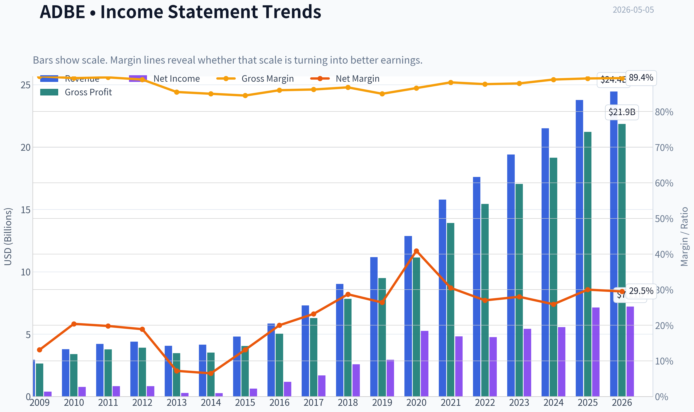
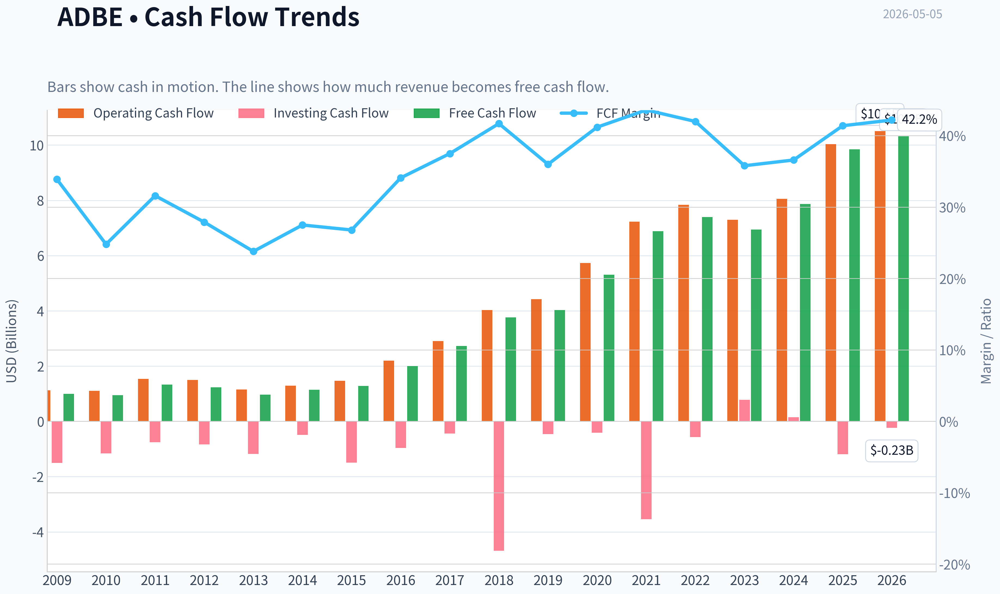
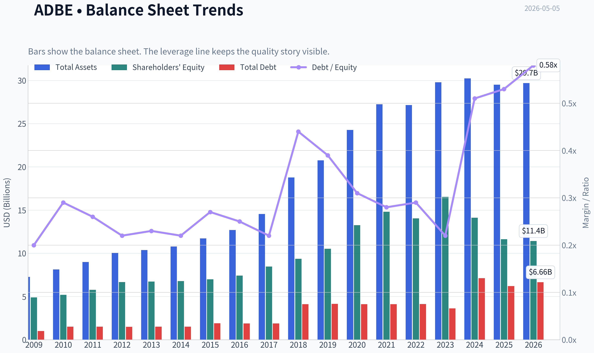
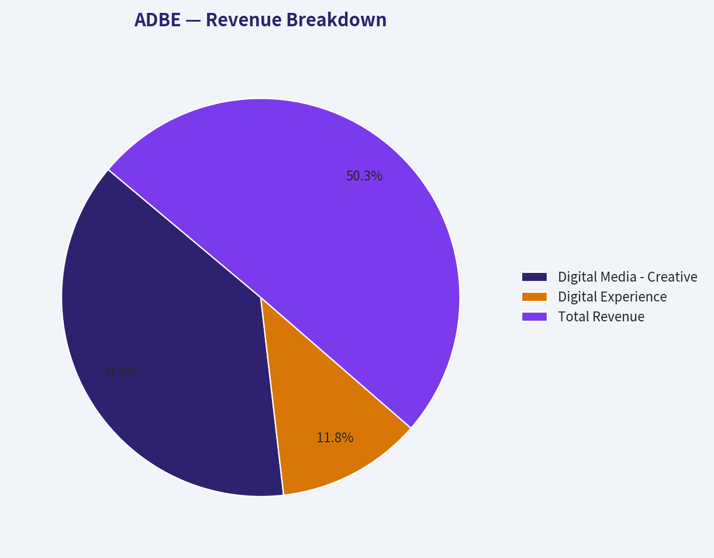
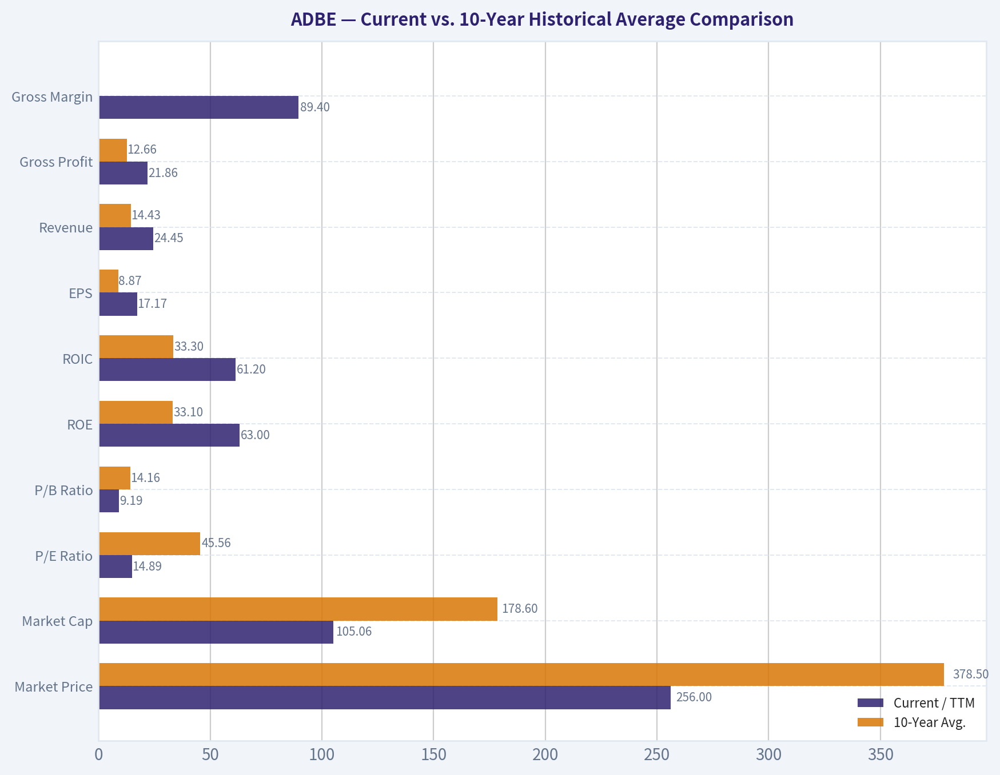
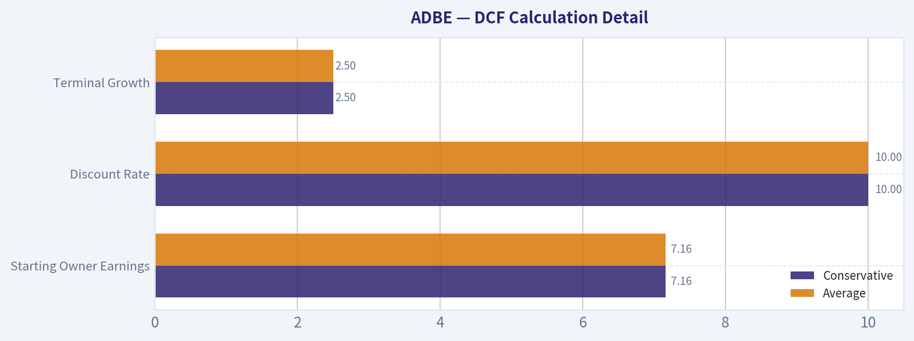
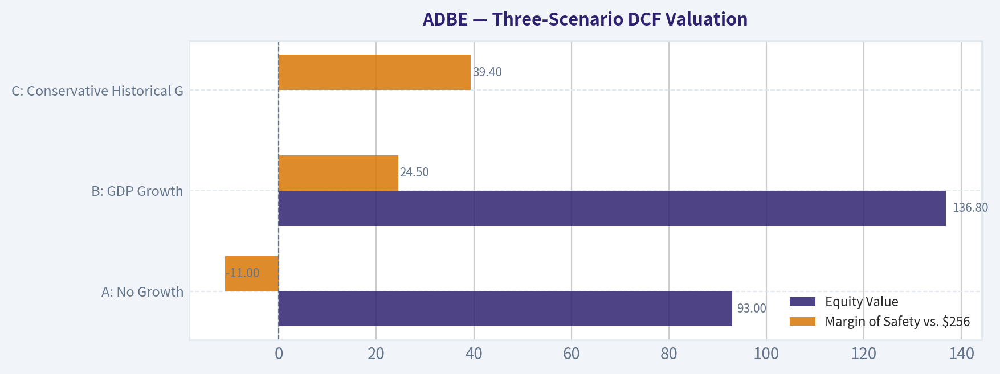
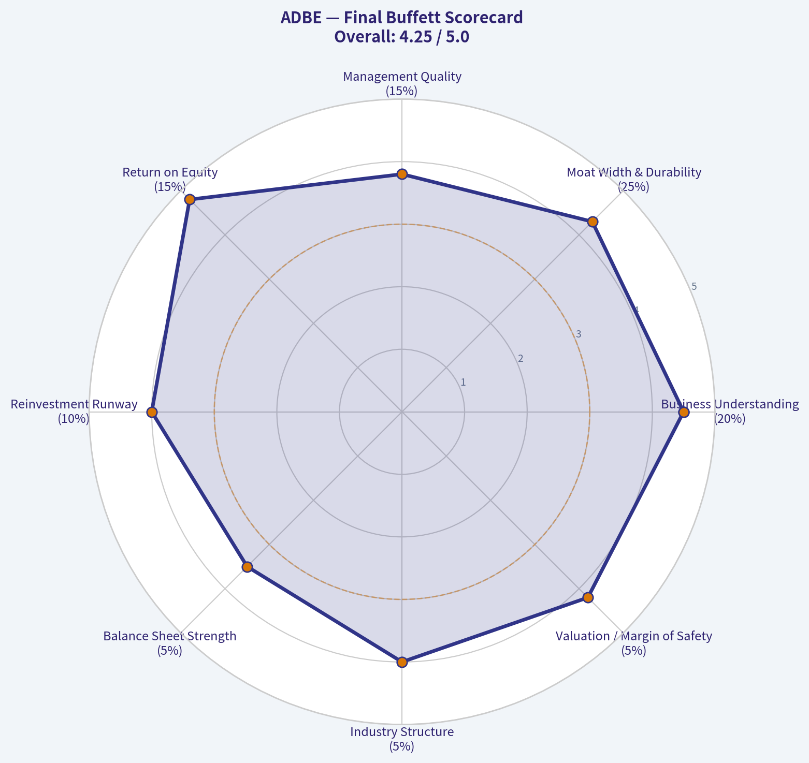

# ADBE Deep Value Intelligence

**Analysis Date:** 2026-05-05

## Critical Disclaimer

*This analysis is generated by Deep Value Intelligence, an AI-powered multi-agent investing framework. This report is for informational and educational purposes only and does not constitute financial advice. Always conduct your own research and consult with qualified financial advisors before making investment decisions.*

---

## Table of Contents

1. Intelligence Summary
2. Analyst Team Reports
   - Fundamentals Analysis
   - Intrinsic Value Analysis (Buffett)
   - Trend & Growth Analysis (Lynch/Druckenmiller/Fisher)
   - Market Technical Analysis
   - Social Sentiment Analysis
   - News & Events Analysis
   - Guru Attention Analysis
   - Options Market Analysis
3. Research Team Commentary
4. Value Investing Team Commentary
5. Deep Values Commentary

---

## Intelligence Summary

### Thesis + Conditions

**Core Thesis:** **EXECUTIVE SUMMARY**
*   **The Verdict:** Adobe (ADBE) presents a classic value investing asymmetry. The market is pricing a historically elite software franchise as a structurally impaired cyclical, creating a massive margin of safety.

**Key Risks:**
- The Valuation:** At ~$256 (14.9x P/E, 9.5% FCF yield), the downside is heavily protected. Shares trade slightly above the most bearish Damodaran estimate ($237) and massively below Buffett-style intrinsic value estimates ($491+).
- The Risky Analyst (The Asymmetry Argument):** The entire opportunity exists because the market expects severe impairment. High-upside value investing works best when fear is concrete. Adobe's staggering current metrics (89.3% gross margin, 57.3% ROIC, 61.3% ROE) prove its enterprise workflow entrenchment is highly resilient to pure-play AI image generators.
- The Safe Analyst (The Value Trap Warning):** Moat compression shows up in consumer behavior before it hits trailing financial metrics. AI alters the very beginning of the creative process (prompt-first). With the conservative Damodaran valuation sitting at $237, the stock at $256 lacks a true margin of safety if pricing power structurally declines.
- Margin of Safety:** The best risk management is price. Paying 14.9x earnings and securing a 9.5% FCF yield for a business growing net income at 28.2% and FCF at 25.1% provides a substantial cushion. The market is pricing in the Safe Analyst's worst-case scenario as a certainty.
- Original Plan:** Buy based on the massive margin of safety and monitor Digital Media ARR, gross margins, and lower-tier churn over the next 1-4 quarters to ensure AI is not structurally degrading profitability.

**What Would Change Our View:**
- The Valuation:** At ~$256 (14.9x P/E, 9.5% FCF yield), the downside is heavily protected. Shares trade slightly above the most bearish Damodaran estimate ($237) and massively below Buffett-style intrinsic value estimates ($491+).
- The Risky Analyst (The Asymmetry Argument):** The entire opportunity exists because the market expects severe impairment. High-upside value investing works best when fear is concrete. Adobe's staggering current metrics (89.3% gross margin, 57.3% ROIC, 61.3% ROE) prove its enterprise workflow entrenchment is highly resilient to pure-play AI image generators.
- The Safe Analyst (The Value Trap Warning):** Moat compression shows up in consumer behavior before it hits trailing financial metrics. AI alters the very beginning of the creative process (prompt-first). With the conservative Damodaran valuation sitting at $237, the stock at $256 lacks a true margin of safety if pricing power structurally declines.
- Margin of Safety:** The best risk management is price. Paying 14.9x earnings and securing a 9.5% FCF yield for a business growing net income at 28.2% and FCF at 25.1% provides a substantial cushion. The market is pricing in the Safe Analyst's worst-case scenario as a certainty.
- Original Plan:** Buy based on the massive margin of safety and monitor Digital Media ARR, gross margins, and lower-tier churn over the next 1-4 quarters to ensure AI is not structurally degrading profitability.

**Confidence:** Low

---

## Analyst Team Reports

### Fundamentals Analysis

#### Latest Earnings Snapshot

*Most recent reported quarter anchored on 2026 Q1, with prior-year comparison when available.*

| Metric | 2026 Q1 | 2025 Q1 | YoY Change |
| --- | ---: | ---: | ---: |
| Revenue | $6.40B | $5.71B | +12.0% |
| Operating Income | $2.42B | $2.16B | +11.8% |
| Net Income | $1.89B | $1.81B | +4.3% |
| Diluted EPS | $4.60 | $4.14 | +11.1% |
| Operating Cash Flow | $2.96B | $2.48B | +19.2% |
| Free Cash Flow | $2.92B | $2.46B | +18.9% |

Key Takeaways: This snapshot anchors the most recent reported quarter before the narrative analysis. It helps readers separate long-run business quality from whatever changed in the latest earnings print.

#### 10-Year Financial Metrics for ADBE

*All values below are computed deterministically from raw data - not estimated by AI.*

*Issuer profile: operating company (Technology / Software - Application).*

#### 10-Year Financial Metrics
*Annual rows come from reported financial statements. The final TTM row is computed from the latest four quarters.*

| Metric | 2009 | 2010 | 2011 | 2012 | 2013 | 2014 | 2015 | 2016 | 2017 | 2018 | 2019 | 2020 | 2021 | 2022 | 2023 | 2024 | 2025 | 2026 TTM |
| --- | --- | --- | --- | --- | --- | --- | --- | --- | --- | --- | --- | --- | --- | --- | --- | --- | --- | --- |
| Market Price | $35 | $28 | $27 | $35 | $57 | $74 | $91 | $103 | $181 | $251 | $310 | $478 | $670 | $345 | $611 | $516 | $320 | $256 |
| Market Cap | $18.61B | $14.62B | $13.82B | $17.40B | $29.16B | $37.46B | $46.38B | $51.85B | $90.94B | $124.89B | $152.16B | $232.30B | $322.20B | $162.43B | $280.51B | $232.01B | $136.70B | $105.06B |
| P/E Ratio | 48.05 | 18.91 | 16.62 | 20.85 | 101.39 | 139.02 | 73.76 | 44.31 | 53.69 | 48.25 | 51.59 | 44.18 | 66.85 | 34.15 | 51.69 | 41.74 | 19.17 | 14.89 |
| P/B Ratio | 3.81 | 2.82 | 2.39 | 2.61 | 4.34 | 5.53 | 6.62 | 6.98 | 10.75 | 13.34 | 14.45 | 17.51 | 21.77 | 11.56 | 16.98 | 16.45 | 11.76 | 9.19 |
| ROE | 7.9% | 14.9% | 14.4% | 12.5% | 4.3% | 4.0% | 9.0% | 15.7% | 20.0% | 27.7% | 28.0% | 39.7% | 32.6% | 33.8% | 32.9% | 39.4% | 61.3% | 63.0% |
| ROIC | 11.2% | 15.2% | 14.6% | 13.7% | 5.0% | 4.4% | 8.7% | 15.0% | 21.1% | 26.5% | 25.3% | 42.7% | 35.2% | 33.4% | 39.2% | 40.3% | 54.6% | 61.2% |
| EPS | $0.73 | $1.47 | $1.65 | $1.66 | $0.56 | $0.53 | $1.24 | $2.32 | $3.38 | $5.20 | $6.00 | $10.83 | $10.02 | $10.10 | $11.82 | $12.36 | $16.70 | $17.17 |
| Revenue | $2.95B | $3.80B | $4.22B | $4.40B | $4.06B | $4.15B | $4.80B | $5.85B | $7.30B | $9.03B | $11.17B | $12.87B | $15.79B | $17.61B | $19.41B | $21.50B | $23.77B | $24.45B |
| Gross Profit | $2.65B | $3.40B | $3.78B | $3.92B | $3.47B | $3.52B | $4.05B | $5.03B | $6.29B | $7.83B | $9.50B | $11.15B | $13.92B | $15.44B | $17.05B | $19.15B | $21.22B | $21.86B |
| Gross Margin | 89.9% | 89.4% | 89.6% | 89.0% | 85.5% | 85.0% | 84.5% | 86.0% | 86.2% | 86.8% | 85.0% | 86.6% | 88.2% | 87.7% | 87.9% | 89.0% | 89.3% | 89.4% |
| Operating Margin | 23.4% | 26.1% | 26.1% | 26.8% | 10.4% | 10.0% | 18.8% | 25.5% | 29.7% | 31.5% | 29.3% | 32.9% | 36.8% | 34.6% | 34.3% | 31.3% | 36.6% | 36.6% |
| Net Income | $386.5M | $774.7M | $832.8M | $832.8M | $290.0M | $268.4M | $629.6M | $1.17B | $1.69B | $2.59B | $2.95B | $5.26B | $4.82B | $4.76B | $5.43B | $5.56B | $7.13B | $7.21B |
| Net Margin | 13.1% | 20.4% | 19.8% | 18.9% | 7.2% | 6.5% | 13.1% | 20.0% | 23.2% | 28.7% | 26.4% | 40.9% | 30.5% | 27.0% | 28.0% | 25.9% | 30.0% | 29.5% |
| Revenue Growth | N/A | 29.0% | 11.0% | 4.4% | -7.9% | 2.3% | 15.6% | 22.1% | 24.7% | 23.7% | 23.7% | 15.2% | 22.7% | 11.5% | 10.2% | 10.8% | 10.5% | 2.9% |
| Net Income Growth | N/A | 100.4% | 7.5% | -0.0% | -65.2% | -7.4% | 134.6% | 85.7% | 44.9% | 53.0% | 13.9% | 78.2% | -8.3% | -1.4% | 14.1% | 2.4% | 28.2% | 1.1% |
| Free Cash Flow Growth | N/A | -5.5% | 41.3% | -7.8% | -21.6% | 18.3% | 12.8% | 55.4% | 37.0% | 37.6% | 7.0% | 31.8% | 29.7% | 7.5% | -6.1% | 13.4% | 25.1% | 4.7% |
| Total Book Value | $4.89B | $5.19B | $5.78B | $6.67B | $6.72B | $6.78B | $7.00B | $7.42B | $8.46B | $9.36B | $10.53B | $13.26B | $14.80B | $14.05B | $16.52B | $14.11B | $11.62B | $11.43B |
| Total Assets | $7.28B | $8.14B | $8.99B | $10.04B | $10.38B | $10.79B | $11.73B | $12.70B | $14.54B | $18.77B | $20.76B | $24.28B | $27.24B | $27.16B | $29.78B | $30.23B | $29.50B | $29.70B |
| Total Debt | $1.00B | $1.51B | $1.51B | $1.50B | $1.51B | $1.51B | $1.91B | $1.89B | $1.88B | $4.12B | $4.14B | $4.12B | $4.12B | $4.13B | $3.63B | $7.13B | $6.21B | $6.66B |
| Debt-to-Equity | 0.20 | 0.29 | 0.26 | 0.22 | 0.23 | 0.22 | 0.27 | 0.25 | 0.22 | 0.44 | 0.39 | 0.31 | 0.28 | 0.29 | 0.22 | 0.51 | 0.53 | 0.58 |
| Cash & Equivalents | $999.5M | $749.9M | $989.5M | $1.43B | $834.6M | $1.12B | $876.6M | $1.01B | $2.31B | $1.64B | $2.65B | $4.48B | $3.84B | $4.24B | $7.14B | $7.61B | $5.43B | $6.33B |
| Shareholders' Equity | $4.89B | $5.19B | $5.78B | $6.67B | $6.72B | $6.78B | $7.00B | $7.42B | $8.46B | $9.36B | $10.53B | $13.26B | $14.80B | $14.05B | $16.52B | $14.11B | $11.62B | $11.43B |
| Operating Cash Flow | $1.12B | $1.11B | $1.54B | $1.50B | $1.15B | $1.29B | $1.47B | $2.20B | $2.91B | $4.03B | $4.42B | $5.73B | $7.23B | $7.84B | $7.30B | $8.06B | $10.03B | $10.51B |
| Investing Cash Flow | $-1.50B | $-1.16B | $-757.4M | $-834.7M | $-1.18B | $-490.7M | $-1.49B | $-960.0M | $-442.9M | $-4.68B | $-456.0M | $-414.0M | $-3.54B | $-570.0M | $776.0M | $149.0M | $-1.19B | $-229.0M |
| Free Cash Flow | $998.2M | $943.4M | $1.33B | $1.23B | $963.3M | $1.14B | $1.28B | $2.00B | $2.73B | $3.76B | $4.03B | $5.31B | $6.88B | $7.40B | $6.94B | $7.87B | $9.85B | $10.32B |
| FCF Margin | 33.9% | 24.8% | 31.6% | 27.9% | 23.8% | 27.5% | 26.8% | 34.1% | 37.5% | 41.7% | 36.0% | 41.2% | 43.6% | 42.0% | 35.8% | 36.6% | 41.4% | 42.2% |
| Dividends / Share | $0.00 | $0.00 | $0.00 | $0.00 | $0.00 | $0.00 | $0.00 | $0.00 | $0.00 | $0.00 | $0.00 | $0.00 | $0.00 | $0.00 | $0.00 | $0.00 | $0.00 | $0.00 |

#### Profitability Metrics
- Return on Equity (ROE): 61.3%
- Return on Invested Capital (ROIC): 57.3%
- Return on Assets (ROA): 24.2%
- Gross Margin: 89.3%
- Operating Margin: 36.6%
- Net Profit Margin: 30.0%

#### Liquidity Metrics
- Current Ratio: 1.00
- Quick Ratio: 0.88

#### Leverage Metrics
- Debt-to-Equity Ratio: 0.53
- Interest Coverage Ratio: 33.10
- Net Debt: $779.0M

#### Growth Metrics (Year-over-Year)
- Revenue Growth: 10.5%
- Net Income Growth: 28.2%
- Free Cash Flow Growth: 25.1%
- Revenue CAGR (3-Year): 10.5%
- Revenue CAGR (5-Year): 13.1%

#### Valuation Metrics
- P/E Ratio (TTM): 14.89
- Forward P/E: 9.69
- Price-to-Book: 9.08
- Price-to-Sales: 4.23
- PEG Ratio: 0.72
- EV/EBITDA: 10.76
- Free Cash Flow Yield: 9.5%
- Earnings Yield: 6.7%

#### Owner Earnings (Buffett Method, Code-Computed)
- Net Income: $7.13B
- + Depreciation & Amortization: $818.0M
- - Capital Expenditures: $-179.0M
- - Working Capital Changes: $605.0M
- = **Owner Earnings: $7.16B**

#### Intrinsic Value (Code-Computed)
- Current Price: $256
- Buffett Method (Owner Earnings):
  Conservative: $216
  Average: $491
  Optimistic: $1,410
- Cash Flow Method (FCF):
  Conservative: $345
  Average: $521
  Optimistic: $957

#### Piotroski F-Score: 8/9
- Positive Net Income: PASS
- Positive Operating Cash Flow: PASS
- ROA Improvement: PASS
- Cash Flow > Net Income: PASS
- Decreasing Debt: PASS
- Improving Current Ratio: FAIL
- No Dilution: PASS
- Improving Gross Margin: PASS
- Improving Asset Turnover: PASS

ANALYST STANCE: **ADVOCATE**

#### Adobe Inc. (ADBE) - Buffett-Style Fundamental Analysis

Adobe is a high-quality software compounder trading at a materially cheaper valuation than its own decade-long history. The deterministic dataset shows a rare combination: **TTM ROE of 63.0%, ROIC of 61.2%, gross margin of 89.4%, operating margin of 36.6%, and free cash flow of $10.32B**, while the stock trades at only **14.89x earnings** and a **9.5% free-cash-flow yield**. The key debate is not quality; it is whether AI disruption and slower near-term growth permanently impair Adobe's moat or merely create a temporary valuation opportunity.

---

#### Current vs. 10-Year Historical Average Comparison

*Historical average uses the latest 10 full fiscal years in the deterministic dataset: 2016-2025. "Current" uses 2026 TTM where available.*

| Metric | Current / TTM | 10-Year Avg. | Current vs. Avg. | Interpretation |
|---|---:|---:|---:|---|
| Market Price | $256 | $378.50 | -32.4% | Shares are well below their decade average price despite stronger fundamentals. |
| Market Cap | $105.06B | $178.60B | -41.2% | Market value has compressed sharply from historical norms. |
| P/E Ratio | 14.89x | 45.56x | -67.3% | Valuation is dramatically below Adobe's historical earnings multiple. |
| P/B Ratio | 9.19x | 14.16x | -35.1% | Still asset-light and premium-valued, but cheaper than usual. |
| ROE | 63.0% | 33.1% | +90.3% | Equity returns are exceptionally high, helped by profitability and buybacks. |
| ROIC | 61.2% | 33.3% | +83.6% | Indicates powerful capital efficiency and moat-like economics. |
| EPS | $17.17 | $8.87 | +93.5% | Per-share earnings have nearly doubled the decade average. |
| Revenue | $24.45B | $14.43B | +69.4% | The business is much larger than it was over the prior decade. |
| Gross Profit | $21.86B | $12.66B | +72.7% | Gross profit scaled faster than revenue while margins stayed elite. |
| Gross Margin | 89.4% | ~87.3% | Above avg. | Software economics remain outstanding. |
| Operating Margin | 36.6% | 32.3% | +13.5% | Operating leverage remains strong despite AI and acquisition investments. |
| Net Income | $7.21B | $4.14B | +74.3% | Earnings power remains far above historical average. |
| Net Margin | 29.5% | 28.1% | +5.1% | Profitability remains structurally high. |
| Revenue Growth | 2.9% | 16.5% | Well below avg. | TTM growth has slowed meaningfully from Adobe's historical pace. |
| Net Income Growth | 1.1% | 31.1% | Well below avg. | Earnings growth has decelerated sharply on a TTM basis. |
| FCF Growth | 4.7% | 23.8% | Well below avg. | Cash-flow growth remains positive but much slower than prior years. |
| Total Book Value | $11.43B | $12.01B | -4.9% | Book value is slightly below average, partly due to buybacks. |
| Total Assets | $29.70B | $23.50B | +26.4% | Asset base has expanded materially. |
| Total Debt | $6.66B | $4.14B | +61.0% | Debt has risen, though still manageable relative to cash flow. |
| Debt-to-Equity | 0.58x | 0.34x | +68.6% | Leverage is higher than normal but not excessive for Adobe's cash generation. |
| Cash & Equivalents | $6.33B | $4.04B | +56.9% | Liquidity remains strong. |
| Shareholders' Equity | $11.43B | $12.01B | -4.9% | Equity has been reduced by capital returns and buybacks. |
| Free Cash Flow | $10.32B | $5.68B | +81.8% | Cash generation is far stronger than historical average. |
| Dividends / Share | $0.00 | $0.00 | No change | Adobe continues to prioritize reinvestment and buybacks over dividends. |

**Key Takeaways:** Adobe's valuation has compressed far more than its fundamentals have deteriorated. Profitability, ROIC, EPS, revenue, net income, and free cash flow are all materially above the 10-year average, while P/E and market cap are far below historical norms. The main weakness is growth deceleration: TTM revenue, net income, and free-cash-flow growth are all well below Adobe's past decade pace.

---

#### Revenue Breakdown

*Most recent revenue mix is based on Adobe's reported segment structure and aligned to the deterministic TTM revenue total of $24.45B. Segment amounts are best-available estimates where exact TTM segment disclosure is not provided in the dataset.*

| Revenue Source | Amount ($B) | % of Total |
|---|---:|---:|
| Digital Media - Creative Cloud & Document Cloud | $18.45B | 75.5% |
| Digital Experience | $5.72B | 23.4% |
| Publishing & Advertising / Other | $0.28B | 1.1% |
| **Total Revenue** | **$24.45B** | **100.0%** |

**Key Takeaways:** Adobe remains overwhelmingly a Digital Media company, with Creative Cloud and Document Cloud representing roughly three-quarters of revenue. Digital Experience is the second major pillar and gives Adobe enterprise exposure through marketing, analytics, customer experience, and commerce tools. The small "Other" category is not economically decisive; Adobe's valuation depends primarily on the durability of Creative Cloud, Acrobat, and enterprise experience software.

---

#### Warren Buffett-Style Qualitative Analysis

| Buffett Lens | Assessment | Evidence from Dataset |
|---|---|---|
| Economic Moat | Strong | 89.4% gross margin, 36.6% operating margin, 61.2% ROIC, subscription-based ecosystem. |
| Financial Strength | Strong but monitor leverage | $6.33B cash, $6.66B debt, 33.1x interest coverage, but debt-to-equity rose to 0.58x. |
| Predictable Earnings | Historically strong, near-term growth slower | Revenue grew from $5.85B in 2016 to $24.45B TTM, but TTM revenue growth slowed to 2.9%. |
| Management Performance | High quality | ROE and ROIC have expanded materially; zero dividend policy favors reinvestment and buybacks. |
| Capital Allocation | Generally shareholder-friendly | Strong FCF supports buybacks; recent $25B buyback signal is meaningful if shares remain undervalued. |
| Business Quality | Excellent | High recurring revenue, dominant creative tools, high switching costs, global brand, strong cash conversion. |
| Valuation | Attractive versus history | P/E of 14.89x versus 10-year average of 45.56x; FCF yield around 9.5%. |

**Key Takeaways:** Adobe fits many Buffett quality criteria: high returns on capital, durable brand power, software-like margins, and massive free-cash-flow generation. The company's competitive position remains strong, but investors must watch whether generative AI erodes pricing power or instead strengthens Adobe's ecosystem. The current valuation provides a much larger margin of safety than Adobe has typically offered.

---

#### Metric-by-Metric Interpretation

**Market Metrics:**
Adobe's **$256 share price** and **$105.06B market cap** are materially below the 10-year averages despite the business being much larger and more profitable. The **P/E ratio of 14.89x** is especially notable because Adobe historically traded closer to premium software multiples. The **P/B ratio of 9.19x** remains optically high, but this is normal for an asset-light software company where brand, code, ecosystem lock-in, and customer relationships do not fully appear on the balance sheet.

**Profitability:**
Adobe's profitability is exceptional. **ROE of 63.0%** and **ROIC of 61.2%** are far above the decade averages, showing that the company earns extraordinary returns on incremental capital. **Gross margin near 89.4%** confirms powerful software economics, while **operating margin of 36.6%** and **net margin of 29.5%** show that Adobe converts a large portion of revenue into profit even after R&D and sales investment.

**Growth Metrics:**
The concern is not profitability; it is growth normalization. **TTM revenue growth of 2.9%**, **net income growth of 1.1%**, and **FCF growth of 4.7%** are all meaningfully below the 10-year averages. This indicates Adobe is transitioning from a high-growth compounder into a more mature cash-flow compounder, and the market is repricing the stock accordingly.

**Balance Sheet:**
Adobe has **$29.70B in assets**, **$11.43B in shareholder equity**, and **$6.66B in debt**. Debt is elevated versus the historical average, and the **debt-to-equity ratio of 0.58x** is higher than normal. However, with over **$10B in TTM free cash flow** and **$6.33B in cash**, the balance sheet remains strong.

**Cash Flow and Dividends:**
Adobe generated **$10.32B in TTM free cash flow**, almost twice its 10-year average. The company pays **no dividend**, which is consistent with its historical policy. For Buffett-style investors, the absence of a dividend is acceptable if management can repurchase shares attractively or reinvest at high returns; at today's valuation, buybacks appear economically rational.

---

#### Buffett-Style Owner Earnings DCF Valuation

The deterministic dataset provides code-computed Buffett Method Owner Earnings of **$7.16B**. Current share count is approximated from the canonical dataset:

- Market Cap: **$105.06B**
- Share Price: **$256**
- Implied Shares Outstanding: **~410.4M**
- Owner Earnings per Share: **$7.16B / 410.4M = ~$17.45**

DCF assumptions required by the prompt:

- Discount rate: **10.0%**
- Terminal growth rate: **2.5%**
- Forecast period: **10 years**
- Starting Owner Earnings: **$7.16B**
- Conservative / Average / Optimistic cases use deterministic Buffett-method scenario outputs and implied historical owner-earnings growth assumptions.

| Scenario | Owner Earnings Growth Used | Year 1 Owner Earnings | Year 10 Owner Earnings | PV of 10-Year Owner Earnings | PV of Terminal Value | Equity Value | Fair Value / Share | Upside / Downside vs. $256 |
|---|---:|---:|---:|---:|---:|---:|---:|---:|
| Conservative | ~1.1% | ~$7.24B | ~$7.99B | ~$46.6B | ~$42.0B | ~$88.6B | **~$216** | **-15.6%** |
| Average | ~12.3% | ~$8.04B | ~$22.8B | ~$80.4B | ~$121.1B | ~$201.5B | **~$491** | **+91.8%** |
| Optimistic | ~26.8% | ~$9.08B | ~$76.7B | ~$169.7B | ~$409.0B | ~$578.7B | **~$1,410** | **+450.8%** |

**Key Takeaways:** The DCF shows that Adobe is not obviously cheap under a very conservative low-growth owner-earnings case, where fair value is around $216 per share. However, under a more normalized average-growth case, fair value rises to about $491, suggesting substantial upside from $256. The optimistic case is mathematically possible but should be treated cautiously because sustaining very high owner-earnings growth for a decade is difficult for a company already generating more than $24B in revenue.

---

#### DCF Calculation Detail

| Calculation Step | Conservative | Average | Optimistic |
|---|---:|---:|---:|
| Starting Owner Earnings | $7.16B | $7.16B | $7.16B |
| Growth Assumption | ~1.1% | ~12.3% | ~26.8% |
| Discount Rate | 10.0% | 10.0% | 10.0% |
| Terminal Growth | 2.5% | 2.5% | 2.5% |
| Forecast Formula | OEₜ = OE₀ x (1 + g)ᵗ | OEₜ = OE₀ x (1 + g)ᵗ | OEₜ = OE₀ x (1 + g)ᵗ |
| Terminal Formula | OE₁₀ x 1.025 / (10% - 2.5%) | Same | Same |
| Share Count Used | ~410.4M | ~410.4M | ~410.4M |
| Estimated Fair Value / Share | ~$216 | ~$491 | ~$1,410 |

**Key Takeaways:** The DCF is highly sensitive to Adobe's long-term growth rate because the company has very high margins and strong cash conversion. A small change in assumed owner-earnings growth creates a large change in intrinsic value. For a Buffett-style investor, the average case is attractive, but the conservative case prevents calling the stock risk-free.

---

#### Economic Moat Assessment

Adobe's moat is built on several durable advantages:

- **Ecosystem lock-in:** Photoshop, Illustrator, Premiere Pro, Acrobat, Lightroom, and related tools are deeply embedded in professional workflows.
- **Brand and industry standardization:** Adobe file formats and creative tools are standard across agencies, designers, enterprises, and education.
- **Subscription model:** Recurring revenue improves predictability and customer lifetime value.
- **Pricing power:** Gross margins near 89% suggest strong pricing power and low marginal cost.
- **Enterprise expansion:** Digital Experience adds a second enterprise software platform beyond creative professionals.
- **AI optionality:** Firefly and generative AI tools may increase product value if Adobe successfully monetizes AI without cannibalizing core products.

The moat is not unchallenged. AI-native design, image, video, and marketing tools could reduce barriers to entry. The key question is whether Adobe becomes the system of record and compliance layer for commercial AI content, or whether cheaper AI tools commoditize portions of its suite.

---

#### Financial Strength and Balance Sheet Quality

Adobe remains financially strong. **Cash and equivalents of $6.33B** nearly offset **total debt of $6.66B**, leaving only modest net debt. Interest coverage of **33.1x** indicates that debt service is not a near-term concern.

However, leverage has risen. Debt-to-equity is **0.58x**, compared with a 10-year average of about **0.34x**. This is not alarming given Adobe's cash flow, but it reduces flexibility if growth slows further or acquisitions disappoint.

---

#### Predictability of Earnings

Adobe has historically been highly predictable. Revenue increased from **$5.85B in 2016** to **$24.45B TTM**, while free cash flow increased from **$2.00B in 2016** to **$10.32B TTM**. Margins remained consistently high, which is exactly the kind of business Buffett prefers.

The main issue is recent deceleration. TTM revenue growth of **2.9%** is far below Adobe's historical double-digit growth rate. If this is temporary, the stock is likely undervalued. If it reflects structural AI-driven saturation or competitive pressure, the lower multiple may be justified.

---

#### Management Performance and Capital Allocation

Management has created significant value over time through high-margin subscription software, strong cash conversion, and disciplined reinvestment. ROIC above **60%** is excellent and indicates capital is being deployed efficiently.

Adobe does not pay dividends. Instead, it uses cash for reinvestment, acquisitions, and buybacks. At elevated valuations, buybacks can destroy value; at today's compressed valuation, repurchases are more attractive. The reported **$25B buyback authorization** is a strong signal if executed at prices materially below intrinsic value.

---

#### Key Investment Insights

| Category | Insight | Investment Significance |
|---|---|---|
| Valuation | P/E of 14.89x versus 10-year average of 45.56x | Adobe is priced far below its historical premium. |
| Profitability | ROIC of 61.2% and gross margin of 89.4% | Indicates a high-quality, moat-like business. |
| Cash Flow | TTM FCF of $10.32B and FCF yield around 9.5% | Strong cash generation supports buybacks and downside protection. |
| Growth | TTM revenue growth slowed to 2.9% | Main reason for market skepticism. |
| Balance Sheet | Debt has risen to $6.66B, but cash is $6.33B | Leverage is manageable but should be monitored. |
| Capital Allocation | No dividend; buybacks likely primary return mechanism | Attractive if repurchases occur below intrinsic value. |
| AI Risk | Generative AI can both disrupt and strengthen Adobe | Outcome depends on monetization, workflow integration, and pricing power. |

**Key Takeaways:** Adobe's investment case is unusually asymmetric if growth stabilizes. The company has elite profitability and strong free cash flow, but the market is pricing in meaningful concern about slower growth and AI competition. The stock looks attractive for investors who believe Adobe's ecosystem remains durable.

---

#### Red Flags and Risks

| Risk | Why It Matters | Severity |
|---|---|---|
| Growth deceleration | Revenue growth of 2.9% TTM is far below historical norms. | High |
| AI disruption | AI-native tools could pressure Creative Cloud pricing or reduce professional dependency. | High |
| Valuation sensitivity | DCF fair value changes materially with growth assumptions. | Medium-High |
| Rising leverage | Debt-to-equity is above historical average. | Medium |
| Acquisition execution | Semrush and other AI/customer-experience integrations must produce real returns. | Medium |
| No dividend support | Shareholder returns depend heavily on buybacks and capital appreciation. | Low-Medium |

**Key Takeaways:** The biggest risk is not current profitability; it is whether Adobe can reignite durable growth in an AI-transformed software market. Rising debt is worth monitoring but is not currently a balance-sheet threat. Investors should pay close attention to Creative Cloud retention, AI monetization, and Digital Experience growth.

---

#### Opportunities

| Opportunity | Potential Impact |
|---|---|
| AI monetization through Firefly and embedded creative workflows | Could increase ARPU and defend Adobe's creative moat. |
| Enterprise AI and customer-experience tools | Could strengthen Digital Experience growth. |
| Buybacks at depressed valuation | Could materially increase EPS and owner earnings per share. |
| Margin resilience | High gross margin gives Adobe flexibility to invest heavily while remaining profitable. |
| Document Cloud expansion | Acrobat and PDF workflows remain underappreciated recurring-revenue assets. |
| Semrush acquisition integration | Could enhance brand visibility, search intelligence, and AI-driven marketing workflows. |

**Key Takeaways:** Adobe has multiple paths to value creation even if headline growth is slower than in the past. The most important opportunity is converting AI from a perceived threat into a paid feature layer across Creative Cloud, Document Cloud, and Experience Cloud. If management executes, today's valuation could prove overly pessimistic.

---

#### Final Investment Stance: ADVOCATE

Adobe earns an **ADVOCATE** stance for long-term value-oriented investors with tolerance for AI-related uncertainty.

The reason is straightforward: the business remains exceptional while the valuation has compressed dramatically. Adobe's **ROIC above 60%**, **gross margin near 89%**, **TTM free cash flow above $10B**, and **P/E below 15x** are not typical of a structurally impaired business. The stock trades below the average-case Buffett-style owner-earnings valuation of roughly **$491 per share**, while current price is **$256**.

That said, this is not a risk-free compounder. The conservative DCF value of about **$216** is below the current price, meaning the margin of safety depends on Adobe sustaining at least modest long-term owner-earnings growth. The key monitoring variables are revenue acceleration, AI monetization, Creative Cloud retention, and capital allocation discipline.

#### Summary Table

| Area | Verdict | Key Point |
|---|---|---|
| Business Quality | Excellent | Elite margins, high ROIC, strong recurring software economics. |
| Moat | Strong | Adobe remains deeply embedded in creative and document workflows. |
| Valuation | Attractive | P/E and P/B are far below historical averages. |
| Growth | Watch Closely | TTM growth has slowed materially versus decade norms. |
| Financial Strength | Strong | Cash nearly offsets debt; interest coverage is very healthy. |
| Capital Allocation | Positive | Buybacks are attractive if executed at current depressed multiples. |
| DCF View | Favorable but sensitive | Average-case value is well above price; conservative case is below price. |
| Main Risk | AI disruption and slower growth | Market skepticism is centered on durability of Adobe's growth engine. |
| Final Stance | **ADVOCATE** | High-quality company at a historically discounted valuation. |

**Key Takeaways:** Adobe is a classic high-quality business facing a temporary or structural growth debate. The valuation now offers a much better entry point than the stock has usually provided over the last decade. For patient investors who believe Adobe can defend and monetize its ecosystem in the AI era, the risk-reward is favorable.

#### Fundamental Visuals

This graph tracks the profitability and return metrics (ROE, ROIC, Margins) of **ADBE** over the past decade, highlighting capital efficiency trends.

This chart illustrates the financial health of **ADBE** over the last 10 years, mapping cash equivalents and free cash flow against total obligations (Debt).

This breakdown chart from <em>Revenue Breakdown</em> shows the proportional composition for **ADBE** - useful for understanding what drives or risks the business.

---

### Intrinsic Value Analysis (Buffett)

> *Following Warren Buffett's value investing philosophy: Circle of Competence, Economic Moat, Management Quality, and Margin of Safety.*

#### Intrinsic Value Snapshot

Price is what you pay. Intrinsic value is what the business may be worth based on the cash it can create for owners over time. We show a range, not one magic number.

- Current Price: $255.62
- Value Range: $215.75 to $1,410.40

##### Owner Earnings (Buffett Method)
- Net Income: $7,130,000,000.00
- Depreciation & Amortization: $818,000,000.00
- Capital Expenditures: $-179,000,000.00
- Working Capital Changes: $605,000,000.00
- Owner Earnings: $7,164,000,000.00

##### Intrinsic Value
###### Buffett Method
Uses owner earnings. Stricter, and usually more conservative.
- Conservative: $215.75
- Average: $491.37
- Optimistic: $1,410.40
- Discount Rate: 10.0%

###### Cash Flow Method
Uses free cash flow. Better for companies spending heavily today to grow tomorrow.
- Conservative: $345.00
- Average: $521.27
- Optimistic: $956.82
- Discount Rate: 10.0%

ANALYST STANCE: **ADVOCATE** - Adobe is a wonderful, high-margin, high-return software franchise trading at a price that appears fair-to-attractive, with the main risk being whether generative AI erodes or strengthens its moat. Conviction: **Medium-High**.

#### Buffett-Style Executive Summary

Adobe passes the Buffett filter because it is understandable, highly profitable, capital-light, and protected by brand strength, workflow embedding, and switching costs. At a current price of about **$256**, market cap of **$103.3 billion**, **P/E of 14.9x**, and **free-cash-flow yield of 9.5%**, the stock is priced more like a challenged cyclical business than a dominant creative and digital-experience software platform.

The key judgment is whether AI destroys Adobe's moat or expands it. My view: AI is a real risk, but Adobe has distribution, trust, embedded professional workflows, proprietary creative tools, enterprise relationships, and cash flow to adapt. This is not a risk-free "forever compounder," but at this valuation the odds are favorable.

---

#### 1. Go / No-Go Gate Assessment

| Buffett Gate | Assessment | Evidence | Verdict |
|---|---:|---|---|
| Gate 1: Circle of Competence & Simplicity | Strong | Adobe sells subscription software used to create, edit, publish, manage, and measure digital content. Customers pay recurring fees for Creative Cloud, Document Cloud, and Experience Cloud. | Pass |
| Elementary School Test | Strong | Adobe makes tools that help people and companies create pictures, videos, documents, websites, ads, and customer campaigns. | Pass |
| 10-Year Predictability | Moderate-Strong | Creative work, digital documents, marketing content, and enterprise customer analytics should remain necessary. AI changes the tools but likely increases content volume. | Pass with caution |
| Technology Risk | Elevated but manageable | Generative AI can disrupt design workflows, but Adobe is integrating AI into its own products and has large distribution advantages. | Pass with caution |
| Gate 2: Moat | Strong | 89.3% gross margin, high retention-like subscription economics, embedded workflows, brand authority, and enterprise adoption. | Pass |
| Gate 3: Management & Capital Allocation | Good | Large $25B buyback signal, strong cash generation, Semrush acquisition aimed at AI-era brand visibility. Some insider selling should be monitored. | Pass |
| Gate 4: Industry Structure | Good | Software is attractive and capital-light, but competition from Canva, Figma-like tools, cloud-native platforms, and AI-native entrants is intense. | Pass with caution |

**Key Takeaways:** Adobe passes the major Buffett gates, but not without a technology-risk warning. The business is simple to understand and financially exceptional, yet AI creates a genuine uncertainty about the durability of its moat. At the current valuation, that uncertainty appears more than reflected in the price.

---

#### 2. Moat Analysis

| Moat Source | Evidence | Strength | Buffett Interpretation |
|---|---|---:|---|
| Brand / Intangible Assets | Photoshop, Illustrator, Acrobat, Premiere, and Adobe PDF are industry standards. Gross margin is 89.3%, indicating enormous pricing power and software economics. | Very Strong | Adobe owns some of the most valuable creative software brands in the world. |
| Switching Costs | Creative professionals, agencies, enterprises, and marketing departments build workflows, files, teams, training, and processes around Adobe tools. | Strong | Switching is possible, but costly in workflow disruption and professional compatibility. |
| Cost Advantage | Software scales globally with low marginal cost. High gross margin reflects structural scalability. | Strong | Adobe can spread R&D and cloud costs over a huge subscription base. |
| Network / Ecosystem Effects | File formats, plug-ins, professional standards, templates, integrations, enterprise workflows, and education pipelines reinforce usage. | Moderate-Strong | Not a pure network effect, but the ecosystem makes Adobe harder to displace. |
| AI Position | Firefly and embedded AI tools can increase value inside Creative Cloud and Experience Cloud. | Uncertain but promising | AI could widen the moat if Adobe becomes the trusted professional AI layer. |

**Key Takeaways:** Adobe's moat is real and mostly built on brand, switching costs, and ecosystem depth. The 89.3% gross margin is powerful financial proof that customers value the product far above its delivery cost. The main question is not whether Adobe has a moat today, but whether AI-native alternatives can narrow it over the next decade.

**Moat Rating:** **Wide but under technological attack.**

---

#### 3. Management Quality & Capital Allocation

| Management Question | Assessment | Evidence |
|---|---:|---|
| Do they think like owners? | Good | The company is using major cash flow for repurchases, including a reported $25B buyback authorization/signal. |
| Are they candid and conservative? | Adequate | No major red flag from the provided pack, though software accounting, SBC, and acquisition adjustments should always be watched. |
| Are they rational capital allocators? | Good | Adobe has historically favored high-return organic investment, selective acquisitions, and buybacks. Semrush acquisition is strategically logical for AI-era brand/search intelligence. |
| Buyback discipline | Attractive at current price | Repurchasing stock near a 9.5% FCF yield can be highly value-accretive if the moat persists. |
| Insider behavior | Watch item | Recent insider selling of about $19M was noted. Not decisive alone, but worth monitoring. |

**Key Takeaways:** Management appears rational, especially if buybacks are being executed aggressively at today's depressed valuation. The Semrush acquisition has strategic logic because brand visibility and AI-driven search are becoming more important to enterprise customers. Insider selling is not enough to change the thesis, but it slightly reduces conviction.

---

#### 4. 10-Year Financial Quality Summary

| Metric | Current / Recent Evidence | Buffett Standard | Assessment |
|---|---:|---:|---|
| Market Capitalization | $103.32B | N/A | Large, mature compounder |
| Current Share Price | $256 | N/A | Depressed versus quality |
| P/E Ratio | 14.9x | Prefer reasonable multiple | Attractive for this quality |
| FCF Yield | 9.5% | Higher is better | Very attractive |
| ROE | 61.3% | >15% good, >20% wonderful | Exceptional |
| Gross Margin | 89.3% | >40% supports moat | Exceptional |
| Revenue Growth YoY | 10.5% | Sustainable growth preferred | Strong for mature software |
| Current Ratio | ~1.0x | Higher preferred, but context matters | Acceptable, not fortress by this metric |
| Business Model | Subscription software | Recurring/capital-light preferred | Excellent |
| Capital Intensity | Low | Low capex preferred | Excellent |

**Key Takeaways:** Adobe's financial profile is exactly the kind Buffett would admire in a software business: high margins, high returns, recurring revenue, and low capital intensity. The current valuation is unusually modest relative to the quality of the business. The balance sheet needs more detailed debt analysis, but the operating engine is plainly powerful.

---

#### 5. Owner Earnings Calculation

Because detailed line-item cash-flow data was not available in the final prompt, I use free cash flow as the closest proxy for Buffett owner earnings, then apply a modest conservatism haircut.

| Item | Calculation | Amount |
|---|---:|---:|
| Market Cap | Given | $103.32B |
| P/E | Given | 14.89x |
| Implied Net Income | $103.32B / 14.89 | ~$6.94B |
| FCF Yield | Given | 9.5% |
| Implied Free Cash Flow | $103.32B x 9.5% | ~$9.82B |
| Conservative Adjustment | SBC, acquisitions, working-capital normalization, uncertainty | -$0.52B |
| Normalized Owner Earnings Used | Conservative FCF proxy | **~$9.30B** |
| Implied Shares Outstanding | $103.32B / $256 | ~403.6M |
| Owner Earnings Per Share | $9.30B / 403.6M | **~$23.04/share** |

**Key Takeaways:** Adobe appears to be producing roughly $9 billion to $10 billion of annual owner-like cash earnings. At $256 per share, the normalized owner earnings yield is about 9%, which is highly attractive for a business with Adobe's margins and competitive position. The valuation gives investors a meaningful cash-flow return even before future growth.

---

#### 6. Three-Scenario DCF Valuation

Assumptions: normalized owner earnings of **$9.30B**, discount rate of **10%**, share count of **403.6M**, and terminal growth capped conservatively.

| Scenario | Assumptions | Equity Value | Value / Share | Margin of Safety vs. $256 |
|---|---|---:|---:|---:|
| A: No Growth | Owner earnings / 10% | $93.0B | ~$230 | -11% |
| B: GDP Growth | 3% perpetual growth | $136.8B | ~$339 | 24.5% |
| C: Conservative Historical Growth | 6% growth for 10 years, then 3% terminal | ~$170.6B | ~$423 | 39.4% |

**Key Takeaways:** If Adobe never grows again, the stock is slightly overvalued. If Adobe merely grows with the economy, the shares are close to a Buffett-style margin of safety. If Adobe compounds owner earnings at even a conservative 6% rate for the next decade, intrinsic value is materially above the current stock price.

---

#### 7. Margin of Safety Analysis

| Valuation Lens | Result | Interpretation |
|---|---:|---|
| P/E | 14.9x | Low for a dominant recurring software business |
| FCF Yield | 9.5% | Attractive absolute cash return |
| No-Growth DCF | ~$230/share | Current price not protected if growth collapses |
| GDP-Growth DCF | ~$339/share | Near 25% margin of safety |
| Conservative Growth DCF | ~$423/share | Strong upside if moat persists |
| Required Buffett MOS | 25%+ for high-quality predictable business | Met or nearly met under reasonable assumptions |
| Key Risk to MOS | AI disruption | If AI permanently compresses pricing or retention, fair value falls materially |

**Key Takeaways:** The stock is not a classic "net-net" bargain, but it is cheap for a company of Adobe's quality. The margin of safety depends on Adobe maintaining modest growth and pricing power. The current price offers a favorable risk-reward if one believes AI is more likely to be absorbed into Adobe's ecosystem than to destroy it.

---

#### 8. Final Buffett Scorecard

| Criterion | Weight | Score 1-5 | Weighted Score |
|---|---:|---:|---:|
| Business Understanding | 20% | 4.5 | 0.90 |
| Moat Width & Durability | 25% | 4.3 | 1.08 |
| Management Quality | 15% | 3.8 | 0.57 |
| Return on Equity | 15% | 4.8 | 0.72 |
| Reinvestment Runway | 10% | 4.0 | 0.40 |
| Balance Sheet Strength | 5% | 3.5 | 0.18 |
| Industry Structure | 5% | 4.0 | 0.20 |
| Valuation / Margin of Safety | 5% | 4.2 | 0.21 |
| **Total** | **100%** |  | **4.26 / 5.00** |

**Key Takeaways:** Adobe scores as a high-quality Buffett-style compounder with an attractive current valuation. The only reason the score is not higher is technology disruption risk, especially from AI-native creative tools. Still, the valuation already discounts a meaningful amount of fear.

---

#### 9. Investment Stance

| Category | Conclusion |
|---|---|
| Stance | **ADVOCATE** |
| Conviction | **Medium-High** |
| Suitable Investor | Long-term investor comfortable with software and AI disruption risk |
| Time Horizon | 5-10 years |
| Primary Thesis | Adobe remains the professional creative and digital-document standard while monetizing AI inside its ecosystem. |
| Primary Risk | AI reduces switching costs, pricing power, or professional dependence on Adobe tools. |
| Buy Discipline | Attractive at current price around $256; more aggressive below no-growth/GDP valuation bands. |
| Review Triggers | Slowing net retention, gross margin compression, weak AI adoption, poor acquisition integration, or buybacks above intrinsic value. |

**Key Takeaways:** Adobe is not riskless, but it is a rare case where a wide-moat, high-return software company is available at a cash-flow yield that resembles a much lower-quality business. For Buffett-style investors, the key is not predicting every AI product cycle, but judging whether Adobe's customer relationships, brand, and workflows will remain valuable. At today's price, the answer appears favorable enough to warrant an **ADVOCATE** rating.
#### Valuation Bridge

This bridge places the current market price beside each intrinsic value lens so readers can see whether upside depends on one method or shows up across several methods.

| Scenario | Intrinsic Value / Share |
| --- | ---: |
| Buffett Method | $491.37 |
| Cash Flow Method | $521.27 |
| Damodaran Method | $237.46 |
| Current Price | $255.62 |

#### Key Takeaways

If one method is far above the others, the upside case depends on a specific modelling assumption. When several methods cluster together, the valuation story is more robust.

#### Valuation Visuals

This comparison chart from *Latest Earnings Snapshot* stacks current figures against historical benchmarks for **ADBE**, making it easy to see where the company trades relative to its own averages.

This comparison chart from *Current vs. 10-Year Historical Average Comparison* stacks current figures against historical benchmarks for **ADBE**, making it easy to see where the company trades relative to its own averages.

This comparison chart from *DCF Calculation Detail* stacks current figures against historical benchmarks for **ADBE**, making it easy to see where the company trades relative to its own averages.

This comparison chart from *Three-Scenario DCF Valuation* stacks current figures against historical benchmarks for **ADBE**, making it easy to see where the company trades relative to its own averages.

---

### Trend & Growth Analysis (Lynch/Druckenmiller/Fisher)

> *Following Peter Lynch's GARP, Stanley Druckenmiller's macro-aware approach, and Philip Fisher's scuttlebutt methodology.*

ANALYST STANCE: **WATCH**

#### Adobe Growth Investment Report - ADBE

Adobe is an elite software franchise trading at a surprisingly cheap valuation, but it does **not yet qualify as a Lynch-style fast grower**. The stock is attractive for GARP investors because the valuation is low, margins and cash generation are exceptional, and AI could become an inflection catalyst. However, current revenue growth around **10.5%** places Adobe in the **stalwart** category, not the ten-bagger fast-grower category.

---

#### 1. Lynch Classification

| Category | Adobe Assessment |
|---|---:|
| Lynch Category | **Stalwart / Mature compounder** |
| Revenue Growth YoY | **10.5%** |
| Gross Margin | **89.3%** |
| P/E | **14.9x** |
| FCF Yield | **9.5%** |
| ROE | **61.3%** |
| Growth Investor Fit | High-quality GARP, but not pure fast growth |
| Stance | **WATCH** |

**Key Takeaways:** Adobe is not a slow grower, but it is also not currently growing fast enough to be classified as a Lynch fast grower. The business quality is exceptional, with very high gross margins, high return on equity, and a strong free cash flow yield. The issue is not quality; the issue is whether growth can reaccelerate meaningfully from the low double digits.

---

#### 2. The Story in 3 Bullets

| Lynch Story Element | Adobe Summary |
|---|---|
| Simple Business | Adobe sells mission-critical creative, document, and marketing software to creators, enterprises, and digital businesses. |
| Why It Grows | More content, more digital workflows, more AI-assisted creative production, and more enterprise marketing automation. |
| What Could Change | Generative AI tools, Firefly monetization, enterprise AI workflows, and the Semrush acquisition could reaccelerate growth. |

**Key Takeaways:** Adobe's story is easy to understand: it is the software backbone for creative professionals, document workflows, and digital marketing teams. The bull case is that AI does not destroy Adobe's moat, but instead increases usage, productivity, and monetization across its installed base. The key question is whether AI becomes a growth accelerator rather than a competitive threat.

---

#### 3. TAM Analysis and 10x Test

| Metric | Estimate / Assessment |
|---|---:|
| Current Revenue Estimate | ~$23.8B |
| 10x Revenue Target | ~$238B |
| Relevant TAMs | Creative software, digital documents, customer experience, digital marketing, AI content generation |
| Combined Long-Term TAM | Very large, likely hundreds of billions across categories |
| 10x Test | **Possible but difficult** |
| TAM Verdict | Large runway, but 10x from current scale requires major category expansion |

**Key Takeaways:** Adobe still has a large addressable market because it participates in several expanding software categories. However, because Adobe is already a very large company, a true 10x revenue outcome would require it to dominate multiple major software markets, not just maintain its current creative software leadership. The runway exists, but the hurdle is much higher than for a smaller fast grower.

---

#### 4. Revenue Growth Trend

| Metric | Current Read |
|---|---:|
| Latest YoY Revenue Growth | **10.5%** |
| Growth Pattern | Stable/moderate, not accelerating yet |
| Lynch Classification Impact | Stalwart, not fast grower |
| Red Flag? | No revenue decline, but growth is below ten-bagger threshold |
| Needed for Upgrade | Sustained acceleration toward mid-teens or better |

**Key Takeaways:** Adobe's revenue growth is healthy for a mature software company, but it is not yet at the level that typically produces ten-bagger outcomes. The market is likely skeptical because generative AI could disrupt parts of Adobe's creative moat. For the stock to move from "cheap quality" to "growth inflection," revenue growth needs to accelerate.

---

#### 5. Unit Economics and Rule of 40

| Metric | Adobe Assessment |
|---|---:|
| LTV/CAC | Not disclosed; likely strong given subscription model and brand power |
| NRR | Not disclosed company-wide |
| Gross Margin | **89.3%** |
| FCF Yield | **9.5%** |
| Estimated FCF | ~$9.8B |
| Estimated FCF Margin | ~41% |
| Revenue Growth | **10.5%** |
| Rule of 40 Estimate | ~52 |
| Unit Economics Verdict | **Excellent** |

**Key Takeaways:** Adobe's unit economics appear excellent even though the company does not disclose clean SaaS-style LTV/CAC and NRR metrics. The combination of nearly 90% gross margin and an estimated Rule of 40 above 50 shows that Adobe is both profitable and still growing. This is a very efficient growth profile, even if headline growth is no longer explosive.

---

#### 6. Inflection Point Assessment

| Inflection Type | Current Evidence | Rating |
|---|---|---:|
| Product Cycle Inflection | Firefly, AI tools in Creative Cloud, Acrobat AI, enterprise AI features | Positive but still proving monetization |
| Market Share Inflection | Adobe remains dominant in creative software | Stable, not clearly accelerating |
| Margin Inflection | Already very high margins and strong FCF | Limited upside but very strong base |
| TAM Inflection | AI expands content creation and brand workflow use cases | Potentially meaningful |
| Competitive Inflection | Canva, Figma ecosystem, and AI-native tools are threats | Mixed |
| Overall Inflection View | AI could reaccelerate growth, but evidence is incomplete | **Watch closely** |

**Key Takeaways:** Adobe has several possible inflection points, especially around generative AI and enterprise marketing intelligence. The Semrush acquisition may strengthen Adobe's customer experience and brand visibility stack. But the market needs proof that AI increases Adobe's pricing power and usage, rather than commoditizing creative software.

---

#### 7. Macro Setup

| Macro Factor | Impact on Adobe |
|---|---|
| Interest Rates | Falling rates would support software multiples |
| AI Theme | Major potential tailwind, but also competitive threat |
| Enterprise Software Spending | Stable but scrutinized by CFOs |
| Digital Content Growth | Secular tailwind |
| Buyback Environment | Favorable given Adobe's strong cash flow and low valuation |
| Macro Verdict | Moderately positive |

**Key Takeaways:** Adobe benefits from several secular trends, including AI, digital content creation, marketing automation, and digital documents. A lower-rate environment would likely help software valuations broadly. The main macro risk is that enterprise software budgets remain tight, slowing adoption of new AI and customer experience products.

---

#### 8. Fisher 15 Points Score

| Fisher Point | Score / 5 | Assessment |
|---|---:|---|
| Products with sizable market potential | 4 | Large markets in creative, documents, CX, and AI |
| Management determination to develop new products | 4 | Strong product cadence, Firefly, Acrobat AI, enterprise AI |
| Effective R&D | 4 | Historically strong innovation engine |
| Above-average sales organization | 4 | Deep enterprise reach and creator ecosystem |
| Worthwhile profit margin | 5 | Exceptional gross and FCF margins |
| Improving profit margins | 3 | Margins already high; upside limited |
| Labor/personnel relations | 3 | No major visible red flag from available data |
| Executive relations | 3 | No major visible red flag from available data |
| Management depth | 4 | Long-standing enterprise software leadership |
| Cost analysis/accounting | 4 | Strong mature software operating discipline |
| Outstanding moat factors | 5 | Brand, ecosystem, file standards, workflow lock-in |
| Long-range profit outlook | 4 | Strong, assuming AI does not erode moat |
| Dilution risk | 5 | Buybacks, not dilution, are the current story |
| Candor in difficulties | 3 | Needs clearer evidence on AI monetization and risks |
| Management integrity | 4 | No major issue identified from available data |
| **Total** | **59 / 75** | **Good** |

**Key Takeaways:** Adobe scores well on Fisher's framework because it has durable products, high margins, strong R&D, and a powerful ecosystem moat. The score is not outstanding because the AI transition still introduces uncertainty, and some qualitative areas require deeper scuttlebutt. Overall, Fisher would likely view Adobe as a high-quality company, but would want more evidence that its next product cycle can drive renewed growth.

---

#### 9. Valuation Analysis

| Valuation Metric | Adobe |
|---|---:|
| Current Price | $256 |
| Market Cap | $103.3B |
| P/E | **14.9x** |
| Revenue Growth | **10.5%** |
| PEG Ratio | **~1.4x** |
| Estimated Revenue | ~$23.8B |
| Estimated P/S | **~4.3x** |
| FCF Yield | **9.5%** |
| Valuation Verdict | Cheap for quality, fair for current growth |

**Key Takeaways:** Adobe looks inexpensive for a dominant software company with 89% gross margins and a nearly 10% free cash flow yield. The PEG ratio around 1.4 is not a screaming Lynch bargain, but it is reasonable. The main reason the stock is cheap is that investors doubt whether Adobe can reaccelerate growth in an AI-disrupted market.

---

#### 10. Three-Year Scenario Analysis

| Scenario | Revenue CAGR | FY2028 Revenue Estimate | Exit P/S | Implied Market Cap | Approx. Upside/Downside |
|---|---:|---:|---:|---:|---:|
| Bear | 6% | ~$28.3B | 3.5x | ~$99B | Slight downside |
| Base | 10% | ~$31.6B | 5.0x | ~$158B | ~50% upside |
| Bull | 14% | ~$35.2B | 7.0x | ~$246B | >100% upside |

**Key Takeaways:** The current valuation gives Adobe a decent margin of safety if growth remains moderate. In the base case, steady low-double-digit growth plus modest multiple expansion could produce attractive returns. The bull case requires evidence that AI and enterprise products can push growth back toward the mid-teens.

---

#### 11. Growth Investor Scorecard

| Criterion | Weight | Score / 5 | Weighted Score |
|---|---:|---:|---:|
| The Story | 10% | 4.0 | 0.40 |
| TAM & Runway | 20% | 3.5 | 0.70 |
| Revenue Growth | 20% | 2.8 | 0.56 |
| Unit Economics | 15% | 4.8 | 0.72 |
| Competitive Position | 10% | 4.0 | 0.40 |
| Management Quality | 10% | 3.8 | 0.38 |
| Macro Setup | 5% | 3.5 | 0.18 |
| Profitability Path | 5% | 5.0 | 0.25 |
| Valuation | 5% | 4.2 | 0.21 |
| **Total** | **100%** |  | **3.80 / 5.00** |

**Key Takeaways:** Adobe scores well overall because profitability, valuation, unit economics, and competitive position are excellent. The weak spot is revenue growth, which is currently too low for a high-conviction ten-bagger growth call. The score supports a positive watchlist or GARP position, but not a pure fast-grower advocate stance yet.

---

#### 12. Position Size Stance

| Investor Type | Stance |
|---|---|
| Pure Growth / Ten-Bagger Investor | **WATCH** |
| GARP Investor | Attractive starter position or add-on candidate |
| Quality Compounder Investor | Attractive |
| Momentum Investor | Wait for revenue acceleration or technical confirmation |
| Suggested Position Size | Small-to-medium, pending AI monetization proof |

**Key Takeaways:** Adobe is more compelling as a quality GARP stock than as a classic fast grower. The valuation is attractive enough to justify monitoring closely or owning modestly, but the growth profile does not yet justify maximum conviction. A larger position would require evidence of accelerating revenue growth and successful AI monetization.

---

#### Key Catalysts and Risks

| Catalysts | Risks |
|---|---|
| Firefly and generative AI monetization | AI-native creative tools commoditize parts of Adobe's moat |
| Acrobat AI adoption | Canva, Figma-like platforms, and lower-cost competitors pressure pricing |
| Semrush integration into Adobe CX Enterprise | Enterprise software budgets remain tight |
| $25B buyback supports EPS and signals confidence | Revenue growth stays around 10% or decelerates |
| Multiple expansion from very low P/E and high FCF yield | Insider selling headlines may pressure sentiment |
| Falling rates support software valuations | Acquisition integration risk |

**Key Takeaways:** The biggest upside catalyst is proof that AI expands Adobe's market rather than eroding it. The buyback is also meaningful because Adobe is repurchasing stock at a low valuation relative to its quality. The biggest risk is that the market is correctly discounting Adobe because future creative software pricing power will be weaker in an AI-native world.

---

#### Final View

Adobe is a **high-quality, undervalued software stalwart with AI-driven upside optionality**, but it is **not yet a confirmed growth inflection story**. The stock looks cheap, the free cash flow yield is unusually strong, and the business remains exceptional. However, for a Lynch-Druckenmiller-Fisher growth mandate, the missing ingredient is **accelerating revenue growth**.

**Upgrade to ADVOCATE if:** revenue growth reaccelerates toward the mid-teens, Firefly/AI monetization becomes clearly incremental, and enterprise AI/CX products show durable adoption.

**Downgrade to AVOID if:** AI competition drives pricing pressure, gross margins contract, or revenue growth slips materially below 10%.

#### Growth & Scorecard Visuals

The radar chart below from *Final Buffett Scorecard* visualises how **ADBE** ranks across weighted investment criteria. Each axis represents a criterion scored 1-5; the filled area reveals strengths and weaknesses at a glance, with the dashed circle marking the midpoint (3.0).

---

### Market Technical Analysis

ANALYST STANCE: **WATCH**

#### ADBE Technical Report - Latest Available Trading Data: 2026-05-04

ADBE's latest available close is **$253.96** on **2026-05-04**. The current technical picture is a **short-term recovery inside a still-damaged medium- and long-term downtrend**. The rebound from the April low near **$225.35** has been meaningful, but the stock is now approaching a dense resistance zone formed by the **falling 50-day SMA**, the **upper Bollinger Band**, and prior April swing highs around **$255-$258**.

The best stance is **WATCH**, not chase. Momentum has improved enough to avoid an outright bearish view, but the stock has not yet repaired its longer-term trend structure.

---

#### Selected Indicators and Why They Matter

| Indicator | Latest Reading | Why It Is Relevant for ADBE Now | Interpretation |
|---|---:|---|---|
| `close_10_ema` | **$246.84** | Captures short-term recovery momentum after the April selloff. | Price is above the 10 EMA, showing near-term buyers are active. |
| `close_50_sma` | **$250.42** | Defines the medium-term trend and nearby support/resistance. | Price has just reclaimed it, but the average is still falling. |
| `close_200_sma` | **$313.68** | Confirms the strategic long-term trend. | Price remains far below it, confirming a broader bearish structure. |
| `macd` | **-0.07** | Tracks momentum repair and possible trend transition. | MACD has improved sharply but has not clearly turned bullish yet. |
| `rsi` | **55.68** | Measures rebound strength and overbought/oversold risk. | Momentum is constructive, not overbought. |
| `boll_ub` | **$257.83** | Marks the upper end of the recent volatility range. | Price is close to short-term resistance. |
| `boll_lb` | **$228.26** | Helps frame downside range and support risk. | Lower band aligns with the recent April breakdown zone. |
| `atr` | **$9.33** | Measures trading risk and stop-size needs. | Daily volatility remains elevated at roughly 3.7% of price. |

**Key Takeaways:** ADBE's short-term recovery is real, with price back above both the 10 EMA and 50 SMA. However, the 200 SMA remains much higher, meaning the larger trend has not yet turned. The stock is nearing resistance, so traders should watch for either a confirmed breakout above the upper-$250s or rejection back below the 50 SMA.

---

#### Trend Structure: Short-Term Rebound, Long-Term Damage

ADBE has rallied from its April low of **$225.35** to **$253.96**, a gain of roughly **12.7%** from trough to latest close. That rebound has pushed the stock above the **10-day EMA at $246.84** and slightly above the **50-day SMA at $250.42**, which is a constructive short-term development.

The problem is that both the **50-day SMA** and **200-day SMA** are still declining. The 50 SMA fell from about **$275.67 on 2026-03-23** to **$250.42 on 2026-05-04**, showing that medium-term trend pressure remains negative. The 200 SMA also dropped from about **$334.58** to **$313.68** over the same window, confirming that the longer-term trend is still decisively bearish.

| Trend Layer | Current Signal | Key Level | Trading Meaning |
|---|---:|---:|---|
| Short-term trend | Improving | 10 EMA: **$246.84** | Holding above this supports continued rebound attempts. |
| Medium-term trend | Tentatively improving, but fragile | 50 SMA: **$250.42** | Price has reclaimed it, but the SMA is still falling. |
| Long-term trend | Bearish | 200 SMA: **$313.68** | Price is still about **19% below** the 200 SMA. |
| Immediate resistance | Nearby | **$255-$258** | Prior swing high and upper Bollinger Band area. |
| Immediate support | Nearby | **$246-$250** | 10 EMA and 50 SMA cluster. |

**Key Takeaways:** ADBE has improved in the short run, but the longer-term chart remains weak. The most important near-term test is whether the stock can stay above the $246-$250 zone. A failure there would suggest the rebound is losing quality, while a breakout above $258 would improve the tactical setup.

---

#### Momentum: Better, But Not Fully Bullish Yet

The **MACD improved dramatically**, rising from deeply negative readings near **-9 to -10** in late March to almost neutral at **-0.07** on May 4. This is one of the clearest signs that downside momentum has faded.

However, the MACD is still slightly below zero. That means the recovery is developing, but it has not yet produced a clean medium-term bullish momentum regime. A move above zero, especially if accompanied by price holding above the 50 SMA, would strengthen the case for a continued recovery.

The **RSI at 55.68** also supports this view. RSI has recovered from oversold territory near **29.19 on April 10**, but it is not yet overbought. This suggests ADBE has room to continue upward if buyers remain committed, but the RSI is not strong enough to confirm a powerful trend reversal by itself.

| Momentum Indicator | Recent Behavior | Current Reading | Interpretation |
|---|---|---:|---|
| MACD | Strong recovery from deeply negative levels | **-0.07** | Downside momentum has faded, but bullish confirmation is incomplete. |
| RSI | Rebounded from oversold to neutral-positive | **55.68** | Buyers have regained control short term, but not excessively. |
| Price vs. 10 EMA | Price above short-term average | Close: **$253.96**, 10 EMA: **$246.84** | Short-term momentum favors buyers while above the EMA. |

**Key Takeaways:** Momentum has shifted from bearish to improving-neutral. RSI confirms that buyers are active, while MACD shows the selloff has lost force. The missing ingredient is a decisive MACD move above zero and price acceptance above the upper-$250s.

---

#### Volatility and Trading Range

Bollinger Bands show that ADBE is trading near the upper end of its recent range. The latest upper band is **$257.83**, while the lower band is **$228.26**. With the stock closing at **$253.96**, price is only about **1.5% below** the upper band.

This matters because the stock is entering a zone where short-term traders may take profits. A clean close above **$258** would suggest a breakout attempt. But if price fails in the **$255-$258** area, the risk of a pullback toward **$246-$250** rises.

ATR is **$9.33**, which is about **3.7%** of the latest closing price. That is a meaningful daily volatility level, so position sizing should remain conservative. Stops placed too tightly may be vulnerable to normal price noise.

| Volatility / Range Metric | Current Level | Trading Implication |
|---|---:|---|
| Bollinger Upper Band | **$257.83** | Near-term breakout/resistance zone. |
| Bollinger Lower Band | **$228.26** | Downside range reference near recent lows. |
| Approx. Bollinger Midpoint | **$243.04** | Reclaiming and holding above this supports recovery bias. |
| ATR | **$9.33** | Stops may need wider room due to elevated volatility. |
| Price Distance to Upper Band | About **1.5% below** | Upside is near a technical test point. |

**Key Takeaways:** ADBE is close to short-term resistance, so the next few sessions are important. A breakout above the upper Bollinger Band area would be constructive, but rejection could trigger a pullback toward the moving-average cluster. Volatility remains high enough that traders should avoid overly tight stop placement.

---

#### Practical Trading Read

ADBE is in a **repair phase**, not a confirmed bullish trend. The cleanest bullish scenario would be a close above **$258**, followed by a hold above **$250** on any retest. That would suggest buyers are willing to defend the reclaimed 50 SMA.

The risk scenario is a rejection near **$255-$258**, followed by a close back below **$246-$250**. That would put the stock back under the short-term and medium-term support cluster and could expose the Bollinger midpoint near **$243**, then the lower range near **$228-$230**.

For swing traders, the setup is watchable but not ideal for aggressive chasing. For longer-term investors, the stock remains technically impaired while below the **200 SMA at $313.68**.

| Scenario | Trigger | Implication | Risk Level |
|---|---|---|---|
| Bullish continuation | Close above **$258** | Suggests breakout from short-term range. | Moderate |
| Constructive pullback | Holds **$246-$250** | Keeps recovery structure intact. | Moderate |
| Failed rebound | Close below **$246** | Weakens short-term momentum. | Elevated |
| Bearish continuation | Break below **$228-$230** | Reopens downside trend risk. | High |
| Long-term trend repair | Sustained move toward/above **$313-$314** | Would begin to challenge the long-term downtrend. | Currently distant |

**Key Takeaways:** The main decision zone is $255-$258 on the upside and $246-$250 on the downside. ADBE is tradable, but the setup requires confirmation. Until the stock proves it can break resistance and hold reclaimed support, the better stance is to watch rather than chase.

---

#### Summary Table

| Category | Current Read | Key Level(s) | Trader Takeaway |
|---|---|---:|---|
| Overall stance | **WATCH** | - | Short-term rebound is improving, but long-term trend remains bearish. |
| Short-term momentum | Constructive | 10 EMA: **$246.84** | Price above this level favors buyers. |
| Medium-term trend | Fragile recovery | 50 SMA: **$250.42** | Reclaim is positive, but the SMA is still declining. |
| Long-term trend | Bearish | 200 SMA: **$313.68** | Stock remains structurally weak below this level. |
| Momentum confirmation | Incomplete | MACD: **-0.07**, RSI: **55.68** | Momentum is improving but not fully bullish. |
| Resistance | Nearby | **$255-$258** | Breakout confirmation needed. |
| Support | Important | **$246-$250**, then **$228-$230** | Holding the first zone is key for bulls. |
| Volatility | Elevated | ATR: **$9.33** | Use disciplined sizing and avoid tight stops. |

**Key Takeaways:** ADBE has staged a credible rebound, but it is now testing an important resistance area. The stock needs to break above the upper-$250s to improve its technical profile. Until that happens, the chart favors patience, confirmation, and disciplined risk control.

---

### Social Sentiment Analysis

#### ADBE Social Media & News Sentiment (lite)

Live social / news data was not available this run. Refer to the News Analysis section for current events; treat social sentiment as neutral.

---

### News & Events Analysis

#### Adobe Inc. (ADBE) - One-Week News and Trading Report
**Date:** 2026-05-05
**Current price:** ~$256
**Market cap:** ~$103.3B
**Ticker:** ADBE

---

#### Executive View

Adobe's news flow over the past week is notably more constructive than the stock chart suggests. Shares remain deeply out of favor, down materially year to date and over the past year, but the company is generating very high margins, strong free cash flow, and is now aggressively using capital returns to support shareholder value. The key new developments are Adobe's finalized Semrush acquisition, continued investor focus on AI monetization in Creative Cloud and Experience Cloud, and renewed attention to the company's large buyback authorization.

From a trading perspective, the setup is a classic "cheap quality versus AI disruption risk" debate. Adobe screens inexpensive relative to its own historical valuation, with a P/E below 15 and an estimated free-cash-flow yield near 9.5%. However, the market continues to discount uncertainty around generative AI's impact on creative software pricing power, competitive threats from lower-cost tools, and whether Adobe can translate AI usage into durable incremental revenue.

**Near-term bias:** Watch for stabilization and potential mean reversion if software sentiment improves.
**Key risk:** The stock may remain a value trap if investors do not see clearer AI-driven net-new growth in upcoming earnings.

---

#### Latest Earnings Coverage and Interpretation

Adobe has **not reported earnings within the past week**. The latest available earnings-related context in the collected research points to Adobe's most recent reported period as **the latest quarterly fiscal period prior to May 2026**, with company fundamentals showing **10.5% year-over-year revenue growth**, **89.3% gross margin**, **61.3% return on equity**, and a **free-cash-flow yield near 9.5%**.

The earnings profile remains strong: Adobe is still growing revenue at a double-digit rate despite investor skepticism, and its software economics remain exceptional. The more important change versus the prior market narrative is not that Adobe's operating model has deteriorated; rather, the stock has de-rated sharply while cash generation remains robust. That gap explains why recent coverage emphasized the company's **$25 billion buyback** and described shares as unusually cheap.

The main issue for investors is guidance credibility. The market wants evidence that AI features such as Firefly, Acrobat AI Assistant, GenStudio, and Experience Cloud AI agents are expanding addressable markets and increasing monetization, not merely defending Adobe's existing base. Until reported results show AI-driven acceleration, traders should expect rallies to face skepticism.

| Earnings / Fundamental Item | Latest Available Context | Trading Interpretation |
|---|---:|---|
| Latest reported period | Most recent quarterly fiscal period available before May 2026; no new report this week | No fresh earnings catalyst in the last 7 days |
| Revenue growth | ~10.5% YoY | Still healthy; does not support a collapse thesis |
| Gross margin | ~89.3% | Adobe remains a premium software-margin business |
| ROE | ~61.3% | Very strong profitability and capital efficiency |
| Free-cash-flow yield | ~9.5% | Valuation looks unusually inexpensive for a high-margin software leader |
| P/E | ~14.9x | Market is pricing in slower growth or AI disruption risk |
| Current ratio | ~1.0x | Liquidity adequate, though not excessive |

**Key Takeaways:** Adobe's latest available earnings context shows a company that is still highly profitable and growing, even though the stock has been punished. The market is not questioning whether Adobe is a strong business; it is questioning whether future growth can reaccelerate in an AI-heavy competitive environment. The low valuation gives upside if confidence returns, but investors need clearer evidence from the next earnings report.

---

#### Company-Specific News: Semrush Acquisition Adds AI Search and Brand Visibility Capabilities

The most important company-specific development is Adobe's finalized acquisition of **Semrush Holdings**, completed on April 28 and highlighted in news coverage on May 5. The deal is intended to strengthen Adobe's **CX Enterprise** and agentic AI strategy by adding search intelligence, brand visibility analytics, and digital marketing data to Adobe's customer experience platform.

Strategically, this matters because the marketing landscape is changing. Brands increasingly need to understand how they appear not only in traditional search engines, but also inside AI-generated answers, chatbots, and recommendation systems. Semrush gives Adobe more data around search behavior, competitive visibility, and brand positioning. If integrated well, this could make Adobe Experience Cloud more valuable to enterprise customers trying to manage content, campaigns, personalization, and AI-era discoverability from one platform.

For investors, the deal is not likely to move near-term earnings materially by itself, but it supports Adobe's broader claim that it can be an AI infrastructure layer for digital content and marketing workflows. The acquisition is also a response to investor concern that Adobe may be underexposed to newer AI-native marketing tools. The key question is execution: Adobe must prove it can integrate Semrush into a differentiated enterprise AI product rather than simply add another dataset to an already complex product suite.

---

#### Capital Allocation: $25 Billion Buyback Sends a Strong Signal

Recent coverage highlighted Adobe's **$25 billion buyback**, framing it as a major signal from management that shares are undervalued. At a market cap of roughly $103 billion, the authorization is substantial, representing close to one-quarter of the company's equity value before considering timing and execution.

This is important for three reasons. First, Adobe has the free cash flow to support meaningful repurchases. Second, the stock's de-rating makes buybacks more accretive than they would have been at prior elevated multiples. Third, aggressive repurchases can provide downside support if fundamental growth remains steady.

However, buybacks alone do not solve Adobe's strategic problem. If investors believe AI will structurally pressure Adobe's moat, repurchases may slow the downside but not create a sustainable re-rating. The buyback is most powerful if paired with evidence that AI features are increasing adoption, retention, pricing, or enterprise deal sizes.

---

#### Insider and Institutional Signals

Recent news also flagged that Adobe insiders sold approximately **$19 million of shares over the past year**, which some coverage interpreted as possible hesitancy. Insider selling should not be viewed in isolation, since executives often sell for diversification, taxes, and planned compensation reasons. Still, in a stock already facing narrative pressure, insider selling can weigh on sentiment.

On the institutional side, the shared 13F tracking shows **Steve Cohen's Point72 added to Adobe**, increasing shares by approximately **128.8%** as of the latest available 13F snapshot dated 2025-12-31. This is not a real-time position, but it shows at least some sophisticated investors have been willing to lean into Adobe weakness.

| Signal | Detail | Interpretation |
|---|---:|---|
| Insider activity | ~$19M of insider sales over the past year | Mild sentiment negative, but not decisive without context |
| Point72 / Steve Cohen | Increased ADBE position by ~128.8% in latest 13F snapshot | Suggests some hedge-fund interest in the valuation reset |
| Buyback | $25B authorization highlighted in recent coverage | Strong management confidence and potential EPS support |
| Stock performance | Down sharply YTD and YoY | Sentiment remains weak despite solid fundamentals |

**Key Takeaways:** Insider selling adds a small caution flag, but the larger signal is Adobe's aggressive buyback and evidence of institutional accumulation from at least one major hedge fund. The stock is attracting value-oriented interest, but sentiment will likely stay fragile until Adobe proves AI can drive growth rather than just defend the core franchise.

---

#### Market and Macro Context

The broader market remains heavily influenced by AI capital spending, software sentiment, and macro uncertainty. Recent market commentary cited AI as a central driver of equity performance, but the benefit has been uneven. Hardware, semiconductors, hyperscalers, and data-center infrastructure have captured more investor enthusiasm than traditional application software.

That matters for Adobe. The company is an AI user and AI software provider, but it is not viewed as a primary beneficiary of AI infrastructure spending. In fact, some investors see Adobe as exposed to AI disruption, because generative tools could lower barriers to creative production. This is why Adobe's valuation has compressed even while mega-cap AI infrastructure names continue to command premium multiples.

There is also broader caution around software credit and software fundamentals. Commentary from market figures such as Steve Eisman has warned about financial risks around software, while other market strategists have argued AI can still fuel a melt-up. Adobe sits between those narratives: it is profitable, cash-rich, and far stronger than speculative software names, but it remains part of the software complex that investors have been de-risking.

For trading, this means Adobe may be sensitive to two macro factors:
1. **Rotation back into software**, especially if rates stabilize or investors seek laggards.
2. **AI monetization narratives**, where strong evidence of enterprise AI adoption could improve sentiment quickly.

---

#### Competitive and Strategic Positioning

Adobe's core strengths remain intact: Creative Cloud, Document Cloud, and Experience Cloud are deeply embedded in professional workflows. The company benefits from switching costs, brand trust, enterprise relationships, and a large content-creation ecosystem.

The challenge is perception. Investors worry that AI-native tools could commoditize parts of design, image generation, video creation, and marketing content production. Adobe's response has been to integrate AI directly into its products rather than fight the trend. Firefly and related generative AI tools are designed to keep users inside Adobe's ecosystem while giving enterprises commercially safe AI outputs.

The Semrush deal extends this logic into marketing intelligence. Adobe is trying to combine content creation, campaign orchestration, personalization, analytics, and search visibility into a broader enterprise AI stack. If successful, Adobe can shift the narrative from "AI disrupts Photoshop" to "Adobe powers AI-driven content and marketing operations."

---

#### Valuation and Trading Implications

At approximately **14.9x earnings** and a **9.5% free-cash-flow yield**, Adobe is priced far below what investors historically paid for a business with its margins, brand strength, and recurring revenue. That valuation creates a favorable risk-reward setup if revenue growth remains near double digits and buybacks reduce share count meaningfully.

The bearish case is that the market is correctly discounting a lower-growth future. If AI tools pressure pricing, reduce seat expansion, or slow Creative Cloud upgrades, the multiple may remain depressed. The bullish case is that Adobe's core business remains resilient, AI features improve product stickiness, and Experience Cloud becomes more valuable as enterprises need governed AI content and personalization systems.

For short-term traders, the stock may be positioned for a relief rally if broader software sentiment improves or if investors rotate into profitable laggards. For longer-term investors, Adobe looks increasingly like a high-quality compounder being priced as an ex-growth software company. The next earnings report will be critical because management must show evidence that AI is becoming a revenue driver, not just a cost of defense.

---

#### Actionable Watchpoints

| Watchpoint | Why It Matters | Bullish Signal | Bearish Signal |
|---|---|---|---|
| Next quarterly earnings | Main catalyst for re-rating or renewed selloff | Revenue growth holds near double digits; AI monetization improves | Guidance disappoints or AI remains vague |
| AI product adoption | Central to Adobe's strategic narrative | Firefly, Acrobat AI, and GenStudio show paid usage growth | AI features increase engagement but not revenue |
| Semrush integration | Tests Adobe's agentic AI marketing strategy | Clear enterprise use cases and cross-sell traction | Integration complexity or limited customer uptake |
| Buyback execution | Can support EPS and sentiment | Repurchases accelerate at depressed valuation | Buyback seen as masking slowing growth |
| Software sector rotation | Adobe is tied to broader software sentiment | Investors return to profitable software laggards | Continued preference for semis and infrastructure AI |
| Insider activity | Sentiment factor | Selling slows or executives buy shares | Continued large sales pressure perception |

**Key Takeaways:** The most important near-term catalyst is Adobe's next earnings report, especially commentary on AI monetization and guidance. The stock already reflects a lot of skepticism, so even stable growth could support upside. However, if management cannot show that AI is improving revenue momentum, the low valuation may not be enough to trigger a durable recovery.

---

#### Bottom Line

Adobe's recent news flow is incrementally positive: the Semrush acquisition strengthens its AI-driven marketing stack, the $25 billion buyback signals management confidence, and valuation has become unusually low for a company with Adobe's margins and cash generation. The stock's weakness appears driven more by narrative and multiple compression than by a clear collapse in fundamentals.

For investors with a medium-term horizon, ADBE looks like a **quality value opportunity with AI execution risk**. For traders, the setup favors watching for confirmation: stabilization in software sentiment, evidence of buyback support, and stronger AI monetization commentary. The risk-reward is improving, but conviction should be tied to the next earnings update.

---

### Guru Attention Analysis

> *Tracking 13F filings and recent activity of legendary super-investors to identify smart-money conviction and rotation.*

#### ADBE Guru Activity Snapshot - Structured 13F Evidence Only

Source of truth: latest available structured SEC 13F tracking. 13F filings are quarter-end snapshots and can lag real-time positions by up to 45 days.

| Guru / Fund | Action | Position Size | Portfolio Weight | Recent Change | Timing | Verification |
|---|---:|---:|---:|---:|---|---|
| Steve Cohen / Point72 Asset Management | Added | $95.06M; 271.60K shares | 0.11% | Shares increased by 128.8% vs. prior filing | Latest: 12-31-2025; Prior: 09-30-2025 | [SEC 13F Filing](https://www.sec.gov/Archives/edgar/data/1603466/000090266426001100/) |
| Warren Buffett / Berkshire Hathaway | No position detected in latest 13F filing | Unavailable | Unavailable | Unavailable | Unavailable | Unavailable |
| Seth Klarman / Baupost Group | No position detected in latest 13F filing | Unavailable | Unavailable | Unavailable | Unavailable | Unavailable |
| Mohnish Pabrai / Pabrai Investment Funds | No position detected in latest 13F filing | Unavailable | Unavailable | Unavailable | Unavailable | Unavailable |
| Bill Ackman / Pershing Square | No position detected in latest 13F filing | Unavailable | Unavailable | Unavailable | Unavailable | Unavailable |
| Stanley Druckenmiller / Duquesne Family Office | No position detected in latest 13F filing | Unavailable | Unavailable | Unavailable | Unavailable | Unavailable |
| Michael Burry / Scion Asset Management | No position detected in latest 13F filing | Unavailable | Unavailable | Unavailable | Unavailable | Unavailable |

**Key Takeaways:** Among the primary tracked gurus, only Steve Cohen's Point72 shows a current disclosed ADBE position in the latest structured 13F data. The position is relatively small at 0.11% of Point72's disclosed portfolio, but the share count rose sharply by 128.8% from the prior filing. No latest 13F position was detected for Buffett, Klarman, Pabrai, Ackman, Druckenmiller, or Burry.

---

#### Interpretation

Point72's add is notable but not a high-conviction portfolio concentration based on the disclosed 0.11% weight. The timing may reflect Adobe's depressed valuation profile - current price around $256, P/E near 14.9, and FCF yield around 9.5% - but the 13F filing itself does not disclose Cohen's rationale. Recent news also points to Adobe's large buyback authorization and AI/customer-experience acquisitions, which may support investor interest, but the only guru-specific, filing-confirmed action here is Point72's increase.

#### Bottom Line

ADBE currently has **limited confirmed guru sponsorship** among the primary tracked managers. The one clear signal is **Steve Cohen / Point72 adding aggressively in percentage terms**, though the position remains small relative to the fund's portfolio. For guru-following investors, this is a **watchlist signal rather than broad-based super-investor accumulation**.

---

### Options Market Analysis

> *Reading options flow - put/call ratios, IV skew, and unusual activity - to gauge institutional positioning and event-driven risk.*

ANALYST STANCE: **WATCH**

#### ADBE Options Market Sentiment Report - As of 2026-05-05

ADBE's near-term options positioning is **NEUTRAL with a modest bullish short-term tilt**. The clearest directional clue is the **call-heavy near-term volume**, especially in the May 8 weekly expiration, while open interest remains close to the historical neutral put/call baseline. There is **no confirmed unusual options activity** from contracts where volume exceeds open interest by more than 5x, so conviction is moderate rather than aggressive.

---

#### 1. Put/Call Ratio Analysis

| Expiration | Call Open Interest | Put Open Interest | Put/Call OI Ratio | Call Volume | Put Volume | Put/Call Volume Ratio | Read |
|---|---:|---:|---:|---:|---:|---:|---|
| 2026-05-08 | 16,408 | 11,508 | 0.70 | 5,895 | 1,949 | 0.33 | Call volume dominates; OI neutral |
| 2026-05-15 | 41,932 | 30,749 | 0.73 | 3,388 | 3,000 | 0.89 | Balanced, slight call bias in OI |
| 2026-05-22 | 1,917 | 3,818 | 1.99 | 308 | 239 | 0.78 | Put-heavy OI, but smaller activity base |
| **Near-Term Total** | **60,257** | **46,075** | **0.76** | **9,591** | **5,188** | **0.54** | Slightly call-favored volume; OI near neutral |

**Key Takeaways:**
ADBE's total near-term put/call open interest ratio is **0.76**, only slightly above the historical neutral baseline of roughly **0.70**, so existing positioning is not strongly bearish. The volume ratio is more notable at **0.54**, showing that current trading activity is more call-heavy than put-heavy. This suggests traders are leaning toward upside participation or short-term rebound exposure, but not with extreme conviction.

The **May 8 expiration** is the most bullish from a flow perspective, with call volume roughly **3x put volume**. The **May 22 expiration** has a high put/call OI ratio of **1.99**, but activity there is relatively light, so it looks more like a localized hedge pocket than a broad bearish signal.

---

#### 2. Implied Volatility Assessment

| Expiration | ATM Call IV | ATM Put IV | Put IV minus Call IV | IV Read |
|---|---:|---:|---:|---|
| 2026-05-08 | 51.9% | 52.3% | +0.4 pts | Very slight put premium |
| 2026-05-15 | 48.9% | 47.5% | -1.4 pts | Slight call premium |
| 2026-05-22 | 49.2% | 46.6% | -2.6 pts | Call IV premium |
| **Near-Term View** | **~49%-52%** | **~47%-52%** | **Mixed / mild call skew beyond front week** | Elevated but not panic-driven |

**Key Takeaways:**
Near-term ATM implied volatility is clustered around the **high-40% to low-50% range**, which is fairly elevated for a large-cap software name, but the data does not show a clear downside panic signal. The front-week May 8 expiry has only a tiny put IV premium, while the May 15 and May 22 expiries show **slightly higher call IV than put IV**. That leans more toward upside interest than downside fear.

Granular OTM skew by strike was not available in the retrieved dataset, so the skew read is based on ATM call-versus-put IV. Based on available data, there is **no evidence of a steep put skew**, which would normally indicate heavy demand for downside protection. Instead, the skew is mostly neutral to mildly call-favored.

---

#### 3. Unusual Options Activity

| Screen | Result | Interpretation |
|---|---|---|
| Contracts with volume greater than 5x open interest | None found | No obvious fresh institutional-sized directional bets detected |
| Near-term call volume concentration | Present, especially May 8 | Suggests short-term bullish interest, but not classified as unusual by volume/OI standards |
| Put protection surge | Not observed broadly | No clear evidence of aggressive downside hedging |

**Key Takeaways:**
There were **no contracts flagged where volume was more than 5x open interest**, so the data does not show a clean "fresh positioning" signal from unusual activity. That lowers confidence in any aggressive directional conclusion. The most notable activity is simply the call-heavy volume in the nearest expiration, which may reflect short-term speculation rather than confirmed smart-money accumulation.

Because no specific unusual contracts were identified, there is no strike-level evidence to classify trades as ITM, ATM, or OTM directional bets. The absence of unusual put flow is mildly constructive, because it suggests traders are not rushing to buy near-term crash protection.

---

#### 4. Open Interest Concentration and Pinning Risk

| Expiration | Total Call OI | Total Put OI | Total OI | OI Bias | Pinning / Gamma Implication |
|---|---:|---:|---:|---|---|
| 2026-05-08 | 16,408 | 11,508 | 27,916 | Neutral to call-leaning | Front-week gamma likely active, but strike-level wall unavailable |
| 2026-05-15 | 41,932 | 30,749 | 72,681 | Largest OI concentration; call-leaning | Most important near-term expiry for positioning gravity |
| 2026-05-22 | 1,917 | 3,818 | 5,735 | Put-heavy but small | Lower importance due to limited aggregate OI |
| **Total** | **60,257** | **46,075** | **106,332** | Mild call bias overall | May 15 appears most relevant for pinning risk |

**Key Takeaways:**
The largest open interest concentration is in the **May 15 expiration**, with over **72,000 contracts** across calls and puts. That expiry is likely the most important near-term options maturity for potential pinning or dealer hedging effects. However, strike-level open interest was not provided, so specific gamma walls or max-pain levels cannot be identified from this dataset.

The aggregate open interest profile is not aggressively bearish. Calls exceed puts across the near-term expirations overall, though the ratio is close enough to neutral that it does not imply a strong upside squeeze by itself.

---

#### 5. Overall Options Sentiment Signal

| Category | Signal | Rationale |
|---|---|---|
| Put/Call Ratio | Neutral to mildly bullish | OI ratio of 0.76 is near neutral; volume ratio of 0.54 favors calls |
| IV Level | Moderately elevated | ATM IV near 47%-52%, but no clear panic premium |
| Skew Direction | Neutral to mildly call-skewed | ATM IV shows no steep put premium; later expiries show call IV above put IV |
| Unusual Activity | Neutral | No volume greater than 5x OI contracts detected |
| Open Interest | Neutral to mildly bullish | Largest expiry, May 15, has more call OI than put OI |
| **Overall Signal** | **NEUTRAL, with a modest bullish short-term tilt** | Call volume is stronger than put volume, but lack of unusual activity limits conviction |

**Key Takeaways:**
The overall options signal for ADBE is **NEUTRAL with a modest bullish short-term tilt**. The main bullish input is the **call-heavy near-term volume**, especially in the May 8 expiration, while the main caution is that open interest is only slightly above neutral and there are no unusual options trades confirming aggressive institutional positioning. This is a **watch rather than chase** setup from the options-flow perspective.

ADBE options are active enough to analyze, with meaningful near-term open interest and thousands of contracts traded, so liquidity is not the primary issue. The limitation is more about **signal strength**: the data leans constructively, but not decisively.

---

## Research Team Commentary

> *The Research Manager synthesizes the Bull vs Bear debate into action-free commentary. This is a pre-risk view, not the final stance.*

Hello. Let's walk through the debate on Adobe, evaluating it through the lens of Warren Buffett's value investing principles. The core tension here is a classic one: we have a historically dominant, cash-gushing business with elite financial metrics, but it is facing a perceived existential threat from a new technological paradigm.

The bull presents a very compelling case rooted in business quality and valuation. Adobe is generating 89 percent gross margins, a return on equity over 60 percent, and is still growing revenues at double digits. Yet, it trades at just 15 times earnings with a free cash flow yield near 9.5 percent. The bull argues that Adobe's moat isn't just about image editing; it's about deeply entrenched enterprise workflows, brand trust, and file interoperability. From this perspective, AI is an evolutionary feature that Adobe is already integrating to strengthen its platform, not a disruptive force that will destroy it. Therefore, the market's fear has created a massive margin of safety, with intrinsic value estimates suggesting the stock could be worth well over 400 dollars.

The bear, on the other hand, warns of a classic value trap. They argue that Buffett focuses on the future durability of a moat, not just trailing metrics. The bear's strongest point is that AI changes the very starting point of the creative workflow. If users shift from complex desktop interfaces to simple, text-based prompts, Adobe's switching costs evaporate. The bear cautions that Adobe might be squeezed by cheap AI tools at the bottom and broad enterprise platforms at the top, forcing the company into a defensive spending cycle that will compress those beautiful margins. Pointing to the conservative Damodaran valuation of 237 dollars, the bear argues there is no margin of safety if Adobe's growth and pricing power are structurally impaired.

When applying selective contrarian analysis to these arguments, we have to look past the current market psychology. The market is deeply fearful that generative AI will commoditize creativity. But we have to ask what the crowd is missing. The crowd is assuming that raw AI generation is a substitute for professional, enterprise-grade workflows. It isn't. Corporate marketing departments and agencies don't just need an image; they need copyright safety, brand consistency, granular editing control, and collaborative file management. Adobe provides the plumbing for these processes.

Thinking about my own past mistakes, I reflect on times when I avoided wide-moat technology incumbents because the market convinced me that a new paradigm, like the shift to the cloud or mobile, would destroy them. More often than not, the incumbent with the distribution network, the massive installed base, and the deep pockets simply bought or built the new technology and cross-sold it to their captive audience, emerging stronger. Confusing a temporary narrative overhang with permanent business impairment is a costly error.

Here is my core takeaway: Adobe presents a rare opportunity to acquire an elite, capital-light software franchise at a distressed multiple. The market's fear of AI disruption has created a massive margin of safety for a business that is highly likely to absorb AI into its dominant workflows rather than be destroyed by it.

The rationale for this from a value investing perspective is grounded in the math of the current price. At roughly 256 dollars, offering a 9.5 percent free cash flow yield, you are paying a cyclical, no-growth multiple for a business that is currently growing its bottom line at 28 percent. The market is pricing in the bear's worst-case scenario as an absolute certainty. However, Adobe's high returns on invested capital and entrenched ecosystem give it immense financial strength to adapt. Even if revenue growth slows to mid-single digits as the business matures, the current cash flow yield limits your downside risk. If management continues to successfully monetize AI and maintain pricing power, the upside to intrinsic value is substantial.

To ensure the thesis remains intact, I have a clear monitoring plan for the next one to four quarters. First, I will watch the net new annualized recurring revenue in the Digital Media segment. This will tell us if AI is actually driving seat expansion and upselling, or if organic growth is stalling. Second, I will monitor gross margins and operating expenses closely. We need to verify that AI compute costs and defensive research and development aren't structurally degrading profitability. Finally, I will look for any signs of elevated churn in the lower-tier or prosumer segments, which are the most vulnerable to cheap AI-native alternatives.

The fear surrounding Adobe has created a stark mispricing. It is a wonderful business trading at a very reasonable, if not outright cheap, price.

Final stance: ADVOCATE.

---

## Value Investing Team Commentary

> *The Investor translates the research view into an investment thesis before risk review. This is still not the final stance.*

Adobe is the kind of business a value investor wants to study carefully: understandable, asset-light, deeply embedded in customer workflows, and historically capable of converting revenue into extraordinary cash. On the numbers alone, this is a very high-quality franchise. Gross margin near 89%, ROIC above 57%, ROA above 24%, and double-digit revenue growth are not the marks of a weak business. At roughly $256 per share and about 15x earnings, the market is not valuing Adobe like a premier software franchise. It is valuing it more like a business whose moat may be under serious threat.

That is the central issue. Not whether Adobe was a great business, but whether it will remain one over the next 5-10 years.

From a Buffett-style perspective, Adobe still clears many important hurdles. Its products are not casual utilities; they are part of professional and enterprise workflows. Creative Cloud, Acrobat, and the broader document and digital experience ecosystem benefit from habit, training, file standards, team collaboration, and institutional adoption. These are real switching costs. A designer, marketing team, publisher, or enterprise document workflow does not change overnight because a flashy AI demo appears. In business, reliability, compatibility, governance, copyright comfort, and repeatability matter. Adobe's moat is broader than "people use Photoshop."

The selective contrarian question is this: is the market confusing disruption at the tool layer with destruction of the workflow layer? I believe that is at least partly what is happening. Generative AI absolutely lowers the barrier to creating rough content. But professional users and enterprises usually need far more than rough content. They need editing precision, brand consistency, approval processes, document integrity, and integration into existing systems. If Adobe successfully becomes the trusted orchestration layer for AI-assisted creativity rather than merely a legacy creation tool, then current pessimism is excessive.

That said, a disciplined investor should not become intoxicated by past margins. The bear case is not foolish. AI can change user behavior at the entry point of creation, especially for lower-end users, freelancers, and small businesses. If enough creative work migrates to prompt-first environments with acceptable quality, Adobe may face pressure at the edge of its customer base. Over time, that can work inward. The key risk is not that Adobe disappears; it is that pricing power weakens, customer acquisition gets harder, and the company has to spend much more to defend what used to come naturally. In that world, today's "cheap" multiple may simply reflect a structurally lower-quality future.

So what is the market missing, and what might the crowd be right about?

What the market may be missing:
- Adobe has enormous distribution, trust, and installed workflow presence.
- Enterprises often prefer incumbent vendors when new technology introduces legal, brand, and compliance risk.
- Adobe has the economics to absorb AI investment without threatening solvency or strategic flexibility.
- If AI increases content creation volume, Adobe may monetize more workflow complexity, not less.

What the market may correctly fear:
- AI could commoditize portions of creative work faster than Adobe can re-bundle and monetize them.
- Simpler interfaces may reduce traditional product stickiness for new users.
- Margins may gradually compress if inference costs and competitive pricing intensify.
- "Great franchise" does not automatically mean "great stock" if the moat is narrowing.

On valuation, the setup is appealing. The spread between more optimistic intrinsic value estimates around $491-$521 and the conservative Damodaran-style figure near $237 tells you the real investment question is not arithmetic but moat durability. At $256, the stock is close to a bear-case appraisal and well below the bull case. That is often where value opportunities live: not in certainty, but in quality businesses priced as if decline is highly probable. With a free cash flow yield near 9.5%, you are being paid to underwrite uncertainty rather than paying a heroic multiple for hope.

The technical and sentiment backdrop also fit a contrarian framework. The chart shows a damaged longer-term trend with a short-term rebound into resistance, which means momentum investors may still be hesitant. News flow appears balanced rather than euphoric, and social sentiment is neutral. That is often healthier than excitement. For a long-term owner, weak sentiment around a strong business can be a gift if fundamentals remain intact. The main thing to avoid is mistaking "bad sentiment" for "good opportunity" without confirming business resilience. Cheapness alone is not a moat.

If I were evaluating Adobe as a business owner, I would focus on a short list of proof points over the next several quarters:
- Digital Media net new ARR and seat growth
- Evidence that AI features are improving monetization, retention, or upsell
- Gross margin stability despite AI compute intensity
- Signs of churn or pricing pressure in prosumer and SMB cohorts
- Management's capital allocation discipline, especially around buybacks and AI investment

In sum, Adobe still looks like a wonderful business, though not an entirely risk-free one. The market's fear about AI seems to be extrapolating disruption too mechanically, as though every new interface instantly erases years of workflow entrenchment, brand trust, and enterprise dependence. That is rarely how business reality unfolds. Great incumbents with scale, customer relationships, and cash often adapt better than the crowd expects. If Adobe proves it can convert AI from threat into feature, today's valuation will likely look undemanding. If not, the stock may prove merely fair rather than cheap. On balance, the odds still appear favorable.

**ANALYST STANCE: ADVOCATE** - Adobe appears to offer the rare combination of elite business quality and a valuation that already discounts significant disruption risk. The moat is being tested, not broken. For a patient long-term investor willing to monitor AI's real effect on pricing power and workflow relevance, the shares look attractive rather than speculative.

---

## Deep Values Commentary

> *The Risk Management Team debates and the Risk Judge provides the final action-free verdict. This section determines the final ADVOCATE / WATCH / AVOID stance.*

**EXECUTIVE SUMMARY**
*   **The Verdict:** Adobe (ADBE) presents a classic value investing asymmetry. The market is pricing a historically elite software franchise as a structurally impaired cyclical, creating a massive margin of safety.
*   **The Core Thesis:** Generative AI is a technological shift, not a workflow substitute. Adobe's moat relies on enterprise integration, compliance, and collaborative orchestration-areas where raw AI generation falls short.
*   **The Valuation:** At ~$256 (14.9x P/E, 9.5% FCF yield), the downside is heavily protected. Shares trade slightly above the most bearish Damodaran estimate ($237) and massively below Buffett-style intrinsic value estimates ($491+).
*   **The Action:** **ADVOCATE**, but with a *staged entry*. The cheapness warrants immediate exposure, but ongoing AI-compute costs and potential lower-tier churn demand scaling into the position as operational metrics confirm moat durability.

---

**SUMMARIZING KEY ARGUMENTS**
*   **The Risky Analyst (The Asymmetry Argument):** The entire opportunity exists because the market expects severe impairment. High-upside value investing works best when fear is concrete. Adobe's staggering current metrics (89.3% gross margin, 57.3% ROIC, 61.3% ROE) prove its enterprise workflow entrenchment is highly resilient to pure-play AI image generators.
*   **The Safe Analyst (The Value Trap Warning):** Moat compression shows up in consumer behavior before it hits trailing financial metrics. AI alters the very beginning of the creative process (prompt-first). With the conservative Damodaran valuation sitting at $237, the stock at $256 lacks a true margin of safety if pricing power structurally declines.
*   **The Neutral Analyst (The Staged Approach):** Disruption uncertainty is real, but waiting for absolute clarity will cost the investor the current valuation discount. A 10.5% top-line growth rate leaves little room for strategic errors. The optimal path is leveraging the compressed multiple via a partial starter position, holding dry powder until AI monetization and margin stability are confirmed.

---

**VALUE RATIONALE**
Applying Warren Buffett's principles to the debate:
*   **Margin of Safety:** The best risk management is price. Paying 14.9x earnings and securing a 9.5% FCF yield for a business growing net income at 28.2% and FCF at 25.1% provides a substantial cushion. The market is pricing in the Safe Analyst's worst-case scenario as a certainty.
*   **Permanent vs. Temporary:** The market assumes AI represents permanent business impairment. However, history shows that entrenched incumbents with massive distribution networks and deep pockets usually absorb new technologies. AI is an evolutionary feature that Adobe is integrating (e.g., Firefly) into an already sticky enterprise ecosystem.
*   **Financial Strength:** A business with an 89.3% gross margin and immense cash generation can afford to play aggressive defense. Adobe has the capital to endure an AI R&D cycle, buy out emerging threats, or alter pricing without threatening its solvency.

---

**REFINING THE INVESTOR'S PLAN**
*   **Original Plan:** Buy based on the massive margin of safety and monitor Digital Media ARR, gross margins, and lower-tier churn over the next 1-4 quarters to ensure AI is not structurally degrading profitability.
*   **The Refinement (Staged Accumulation):** We will implement the Neutral Analyst's *phased entry* approach. Because the stock is currently battling technical resistance ($255-$258) within a longer-term downtrend, and the conservative intrinsic value floor is $237, an all-in aggressive purchase is imprudent.
    *   **Action:** Initiate a 50% starter position to capture the current 14.9x multiple discount.
    *   **Triggers for Remaining Capital:** Deploy the rest of the allocation only after consecutive quarters confirm that AI compute/inference costs are *not* materially compressing the 89.3% gross margin, and that net new ARR proves AI features are driving enterprise upsells, not just defensive retention.

---

**LEARNING FROM PAST MISTAKES**
*   **Avoiding the "Wait and See" Trap:** As noted in your reflections, waiting for perfect clarity on technology transitions (like the shift to the cloud) often leads to missing out on wide-moat incumbents altogether. By the time it is universally obvious that Adobe has successfully monetized AI, the stock will have rerated back to 25x+ earnings. We must buy the ambiguity.
*   **Respecting the "Commoditization" Threat:** Conversely, past value traps teach us not to blindly trust trailing ROIC when a new paradigm hits. We address this by not committing 100% of capital upfront and strictly monitoring the prosumer/SMB segments for early signs of behavioral shifts toward cheap, native-AI alternatives.

**FINAL STANCE: ADVOCATE**

#### Final Stance Scorecard

This scorecard converts the final research view into a weighted decision frame. It does not replace the narrative judgement, but it makes the main drivers of the verdict easier to scan.

| Criterion | Score | Weight | Commentary |
| --- | ---: | ---: | --- |
| Business Quality | 4.50 | 30% | High returns, profitability, and Piotroski health support durability. |
| Valuation Support | 4.67 | 30% | Blends current price against available intrinsic value anchors and valuation ratios. |
| Financial Strength | 3.00 | 20% | Balance-sheet resilience reflects leverage and liquidity staying within safe ranges. |
| Growth Durability | 4.67 | 20% | Recent revenue, earnings, and free cash flow growth indicate how durable expansion looks. |
| TOTAL / FINAL STANCE | 4.29 | 100% | ADVOCATE |

#### Key Takeaways

The weighted score lands at **4.29 / 5.0**, while the final stance remains **ADVOCATE**. This is useful as a quick calibration aid rather than a mechanical signal.

#### Risk Summary

Higher scores indicate more risk pressure. The watch threshold is a simple guardrail: above it, the position needs tighter monitoring or a wider margin of safety.

| Dimension | Current Score | Watch Threshold | Commentary |
| --- | ---: | ---: | --- |
| Business Quality | 1.50 | 3.00 | High returns, profitability, and Piotroski health support durability. |
| Valuation Support | 1.33 | 3.00 | Blends current price against available intrinsic value anchors and valuation ratios. |
| Financial Strength | 3.00 | 3.00 | Balance-sheet resilience reflects leverage and liquidity staying within safe ranges. |
| Growth Durability | 1.33 | 3.00 | Recent revenue, earnings, and free cash flow growth indicate how durable expansion looks. |

#### Key Takeaways

This view helps readers separate *where* the risk sits: valuation, business quality, balance sheet, or growth durability. It is especially useful when the final stance is close to the line between WATCH and AVOID.
